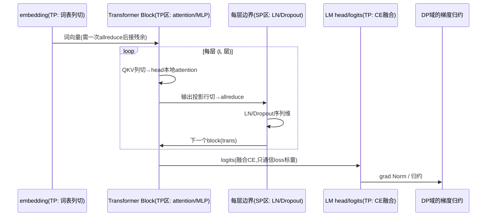
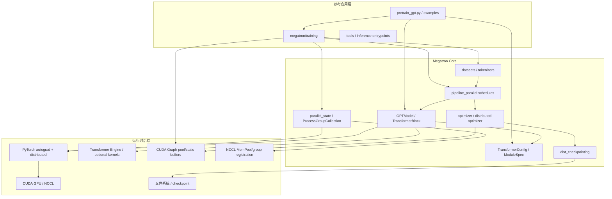
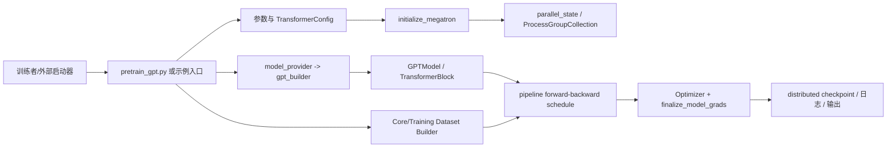
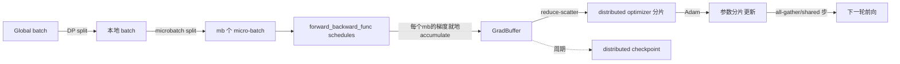
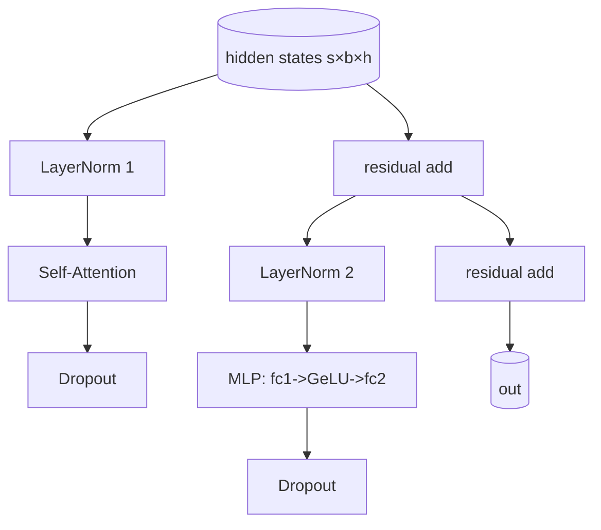
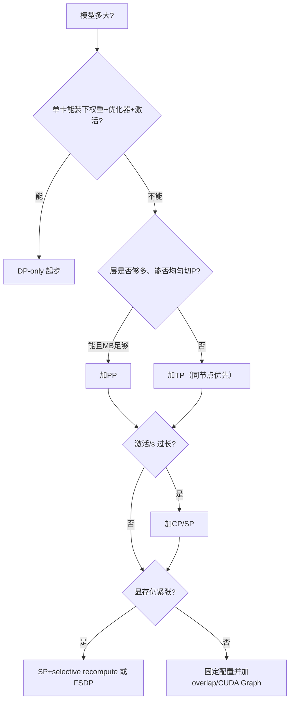
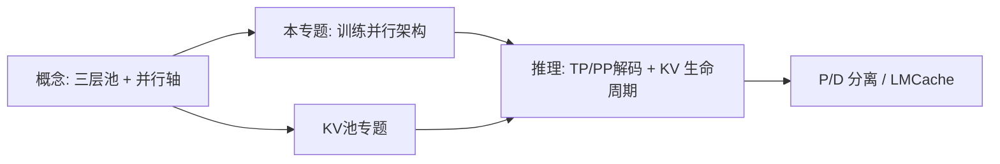

# Megatron 架构洞察：从张量并行到可组合的 Megatron-Core

> 本文面向准备推理系统、分布式训练、SGLang/vLLM、GPU 显存管理和系统设计面试的工程师，也覆盖想理解 Megatron-Core 内部架构的读者。
> 证据基线：本文「源码锚点」取自同一 GitHub 仓库的 `megatron-lm/` 分析知识库，其锚定 NVIDIA/Megatron-LM `main` commit `3703d4e33a3a2b2d11ebcc8e41f45af7ce7d1eda`；论文锚点包括 Megatron-LM(arXiv:1909.08053)、Megatron-Turing NLG(arXiv:2201.11990)、Reducing Activation Recomputation(arXiv:2205.05198) 以及 NVIDIA Megatron-Core 官方文档。本仓库未执行任何 GPU 训练实验；涉及吞吐、显存、MFU、扩展性等数字均为论文或官方文档报告，不声称本地复现。
> 状态约定：`[已确认]` 来自论文原文、官方文档或本仓库分析库的源码引用；`[推断]` 为基于证据的工程推导；`[待验证]` 需要实验或线上指标；`[建议]` 为设计建议；`[存在争议]` 表示不同系统或论文方案取舍不同。

## 目录

1. 为什么 Megatron 值得单独成篇
2. 三代演进：从单层分片到可组合库
2A. 基础：训练单步里发生了什么（不需要代码也能掌握的图景）
3. 总体软件架构与分层模型
4. 核心抽象：TransformerConfig / ModuleSpec / 进程组 / schedule
4A. 模型变体与架构演进（M01 补充）
5. 数据并行（DP）
6. 张量并行（TP）：切分、通信与数学
7. 序列并行（SP）与 f/g 算子
8. 流水线并行（PP）：调度、气泡与显存
9. Context 并行（CP）与长序列
10. 3D 与 Hybrid 并行组合：RankGenerator 与拓扑
11. MoE 与专家并行（EP）
12. 优化器、分布式状态与激活重计算
12A. 混合精度：FP16/BF16/FP8 与 loss scaling
12B. 吞吐与扩展性的第一性计算
13. 通信与重叠优化
14. 检查点与推理侧（关联 KV cache 专题）
15. 设计权衡与失效模式
16. 面试复盘题纲
16A. 如何读 Megatron 源码（导航地图）
17. 证据纪律与未验证清单
18. 术语表与快速索引
附：与 insights 既有专题的交叉引用

---

## 1. 为什么 Megatron 值得单独成篇

### 1.1 定位

[已确认] Megatron-LM 是 NVIDIA 面向大规模 Transformer 训练的参考实现与基础库；Megatron-Core 把模型、并行、数据、优化器、分布式检查点和推理能力拆成可组合的 GPU 优化组件。Megatron-LM（参考框架）与 Megatron-Core（库）通常一起工作，Megatron-Bridge 负责与 HuggingFace 等生态做双向 checkpoint 转换。来源：[NVIDIA Megatron-Core Overview](https://docs.nvidia.com/megatron-core/developer-guide/nightly/get-started/overview.html)、`../megatron-lm/README.md`。

这份洞察与 insights 仓库的 KV cache 专题互补：KV cache 专题解决「推理时每组 token 的显存池如何管理」，Megatron 专题解决「训练/推理时模型权重与激活如何在多 GPU 间切分、通信与调度」。两者在推理侧交汇于 P/D 分离、KV transfer、张量/流水线并行下的 KV 分片等话题。

### 1.2 为什么它比「并行策略列表」更难

大多数资料把 Megatron 讲成「TP=切权重、PP=切层、DP=切数据」三张图。但真正的架构洞察在于：

1. **通信与非线性函数的耦合**：TP 的权重切分方向（按行 vs 按列）不是任意的，是为了让 GeLU 等非线性保持本地化、省掉一层同步；
2. **并行 = 一组正交的通信域**：不是三种「模式」，而是由 `RankGenerator` 依据 shape/stride 统一生成的若干 `process group`，模型代码只做组内通信；
3. **调度与模型解耦**：PP 的 forward/backward 顺序由 schedule 拥有，模型只输出 hidden state，杜绝每层手写 P2P；
4. **每个并行维度都有显存↔计算↔通信的三方权衡**：没有免费的并行。

### 1.3 术语速查：并行轴的名称矩阵

| 轴 | 英文 | 切分对象 | 典型通信 | 本仓库锚点 |
|---|---|---|---|---|
| 数据并行 | Data Parallel (DP) | batch | allreduce / reduce-scatter | M02 |
| 张量并行 | Tensor Parallel (TP) | 单个权重矩阵 | allreduce（sp 下拆成 all-gather/reduce-scatter） | M02 |
| 序列并行 | Sequence Parallel (SP) | LayerNorm/Dropout 激活的序列维 | f/g 算子 | 论文 2205.05198 |
| 流水线并行 | Pipeline Parallel (PP) | 层 / stage | P2P send/recv | M02 |
| 虚拟流水线 | Virtual Pipeline (VP) | 层内的虚拟 chunk | P2P（交错 1F1B） | M02 |
| Context 并行 | Context Parallel (CP) | 序列激活、不切权重 | 序列维通信（可能含 P2P） | M02 |
| 专家并行 | Expert Parallel (EP) | MoE experts | all-to-all | 官方 MoE 文档 |
| 权重重物化轴 | GTP | 权重 rematerialization 轴 | 权重 re-materialization 组 | M02 |

> [已确认] 横向 note:Megatron-Core 官方把并行轴简化为 DP/TP/PP/CP/EP/FSDP 六类；本仓库分析库 M02 进一步把 PP>1 时的虚拟 stage 记为 VP、把权重重物化轴记为 GTP。两者不矛盾，是不同粒度的编目。

### 1.4 三个心智模型（先记住再深入）

**心智模型一：并行 = 一组通信域。** 并行策略不是「模式」，而是把各轴（DP/TP/PP/SP/CP/EP）映射成一组成员集合；每个 rank 属于多个组，模型代码只面对「在某个组内做什么通信」。读代码时先找「这里在哪个 group 上通信」，再问「为什么」。

**心智模型二：一切问题都能化成四方权衡。**

```text
显存（能装下多少）
   ↕
计算（FLOPs 利用率）
   ↕
通信（带宽×时延）
   ↕
调度（气泡 / 空闲）
```

任何并行轴的取舍都是这四个维度的优化：TP 牺牲通信换计算密度，SP 牺牲「多一次半步」换激活驻留，PP 牺牲气泡换权重切分，CP 牺牲序列维通信换 attention 可行性，EP 牺牲 A2A 换专家显存。

**心智模型三：训练 = 数学 + 搬运 + 生命周期。**

- **数学**：forward/backward/optimizer，与并行无关，只是被切分执行；
- **搬运**：f/g、P2P、all-to-all 等通信原语，是并行给定的运输层；
- **生命周期**：microbatch 的产生-传输-消费、激活的驻留-释放-重算、KV 的分配-回收，是「谁持有、谁释放、何时换人」的调度。

> 面试时若能自然带出这三个模型（而不是背参数），通常就能从「了解」跳到「理解」。

### 1.5 与其他技术专题的关系

- **与 insights KV 专题**：训练侧把 KV 视为激活（TP head 分片 / CP 序列分片），推理侧把 KV 视为池化资源（slot/backing 分层）。两者是同一 tensor 的两种生命周期。
- **与 Transformer Engine**：Megatron-Core 的 fused kernel 与 FP8 多经 TE 提供；架构设计呈「Megatron 定并行与调度、TE 定 kernel 与精度」，是「框架-算子」两层划分。
- **与 SGLang / vLLM**：训练生态重调度与并行，推理生态重 KV 池化与动态 batching；共享的契约是「并行排布 = 权重与激活的切分契约」，vLLM 解码时按 TP head 分片读取权重。

---

## 2. 三代演进：从单层分片到可组合库

### 2.1 第一代：Megatron-LM（2019/2020）

- 论文：[EfficientMMU Megatron-LM: Training Multi-Billion Parameter Language Models Using Model Parallelism](https://arxiv.org/abs/1909.08053)。
- 核心问题：模型参数量超过单卡显存，且 pipeline parallelism（GPipe 风格）要求层间大量通信、难以做到负载均衡。
- 核心回答：**intra-layer model parallelism**（Intra-layer = 张量并行）——在单个 Transformer 层内部把 GEMM 切分到多 GPU，用 `f`/`g` 两个原生 PyTorch all-reduce 算子完成；不需要新编译器、不需要重写代码库。
- [已确认] 论文声称用 512 张 GPU 训练 8.3B 参数模型，达到 15.1 PFLOPs 持续吞吐、相对单 GPU 基线 76% 扩展效率；8 路 model parallel 的 8.3B 模型相对线性扩展达到 77%；8.3B 512 GPU 数据并行将达到 74%。这些数字是论文作者报告，不是本仓库复现。
- [已确认] 论文的关键工程事实：基准 GPT-2 词表 50,257，为了 GEMM 对齐把词表 padding 到 128 的倍数再乘 8 路并行，得到 51,200。
- **历史贡献**：第一次让「不用 compiler、用 all-reduce 即可做 tensor 切分」成为可复制的配方。

### 2.2 第二代：Megatron-Turing NLG 530B（2021/2022）

- 论文：[Using DeepSpeed and Megatron to Train Megatron-Turing NLG 530B](https://arxiv.org/abs/2201.11990)。微软 × NVIDIA 合作。
- 核心回答：单靠 TP 无法扩展到数千 GPU。提出 **3D parallelism** = 数据并行 + 张量并行 + 流水线并行，并将 TP 用于同节点、PP 用于跨节点、DP 用于进一步横向扩展。
- [已确认] 530B 模型配置：105 层、hidden 20480、attention heads 128、序列长度 2048、global batch 1920；每个模型副本跨 280 张 A100（8 路张量并行 × 35 路流水线并行），再用 DP 扩展到数千 GPU。训练数据 339B token，训练于 270B token。
- [已确认] 论文用 1F1B pipeline schedule 限制在飞 microbatch 数（等于 stage 数量而非总 microbatch 数），并给出 bubble 效率公式（见第 8 节）。
- [已确认] 论文强调 topology-aware mapping：TP 通信量最大（同节点 NVLink）、DP 其次（优先同节点或近邻节点）、PP 通信量最小（可跨节点）。这是 3D 并行排布的核心法则。
- **历史贡献**：把「TP 同节点、PP 跨节点、DP 顶行」的排布法则固化，后来成为所有大规模训练的默认约束。

### 2.3 第三代：Megatron-Core（2023 至今）

- 定位：[已确认] Megatron-Core 是「composable library」，提供 GPU-optimized building blocks（attention、MLP、normalization、embedding 等），支持 TP/SP/PP/CP/EP/FSDP、FP8、MoE、多模态与分布式 checkpoint。Megatron-LM 变成基于 Core 的精简参考框架。[820]: Megatron-Core 官方 Overview。
- 结构性变化（相对前两代）：
  1. **配置驱动**：一个 `TransformerConfig` 承载模型拓扑与并行参数，builder 用其生成模块规格与通信组；
  2. **并行状态显式化**：`parallel_state` / `ProcessGroupCollection` 保存一组正交 process group，`RankGenerator` 负责把「TP×PP×DP×CP×EP...」映射为 rank 列表；
  3. **调度函数化**：`get_forward_backward_func` 依据 PP/VP 返回 no-pipeline / pipeline / interleaved 三种 forward-backward 函数；
  4. **后端可插拔**：优化器可选 TE/Apex/Torch fallback；Transformer Engine 提供 fused kernel 与 FP8；
  5. **MoE 一等公民**：EP、token dispatcher（allgather/alltoall/flex）、Parallel Folding、token dropping、upcycling；
  6. **检查点分布式化**：sharded state dict + `save_distributed_checkpoint` / `load_distributed_checkpoint`，并行度变化时可 reshard。
- [存在争议]「Megatron-Core vs 极简 reference」并非所有功能都在 library 核心；部分功能（如部分 MoE 优化、bridge 转换）在 NeMo Framework / plugin 层。把 Core 当成一个平铺的组件包会更准确。

### 2.4 三代对比总结

| 维度 | Megatron-LM(2019) | MT-NLG(2021) | Megatron-Core(2023+) |
|---|---|---|---|
| 并行维度 | TP（f/g）+ 数据并行 | TP+PP+DP（3D） | TP+SP+PP+CP+EP+FSDP+heterogeneous |
| 可组合性 | 脚本/参考 | 脚本/参考 | 库 + 可组合 API |
| MoE | 无 | 无（530B 稠密） | 一等公民（EP/dispatcher/folding） |
| 精度 | FP16 | FP16 | FP16/BF16/FP8/FP4 |
| 检查点 | 稠密 | 分片 | 分布式 sharded + reshard |
| 核心杀手锏 | 免编译器 TP | 3D 并行 + 1F1B + 拓扑感知排布 | 配置驱动组件化 + 全并行轴统一生成 |

---

## 2A. 基础：训练单步里发生了什么（不需要代码也能掌握的图景）

### 2A.1 一个 forward 的旅程

[推断] 以 GPT 稠密模型在「无 PP、有 DP×TP」的配置为例，一次前向的隐状态旅程：



关键点：[已确认] logits 与 CE 融合（论文 1909.08053）把通信从 b·s·v 压缩到 b·s 损失标量。这也是「通信简并到数学」的又一个例子。

### 2A.2 训练单步的三阶段

```text
1. forward（前向）：从输入到 loss，逐层传播；每层保存反向所需激活；
2. backward（反向）：从 loss 反推每参数梯度 grad_w = ∂L/∂w；沿 TP/PP/DP 归约与聚合；
3. optimizer step：用累积梯度更新参数（可能含 fp32 master 与 loss scaling）。
```

[推断] 这三点是阅读 Megatron 任何 schedule/代码的前提：schedule 只是决定这三步在哪些 GPU、以什么顺序、是否重叠执行，模型本身的「forward/backward 数学」不因并行改变。

### 2A.3 关键通信原语速查

| 原语 | 作用 | Megatron 中出现位置 |
|---|---|---|
| all-reduce | 各 rank 的局部结果求和，结果广播给全体 | TP 的 f/g、DP 梯度 |
| reduce-scatter | 求和后按 rank 分发分片 | distributed optimizer 的梯度、SP 的 ḡ forward |
| all-gather | 各 rank 分片拼接后广播 | SP 的 g forward、DP 参数同步、分布式优化器同步 |
| p2p send/recv | 点到点单向 | PP stage 边界激活/梯度 |
| all-to-all | 各 rank 数据交换（重排） | EP token dispatcher |

> [推断] 把一次训练 step 映射到这张表，是调试通信问题最快的办法：看到奇怪耗时，先问「现在执行到哪个原语」，再问「这个原语绑在哪个并行组上」。

---

## 3. 总体软件架构与分层模型

### 3.1 分层职责

[已确认] 根据本仓库 `megatron-lm/00-overview/architecture.md`，Megatron 不是单一服务，而是「Python 参考程序 + Core 库 + PyTorch/CUDA/NCCL 后端」三层：



五个职责层：
1. **入口/配置层**：解析命令行、YAML 和环境，产生 args/config；
2. **初始化层**：设置 device、初始化 `torch.distributed` 与 Megatron process groups、种子与可选编译；
3. **装配层**：`model_provider` 选择 ModelOpt 或传入 builder；`gpt_builder` 按 spec、TE、MoE、异构配置选择具体 `ModuleSpec`；
4. **执行层**：schedule 依据 PP/VP 选择无流水线、流水线或交错流水线函数，驱动 microbatch 前向/反向；
5. **状态层**：optimizer 更新参数、checkpoint 读写 sharded state dict、日志与 telemetry 伴随训练。

### 3.2 5 分钟运行主线

[已确认] 由 `megatron-lm/README.md`：入口读取参数 → 创建配置与数据集 → 初始化 CUDA/NCCL 与 TP/PP/DP/CP/EP 进程组 → builder 创建 Core 模型 → training runtime 通过 pipeline schedule 驱动 microbatch 前向/反向 → 梯度同步 → 优化器更新 → 日志与检查点。



### 3.3 关键边界：新旧 API 并存

[已确认] 本仓库分析库 architecture.md 指出：`ProcessGroupCollection` 是较新的显式通信上下文；仍存在 `parallel_state` 全局兼容接口。Core 新代码应优先显式传递 process group，训练兼容层可以读取 MPU 全局。这是理解「为什么同一个仓库里有两种初始化并行状态的方式」的关键。

### 3.4 训练循环详解（以最小 Core GPT 训练为例）

[已确认] 本仓库 D01 Demo `examples/run_simple_mcore_train_loop.py` 是最小且自包含的训练入口：分布式初始化 → mock GPT 数据 → forward/backward schedule → 梯度 finalize → Adam 更新 → 分布式检查点保存/加载。它使用真实 Core API 且不依赖外部数据集。

迭代骨架（[推断]，基于 D01 与 M03 分析）：

```text
for step in range(max_train_steps):
    # 1. 数据：从 train iterator 取一个 micro-batch
    batch = next(train_iterator)                    # M04 data pipeline
    # 2. 并行微批划片：把 global batch 切成 mb 个 micro-batch
    data_iterator_list = build_data_iterator_list(batch, num_microbatches)
    # 3. 前后向：统一签名的 schedule（no-pipeline / PP / interleaved）
    optimized_params_list = forward_backward_func(
        model, data_iterator_list, ...)
    # 4. 梯度 finalize：跨 DP/CP/SP 域做 reduce-scatter / allreduce
    grad_pool = GradBuffer()
    grad_pool.scale_and_accumulate_gradients(...)
    grad_pool.reduce_and_split_gradients(...)
    # 5. 优化器：distributed Adam 用本地梯度分片更新参数分片
    optimizer.step(args, timers)
    # 6. 周期保存 sharded checkpoint
    if step % save_interval == 0:
        save_distributed_checkpoint(...)
```

三个值得注意的契约：

1. **schedule 的 output 是 param 引用**：`forward_backward_func` 返回的是「本次反向中最后被更新的 model.params」结构，不是 loss tensor——梯度在 backward 内就已被就地 accumulated，优化器不再 re-derive。
2. **grad buffer 管理**：accumulate 阶段做梯度 scale（除以 micro-batch 数）、平方与重叠；reduce 阶段按 bucket 触发 reduce-scatter（DP+distributed optimizer 时）或 allreduce（非分片时）。bucket 与参数顺序对齐，减少 NCCL 调用次数。
3. **checkpoint 与异步保存**：M05 描述 dist_checkpointing 每 rank 保存局部 shard 并支持并行度变化后的 reshard；checkpoint 保存的后台异步（async save）与文件系统带宽强相关。

### 3.5 一个 step 的全链路图（把上面全部串起来）

[推断] 下图把「数据→schedule→梯度→优化器→checkpoint」压缩成一张，方便面试现场手画：



### 3.6 训练开始前你会经历四道检查

[推断/已确认] 大量「训练一发就报错」都对应下面中的某一层：

1. **设备与集群检查**：CUDA 可见设备数、NCCL 初始化、GPUs 是否大于零；
2. **整除与参数检查**：world_size 能否被 T×P×C×DP 整除、VP 约束、MoE econfig 约束；
3. **数据检查**：数据集与 tokenizer 匹配、longest sequence 不超 max seq len、micro-batch 划分合法；
4. **模型/初始化检查**：builder 能否构造（spec 存在的模块）、seed 一致性、权重 init 不因并行布局出现重复/遗漏。

> 面试里被问「为什么初始化这么慢」，答案通常就是这四道检查中的某些在做 heavy work（NCCL init、数据 profiling、build graph 尝试）。

---

## 4. 核心抽象：TransformerConfig / ModuleSpec / 进程组 / schedule

### 4.1 TransformerConfig：配置即契约

[推断] TransformerConfig 是模型拓扑与系统参数的「单一事实源」：hidden size、num layers、num heads、kv heads、ffn hidden、parallel size（TP/PP/DP/CP/EP）、precision、sequence parallel 开关、activation recompute、ambertration 选项等。builder 与 schedule 都从它派生命令。它的存在让「换一个模型变体」变成「换一份配置」，而不是改模型类。

### 4.2 ModuleSpec：规格与实现分离

[已确认] gpt_builder 依据 spec、TE、MoE、异构配置选择具体 `ModuleSpec`（[gpt_builders.py:24-110]）。`ModuleSpec` 描述某个模块「应该怎么装」——用哪个 class、哪些子模块、参数怎么传；具体实现类（如 `ParallelTransformerLayer`）由 spec 间接决定。这带来：

- 好处：模型只有一种外观，可被多种 backend（原生 / TE / 异构精度）替换；
- 代价：`spec` 与实际 class 的绑定藏在 registry 里，读代码时跳转变多、分支组合难以穷举（已知，存在于 M01 分析中）。

### 4.3 进程组模型：正交轴的统一表示

[已确认] M02 分析指出核心组件是 `parallel_state`（保存 TP/PP/DP/CP/EP 等 group 与 accessor）与 `RankGenerator`（将各轴映射到 shape/stride，生成 rank 列表）。设计原则是**拓扑与计算解耦**：模型与 schedule 只通过 group 查询通信对象，不自推导全局 rank。

关键不变量（[已确认/推断] 来自 M02 文档）：
- `torch.distributed` 必须先初始化；world size 必须能被模型并行规模整除；
- VP 只有在 PP>1 时合法；
- GTP rematerialization 与多个 distributed-optimizer instance 当前由初始化逻辑禁止组合；
- decoder 与 expert rank generator 产生的 PP group 必须一致；
- schedule 的 model/data iterator 数量必须与所选调度类型匹配。

### 4.4 Schedule：调度拥有通信

[已确认] `get_forward_backward_func` 以 PP/VP 和多模块 collection 为输入，返回统一签名的 forward-backward 函数。schedule 负责：stage 间 P2P send/recv、activation 生命周期、`deallocate_output_tensor`（替换已发送输出的 storage 以省显存）以及 `finalize_model_grads` 的调用时机。模型只输出 hidden states。

> 一句话记忆：**模型负责数学，schedule 负责搬运与生命周期。**

### 4.4b 从命令行参数到并行拓扑：一张映射表

[已确认/推断] 了解「启动命令里写了什么」能帮助你读任何 Megatron 配置。常用参数（官方文档与 M02 分析）：

| 参数 | 含义 | 影响 |
|---|---|---|
| `--tensor-model-parallel-size T` | TP 维度 | 每层 GEMM 切成 T 份 |
| `--pipeline-model-parallel-size P` | PP 维度 | 层切成 P 段 |
| `--num-layers-per-virtual-pipeline-stage V` | VP | 每虚拟 stage 层数，需 PP>1 |
| `--data-parallel-size`（隐式） | DP | 由 world/T/P 推得 |
| `--context-parallel-size C` | CP | 序列维切成 C 份 |
| `--sequence-parallel` | 开启 SP | 与 TP 并用 |
| `--expert-model-parallel-size E` | EP | MoE experts 切 E 份 |
| `--use-distributed-optimizer` | 状态分片 | reduce-scatter 梯度 |
| `--recompute-method` / `--recompute-num-layers` | 重计算 | full / selective |
| `--fp8`（TE）等 | 精度 | FP8 GEMM 等 |

[推断] 关键校验：`world_size == T × P × C × DP` 且 `T×P×C` 整除 world、每轴合法（如 VP 需 PP>1）。非法组合通常能在 initialization 阶段报错而不是运行期爆炸——这就是「早失败」设计。

### 4.4c 三种 schedule 的一份对比

| schedule | 适用 | forward/backward 性质 | 显存特征 |
|---|---|---|---|
| no-pipeline | PP=1 | 顺序 F/B，简单 | 需完整模型在单卡 |
| pipeline（1F1B） | PP>1, VP=1 | 交替 F/B，MB 在飞绑 stage | 权重切分，激活可控 |
| interleaved | PP>1, VP>1 | 虚拟 chunk 交替 | 更低在飞激活，更多 P2P |

[已确认] 由 `get_forward_backward_func` 依据 PP/VP 选择上述实现（[schedules.py:53-168]）。

### 4.5 核心组件深挖：TransformerBlock 内部结构

[已确认] 本仓库 M01 分析把 Core 模型拆为 `GPTModel`（词嵌入 / position embedding / 若干 `ParallelTransformerLayer` / final norm）与 `TransformerBlock`。一个 `ParallelTransformerLayer` 的经典 GPT/LLaMA 结构（推断 + M01 分析）：



子模块划分（推断，基于 M01/megatron/core/models）：

| 位置 | 组件 | 并行策略 | 说明 |
|---|---|---|---|
| 入口 | embedding / position emb | TP：词表维列切 | 加位置编码 |
| block 头 | LayerNorm 1 | SP：序列维切 | 输入层归一提 |
| attention | QKV projection | TP：列切 | MHA/GQA/MLA 因模型而异 |
| attention | attention compute | TP：head 维切分 | softmax 只依赖序列维 |
| attention | out projection | TP：行切 | 输出归约 |
| block 中 | LayerNorm 2 + Dropout | SP | 归一提 + 正则 |
| block 尾 | MLP fc1/fc2 | TP：列切/行切 | GeLU 本地 |
| block 尾 | residual add | 复制计算 | 无通信 |

[推断] 这一结构也解释了为什么「TP/SP 组合把一个 layer 拆成 TP 区与 SP 区交替」的图（见第 7 章）：attention 与 MLP 是 TP 区，LayerNorm/Dropout/residual 是 SP 区，两个 f/g 算子位于边界。

### 4.6 随机数与可复现性

[已确认/推断] 分布式训练的可复现性难题：dropout 与 data shuffle 需要跨 rank 一致的随机流。Megatron 的做法是：
- 为模型权重初始化设置基础 seed，并通过 rank 派生的 offset 保证不同进程初始化一致（某些路径还需要 unmerged bias）。
- data loader 使用独立的 seed 控制 shuffle，使不同 DP rank 的数据分片在每次 epoch 不同。
- inference 的 sampling 随机性由 sampling 层独立管理。

[推断] 微妙的点：当 TP/PP 组合时，「同一逻辑参数」在多个 rank 上的初始化必须产生同一数值，否则张量并行下的 reduce 会破坏初始一致性；这要求初始化 seed 只依赖逻辑参数标识而非物理 rank。这也是测试中检测「随机数生成被错误跨 rank 共享/隔离」的一个常见坑。

### 4.7 后端可插拔与 transformer engine

[已确认] 本仓库 design-principles.md 列出「后端可选」原则：optimizer import TE/Apex/Torch fallback（[megatron/core/optimizer/__init__.py:13-35]）。Transformer Engine 提供：
- fused GEMM + activation（如 bias-GELU、norm-GEMM fused），把若干小 kernel 合并为单个 fused kernel，降低 launch 与中间显存；
- FP8 混合精度（Hopper/Ada/Blackwell 上优化）；
- 自动精度分配（autograd 内的 delayed scaling，`_FusedAdam` 等）。

[推断] 这层抽象是所有「原生 PyTorch」与「NVIDIA 专用 kernel」两条路径的分界：用户代码调用同一 `TransformerBlock`，但底层要么跑 PyTorch 算子、要么跑 TE fused kernel。性能优化常落在 TE 侧，正确性验证常落在原生侧。

---

## 4A. 模型变体与架构演进（M01 补充）

### 4A.1 从 GPT 到多 token 预测（MTP）

[已确认] 官方 MoE 文档列出 Multi-Token Prediction（`--mtp-num-layers`），即每个位置同时预测多个未来 token，用额外浅层共享主干特征。它把「每 token 一个 logits」扩展为「每 token k 个 logits」，对并行的影响是 logits/head 数量上升，CE loss 融合的通信形态更重。

### 4A.2 Mamba / State Space Model 变体

[已确认] Megatron-Core 支持 Mamba（SSM）等非 attention 架构；本仓库 M01-Core-models 的分析把 Mamba 与 GPT/Hybrid 分开，因为其状态维非 head 结构、且 KV 式 cache 换成固定维状态（与 insights KV 专题的 `MambaPool` 对应）。Mamba 的并行切分不能照搬 attention 的 head 维，需要在 state 维上做 TP。

### 4A.3 Hybrid / VLM / encoder-decoder

[已确认] Core 支持 encoder-decoder 与多模态（VLM）路径；本仓库 architecture.md 明确说明「不同模型（Hybrid/Mamba/VLM）具有不同 builder 和数据路径，本文以 GPT 主路径为统一骨架」。这意味着「Megatron 架构」若要准确描述某一变体，必须补充该变体的 builder 与数据流，而不是复用 GPT 主骨架。

### 4A.4 为什么这个抽象重要

[推断] ModuleSpec 的深层价值是同一套并行+调度+优化器基础设施可以服务不同骨架模型（Transformer / SSM / VLM / MoE）。Megatron 的架构贡献不只在「并行策略」这一层，而在「并行策略成为模型骨架的提参可插拔性」上。

---

## 5. 数据并行（DP）

### 5.1 原理

[已确认] DDG 每个 DP worker 持有完整模型副本，处理不同 micro-batch；每个 microbatch 完成向后传播后，各 worker 的梯度通过 allreduce（或 reduce-scatter）合并，再用统一梯度更新本地副本。[2201.11990 / 官方]。

### 5.2 显存与效率特性

[已确认] 官方 MoE 文档的并行策略表格将 DP 记为：
- Peak activation memory：1（不省）
- Weight memory：1（复制）
- Optimizer states：1/N（使用 distributed optimizer 时）或 1（本地优化器时）
- 每层通信：Low

### 5.3 实现要点（推断/已确认）

- **梯度 bucket**：把多个参数的梯度拼成大 buffer 再 allreduce，减少 NCCL 调用次数与 kernel launch 开销；bucket 边界通常按参数内存顺序对齐。
- **通信与计算重叠**：backward 时边算边异步 reduce（overlap），现代框架用多个 CUDA stream。
- **大战 batch**：DP 依赖把 global batch 放大到 DP 倍数以保持单 rank 计算密度；[2019] 论文指出数据并行 scaling 相比强基线会略低（因为额外梯度通信），8.3B/512 GPU 为例约 74%。
- **限制**：模型必须整体装进单卡（权重+优化器状态+激活都要 fit），这是 DP 的根本约束；这正是 TP/PP 存在的原因。

### 5.4 与 distributed optimizer 的关系

[已确认] distributed optimizer 把梯度和优化器状态分片到各 DP rank，使用 reduce-scatter 替代 allreduce，避免每个 rank 持有全量优化器状态。官方文档将「Optimizer states: 1/N（with distributed optimizer）」与 DP 配置绑定，说明它本质是「DP + 状态分片」的组合。

### 5.5 DP 在官方并行策略表中的横向对比

[已确认] 官方并行策略表格的完整对比（DP 在其中的角色）：

| 策略 | Peak activation | Weight | Optimizer | 每层通信 | 通信模式 |
|---|---|---|---|---|---|
| DP | 1 | 1 | 1/N 或 1 | Low | 梯度 allreduce / reduce-scatter |
| TP | /t | /t | /t | High | all-reduce 4 次/层 |
| SP | 1/N | 1 | /t | Medium | f/g 拆半步 |
| PP | 1/(PP·vp) | /(PP·vp) | /(PP·vp) | Low | stage 边界 P2P |
| CP | 1/N | 1 | 1/N | Medium | 序列维 p2p/ring |
| EP | /E | /E | /E | Medium | token all-to-all |

读表要点（[推断]）：
- DP 是唯一「optimizer 可以 1/N」且不需要改模型结构的策略——它只做数据划分；
- TP/PP/CP/EP 都把权重或激活放进策略里，改造模型结构；
- 因此从实现成本看，DP 最便宜、可插拔；TP 最贵、需要模型重构；
- 实践里通常「先 DP 打满，再 TP 分隐藏，再 PP 分层，再 CP 分序列」，与 15.5 决策树一致。

### 5.6 DP 与 batch 全局大小的耦合

[推断/已确认] DP 生效的前提是「全局 batch 够大」：
- 每 DP rank 的 micro-batch 大小 = 全局 batch / DP；
- 若全局 batch 太小（如微调时 batch=8、DP=8），每个 rank 只有 1 个样本，梯度噪声大且通信占比上升；
- 官方推荐「大 global batch + DP」以维持单 rank 计算密度（论文报告 8.3B/512 GPU 94% 的 scaling，但相对更强 baseline 数字各有口径，勿误读）。

> [建议] 微调场景若 global batch 受限，优先降低 DP 数（改用 TP/PP 消化模型大小），而不是强行保持 DP 扩展。

### 5.7 DP 与 load balancing

[推断] DP 天然均衡：每个 rank 处理相同数量的 micro-batch，除梯度归约外无负载差异。摩异之处在 MoE 路由偏斜时（见 11.6/11.7）——DP 的「batch 均分」假设可能被路由热点破坏，此时需要考虑 aux loss 校准或以 EP dimension 承担热点。这也说明「DP 均分」只是 batch 维手工均分，不代表计算资源被均匀使用。

---

## 6. 张量并行（TP）：切分、通信与数学

### 6.1 核心洞察：切分方向取决于非线性

[已确认] 论文 1909.08053：考虑 MLP 的第一段 `Y = GeLU(XA)`。有两种切分：

1. 按 A 的行切分（即把 X 按列切、A 按行切）：`X=[X1,X2], A=[A1;A2]`，得到 `Y = GeLU(X1A1+X2A2)`。由于 GeLU 非线性，`GeLU(X1A1) + GeLU(X2A2) ≠ GeLU(X1A1+X2A2)`，因此在 GeLU 之前必须 allreduce——在非线性前增加同步点，不理想。
2. 按 A 的列切分：`A=[A1,A2]`，得到 `[Y1,Y2]`，GeLU 可独立施加于每个分片输出。**没有中间同步点**。

[已确认] 因此 MLP 采用「第一个 GEMM 列切分 + 第二个 GEMM 行切分」：第一个 GEMM 输出被列切，第二个 GEMM 的输入正好是这些列分片，无需 rearrange；第二个 GEMM 输出后做一次 allreduce。

### 6.2 MLP block 的切分（图 3a 等价描述）

```text
输入 X（序列×batch×hidden）
  -> LayerNorm（复制于各 GPU）
  -> 第一线性层 A: h×4h 按列切              （每 GPU 持 4h/t 列）
  -> GeLU（本地、无通信）
  -> 第二线性层 B: 4h×h 按行切              （每 GPU 持 4h/t 行）
  -> 输出 allreduce（g 算子）               （把各 GPU 部分和归约为完整 h 输出）
  -> Dropout（复制计算）
```

forward 一次 allreduce（g），backward 一次 allreduce（f）。

### 6.3 Attention block 的切分（图 3b 等价描述）

[已确认] Attention 的 QKV 投影按列切（head 维度），其好处是：每个 attention head 的全部计算落在同一 GPU 上，softmax 等算子只需在未切分的序列维上进行，不需要通信；随后的输出投影按行切，直接消费列分片；最终一次 allreduce。

```text
输入 X
  -> QKV 投影 按列切（每 GPU 持有部分 head）
  -> 本地 attention（QK^T、softmax、@V 都在序列维上局部执行）
  -> 输出投影 按行切
  -> 输出 allreduce
```

### 6.4 f/g 算子：唯一的通信原语

[已确认] f 与 g 是共轭算子：
- `f`：forward 是恒等、backward 是 all-reduce；
- `g`：forward 是 all-reduce、backward 是恒等。

论文给出的实现（PyTorch）：

```python
class f(torch.autograd.Function):
    def forward(ctx, x):
        return x
    def backward(ctx, grad):
        torch.distributed.all_reduce(grad)
        return grad
```

`g` 类似：forward 里 all_reduce，backward 恒等。

> 工程含义：**模型作者只需把 f/g 放在正确位置，PyTorch autograd 保证符号正确性**；通信次数与通信体积由 Graph 决定。

### 6.5 每层通信次数：4 次 allreduce 的由来

[已确认] 一个 Transformer 层 = self-attention block + MLP block。论文 1909.08053 明确指出：

```text
每层 forward:  2 次 allreduce（attention 输出一次 + MLP 输出一次）= g×2
每层 backward: 2 次 allreduce（attention 梯度一次 + MLP 梯度一次）= f×2
每层合计:      4 次 allreduce（与 TP 规模 t 无关）
```

这是经典 Megatron TP 的旗舰结果：**通信次数是常数，不随 t 增长**；通信体积随 t 变化但 ring allreduce 的带宽消耗与 t 弱相关（约 2·(t-1)/t · 数据量）。

### 6.6 通信量估算（推断）

当 TP 规模为 t、激活大小为 s·b·h（s 序列、b batch、h hidden）时：
- 每次 allreduce 需要 transateive 2·(t-1)/t · s·b·h 元素（ring 算法，双倍数据是因为 reduce+scatter 结构）；
- 每层四个原语的合计体积 ~ 8·s·b·h·(t-1)/t 元素；
- 因此 TP 是**每层、每次前向反向都有全组同步**的高频轴，官方文档将其通信等级标为 High。

这解释了为什么 MT-NLG 把 TP 限制在同节点（NVLink），并把 TP 通信量最大的法则用于排布。

### 6.7 LayerNorm / Dropout / residual：复制计算，不复制通信

[已确认] 论文 1909.08053 的策略是：LayerNorm 参数在每个 TP rank 上复制一份，dropout 与 residual 在每个 rank 上就地各自计算，输出不需要广播——因为每个 rank 的下一段 TP 计算本来就需要完整（或经 SP 切分的）张量。用「重复计算」换「零通信」。

### 6.8 Embedding / logits 的 TP

[已确认] 论文把输入 embedding 按词表维列切（`E=[E1,E2]`），输入 embedding 后需要一次 allreduce（g）。对输出 logits，朴素做法是 all-gather 全部 logits（大小为 b·s·v，v 巨大），论文将其与交叉熵损失融合：先 local 计算 `[Y1,Y2]`，再只对损失跨 rank allreduce——通信量从 b·s·v 降到 b·s。这是「通信密集操作与下游数学融合」的典型范例。

### 6.9 TP 的适用边界

- 最佳场景：大层、大 hidden、GEMM 密集，kernel 可 hide 通信；
- [存在争议] t 增大后 GEMM 变小，单卡计算密度下降、通信占比上升；
- 单节点内（NVLink 域）通信带宽最高，TP 超过节点规模通常不划算（MT-NLG 法则：TP 优先同节点）。

### 6.10 GQA / MLA 对 TP 切分的影响

[已确认/推断] 现代模型广泛采用 GQA（grouped query attention）与 MLA（multi-head latent attention）：

- **GQA**：KV head 数远小于 Q head 数。TP 切分列时要求「每个 rank 持有整数个 KV head」；当 KV head 数不能被 t 整除时，需要复制 KV 投影或 padding head，导致跨 rank 的 KV 复制计算。DeepSeek-V3/LLaMA-3 等在 KV head 数与 TP 大小之间做了整除设计。
- **MLA**：把 KV 压缩到低维 latent（`c` 维），attention 输入是解压后再投影的。TP 对 latent 投影做列切，解压算子（升维 GEMM）也需要 TP 化；低维 latent 让 KV 显存大幅下降，但解压计算的 TP 切分更难与 head 维对齐。

[推断] 这一点直接影响推理侧：KV cache 的 head 维分片（对应 insights KV 专题「物理 K/V tensor 层」）必须以「TP 组内 head 的归属」为约束——GQA 的 KV 复制与 MLA 的 latent 结构决定 KV tensor 的实际 layout，而这正是 vLLM/SGLang 等引擎与 Megatron 训练权重转换时需要对齐的契约。

### 6.11 Embedding 的 TP：词表维切分的细节

[已确认] 论文对 input embedding 采用词表维列切：`E = [E1, E2]`。切得到的 embedding 表被复制到部分 rank ？——每 rank 持有一块词表子集，forward 定位 token 时若 token 落在其它 rank 的词表，需要从对应 rank 拿对应行（通过 embedding「index + allreduce」组合实现，见论文代码的 embedding 部分；本仓库不做逐行复述）。

- 词表 padding 到 `N * t`（论文示例 51,200），保证每个 rank 的词表子块等大；
- 输入 embedding 后一次 allreduce（g）；
- 输出 logits 与 CE loss 融合，避免 all-gather 词表完整 logits。

### 6.12 TP 的梯度行为：为什么 backward 的顺序很重要

[推断/已确认] TP 下每个参数分片本地持有梯度；backward 时：
- 列切参数（第一 GEMM 的 A、QKV 的 W）只在本 rank 需要梯度，**不需跨 rank 归约**（各 rank 参数不同）；
- 行切参数（第二 GEMM 的 B、输出投影）在输入侧经历 f 的 allreduce，梯度经 f̄ 的恒等/归约传播；
- 结果：TP 的梯度归约总量与模型并行度无关，但**需要正确处理 f/g 的 backward 方向**——把 allreduce 放在 gradient 之前还是之后，决定了「每个 rank 梯度是否已经包含全部输入沿」的和。

[推断] 这也是为什么「TP 的数值正确性」测试通常从「TP=1 baseline vs TP=2 训练几步后的 loss 曲线 diff」开始：一旦梯度归约位置写错，loss 在首个 step 后就会偏离。

### 6.13 TP 与 FlashAttention / 融合 kernel 的接口

[推断] 现代训练栈（Megatron-Core + FlashAttention + TE）中，TP 的「head 分片」落在 attention kernel 的输入 layout 上：
- QKV 投影输出已是列切，FlashAttention 接受的 Q/K/V 正好是「每 rank 一部分 head」，无需再 rearrange；
- 输出投影（行切）消费 FlashAttention 的完整输出（head 维已合并），意味着 attention 内部的 seq 维信息不需要跨 TP rank 传递；
- 从而「TP 只动 hidden/head 维、不动 seq/hidden 的内部计算」约束与融合 kernel 良好兼容。

[待验证] 具体 kernel 的 CUDA Graph 捕获与 FlashAttention 版本间行为差异需要实机验证，本文只表达架构层面的接口原则。

### 6.14 TP 与 CP 的配合（典型长序列配置）

[推断/已确认] 长序列时通常 TP 切 hidden、CP 切 seq 平行应用：
```text
TP=8 → 每 rank 持有 1/8 的 head 与 hidden
CP=8 → 序列切 8 段，attention 的 s² 项被分摊
```
- 两者通信域正交：TP 在 hidden 域、CP 在 seq 域；
- KV gradient 需跨 CP 冗余（复制权重）与 TP 的 head 分片两个方向分别归约；
- [推断] 工程上采用「先 TP→CP→PP→DP」的 axis order，使通信域命中最优物理排列（TP 与 CP 都争取靠同节点）。

### 6.12 TP 下的切片几何：非均匀层

[推断] 当模型层内存在多个不同 shape 的 GEMM（如 MHA + MoE 混合、sharded attention 与 MLP 的不同 hidden），TP 切分维度必须跨所有 GEMM 一致（同一轴秩序列），否则 f/g 之间的 layout 契约被破坏。这也是 Parallel Folding（EP/TP 解耦）要解决的一个根源问题：attention 与 MoE 层形状本就不同。

---

## 7. 序列并行（SP）与 f/g 算子

### 7.1 问题：TP 留下了「复制区」

[已确认] 论文 2205.05198 指出：TP 只切分 GEMM 密集区域，LayerNorm 与 attention/MLP 之后的 Dropout 在 TP 组内仍是复制的。这些算子计算量小但激活体积大（对训练反向需要的激活,这个复制区导致 10·s·b·h 的激活不被 t 除）。对激活显存来说，这是明显浪费。

### 7.2 方案：把非 TP 区沿序列维切分

[已确认] LayerNorm 与 Dropout 是逐序列元素独立的算子，可以沿序列维 s 切分到 t 个 rank，让它们成为「序列并行」。为了让「序列切分」与「隐藏维切分」两种 layout 互相转换，需要转换通信算子 g 与 ḡ（共轭）：

```text
g  : forward = all-gather（沿序列维）  backward = reduce-scatter
ḡ : forward = reduce-scatter          backward = all-gather
```

MLP 的推导（论文 7.2 节）：
- 输入 X 已按序列维切分 `X=[X1^s, X2^s]` → LayerNorm 输出 Y 也按序列切；
- 第一线性层（GeLU）需要完整 Y，因此 forward 先 all-gather（即 g）；
- 按列切 A、按行切 B 后，W1、W2 需要求和为完整 W；但 Dropout 希望输入是「序列切分」的，所以把「求和+切分」合并为 reduce-scatter（即 ḡ）。

### 7.3 通信带宽不变的关键论据

[已确认] 论文指出：ring all-reduce 本质 = reduce-scatter + all-gather 两步。因此「TP 用 4 次 all-reduce」与「TP+SP 用 4 次 all-gather + 4 次 reduce-scatter」在带宽维度上等价：SP **不引入额外的通信开销**，只是把一次 all-reduce 拆成两个半部并重新编排到正确位置。这是 SP 的核心卖点。

### 7.4 激活显存收益与公式

论文给出的激活公式（用于说明）：
- TP-only 时，非 TP 区的 `10·s·b·h` 不被 t 除；
- TP+SP 时这些激活也按序列/隐藏维被 t 切分。

[已确认] 论文报告：SP + selective recompute 可减少 5× 激活显存，并把 activation recomputation 的执行时间开销降低超过 90%。530B 模型、2240 张 A100 上 MFU 达 54.2%（对比使用 recomputation 的 42.1%，快约 29%）。

### 7.5 Y 张量的 backward 细节（推断/已确认）

第一个线性层反向需要完整的输入 Y；SP 下只存自己的 Y_i^s 分片，backward 时再做一次 all-gather。论文把这个 all-gather 与「计算关于 Y 的梯度」重叠，从而隐藏其延迟。

### 7.6 SP 在实际配置中的角色

[已确认] 官方并行指南示例：TP 与 EP 组合时必须开启 sequence parallel（`--sequence-parallel`），因为 MoE 的 token dispatch 需要统一 layout；另外 TP 单层的 ETP=1 时也需要 SP 来保证激活切分一致。

---

## 8. 流水线并行（PP）：调度、气泡与显存

### 8.1 原理与记忆收益

[已确认] PP 把模型层分成多个 stage，每个 stage 放在一个（或多个）rank 上；stage 边界通过 P2P 传递激活（forward）和梯度（backward）。PP 让模型深度线性扩展到多个 rank，**权重/梯度/优化器状态按 stage 切分，但每个 stage 的激活并不减少**（该层激活仍完整驻留在该 rank）。

### 8.2 why microbatch：气泡的本质

[已确认] naive pipeline（每个 micro-batch 先全部 forward 再全部 backward）会形成很大的气泡：最坏时效率趋近 `1/PP`。把 batch 切成 microbatch 并在相邻 stage 间流水化，是消除大部分气泡的手段。但流水线的填充（warmup）和清空（cooldown）阶段仍然存在气泡。

### 8.3 1F1B 调度（one-forward-one-backward）

[已确认] MT-NLG 论文明确使用 1F1B schedule：在稳定阶段，每个 rank 交替执行一个 forward 和一个 backward。关键收益：**在飞 microbatch 数量被 bound 等于 pipeline stage 数量**，而不是总 microbatch 数——显著降低激活驻留量。

伪代码（推断，基于论文描述）：

```text
for step in range(num_microbatches + num_pipeline_stages - 1):
    if should_fwd(step):   # warmup/稳定阶段向前推进
        fwd(microbatch(step))
    if should_bwd(step):   # 稳定/cooldown阶段
        bwd(microbatch(step - num_pipeline_stages))
        finalize_grads_if_needed()
```

1F1B 的「先 forward 再 backward」让 VD 阶段每个 rank 最多同时持有 PP 个 microbatch 的激活。

### 8.4 气泡效率公式

[已确认] MT-NLG 论文给出：平行效率（无气泡意义上的）正比于 micro-batch 数与 stage 数的比值：

```text
efficiency ≈ 1 - ((PP - 1) / (MB + PP - 1))
```

当 `MB = 4 × PP` 时效率约 81%，`MB = 8 × PP` 时约 90%。这也是「PP 不能无限增长、需要足够大的 batch 以填满流水线」的原因。

### 8.4b 1F1B 的时序直观图（教学）

以 PP=4、MB=8 为例，把每 rank 的时间轴按「F/B/空」画出（[推断]示意，用于理解而非实测）：

```text
time ->  0  1  2  3  4  5  6  7  8  9  10 11
rank0:   F0 F1 F2 F3 B0 F4 B1 F5 B2 F6 B3 F7 ...
rank1:   .  F0 F1 F2 F3 B0 F4 B1 F5 B2 F6 ...
rank2:   .  .  F0 F1 F2 F3 B0 F4 B1 F5 ...
rank3:   .  .  .  F0 F1 F2 F3 B0 F4 ...
```

- 稳阶段每个 rank 交替 F→B（1F1B）；
- 在飞 microbatch ≤ stage 数（此处≤4）而非总 MB（8）；
- 开头 3 个时间片与结尾 3 个时间片是气泡（与 `PP-1` 成正比）。
- 注意 rank0 的 `B0` 出现在 `F3` 之后：这是「先运矿泉水，再回拖空瓶子」的流水线。

> 这个图直接回答面试题「1F1B vs GPipe」：GPipe 是整批先 F 后 B，气泡更宽；1F1B 通过交错收发缓解记忆压力并捕获更短的 pipeline 步调节奏。

### 8.5 Interleaved / Virtual Pipeline（VP）

[已确认] 本仓库 M02 把 VP 记为「每个 PP rank 持有多个虚拟 chunk」。交错 pipeline（interleaved schedule）把模型层切成多个虚拟 stage，让每个 rank 轮流处理多个虚拟 chunk，进一步减少稳定阶段单个时间片的空闲；代价是 P2P 通信次数增多（更多边界点）、tensor 保存与调试复杂度上升。VP 只有在 PP>1 时合法。

### 8.6 PP 的显存代价：每个 worker 要驻留所有在飞 microbatch 的激活

[已确认] MT-NLG 论文指出：PP 减少权重等状态的内存，但不减少「每层激活」的内存；并且每个 worker 必须保存所有在飞 microbatch 的激活。因此 PP 的显存收益主要来自权重/优化器状态切分，激活方面要靠 microbatch 数控制。

### 8.7 PP 通信与计算特性

- 通信：只有 stage 边界的激活/梯度 P2P，次数少、体积小，官方表格将其 Communication 标为 Medium 且是三个经典轴中最低；
- 计算：需要 stage 负载完全均衡（每 stage 层数相等），否则慢 stage 拖全 pipeline；
- 限制：PP 度数受层数上限、MB 需 >> PP、气泡随 PP 增长（效率公式）。

### 8.8 显存模型：PP×VP 下每 rank 的驻留

[推断] PP 下每个 rank 持有：
- 本 stage 的权重 + 梯度 + 优化器状态（若 TP 也已切，则再除以 t）；
- 每个在飞 microbatch 的 stage 激活（1F1B 下 ≤ 当前 stage 数 × 单激活）；
- 跨 stage 通信缓冲（P2P 缓冲 + `deallocate_output_tensor` 前的暂存）。

VP/interleaved 的关键 tradeoff（[已确认/推断]，来自 M02 设计页）：
- 多虚拟 chunk 把单 stage 层数从 `L/PP` 降为 `L/(PP·vp)`，令「在飞 microbatch 的激活」进一步下降；
- 代价：stage 边界数量增加 → P2P 通信次数与 tensor 保存、调试复杂度上升；
- 极限：vp 过大时每 rank 的虚拟 chunk 过多，调度开销逼近单 rank 串行。

### 8.9 数据并行 + 流水线：PP 与 DP 的关系

[已确认] 当一个 stage 有多个 rank 时，通常给该 stage 配 DP 副本（stage 内 DP）。此时：
- 同一 stage 的多个 DP rank 处理不同 micro-batch，梯度在 stage 内 DP 域归约；
- PP 跨 stage 通信仍是 P2P，但每个 stage 收到的是「本 stage 上所有 DP rank 相同 micro-batch 的输出取平均？」——不，DP 域内 micro-batch 不同，P2P 只传本 rank 的 micro-batch 输出，DP 域间的梯度归约与 P2P 独立；
- [推断] 因此 PP×DP 组合下，P2P 通信量乘的是 DP 倍（每个 DP rank 都要把自己的 micro-batch 传给下一 stage 对应 rank），DP 维的梯度归约在 stage 域内独立完成。

### 8.10 PP 与 inference 的关系

[推断] 训练侧 PP 的「stage 分解」可复用于推理：把模型层拆到多 GPU 做流水线式 decode，每个 stage 持有自己层的权重与 KV cache。这构成「PP-inference」的天然形态，但会引入 decode 时的 stage 间串行时延（P/D 分离、KV transfer 论文都以此为背景）。它与 vLLM/SGLang 推理的「TP decode + 动态 batching」是两种取舍：PP 快在权重切分清晰、慢在跨 stage 延迟；TP 快在吞吐、慢在通信与 KV 分片。

---

## 9. Context 并行（CP）与长序列

### 9.1 问题域

[已确认] 长序列（≥8K token）训练时，激活显存按 s 线性增长，attention 计算量按 s² 增长，DP 与 TP 都不能有效降低 s 维代价（TP 切 hidden，DP 切 batch）。CP 在序列维切分。

### 9.2 CP 机制与并行表格

[已确认] Megatron Core 官方并行表格：
- Peak Activation memory：1/N
- Weight memory：1（不切权重）
- Optimizer states：1/N（with distributed optimizer）
- 每层 Communication：Medium

[已确认] 不切权重意味着：CP 组的模型参数是复制的，backward 时需要额外归约梯度的复制份（本仓库 M02 明确记录「CP 不切分权重，因此需要在 backward 额外归约复制权重的梯度」）。

### 9.3 CP 与 TP 的关系

[已确认/推断] CP 作用维度与 TP 正交：CP 沿序列，TP 沿 hidden。实际配置中 CP 可与 TP/PP/DP 组合。CP 内部——不同模型（dense/ MTP/ MLA）的 attention kernel 对 CP 有不同支持（官方 MoE 文档提到 CP 对 MTP 与 MLA 支持）。CP≥8K 序列时推荐开启，关键在通信与计算的重叠（p2p/ring 通信类型）。

### 9.4 CP 的通信形态

[推断] CP 的注意力对长序列在 rank 间需要传输 KV/中间 softmax 统计（例如 ring attention / zigzag attention 的变体），通信量随序列长而增长。官方将 `--cp-comm-type p2p` 列为可选通信类型，暗示 CP 通信既有集合型也有 P2P 型，取决于实现。

### 9.5 CP 适用边界与建议

[已确认] 官方指南：
- 何时用：sequence length ≥ 8K；
- 关键因素：CP 效率依赖把通信与计算重叠；
- 配置：`--context-parallel-size N`。

### 9.6 CP 的两种注意力实现路线（推断/待验证）

长序列 CP 下，attention 需要在 CP 组内交换信息，常见两种组织：

1. **Ring/zigzag attention**：每个 CP rank 处理一段序列，KV 在环上轮流传输，每个 rank 分块计算部分 softmax（online softmax 风格），最后合并 statistics；通信按序列分块逐步推进。
2. **KV-shrink/网络化（依托 NCCL）**：把完整 KV 先集中再广播，简单但通信量大。

[推断] Megatron-Core 的 CP 可选 `p2p` 通信类型说明其实现倾向 P2P 化（1 式路线）。这不是安全性声明，具体以官方文档/源码为准。[待验证] 本仓库未测量 CP 的通信与重叠收益；长序列（16K+）下 CP 与 TP、selective recompute 的协同效果需在真实硬件验证。

### 9.7 CP 与分布式优化器的交互

[已确认/推断] CP 组的权重是复制的，backward 需要额外归约梯度的复制份。若同时开启 distributed optimizer，梯度的 reduce-scatter 需要在本 CP 组内也归约——意味着梯度归约的「通信域」是 DP∩CP 的复合。这也是为什么本仓库 M02 强调「CP 的梯度归约复用 DP 域」。配置时若想使这个归约最小化，通常让 CP 与 DP 组合使用，而不是 CP 单独叠加在 TP 之上。

---

## 10. 3D 与 Hybrid 并行组合：RankGenerator 与拓扑

### 10.1 为什么需要组合

[已确认] MT-NLG 论证：单一并行轴无法同时满足记忆与计算效率——DP 复制模型没法突破单卡容量；TP 出发于同节点才划算；PP 需要大 batch 且受层数限制。3D 并行（TP×PP×DP）是对三种轴取各自最适用范围的组合：TP 负责同节点内的大 GEMM 切分，PP 负责跨节点层切分，DP 负责横向 batch 扩展。530B 即 8(TP)×35(PP)×(DP 扩展) = 280 GPU 每副本。

### 10.2 排布法则（topology-aware mapping）

[已确认] MT-NLG 论文：
- 通信量排序：TP > DP > PP（论文的定性评估）；
- 因此：TP 组放在同节点（NVLink）；DP 尽量同节点或邻近节点；PP 可跨节点。

[推断] 这一法则可推广为通用排布优先级：高通信量的轴优先靠近物理拓扑高带宽的域。

### 10.3 RankGenerator：正交轴统一生成

[已确认] 本仓库 M02 描述：`RankGenerator` 将 TP/PP/DP/CP/EP/GTP 映射到 shape/stride，生成 rank 列表，减少为每种并行组合手写 rank 列表。设计原则「正交轴统一生成」意味着并行空间的坐标 = 各轴索引的笛卡尔积，rank = 轴索引的组合编码。

示例（推断，用于理解）：

```text
world = TP(2) × PP(3) × DP(2) = 12 ranks
给定 rank r，
  tp_axis = r // (stride_tp)           # 由 axis order 决定
  pp_axis = (r // (stride_pp)) % 3
  dp_axis = (r // (stride_dp)) % 2
```

`ProcessGroupCollection` 显式持有这些组；`initialize_model_parallel` 依据 TP/PP/CP/EP 与 axis order 生成这些组并验证整除不变量（[parallel_state.py:232-260]）。

### 10.4 3D 并行下的通信总览

| 轴 | 每层/每步主要通信 | 通信体积 | 拓扑偏好 |
|---|---|---|---|
| TP(+SP) | allreduce / g,ḡ | 高 | 同节点 NVLink |
| PP | stage 边界 P2P 激活/梯度 | 低 | 可跨节点 |
| DP | 梯度 allreduce / reduce-scatter | 中 | 同节点或近邻 |
| CP | 序列维通信/ P2P | 中 | 同节点优先 |
| EP | token all-to-all | 中-高 | NVLink 域优先 |

### 10.5 Heterogeneous 与 FSDP 扩展

[已确认] 官方文档已支持 Megatron-FSDP（fully_shard）替代 DP 维切分参数，使用 `fully_shard` 不依赖 Megatron-LM；MoE 报告还提到 FSDP 与 EP 组合时使用双 DeviceMesh（主 Mesh 管 DP/TP/CP，Expert Mesh 管 EDP 内 FSDP），all-gather/reduce-scatter 保持在小组内。这属于 Core 生态的最新扩展，非论文 3D 范畴。

### 10.6 Heterogeneous parallelism：模型并行轴的非对称分配

[推断/已确认] Megatron-Core 支持 heterogeneous parallelism —— 即不同 layer/模块可以使用不同并行配置。这是 Parallel Folding 与 FSDP 的「基」，但异类并行也会带来：

- **层间并行切换的开销**：从「TP=4」的层过渡到「ETP=1、EP=8」的层，需要 layout 转换（通常发生在 token dispatch 时）；
- **拓扑不可预测性**：动态并行变化不利于 CUDA Graph 捕获；
- **challenge**: 通信域的数量、rank stride 与 axis order 必须逐层一致，否则 f/g 契约断裂。

[待验证] 异构并行对吞吐的量化收益与稳定性需要真实多塔实验；本仓库未执行。

### 10.7 Axis order 与 stride 编码的示例（推导）

[推断] 官方 `data-parallel-size`、TP、PP、CP、EP 的 axis order 决定每个 rank 如何被解码。示例（world=16，TP2×PP2×DP4）：

```text
axis order = [TP, PP, DP]
每个轴 stride:
  TP:  1
  PP:  2
  DP:  4
rank 5 的坐标为:
  tp_axis = 5 // 1  % 2 = 1
  pp_axis = 5 // 2  % 2 = 0
  dp_axis = 5 // 4  % 4 = 1
```

这样「谁跟谁共享 TP 域」「谁跟谁共享 DP 域」就由 axis order 完全决定。若把 DP 放最内、TP 放最外，同样的 16 rank 会得到完全不同的通信组划分。理解这一点，就能明白为什么「TP 同节点、DP 近邻」需要从 axis order + 节点映射一起推导，而不是只看一个数。

### 10.8 3D 配置通常遵循的比例经验

[已确认/推断] 官方并行指南的推荐配置表呈现比例经验：

| 模型规模 | 典型配置 | 一句点评 |
|---|---|---|
| LLaMA-3 8B | TP1/PP1/CP2 或只 DP | 小模型不需要切分了 |
| LLaMA-3 70B | TP4/PP4/CP2 等 | 平衡 TP+PP |
| LLaMA-3.1 405B | TP8/PP8/CP2 | 3D（TP+PP+CP） |
| Mixtral 8x7B | PP4/EP8 | 专家并行为主 |
| DeepSeek-V3 671B | TP2/PP16/EP64 | 细粒度 MoE，EP 承担专家 |

[存在争议] 这不是「必须如此」而是「经验起点」；实际取舍需按通信拓扑、batch、显存做验证（参见 15.4 决策流程）。

---

## 11. MoE 与专家并行（EP）

### 11.1 为什么 MoE 需要 EP

[已确认/推断] MoE 把参数与计算解耦：每个 token 只路由到 top-K experts，参数量大但 FLOPs/token 相对稠密模型不线性增长。若只复制 experts（DP 式），每个 rank 要装下全部 experts，显存浪费；因此把 experts 分布到多 GPU（EP），token 需要通过 all-to-all 被派发到持有目标 expert 的 rank 上再计算。

### 11.2 官方 MoE 并行推荐

[已确认] 官方 MoE 文档：
- 推荐 config 示例（Mixtral 8x7B：TP1/PP4/EP8；DeepSeek-V3：TP2/PP16/EP64）；
- 重要约束：EP 与 TP 组合时必须开启 SP；
- 可用的 token dispatcher：allgather / alltoall / flex（DeepEP / HybridEP 后端）；
- 性能优化：grouped GEMM、permute 融合、EP A2A overlap、shared expert overlap、token dropping（dropless 与 capacity factor）。

### 11.3 MoE Parallel Folding

[已确认] 报告的 MoE Parallel Folding 把 attention 与 MoE 层的并行配置解耦：

| 并行组 | attention 层 | MoE 层 |
|---|---|---|
| 维度集 | TP × CP × DP × PP | ETP × EP × EDP × PP |

其核心动机是「稠密-稀疏失配」：attention 层喜欢高 TP/CP（GEMM 大、序列长），MoE 层喜欢高 EP 而没必要高 TP（fine-grained experts、ETP=1 更好）。Folding 让两类层各用最优拓扑，而不必像以往那样被强制共享单一并行配置。这是 Megatron-Core 区别于上世纪 3D 拆分的创新发展。

### 11.4 EP 与 distributed optimizer / FSDP

[已确认] MoE + FSDP 时 Expert DeviceMesh 只在 EDP 组内 shard expert 参数，减轻全 EP 组内 all-gather/reduce-scatter 的带宽。

### 11.5 MoE forward/backward 的执行流程

[推断] 结合官方 dispatcher 机制与 MoE 层结构，一次 MoE 层的前向骨架为：

```text
输入 X: s×b×h
1. 门控/router：每个 token 计算 top-K expert 得分（本地 GEMM，TP/SP 下需要完整 token 表示）
2. 选择：每个 token 决定去往哪些 expert（top-2 常见）
3. dispatch：把 token 重排 / 发往持有目标 expert 的 rank
   - allgather dispatcher：先全量汇聚，再按 expert 分拣（通信量大、简单）
   - alltoall dispatcher：直接交换 token（通信优化、native NCL 域）
   - flex + DeepEP/HybridEP：去冗余、跨节点融合（deepseek 类细粒度 MoE 方向）
4. 在目标 expert 上执行 FFN（grouped GEMM 批量算多 expert）
5. combine（reduce）：把同一 token 的多个 expert 输出加权求和
6. 输出回到原 rank / 统一 layout
```

backward 反过来：先分 grad 给各 expert，再 dispatch grad 回原 rank，同时计算 router 的梯度。EP 的场景里，token dispatch 是通信重载；`--overlap-moe-expert-parallel-comm` 的目标就是把第 3/5 步藏在 FFN 计算后。

### 11.6 token dropping 与容量控制

[已确认] 官方配置项：`--moe-expert-capacity-factor` 与 `--moe-pad-expert-input-to-capacity` 控制给定 capacity 的专家队列是否丢弃溢出 token（`--moe-token-drop-policy probs/position`）。dropless（不丢）适用于预算允许时避免信息损失；token dropping 换取恒定 capacity 从而可被 CUDA Graph 捕获。

[推断] 工程权衡：token dropping 会影响收敛质量（可靠性），但让计算 shape 静态化，支持 graph capture 与更稳的吞吐；取 balance 通常按目标吞吐与质量约束调节 capacity factor。

### 11.7 EP 何时不适合

- [存在争议/推断] 若 experts 数很少（如 Mixtral 8 个）且 batch 小，EP 的 all-to-all 开销占比高，可能不如每个 rank 复制全部 experts 的 DP 式；
- 若 EP 组跨节点、且 NVLink 不全覆盖，A2A 走到 IB/RDMA，延迟显著上升；
- 微调/小规模场景，EP 收益有限；训练更大 batch 与更大 experts 数时 EP 优势放大。

---

## 12. 优化器、分布式状态与激活重计算

### 12.1 本地优化器 vs 分布式优化器

[已确认] Megatron-LM 的经典做法是每个 TP 组取回完整梯度（或各 rank 持有一个完整参数副本的更新）——即 DP 维度全量复制优化器状态；distributed optimizer 则把中间状态按 rank 分片。其组合特征是「TP 全量、DP 分片」的混合。本仓库 M02 指出：M02 不决定 optimizer 是否 sharded；它只提供 optimizer 与 gradient finalize 所需的通信域。

### 12.2 显存账（推断）

正常 Adam 需要参数+梯度+两个 moment + 可能 fp32 master，约 16–20× 参数量的优化器状态（fp16 训练 + fp32 copy）。单卡装得下模型不一定装得下优化状态，这就是 distributed optimizer 与 FSDP 存在的根本原因。

### 12.3 激活重计算（activation recomputation / selective recompute）

[已确认] 论文 2205.05198 提出 **selective activation recomputation**：对激活体积大但计算密度低的区域（attention 的 QKᵀ、softmax、softmax dropout、V 乘）做 checkpoint 与重算，对其余区域保留。公式化判断：

```text
若 5·a·s/h > 34 → 重算这部分更划算（a=heads, s=seq, h=hidden）
GPT-3(96 heads, s=2048, h=12288)：5as/h = 80 > 34 → 省约 70% 激活
MT-NLG(128 heads, s=2048, h=20480)：5as/h = 64 > 34 → 省约 65% 激活
```

重算引入的额外 FLOPs 仅为 2.7%（GPT-3）与 1.6%（MT-NLG）。full recomputation 的缺点是 30–40% compute 开销，selective 则很小。

### 12.4 MoE layer recompute / offloading

[已确认] 官方 MoE 文档提供 `--moe-layer-recompute`、fine-grained recomputation 与 offloading 选项，说明 MoE 场景的激活管理更细粒度（per layer per expert）。

### 12.5 分布式优化器执行的时序（推断）

一次 optimizer.step 的典型执行顺序（D01 / M03 推理）：

```text
1. scaler 检查（如果启用了 apex 的 Dynamic Loss Scaling）：
   - 若本轮 loss 异常（inf/nan），skip update，放大/缩小 scale；
2. 主参数准备：fp32 master 拷贝（若启用以稳定 Adam）；
3. 梯度 gather：
   - 本地参数梯度在 rank 内已经就绪；
   - distributed optimizer 场景先完成 reduce-scatter 得到本 rank 负责的分片；
4. Adam 更新本 rank 负责的参数分片（_FusedAdam 或 torch 实现）；
5. （可选）将更新后的参数分片 all-gather 回 DP 副本；
6. 记录 grad norm（用于 clip 与日志）。
```

[推断] 这一步是 checkpoint 依赖的最大「状态集合点」：save 必须在 step 完成后读取一致的参数/优化器分片，否则 shard 布局与优化器两处元数据不同步，会造成 load 后数值漂移。这也是 M05 把 checkpoint 与 optimizer 一起讲的原因。

---

## 12A. 混合精度：FP16/BF16/FP8 与 loss scaling

### 12A.1 为什么需要混合精度

[已确认/推断] 训练大模型的主要开销在显存与通信，「全 fp32」升级成本高：
- fp32 训练：参数 4B/元素、激活 4B/元素，显存翻倍，Adam 状态 8B/element；
- fp16/bfloat16 前向与反向：激活减半；
- FP8 前向+反向：QKV 投影、MLP 等 GEMM 再用减半格式（Hopper+）。

风险：低精度表示动态范围不足（fp16 的 exponent 只有 5 位），导致数值溢出或下溢；bfloat16 动态范围与 fp32 相似但精度低（尾数 7 位）；FP8 需延迟缩放（delayed scaling）避免幅值突变。

### 12A.2 Megatron 的经典方案

[已确认] 论文 1909.08053 明确使用 mixed precision training，配合 NCCL；后续演进：
- **fp16 + 动态 loss scaling**：master 参数保持 fp32，forward/backward 用 fp16，loss 乘以 scale 避免梯度下溢，scaler 监测 inf/nan；
- **bf16**：无 loss scaling，前向/反向直接用 bf16，参数与优化器仍在 fp32 精度更新；
- **FP8**（Hopper 之后）：Transformer Engine 提供 FP8 GEMM 与延迟 scaling（每次迭代依据统计自动调整 scale），官方称在 NVIDIA 硬件上优化。

### 12A.3 FP8 架构要点（推断/待验证）

- FP8 分 E4M3（宽动态范围，适合 forward 权重/激活）与 E5M2（更大范围，适合梯度）两种格式；
- 需要对 activation/weight/gradient 统计幅值以设置 scale，通常用前一迭代统计（delayed scaling）；
- 与 FP16/BF16 的差异：scale 是逐 tensor 而非全模型，需要额外的 scale 元数据传播；这也是「自动精度分配」要处理的问题；
- [待验证] 本仓库未执行 FP8 训练；所有 FP8 与硬件收益均属于官方报告。

### 12A.4 精度与并行的交互（推断）

- TP 下各 rank 的 scale 计算需要一致——若各 rank 独立统计 activation 幅值可能产生 gradient 数值不一致，降低收敛确定性；
- distributed optimizer 的 fp32 master 分片同理：分片粒度决定 scale 传播范围；
- [建议] 做 FP8 实验时，先固定 seed 与单卡基线 diff 一组 layer 的数值，再逐层开 FP8，避免一次全开难以定位。

---

## 12B. 吞吐与扩展性的第一性计算

### 12B.1 一次训练 step 的三个时间分量

[推断] 任意并行配置下，step 时间可近似写为：

```text
step_time ≈ compute_time + communication_time + idle_time
compute   = 总 FLOPs / (GPU数 × 单卡峰值FLOPs × MFU)
comm      = Σ(每个原语的通信体积 / 有效带宽) + 原语次数×延迟
idle      = bubble（PP）+ 未重叠的等待 + kernel 启动开销
```

### 12B.2 MFU（Model FLOPs Utilization）的定义

[已确认/推断] MFU 是衡量「模型 FLOPs 利用率」的标准指标，Megatron/TE 生态常用它报告性能：

```text
MFU = 实际模型 FLOPs / (GPU数 × 单卡峰值FLOPs × 运行时长)
```

论文报告示例（全部为作者报告，非本地复现）：
- Megatron-LM：单卡 baseline 39 TFLOPS（约峰值的 30%）；8.3B 在 512 GPU 上整体 76% 扩展效率；
- 2205.05198：530B 在 2240 A100 上 MFU 54.2%（相对启用 recomputation 的 42.1%，快约 29%）。

### 12B.3 SP 与 MFU 的关系

[已确认] 官方 MoE/并行文档没有把 MFU 单独列为一个策略维度，但它是最常用来评估「叠加并行+重叠+recompute」组合效果的输出指标。SP 对 MFU 的贡献是「不增加带宽（等价）但减少激活显存」，从而允许更大 micro-batch/更高 batch 密度，间接提升 MFU。[推断] 这也是为什么 MFU 提升不能简单归因于某一开关，必须全局观测。

### 12B.4 扩展效率的测量口径

[建议] 做扩展实验时固定：
- 全局 batch 大小（weak scaling 还是 strong scaling 要说清楚）；
- 每 step 的时间，而非每秒样本数；
- warmup 轮数与重复次数（至少 3 次取中位数）；
- 通信与计算的 profiler trace（NCCL/nsys），区分 comm 与 idle。

### 12B.5 一个 70B 稠密的拆分计算示例

[推断/教学示例，非实测] 给定 70B、hidden 8192、层数 80、seq 4096、A100-80G（峰值 ~312 TFLOPs bf16）：

```text
训练 FLOPs/token(前向) ≈ 2 × 参数量 ≈ 140B FLOPs
单步前向 FLOPs ≈ 140B × 4096 tokens ≈ 5.7e14
设 TP=8, PP=8, DP=2 → 128 GPU
单卡计算时间 ≈ 5.7e14 / (312e12 × MFU) 
若 MFU≈0.50 → 约 3.7 ms/前向（纯推理值，训练≥2×）
```

- 同样配置下激活驻留主因是 s×h×TP 相关的大头，SP 将 LN/Dropout 降 /t；
- 若 seq 增到 32K（CP=4），attention 的 s² 项变成瓶颈，CP 将激活 /4 并把 attention 块分散到 4 rank。

[强调] 数字只为教学展示量级关系，不代表实测。真实收益必须按 13.4/15.5 的实验流程测量。

### 12B.6 吞吐目标的倒推（planning 视角）

[建议] 从商业目标倒推集群与并行 config 的简单框架：

```text
tokens/day 目标 → 每 step 时长 → (全局batch × seq) / step 时长
→ 需要的总 FLOPs = tokens × 2×params
→ 需要的 GPU·TFLOPs → 校验集群能不能达到
→ 再决定并行策略：TP 填 NVLink、PP 切节点、DP 靠 batch、CP 吃长序列
```

这个倒推流程把 12B.1 的公式反过来用，是「并行规划」而非「并行理解」的实用入口。

---

## 13. 通信与重叠优化

### 13.1 三类重叠

[已确认] 官方文档列出 TP / PP / EP 三种通信重叠：
- **TP communication overlap**：把 TP 的 all-reduce/g 与后续 GEMM 计算放到不同 CUDA stream 重叠；
- **PP communication overlap**：stage 边界的 P2P send/recv 与当前计算重叠；
- **EP A2A overlap**：合并相邻 microbatch 的 FWD/BWD passes，把 all-to-all 藏在另一路计算后（`--overlap-moe-expert-parallel-comm --delay-wgrad-compute`）；shared expert 并行执行。

### 13.2 为什么重叠重要

- TP 是每层 4 个原语，若不重叠，每层至少一个 RTT 的通信停顿；
- 1F1B 的 warmup/cooldown 阶段正确借助 overlap 让 bubble 变小；
- EP 的 all-to-all 体积大、时延高，是 MoE 训练吞吐的主要瓶颈之一，官方将其列为 MoE 优化重心。

### 13.3 Activation 的显存与计算交集

[确认] SP + selective recompute 的双重作用是同时降低激活驻留与重算开销。CUDA Graph 侧，MoE 动态 shape（capacity factor 未设时）可能无法被 graph 捕获，官方建议只把 attention 部分捕获（`--cuda-graph-modules=attn`）——与 insights KV 专题中「CUDA Graph 依赖静态 shape/地址」的判断一致。

### 13.4 三种 overlap 的工程形态

[推断] 每种 overlap 的典型实现：

```text
TP 通信 overlap（intra-layer）
  ┌─ stream A: GEMM(M) ─┐
  └─ stream B: allreduce(g)  ── 用反向依赖让 allreduce 等在 GEMM 之后
  → f/g 的 wait 点提前到「下次真正消费 g 输出的 GEMM」之前

PP 通信 overlap（stage 边界）
  send(输出) ──────── recv(输入) 与 本 stage 计算并行
  → 用 ring buffer 预取下一 stage 输入，避免串行等待

EP A2A overlap（token 交换）
  ✗ 使 alltoall 与 FFN 计算并发
  ✓ 相邻 microbatch 合并 FWD/BWD，all-to-all 藏进对向计算
```

三者的共同模式是：**把通信需要的假设（依赖链）显式化，让调度器把通信排到计算空隙。** [推断] 这也是为什么各类 overlap 开关都要随 schedule 一起选择——不能只关掉某一路通信就算完成。

### 13.5 不重叠时的代价为什么是「成倍增加」

[推断/已确认] 无 overlap 时，TP 的每个原语都造成一个 RTT 空洞；对 L 层模型：
- 全同步原语数 ∝ L × 4（TP 维度），若每次空洞 ~ 数十 μs，L=80 的 8B 模型可能累计数百 ms 的纯通信空洞；
- PP warmup/cooldown 的气泡本来就有 `PP-1` 次空白，若 P2P 不 overlap，气泡进一步被拉长；
- MoE 的 all-to-all 不重叠≈每 token 一次完整 A2A 停机，吞吐可被砍半量级（具体数字 [待验证]）。

[建议] 排查顺序：先开 `--overlap-*` 观察 step 时间下降，再看 nsys 里的通信空隙；若空隙仍在，检查 stream 依赖是否真的解除了（是否仍是「通信等计算」的串行依赖）。

### 13.6 重叠与显存/收敛的相互作用

- **显存**[推断]：overlap 通常不直接省显存，但常与更大的 MB 组合使用，间接消化掉被释放的空隙以提升利用率；
- **收敛**：EP 的 A2A 重叠 + delay-wgrad 会改变梯度计算顺序，[推断] 对数值的扰动在 fp16 下可能被放大，需对比 loss 曲线；
- **可复现性**：不同 overlap 排列影响浮点累加顺序 → 跨配置逐位一致不保证（见 14.5「复现≠逐位相同」）。

---

## 14. 检查点与推理侧（关联 KV cache 专题）

### 14.1 分布式检查点

[已确认] Megatron-Core 把训练状态组织为 sharded state dict，每个 rank 管理自己持有的参数/优化器状态分片；`save_distributed_checkpoint`/`load_distributed_checkpoint` 支持并行度变化时的 reshard。本仓库分析库 M05 将其描述为「每 rank 管理局部 shard」。Megatron-Bridge 提供与 HuggingFace 的双向 checkpoint 转换，可在 on-the-fly、模型并行感知的前提下转换参数布局。

### 14.2 与 KV cache 专题的交汇

- **张量并行下的推理 KV**：QKV 投影被列切后，每个 TP rank 持有部分 head 的 KV；KV cache 相应按 head 维分片（每 rank 自己的 head 子集）。这与 insights 00 的「物理 K/V tensor」分层直接关联——TP 决定了 KV tensor 在物理层的分布形状。
- **P/D 分离**：KV 需要跨 prefill/decode 实例传输（LMCache、P/D-Serve 主线），而 Megatron 训练时 KV 是 stage 间的激活传输；推理时的「KV pool 生命周期」与训练时的「stage 激活生命周期」在机制上同源（都是跨边界传输+消费）。
- **序列/Context 并行下的长上下文**：CP 在训练中切长序列;推理侧长上下文则靠 KV cache 池化管理、page/compress/offload——两套体系解决同一边界（容量 vs 序列长）。

### 14.3 推理入口

[已确认] 本仓库知识库 M06 覆盖推理引擎、服务入口、转换与数据预处理工具。Megatron-LM 的推理扩展（如 vLLM 等）通常复用训练并行拓扑做 tensor 并行 decode，再由编排层做动态 batching 与 KV 管理——与 SGLang/vLLM 的差异在于 Megatron 更侧重训练侧，推理侧生态由外部引擎承载。

### 14.4 数据管线（M04 补充）

[已确认] M04 数据管线负责：tokenizer 构建、mock/真实数据集构建、microbatch 划分与采样。三件值得注意的事：

1. **BlendedMegatronDatasetBuilder**：把多个数据集按采样权重混合成批（对应 MT-NLG 论文的 15 数据集 blend）；
2. **mock dataset**：D01 用 mock 数据做自包含验证，不依赖外部语料——利于单元测试；
3. **microbatch 与 DP 的关系**：global batch 的每次迭代先被 DP 切到各 rank、再在 rank 内按 PP 切 microbatch。[推断] 采样器必须保证每个 DP rank 的 micro-batch 彼此相异、且 PP 所需数量与 schedule 匹配（M02 不变量：schedule 的 model/data iterator 数量必须与所选调度类型匹配）。

### 14.5 初始化的两个层次（复现与正确性）

[已确认/推断] initialize_megatron 有两层目标：

- **复现**：跨 rank 一致的 seed 与初始化方案，保证同一配置在任意并行布局下产生相同初值；
- **正确性**：整除校验（world size 可被模型并行整除）、VP/PP 合法、GTP 与多 optimizer 实例互斥等（见 4.3 不变量）。

[推断] 一个常见的调试陷阱：把「复现」误当成「同一模型在不同并行度下的逐位一致」。TP/PP/CP 会改变算子顺序与归约顺序，通常只保证「数学等价、浮点近似」，不保证逐位相同。[建议] 验收并行正确性用「梯度范数 / loss 曲线 / 若干层参数 diff」而不依赖逐位比较。

### 14.6 可观测性：timer、日志与性能分析

[推断 + 已确认] Megatron 生态的观测习惯：
- 内置 timer 统计 per-iteration、per-microbatch、FP 与 BP 的耗时（`timers('forward-compute')` 等）；
- `--log-interval` 打印 throughput（tokens/s）、MFU、损失；
- 分布式性能分析用 nsys/NCCL：查看每 step 的通信与空闲比，定位「通信未重叠」还是「kernel 启动抖动」；
- CUDA Graph 捕获分析：确认所有被捕获算子是静态 shape/地址（推理侧约束见 insights KV 专题）。

### 14.7 错误边界与失败恢复

[已确认] 本仓库 knowledge base 有 global-error-model 与 error-boundaries；Megatron 训练的错误大体分三类：
1. **配置/初始化错误**：整除失败、并行组合非法、数据集缺失——早失败，找 launch 文档；
2. **数值/收敛错误**：inf/nan loss——查 loss scaling、FP8 scale、学习率、数据集（较难定位）；
3. **系统/通信错误**：NCCL hang、OOM、checkpoint 不一致——先看是常驻还是偶发；常驻查拓扑/group，偶发查 overlap 与资源竞争。

[建议] 生产训练采用「保存-重启」策略：周期性 sharded checkpoint + async save；一旦 step 失败，从最近 checkpoint 恢复而不是从头。这与 KV 专题的「故障注入清单」思路一致（先止损、再修根因）。

---

## 15. 设计权衡与失效模式

### 15.1 每轴的核心权衡表

| 轴 | 显存收益 | 计算效率 | 通信代价 | 典型失效 |
|---|---|---|---|---|
| DP | 无（模型复制） | 高 | 低-中（梯度 reduce） | global batch 过大影响收敛 |
| TP | 权重/激活 /t | 高（大 GEMM） | 高（每层全组同步） | t 过大 → GEMM 碎片化 |
| SP | 激活明显下降 | 不变（带宽等价） | 中-高（layout 转换） | 与 TP/Gather 排序错位 |
| PP | 权重+优化器 /stage | 取决于 MB/PP | 低（P2P 边界） | MB 不足 → 气泡大；stage 不均 |
| CP | 激活 /N | 中 | 中（序列维通信） | 未 overlap → 通信占主 |
| EP | experts 显存分担 | 中（A2A 占比） | 中-高（all-to-all） | 路由不平衡 → 热点专家 |

### 15.2 失效模式清单

| 失效 | 症状 | 根因方向 | 处置 |
|---|---|---|---|
| TP 卡死/错误结果 | 数值不符、hang | f/g 位置错误、group 未对齐、SP 转换链断 | 单 TP=1 基线 + 逐步开轴 diff |
| PP 性能差 | 吞吐 < 期望 | MB 过小、stage 负载不均、P2P 未 overlap | 增大 MB/PP 比值、平衡层数 |
| OOM | 训练中断 | 激活驻留超预算：recompute 不足、PP 在飞 MB 过多 | 打开 SP、selective recompute、降低在飞 MB |
| MoE 热点 | A2A 长时间 | 路由负载不均衡 | aux_loss / sinkhorn / capacity |
| CUDA Graph 死锁/失败 | graph replay 出错 | 动态 shape（MoE）、静态 buffer 不匹配 | 只 graph attention、限制 capacity |
| checkpoint 不兼容 | load 失败 | shard 布局/并行度变化 | 用官方转换路径 reshard |

### 15.3 反直觉点

- **反直觉 1**：TP 通信次数与 t 无关（是每层常数 4 个原语），通信体积才随 t 变——因此「TP 越大通信越多」是误解，真正变多是未 overlap 的延迟摊薄与 GEMM 变小。
- **反直觉 2**：SP 没有增加带宽消耗（all-reduce = reduce-scatter + all-gather 的带宽等价）。它只改变延迟分布与激活 layout，收益在激活显存。
- **反直觉 3**：DP 的优化器状态可以被分片成 1/N，因此「DP 只是复制模型+all-reduce」是过时描述；现代帧里 DP+distributed optimizer 是状态分片的一种。
- **反直觉 4**：PP 减压的是权重/优化器，不是激活；需要额外用 microbatch 节流与 recompute 控制激活。
- **反直觉 5**：并行度不是越大越好。PP=5 时气泡比例升高、EP 过大会把 A2A 推离 NVLink 域、CP 过大且未 overlap 时通信占主。最优并行度是一个 P&L 问题，不是 max。
- **反直觉 6**：分布式优化器其实让「参数分片」与「梯度 reduce-scatter」在 DP 维对齐，这会把 all-reduce 拆成 reduce-scatter+all-gather，和 SP 一样把通信带宽摊到局部——规模越大越划算。

### 15.4 一个可计算的配置示例（推断演示）

以「70B 稠密、hidden 8192、80 层、TP8×PP8×DP2=128 卡」为例的粗略显存账（fp16）：

```text
权重量 ≈ 70B × 2B ≈ 140GB
单模型副本分片后每卡权重 ≈ 140GB / (TP8×PP8) ≈ 2.2GB/卡（128 卡=一个完整副本? 不对） 
```

纠正：TP8×PP8 把整个模型切到一组 64 卡 = 一个副本；DP2 表示复制两个副本。于是每卡权重 ≈ 140GB / (8×8) ≈ 2.2GB；优化器状态（若 distributed）再往 DP 分片，约状态总量 /(8×8×2)。激活显存受 SP/recompute/微批控制，不随并行度线性下降，常常成为 OOM 主因。

> [推断/教学示例] 上述数字是「粗略估算的教学演示」，不是某一模型的实测。重要结论：**权重大头被 TP×PP 切分，优化器状态被 DP 再除，激活要单独按微批/SP/recompute 预算。** 这正是 Megatron 架构把三轴分层的原因。

### 15.5 选择并行配置的决策流程



每步都要回答：显存是否真的降了、MFU 是否升、通信是否被重叠、是否有新的气泡。

### 15.6 与主流替代方案的对照

| 方案 | 核心机制 | 与 Megatron TP/PP 的关系 | 一句话判断 |
|---|---|---|---|
| ZeroDP / ZeRO | 状态分片 + 通信原语 | 与 distributed optimizer 同族 | 大模型显存救星，依赖带宽重叠 |
| Fully-Sharded (FSDP) | 全状态分片 + 通信 | Megatron-FSDP 是其 GPU 化实现 | 与 TP/CP 组合有重叠优势 |
| GPipe | 朴素 pipeline | 气泡大、需 MB 大 | 被 1F1B/interleaved 取代 |
| Pipeline parallelism (原版) | 模型深度切分 | 是 Megatron PP | 看 MB/PP 比值 |
| FlexFlow/Alpa | 自动并行搜索 | 与手工 Megatron 相对 | 自动换来更少控制、更多维度 |
| Mesh-TensorFlow | 语言级张量切分 | TP 的思想前身 | 需编译/框架支持 |
| vAttention（推理） | VMM 持续 KV | 无交集（训练 vs 推理） | 别混淆训练/推理池 |

[存在争议] 自动并行（Alpa/FlexFlow）vs 手工 Megatron 各自有适用场景；Megatron 以可控、可复现、可调试为核心取舍。

---

## 16. 面试复盘题纲

### 16.1 概念澄清（一问一答式）

1. Megatron-LM 的 TP 为什么必须「第一 GEMM 列切、第二 GEMM 行切」，不能反过来？GeLU 的非线性在这件事里起什么作用？
   > 因为 GeLU/非线性与列切可交换，与行切不可交换；列切后 GeLU 本地执行，省掉中间 all-reduce；行切第二 GEMM 的输入正好是列切输出。
2. f/g 算子的共轭含义是什么？为什么 forward 与 backward 各只有 2 次 all-reduce？
   > f forward=恒等 backward=allreduce，g 相反；每 layer attention 与 MLP 各一对，共 4 个原语、fwd 2 个、bwd 2 个，与 t 无关。
3. Sequence parallelism 为什么「不增加通信带宽」？
   > ring all-reduce = reduce-scatter + all-gather；把一次 all-reduce 拆成 g/ḡ 两个半步并移到正确位置，总带宽不变，收益在激活显存与 wait 时间。
4. PP 的 1F1B 为什么比 GPipe 省内存？
   > 在飞 microbatch 数被 bound 等于 stage 数而非总 MB 数，激活驻留显著下降（MT-NLG 论文明确）。
5. 「分布式优化器不是并行策略」这句话对吗？
   > 对错各半：它是「DP 维的状态分片方案」，与 FSDP/ZeRO 同族；M02 明确它不属于拓扑生成，只依赖通信域。

### 16.2 分析与推导题

6. 推导一个 Transformer 层 TP 下的通信量（t 路），并与 DP 单步梯度通信量比较。
7. 已知 MB=16、PP=4，用效率公式算出气泡比例；若改成 MB=8、PP=8 呢？说明什么？
8. 长序列（32K）用 CP=4 替代 TP=4 的理由与代价各是什么；CP 与 SP 能否混用？为什么 EP 与 TP 必须开 SP？
9. GPT-3 用 selective recompute 到底省下的「70% 激活」指的是什么口径？实测该怎么验证？
10. 某 500B 模型用 TP8×PP35 训练，若把 TP 改 4、PP 改 70，气泡与通信各会怎么变？（高层回答即可）

### 16.3 设计题

11. 设计一个从单卡到 TP→SP→PP→DP→CP 逐步扩展、并能回滚的并行升级方案；每一步的验收指标是什么。
12. 为公司的 8 卡 NVLink 节点设计一个 13B MoE 训练配置；说明如何避免某卡成为 A2A 热点、如何选 token dispatcher。
13. 解释为什么 Megatron-Core 要把「并行状态」从全局 `parallel_state` 演进到显式 `ProcessGroupCollection`；兼容层保留的意义是什么。
14. 训练遇到 OOM，如何系统排查（给出检查顺序），如何区分「激活爆了」与「权重/优化器爆了」。
15. 你做过的项目里，哪些场景其实不需要 TP，只用 DP+overlap 就够？判断标准是什么。
16. 若要把一个 HuggingFace checkpoint 转成 Megatron 分布式训练，流程与校验点是什么？（桥接 Megatron-Bridge：双向转换、模型并行感知、并行度变化 reshard）

### 16.4 追问清单（面试官视角）

- 解释 `deallocate_output_tensor` 为何能省显存，涉及什么不变量？
- TP 与 CP 能否共享一个并行轴编号？它俩的 group 和 grad 归约分别怎么处理？
- 为什么 PP 的 P2P 通信「被排到跨节点」而 TP 不行？物理带宽假设是什么？
- CUDA Graph 为何在训练中常只捕获固定 shape 的 micro-batch？MoE 的 dynamic capacity 会让什么失效？

### 16.5 深挖追问：两个常被低估的细节

**细节一：为什么 `deallocate_output_tensor` 能省显存？**

[推断] PP 的每一层输出在发给下一 stage 之前可以不再持有一个「完整张量引用」——通过 `no_copy_tensor` 或 viewless tensor 机制，把输出 storage 的引用替换为「送给下一个 stage 后即释放」的语义。它依赖 `custom backward` 与 viewless tensor 的不变量：既要在 backward 里有正确的梯度回传，又要让被发送的张量不跨阶段保存副本。这个「节省」的量级是 stage 边界上传送的激活体积 × 在飞 MB 数。

**细节二：TP 与 CP 的秩编码会不会混淆？**

[推断] `RankGenerator` 用「每个轴一个 shape/stride」编码 rank。若两个轴都被同一个 tensor 用到（如 TP 切 hidden、CP 切序列），它们仍必须由不同 stride 描述；若 axis order 写错（把 CP 的 stride 和 TP 的 stride 调位），会导致同一个 rank 既当 TP rank 又当 CP rank，产生隐式错误而非显式报错。因此 axis order 是风险配置，修改时务必对照测试（本仓库 M02 有对应 unit test：`test_parallel_state.py:57-101`）。

---

## 16A. 如何读 Megatron 源码（导航地图）

> 本仓库 `megatron-lm/` 分析库锚定 commit `3703d4e`。这里给一张「第一次打开仓库怎么走」的地图，全部基于该知识库的模块编目（M00/M01/M02/M03/M04/M05/M06）。

### 16A.1 入口与顶层

| 你想读什么 | 去哪个模块 |
|---|---|
| 总览/设计 | `00-overview/architecture.md` |
| 核心原则 | `00-overview/design-principles.md` |
| 关键路径性能 | `90-cross-module/performance-critical-paths.md` |
| 训练流程/入口 | `M03/`（训练、step、checkpoint 关系） |
| GPT/模型定义 | `M01/`（GPTModel、TransformerBlock 实现与 kernel 选择） |
| 并行与通信 | `M02/`（所有并行轴、视野、schedule、组管理） |
| 数据管线 | `M04/` |
| checkpoint/推理 | `M05/`、`M06/` |

### 16A.2 推荐的 4 步走读路径

1. 读 `00-overview/architecture.md` 建立心智模型（这是本文第 3-4 章的浓缩版）；
2. 读 `M02-parallelism/design.md` + `README`：理解「并行轴非正交、有依依赖」的不变量；
3. 顺着一个真实 Step 走代码：训练入口 → `get_forward_backward_func` → schedule → TransformerBlock → f/g → optimizer；
4. 遇到性能问题去 `90-cross-module/performance-critical-paths.md` 看论文给出的关键路径拆解。

### 16A.3 三个「读了就懂」的源码片段（来自知识库锚点，均为示例）

- `transformer/MegatronTransformerBlock`（M01）：从 `pre_mlp_layernorm` 到 attention、从 `post_attention` 到 MLP 的骨架，展示 TP/SP 挂点位置；
- `schedules.py` 的 `forward_step`/`backward_step`（M02）：展示 microbatch、PP rank、traversal 状态如何处理；含 `deallocate_output_tensor` 与 flags 的时序；
- `parallel_state.py`：`initialize_model_parallel` 与 `get_*_parallel_group` 的组生成逻辑——它是 4.3「每个并行轴一个组」的具体化。

### 16A.4 避免踩的坑（读源码时）

- 不要把「一个函数看起来这么写」当成「运行时一定这么走」：Megatron 大量行为依赖 flags 与并行组上下文（如 auto-parallel、sequence_parallel、no-cross-pp 之类的高级组合）；
- 优先认 API 契约而非实现细节：如 `get_forward_backward_func` 依据 schedule 返回对应函数，而不是「每个函数都从头看」；
- 源码中的实证注释常标注出处（论文/官方），与本文证据纪律一致：`[已确认]` 引用的是知识库中的源码行号，不是源代码文字本身。

---

## 17. 证据纪律与未验证清单

- 本文 `[已确认]` 事实来自论文原文（1909.08053 / 2201.11990 / 2205.05198）、NVIDIA Megatron-Core 官方文档与 `megatron-lm/` 知识库的源码行号锚点；`[推断]` 为工程推导，未逐一定量的结论保持推断级。
- 本仓库未执行任何 Megatron 训练实验（无可用 GPU/NCCL），因此：
  - 吞吐、TFLOPS、MFU、扩展效率、显存数字 = 论文/官方报告，不写入本地已验证区；
  - TP/PP/SP/CP 的实际通信带宽、latency、重叠效果 = `[待验证]`；
  - 具体设备（A100/H100/GB200）上的 kernel 行为、MoE dispatcher 后端差异、FSDP 组合效果 = `[待验证]`；
  - CUDA Graph 与 FP8 行为的稳定性、跨平台兼容 = `[待验证]`。
- 不要把「论文做得到」写成「Megatron 默认可达」；不要把「官方文档描述的功能」写成「本 commit 已验证运行」。要核对功能，请以 `megatron-lm/` 分析库的 `00-overview/architecture.md`、`M02-parallelism/*` 中的源码引用为准。

---

## 附：与 insights 既有专题的交叉引用

- KV cache 池化三轴（物理 backing / 逻辑 slot / 放置层级） ↔ 本专题的 TP/PP/CP 决定 KV 在物理层与 stage/上下文层的切分形状。
- PagedAttention / vAttention / LMCache 等推理 KV 论文 ↔ Megatron 训练侧的 stage 激活传输与 EP A2A 传达了「跨边界传输+恢复」的同一系统主题。
- 面试答题时建议把「训练并行」与「推理 KV 池」两个专题合并讲述：同一张图里既有权重/激活并行，也有 KV slot 池与 transfer 生命周期。

### 附 A：回到 insights 首页的阅读建议



📌 记忆锚点一句话：**Megatron 把「训练时权重/激活的并行」和「推理时 KV 的池化」统一到同一张图上——并行决定分布，池化决定消费。** 面试中先亮这张图，再逐层展开，通常比直接背论文更得分。

## 18. 术语表与快速索引

| 术语 | 定义 | 对应章节 |
|---|---|---|
| TP | 张量并行：同一权重/激活按 hidden 维切到多 rank 计算 | 6 |
| SP | 序列并行：LN/Dropout 按序列维切，与 TP 结合 | 7 |
| f / g | 共轭算子：forward/backward 各做一次 all-reduce | 6.4/7.2 |
| ḡ | reduce-scatter（forward）/ all-gather（backward） | 7.2 |
| PP | 流水线并行：按层切 stage，P2P 传递激活/梯度 | 8 |
| VP | 虚拟 pipeline：每个 PP rank 持多个虚拟 chunk | 8.5 |
| 1F1B | one-forward-one-backward：在飞 MB 数绑 stage 数 | 8.3 |
| bubble | 流水线填充/清空气泡 | 8.4 |
| DP | 数据并行：按 batch 切 | 5 |
| CP | Context 并行：长序列按 s 切，不切权重 | 9 |
| EP | 专家并行：MoE experts 分布 | 11 |
| ETP/EDP | MoE 层专用张量/数据并行（Parallel Folding） | 11.3 |
| EDP | expert data parallel 组（FSDP 在组内 shard） | 11.4 |
| GTP | 权重重物化轴（M02 编目，与 dist-optimizer 互斥） | 4.3 |
| RankGenerator | 由各轴 shape/stride 生成 rank 列表 | 10.3 |
| ProcessGroupCollection | 显式持有的并行通信组集合 | 4.3/3.3 |
| ModuleSpec | 模型规格，将模块组装与实现解耦 | 4.2 |
| TransformerConfig | 单点事实源：拓扑+并行+精度配置 | 4.1 |
| get_forward_backward_func | 依据 PP/VP 选择 schedule 的入口 | 4.4 |
| distributed optimizer | 把梯度/优化器状态分片到 DP rank | 12.1 |
| selective recompute | 只重算激活大/计算密度低的部分 | 12.3 |
| 5as/h > 34 | selective recompute 取舍判据 | 12.3 |
| MFU | 模型 FLOPs 利用率 | 12B |
| MoE | 混合专家：token 路由到 top-K experts | 11 |
| Parallel Folding | 解耦 attention 与 MoE 层的并行配置 | 11.3 |
| tensor dispatcher | allgather/alltoall/flex：token 派发方式 | 11.2 |
| all-reduce / reduce-scatter / all-gather | 常见集合通信原语 | 2A |
| P2P send/recv | PP 边界激活/梯度传输 | 8 |
| sharded checkpoint | 分布式 sharded state dict | 14.1 |
| Megatron-Bridge | HF ↔ Megatron 双向转换 | 14.1 |
| loss scaling | fp16 下防梯度下溢/溢出 | 12A |
| FP8 E4M3/E5M2 | FP8 两种格式 | 12A.3 |

---

*本页最后更新：2026-09-17。文档结论的锚点版本与证据纪律见第 17 章。*