# AI Infra 高级面试题

- 题数：20；稳定 ID：`AIInfra-A001`–`AIInfra-A020`
- 证据规则：源码/文档结论按 [已确认]、[推断] 区分；未运行的性能实验按 [待验证] 处理。
- 高级题侧重架构设计与权衡——答案需体现设计选择、约束分析、方案对比和定量论证；不存在唯一正确答案。
- 单题门槛：每题包含元数据、背景、分析、具体答案、洞察、图示、拓展、追问、易错点、实践、评分和证据，且答案段唯一。

---

## AIInfra-A001. 设计一个 roofline 驱动的算子优化闭环流程：从测量到改进到验证的完整步骤。

- 难度：高级
- 知识域：K010 性能工程
- 考察能力：系统设计、定量分析、实验方法论
- 题型：架构设计
- 面试频率：高频
- 前置知识：GPU 执行模型、roofline 分析、profiling 工具链
- 关联题目：AIInfra-B001（warp 发散）、AIInfra-I001（roofline 定位）
- 事实状态：[已确认] [推断] [待验证]

#### 1. 背景知识

Roofline 模型把算子性能的上界表示为两条约束的叠加：(1) 峰值计算吞吐 `π`（FLOPS/s）和 (2) 峰值带宽 `β`（bytes/s）。算子的算术强度 `I`（FLOPs/byte）决定它落在带宽受限区还是计算受限区：`min(π, β·I)` [推断]。一个算子的实测点离 roofline 上界越远，说明优化空间越大。

端到端 kernel launch 路径经过多个阶段：API 参数检查 → launchData 打包 → syscall → QMD 编码 → pushbuffer/GPFIFO 提交 → 设备消费 → 完成信号回收 [已确认] `cuda/90-cross-module/end-to-end-kernel-launch.md:12-27`。profiler 需要在这些阶段中区分 launch overhead、kernel 执行、同步等待与空闲。

#### 2. 问题分析

1. 先建立"测量什么"——需要同时采集计算吞吐、带宽利用率、launch overhead 和 occupancy。
2. 再设计"怎么定位"——用 roofline 把算子分类到带宽/计算/延迟受限区。
3. 然后设计"改进策略"——针对每类瓶颈有对应优化方向。
4. 最后设计"验证闭环"——确保改进不引入退化、可复现、可归因。

#### 3. 具体答案

面试中可以这样回答：

> roofline 驱动的优化闭环不是"跑一下 profiler 然后猜优化"，而是一个四阶段流程：
>
> **阶段一：基线测量与分类。** 对每个热点算子采集：(1) 实测 FLOPs/s 与 bytes/s；(2) 算术强度；(3) achieved occupancy；(4) launch latency 分布。在 roofline 图上标注每个算子的位置，按 `I < π/β` 判为带宽受限、`I > π/β` 判为计算受限、occupancy 低判为延迟/launch 受限。
>
> **阶段二：定向优化。** 带宽受限算子→减少数据搬运（融合、shared memory cache、数据重用）、压缩精度；计算受限算子→Tensor Core 对齐、warp 级优化、减少冗余计算；launch 受限→CUDA Graph 批量化、减少 host-device 同步；occupancy 低→寄存器/共享内存使用重调、block size 优化。
>
> **阶段三：增量验证。** 每次只改一个方向，对比 (a) kernel 级耗时、(b) 端到端吞吐、(c) 数值精度（diff oracle）。不允许"三项指标一项升两项降"称为优化。
>
> **阶段四：回归与文档化。** 把优化决策记为"某算子从带宽区移到计算区"而非"换了 block size 快了 10%"——前者可迁移到下一架构，后者随硬件失效。

#### 4. 技术洞察

```text
优化优先级决策矩阵：
  带宽受限 + 低 occupancy → 先解决带宽（收益上限更高）
  计算受限 + 低 occupancy → 先解决 occupancy（释放计算潜力）
  计算受限 + 高 occupancy → 已是局部最优，考虑算法级改变
  
定量边界：
  实际 MFU = 实测 FLOPs / (GPU 峰值 × 运行时间)
  剩余空间 = 1 - MFU / roofline_bound(I)
```

[推断] roofline 假设带宽和计算互不干扰，但实际 kernel 中两者存在资源竞争（shared memory 用于 cache 时不能同时用于 occupancy），因此 roofline 上界通常是不可达的。优化目标不是"碰到 roofline"而是"持续缩小与 roofline 的 gap"。

#### 5. 图文说明

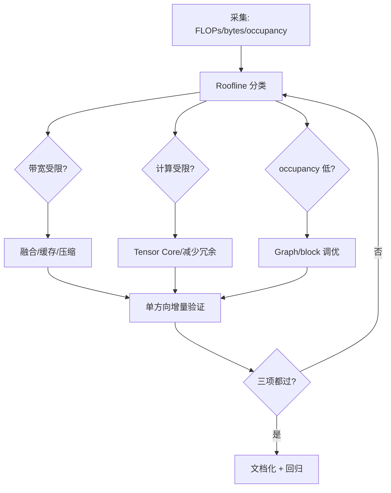

图示表达闭环流程，但不能替代实际 profiling——分类正确性取决于采集精度。

#### 6. 拓展知识

- roofline 在多芯片互联场景下需要按 NVLink/PCIe 分层建模，不同带宽平面有不同的 roofline 上界。
- Tensor Core 对齐要求 hidden dimension 为 8 的倍数（FP16）或 16 的倍数（FP8），否则带宽利用率大幅下降。
- [推断] 在 MUSA 架构上，roofline 参数（π, β）需从硬件手册或 microbenchmark 获取，不能直接套用 NVIDIA 数据。

#### 7. 常见追问及回答要点

1. **问：两个算子 roofline 位置相同，为什么优化后一个提升大一个没提升？** 答：roofline 只看算术强度与峰值距离，忽略了微架构差异——shared memory bank conflict、warp scheduler 效率、L2 cache hit rate 等因素不在 roofline 模型内，需要 nsys 逐层分解。
2. **问：CUDA Graph 化后 kernel 端到端时间反而变长，可能原因？** 答：Graph replay 省掉了 launch overhead，但如果是计算受限算子，launch overhead 本来就只占小头；同时 Graph 捕获可能强制某些 kernel 串行化（依赖边约束），把本来可并行的 kernel 串行化了。
3. **问：如何确定 roofline 的 π 和 β 参数？** 答：理论上来自硬件规格书，实际中建议用 microbenchmark 测 peak bandwidth（如 bandwidthTest）和 peak FLOPS（如 max GEMM），因为实际可达值通常低于规格峰值。

#### 8. 易错点与反例

- 反例："我的算子 MFU 到 90% 了，没有优化空间了"——MFU 是平均值，热点 kernel 可能只有 30%，尾部 kernel 被平均掩盖了。
- 反例："带宽受限算子就一定能用 Tensor Core 加速"——Tensor Core 提高的是计算吞吐，带宽受限算子的瓶颈是数据搬运，Tensor Core 反而可能加剧带宽压力。
- 易错：把 launch overhead 计入 kernel 执行时间——profiler 需要区分 API time、GPU time 和 overlap 区间。

#### 9. 实践与验证

[待验证] 输入：选取推理 prefill 阶段的 attention MLP 两个热点算子。步骤：先用 nsys 采集 kernel 级 FLOPs 与 bytes，在 roofline 图上标注；然后针对 bandwidth 受限的 MLP 做 kernel fusion（把 LayerNorm+fc1 融合）；最后对比融合前后的算术强度与 kernel 耗时。oracle：融合后算术强度上升、kernel 数量减少、端到端耗时下降。当前未执行 GPU 实验，数字不写死。

#### 10. 评分标准

- 不合格：说不清 roofline 的两个参数，或认为优化就是"试参数"。
- 合格：能描述测量→分类→优化→验证的四阶段闭环，知道 roofline 分类方法。
- 良好：能讨论 roofline 的局限性（微架构因素不可见）、CUDA Graph 化的双向效应、增量验证原则。
- 优秀：给出优化优先级决策矩阵，说明"文档化决策而非参数"的工程价值，讨论多芯片互联的分层 roofline。

**证据与来源：** [已确认] cuda/90-cross-module/end-to-end-kernel-launch.md:12-27；[推断] roofline 模型 + 工程实践

---

## AIInfra-A002. 多 stream 并发执行时，如何避免资源竞争与过度同步？stream 优先级怎么用？

- 难度：高级
- 知识域：K02 驱动与运行时
- 考察能力：并发控制、资源管理、性能调优
- 题型：架构设计与权衡
- 面试频率：高频
- 前置知识：CUDA stream/event 模型、GPU 硬件调度
- 关联题目：AIInfra-A003（Graph 中的 stream）、AIInfra-I001（roofline）
- 事实状态：[已确认] [推断] [待验证]

#### 1. 背景知识

CUDA stream 是 host 侧提交的命令队列，同一 stream 内命令严格有序、不同 stream 间可并行。stream 的生命周期为 FREE → ACTIVE → DETACHED（GPU 可能仍在执行）→ FREE [已确认] `cuda/01-modules/M05-stream-submit/README.md:22-25`。Detach 只是 host handle 失效，底层资源要等 GPU 完成才回收。

Kernel launch 经过 channel → pushbuffer → GPFIFO → 设备消费 [已确认] `cuda/01-modules/M05-stream-submit/README.md:28-35`。多个 stream 的 kernel 在设备端的实际并发取决于硬件 engine（compute/copy）数量和调度策略。

#### 2. 问题分析

1. 先回答"并发在哪里"——host 侧提交与设备侧执行是两个不同层次的并发。
2. 然后分析竞争来源：显存带宽、compute engine、host 侧锁、同步等待。
3. 给出避免过度同步的原则：最小必要同步、event 替代阻塞、async 替代 sync。
4. 最后讨论优先级：stream priority 只影响 host 侧提交顺序，不影响设备端调度。

#### 3. 具体答案

面试中可以这样回答：

> 多 stream 并发的核心矛盾是"我们希望并行"但"资源是有限的"。竞争来源有三层：
>
> **第一层：设备资源竞争。** 多个 kernel 共享同一 compute engine 和 memory bandwidth，物理上不能真正并行。过度并发不会让它们变快，只会增加调度开销。正确做法是按硬件 engine 数控制并发度——compute 域通常 1-2 个、copy 域 1-2 个（H2D/D2H/D2D 各有独立拷贝 engine）。
>
> **第二层：host-device 同步。** `cudaStreamSynchronize` 和 `cudaDeviceSynchronize` 会阻塞 host thread，严重损害流水线。应改用 `cudaEventRecord` + `cudaEventQuery`（非阻塞 poll）或 `cudaStreamWaitEvent`（流间依赖）来实现最小必要同步。只在真正需要结果时才同步。
>
> **第三层：host 侧资源竞争。** 多线程多 stream 同时调用 CUDA API 会在 driver 内部竞争全局锁。CUDA per-thread stream（`cudaStreamPerThread`）可以缓解，但更好的模式是每个 host thread 绑定一个 persistent stream，避免 stream 创建/销毁开销。
>
> Stream priority 只影响 host 侧 channel 在 pending 队列中的提交顺序 [推断]，**不保证设备端执行顺序**。优先级适用于"我希望一个流比另一个流先进入设备"的场景（如实时推理的 decode 流 vs 后台 prefill 流），但不能替代同步原语来保证正确性。

#### 4. 技术洞察

```text
并发度控制公式：
  optimal_concurrent_streams ≈ compute_engine_count + copy_engine_count
  超出后边际收益递减（调度开销↑，cache 效率↓）

同步成本模型：
  sync_cost = host_block_time + context_switch_penalty
  event_poll_cost = polling_interval × poll_count（轮询开销）
  当 sync 等待 > 100μs 时 event poll 更划算
```

[推断] 在多 MUSA stream 场景下，优先级的效果取决于 runtime 实现——如果 MUSA driver 不支持 priority 区分，所有 stream 等价。需查具体平台文档确认。

#### 5. 图文说明

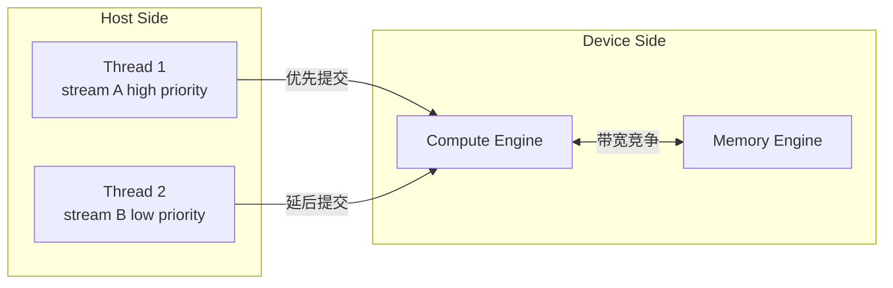

图示显示 host 优先级影响提交顺序，但 device 端竞争仍在发生。

#### 6. 拓展知识

- CUDA Graph 的 launch 天然避免了多 stream host 侧锁竞争——instantiate 一次，replay 时不走常规 launch 路径。
- NCCL 集合通信会创建内部 stream，与用户 stream 之间可能产生隐式同步（需 `cudaStreamSynchronize` 确保 buffer 可用）。
- [推断] Hyper-Q（35+ hardware connections）让多 stream 的 kernel 真正并发，但超出的 stream 只是排队。

#### 7. 常见追问及回答要点

1. **问：两个 stream 各自做 GEMM，kernel 时间反而比单 stream 长？** 答：共享 compute engine 和显存带宽，两个 kernel 会争抢资源。如果两个 GEMM 都不大，切换开销（register file 刷新、shared memory 重新加载）会吃掉并行收益。只有当 kernel 大到足以占满 engine 时才有并行价值。
2. **问：event 和 callback 哪个更适合异步通知？** 答：callback 更轻量但不精确（callback 在某个未定义的 host thread 上下文执行）；event 可以 poll 或 wait，更灵活但需要手动管理生命周期。对延迟敏感场景用 event poll，对简单通知用 callback。
3. **问：stream 优先级在推理服务中的典型用途？** 答：decode 流（P99 敏感）设高优先级，prefill 流设低优先级。但这只是 host 侧提示，真正的 P99 保证需要 preemption 机制支持（MIG 或 time-sliced scheduling）。

#### 8. 易错点与反例

- 反例："我用 10 个 stream 并发，吞吐就能翻 10 倍"——GPU 只有有限个 engine，超出后只是并发排队而非真正并行。
- 反例："priority 高的 stream 一定先执行完"——priority 只影响提交顺序，设备端调度器可能按自己的策略重新排序。
- 易错：detach 不等同于完成——detach 后 GPU 可能仍在执行该 stream 的 kernel，此时释放其 buffer 会导致 use-after-free。

#### 9. 实践与验证

[待验证] 输入：固定 GEMM 工作量，分别用 1/2/4/8 个 stream 并发提交。步骤：记录端到端时间、nsys 看 kernel 重叠率、L2 cache hit rate。oracle：吞吐随 stream 数增加先升后平，最佳 stream 数等于 hardware engine 数。当前未在 MUSA 平台执行。

#### 10. 评分标准

- 不合格：说不清 stream 在 host 和 device 侧的区别，或认为优先级保证执行顺序。
- 合格：能描述三层竞争来源，知道 event 优于阻塞 sync，理解 priority 的有限作用。
- 良好：给出并发度控制公式、同步成本模型、Graph 对锁竞争的消除。
- 优秀：讨论 Hyper-Q 的物理限制、NCCL 隐式同步、多 MUSA 平台的 priority 行为差异。

**证据与来源：** [已确认] cuda/01-modules/M05-stream-submit/README.md:22-35；[推断] CUDA 编程指南 + 工程实践

---

## AIInfra-A003. CUDA/MUSA Graph 中动态控制流(IF/WHILE/SWITCH)的实现难点是什么？如何规避？

- 难度：高级
- 知识域：K02 驱动与运行时
- 考察能力：机制理解、规避设计、边界分析
- 题型：机制分析与设计
- 面试频率：高频
- 前置知识：CUDA Graph API、GraphExec、stream capture
- 关联题目：AIInfra-A002（多 stream 同步）、AIInfra-I001（roofline）
- 事实状态：[已确认] [推断] [待验证]

#### 1. 背景知识

MUSA Graph 将静态依赖编译为设备侧 acquire/release 同步命令；而 IF、WHILE、SWITCH 并不是 GPU command buffer 内的原生分支指令，而是由 GraphCommand 在 Driver 提交路径中等待 semaphore、读取 host-mapped conditional handle，然后递归选择或重复提交 submission cluster [已确认] `control_stream/musa-graph-control-flow-analysis.md:16-18`。

Graph 是显式 DAG——Kahn 拓扑排序验证无环；WHILE 的重复执行并不在 Graph 静态边中创建回边，而是运行时对已实例化的 body cluster 进行重复调用 [已确认] `control_stream/musa-graph-control-flow-analysis.md:333-338`。

#### 2. 问题分析

1. 先理解为什么动态控制流"难"——Graph 的核心优势是预构建命令、减少 launch 开销，但动态分支需要 host 参与判断，打破"纯设备执行"假设。
2. 分析每种控制流的实现机制：IF=Driver 读取 handle 后选择 cluster，WHILE=Driver 重复递归 body，SWITCH=值作为下标。
3. 识别性能瓶颈：host 往返延迟、semaphore wait、不可预知的执行时间。
4. 给出规避策略。

#### 3. 具体答案

面试中可以这样回答：

> 动态控制流在 Graph 中的核心难点是 **host-device 往返**。Graph 的设计初衷是把所有命令预构建到设备侧，launch 时只需一次提交。但 IF/WHILE/SWITCH 需要在运行时根据条件值选择路径，而条件值可能来自前序 GPU kernel 的输出——这迫使 Driver 在每轮判断前：(1) 等待前序 semaphore 完成，(2) 从 host-mapped memory 读取条件值，(3) 选择或重复提交 child cluster [已确认] `control_stream/musa-graph-control-flow-analysis.md:778-790`。
>
> **三个具体难点：**
>
> 1. **IF 的 host 往返**：每次判断至少包含 semaphore wait + host 读取 + Driver 分支 + child cluster 提交。如果 IF 判断频率高（如每 token 一次），host 调度开销会抵消 Graph 的收益。
>
> 2. **WHILE 的循环放大**：WHILE 是后判断形式——body 先执行再读 handle 决定是否继续。每轮循环都重复一次 host 往返。小粒度循环（如 10 次以内的 reduction）在 Graph 中的代价可能远高于直接 kernel launch。
>
> 3. **SWITCH 的灵活性不足**：当前实现将值作为 child index，越界走 empty callback，没有独立 default child [已确认] `control_stream/musa-graph-control-flow-analysis.md:680-697`。复杂跳转逻辑需要嵌套 IF 组合，增加 host 判断次数。
>
> **规避策略：**
> - 把条件判断从"每 token 一次"降为"每 layer/每请求一次"，摊薄 host 往返成本。
> - 用 **static schedule 替代 dynamic branch**：如果条件取值空间有限（如 top-K 选择），预构建所有路径、用条件值选择 cluster，而不是用 IF 跳。
> - 把循环体做大：WHILE 每轮做足够多的 work 来摊薄 host wait 成本。
> - 如果条件由 CPU 侧逻辑控制（非 GPU kernel 输出），考虑把 Graph 拆成多个子图，在 host 侧串联。

#### 4. 技术洞察

```text
WHILE 每轮最小开销 ≈ semaphore_wait + host_read + driver_branch + cluster_submit
  ≈ 数十到数百 μs（取决于 host 调度器负载）

规避阈值：
  若 loop_body_execution_time < 10 × while_overhead → 不值得用 Graph WHILE
  建议 loop_body 至少 > 1ms
```

[推断] GraphExec2（多内部 stream 的扁平化路径）可能通过减少 submission 边界来降低 conditional 的 overhead，但目前源码中未确认其对 IF/WHILE/SWITCH 的完整支持 [已确认] `control_stream/musa-graph-control-flow-analysis.md:760-765`。

#### 5. 图文说明

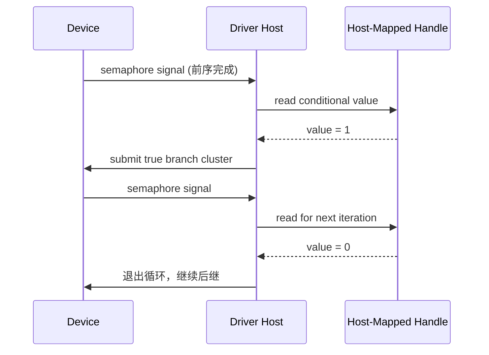

时序图展示 WHILE 的 host-device 往返——每轮循环都有一次完整的信号等待与读取。

#### 6. 拓展知识

- conditional handle 是 64-byte host-mapped internal memory，GPU 可写、Driver 可读 [已确认] `control_stream/musa-graph-control-flow-analysis.md:524-535`。
- disabled node 通过 NOP 保留拓扑位置，避免重新计算依赖布局 [已确认] `control_stream/musa-graph-control-flow-analysis.md:483-485`。
- CUDA Graph 在 NVIDIA 上有 `cudaGraphKernelNodeSetConditional` 等 API，机制与 MUSA 类似但细节不同。

#### 7. 常见追问及回答要点

1. **问：为什么 Graph 不直接在设备侧做分支？** 答：设备侧（command buffer）的 execute 单元不具备读取 host-mapped memory 后改变提交路径的能力——分支逻辑必须在 host 侧完成。如果要纯设备分支，需要完全不同的硬件支持（如 GPU 内部的 command processor）。
2. **问：WHILE 初始条件为 0 时 body 是否执行？** 答：从当前 MUSA 源码看是后判断形式，body 至少执行一次。但需结合正式 API 语义确认 [已确认] `control_stream/musa-graph-control-flow-analysis.md:656-663`。
3. **问：如何调试 conditional graph 的 hang？** 答：检查 (a) handle 是否被正确更新（kernel 写入的值与预期一致），(b) semaphore 是否正常 signal（前序 cluster 是否卡住），(c) conditional node 的 cluster index 是否正确。

#### 8. 易错点与反例

- 反例："WHILE 可以用 Graph 加速任意循环"——小粒度循环的 host 往返 overhead 可能远大于循环体本身。
- 反例："Graph 中的 IF 和代码中的 if 等价"——IF 需要 host 读取 handle 并重新提交，if 只是设备侧的 predicated execution（无分支，双路径都执行）。
- 易错：在 WHILE 循环中引用外部资源（如 host-side 数组）——Graph 的设备侧执行无法安全访问 host 内存。

#### 9. 实践与验证

[待验证] 输入：构建含 WHILE 循环的 MUSA Graph，循环体为固定大小的 GEMM，循环次数从 1 到 100。步骤：分别测量 Graph 执行时间 vs 等效的普通 kernel 循环提交时间。oracle：小循环次数时普通提交更快（Graph host 往返开销大），大循环次数时 Graph 优势显现（单次 launch vs 多次 launch）。当前未执行。

#### 10. 评分标准

- 不合格：说不清 Graph 中控制流是 host 侧而非设备侧实现。
- 合格：能描述 IF/WHILE/SWITCH 的 handle 读取与 cluster 选择机制，知道 host 往返是瓶颈。
- 良好：给出 WHILE 开销的定量模型、规避策略（static schedule / 大循环体 / 子图拆分）。
- 优秀：讨论 GraphExec2 的适用边界、disabled node 的 NOP 语义、CUDA vs MUSA 的 conditional 实现差异。

**证据与来源：** [已确认] control_stream/musa-graph-control-flow-analysis.md:16-18,333-338,524-535,656-663,680-697,760-765,778-790

---

## AIInfra-A004. 设计一个多租户显存池：如何做配额、回收、隔离与 OOM 处理？

- 难度：高级
- 知识域：K03 显存管理
- 考察能力：系统设计、资源管理、故障处理
- 题型：架构设计
- 面试频率：高频
- 前置知识：GPU 显存分配、SOMA 池化、CUDA VMM
- 关联题目：AIInfra-A005（PagedAttention）、AIInfra-A015（多模型共池）
- 事实状态：[已确认] [推断] [待验证]

#### 1. 背景知识

SOMA（Stream Ordered Memory Allocation）显存池采用两级设计：Runtime 软件层切分 segment、Driver/HAL 设备层管理物理页 [已确认] `cann/memory_pool_analysis.md:14-19`。Segment 有三种状态：FREE（可立即分配）、BUSY（已返回用户）、CACHED（软件释放但等待 stream/event 依赖后复用）[已确认] `cann/memory_pool_analysis.md:142-147`。

当前实现中 best-fit 分配为 O(log f)，地址范围查询为 O(log p) [已确认] `cann/memory_pool_analysis.md:419-422`。

#### 2. 问题分析

1. 多租户显存池的四个核心问题：配额（谁能用多少）、回收（用完归还）、隔离（互不干扰）、OOM（超限时怎么办）。
2. 需要对比不同策略：per-tenant 独立池 vs 全局共享池 + quota vs 分层预留。
3. 每个设计选择都有 trade-off：隔离性好则利用率低，利用率高则隔离性差。
4. OOM 处理需要分级：预防→降级→驱逐→拒绝。

#### 3. 具体答案

面试中可以这样回答：

> 多租户显存池设计需要在 **隔离性** 和 **利用率** 之间取舍。三种基本策略：
>
> **策略一：Per-tenant 独立池。** 每个租户预分配固定大小池，完全隔离。优点是无干扰、配额简单（池大小即配额）；缺点是利用率低——租户 A 空闲的显存租户 B 不能用。适合强隔离场景（如不同 SLA 级别租户），不适合负载波动大的共享集群。
>
> **策略二：全局共享池 + 逻辑配额。** 所有租户共享一个大池，每个租户有逻辑配额上限（soft limit）。优点是利用率最高——空闲资源可被任何租户使用；缺点是高租户吃光低租户资源、OOM 时互相牵连。需要配合 admission control 和 preemption。
>
> **策略三：分层预留（推荐折中）。** 把总显存分为三层：
> - **Reserved**：每个租户的 guaranteed 最小容量（硬隔离）
> - **Shared**：全局共享池，按权重或 priority 分配（弹性容量）
> - **Emergency reserve**：系统保留，只在 OOM 时触发回收使用
>
> 三层比例建议 [推断]：Reserved 50-70%（覆盖 baseline），Shared 20-40%（弹性），Emergency 5-10%（安全垫）。
>
> **OOM 处理四级响应：**
> 1. **预防**：admission 检查，新请求只进 Reserved 或 Shared 有足够余额时。
> 2. **降级**：KV cache eviction（淘汰低优先级 prefix）、retraction（撤回 decode 中请求）、precision 降级（FP16 → FP8）。
> 3. **驱逐**：跨租户 preemption——按 priority + 占用比驱逐最低优先级租户的资源。
> 4. **拒绝**：以上都失败时返回 503，保护已有请求。
>
> **关键不变量**：单租户永远不超过其 quota + shared 份额；Emergency reserve 只在确认有租户即将 OOM 时动用，且动用时必须有日志告警。

#### 4. 技术洞察

```text
利用率 vs 隔离性权衡：
  独立池利用率 ≈ avg(租户负载率)  # 通常 30-50%
  共享池利用率 ≈ 1 - max(1 - Σ负载率, 0)  # 可达 70-90%
  分层预留利用率介于两者之间

OOM 响应时间目标：
  admission 检查 < 1ms
  eviction 决策 < 10ms（延迟敏感时需预判而非被动响应）
  preemption 完成 < 100ms（需要 KV flush + 请求迁移）
```

[推断] 在 K8s + GPU Operator 场景下，MIG（Multi-Instance GPU）提供硬件级显存隔离，但 MIG 的 partition 粒度固定（如 1/2/4/7 份），不如软件池灵活 [待验证]。

#### 5. 图文说明

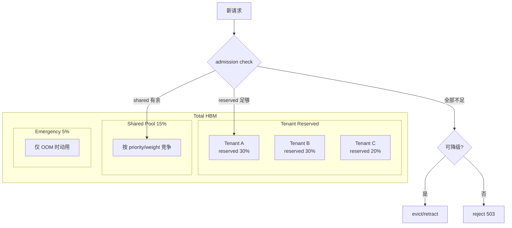

图示展示三层结构和 OOM 决策路径。

#### 6. 拓展知识

- SOMA 的 TryToReuse 当前是空实现——分配只看 freeSegs_，CACHED 块无法复用 [已确认] `cann/memory_pool_analysis.md:236-246`。这是多租户场景下的利用率瓶颈。
- 单池一把 mutex_ 串行所有分配/释放操作 [已确认] `cann/memory_pool_analysis.md:463-465`——多租户高并发时锁竞争会成为瓶颈。
- CheckMergeRules 要求 streamId/graphId/eventId/seqId 全部相同才能合并 [已确认] `cann/memory_pool_analysis.md:298-311]——跨租户的块天然不能合并。

#### 7. 常见追问及回答要点

1. **问：租户 A 的 load 突然翻倍，shared 池被吃光，租户 B 的推理 P99 劣化，怎么处理？** 答：短期——对 A 做 admission throttle（限制新请求速率）+ 触发 B 的 KV eviction 保护；中期——动态调整 shared 池的权重（A 的 priority 下调）；长期——扩容或迁移 A 到独立池。
2. **问：Emergency reserve 的"动用时必须有日志告警"为什么重要？** 答：因为动用 Emergency 意味着系统设计的水位线已经失效——要么是负载预测错了，要么是 shared 池配小了。如果不告警，问题会反复出现直到真正 OOM。
3. **问：per-tenant 独立池的最大缺陷怎么缓解？** 答：引入"池借用"机制——空闲 reserved 部分临时借给 shared 池，租户实际需要时优先回收。但这增加了管理复杂度，需要 tracking 借用关系。

#### 8. 易错点与反例

- 反例："加个全局 mutex 保护多租户分配就够了"——这把所有租户的分配串行化，吞吐受限于最慢的分配操作。
- 反例："quota 设成 HBM 总大小 / 租户数就行"——忽略了模型权重、activation buffer、KV pool 的固定开销，不同租户的 model 大小不同。
- 易错：配额只检查 `torch.cuda.mem_get_info()`——这是全局视角，不包含租户级逻辑配额。

#### 9. 实践与验证

[待验证] 输入：模拟 3 个租户，各有不同的 KV 请求负载分布（泊松到达 + 不同输出长度）。步骤：分别测量独立池、共享池、分层预留三种策略下的 (a) 各租户 P99 TPOT、(b) 集群级显存利用率、(c) OOM 发生次数。oracle：分层预留策略在 P99 和利用率上取得最佳平衡。当前未执行。

#### 10. 评分标准

- 不合格：只给一种方案，不考虑 trade-off；或认为 quota 就是除法。
- 合格：能对比独立池/共享池/分层预留三种策略的优缺点，理解 OOM 需要分级响应。
- 良好：给出三层比例建议、OOM 四级响应时间目标、关键不变量设计。
- 优秀：结合 SOMA 的具体实现缺陷（TryToReuse 空实现、单 mutex 瓶颈）讨论真实约束，提出"池借用"等增强方案。

**证据与来源：** [已确认] cann/memory_pool_analysis.md:14-19,142-147,236-246,298-311,419-422,463-465；[推断] 工程实践

---

## AIInfra-A005. PagedAttention 的设计动机、页大小权衡与碎片问题——给一个页表管理方案。

- 难度：高级
- 知识域：K03 显存管理
- 考察能力：机制理解、设计权衡、定量分析
- 题型：机制分析与设计
- 面试频率：高频
- 前置知识：KV cache 管理、虚拟内存分页、attention 计算
- 关联题目：AIInfra-A004（多租户显存池）、AIInfra-I001（roofline）
- 事实状态：[已确认] [推断] [待验证]

#### 1. 背景知识

PagedAttention 将 KV cache 管理类比为虚拟内存分页，目标是减少动态 KV cache 的碎片和冗余复制 [已确认] `insights/01-static-dynamic-hybrid-pools.md:35-54`。核心映射链：logical sequence blocks → block table → physical KV blocks。

SGLang 的 KV pool 分层：`ReqToTokenPool` 管 request 到 token location 的映射，`TokenToKVPoolAllocator` 管 slot/page index，`RadixCache` 管可复用 prefix 的索引引用 [已确认] `insights/02-kv-pool-lifecycle-and-ownership.md:6-33`。

#### 2. 问题分析

1. 理解 PagedAttention 解决什么问题：变长序列导致外部碎片、冗余复制、admission 困难。
2. 分析页大小权衡：大页→内部碎片多、prefix 粒度粗；小页→页表大、kernel overhead 高。
3. 碎片分类：internal waste（页内未用 token）、external fragmentation（free 总量不少但分散）、partial page 生命周期。
4. 设计页表方案。

#### 3. 具体答案

面试中可以这样回答：

> **设计动机：** 传统 KV cache 为每个请求按最大长度预留连续显存，两个问题：(1) 短输出浪费显存——大部分预留空间从未使用；(2) 不同请求的 KV 长度不同，动态分配产生外部碎片。PagedAttention 借鉴 OS 虚拟内存——逻辑连续、物理分页，把 KV 从"按请求预留"变成"按页领取"。论文报告接近零 KV cache waste 与 2-4x 吞吐提升 [已确认] `insights/01-static-dynamic-hybrid-pools.md:35-37`。
>
> **页大小权衡：**
>
> | 页大小 | 内部碎片 | 页表开销 | prefix 粒度 | transfer 粒度 | 适用场景 |
> |---|---|---|---|---|---|
> | 1 | 零 | 大 | 细 | token 级 | 研究/极致效率 |
> | 16-32 | 中（<1页/请求） | 中 | 适中 | page 级 | 通用 serving |
> | 64+ | 大（尾页浪费可达50%） | 小 | 粗 | 大 chunk | batch 推理 |
>
> [推断] 推荐 page_size=16 或 32 作为起点，按输出长度分布调整——如果大多数请求输出 < 128 token，page_size=16 的内部碎片约 1-7 token/请求（平均 < 5%）；如果输出普遍 > 1024，page_size=64 也可接受。
>
> **碎片处理方案：**
> - Internal waste：不可消除但可控——选匹配输出长度分布的 page_size。
> - Partial page：未对齐尾部不能作为完整 radix node 共享 [已确认] `insights/02-kv-pool-lifecycle-and-ownership.md:86-95`。方案：partial tail 延迟到请求完成或 next chunk 再对齐，期间不参与 prefix 共享。
> - External fragmentation：分页后基本消除——任何 free page 可被任何请求使用。
>
> **页表管理方案：**
> ```
> 三级索引：
>   request → logical_page_list (per-request)
>   logical_page → physical_page_id (global block table)
>   physical_page → KV tensor slice (fixed mapping: page_id × page_size × kv_dim)
>   
> 操作复杂度：
>   alloc_page: O(1) 从 free list pop
>   free_page: O(1) push to free list
>   prefix_share: O(命中页数) radix tree 查找
>   eviction: O(可驱逐叶子数) heap 选择
> ```

#### 4. 技术洞察

```text
内部碎片上界：
  waste_per_request ≤ page_size - 1 tokens
  waste_ratio ≤ (page_size - 1) / avg_output_len
  
  例：page_size=16, avg_output=256 → waste_ratio < 6%
  例：page_size=64, avg_output=128 → waste_ratio 可达 49%

页表内存开销：
  block_table_size = max_requests × max_pages_per_request × 4B
  例：1024 req × 512 pages × 4B = 2MB（可忽略）
```

[推断] SGLang 的 `PagedTokenToKVPoolAllocator` 把 `num_pages = size // page_size`，alloc 时只接受 page-aligned 的需求 [已确认] `sglang/01-modules/M08-kv-cache/README.md:93-95`。

#### 5. 图文说明

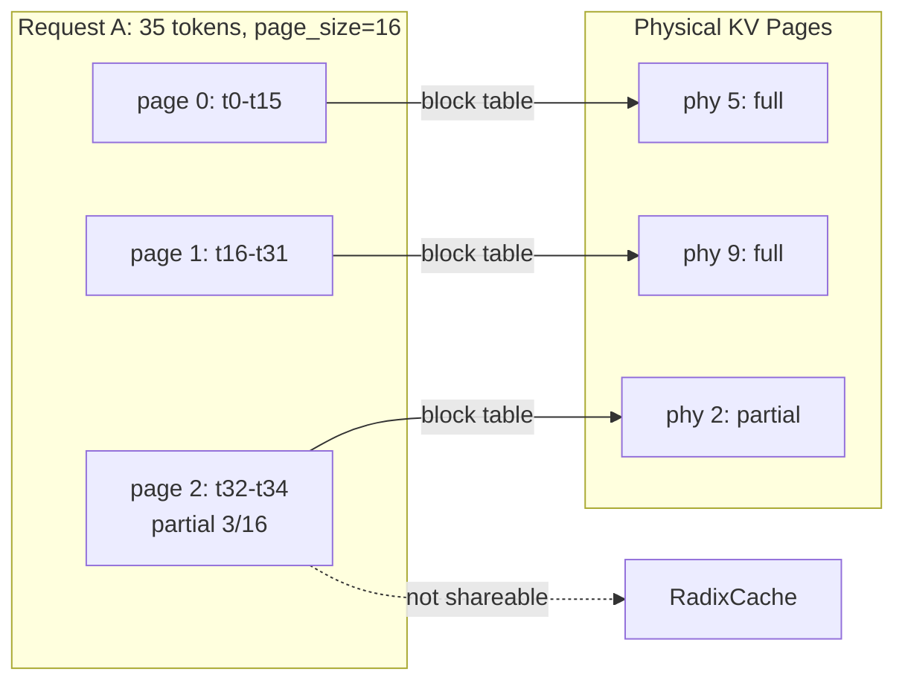

图示展示逻辑到物理的映射和 partial page 不可共享。

#### 6. 拓展知识

- vAttention 用 CUDA VMM 把虚拟连续+物理动态映射分离，解决 PagedAttention 非连续虚拟布局的 kernel 适配成本 [已确认] `insights/01-static-dynamic-hybrid-pools.md:55-63`。
- NEO 把部分 KV 迁到 CPU，用 GPU/CPU 非对称流水减轻显存压力 [已确认] `insights/01-static-dynamic-hybrid-pools.md:65-68`。
- eviction policy 可以是 LRU/LFU/FIFO/SLRU/priority-aware [已确认] `sglang/01-modules/M08-kv-cache/README.md:130-133`。

#### 7. 常见追问及回答要点

1. **问：prefix cache 命中时页表怎么更新？** 答：命中的 KV indices 写入请求的 prefix_indices，extend_range 只包含未命中部分 [已确认] `insights/02-kv-pool-lifecycle-and-ownership.md:64-66`。物理页不移动，只是逻辑引用。
2. **问：eviction 一个被多请求共享的 prefix 页怎么办？** 答：RadixCache 的 lock_ref 机制——被请求引用的节点不可驱逐 [已确认] `sglang/01-modules/M08-kv-cache/README.md:105-107`。必须先解除引用（请求完成或 retract）才能驱逐。
3. **问：PagedAttention vs vAttention 怎么选？** 答：如果 attention kernel 生态已支持 paged layout（如 FlashAttention 的 block table 模式），PagedAttention 实现简单；如果 kernel 必须连续 KV（如某些自定义 kernel），vAttention 的虚拟连续更好。

#### 8. 易错点与反例

- 反例："page_size=1 就零碎片"——page_size=1 时 block table 变大，且 attention kernel 的 block 遍历 overhead 上升。
- 反例："partial tail 可以直接共享给下一个请求"——partial tail 的 KV 可能未定义或错误，共享会导致数值错误 [推断] `insights/02-kv-pool-lifecycle-and-ownership.md:86-95`。
- 易错：忽略 eviction 的 page-aligned 约束——free_segment 只接受 page-aligned 的 segment [已确认] `sglang/01-modules/M08-kv-cache/README.md:95-96`。

#### 9. 实践与验证

[待验证] 输入：固定并发 64 请求，输出长度服从正态分布 μ=256, σ=64。步骤：分别用 page_size=1/16/64/256 运行，统计 (a) 显存利用率、(b) attention kernel 耗时、(c) prefix hit 正确率。oracle：page_size=16 在利用率和 kernel 开销之间取得最佳平衡。当前未执行。

#### 10. 评分标准

- 不合格：说不清 PagedAttention 解决什么问题，或认为页越大越好。
- 合格：能描述动机、页大小权衡、碎片分类，给出基本的页表方案。
- 良好：定量分析内部碎片和页表开销，给出 partial page 处理方案，对比 PagedAttention vs vAttention。
- 优秀：结合 SGLang 源码讨论 RadixCache lock_ref 对 eviction 的约束、page-aligned free 的实现细节。

**证据与来源：** [已确认] insights/01-static-dynamic-hybrid-pools.md:35-68；insights/02-kv-pool-lifecycle-and-ownership.md:6-95；sglang/01-modules/M08-kv-cache/README.md:93-133

---

## AIInfra-A006. 设计跨机拓扑感知的集合通信链路选择：NVLink domain 与 RDMA domain 如何分层调度？

- 难度：高级
- 知识域：K04 网络互联
- 考察能力：系统设计、拓扑感知、分层抽象
- 题型：架构设计
- 面试频率：高频
- 前置知识：NCCL、NVLink、RDMA、集合通信原语
- 关联题目：AIInfra-B001（warp）、AIInfra-A014（故障域）
- 事实状态：[已确认] [推断] [待验证]

#### 1. 背景知识

MT-NLG 论文确立的 3D 并行排布法则：通信量排序 TP > DP > PP，因此 TP 组放在同节点（NVLink）、DP 尽量同节点或邻近节点、PP 可跨节点 [已确认] `insights/05-megatron-architecture.md:117-119`。

Megatron-Core 的官方并行策略表：TP 每层 Communication 标为 High（4 次 all-reduce/层），PP 标为 Low（仅 stage 边界 P2P），DP 标为 Low-Medium（梯度 reduce）[已确认] `insights/05-megatron-architecture.md:499-509`。

#### 2. 问题分析

1. 集合通信的性能由拓扑决定——同节点 NVLink 带宽远高于跨节点 RDMA。
2. 需要把"通信轴"映射到"物理拓扑轴"——高通信量轴优先放在高带宽域。
3. 分层调度：节点内用 NVLink 做 TP allreduce、节点间用 RDMA 做 DP gradient reduce 或 PP P2P。
4. 还需要考虑 ring vs tree 算法的选择、link aggregation、路径故障切换。

#### 3. 具体答案

面试中可以这样回答：

> 跨机拓扑感知的通信链路选择核心原则是 **"把通信量最大的组放到带宽最大的物理链路上"**。
>
> **分层模型：**
>
> | 层级 | 物理介质 | 典型带宽 | 放置的通信组 |
> |---|---|---|---|
> | Node-local | NVLink (switch) | 600-900 GB/s (A100/H100) | TP group（每层 4 次 all-reduce） |
> | Rack-local | RoCE/NVLink-SW | 100-400 GB/s | DP gradient reduce（同 rack） |
> | Cross-rack | IB/RDMA | 100-200 Gb/s | PP P2P（stage 边界） |
>
> **链路选择算法：**
>
> 1. **枚举所有通信组**：从并行配置中提取 TP/PP/DP/CP/EP group。
> 2. **按通信量排序**：TP（最高频全组同步）> EP all-to-all > DP allreduce > CP seq 通信 > PP P2P。
> 3. **拓扑匹配**：对每个通信组，找到能覆盖其所有 rank 的最小带宽域——如果 TP 组能放入同节点，用 NVLink；否则降级到 RDMA（性能急剧下降）。
> 4. **冲突仲裁**：多个组竞争同一链路时，按通信频率 × 通信量加权分配——高频小消息优先用 NVLink（延迟敏感），低频大消息可用 RDMA（带宽敏感）。
>
> **具体规则（Megatron MT-NLG 法则）：**
> - TP 必须同节点 NVLink 域（否则每层 4 次 all-reduce 的延迟会主导训练时间）
> - DP gradient reduce 尽量同 rack（reduce-scatter 数据量大但频率低）
> - PP P2P 可跨 rack（每 step 每 stage 边界仅一次 send/recv，数据量=单个 microbatch 的 activation）
>
> **故障切换：** 当 NVLink link 降级或 RDMA path 不可达时，NCCL 可以 fallback 到替代路径（如 NVLink 降级到 PCIe），但性能下降显著。设计时应预留 monitoring——如果某链路的有效带宽持续低于阈值，告警并考虑 reschedule。

#### 4. 技术洞察

```text
拓扑匹配的定量判断：
  TP 通信量/层 ≈ 8·s·b·h·(t-1)/t elements  (s=seq, b=batch, h=hidden, t=TP size)
  
  例：s=4096, b=4, h=8192, t=8, FP16
  ≈ 8 × 4096 × 4 × 8192 × 7/8 × 2B ≈ 1.8 GB/层
  
  NVLink 900 GB/s → 1.8GB / 900GB/s ≈ 2ms
  RDMA 25 GB/s  → 1.8GB / 25GB/s  ≈ 72ms  (36× slower!)
```

[推断] 对于 MoE 模型的 EP all-to-all，通信量与 token 数 × hidden × expert_count 相关，可能比 TP 更大，因此 EP 组也应优先 NVLink 域 [待验证]。

#### 5. 图文说明

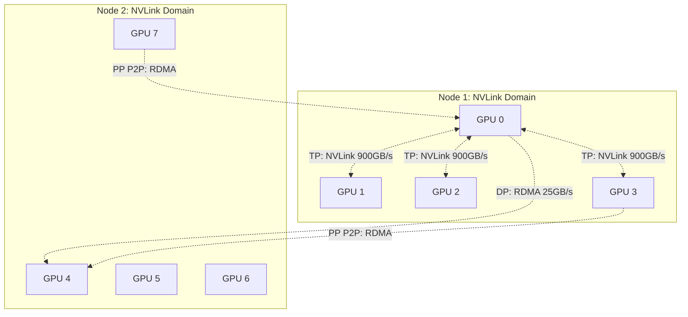

图示展示同节点内 TP 走 NVLink、跨节点 DP/PP 走 RDMA。

#### 6. 拓展知识

- NCCL 内部会自动选择最优路径（NVLink > IB > PCIe），但前提是并行组的 rank placement 正确。
- NVSwitch（如 DGX A100）让所有 GPU 之间都有直连 NVLink，拓扑是 fully connected。
- ring allreduce 的带宽不随 TP 规模线性下降——约 `2·(t-1)/t` 因子，所以 t 从 4 到 8 带宽只下降 12.5% [推断]。

#### 7. 常见追问及回答要点

1. **问：TP 组被迫跨节点时（如只有 4 GPU/node 但需要 TP=8），有什么缓解方案？** 答：(1) 用 NVLink-SW（如果机架级 NVLink 交换机存在）；(2) 增大 microbatch 计算量来摊薄通信占比；(3) 使用 async TP——把 all-reduce 与下一层的 GEMM 计算重叠；(4) 降 TP 到节点内，改用 PP 替代。
2. **问：NCCL 的 ring 和 tree 算法什么时候选哪个？** 答：ring 在大规模 allreduce 上带宽利用率高（不受 root 瓶颈限制）；tree 在小规模或延迟敏感场景更优。NCCL 会根据消息大小和 group 大小自动选择。
3. **问：如何验证链路选择是否生效？** 答：用 NCCL_DEBUG=INFO 查看选择的 transport（NVLink/IB/PCIE），或用 nsys 看通信 kernel 的带宽是否匹配预期。

#### 8. 易错点与反例

- 反例："所有通信都走 RDMA 就够了"——TP 跨节点的 RDMA 带宽是 NVLink 的 1/36，训练时间会增加数倍。
- 反例："PP 走 NVLink 更好"——PP 通信量小，跨节点的 RDMA 已经够用，强行 PP 同节点会限制集群规模。
- 易错：axis order 决定 rank 编码——如果把 DP 放内层、TP 放外层，同 TP 组的 rank 可能跨节点 [推断]。

#### 9. 实践与验证

[待验证] 输入：8 机 64 GPU 集群，训练 70B 模型。步骤：对比 (a) TP8 同节点 vs (b) TP8 跨节点的每 step 时间。oracle：同节点配置 step 时间显著更短，差距主要来自 TP all-reduce。当前未执行。

#### 10. 评分标准

- 不合格：说不清 NVLink 和 RDMA 的带宽差距，或认为所有通信等价。
- 合格：能描述分层模型、MT-NLG 排布法则、TP 必须同节点。
- 良好：定量计算 TP 通信量在 NVLink vs RDMA 上的时间差，讨论故障切换和冲突仲裁。
- 优秀：讨论 ring vs tree 选择、MoE EP 的通信量评估、axis order 对物理 placement 的约束。

**证据与来源：** [已确认] insights/05-megatron-architecture.md:117-119,499-509；[推断] NCCL 文档 + 工程实践

---

## AIInfra-A007. PD 分离架构中，Prefill 与 Decode 间 KV 传输的设计选型（带宽、延迟、显存）。

- 难度：高级
- 知识域：K04 网络互联
- 考察能力：架构设计、权衡分析、端到端系统思维
- 题型：架构设计
- 面试频率：高频
- 前置知识：KV cache 管理、推理 serving、分布式系统
- 关联题目：AIInfra-A005（PagedAttention）、AIInfra-A015（多模型共池）
- 事实状态：[已确认] [推断] [待验证]

#### 1. 背景知识

PD 分离将 prefill 与 decode 放到不同 runtime/实例，通过 KV transfer 连接 [已确认] `sglang/01-modules/M13-disaggregation-hicache/README.md:19-20`。

SGLang 的 KV transfer 契约定义在 `base/conn.py`：StateType、KVArgs、KVPoll、BaseKVSender/Receiver [已确认] `sglang/01-modules/M13-disaggregation-hicache/README.md:38-42`。staging buffer 管理指针、offset、水位线 [已确认] `sglang/01-modules/M13-disaggregation-hicache/README.md:44-46`。

#### 2. 问题分析

1. KV transfer 的三个维度：带宽（能传多快）、延迟（第一个 KV chunk 到达前等多久）、显存（staging buffer 占多少）。
2. 不同传输策略对比：全量传输 vs 按需分页传输 vs 分层传输（L1→L2→storage）。
3. 传输粒度权衡：整请求传输（简单但带宽浪费）vs page 级传输（精细但 overhead 高）。
4. 错误处理：传输超时、decode 请求 abort、节点失联。

#### 3. 具体答案

面试中可以这样回答：

> PD 分离的核心 trade-off 是把"prefill 和 decode 在同一实例内共享 KV cache"变成了"KV 需要跨网络传输"。设计选型需要回答三个问题：
>
> **问题一：传多少？**
> - **全量传输**：prefill 完成后把整条 KV 传给 decode。简单、无后续传输出错，但传输量大（seq_len × layers × 2 × kv_heads × head_dim × dtype_bytes）。
> - **按页传输**：decode 一边生成一边按需拉取 KV。传输量小（只传 decode 需要的），但 prefill 需要服务 pull 请求，且 page 粒度传输 overhead 高。
> - **分层传输（HiCache 模式）**：prefill 产出的 KV 写 L1（GPU）+ host storage，decode 先查 L1 radix miss 时从 host restore。传输延迟隐藏在 decode 的 attention 计算后 [已确认] `sglang/01-modules/M13-disaggregation-hicache/README.md:31-35`。
>
> **问题二：什么时候传？**
> - **Eager**：prefill 完成即开始传输。decode 等待时间短，但 prefill 节点被传输占用网络带宽。
> - **Lazy**：decode 开始生成时才请求传输。prefill 节点完全释放，但 decode 的首 token 延迟增加。
> - **Prefetch**：预测 decode 将在 X ms 内到达某 page，提前开始传输。平衡两者但预测错误会浪费带宽。
>
> **问题三：失败怎么办？**
> - 传输超时 → abort 请求（返回客户端）或 fallback 到聚合实例重做 prefill。
> - decode 节点失联 → prefill 节点需清理 staging buffer，避免内存泄漏 [已确认] `sglang/01-modules/M13-disaggregation-hicache/README.md:47-48`。
> - 传输 checksum 校验 → 确保 KV 数值正确（防止网络 bit flip）。

#### 4. 技术洞察

```text
传输量估算（per request, FP16）：
  KV_per_token = layers × 2 × kv_heads × head_dim × 2B
  例：32 layers × 8 kv_heads × 128 head_dim × 2B = 64 KB/token
  seq=4096 → 256 MB/request

传输时间：
  RDMA 25 GB/s → 256MB / 25GB/s ≈ 10ms
  但如果 decode 只需等前几 token 的 KV → 首 token KV 传输 < 1ms

staging buffer 显存占用：
  worst case = max_concurrent_transfers × avg_request_size × KV_per_token
  例：32 concurrent × 256 MB = 8 GB（不可忽略）
```

[推断] 在 decode 场景下，大部分请求的 KV 传输可以隐藏在 attention 计算后面——decode 每步只需新增 1 token 的 KV，prefill 可以按 "decode 即将消费" 的速率流式传输。

#### 5. 图文说明

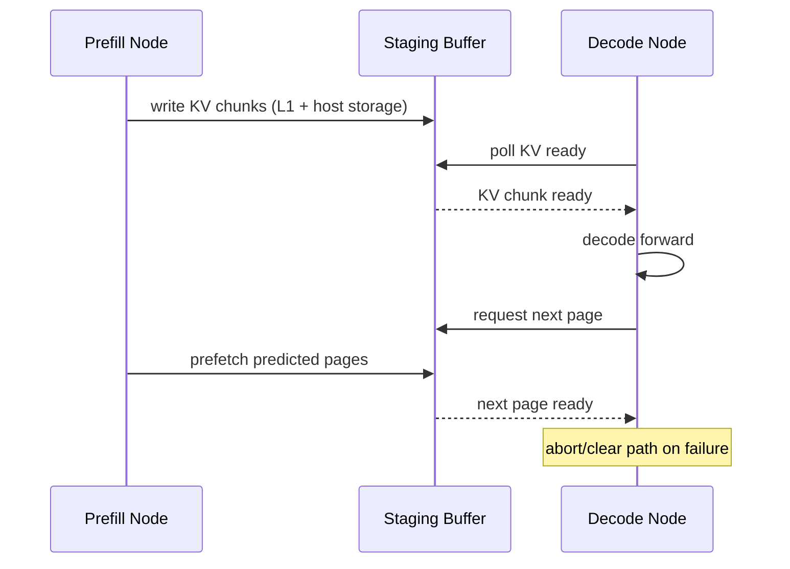

图示展示 PD 间的 KV staging 传输流程。

#### 6. 拓展知识

- 传输引擎可以是 RDMA、NIXL、Mooncake、Mori 等——不同引擎的延迟和吞吐差异可达 10× [已确认] `sglang/01-modules/M13-disaggregation-hicache/README.md:42`。
- ZMQ control channel 只传元数据/控制信号，实际 payload 走专用 transfer engine [已确认] `sglang/01-modules/M13-disaggregation-hicache/README.md:52`。
- HiCache 的 restore 失败、超时或 abort 时必须调用 `_clean_hicache_prefetch_resources` [已确认] `sglang/01-modules/M13-disaggregation-hicache/README.md:48`。

#### 7. 常见追问及回答要点

1. **问：PD 分离适合什么场景？不适合什么？** 答：适合 prefill 和 decode 的负载特性差异大（prefill 计算密集、decode 带宽密集）、可以独立扩缩的场景。不适合小模型（KV 传输 overhead 占比过高）、或 prefill/decode 必须共享大量动态数据的场景。
2. **问：staging buffer 设在 prefill 端还是 decode 端？** 答：取决于传输模式——eager 传输时设在 decode 端（prefill 写完 decode 端直接消费）；分层模式时设在中间层（host storage），两端各自缓存热数据。
3. **问：如何决定 prefetch 窗口大小？** 答：如果 decode 的 TPOT 是 20ms，一次传输 5 个 page 约 10ms，则 prefetch 窗口 = 3-5 page（平衡带宽浪费和首 token 延迟）。

#### 8. 易错点与反例

- 反例："KV 传输越快越好，所以用最大带宽全量传"——全量传输的峰值带宽占用会干扰其他请求的实时传输，且 staging buffer 巨大。
- 反例："传输失败就 abort"——对于长序列请求，重做 prefill 的成本很高，应考虑 fallback（如聚合实例重做）。
- 易错：忽略 staging buffer 的显存成本——在高并发场景下 staging buffer 可能占 5-10 GB，直接挤压 KV pool 容量。

#### 9. 实践与验证

[待验证] 输入：Prefill + Decode 各一个节点，通过 RDMA 互联，运行 Qwen2-7B。步骤：对比 (a) eager 全量传输 vs (b) lazy 按页传输 vs (c) prefetch 窗口=3 的吞吐和 P99 TTFT。oracle：prefetch 在 TTFT 和吞吐之间取得最佳平衡。当前未执行。

#### 10. 评分标准

- 不合格：说不清 PD 分离的 KV 传输需求，或认为"直接传就行"。
- 合格：能描述三种传输模式（全量/按页/分层），理解 staging buffer 和传输引擎选择。
- 良好：定量估算传输量和 staging buffer 占用，讨论失败处理的 abort vs fallback。
- 优秀：讨论 prefetch 窗口调优、传输引擎（RDMA vs NIXL vs Mooncake）的差异、staging buffer 与 KV pool 的容量 trade-off。

**证据与来源：** [已确认] sglang/01-modules/M13-disaggregation-hicache/README.md:19-52；[推断] 工程实践

---

## AIInfra-A008. 设计 GPU 共享集群的混合资源模型：独占/共享/MIG 混合场景的调度约束。

- 难度：高级
- 知识域：K05 容器与 K8s
- 考察能力：资源建模、调度设计、约束分析
- 题型：架构设计
- 面试频率：中频
- 前置知识：K8s 调度、GPU Operator、MIG、资源 QoS
- 关联题目：AIInfra-A004（多租户显存池）、AIInfra-A010（多租户推理）
- 事实状态：[已确认] [推断] [待验证]

#### 1. 背景知识

Ray 的调度由 NodeManager、WorkerPool、local/cluster lease manager 协作完成 [已确认] `ray/01-modules/M04-raylet-scheduling/README.md:7-8`。任务从 CoreWorker 进入 lease 请求，Raylet grant 后进入 worker push [已确认] `ray/01-modules/M04-raylet-scheduling/README.md:12-18`。

K8s GPU 调度通过 device plugin 上报 GPU 资源，scheduler 按 node selector / resource request 做 placement [推断]。

#### 2. 问题分析

1. GPU 共享集群有三种资源模型：独占（整卡）、共享（显存时分复用）、MIG（硬件分区）。
2. 每种模型有不同的隔离级别、利用率上限、适用场景。
3. 混合使用时需要统一的资源抽象——如何让用户声明需求，如何在后台映射到物理资源。
4. 调度约束：亲和性、反亲和性、抢占、资源碎片。

#### 3. 具体答案

面试中可以这样回答：

> GPU 共享集群的三种资源模型有本质不同的设计取舍：
>
> | 模型 | 隔离粒度 | 利用率上限 | 切换成本 | 适用场景 |
> |---|---|---|---|---|
> | 独占（whole GPU） | 硬件级 | 单任务负载率 | 高（需启停容器） | 训练、对延迟敏感 |
> | 共享（time-slicing/MPS） | 软件级 | 高（受显存限制） | 低（进程级切换） | 推理、开发环境 |
> | MIG | 硬件分区 | 受分区数限制 | 中（需重分区） | 多租户强隔离 |
>
> **统一资源抽象设计：**
>
> 在 K8s 层定义三种 resource class：
> - `gpu-exclusive`：整卡，label `nvidia.com/gpu-exclusive: "true"`
> - `gpu-shared`：共享，用 `nvidia.com/gpu-shared: count` 表示可分配的 GPU 时间片份额
> - `gpu-mig-{profile}`：MIG 实例，如 `nvidia.com/mig-3g.40gb: count`
>
> **调度约束：**
>
> 1. **亲和性约束**：训练任务偏好同节点 GPU（TP/PP 通信需求），推理任务可跨节点。
> 2. **反亲和性约束**：同一服务的多个副本不放在同一节点（避免单点故障）。
> 3. **抢占规则**：独占 > MIG > shared——shared 任务最先被抢占。
> 4. **碎片控制**：如果节点只剩 0.5 GPU 显存但需要 1 GPU 的 incoming 请求无法放置，触发 consolidation（迁移低优先级任务）或 wait。
>
> **混合调度示例：**
> ```
> 节点: 8 GPU, 80GB HBM each
> 
> 放置:
>   Tenant A (训练): GPU 0-3 独占 → TP4 训练
>   Tenant B (推理): GPU 4-7 共享 → 各跑 2 推理实例 (MPS)
>   Tenant C (测试): MIG 1g.10gb × 4 → 开发环境
> 
> 调度器决策:
>   新推理请求到达 → 检查 GPU 4-7 共享水位
>   水位 < 70% → 放入共享池
>   水位 > 90% → 驱逐最低优先级 shared 任务
>   全部满 → spillback 到有空闲的节点
> ```

#### 4. 技术洞察

```text
MIG 分区限制（A100-80GB 示例）：
  7 个 1g.10gb 实例（1/7 each）
  或 3 个 2g.20gb 实例
  或 1 个 3g.40gb + 1 个 2g.20gb
  → 分区后不能动态调整，需重启 GPU

shared 模式的显存隔离：
  MPS 只分时计算 engine，不隔离显存
  → 需要显存池级隔离（如 A004 的多租户显存池）
  → 否则一个任务 OOM 会 kill 同 GPU 的所有任务
```

[待验证] K8s 对 MIG 的 device plugin 上报格式和 scheduler extender 的具体配置细节，不同版本差异较大。

#### 5. 图文说明

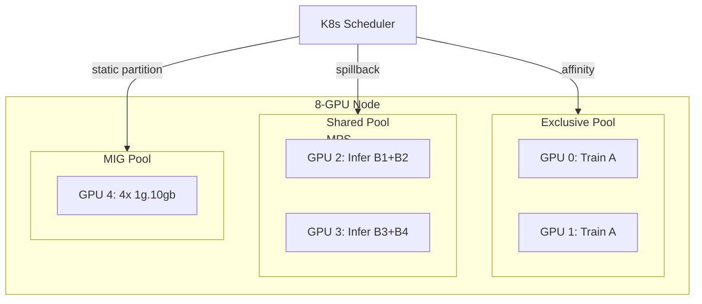

图示展示三种资源模型在同一节点上的混合。

#### 6. 拓展知识

- Ray 的 placement group 支持 STRICT_PACK / STRICT_SPREAD / PACK / SPREAD 四种策略，对应不同的亲和/反亲和语义 [推断]。
- K8s GPU Operator 自动配置 MIG 模式和 device plugin 上报。
- [推断] 在 MUSA 平台上，MIG 可能不存在或语义不同，需要软件级时分复用替代。

#### 7. 常见追问及回答要点

1. **问：shared 模式下两个推理任务争抢 GPU 计算资源怎么处理？** 答：(1) MPS 层面可以用 client priority 设置权重；(2) 更精细的做法是 per-process GPU time quota（如 50% each）；(3) 如果任务间有 SLO 差异，高 SLO 任务应放在独占或 MIG。
2. **问：训练任务需要 3.5 GPU 怎么办？** 答：MIG 不支持非对称组合（如 3.5 GPU）。方案：(a) 用 4 GPU 独占但浪费 0.5；(b) 用 3 GPU 独占 + 1 GPU 共享辅助（但跨模型分片不匹配）；(c) 等待有空闲 4 GPU 时调度。
3. **问：consolidation 的迁移成本如何估算？** 答：迁移成本 ≈ 进程 checkpoint 时间 + 网络传输时间 + 目标节点恢复时间。如果迁移期间目标服务可以降级（如 batch size 临时降低），则可行；如果迁移时间 > SLO 容忍度，则不可行。

#### 8. 易错点与反例

- 反例："所有任务都用 MIG 最公平"——MIG 的显存和计算都是硬分区，碎片严重（如 80GB 分 7×10GB 剩 10GB 无法使用），且不能动态调整。
- 反例："K8s 原生的 resource limit 就够了"——K8s 的 GPU 调度只看到整卡/整数卡，看不到显存粒度。需要自定义 device plugin 或 scheduler extender。
- 易错：shared 模式不做显存隔离——一个任务 OOM 会触发 CUDA context 重建，影响同 GPU 所有任务。

#### 9. 实践与验证

[待验证] 输入：8-GPU 节点，混合 2 训练 + 4 推理 + 2 开发任务。步骤：分别用 (a) 全部独占、(b) 全部共享、(c) 混合模式运行 24h，统计 GPU 利用率、任务完成率、SLO 违反次数。oracle：混合模式在利用率和 SLO 之间取得最佳平衡。当前未执行。

#### 10. 评分标准

- 不合格：说不清三种资源模型的区别，或认为一种模型解决所有问题。
- 合格：能对比独占/共享/MIG 的隔离级别和利用率，理解调度约束。
- 良好：给出统一资源抽象设计、抢占规则、碎片控制方案，讨论 consolidation。
- 优秀：讨论 MIG 分区限制、MPS 显存隔离缺陷、K8s device plugin 的上报机制。

**证据与来源：** [已确认] ray/01-modules/M04-raylet-scheduling/README.md:7-18；[推断] K8s 文档 + NVIDIA GPU Operator

---

## AIInfra-A009. 设计推理服务 autoscaling：基于 QPS、GPU util、KV cache 水位的多信号伸缩策略。

- 难度：高级
- 知识域：K09 推理服务
- 考察能力：控制理论、多信号处理、系统设计
- 题型：架构设计
- 面试频率：高频
- 前置知识：serving 系统、指标采集、autoscaling
- 关联题目：AIInfra-A004（显存池）、AIInfra-A010（多租户公平性）
- 事实状态：[已确认] [推断] [待验证]

#### 1. 背景知识

SGLang 的 Scheduler 主循环每轮执行 `ingest_requests → get_next_batch_to_run → run_batch → process_batch_result`；无 batch 时进入 idle 维护 [已确认] `sglang/01-modules/M04-scheduler-batching/README.md:100-108`。

`PrefillAdder` 用 token budget、page size、running batch、tree cache 和 allocator 做 admission 决策 [已确认] `sglang/01-modules/M04-scheduler-batching/README.md:93-94`。

#### 2. 问题分析

1. 单一信号伸缩的局限：QPS 不反映计算成本、GPU util 不反映显存瓶颈、KV cache 水位不反映计算负载。
2. 需要多信号融合：取 max（木桶效应）vs 加权组合 vs 分阶段决策。
3. 伸缩粒度：实例级 vs 副本组 vs 分片级。
4. 冷却与振荡抑制。

#### 3. 具体答案

面试中可以这样回答：

> 多信号 autoscaling 的关键认识是 **"不同信号在不同场景下是瓶颈"**——计算瓶颈时 GPU util 高但 KV cache 充裕，显存瓶颈时 KV cache 接近满载但 GPU util 可能低。单一信号伸缩会导致误判。
>
> **信号融合策略：**
>
> | 信号 | 采集周期 | 反映的瓶颈 | 上升时含义 |
> |---|---|---|---|
> | QPS (或 queue depth) | 10s | 请求量 | 到达率 > 服务率 |
> | GPU utilization | 10s | 计算密度 | 计算接近饱和 |
> | KV cache occupancy | 5s | 显存压力 | 接近 retraction/eviction 阈值 |
> | P99 TPOT | 30s | 端到端延迟 | SLO 违反风险 |
>
> **融合规则：**
> ```
> scale_signal = max(
>   qps / target_qps_per_instance,
>   gpu_util / target_util,          # target_util ≈ 70-80%
>   kv_occupancy / target_occupancy,  # target_occupancy ≈ 75%
>   p99_tpot / slo_tpot
> )
> 
> if scale_signal > 1.0 → scale_out(replicas = ceil(current × scale_signal))
> if scale_signal < 0.5 → scale_in(replicas = floor(current × 0.8))  # 保守缩容
> ```
>
> **为什么取 max 而非加权平均：** 取平均会让瓶颈信号被非瓶颈信号稀释——KV cache 90% 但 GPU util 30%，平均只有 60%，不会触发扩容，但 OOM 已经在发生。取 max 保证任何瓶颈都触发扩容。
>
> **伸缩速率控制：**
> - scale_out: 快速（30s 内完成），因为 SLO 违反成本 > 多余实例成本
> - scale_in: 慢速（5-10 分钟），避免 flapping；缩容前先 drain（不再接受新请求，等 running 请求完成）
>
> **分阶段决策：** 当 KV cache 是瓶颈但 GPU util 低时，优先 **vertical scale**（把实例从共享 GPU 升级到独占 GPU）而非 horizontal scale；当 GPU util 是瓶颈时 horizontal scale。

#### 4. 技术洞察

```text
伸缩决策的 hysteresis 防止振荡：
  scale_out_threshold = 1.0
  scale_in_threshold = 0.5
  区间 [0.5, 1.0] → 不操作
  
  如果阈值太近（如 0.9/1.0），会导致 flapping：
  扩容 → 利用率下降 → 缩容 → 利用率上升 → 扩容...

冷却时间：
  cooldown_after_scale_out = 60s   # 避免连续扩容
  cooldown_after_scale_in = 300s   # 避免连续缩容
```

[推断] 在 K8s HPA 场景下，custom metrics 可以通过 Prometheus adapter 上报，但多信号 max 逻辑需要自定义 controller（HPA 原生只支持单指标的 threshold）。

#### 5. 图文说明

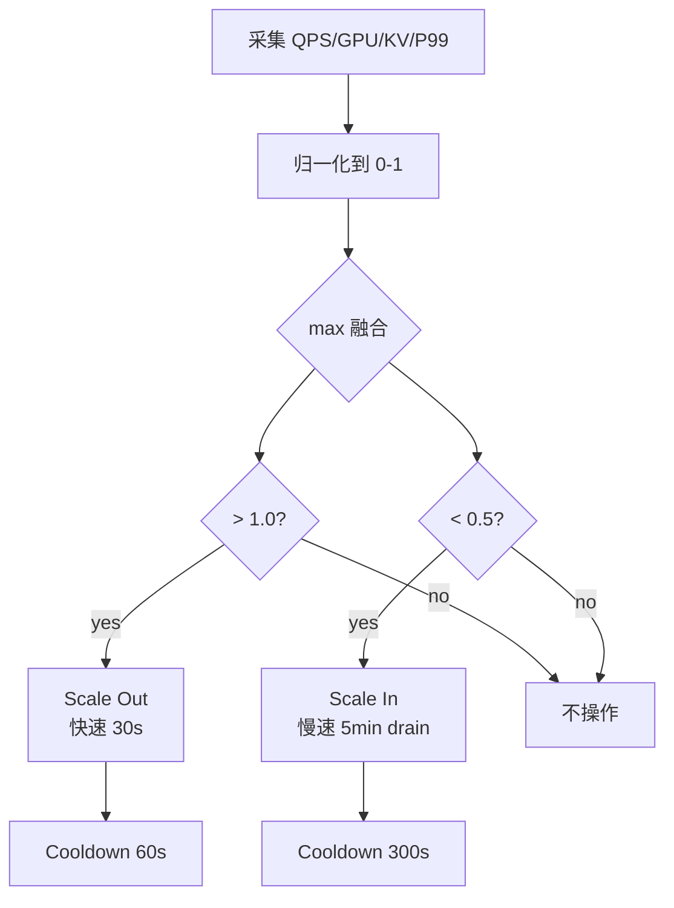

图示展示多信号融合和不对称的伸缩速率。

#### 6. 拓展知识

- Prefill 和 Decode 的计算特性不同，PD 分离架构下应分别伸缩 prefill 和 decode 实例 [推断]。
- [待验证] K8s KEDA（Kubernetes Event-driven Autoscaling）支持多信号 source，但融合逻辑仍需自定义。
- GPU util 的"目标值"不是 100%——70-80% 留 burst 余量，100% util 意味着任何突发请求都会导致排队。

#### 7. 常见追问及回答要点

1. **问：为什么 scale_in 需要 drain 而不是直接 kill？** 答：推理实例上有 running 的请求，直接 kill 会导致请求失败。Drain = 停止接收新请求 + 等 running 请求自然完成（设一个 max drain timeout，超时后 abort）。
2. **问：KV cache 水位信号噪声大（突发请求导致瞬时 95%），怎么处理？** 答：用滑动窗口平均（如 30s 的 P90 而非瞬时值）+ 持续超阈值 2 个周期才触发，避免对瞬时 spike 响应。
3. **问：如果 QPS 和 P99 矛盾（QPS 低但 P99 高）？** 答：通常意味着少量长尾请求（超大 prompt）拖慢了整个 batch。应检查 `PrefillAdder` 的 chunked prefill 配置——把大 prompt 拆成多个 chunk 避免阻塞。

#### 8. 易错点与反例

- 反例："GPU util 100% 就应该扩容"——可能是某个异常 kernel 占满 GPU，扩容不能解决问题反而浪费资源。
- 反例："伸缩只看 QPS 就行"——100 QPS 的小 prompt 和 100 QPS 的 100K prompt 需要的计算资源完全不同。
- 易错：scale_in 时选择 running 请求最多的实例——这会导致大量请求被驱逐。应选 running 请求最少 + 最长时间没收到新请求的实例。

#### 9. 实践与验证

[待验证] 输入：模拟负载从 100 QPS 阶梯式增长到 2000 QPS。步骤：分别运行 (a) 单信号 QPS 伸缩、(b) 多信号 max 融合伸缩、(c) 多信号加权平均伸缩，统计 (i) P99 TPOT SLO 违反率、(ii) 平均实例数（成本）、(iii) 伸缩事件次数。oracle：多信号 max 融合在 SLO 违反率和成本之间最优。当前未执行。

#### 10. 评分标准

- 不合格：认为 autoscaling 只看一个信号（如 QPS）。
- 合格：能列举多个信号并解释各自反映的瓶颈，理解取 max 的合理性。
- 良好：给出融合公式、hysteresis 设计、不对称伸缩速率、drain 机制。
- 优秀：讨论 PD 分离下的分阶段伸缩、K8s HPA/KEDA 的实现约束、信号噪声处理。

**证据与来源：** [已确认] sglang/01-modules/M04-scheduler-batching/README.md:93-108；[推断] 控制理论 + 工程实践

---

## AIInfra-A010. 设计多租户推理集群的公平性与优先级：preemption、queue、权重调度。

- 难度：高级
- 知识域：K09 推理服务
- 考察能力：调度算法、公平性建模、优先级设计
- 题型：架构设计
- 面试频率：高频
- 前置知识：排队论、调度策略、serving 系统
- 关联题目：AIInfra-A008（GPU 共享）、AIInfra-A009（autoscaling）
- 事实状态：[已确认] [推断] [待验证]

#### 1. 背景知识

SGLang Scheduler 的 admission 由 `PrefillAdder` 执行，考虑 token budget、page size、running batch、tree cache 和 allocator 容量 [已确认] `sglang/01-modules/M04-scheduler-batching/README.md:93-94`。

`get_next_batch_to_run` 支持 priority preemption 决策 [已确认] `sglang/01-modules/M04-scheduler-batching/README.md:138-142`。

#### 2. 问题分析

1. 多租户公平性的两个维度：吞吐量公平（按权重分配 compute time）和延迟公平（P99 不受邻居影响）。
2. preemption 的代价：被抢占的请求需要释放 KV cache、稍后重新调度，浪费已做的 prefill。
3. 队列管理：单队列优先级 vs 多队列 per-tenant vs 加权公平队列。
4. 权重 vs 优先级：权重是"应该得到多少"，优先级是"先服务谁"。

#### 3. 具体答案

面试中可以这样回答：

> 多租户推理调度需要在 **效率**（GPU 利用率）、**公平性**（按约定分配资源）、**优先级**（SLO 差异）三者间取舍。
>
> **调度架构：三层队列**
>
> 1. **Per-tenant 子队列**：每个租户有自己的 waiting 队列，防止一个租户的请求饿死其他租户。
> 2. **全局优先级调度**：跨租户按 priority + 到达时间加权选择下一个请求——`score = priority_weight × f(wait_time)`，其中 `f` 是 anti-starvation 函数（等待越久 score 越高）。
> 3. **资源预留准入**：每个租户有 min/max 容量，`min` 是 guaranteed、`max` 是 burstable 上限。超过 `max` 的请求排队。
>
> **Preemption 策略：**
>
> | 场景 | 抢占目标 | 抢占方式 |
> |---|---|---|
> | 高优请求到达但 GPU 满 | 最低优先级租户的 decode 请求 | retract → release KV → 重新入队 |
> | KV cache 不足 | 同租户内最长运行时间的请求 | eviction + retract |
> | 显存 OOM | 全局最低优先级 + 最大 KV 占用的请求 | abort + 返回 503 |
>
> Preemption 成本 [推断]：retract 一个已 decode N token 的请求，需要释放其 KV cache（N pages），但 prefill 的 KV 在下次恢复时需要重新计算。因此应优先 retract decode 阶段远未完成的请求（浪费少），而非即将完成的请求。
>
> **加权公平调度（WFQ 变体）：**
> ```
> 服务权重 = tenant_weight / Σ(all_active_tenant_weights)
> 每轮从租户 A 选请求的概率 ∝ A_weight / total_weight
> 但同时受 admission 约束：A 已达 max 份额时不选
> ```

#### 4. 技术洞察

```text
anti-starvation 函数设计：
  effective_priority = base_priority + k × wait_time
  k = priority_boost_per_second
  
  例：base_priority=1（低）, wait_time=300s, k=0.01
  effective = 1 + 3 = 4 → 已超过 base_priority=3（中）的请求
  
  保证：任何请求的等待时间不会超过 (max_base_priority - min_base_priority) / k

preemption 成本估算：
  wasted_work = retracted_tokens × prefill_cost_per_token
  例：已 decode 100 token, prefill 4000 token → 浪费 4000 token 的 prefill
  应选择 wasted_work / remaining_work 最小的请求作为抢占目标
```

#### 5. 图文说明

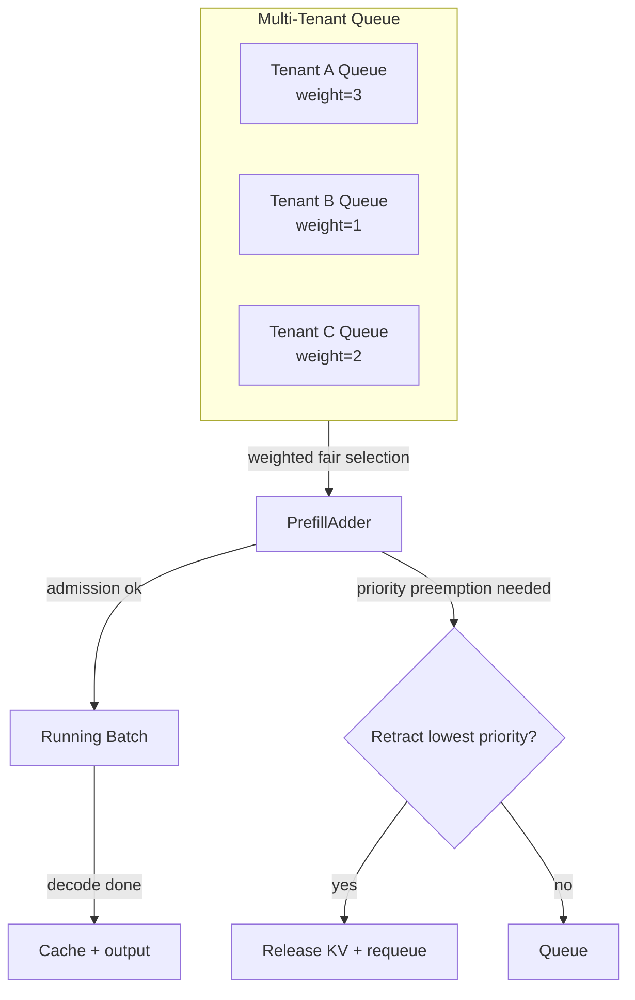

图示展示三层队列、加权选择和 preemption 路径。

#### 6. 拓展知识

- RadixCache 的 lock_ref 机制天然支持 preemption 安全——被 running 请求引用的 prefix 不会被驱逐 [已确认] `sglang/01-modules/M08-kv-cache/README.md:105-107`。
- [推断] WFQ 在 GPU 上的实现与网络包调度不同——GPU 的 "service unit" 是 token 而非 packet，一个请求的服务时间是 bursty 的（prefill 集中计算，decode 分散）。
- chunked prefill 可以把大请求的 prefill 分片，减少单次抢占的影响范围 [已确认] `sglang/01-modules/M04-scheduler-batching/README.md:139-141`。

#### 7. 常见追问及回答要点

1. **问：为什么不直接用 FIFO？** 答：FIFO 下一个大租户可以连续发 1000 个请求堵住队列，后面小租户的请求饿死。加权公平保证了小租户至少得到 `weight/total` 的服务。
2. **问：preemption 和 eviction 的区别？** 答：eviction 是 KV cache 管理层的行为（淘汰不活跃的 prefix），不影响请求的 running 状态；preemption 是调度层的行为（把 running 请求从 batch 中移除），影响请求的执行进度。
3. **问：如何防止租户 A 故意发大量短请求来"骗取"权重？** 答：引入"有效权重"概念——权重按 **token 数** 而非请求数计算。发大量短请求的租户在 token 层面并未超额。

#### 8. 易错点与反例

- 反例："优先级高的请求一定先服务"——如果高优请求是 100K token 的 prefill，一直服务它会让所有低优请求饿死。需要 preemption 和 fair share 的组合。
- 反例："preemption 就是 kill 请求"——kill 返回错误给客户端；retract 是暂时移出 running batch，稍后恢复。
- 易错：忘记更新被抢占请求的 `wait_time`——如果被抢占后 wait_time 重置，它可能再次立即被抢占（thrashing）。

#### 9. 实践与验证

[待验证] 输入：3 个租户，权重 3:1:2，各自发混合负载。步骤：对比 (a) 纯 FIFO、(b) 优先级抢占、(c) WFQ + preemption 三种策略下的 (i) 各租户 throughput 比例、(ii) 各租户 P99 TPOT、(iii) preemption 次数。oracle：WFQ+preemption 最接近 3:1:2 的 throughput 比例，且 P99 不出现极端分化。当前未执行。

#### 10. 评分标准

- 不合格：认为 FIFO 够用，或认为 preemption 就是 kill。
- 合格：能描述 per-tenant 队列 + 全局优先级调度，理解 preemption 的成本。
- 良好：给出 WFQ 变体设计、anti-starvation 函数、preemption 成本估算。
- 优秀：讨论 WFQ 在 GPU 上的实现差异（token vs packet）、chunked preemption、防欺诈权重设计。

**证据与来源：** [已确认] sglang/01-modules/M04-scheduler-batching/README.md:93-94,138-142；sglang/01-modules/M08-kv-cache/README.md:105-107；[推断] 排队论 + 工程实践

---

## AIInfra-A011. 设计 TB 级训练数据管道：存储选型、缓存层次、断点续读与数据血缘。

- 难度：高级
- 知识域：K07 数据管道
- 考察能力：系统设计、存储分层、数据管理
- 题型：架构设计
- 面试频率：中频
- 前置知识：分布式存储、数据格式、训练数据加载
- 关联题目：AIInfra-A012（checkpoint）、AIInfra-B001（warp）
- 事实状态：[已确认] [推断] [待验证]

#### 1. 背景知识

Megatron 的数据管线从 `GPTDatasetConfig` → `GPTDataset` → sampler/DataLoader → `get_batch` [已确认] `megatron-lm/01-modules/M04-data-pipeline/README.md:17-24`。

`GPTDataset.__getitem__` 将文本转为 long tensor，`add_extra_token_to_sequence` 控制 label 偏移 [已确认] `megatron-lm/01-modules/M04-data-pipeline/README.md:31-33`。BlendedMegatronDatasetBuilder 把多个数据集按采样权重混合 [已确认] `insights/05-megatron-architecture.md:1232-1233`。

#### 2. 问题分析

1. TB 级数据管道的挑战：存储带宽 vs 计算带宽不匹配、全局 shuffle 不可行、数据损坏检测。
2. 存储层次：本地 SSD → 分布式 FS（Lustre/WEKA）→ 对象存储（S3/OSS）。
3. 缓存策略：预取、按 epoch shuffle、数据去重。
4. 断点续读：step-level 的数据位置恢复。
5. 数据血缘：每个 batch 的数据来源可追踪。

#### 3. 具体答案

面试中可以这样回答：

> TB 级训练数据管道的核心矛盾是 **GPU 计算速度远快于存储读取速度**。一张 A100 的处理能力约 312 TFLOPS，一条 NVMe SSD 的读取带宽约 3 GB/s——如果数据管道设计不当，GPU 50% 以上时间在等数据。
>
> **存储选型：**
>
> | 层 | 存储 | 容量 | 带宽 | 用途 |
> |---|---|---|---|---|
| L1 热缓存 | 本地 NVMe SSD | 1-10 TB | 3-7 GB/s | 当前 epoch 数据 |
| L2 分布式 FS | Lustre/WEKA | 100+ TB | 50-200 GB/s | 全量训练数据 |
| L3 冷存储 | S3/OSS | ∞ | 按需 | 归档、checkpoint 备份 |
>
> **缓存层次设计：**
> 1. **L2 → L1 预取**：当前 epoch 数据提前从 L2 拉到 L1。多个 rank 共享同一 L2，避免每个 rank 独立存储 1TB 数据。
> 2. **数据格式**：用内存映射格式（如 MmapDataset、BinIndex）避免全量加载——`__getitem__` 按 index 直接 seek 读取 [推断]。
> 3. **跨 rank 去重**：同一 DP rank 的数据由该 rank 的 DataLoader 读取，不同 DP rank 读取不同分片——sampler 的 DP rank/size 保证这一点 [已确认] `megatron-lm/01-modules/M04-data-pipeline/README.md:39`。
>
> **断点续读：**
> - 每个 checkpoint 保存 `(epoch, sample_index, document_index)` 三元组——恢复时从同一位置继续。
> - 使用 shuffle index 文件（而非运行时 shuffle）——恢复时读取同一 shuffle index，保证 epoch 内的数据顺序可复现。
> - [推断] 如果 checkpoint 时刚好在 epoch 中间，恢复后应跳过已消费的 sample 数而非重启 epoch。
>
> **数据血缘：**
> - 每个 batch 记录 `{(dataset_name, sample_index), ...}` 到训练日志。
> - 如果训练出现数值异常，可以回溯到具体的训练样本，排查数据质量问题。

#### 4. 技术洞察

```text
带宽需求分析：
  每 step 数据量 = global_batch × seq_len × 2B (tokens + labels)
  例：global_batch=1024, seq_len=4096 → 8 MB/step
  
  训练 step 时间 ≈ 5s（大模型）
  所需带宽 ≈ 8MB / 5s ≈ 1.6 MB/s（看似很低）
  
  但注意：这是 *平均* 带宽
  DataLoader 的 prefetch buffer 需要 2-4 个 batch → 突发带宽 ≈ 6-12 MB/s
  实际瓶颈在 IOPS（小文件随机读）而非吞吐
```

[推断] 如果使用 packed sequence（多个文档拼接到一个序列），`cu_seqlens` 格式的元数据也需要随数据一起读取——这增加了 DataLoader 的 CPU 预处理开销。

#### 5. 图文说明

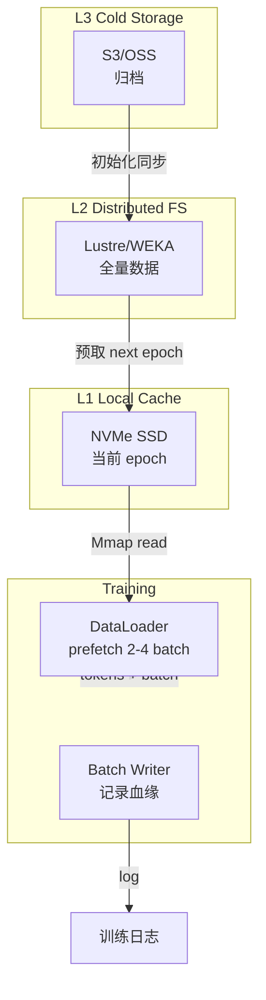

图示展示三层存储和数据流向。

#### 6. 拓展知识

- BlendedMegatronDatasetBuilder 的采样权重需要在 checkpoint 中保存——否则恢复后 blend 比例可能变化 [推断]。
- mock dataset 用于不依赖外部语料的单元测试 [已确认] `insights/05-megatron-architecture.md:1234`。
- inter-document masking 防止跨文档 attention（packed sequence 中不同文档的 token 不应 attend 到对方）[推断]。

#### 7. 常见追问及回答要点

1. **问：为什么不用 object storage 直接读？** 答：S3 的单流带宽低（~100 MB/s）且延迟高（~10ms），无法满足 DataLoader 的突发需求。正确做法是 S3 → L2 分布式 FS → L1 本地 SSD 的层次化加载。
2. **问：多个 rank 同时从 L2 读同一 epoch 数据，会不会把 L2 打爆？** 答：如果每个 rank 读不同分片（sampler 保证），L2 的总带宽需求 = rank_count × per_rank_bandwidth。8 机 64 GPU 场景下需要 L2 提供 64 × 50MB/s = 3.2 GB/s——Lustre 单 client 可达此带宽。
3. **问：shuffle index 文件会不会很大？** 答：TB 级数据集可能有 billions of samples，shuffle index 文件 ≈ N × 8B（uint64 index）。10B samples = 80GB index——需要放在 L2 而非 L1。

#### 8. 易错点与反例

- 反例："把所有数据 copy 到每节点的本地 SSD"——TB 级数据 × 64 节点 = 64 TB 浪费，且 copy 时间长。
- 反例："DataLoader 的 num_workers 越大越好"——过多 worker 会竞争 CPU 和 I/O，反而降低吞吐。通常 4-8 workers/GPU。
- 易错：忽略 epoch 切换时的数据间隙——当前 epoch 结束到下一 epoch 数据就绪之间 GPU 空闲。需要预取下一 epoch。

#### 9. 实践与验证

[待验证] 输入：1TB 训练数据，64 GPU 节点。步骤：对比 (a) 无 L1 缓存直接读 L2、(b) L1 缓存 + 2-worker DataLoader、(c) L1 缓存 + 8-worker + 4-batch prefetch 的每 step 时间和 GPU idle 比例。oracle：方案 (c) 的 idle 比例最低，但边际收益递减。当前未执行。

#### 10. 评分标准

- 不合格：认为数据管道就是 DataLoader，不知道存储层次。
- 合格：能描述三层存储设计、预取策略、断点续读的数据位置保存。
- 良好：定量分析带宽需求、IOPS 瓶颈、shuffle index 大小、数据血缘记录。
- 优秀：讨论 packed sequence 的 cu_seqlens 开销、inter-document masking、blend 权重的 checkpoint 一致性。

**证据与来源：** [已确认] megatron-lm/01-modules/M04-data-pipeline/README.md:17-39；insights/05-megatron-architecture.md:1232-1234；[推断] 工程实践

---

## AIInfra-A012. 设计大规模训练的分层 checkpoint：保存频率、异步化、存储带宽估算与恢复时间目标(RTO)。

- 难度：高级
- 知识域：K08 分布式训练
- 考察能力：系统设计、性能估算、容灾设计
- 题型：架构设计
- 面试频率：高频
- 前置知识：分布式 checkpoint、训练容灾、存储系统
- 关联题目：AIInfra-A011（数据管道）、AIInfra-A013（弹性训练）
- 事实状态：[已确认] [推断] [待验证]

#### 1. 背景知识

Megatron-Core 把训练状态组织为 sharded state dict，每个 rank 管理自己持有的参数/优化器状态分片；`save_distributed_checkpoint`/`load_distributed_checkpoint` 支持并行度变化时的 reshard [已确认] `insights/05-megatron-architecture.md:1217`。

checkpoint 兼容性取决于模型结构和并行配置；`check_checkpoint_args` 会拒绝/警告关键结构参数不匹配 [已确认] `megatron-lm/01-modules/M05-optimizer-checkpointing/README.md:45-46`。

#### 2. 问题分析

1. 大规模训练的 checkpoint 挑战：数据量大（70B 模型 140GB+ 优化器状态）、保存频率与训练吞吐的权衡、异步保存的 correctness 保证。
2. 分层设计：快速 checkpoint（仅参数，本地 SSD）vs 完整 checkpoint（参数+优化器+数据位置，分布式 FS）。
3. 存储带宽估算：N rank × shard_size / save_time。
4. RTO 定义：从故障到恢复服务的时间，包含检测 + 加载 + 追赶。

#### 3. 具体答案

面试中可以这样回答：

> 大规模训练 checkpoint 设计的核心矛盾是 **保存成本 vs 恢复速度**——频繁保存减少重复计算但增加 I/O 开销，异步保存减少训练暂停但增加复杂度。
>
> **分层 checkpoint 设计：**
>
> | 层级 | 内容 | 频率 | 存储位置 | 用途 |
> |---|---|---|---|---|
| L1: 热备份 | 仅模型参数（fp16） | 每 50 step | 本地 NVMe | 快速恢复（最近） |
| L2: 温备份 | 参数 + 优化器 + RNG | 每 500 step | 分布式 FS | 完整恢复 + reshard |
| L3: 冷备份 | 全状态 + 数据位置 | 每 5000 step | S3/OSS | 灾难恢复 + 并行度变更 |
>
> **存储带宽估算：**
> ```
> 70B 模型, TP8×PP8×DP2, fp16:
>   params_per_rank = 140GB / (8×8) ≈ 2.2 GB
>   optimizer_per_rank = 2.2GB × 12 (Adam fp32 master + m + v) ≈ 26 GB
>   total_per_rank ≈ 28 GB
>   
>   64 rank 并行写 → aggregate = 64 × 28GB / save_time
>   L2 目标 save_time < 60s → need 30 GB/s aggregate
>   → 单 rank 需 0.5 GB/s (分布式 FS 单 client 可达)
> ```
>
> **异步保存：**
> - 方案一：后台线程 copy-on-step——step 开始时把上一轮的 state dict 异步传给后台线程写入存储。优点是无阻塞，缺点是落后一步。
> - 方案二：后台 rank——每节点指定 1 个 rank 负责收集本节点 shard 并写入。优点是不影响训练 rank 计算，缺点是收集阶段有通信开销。
> - 推荐方案一（异步线程），因为大模型的 state dict copy 已有成熟的 async 路径 [已确认] `insights/05-megatron-architecture.md:1261`。
>
> **RTO 目标分解：**
> ```
> RTO = T_detect + T_restore + T_catchup
> T_detect: 故障检测（心跳超时）≈ 30-60s
> T_restore: 加载最近 checkpoint ≈ 60-180s (取决于存储带宽)
> T_catchup: 重跑丢失的 step ≈ 50 steps × step_time
>          例：5s/step → 250s
> 总 RTO ≈ 5-8 分钟
> ```

#### 4. 技术洞察

```text
保存频率的盈亏平衡：
  checkpoint_interval = sqrt(2 × MTBF × save_time) / step_time
  例：MTBF=24h=86400s, save_time=60s, step_time=5s
  = sqrt(2 × 86400 × 60) / 5 ≈ 14400 / 5 ≈ 2880 step
  → 约每 3000 step 保存一次达到盈亏平衡

异步保存的正确性约束：
  state_dict 必须在 optimizer.step() *之后* 复制
  但不能在下一轮的 forward 开始前未完成（否则会被覆盖）
  → 需要 barrier: copy_start_after_step_end + copy_end_before_next_forward
```

[推断] 如果使用 GPU Direct Storage (GDS)，checkpoint 可以直接从 GPU memory 写到 NVMe，绕过 CPU copy，save_time 可减少 30-50%。

#### 5. 图文说明

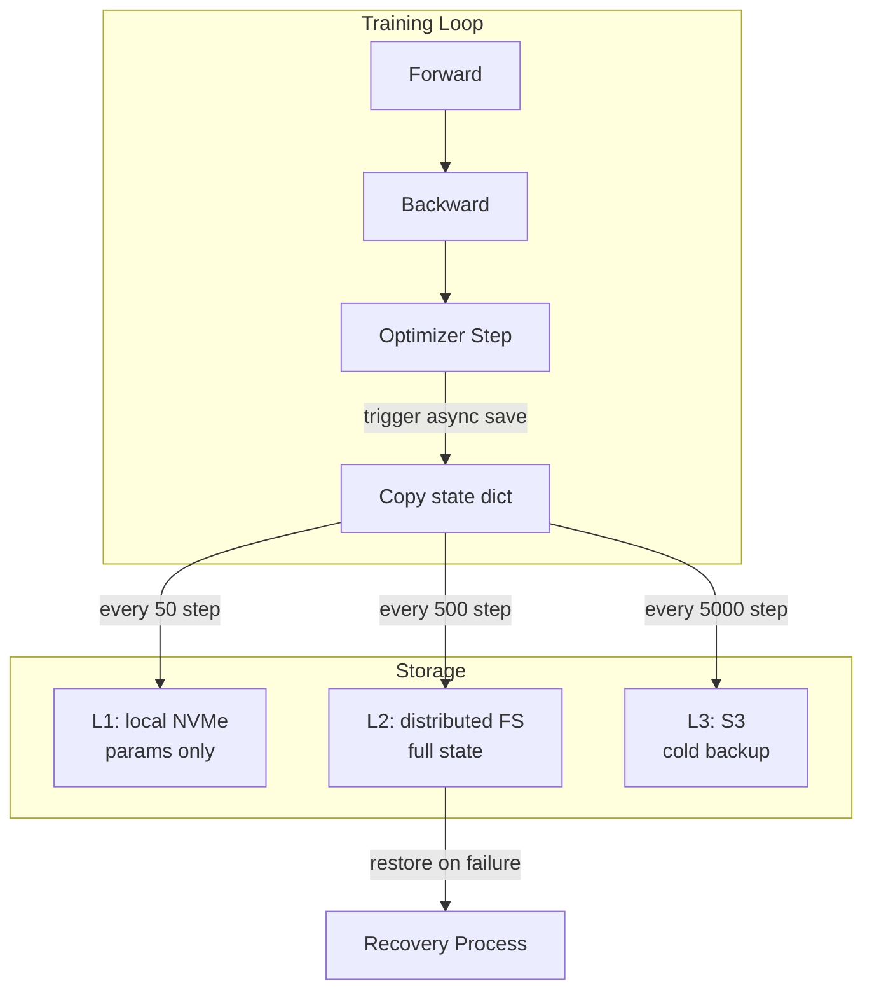

图示展示三层 checkpoint 和异步保存触发点。

#### 6. 拓展知识

- `save_distributed_checkpoint` 支持并行度变化时的 reshard——从 TP8 恢复为 TP4 时自动重新分配 shard [已确认] `insights/05-megatron-architecture.md:1217`。
- checkpoint 保存的后台异步与文件系统带宽强相关 [已确认] `insights/05-megatron-architecture.md:309`。
- [推断] L1 热备份可以放在 tmpfs（内存文件

系统），进一步降低 save_time，但容量受限。

#### 7. 常见追问及回答要点

1. **问：异步保存时 GPU 计算覆盖了 state dict 的内存怎么办？** 答：state dict copy 发生在 optimizer.step() 之后——此时参数已经更新，copy 的是更新后的值。关键是 copy 必须在下一轮 optimizer 修改参数前完成，或使用独立 buffer。
2. **问：从 L1（仅参数）恢复和从 L2（完整状态）恢复的区别？** 答：L1 恢复快（无需加载优化器状态），但需要重建优化器状态——Adam 的 m/v 从零开始，恢复后前几步的步长可能偏大。L2 恢复完整但慢。
3. **问：并行度变化怎么 load checkpoint？** 答：Megatron-Core 的 dist_checkpointing 支持 reshard——从 checkpoint 中读取不同并行度下的 shard 并重新映射到当前 rank [已确认] `insights/05-megatron-architecture.md:1217`。

#### 8. 易错点与反例

- 反例："每 step 都保存最安全"——60s 保存时间 × 10000 step = 17 小时浪费在 I/O 上。
- 反例："异步保存不需要 barrier"——如果没有正确同步，可能保存了"半新半旧"的状态——参数已更新但优化器状态还是上一轮的。
- 易错：checkpoint 路径不包含数据管线状态——恢复后不知道读到了第几个 sample，可能重复或跳过数据 [推断]。

#### 9. 实践与验证

[待验证] 输入：70B 模型，64 GPU，训练 1000 step。步骤：对比 (a) 同步保存 vs (b) 异步保存的 (i) 每 step 平均时间、(ii) checkpoint 文件完整性（MD5 校验）、(iii) 恢复后的 loss 曲线 diff。oracle：异步保存的 step 时间增加 < 5%，恢复后 loss diff < 1e-5。当前未执行。

#### 10. 评分标准

- 不合格：说不清 checkpoint 包含哪些内容，或认为保存越频繁越好。
- 合格：能描述分层 checkpoint 设计、异步保存机制、RTO 分解。
- 良好：定量计算存储带宽需求、保存频率盈亏平衡、异步正确性约束。
- 优秀：讨论 GDS 加速、L1 恢复的优化器状态重建问题、reshard 机制、数据管线状态的保存遗漏。

**证据与来源：** [已确认] megatron-lm/01-modules/M05-optimizer-checkpointing/README.md:45-46；insights/05-megatron-architecture.md:1217,1261,309；[推断] 工程实践

---

## AIInfra-A013. 设计弹性训练：worker 容错、状态迁移与梯度一致性边界。

- 难度：高级
- 知识域：K08 分布式训练
- 考察能力：分布式系统、一致性模型、容错设计
- 题型：架构设计
- 面试频率：高频
- 前置知识：分布式训练、状态同步、容错
- 关联题目：AIInfra-A012（checkpoint）、AIInfra-A014（故障域）
- 事实状态：[已确认] [推断] [待验证]

#### 1. 背景知识

Megatron 训练的 schedule 拥有通信——stage 间 P2P send/recv、activation 生命周期、`finalize_model_grads` 的调用时机 [已确认] `insights/05-megatron-architecture.md:366-368`。

分布式优化器的 shard 所有权不能与普通 model state 混淆 [已确认] `megatron-lm/01-modules/M05-optimizer-checkpointing/README.md:37`。

#### 2. 问题分析

1. 弹性训练的核心需求：worker 故障后不中断整个 job，而是替换 worker 并继续。
2. 状态迁移的难点：每个 worker 持有不同的参数/梯度/优化器 shard——替换后新 worker 需要获得正确的 shard。
3. 梯度一致性：故障发生在 forward 中途 vs backward 中途 vs optimizer step 中途，恢复策略不同。
4. 一致性边界：哪些操作是幂等的、哪些不能重做、哪些必须回滚。

#### 3. 具体答案

面试中可以这样回答：

> 弹性训练设计需要回答三个问题：**故障检测多快、恢复后状态多新、一致性保证到什么程度。**
>
> **故障检测与分类：**
>
> | 故障类型 | 检测方式 | 影响范围 |
> |---|---|---|
| 单 worker hang | NCCL timeout + heartbeat | 所有与该 worker 通信的集合操作失败 |
| 单 worker OOM | 进程 exit code + 日志 | 该 worker 的 DP group 受影响 |
| 节点失联 | 心跳超时 | 该节点所有 worker 退出 |
| NVLink 降级 | NCCL error + 带宽监控 | TP allreduce 性能下降但不中断 |
>
> **状态迁移设计：**
>
> 新 worker 加入后的状态恢复有两条路：
>
> 1. **Full restore from checkpoint**：新 worker 从最近 checkpoint 加载自己负责的 shard → 需要 checkpoint 路径可达 + 加载时间（30-180s）。优点是状态一致；缺点是慢。
> 2. **Peer restore from alive workers**：存活 worker 把自己持有的 shard 传给新 worker（allgather 新 worker 的分片）→ 无需存储读取，速度快；但需要存活 worker 状态最新。
>
> 推荐混合策略：**参数 + 优化器用 checkpoint 恢复（强一致），pipeline 中的 in-flight activation 丢弃重算（弱一致）。**
>
> **梯度一致性边界：**
>
> ```
> forward/backward/optimizer 三个阶段的容错差异：
> 
> forward 中途故障:
>   丢弃本轮所有 microbatch 的 activation → 重做
>   成本 = 本轮 forward 时间
> 
> backward 中途故障:
>   丢弃本轮所有梯度（accumulated grads 不可信）→ 重做
>   成本 = 本轮 forward + backward 时间
> 
> optimizer step 中途故障:
>   参数可能部分更新 → 必须回滚到 step 前
>   成本 = 从最近 checkpoint 恢复 + 重做丢失的 step
> ```
>
> **关键不变量：** 梯度 finalize（reduce-scatter/allreduce）必须是原子操作——要么所有 rank 都完成，要么全部回滚。不能出现"rank A 已 finalize 但 rank B 未 finalize"的中间状态。

#### 4. 技术洞察

```text
弹性训练的 throughput overhead:
  availability = MTBF / (MTBF + MTTR)
  例：MTBF=24h, MTTR=5min → 可用率 99.6%
  
  但如果每 step 都做 checkpoint: overhead = save_time / step_time
  60s/5s = 12x → 不可接受
  
  最佳策略：异步 checkpoint + 故障时回退到最近 ckpt
  overhead = checkpoint_overwrite_bandwidth + 恢复时间 × 故障频率

一致性边界的形式化：
  设 G_i 为第 i 步的梯度
  允许的最大重做步数 = checkpoint_interval
  如果故障间隔 < checkpoint_interval → 最多回退 checkpoint_interval 步
  如果故障间隔 > checkpoint_interval → 回退到最近 ckpt + 重跑
```

#### 5. 图文说明

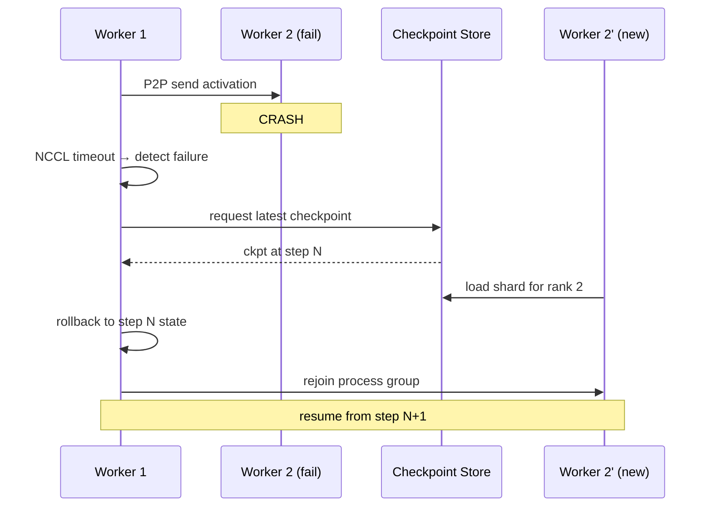

图示展示故障检测和 peer restore 流程。

#### 6. 拓展知识

- Megatron-Core 的 dist_checkpointing reshard 支持并行度变化——这意味着替换 worker 时甚至可以用不同数量的 worker 恢复 [已确认] `insights/05-megatron-architecture.md:1217`。
- [推断] 在 MoE 场景下，worker 故障还涉及 expert 的重新分配——EP group 的成员变化需要重新路由 token。
- [待验证] K8s 场景下，弹性训练通常结合 Volcano/Run:ai 等调度器的 preemptible pod 机制。

#### 7. 常见追问及回答要点

1. **问：为什么不直接把所有 worker 的 checkpoint 同步保存到内存，故障时秒级恢复？** 答：70B 模型全量 checkpoint ≈ 1.5TB（参数+优化器），64 节点的总内存占用不现实。且内存 checkpoint 在节点断电时丢失。
2. **问：PP 场景下故障 worker 在中间 stage，上下游 stage 怎么处理？** 答：上下游 stage 的 P2P send/recv 会 timeout → 所有 stage 回退到最近 checkpoint。PP 的全局一致性要求"全部 stage 同时恢复"。
3. **问：数据管线也需要恢复吗？** 答：是的——如果数据位置不恢复，重做的 step 会读到不同数据，导致 loss 曲线不连续。checkpoint 必须包含 (epoch, sample_index) [推断]。

#### 8. 易错点与反例

- 反例："换一个新 worker 就行，不需要恢复状态"——新 worker 没有正确参数分片，allreduce 会产出错误结果。
- 反例："梯度可以部分 finalize"——部分 finalize 意味着不同 rank 的梯度混合了不同 step 的值，更新后参数不一致。
- 易错：忘记销毁旧 NCCL communicator就创建新的——NCCL group 泄漏导致后续集合操作 hang。

#### 9. 实践与验证

[待验证] 输入：8 节点 64 GPU 训练 70B。步骤：在第 500 step 时 kill 1 个 worker，测量 (a) 故障检测时间、(b) 从 checkpoint 恢复时间、(c) 恢复后 loss 曲线与 baseline 的 diff。oracle：RTO < 5min，loss diff < 1e-4。当前未执行。

#### 10. 评分标准

- 不合格：认为弹性训练就是"重启 worker"，不了解状态迁移需求。
- 合格：能描述故障检测、checkpoint 恢复、梯度一致性边界。
- 良好：给出 peer restore vs full restore 的对比、梯度 finalize 的原子性约束、throughput overhead 估算。
- 优秀：讨论 MoE 的 expert 重分配、PP 的全局一致性要求、NCCL communicator 生命周期管理。

**证据与来源：** [已确认] megatron-lm/01-modules/M05-optimizer-checkpointing/README.md:37；insights/05-megatron-architecture.md:366-368,1217；[推断] 工程实践

---

## AIInfra-A014. 万卡集群通信故障域隔离：如何限制一个集合通信错误的爆炸半径？

- 难度：高级
- 知识域：K04 网络互联
- 考察能力：故障域设计、隔离策略、系统可靠性
- 题型：架构设计
- 面试频率：中频
- 前置知识：NCCL、集合通信、网络拓扑
- 关联题目：AIInfra-A006（拓扑感知通信）、AIInfra-A013（弹性训练）
- 事实状态：[已确认] [推断] [待验证]

#### 1. 背景知识

Megatron 的并行轴（TP/PP/DP/CP/EP）由 `RankGenerator` 映射到独立的 `process group`，每个 group 是独立的 NCCL communicator [已确认] `insights/05-megatron-architecture.md:355-356`。

MT-NLG 的排布法则：TP 同节点 NVLink、DP 同 rack、PP 可跨 rack [已确认] `insights/05-megatron-architecture.md:867-869`。

#### 2. 问题分析

1. 万卡集群的通信故障影响范围取决于 communicator 的耦合程度——如果所有通信共享一个 communicator，一个节点的错误会让整个集群 hang。
2. 故障域隔离的核心：把大通信组拆成小组、每小组独立容错、限制错误传播。
3. 需要在"隔离性好"（小组独立）和"通信效率高"（大组带宽高）之间权衡。
4. 错误检测 + 隔离 + 恢复的三阶段设计。

#### 3. 具体答案

面试中可以这样回答：

> 万卡集群通信故障域隔离的核心思想是 **"爆炸半径 = 共享同一 communicator 的 rank 数"**——要限制爆炸半径，就要限制每个 communicator 的规模。
>
> **隔离策略分层：**
>
> 1. **Per-axis communicator 隔离**：TP/PP/DP/CP/EP 各用独立的 NCCL communicator [已确认] `insights/05-megatron-architecture.md:355-356`。一个 TP group 内的错误不影响 PP group 的通信。
>
> 2. **Per-group timeout + abort**：为每个 communicator 设置独立的 timeout（如 TP=600s, PP=3600s）。超时后仅 abort 该 communicator，不影响其他。
>
> 3. **Group 内 subgroup 隔离**：对于必须大 group 的通信（如 DP gradient reduce 在万卡规模），用 hierarchical reduce——先 rack-local reduce，再 cross-rack reduce。rack-local 失败只影响该 rack，不扩散到全部万卡。
>
> **故障域映射到物理拓扑：**
>
> ```
> 万卡 = 128 节点 × 8 GPU
> 
> Level 1: TP group (8 GPU, 同节点)
>   → 故障域 = 单节点
>   → 爆炸半径: 8 GPU
> 
> Level 2: PP group (跨节点, 32 节点)
>   → 故障域 = 单 rack
>   → 爆炸半径: 256 GPU
> 
> Level 3: DP group (全局, 128 节点)
>   → 故障域 = 集群 (但用 hierarchical reduce)
>   → 实际爆炸半径: 单 rack (hierarchical 隔离)
> ```
>
> **错误传播阻断：**
> - NCCL 的 error 通过 callback/event 返回——需要在 callback 中做隔离决策：重试（transient error）/ abort（persistent error）/ fallback（降级到 CPU/Gloo）。
> - 如果一个 communicator abort，所有等待该 communicator完成的 rank 必须同步感知——否则部分 rank 继续执行导致 deadlock。
> - [推断] 在 MUSA 平台上，conditional graph 的 host 往返路径也是故障注入点——host-side conditional handle 读取失败会导致 graph 执行 hang。

#### 4. 技术洞察

```text
hierarchical reduce 的隔离效果:
  无 hierarchical: 1 个 rank 故障 → 全部 10240 rank 等待超时
  有 hierarchical: 1 个 rank 故障 → 仅该 rack 的 256 rank 受影响
                    其他 rack 的 reduce 正常完成 → 可继续训练

错误检测延迟模型:
  T_detect = T_heartbeat_interval + T_NCCL_timeout_check
  典型值: heartbeat=30s, NCCL timeout=600s
  → 最长 630s 才能检测到故障
  
  优化: 用 watchdog thread 做 per-step 心跳（每 10s）
  → 检测延迟降到 10s
```

#### 5. 图文说明

```mermaid
flowchart TD
  subgraph Rack1[Rack 1: 32 nodes]
    R1G1[TP grp 1]
    R1G2[TP grp 2]
    R1H[Rack-local reduce]
  end
  subgraph Rack2[Rack 2: 32 nodes]
    R2G1[TP grp 33]
    R2G2[TP grp 34]
    R2H[Rack-local reduce]
  end
  R1H -.->|cross-rack reduce| R2H
  R1G1 -.->|isolated failure| R1G1
  Note right of R1G1: 爆炸半径=8 GPU<br/>不影响其他rack
```

图示展示 hierarchical reduce 的故障隔离效果。

#### 6. 拓展知识

- NCCL 的 `NCCL_TIMEOUT` 环境变量设置全局 timeout，但可以 per-communicator 设置更精细的值 [推断]。
- [待验证] 在 InfiniBand 子网层面，Partition Key (P_Key) 可以提供硬件级隔离——不同 communicator 用不同的 P_Key。
- NVLink 的单 link 降级不会触发 communicator abort，但会降低有效带宽——需要 bandwidth monitor 告警而非错误处理。

#### 7. 常见追问及回答要点

1. **问：为什么不用全局统一 timeout？** 答：全局 timeout 会让 PP 的低频通信和 TP 的高频通信用同一 timeout——PP 通信量大需要更长 timeout，TP 希望快速检测故障。
2. **问：hierarchical reduce 的代价是什么？** 答：多一轮 rack-local reduce（增加约 10-20% 的 reduce 时间），以及 rack-level reduce 的 root 节点是单点——如果 rack root 故障，该 rack 的 DP 通信也受影响。
3. **问：如何测试故障隔离？** 答：注入故障——(1) 用 `tc qdisc` 模拟网络丢包；(2) kill 单 worker 进程；(3) 注入 NVLink 误码。验证其他 rack 的通信不受影响。

#### 8. 易错点与反例

- 反例："一个 communicator abort 不影响其他 communicator"——如果 rank A 的 TP communicator abort，rank A 不再参与 PP P2P，导致 PP 上下游也 hang。
- 反例："万卡必须用 all-to-all 通信"——all-to-all 的故障域是全集，应尽可能用 reduce-scatter 替代。
- 易错：NCCL communicator 销毁后未清理 MemPool 注册——资源泄漏导致后续 communicator 创建失败 [推断]。

#### 9. 实践与验证

[待验证] 输入：128 节点 1024 GPU 集群。步骤：在 1 个节点上注入网络丢包，测量 (a) 故障检测时间、(b) 受影响节点数、(c) 训练 step 时间变化。oracle：仅 1 个 rack 受影响，其他 rack 的 step 时间不变。当前未执行。

#### 10. 评分标准

- 不合格：说不清故障域的概念，或认为一个错误影响全部万卡。
- 合格：能描述 per-axis communicator 隔离、hierarchical reduce、timeout 设置。
- 良好：定量分析爆炸半径、检测延迟模型、fallback 策略。
- 优秀：讨论 IB P_Key 硬件隔离、NVLink 降级处理、conditional graph 的 host 故障点。

**证据与来源：** [已确认] insights/05-megatron-architecture.md:355-356,867-869；[推断] NCCL 文档 + 工程实践

---

## AIInfra-A015. 设计多模型共池的推理平台：显存切分、抢占策略与 SLO 分级。

- 难度：高级
- 知识域：K09 推理服务
- 考察能力：系统设计、资源管理、SLO 建模
- 题型：架构设计
- 面试频率：高频
- 前置知识：KV cache 管理、显存池化、推理 serving
- 关联题目：AIInfra-A004（多租户显存池）、AIInfra-A005（PagedAttention）
- 事实状态：[已确认] [推断] [待验证]

#### 1. 背景知识

SGLang 的 KV pool 分层模型：`ReqToTokenPool` + `TokenToKVPoolAllocator` + 物理 KV backing [已确认] `insights/02-kv-pool-lifecycle-and-ownership.md:6-33`。

`Schedulable_token_capacity` 在存在 auxiliary cache 时返回 dense capacity，而不是直接返回物理 KV capacity [已确认] `sglang/01-modules/M08-kv-cache/README.md:99-100`。

#### 2. 问题分析

1. 多模型共池的核心挑战：不同模型的 KV 结构不同（layers × kv_heads × head_dim）、加载/卸载成本高、SLO 差异大。
2. 显存切分策略：固定分区 vs 动态共享 vs 分层（热模型固定 + 冷模型弹性）。
3. 抢占策略：模型 A 的请求抢占模型 B 的资源——需要考虑 B 的 KV cache 驱逐代价。
4. SLO 分级：不同模型的 P99 目标不同——GPT-4 级别的 P99 可能 5s，demo 模型可能 500ms。

#### 3. 具体答案

面试中可以这样回答：

> 多模型共池的核心矛盾是 **模型间的显存需求差异**——70B 模型需要 140GB 权重，7B 模型只需 14GB，两者 KV cache 结构也不同。
>
> **显存切分策略对比：**
>
> | 策略 | 实现 | 利用率 | 隔离性 | 适用 |
> |---|---|---|---|---|
> | 固定分区 | 每个模型预分配固定 KV pool | 低（按峰值配） | 强 | 核心模型 |
> | 弹性共享 | 全局共享 pool + per-model quota | 高 | 中 | 所有模型 |
> | 分层（推荐） | 热模型固定 + 冷模型弹性 | 高 | 强+中 | 混合场景 |
>
> **分层设计的关键：**
> ```
> HBM 总容量 = model_A_weight + model_B_weight + ... + KV_budget_all
> 
> KV_budget_all = KV_hot_fixed + KV_cool_elastic
>   KV_hot_fixed: 核心模型（如 70B）固定预留
>   KV_cool_elastic: 其他模型共享池
>   
> 当 core 模型的 load 下降:
>   可以把 KV_hot_fixed 的一部分临时借给 elastic pool
>   → 但需要 protocol: 当 core 模型 load 上升时，elastic 池必须归还
> ```
>
> **抢占策略设计：**
> 1. **模型级抢占**：低 SLO 模型（如内部 demo）的 KV 被高 SLO 模型驱逐。代价：被抢占模型后续请求需要重新 prefill。
> 2. **请求级抢占**：同一模型内，低优先级请求的 KV 被高优先级请求驱逐（同 A010 的 preemption）。
> 3. **抢占成本排序**：优先抢占 (a) partial KV 少（prefill 浪费少）的模型、(b) SLO 冗余度高的模型、(c) running 请求少的模型。
>
> **SLO 分级：**
>
> | SLO 等级 | P99 TPOT | 显存保障 | 抢占优先级 |
> |---|---|---|---|
| P0 (production) | < 50ms | 固定预留 + 不驱逐 | 不被抢占 |
| P1 (standard) | < 200ms | shared pool 优先配额 | 抢占 P2 |
| P2 (best-effort) | < 1s | shared pool 剩余 | 最先被抢占 |

#### 4. 技术洞察

```text
模型切换成本：
  model_unload_time ≈ weight_size / PCIe_bandwidth
  70B FP16 = 140GB / 32GB/s (PCIe Gen4) ≈ 4.4s
  
  model_load_time ≈ weight_size / storage_bandwidth
  从 NVMe: 140GB / 7GB/s ≈ 20s
  从 distributed FS: 140GB / 500MB/s ≈ 280s (网络受限)
  
  → 模型切换代价高，不适合细粒度时间片
  → 共池的前提是模型常驻显存（或热模型常驻）
```

#### 5. 图文说明

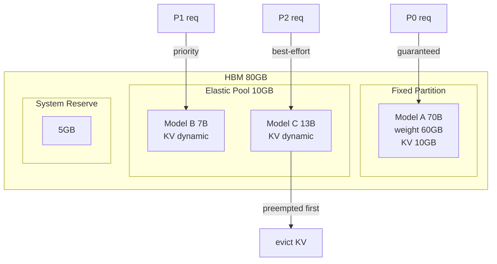

图示展示分层显存分区和抢占优先级。

#### 6. 拓展知识

- CUDA Graph 的 capture batch/shape 与模型绑定——多模型共池时不同模型的 graph 不能共享 [已确认] `insights/02-kv-pool-lifecycle-and-ownership.md:42`。
- [推断] LoRA 适配器的 KV 结构相同（同一 base model），可以共享 KV pool——这是共池的一个优化点。
- MIG 不支持跨 partition 的显存共享——不同 MIG instance 上的模型完全隔离 [待验证]。

#### 7. 常见追问及回答要点

1. **问：热模型 load 突然飙升导致 elastic pool 被强制归还，冷模型的请求怎么处理？** 答：冷模型进入 "degraded mode"——接受更长的 TPOT、减少 max batch size、甚至暂停接受新请求。归还过程是渐进的（分 step 归还），不是瞬间切断。
2. **问：多个小模型和一个大模型共池，大模型会不会"饿死"小模型？** 答：如果用了固定分区，不会——大模型有 guaranteed 的 KV budget。如果是纯共享池，需要 per-model min quota 保护。
3. **问：模型卸载后重新加载时 KV cache 怎么办？** 答：卸载前必须 flush 所有 running 请求（abort 或 drain）。重新加载后 KV cache 从零开始——之前缓存的 prefix 全部丢失。这是卸载的隐性成本。

#### 8. 易错点与反例

- 反例："模型可以像进程一样快速切换"——70B 模型加载需要 20s，比推理请求的 P99 大 100 倍。
- 反例："所有模型共享一个 KV pool 就行"——不同模型的 layers/kv_heads/head_dim 不同，KV tensor 的 layout 不同，不能直接共享。
- 易错：卸载模型时不 flush running 请求——请求持有已释放 KV 的 dangling pointer。

#### 9. 实践与验证

[待验证] 输入：70B + 7B + 13B 三模型共池，P0/P1/P2 SLO。步骤：在 P0 模型 load 突增时观察 (a) P1 模型的 P99 TPOT 变化、(b) 抢占次数、(c) 被抢占请求的恢复时间。oracle：P1 P99 可能上升 50% 但 SLO 不违反；P2 可能暂停服务。当前未执行。

#### 10. 评分标准

- 不合格：认为所有模型可以直接共享显存，不了解模型切换成本。
- 合格：能描述显存切分策略对比，理解抢占和 SLO 分级的基本思路。
- 良好：定量分析模型切换成本、分层设计的租借协议、抢占成本排序。
- 优秀：讨论 CUDA Graph 与模型的绑定、LoRA 共享优化、卸载 flush 的隐性代价。

**证据与来源：** [已确认] insights/02-kv-pool-lifecycle-and-ownership.md:6-33,42；sglang/01-modules/M08-kv-cache/README.md:99-100；[推断] 工程实践

---

## AIInfra-A016. 长上下文推理的显存与延迟工程：KV 溢出、量化与分页的组合策略。

- 难度：高级
- 知识域：K09 推理服务
- 考察能力：系统设计、技术组合、工程权衡
- 题型：架构设计
- 面试频率：高频
- 前置知识：KV cache、量化、分页、长上下文
- 关联题目：AIInfra-A005（PagedAttention）、AIInfra-A015（多模型共池）
- 事实状态：[已确认] [推断] [待验证]

#### 1. 背景知识

PagedAttention 减少动态 KV cache 的碎片和冗余复制 [已确认] `insights/01-static-dynamic-hybrid-pools.md:35-37`。

vAttention 用 CUDA VMM 分离虚拟地址和物理显存 [已确认] `insights/01-static-dynamic-hybrid-pools.md:55-63`。

NEO 把部分 attention 和 KV cache 迁到 CPU 减轻 GPU 显存压力 [已确认] `insights/01-static-dynamic-hybrid-pools.md:65-68`。

KVPR 把 CPU offload 和 GPU partial recomputation 结合 [已确认] `insights/01-static-dynamic-hybrid-pools.md:68-69`。

#### 2. 问题分析

1. 长上下文（128K+）的 KV cache 显存需求巨大——FP16 的 128K token KV 可达 32 × 8 × 128 × 2B = 64MB/token（for 70B），128K token = 8GB/request。
2. 单一技术不够：分页解决碎片但容量不变、offload 增加延迟、量化损失精度。
3. 需要组合策略：PagedAttention（碎片）+ KV quantization（容量）+ 分层 offload（超容量）+ sparse attention（计算）。
4. 每种组合有不同的延迟-质量 trade-off。

#### 3. 具体答案

面试中可以这样回答：

> 长上下文推理面临三重挑战：**KV cache 显存爆炸、attention 计算 O(s²) 增长、offload 恢复延迟**。单一技术无法同时解决三者，需要分层组合。
>
> **组合策略层次：**
>
> | 层 | 技术 | 解决的问题 | 代价 |
> |---|---|---|---|
> | L1 基础 | PagedAttention (page_size=16-64) | 碎片、prefix 共享 | kernel 适配成本 |
> | L2 容量 | KV quantization (FP16→FP8/INT8) | KV 显存减半 | 精度损失 |
> | L3 溢出 | CPU offload (HiCache) | 突破 GPU 显存上限 | 恢复延迟 |
> | L4 计算 | sparse attention / sliding window | 避免 O(s²) | 长距离依赖丢失 |
>
> **决策流程：**
> ```
> available_KV_budget = HBM - weights - activations
> 
> if seq_len × KV_per_token < available_KV_budget:
>     → L1 足够，GPU-only decode
> 
> elif seq_len × KV_per_token × 0.5 (quantized) < available_KV_budget:
>     → L1 + L2 足够，KV 量化后全驻 GPU
> 
> elif seq_len × KV_per_token × 0.5 < available_KV_budget + CPU_pool:
>     → L1 + L2 + L3，热 KV 在 GPU、冷 KV 在 CPU
>     → 需要 prefetch 预测避免 decode 阻塞
> 
> else:
>     → L1 + L2 + L3 + L4，sparse attention + offload + quantize
>     → 性能降级但功能可用
> ```
>
> **量化的精度-容量权衡：**
>
> | KV 量化方案 | 容量节省 | 精度影响 | 工程复杂度 |
> |---|---|---|---|
> | FP16 → FP8 (per-head) | 2× | 小 | 低（kernel 已支持） |
> | FP16 → INT8 (per-token) | 2× | 中 | 中 |
> | FP16 → INT4 (per-channel) | 4× | 大 | 高（需要 dequant attention） |
>
> **Offload 的恢复延迟隐藏：**
> ```
> prefetch_window = decode_step_time × num_prefetch_pages
> 例：decode TPOT=20ms, prefetch 5 pages → 100ms 提前量
> 
> 如果 offload 传输时间 < decode_step_time → 完全隐藏
> 如果 offload 传输时间 > decode_step_time → decode 阻塞等待
> 
> PCIe Gen4: 32 GB/s → 1 page (64KB) = 2μs (可忽略)
> 但 host→device 的 actual bandwidth ≈ 12-16 GB/s (考虑 overhead)
> ```

#### 4. 技术洞察

```text
KV per token 精确计算：
  KV_per_token = layers × 2 × kv_heads × head_dim × dtype_bytes
  
  例 70B: 32L × 2 × 8 × 128 × 2B = 131072B ≈ 128KB/token
  128K token: 128KB × 128K = 16GB/request (FP16)
  FP8 量化后: 8GB/request
  
  单卡 80GB HBM, 模型 60GB → 剩余 20GB
  FP16 只能支持 20GB/128KB ≈ 156K token (不含 batch)
  FP8 可支持 312K token
```

[推断] FP8 KV 量化的精度影响通常 < 0.1 perplexity increase——对于大多数 serving 场景可接受。但 INT4 量化对某些"大海捞针"类任务（精准回忆长上下文中的细节）影响显著。

#### 5. 图文说明

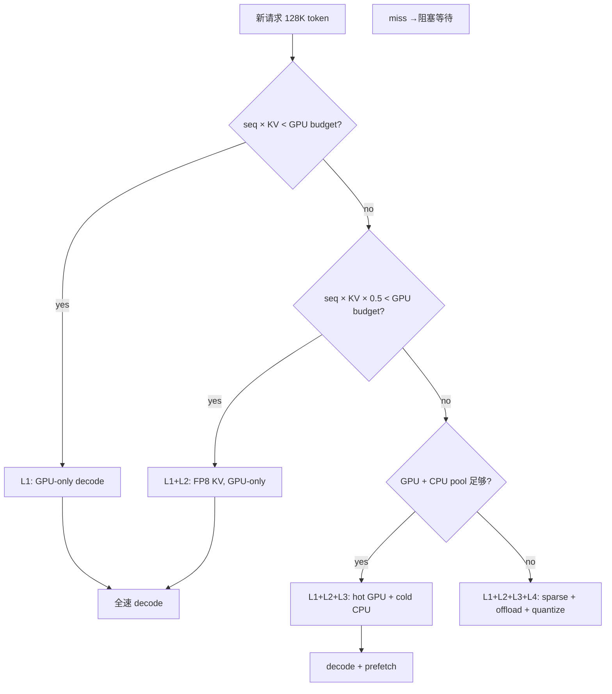

图示展示分层组合决策流程。

#### 6. 拓展知识

- KVPR 把 CPU offload 和 GPU partial recomputation 结合——用额外计算换取更好的 PCIe 传输重叠 [已确认] `insights/01-static-dynamic-hybrid-pools.md:68-69`。
- [推断] GQA (grouped query attention) 的 KV head 数少于 Q head，天然减少 KV cache 大小——长上下文场景下 GQA 比 MHA 更有优势。
- sliding window attention（如 Mistral）的 KV cache 可以只保留最近 W 个 token，从根本上消除长上下文的显存增长——但丢失全局依赖。

#### 7. 常见追问及回答要点

1. **问：为什么不在长上下文中全部用 sliding window？** 答：sliding window 丢失全局依赖——对于需要引用文档开头的任务（如"总结全文主旨"），效果差。组合策略更灵活：大部分 decode 用 full attention + offload，只在显存实在不够时降级为 sliding window。
2. **问：KV 量化和 weight-only 量化有什么区别？** 答：weight-only 量化减少模型权重显存（一次性收益），KV 量化减少每个 token 的显存（序列长度累加收益）。长场景下 KV 量化收益远大于 weight-only。
3. **问：offload 的 prefetch 预测错误怎么办？** 答：如果预测错误（decode 需要的 KV 不在 GPU），decode 阻塞等待——这是最坏情况。缓解：(1) 保守 prefetch（提前更多）；(2) fallback 到 recompute——丢弃 GPU 上的 KV，从 CPU 重算（用带宽换恢复速度）。

#### 8. 易错点与反例

- 反例："用 FP4 KV 量化就能支持无限上下文"——极端量化导致 attention 质量急剧下降，即使能跑也输出垃圾。
- 反例："offload 的延迟可以完全隐藏"——prefetch 预测不可能 100% 准确，miss 时的阻塞是必然的。
- 易错：忽略 KV cache 的 dtype 对齐——FP8 KV 需要 attention kernel 支持 dequant-on-the-fly，不是所有 kernel 都支持。

#### 9. 实践与验证

[待验证] 输入：128K 上下文，70B 模型。步骤：对比 (a) FP16 GPU-only、(b) FP8 GPU-only、(c) FP8 + CPU offload 的 (i) 最大并发请求数、(ii) P99 TPOT、(iii) 输出质量（perplexity）。oracle：FP8 的并发数约为 FP16 的 1.8-2×，质量差异 < 0.1 perplexity；offload 在 GPU 满载时提供额外 50% 并发。当前未执行。

#### 10. 评分标准

- 不合格：认为长上下文就是"加显存"或"用分页"。
- 合格：能描述三种以上技术的组合，理解各层的 trade-off。
- 良好：给出分层决策流程、KV 显存精确计算公式、offload prefetch 隐藏模型。
- 优秀：讨论 INT4 量化对"大海捞针"任务的影响、GQA 的天然优势、KVPR 的 recompute+offload 组合。

**证据与来源：** [已确认] insights/01-static-dynamic-hybrid-pools.md:35-69；[推断] 工程实践

---

## AIInfra-A017. 设计 GPU 集群可观测体系：从 kernel 到请求的全链路指标、trace 与采样策略。

- 难度：高级
- 知识域：K10 性能工程
- 考察能力：可观测性设计、指标体系、采样理论
- 题型：架构设计
- 面试频率：高频
- 前置知识：metrics、trace、profiling、GPU 遥测
- 关联题目：AIInfra-A001（roofline）、AIInfra-A009（autoscaling）
- 事实状态：[已确认] [推断] [待验证]

#### 1. 背景知识

Megatron 生态用内置 timer 统计 per-iteration、per-microbatch 的耗时；`--log-interval` 打印 throughput/MFU/损失 [已确认] `insights/05-megatron-architecture.md:1248-1251`。

SGLang 的 Scheduler 每轮记录 launch 时间和 prefill token counter [已确认] `sglang/01-modules/M04-scheduler-batching/README.md:146`。

#### 2. 问题分析

1. 全链路可观测的三个层次：kernel（nsys/MUPTI）、system（CPU/mem/net）、request（latency/throughput）。
2. 指标采集的成本：高精度 trace 产生大量数据，需要采样策略。
3. trace 关联：一个请求从 HTTP → tokenize → scheduler → forward → sample → output 需要全局 trace id。
4. 告警设计：基于 SLO 的 burn rate 告警 vs 基于阈值的告警。

#### 3. 具体答案

面试中可以这样回答：

> GPU 集群可观测体系的难点在于 **"纵向关联"**——一个请求的 P99 劣化，根因可能在 kernel（warp divergence）、系统（NUMA 远端内存访问）、或调度（batch 过大）——需要从 request 一路 trace 到 kernel。
>
> **指标体系三层：**
>
> | 层 | 指标示例 | 采集方式 | 保留周期 |
> |---|---|---|---|
> | Request 层 | TTFT, TPOT, P99, throughput, queue depth | serving framework 内埋点 | 24h（聚合） |
> | System 层 | GPU util, HBM used, NVLink bw, PCIe bw, CPU util | DCGM / 系统 agent | 7d |
> | Kernel 层 | grid size, occupancy, dram util, branch divergence | nsys/MUPTI trace | 采样 1% |
>
> **Trace 关联设计：**
> 每个请求分配全局 `trace_id`，在 HTTP → tokenize → scheduler → forward → sample 各层传递。在 trace 系统中（如 Jaeger/SkyWalking），一个 trace 的 span 包括：
> ```
> trace_id: abc123
>   span: http_recv (0ms)
>   span: tokenize (5ms)
>   span: schedule_wait (2ms)
>     span: forward_prefill (150ms)
>       span: attention_kernel (80ms)
>       span: mlp_kernel (60ms)
>     span: sample (1ms)
>   span: output_stream (3ms)
> ```
>
> **采样策略：**
> - Request 层：全量（成本低，每个请求几个 int）。
> - System 层：10s 一次（DCGM 默认采样率）。
> - Kernel 层：采样 1-5%（nsys trace 数据量极大，全量不可行）。
> - 异常时自动提升采样率——P99 突增时触发 100% kernel trace 采集 60s（snapshot-on-anomaly）。
>
> **告警设计：**
> - SLO-based burn rate："如果当前错误率持续 5min，会在 30min 内耗尽月度 SLO 预算"→ 早期告警。
> - Threshold-based：KV occupancy > 90% 持续 1min → 告警（预防 OOM）。
> - 关联告警：当 "GPU util 低 + TTFT 高" 同时出现 → 大概率是调度/数据管道瓶颈而非计算瓶颈。

#### 4. 技术洞察

```trace
Trace 数据量估算（kernel 层）：
  每 kernel: ~200 bytes (name, start, end, grid, block, ...)
  每 step 100 kernels × 1000 steps/s = 100K records/s
  = 20 MB/s per GPU
  64 GPU = 1.28 GB/s → 不可全量存储
  
  采样 1% = 12.8 MB/s → 每小时 45 GB → 可接受

全量指标 cardinality：
  request 层: req_id × model × tenant × endpoint
  → 高基数（百万级），需要聚合后存储
  → raw data 只保留最近 1h
```

[推断] 在 MUSA 平台上，MUPTI（类比 CUPTI）提供 kernel trace 和 metric 采集接口，但 API 细节可能不同——需要确认活动/回调模式的可用性。

#### 5. 图文说明

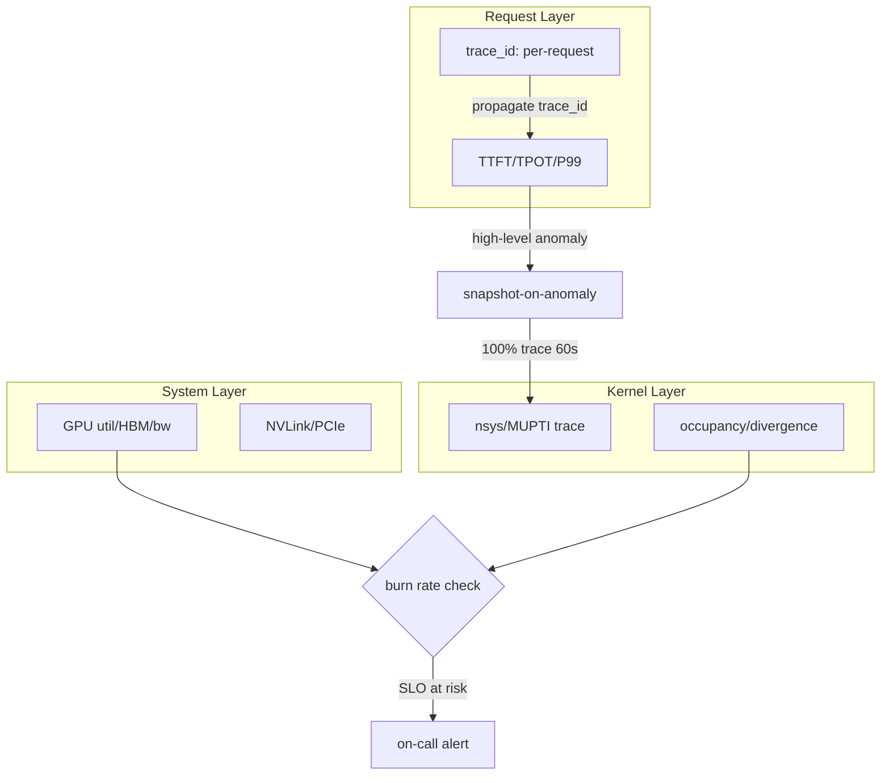

图示展示三层指标体系和 trace 关联。

#### 6. 拓展知识

- DCGM（Datacenter GPU Manager）提供 GPU 级 metrics 的标准化接口，支持 Prometheus exporter [推断]。
- [待验证] MUSA 平台可能没有 DCGM 等效物，需要通过自研 agent 采集 GPU metrics。
- nsys 的 `--trace=cuda,musa,nvtx` 可以生成 GPU + API 的完整时间线，但引入 5-15% 的开销。

#### 7. 常见追问及回答要点

1. **问：snapshot-on-anomaly 的触发延迟如何控制？** 答：告警触发到 nsys 启动之间有延迟（~5-10s）。对于瞬态问题（持续 < 10s），可能来不及 snapshot。缓解方案：始终保留最近 60s 的 ring buffer trace——告警触发后保存 ring buffer 而非启动新 trace。
2. **问：如何关联 kernel-level metric 和 request-level latency？** 答：通过 NVTX marker——在 request forward 前后打 NVTX range，nsys trace 中每个 kernel 都带 NVTX context。查询时可以"给定 trace_id 的所有 kernel"聚合。
3. **问：多租户场景下如何隔离 trace 数据？** 答：每个 trace_id 带 tenant label，trace 存储系统按 tenant 分 shard。租户只能访问自己 trace_id 的数据——需要 trace 系统支持 RBAC。

#### 8. 易错点与反例

- 反例："全量 trace 存 30 天"——kernel trace 数据量是 TB 级/天，存储成本不可承受。
- 反例："只看 GPU util 就能判断瓶颈"——GPU util 高可能是计算密集（好事），也可能是 memory stall（坏事），需要 dram util 辅助判断。
- 易错：trace_id 在跨进程传递时丢失——scheduler 进程与 model worker 进程之间的 IPC 需要显式传递 trace_id。

#### 9. 实践与验证

[待验证] 输入：64 GPU 推理集群，运行混合负载。步骤：部署全链路 trace 系统，模拟一次 KV cache 溢出导致的 P99 劣化，验证 trace 能否从请求延迟 → scheduler retraction → KV occupancy → eviction kernel 完整关联。oracle：trace 显示 "TPOT spike → retract_decode → KV free → decode resume" 的全链路时序。当前未执行。

#### 10. 评分标准

- 不合格：认为可观测性就是"加 log"，不了解采样策略和 trace 关联。
- 合格：能描述三层指标体系、trace_id 传递机制、基本的采样策略。
- 良好：定量分析 trace 数据量、给出 snapshot-on-anomaly 设计、讨论 burn rate 告警。
- 优秀：讨论 ring buffer trace、NVTX 与 kernel 关联、多租户 trace 隔离、MUSA MUPTI 的差异。

**证据与来源：** [已确认] insights/05-megatron-architecture.md:1248-1251；sglang/01-modules/M04-scheduler-batching/README.md:146；[推断] 工程实践

---

## AIInfra-A018. 设计容量规划模型：算力/显存/网络/存储的容量推导与水位线。

- 难度：高级
- 知识域：K10 性能工程
- 考察能力：定量建模、容量规划、多约束优化
- 题型：架构设计
- 面试频率：中频
- 前置知识：GPU 算力、显存层次、网络拓扑、存储
- 关联题目：AIInfra-A006（网络拓扑）、AIInfra-A009（autoscaling）
- 事实状态：[已确认] [推断] [待验证]

#### 1. 背景知识

Megatron 的训练 FLOPs 估算：训练 FLOPs/token ≈ 2×参数量 [已确认] `insights/05-megatron-architecture.md:1129`。

70B 模型在 128 GPU 上的显存拆分示例：权重量 ≈ 140GB，单模型副本分片后每卡权重 ≈ 2.2GB [已确认] `insights/05-megatron-architecture.md:1300-1305`。

KV bytes = live_tokens × layers × 2 × kv_heads × head_dim × dtype_bytes [已确认] `insights/04-design-decision-and-validation.md:20-21`。

#### 2. 问题分析

1. 容量规划的四个维度：算力（是否能算够快）、显存（是否能装得下）、网络（是否够传）、存储（是否够读）。
2. 每个维度有不同的瓶颈特征和扩容策略。
3. 需要推导"在给定 SLO 下，最多能服务多少并发"的公式。
4. 水位线设计：正常/警告/危险的阈值。

#### 3. 具体答案

面试中可以这样回答：

> 容量规划的核心公式是 **"所需资源 = 并发数 × 单请求资源"**，但每个维度的"单请求资源"计算方式不同，且相互约束。
>
> **四维度容量推导：**
>
> | 维度 | 公式 | 瓶颈特征 | 扩容方式 |
> |---|---|---|---|
> | 算力 | `compute_time = FLOPs / (GPUs × peak × MFU)` | GPU util → 100%，step time 不随 batch 增大 | 加 GPU / 提升 MFU |
> | 显存 | `HBM = weights + KV + activations + safety` | OOM / retraction 频率上升 | 加 GPU / 量化 / 减少并发 |
> | 网络 | `comm_time = data_volume / effective_bandwidth` | 等通信时间占比上升 | 优化拓扑 / 增加 PP |
> | 存储 | `io_time = batch_data / storage_bandwidth` | DataLoader idle ratio 上升 | 加缓存 / 升级存储 |
>
> **推理场景的容量推导（示例）：**
> ```
> 单实例 HBM = 80GB
> model_weights = 60GB (70B FP16)
> available_for_KV = 80 - 60 - 5 (activation) - 3 (safety) = 12GB
> 
> KV_per_token = 128KB (70B, FP16)
> KV_per_request(seq=4096) = 512MB
> 
> max_concurrent = 12GB / 512MB ≈ 24 请求
> 
> 但还要满足 P99 TPOT < 100ms:
>   compute_per_step = 70B × 2 / (8 × 312TFLOPS × 0.5) ≈ 56ms
>   batch_size_limit 由 P99 决定 → 可能需要减少并发
> ```
>
> **水位线设计：**
> ```
> Level | KV occupancy | 动作
> 正常  | < 70%         | 正常运行
> 警告  | 70-85%        | 准备扩容 / 限制新请求速率
> 危险  | 85-95%        | 主动 eviction / retract
> 紧急  | > 95%         | 拒绝新请求 / 强制 abort
> 
> 关键：水位线应基于 "即将到达 OOM 的时间" 而非 "当前 occupancy"
> 如果 occupancy 以 2%/s 上升 → 10s 后 OOM → 现在就该动作
> 如果 occupancy 稳定在 88% → 还可接受
> ```

#### 4. 技术洞察

```text
多维度约束的交集：
  max_concurrent = min(
    HBM_based_limit,
    compute_based_limit,    # P90 TPOT SLO
    network_based_limit,    # allreduce 时间占比
    storage_based_limit     # DataLoader 吞吐
  )
  
  通常 HBM_based_limit 是最紧约束（推理）
  或 compute_based_limit（训练大模型）

集群级容量：
  total_throughput = min(per_instance_throughput × instance_count,
                         total_flops / flops_per_request)
```

[推断] 在万卡集群中，网络维度往往是最紧约束——PP 跨节点 P2P 的延迟决定了最小 step time。

#### 5. 图文说明

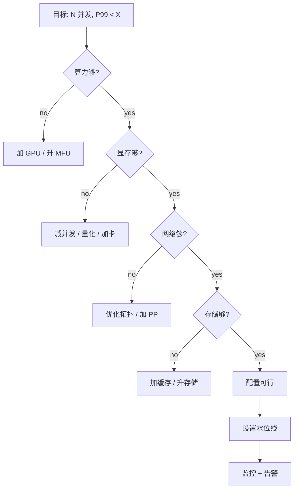

图示展示四维度约束的逐层检查。

#### 6. 拓展知识

- MFU（Model FLOPs Utilization）是核心指标——实际模型 FLOPs / (GPU数 × 峰值 × 运行时长) [已确认] `insights/05-megatron-architecture.md:1104-1106`。
- [推断] 不同模型的 MFU 上限不同——dense 模型可达 50-55%，MoE 模型因 all-to-all 可能只有 40-45%。
- 容量规划需要考虑 **故障域**——如果一个 rack 故障，剩余容量是否仍能满足 SLO？

#### 7. 常见追问及回答要点

1. **问：为什么水位线用"即将到达 OOM 的时间"而不是当前值？** 答：因为高 occupancy 不等于危险——如果 load 稳定在 85% 且不再增长，系统可以长期运行。危险的是 occupancy 快速增长（新请求突发）——只看当前值会漏报。
2. **问：推理和训练的容量模型有什么区别？** 答：训练是 throughput-oriented（最大化 tokens/s），瓶颈通常是算力或通信；推理是 latency-oriented（P99 TPOT），瓶颈通常是显存（KV cache 限制了并发数）。
3. **问：如何验证容量模型的准确性？** 答：逐步增加负载直到 SLO 违反，记录实际最大并发。与模型预测对比——如果偏差 > 20%，说明模型遗漏了某些约束（如 CPU 预处理瓶颈）。

#### 8. 易错点与反例

- 反例："显存够用就能加并发"——忽略了 compute bound——并发大到一定程度，每个请求的 TPOT 会因为 batch 过大而超标。
- 反例："容量规划是静态的"——负载分布变化（短序列→长序列）会改变 KV_per_request，需要动态调整。
- 易错：忽略故障冗余——N+1 冗余意味着可用容量是 N 而不是 N+1。

#### 9. 实践与验证

[待验证] 输入：70B 模型，8 GPU 实例，逐步增加并发从 1 到 64。步骤：记录每并发下的 (a) P99 TPOT、(b) KV occupancy、(c) GPU util。oracle：P99 在某个并发数处突变（从 50ms 跳到 200ms），对应 KV occupancy 的 retraction 阈值。当前未执行。

#### 10. 评分标准

- 不合格：只能给出"加 GPU"这种单一答案，不了解多维度约束。
- 合格：能描述四维度容量推导、水位线设计、多约束取 min 的原则。
- 良好：给出推理场景的容量推导示例、水位线的动态判断逻辑、throughput vs latency 的区别。
- 优秀：讨论 MoE 模型的 MFU 差异、万卡集群的网络约束、故障冗余对容量的影响。

**证据与来源：** [已确认] insights/04-design-decision-and-validation.md:20-21；insights/05-megatron-architecture.md:1129,1300-1305；[推断] 工程实践

---

## AIInfra-A019. 设计训练任务的故障爆炸半径控制：单任务多机失败的隔离与恢复。

- 难度：高级
- 知识域：K11 可靠性工程
- 考察能力：容错设计、故障域、恢复策略
- 题型：架构设计
- 面试频率：高频
- 前置知识：分布式训练容错、故障注入、checkpoint
- 关联题目：AIInfra-A013（弹性训练）、AIInfra-A014（通信故障域）
- 事实状态：[已确认] [推断] [待验证]

#### 1. 背景知识

Megatron 训练错误分三类：配置/初始化错误（早失败）、数值/收敛错误（难定位）、系统/通信错误（常驻查拓扑、偶发查 overlap）[已确认] `insights/05-megatron-architecture.md:1256-1260`。

错误边界是分层的：Driver drvError → HAL return → Runtime rtError → ACL aclError → GE Status [已确认] `cann/90-cross-module/error-boundaries.md:16-17`。

#### 2. 问题分析

1. 单任务多机训练中，一个节点的故障可能"传染"到整个任务——需要设计隔离机制。
2. 爆炸半径 = 因单点故障而必须停止的 worker 数。
3. 隔离设计：故障检测时间 + 故障影响范围 + 恢复策略。
4. 与 A014（通信故障域）的区别：A014 侧重通信层隔离，本题侧重训练任务层隔离。

#### 3. 具体答案

面试中可以这样回答：

> 训练任务的故障爆炸半径控制需要 **"快速止血 + 最小回滚 + 渐进恢复"** 三步。
>
> **爆炸半径分析：**
>
> | 故障场景 | 默认爆炸半径 | 目标爆炸半径 | 实现方式 |
> |---|---|---|---|
> | 单 worker OOM | 全部 worker（NCCL hang） | 仅故障 worker | 独立 error callback + 异步 abort |
> | 节点宕机 | 全部 worker | 仅该节点 worker | heartbeat timeout + process group 隔离 |
> | NVLink 错误 | TP group 内全部 worker | 降级为 PCIe 通信 | 错误 fallback + 带宽监控 |
> | 数值异常 (NaN) | 无（静默传播） | 停止当前 step | grad norm check + loss watchdog |
>
> **隔离设计：**
>
> 1. **快速止血（< 30s）**：每个 worker 有独立 watchdog——如果 30s 内没有 heartbeat，自动标记故障并通知 coordinator。Coordinator 触发 "drain"：停止向故障 worker 的 P2P send，abort 涉及故障 worker 的集合操作。
>
> 2. **最小回滚**：不是回退到上一个 checkpoint，而是 **"回退到上一个一致的 optimizer step"**。因为 checkpoint 可能已经是 500 step 前——回退 500 step 的代价太大。
>    - 如果故障发生在 forward 中途 → 只丢弃当前 step，从 step 开头重做。
>    - 如果故障发生在 optimizer step 中途 → 回退到本 step forward 前的参数 + 梯度。
>
> 3. **渐进恢复**：
>    - 阶段 1：替换故障 worker，从 alive worker 同步参数（peer restore，~30s）。
>    - 阶段 2：重新加入 NCCL group，验证通信正常（1-2 step 预热）。
>    - 阶段 3：恢复正常训练，观察 100 step 确认无异常。
>
> **关键不变量：** 任何时刻，所有 alive worker 的参数在同一 optimizer step 版本上。不允许"部分 worker 在 step N、部分在 step N-1"的状态存在超过 T_detect + T_recover 时间窗口。

#### 4. 技术洞察

```text
爆炸半径的形式化：
  blast_radius = f(T_detect, T_isolate, T_propagate)
  
  其中 T_propagate = 错误从源头扩散到其他 worker 的时间
  例如：NCCL P2P send 没有 timeout → T_propagate = ∞
      如果设 NCCL timeout=10s → T_propagate ≤ 10s
      
  目标: blast_radius = 1 (只影响故障 worker)
  条件: T_detect + T_isolate < T_timeout
  即: 在超时触发前完成隔离

恢复代价对比:
  checkpoint 恢复: rollback 500 step × 5s = 2500s
  step 重做: 1 step × 5s = 5s
  peer 恢复: 同步 28GB / 50GB/s ≈ 0.56s + NCCL init 5s ≈ 6s
  → 优先 step 重做 > peer 恢复 > checkpoint 恢复
```

#### 5. 图文说明

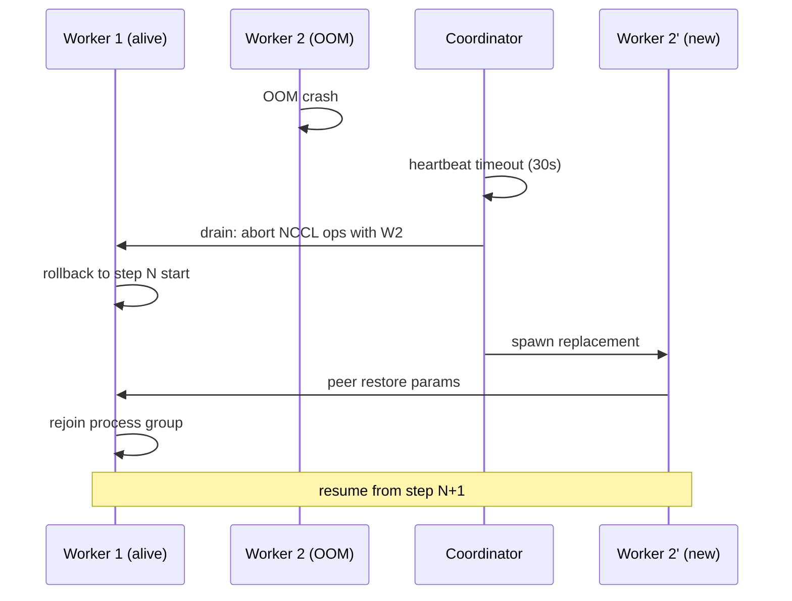

图示展示故障检测、隔离和恢复流程。

#### 6. 拓展知识

- Megatron 的 `check_checkpoint_args` 会拒绝/警告关键结构参数不匹配 [已确认] `megatron-lm/01-modules/M05-optimizer-checkpointing/README.md:45-46`——这是恢复后正确性的第一道检查。
- [推断] 在 K8s 场景下，training operator（如 Kubeflow Training Operator）负责 worker 生命周期管理——故障检测可以复用 liveness probe。
- [待验证] 弹性训练框架（如 TorchElastic）的 rendezvous 机制支持动态 worker 集合变更。

#### 7. 常见追问及回答要点

1. **问：为什么不用 checkpoint 做标准恢复？** 答：大模型 checkpoint 间隔通常 500-5000 step——回退 500 step 浪费 2500s 的计算。step 重做或 peer 恢复的代价低得多。
2. **问：如果 coordinator 本身故障了怎么办？** 答：coordinator 不应该是单点。方案：(a) 外部 coordinator（K8s operator 或 Ray GCS [已确认] `ray/01-modules/M05-gcs-control-plane/README.md:7-8`）做故障检测，实际恢复逻辑由 worker 协商执行。
3. **问：数值异常（NaN loss）怎么在"静默传播"前检测到？** 答：每个 step 后检查 grad norm——如果 grad norm > threshold 或 loss = NaN，立即 skip optimizer step 并回退到 step 前的参数。Megatron 的 Dynamic Loss Scaling 已支持此机制 [已确认] `insights/05-megatron-architecture.md:1037-1039`。

#### 8. 易错点与反例

- 反例："故障了就全部重启"——64 GPU 的 restart 成本：NCCL init ~30s + 模型 load ~60s = 90s，而 peer 恢复只需 6s。
- 反例："用 NCCL 默认 timeout 就够了"——默认 timeout 可能长达 30min——在这期间所有 worker 都在等。
- 易错：恢复后不验证通信——新 worker 的 NVLink 可能有问题，会导致后续 step 偶发 hang。

#### 9. 实践与验证

[待验证] 输入：8 节点 64 GPU 训练 70B。步骤：在训练第 500 step 时 kill 1 个 worker，测量 (a) 故障检测时间、(b) 恢复时间、(c) 恢复后 100 step 的 loss 曲线 diff。oracle：检测 < 30s，恢复 < 60s，loss diff < 1e-4。当前未执行。

#### 10. 评分标准

- 不合格：认为容错就是"重启"，不了解爆炸半径概念。
- 合格：能描述故障检测、隔离、恢复三阶段，知道 checkpoint 恢复代价高。
- 良好：给出爆炸半径的形式化模型、恢复代价对比、最小回滚策略。
- 优秀：讨论 coordinator 单点问题、Dynamic Loss Scaling、K8s training operator 的集成。

**证据与来源：** [已确认] insights/05-megatron-architecture.md:1256-1260,1037-1039；megatron-lm/01-modules/M05-optimizer-checkpointing/README.md:45-46；cann/90-cross-module/error-boundaries.md:16-17；ray/01-modules/M05-gcs-control-plane/README.md:7-8；[推断] 工程实践

---

## AIInfra-A020. 设计框架/驱动升级的灰度与回滚：兼容性验证矩阵。

- 难度：高级
- 知识域：K12 MLOps
- 考察能力：变更管理、风险评估、验证策略
- 题型：架构设计
- 面试频率：中频
- 前置知识：GPU 驱动、框架版本管理、CI/CD
- 关联题目：AIInfra-A019（故障隔离）、AIInfra-B001（warp）
- 事实状态：[已确认] [推断] [待验证]

#### 1. 背景知识

Megatron-Core 的 checkpoint `check_checkpoint_args` 会拒绝/警告关键结构参数不匹配 [已确认] `megatron-lm/01-modules/M05-optimizer-checkpointing/README.md:45-46`。

错误边界是分层的——Driver/HAL 错误 → Runtime 错误 → 框架错误——每一层都可能因为版本变化而产生不同行为 [已确认] `cann/90-cross-module/error-boundaries.md:16-17`。

MUSA Graph 的控制流实现（IF/WHILE/SWITCH）在不同 GraphExec 版本（v1 vs v2）之间行为可能不同 [已确认] `control_stream/musa-graph-control-flow-analysis.md:760-765`。

#### 2. 问题分析

1. 框架/驱动升级的风险：新版本引入 API 行为变化、性能退化、数值差异、bug。
2. 灰度策略：如何让少量 worker 先升级验证，再逐步推广。
3. 兼容性矩阵：哪些版本组合是已验证的、哪些是未知的。
4. 回滚策略：升级失败后如何快速恢复到旧版本。

#### 3. 具体答案

面试中可以这样回答：

> GPU 框架/驱动升级的难点在于 **"版本组合爆炸"**——驱动版本 × 框架版本 × 模型 × 并行配置 × 硬件型号 = 几千种组合。不可能全部验证，需要设计优先级。
>
> **兼容性矩阵设计：**
>
> | 维度 | 验证项 | 验证方法 | 通过标准 |
> |---|---|---|---|
> | API 兼容性 | 新 API / 废弃 API | 编译 + 单元测试 | 全量编译通过 |
> | 数值一致性 | 同一模型 + 数据 loss 曲线 | 确定性训练（fixed seed） | loss diff < 1e-5 |
> | 性能对比 | 典型模型 throughput | benchmark suite | 新 ≥ 旧 × 95% |
> | 并行正确性 | TP/PP/CP/EP 组合 | 多配置 smoke test | 结果与 baseline 一致 |
> | Graph 行为 | CUDA/MUSA Graph capture/replay | graph-specific tests | 所有用例通过 |
>
> **灰度策略：**
>
> ```
> Stage 0: CI 验证 (1-2天)
>   → 所有 unit test + integration test
>   → 兼容性矩阵中所有 "已验证" 组合
> 
> Stage 1: Canary (1-3天)
>   → 5% 节点升级
>   → 观察: error rate, P99, throughput, OOM 频率
>   → 对比 baseline: 任何指标退化 > 5% → 暂停灰度
> 
> Stage 2: 逐步推广 (1-2周)
>   → 25% → 50% → 100%
>   → 每阶段至少观察 24h
>   → 异常率 < baseline × 1.05 才继续
> 
> Stage 3: 全量 + 观察 (持续)
>   → 全量升级后保留旧版本镜像 2 周
>   → 2 周无异常 → 清理旧版本
> ```
>
> **回滚策略：**
>
> - 驱动回滚：需要重启节点——成本高（~5min/node）。设计"双 partition"——节点有 old/new 两个驱动 slot，故障时切换 slot 无需重装。
> - 框架回滚：只需替换容器镜像——成本低（~30s）。前提是容器镜像有版本 tag 且 registry 保留历史版本。
> - **关键：回滚后验证 checkpoint 兼容性**——新框架可能写入旧框架不认识的 checkpoint 格式 [已确认] `megatron-lm/01-modules/M05-optimizer-checkpointing/README.md:45-46`。

#### 4. 技术洞察

```text
灰度中的统计学：
  如果新版本有 1% 的 silent error rate
  跑 100 step 后观察到 error 的概率 = 1 - 0.99^100 ≈ 63%
  → canary 阶段至少跑 100 step 才能有统计学意义
  
  但 100 step × 5s = 500s ≈ 8min
  → canary 阶段 1-3 天的观察期是合理的

兼容性矩阵的组合数：
  驱动版本: 5 (近 2 年)
  框架版本: 10
  模型大小: 3 (7B, 70B, 700B)
  并行配置: 4 (TP1, TP8, TP8+PP8, TP8+PP16)
  硬件: 2 (A100, H100)
  → 5×10×3×4×2 = 1200 组合
  → 全量验证不可行，按优先级选 20-50 个核心组合
```

[推断] 在 MUSA 平台上，GraphExec v1 vs v2 的 conditional 支持差异是一个高风险变更——需要专项 Graph 测试 [已确认] `control_stream/musa-graph-control-flow-analysis.md:760-765`。

#### 5. 图文说明

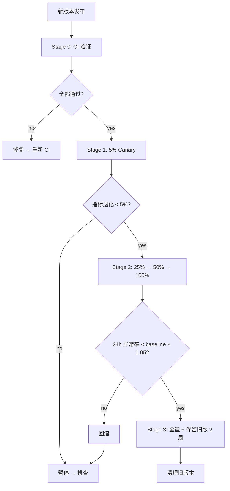

图示展示灰度阶段和回滚路径。

#### 6. 拓展知识

- checkpoint 的版本兼容性：Megatron-Core 的 `check_checkpoint_args` 只检查结构参数，不检查版本号——如果新框架的 optimizer state dict 格式变化，需要显式 migration [推断]。
- 驱动升级后 NCCL 行为可能变化——allreduce 的 ring 路径选择、tree 算法阈值都可能调整——需要通过 benchmark 验证。
- [待验证] K8s 场景下，framework 和 driver 的升级通常通过不同 operator 管理（GPU Operator 管理驱动、自定义 operator 管理框架），需要协调两者的发布节奏。

#### 7. 常见追问及回答要点

1. **问：如果 canary 阶段没发现问题，但全量升级后第 5 天才出现 bug？** 答：这种"低频 bug"通常只在特定条件触发（如 GraphExec2 的 conditional 行为 [已确认] `control_stream/musa-graph-control-flow-analysis.md:760-765`）。需要在 CI 中增加这些特殊组合的专项测试——不能只靠灰度发现问题。
2. **问：checkpoint 格式不兼容怎么办？** 答：(1) 升级前 checkpoint 转存两份（旧格式 + 新格式）；(2) 新框架提供 migration tool——读取旧格式并转换；(3) 如果无法 migration，必须保留旧框架镜像用于恢复旧 checkpoint。
3. **问：如何验证"数值一致性"？** 答：用 fixed seed + 同一 dataset 跑 N step，比较 loss 曲线和 grad norm 序列。diff < 1e-5 视为一致——但注意不同的 NCCL 算法可能导致浮点累加顺序不同，diff 可能在 1e-6 ~ 1e-4 之间（正常）。

#### 8. 易错点与反例

- 反例："CI 过了就能全量升级"——CI 只覆盖 20-50 个组合，实际环境有 1200 种组合。
- 反例："回滚就是重启到旧镜像"——如果新框架已经写入了旧框架不认识的 checkpoint 格式，回滚后无法恢复训练状态。
- 易错：忽略驱动和框架的耦合——新框架可能依赖新驱动 API，旧驱动上跑新框架会 crash。

#### 9. 实践与验证

[待验证] 输入：准备驱动版本 N 和 N+1，框架版本 M 和 M+1。步骤：在 10 个核心组合上运行 CI（单元测试 + smoke test + 数值一致性），对比 (a) 通过率、(b) throughput diff、(c) loss diff。oracle：核心组合通过率 100%，throughput diff < 2%，loss diff < 1e-5。当前未执行。

#### 10. 评分标准

- 不合格：认为"测试通过就能升级"，不了解灰度策略和版本组合爆炸。
- 合格：能描述灰度阶段、兼容性矩阵设计、基本回滚策略。
- 良好：定量分析灰度统计学、组合数计算、checkpoint 兼容性风险。
- 优秀：讨论 MUSA GraphExec v1/v2 的高风险变更、checkpoint migration、driver+framework 耦合、K8s operator 协调。

**证据与来源：** [已确认] megatron-lm/01-modules/M05-optimizer-checkpointing/README.md:45-46；cann/90-cross-module/error-boundaries.md:16-17；control_stream/musa-graph-control-flow-analysis.md:760-765；[推断] 工程实践

---

*END OF FILE*