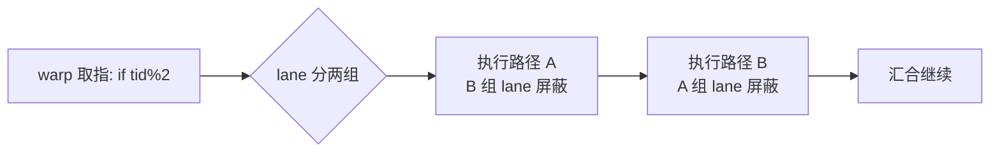
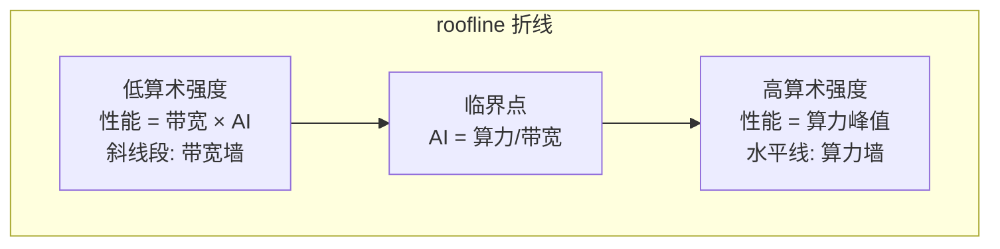
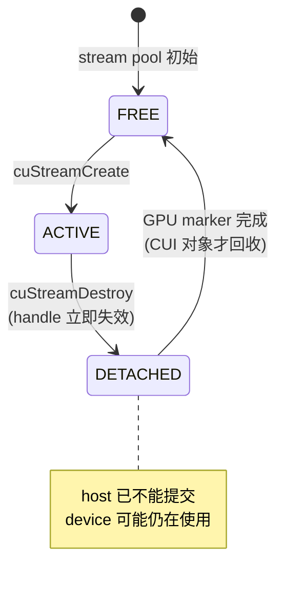
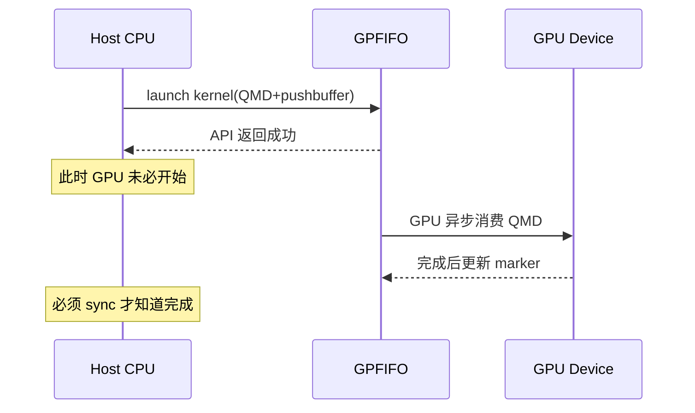
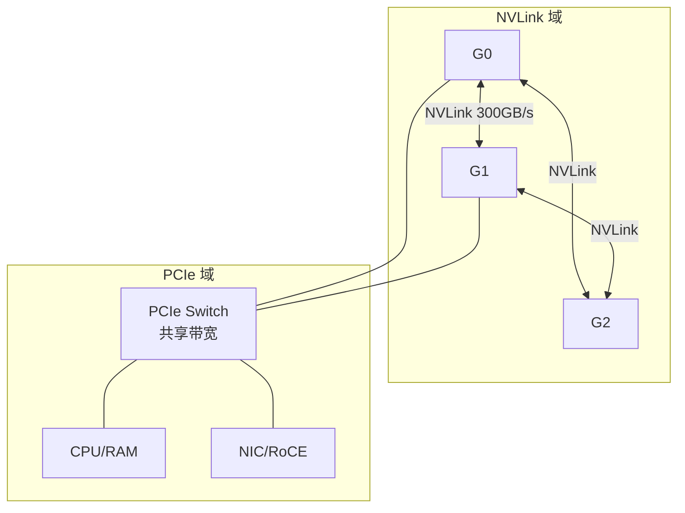
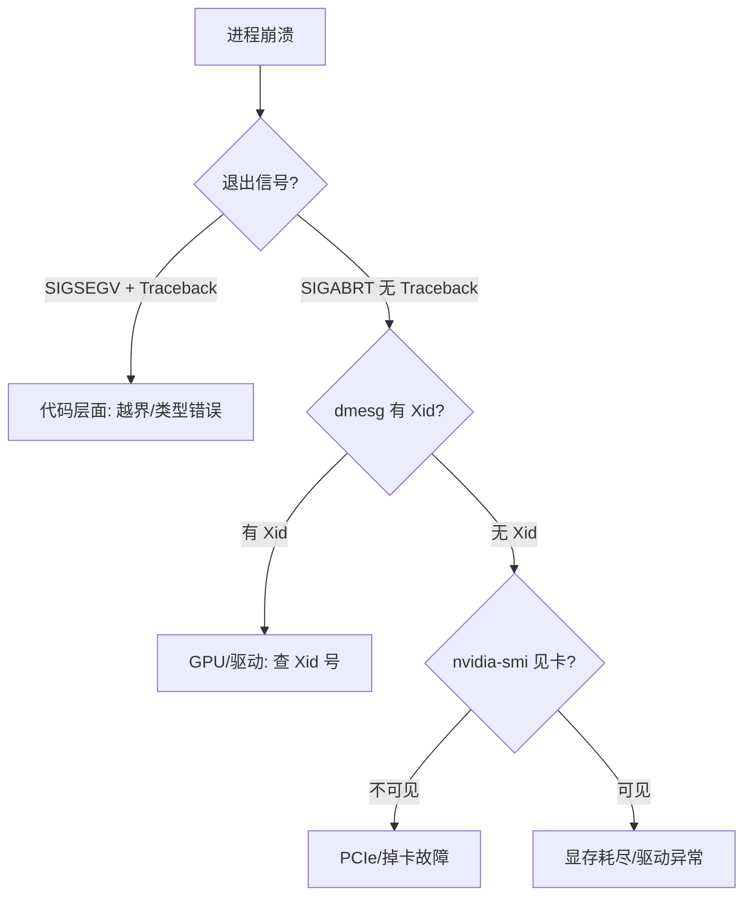
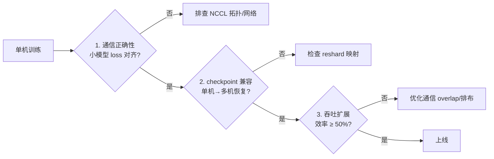
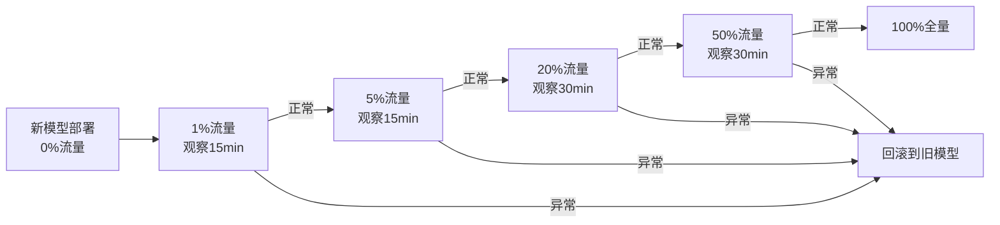
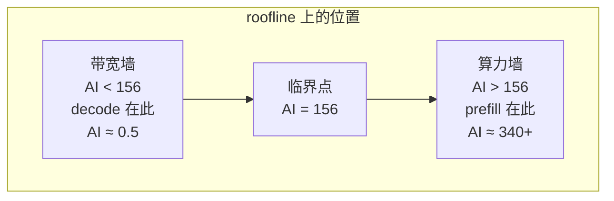

# AI Infra 入门级面试题

- 题数：20；稳定 ID：`AIInfra-B001`–`AIInfra-B020`
- 证据规则：源码/文档结论按 [已确认]、[推断] 区分；硬件、网络、多进程和性能实验按 [待验证] 处理。
- 单题门槛：每题包含元数据、背景、分析、具体答案、洞察、图示、拓展、追问、易错点、实践、评分和证据，且答案段唯一。

## AIInfra-B001. GPU 以 warp 为单位执行线程时，同一 warp 内的分支发散为什么会拖慢执行？拖慢的边界在哪里？

- 难度：入门级
- 知识域：K01 计算硬件与加速器
- 考察能力：概念解释、机制推导、边界辨析
- 题型：概念解释与辨析
- 面试频率：高频
- 前置知识：CUDA/MUSA 线程层次（thread/warp/block）、基本控制流
- 关联题目：AIInfra-I001（roofline 定位）、AIInfra-I002（Tensor Core 对齐）、AIInfra-A001（算子优化闭环）
- 事实状态：[已确认] [推断]

#### 1. 背景知识

GPU 不为每个 thread 提供独立的取指与调度单元，而是把 thread 组织成 warp 后交给 SM 上的 warp scheduler 调度 [已确认] `insights/sm-block-warp-technical-insight.md:102,144-153`。在绝大多数 CUDA 架构中一个 warp 含 32 个 thread；block 的 warp 数为 `ceil(threads_per_block / 32)`，末尾不满 32 的 lane 会被屏蔽 [已确认] `insights/sm-block-warp-technical-insight.md:108-125`。同一 warp 内所有 lane 共享一条指令流、各自维护寄存器状态，即 SIMT 模型 [已确认] `insights/sm-block-warp-technical-insight.md:153-160`。

#### 2. 问题分析

1. 先回答"warp 是什么、谁在调度它"，建立执行模型基线。
2. 再解释分支发散时硬件的行为：同一 warp 冃组 lane 无法独立同时执行两条路径，两条路径会被串行执行、非活跃 lane 屏蔽。
3. 最后回答"边界"：发散只发生在 warp 内部；不同 warp 之间的分支互不影响。定量上，最坏情况有效吞吐降到 1/路径数。

#### 3. 具体答案

面试中可以这样回答：

> warp 是 GPU 硬件调度的最小单位，一个 warp 通常含 32 个 thread，它们共享一条指令流，这就是 SIMT 模型。所以当同一个 warp 里的 thread 走了不同分支（比如 `if (tid % 2 == 0)`），硬件没法让两半 lane 同时执行两条路径，而是把每条路径各执行一遍、期间屏蔽掉不相关的 lane——这叫 warp divergence。
>
> 代价可以直接算：if/else 两条路径都会进入执行，最坏情况下这个 warp 的有效吞吐只有原来的一半；如果分支有 k 条互斥路径且分布均匀，最坏降到 1/k。注意代价只发生在 warp 内——32 个 thread 如果分成 16 个走 A、16 个走 B，和分成 32 个 warp 各自走向一致，后者没有发散损失。
>
> 边界有两条：一是发散不跨 warp，二是"未使用 lane 仍占位"——block 的 thread 数不是 32 的整数倍时，末尾 warp 依然完整存在，浪费的 lane 也是一种隐性损失。

#### 4. 技术洞察

```text
有效吞吐 ≈ 峰值吞吐 / max(1, 同 warp 内互斥路径数)
warp_count = ceil(threads_per_block / 32)   # 末尾 warp 半空也占一个调度槽
```

[推断] 上式假设各路径指令量相当；若一条路径远长于另一条，代价由长路径主导。优化方向不是消灭分支，而是"让同一 warp 内的 lane 尽量走同一条路"——重排线程与数据的映射（如按 key 分桶、按 mask gather）比删分支更常见。

#### 5. 图文说明



图示只说明执行顺序被串行化；它不能证明实际性能损失是多少——损失取决于路径长度比与分支命中率，需 profile 确认。

#### 6. 拓展知识

- 发散与谓词化（predication）：短分支常被编译为谓词指令，无跳转但仍有无用功。
- 结构化发散：CUDA 7+ 的独立线程调度（independent thread scheduling）改变了发散后线程的收敛行为，但不消除双路径执行成本。
- 与 K02 呼应：发散发生在 SM 内，与 stream/异步提交无关，不要与 host 侧并发混淆。

#### 7. 常见追问及回答要点

1. **问：block 内 thread 数设为 30 有什么隐藏成本？** 答：仍占用 1 个 warp 槽但只用 30/32 lane，末尾 2 个 lane 空转；且 block 数上升带来额外调度开销。对齐到 32 的倍数是常规做法。
2. **问：循环里 `if` 改成 `?:` 能消除发散吗？** 答：短分支可能被编译为无分支谓词代码，双路径"执行"变成双路径"求值后选择"，指令数仍增加；是否值得取决于分支体大小，需反汇编或 profile 验证，不能只凭源码判断。
3. **问：两个不同 block 的 thread 走不同分支，有发散代价吗？** 答：没有。block 由不同 SM 或不同时刻调度，发散约束只存在于 warp 内部。

#### 8. 易错点与反例

- 反例："我把 if 换成函数调用就不会发散了"——发散由 warp 内控制流是否分叉决定，与代码组织形式无关。
- 反例："发散会让 GPU 崩溃或结果错误"——发散只影响性能；结果正确性由各 lane 各自的寄存器状态保证，不会串值。
- 易错：把"发散"与"占存不足导致驻留 warp 数下降"混为一谈——后者是资源问题（见 `insights/sm-block-warp-technical-insight.md:185-188`），两者会叠加但机理不同。

#### 9. 实践与验证

[待验证] 输入：同一 elementwise kernel 两种写法——写法 A 内 `if (i % 2)` 分叉到两段不同计算，写法 B 消除分支；数据规模固定 2^24。步骤：分别编译运行，用 profiler 记录 warp stall 原因分布与 achieved occupancy；控制时钟与温度。oracle：写法 B 的 kernel 耗时显著低于 A，且 stall 原因中 branch相关占比下降。当前未执行 GPU 实验，数字不写死。

#### 10. 评分标准

- 不合格：说不清 warp 是调度单位，或声称发散导致错误结果。
- 合格：说明 SIMT 共享指令流、双路径串行执行、代价发生在 warp 内。
- 良好：给出 1/k 的定量边界、末尾 warp 占位问题、举出正确优化方向。
- 优秀：补充谓词化与独立线程调度的现代行为，指出需 profile 验证而非源码臆断。

**证据与来源：** [已确认] insights/sm-block-warp-technical-insight.md:102,108-125,144-160,164-188

---

## AIInfra-B002. 算力(TFLOPS)与带宽(GB/s)如何决定一个 kernel 的性能上限？roofline 模型怎么用？

- 难度：入门级
- 知识域：K01 计算硬件与加速器
- 考察能力：概念解释、定量推导、模型应用
- 题型：概念解释与计算
- 面试频率：高频
- 前置知识：GPU SM 与 warp 调度、DRAM/HBM 带宽概念
- 关联题目：AIInfra-B001(warp 执行)、AIInfra-B015(利用率 vs 性能)、AIInfra-I001(roofline 定位)
- 事实状态：[已确认] [推断]

#### 1. 背景知识

每个 GPU 有两个常被同时提及但含义截然不同的峰值指标：一是算力(peak TFLOPS)，即每秒能执行的浮点运算数；二是显存带宽(peak GB/s)，即每秒能从 HBM 读入或写出的数据量。二者共同构成 roofline 模型的两条"屋顶边"。roofline 模型把 kernel 的性能上限画成一条折线：横轴是"算术强度"(arithmetic intensity, FLOPS/B)，纵轴是实际吞吐(FLOPS)。[推断] 该模型假设内存访问无法被 cache 完全命中；实际 cache 命中会抬高曲线，但 roofline 给出的仍然是理论上限。

#### 2. 问题分析

1. 先定义算术强度 = kernel 每读 1 字节数据做了多少 FLOPS。
2. 再说明 roofline 的两条边：带宽限制段(低强度时性能随强度线性增长)与算力限制段(高强度时性能卡在上限)。
3. 最后给出"怎么用"：定位一个 kernel 在屋顶图上的位置，判断优化方向——是在带宽墙下(优化访存/复用数据)还是在算力墙下(减少无用计算/提高指令吞吐)。

#### 3. 具体答案

面试中可以这样回答：

> roofline 模型用一张图回答一个问题："这个 kernel 最快能跑多快？"。图的横轴是算术强度，即每搬运 1 字节数据做了多少 FLOPS；纵轴是实际达到的 FLOPS。GPU 有两个硬上限——算力峰值(比如 A100 FP16 Tensor Core 约 312 TFLOPS)和显存带宽(约 2 TB/s)。roofline 就是由这两条线交叉形成的折线：左侧斜线是带宽墙，性能 = 带宽 × 算术强度；右侧水平线是算力墙，性能 ≤ 算力峰值。
>
> 用法分三步。第一步，测出 kernel 的实际 FLOPS 和实际算术强度(总 FLOPS / 总访存字节)，点在图上。第二步，看点落在哪一段——如果落在左侧斜线段，说明 kernel 被带宽卡住，优化方向是减少冗余搬运、提高数据复用(比如 tiling、把热点数据放进 shared memory)；如果落在右侧水平段，说明算力已经是瓶颈，要优化计算路径、减少分支或利用 Tensor Core。第三步，估算理论上限：性能 = min(算力峰值, 带宽 × 算术强度)。实际达到的值越接近 roofline，kernel 越接近硬件极限。
>
> 注意 roofline 是一个上界而非预测——它不考虑 launch overhead、同步开销、warp divergence 等次级效应；这些会进一步压低实际性能。

#### 4. 技术洞察

```text
性能上限 = min(峰值算力, 峰值带宽 × 算术强度)
算术强度 = kernel 总 FLOPS / kernel 总 DRAM 读写字节(FLOPS/B)
临界算术强度 = 峰值算力 / 带宽(TFLOPS 转 FLOPS, GB/s 转 B/s)
例: 312 TFLOPS / 2 TB/s = 312e12 / 2e12 = 156 FLOPS/B
→ 算术强度 < 156 时带宽受限; > 156 时算力受限
```

[推断] 典型 elementwise kernel(如 y = x + 1)算术强度约为 1 FLOPS / (2×4B) = 0.125 FLOPS/B(读写 fp32)，远在带宽墙一侧，因此这类 kernel 几乎不可能被算力卡住。

#### 5. 图文说明



roofline 是理论性能上界，不是实测性能预测——cache 命中、launch overhead、warp divergence 等效应会使实际点低于该折线。

#### 6. 拓展知识

- HBM vs L2 cache：roofline 通常针对 DRAM/HBM 层级；若数据命中 L2，等效带宽大幅提高，同一 kernel 的实际点上移。
- Tensor Core 与 CUDA Core 两条 roofline：同一张 GPU 的 FP16 Tensor Core 和 FP32 CUDA Core 峰值不同，需分开画 roofline。
- 与 B001 联动：warp divergence 降低的是实际算力而非 roofline 本身——在图上表现为"在同一算术强度下，实际点低于理论斜线"。

#### 7. 常见追问及回答要点

1. **问：一个矩阵乘法 [M,K]×[K,N]，不考虑 shared memory tiling 时算术强度大约多少？** 答：总计算 2MNK FLOPS，总读写字节 (M×K + K×N + M×N)×sizeof(dtype)；当 M=N=K 时 AI ≈ 2N³ / (3N²) ≈ N/3 FLOPS/B(fp32 则为 N/6)，N 足够大时进入算力墙。
2. **问：算术强度刚好等于临界值怎么办？** 答：此时带宽与算力刚好同时饱和，称为"roofline 膝部"；实际中很难精确落在膝部，通常优化目标是跨过临界点进入算力墙(此时带宽不再是瓶颈)。
3. **问：roofline 模型能解释"为什么 FLOPS 高但实际慢"吗？** 答：不能。roofline 只回答"上限在哪"；FLOPS 高但实际慢多半是 launch 延迟、同步、divergence 等次级效应——参见 B015。

#### 8. 易错点与反例

- 反例："算术强度越高性能越好"——超过临界点后算术强度再提高，性能不再上升，受限于算力峰值。
- 反例："roofline 等于 kernel 的实际性能"——roofline 是理论上限；cache 与次级效应可能使实际性能高于或低于简单 roofline 曲线。
- 易错：混淆"算力受限"与"GPU 利用率高"——一个 kernel 在算力墙下，SM 可能仍因 operand 未到而 stalls，利用率并不等于 100%。

#### 9. 实践与验证

[待验证] 输入：一个 fp32 elementwise 加法 kernel (y = a*x + b)，长度 2^28。步骤：用 ncu 测量 dram__bytes.sum 与 sm__pipe_fma_cycles_active 计算实际算术强度与 FLOPS；在同一图上画出 A100 的 FP32 roofline，定位该 kernel。oracle：算术强度 ≈ 0.125 FPO/B，远低于临界值，实际点应贴近左侧斜线。当前未执行 GPU 实验，数字不写死。

#### 10. 评分标准

- 不合格：说不清算术强度定义，或把 roofline 当成性能预测曲线。
- 合格：给出 perf = min(峰值算力, 带宽 × 算术强度) 并解释两条线段。
- 良好：能估算临界算术强度、举例 elementwise 与 matmul 各落在哪一段。
- 优秀：指出 roofline 是上限而非预测，并能关联 cache/divergence 等次级效应解释实际偏离。

**证据与来源：** [推断] roofline 模型为 Berkeley 提出的通用性能分析框架；[已确认] A100 参数参考 NVIDIA 官方规格(非本仓库实测)

---

## AIInfra-B003. host 线程、device 上下文与 stream 是什么关系？谁管理它们的生命周期？

- 难度：入门级
- 知识域：K02 驱动、运行时与设备管理
- 考察能力：概念解释、生命周期分析、所有权辨析
- 题型：概念解释与辨析
- 面试频率：高频
- 前置知识：CUDA Runtime/Driver API 基础、操作系统线程模型
- 关联题目：AIInfra-B004(kernel launch 异步)、AIInfra-B005(异步与 buffer 复用)
- 事实状态：[已确认] [推断]

#### 1. 背景知识

CUDA 的 host-device 编程模型依赖三个层次：host 线程是 CPU 侧的调用者；device 上下文(CUcontext)是进程内一个 device 的状态容器，持有 memory allocator、stream/channel manager、sticky error 等；stream 是 device 侧的提交队列，kernel 与 memcpy 按提交顺序执行。[已确认] current context 属于线程局部状态而非进程全局变量，跨线程使用 handle 不代表 context 已在目标线程成为 current [已确认] `cuda/01-modules/M02-runtime-context/README.md:38-39`。Context 创建失败时会反向执行 finalize、deinitialize 和 primary TSG 释放 [已确认] `cuda/01-modules/M02-runtime-context/README.md:34`。

#### 2. 问题分析

1. 先用一句话定义三者：host 线程是"谁在调用"，context 是"在哪个状态容器上操作"，stream 是"在哪个队列上提交"。
2. 再说明所有权：context 由进程持有但通过 TLS 绑定到线程；stream 由 context 持有。
3. 最后说明生命周期管理：context 有分配→初始化→销毁的明确阶段；stream 有 FREE→ACTIVE→DETACHED→FREE 的状态机。

#### 3. 具体答案

面试中可以这样回答：

> host 线程、device 上下文和 stream 是 CUDA 编程模型的三层——每一层都有明确的所有者和生命周期。host 线程是 API 调用者，CUDA 驱动在每次 API 入口通过 TLS 查找当前线程绑定的 current context [已确认] `cuda/01-modules/M02-runtime-context/README.md:30-31`；如果 current context 不存在，多数 Runtime API 会失败。所以 context 是"线程局部"的，不是全进程共享——把一个 context handle 传给另一线程不代表那线程能用它，必须先 makeCurrent。
>
> context 本身由进程持有，内部包含 memory allocator、stream/channel manager 和 sticky error。创建时先 `cuiCtxAllocate` 分配持久状态，再由 `cuiCtxInitialize` 建立资源，失败时回滚 [已确认] `cuda/01-modules/M02-runtime-context/README.md:34`。销毁顺序相反：先 finalize、再 deinitialize、最后释放 primary TSG。
>
> stream 的生命周期比 context 更精细，有四个阶段：FREE→ACTIVE→DETACHED→FREE。public handle 在 detach 时立即失效，但 CUI stream 对象要等 marker 报告 GPU 完成后才真正回收 [已确认] `cuda/01-modules/M05-stream-submit/README.md:21-25`。这意味着 detach 后 host 侧不能再提交，但 device 侧可能还在消费该 stream 上的任务——不能把"handle 失效"当成"device 已完成"。
>
> 一句话：host 线程管理 context 的选择(context 是线程局部的)，context 拥有 stream 集合，stream 承载提交顺序。

#### 4. 技术洞察

```text
host thread
  └─ TLS → current CUcontext(线程局部)
              ├─ memmgr(allocator)
              ├─ streamManager → stream pool
              │     └─ FREE → ACTIVE → DETACHED → FREE
              ├─ channelManager
              └─ sticky error(错误会粘在 context 上)
```

[推断] 多线程程序常见错误：主线程创建 context 后传给工作线程直接使用——实际必须在工作线程内 cuCtxSetCurrent 才生效。

#### 5. 图文说明



状态机只描述 host-side 生命周期；detach 到 FREE 之间 GPU 可能仍在执行该 stream 上的任务——不能把 public handle 失效等同于设备完成。

#### 6. 拓展知识

- Primary context vs 显式 context：cuDevicePrimaryRetain 返回的是驱动为设备自动创建的 context，不可显式 destroy。
- MPS(Multi-Process Service)：多个进程的 context 可通过 MPS 共享 device 资源，但各自 TLS 状态仍独立。
- 与 B004 联动：kernel launch 提交到 stream 上，stream 绑定在特定 context 中——context 一致性检查是 launch 前的必要步骤。

#### 7. 常见追问及回答要点

1. **问：两个 host 线程共享同一个 CUcontext handle，需要加锁吗？** 答：CUDA driver API 本身是线程安全的(多线程调用 API 不会 crash)，但多个线程同时操作同一 stream 上的提交顺序是未定义行为——需要应用层加锁或每个线程用独立 stream。
2. **问：context 销毁时其上的 stream 还没完成会怎样？** 答：Context teardown 会先清理 stream，但未完成的 device 工作必须通过 tracking marker 等待；不能假设 context 一销毁 device 上的任务就立即停止。
3. **问：sticky error 怎么影响后续调用？** 答：sticky error 会粘在 context 上，后续每次 API 的 `cuiInitCheckEx` 都会先检查 sticky error 并提前返回 [已确认] `cuda/01-modules/M02-runtime-context/README.md:39`——这常让人误以为"新调用的 API 出错"，实际是之前异步操作留下的错误。

#### 8. 易错点与反例

- 反例："cuStreamDestroy 后 device 上的 kernel 也停了"——destroy 只是让 host handle 失效且 detach stream；GPU 可能仍在执行，要等 marker 完成 [已确认] `cuda/01-modules/M05-stream-submit/README.md:25`。
- 反例："进程内所有线程共享一个 current context"——current context 是线程局部的(TLS)，跨线程不自动继承。
- 易错：在 context 销毁后继续通过旧 handle 查 sticky error——handle 可能已指向被回收的对象。

#### 9. 实践与验证

[待验证] 输入：两个 pthread，主线程 cuCtxCreate + cuStreamCreate，子线程不 setCurrent 直接调用 cuLaunchKernel。步骤：编译运行，观察返回值；再用 cuStreamSynchronize 与 cuStreamQuery 探测 detach 后 device 状态。oracle：子线程 launch 应报 CUDA_ERROR_INVALID_CONTEXT 或类似错误；stream destroy 后立即同步，可能返回 not-ready。当前未在多 GPU 环境实测，数字不写死。

#### 10. 评分标准

- 不合格：混淆 context 与 stream 的作用，或声称 stream destroy 等于 device 完成。
- 合格：说明 current context 是 TLS 状态、stream 有 FREE→ACTIVE→DETACHED 状态机。
- 良好：指出 sticky error 的传播机制、detach 后 device 仍在工作的边界。
- 优秀：补充 primary context 与 MPS 等变体，能跨 B004 解释 launch 时的 context 一致性检查。

**证据与来源：** [已确认] cuda/01-modules/M02-runtime-context/README.md:30-34,38-39 ; cuda/01-modules/M05-stream-submit/README.md:21-25

---

## AIInfra-B004. kernel launch 是同步还是异步？API 返回成功能证明设备计算已完成吗？

- 难度：入门级
- 知识域：K02 驱动、运行时与设备管理
- 考察能力：概念辨析、异步模型理解、边界意识
- 题型：概念解释与辨析
- 面试频率：高频
- 前置知识：CUDA stream 概念、host-device 并行
- 关联题目：AIInfra-B003(上下文与 stream)、AIInfra-B005(异步 buffer 复用)
- 事实状态：[已确认]

#### 1. 背景知识

CUDA 的 kernel launch(cuLaunchKernel / cudaLaunchKernel)对 host 侧而言是异步的：API 把 kernel 提交到 stream 的 pushbuffer 并通过 GPFIFO 发布后即返回不等设备完成 [已确认] `cuda/90-cross-module/end-to-end-kernel-launch.md:26-29`。"提交成功"只意味着 host 侧已走完 API 检查、参数 packing、QMD 编码和 GPFIFO entry 发布；不能证明 RM 内核驱动已消费 GPFIFO、firmware 已调度 QMD 或 GPU 已执行完成 [已确认] `cuda/90-cross-module/end-to-end-kernel-launch.md:29`。设备端完成需要通过 tracking semaphore / completion marker 的更新来确认 [已确认] `cuda/90-cross-module/end-to-end-kernel-launch.md:282-291`。

#### 2. 问题分析

1. 先直接回答：launch 是异步的，API 返回成功不等于设备完成。
2. 再解释为什么：host 侧只是把命令推入 GPFIFO；GPU 消费 GPFIFO 是异步过程。
3. 最后说明何时可以认为完成：显式同步(cuStreamSynchronize / cuDeviceSynchronize)或查询 marker 状态。

#### 3. 具体答案

面试中可以这样回答：

> kernel launch 在 host 侧是异步的。CUDA 的 launch 路径是：API wrapper → 参数/句柄检查 → TLS current context → launchData 与参数 packing → QMD 编码 → pushbuffer → GPFIFO entry 发布 → DMAL backend/RM 边界。这一整段是 host 侧的工作，完成后 API 就返回了 [已确认] `cuda/90-cross-module/end-to-end-kernel-launch.md:26-29`。
>
> 但 API 返回成功只证明 host 侧提交成功——不能证明 GPU 已经执行。从源码看，我们能确认到 `hal.writeGPPut` 也就是发布新的生产者位置；不能从当前 checkout 单独证明 RM 内核驱动如何消费 GPPut、firmware 如何调度 QMD 或 GPU 已经跑完 [已确认] `cuda/90-cross-module/end-to-end-kernel-launch.md:29`。实际设备完成是通过 tracking semaphore / completion marker 的更新来确认的 [已确认] `cuda/90-cross-module/end-to-end-kernel-launch.md:282-291`。
>
> 所以"API 返回成功 = 计算完成"是 CUDA 编程中最常见的不变量违反之一。正确做法是在需要用结果之前显式同步：`cuStreamSynchronize(stream)` 或 `cuDeviceSynchronize()`，或者查询 event/marker 状态。不加同步就复用输入 buffer 可能读到未完成的结果——这正是 B005 要讨论的问题。

#### 4. 技术洞察

```text
cuLaunchKernel 返回 ≠ GPU 计算完成
cuLaunchKernel 返回 = host 提交到 GPFIFO 成功
GPU 计算完成 ← tracking semaphore / completion marker 更新
显式确认: cuStreamSynchronize / cuEventSynchronize / cuStreamQuery
```

[推断] 在默认 stream(legacy stream)上，隐式同步会在某些操作(如 cuMemcpy)前插入，但不应依赖隐式同步作为通用保证。

#### 5. 图文说明



时间线是概念性的——实际 GPU 消费与 host 执行完全并行；API 返回后 host 可能已执行很多 CPU 指令。

#### 6. 拓展知识

- 同步与阻塞：cuStreamSynchronize 是阻塞调用，会 stall host 线程直到 stream 上所有任务完成。
- 非阻塞查询：cuStreamQuery 返回 CUDA_SUCCESS(已完成)或 CUDA_ERROR_NOT_READY(未完成)，适合 poll 模式。
- Capture 模式：cuStreamBeginCapture 时 launch 只创建 graph node 不发布 GPFIFO——连 host 提交都不发生 [已确认] `cuda/90-cross-module/end-to-end-kernel-launch.md:164-178`。

#### 7. 常见追问及回答要点

1. **问：在默认 stream 上 launch 后立刻 cuMemcpy，需要同步吗？** 答：不需要手动同步——cuMemcpy 在同一 stream 上会排队在 kernel 之后，且 driver 在跨 stream 或隐式同步点会自动插入等待；但不能依赖这种隐式顺序做 buffer 复用。
2. **问：cuStreamSynchronize 和 cuDeviceSynchronize 有何区别？** 答：前者只等指定 stream 完成；后者等当前 context 上所有 stream 的所有任务完成——后者代价更大，在不需要全局同步时应用前者。
3. **问：launch 失败一定在 API 返回时体现吗？** 答：参数/handle 验证失败会立即返回错误 [已确认] `cuda/90-cross-module/end-to-end-kernel-launch.md:318`；但 device 执行错误(如 illegal memory access)是异步的，可能在下一次同步调用中才通过 sticky error 暴露 [已确认] `cuda/01-modules/M02-runtime-context/README.md:39`。

#### 8. 易错点与反例

- 反例："API 返回成功就说明 kernel 跑完了"——返回只证明 host 提交成功，GPU 可能尚未开始或正在执行 [已确认] `cuda/90-cross-module/end-to-end-kernel-launch.md:29`。
- 反例："launch 后立刻读取 device 到 host 的 memcpy 不需要 sync"——同一 stream 上 memcpy 会等待 kernel，但跨 stream 或复用输入 buffer 时仍需显式同步。
- 易错：把 device 执行错误(如 OOM、illegal access)当成同步错误——这些是异步的，只在后续同步点暴露。

#### 9. 实践与验证

[待验证] 输入：一个长时间 kernel(比如空循环 1 秒)后紧跟一个 elementwise kernel 复用同一 input buffer。步骤：不加 sync 运行，观察 output 是否正确；加 cuStreamSync 后对比。oracle：无 sync 时 output 可能包含未完成计算的旧数据；有 sync 时 output 正确。当前未实测，数字不写死。

#### 10. 评分标准

- 不合格：声称 launch 是同步的，或认为 API 返回 = 设备完成。
- 合格：明确 launch 异步，区分 host 提交与 device 执行，知道需要显式同步。
- 良好：能描述 launch 路径到 GPFIFO 边界、指出异步错误只在后续同步暴露。
- 优秀：补充 capture 模式下的行为差异、区分 stream sync 与 device sync 的代价。

**证据与来源：** [已确认] cuda/90-cross-module/end-to-end-kernel-launch.md:26-29,164-178,282-291,318 ; cuda/01-modules/M02-runtime-context/README.md:39

---

## AIInfra-B005. "显存泄漏"与"异步未完成就复用输入 buffer"两种错误有何本质不同？各造成什么后果？

- 难度：入门级
- 知识域：K03 显存、主机内存与存储
- 考察能力：概念辨析、错误分类、后果分析
- 题型：概念解释与辨析
- 面试频率：高频
- 前置知识：CUDA 内存分配 API、stream 异步语义
- 关联题目：AIInfra-B004(launch 异步)、AIInfra-B006(pinned/UVM)
- 事实状态：[已确认] [推断]

#### 1. 背景知识

显存泄漏指 cuMemAlloc/cuMemAllocPool 等分配接口返回的指针未被 cuMemFree 归还，导致进程内可用显存随时间单调递减。suballocator 的 best-fit radix tree 管理空闲区，最后一个 memobj 释放时才调用 memblockFree 归还物理资源 [已确认] `cuda/01-modules/M04-memory-uvm/gpu-memory-pooling.md:39`。"异步未完成就复用输入 buffer"是另一种错误模式——指针已被释放或仍在占用但 host 侧在 GPU 仍在读/写该 buffer 时复用它，造成数据竞争而非内存泄漏。

#### 2. 问题分析

1. 先区分两类错误的本质：泄漏是"分配了不复用"，异步复用是"释放/复用时 device 仍在用"。
2. 再分析各自后果：泄漏→OOM；异步复用→静默数据错误。
3. 最后说明调试难度差异：泄漏可用 memory checker 定位，异步复现高度依赖时序。

#### 3. 具体答案

面试中可以这样回答：

> 这两种错误的本质完全不同。显存泄漏是"我 malloc 了但一直不 free"——分配出去的显存没有归还给内存池，随着运行持续累积直到 OOM。泄漏是确定性的：每漏一次就少一块，最终必然暴露。在 suballocator 设计下，只有最后一个 memobj 从 block 上释放时，block 的物理资源才通过 memblockFree 归还给 DMAL [已确认] `cuda/01-modules/M04-memory-uvm/gpu-memory-pooling.md:39`——所以即使应用层调了 free，只要 block 上还有其他 memobj，物理显存也不会立刻归还。
>
> "异步未完成就复用"是另一种问题——我 free 了或者没 free，但在 GPU 还在读写这块 buffer 时就用它做新的输入或覆写。这不是泄漏，而是数据竞争(data race)。后果不是 OOM，而是静默的计算错误——kernel 可能读到新旧数据的混合，或者新 kernel 覆写正在被旧 kernel 使用的 buffer。最坏情况是结果看起来"偶尔对偶尔错"，极难复现。
>
> 调试难度也差很多。泄漏是单调累积的，用 memory profiler 或统计分配/释放差值就能定位；异步复用是时序依赖的，在 A 机器上可能永远不会出错，到 B 机器上由于调度差异就暴露了。防范手段也不同——泄漏靠 RAII 或内存池的生命周期管理；异步复用靠显式同步(cuStreamSynchronize)或 tracking marker 保证 device 不再使用该 buffer 后再复用。

#### 4. 技术洞察

```text
显存泄漏: 分配 - 释放 > 0 随时间累积 → 确定性 OOM
异步复用: device 仍在使用 buffer 时 host 覆写 → 非确定数据竞争
suballocator 归还物理资源条件:
  block 上最后一个 memobj 释放 → memblockFree → DMAL
  (中间 free 只是把 slice 插回 radix tree，物理 backing 不归还)
```

#### 5. 图文说明

| 错误类型 | 本质 | 后果 | 确定性 | 调试手段 |
|---|---|---|---|---|
| 显存泄漏 | 分配不复用 | OOM | 单调确定 | 分配/释放差值统计 |
| 异步复用 | 释放时 device 仍在用 | 静默数据错误 | 时序依赖 | 显式 sync + race detector |

表格是两类错误的对比，不代表两者会同时发生——一个程序可能只有泄漏、只有异步复用、或两者兼有。

#### 6. 拓展知识

- CUDA Memory Checker / cuda-memcheck：可检测 device 侧越界和 use-after-free 类的异步复用。
- Managed memory(cuMemAllocManaged)下异步复用更隐蔽——UVM 的 page migration 让 buffer 看似可被 host 访问，但 device 可能仍在读写。
- 与 B004 联动：API 返回成功 ≠ 设备完成；"异步复用"正是误用"返回成功 = 完成"的结果。

#### 7. 常见追问及回答要点

1. **问：suballocator 中调了 free 但显存占用没下降，是泄漏吗？** 答：不一定是——只要 block 上还有其他 memobj，物理 backing 不会归还；显存占用统计反映的是 reserveSize 而非 instantaneous free，需区分"逻辑释放"与"物理归还" [已确认] `cuda/01-modules/M04-memory-uvm/gpu-memory-pooling.md:39`。
2. **问：如何排查"异步复用"类 bug？** 答：先在可疑 buffer 使用前插入 cuStreamSynchronize，看错误是否消失——如果消失说明是异步时序问题；也可用 cuda-memcheck --tool racecheck 检测 device 侧的竞争访问。
3. **问：泄漏和 OOM 是等价概念吗？** 答：泄漏是 OOM 的常见原因但不是唯一原因——大块分配失败、碎片化导致找不到足够连续空间也会 OOM，此时总量未必泄漏。

#### 8. 易错点与反例

- 反例："free 了就等于显存归还了"——suballocator 中 free 只是把 slice 标记为空闲；物理 backing 要等 block 上最后一个 memobj 释放 [已确认] `cuda/01-modules/M04-memory-uvm/gpu-memory-pooling.md:39`。
- 反例："异步复用一定会 crash"——多数情况下是静默数据错误，不会 crash，因此更危险。
- 易错：用"显存占用没下降"直接判定泄漏——需先排除 suballocator 的 reserve 语义与 cached segment 未 trim。

#### 9. 实践与验证

[待验证] 输入：一个循环每步 alloc→launch→free 同一块 buffer 但不含 sync。步骤：连续运行 1000 轮，观察显存占用曲线(nvidia-smi dmon)与结果正确性。oracle：无 sync 时结果偶尔错但显存占用稳定(不泄漏)；有 sync 时结果正确但吞吐下降。当前未实测，数字不写死。

#### 10. 评分标准

- 不合格：混淆泄漏与异步复用，或认为两者后果相同。
- 合格：区分泄漏(确定性 OOM)与异步复用(非确定数据竞争)。
- 良好：指出 suballocator 的物理归还条件、异步复现的时序依赖性。
- 优秀：给出具体排查手段(sync 注入、cuda-memcheck)并能关联 B004 的"返回 ≠ 完成"概念。

**证据与来源：** [已确认] cuda/01-modules/M04-memory-uvm/gpu-memory-pooling.md:39 ; cuda/90-cross-module/end-to-end-kernel-launch.md:29

---

## AIInfra-B006. pinned memory、pageable memory 与统一内存(UVM)分别适用什么场景？

- 难度：入门级
- 知识域：K03 显存、主机内存与存储
- 考察能力：概念解释、场景辨析、权衡分析
- 题型：概念解释与应用
- 面试频率：中频
- 前置知识：操作系统虚拟内存与分页、CUDA 内存 API
- 关联题目：AIInfra-B005(显存泄漏与异步复用)、AIInfra-B020(HBM 带宽瓶颈)
- 事实状态：[已确认] [推断]

#### 1. 背景知识

CUDA 有三种主要的 host 端内存形态。pageable memory 是普通 malloc 分配的内存，OS 可随时将其 page out 到磁盘；pinned memory(cuMemAllocHost / cudaMallocMalloc)被锁定在物理页中不参与 page-out，使 DMA 可直接访问，传输带宽更高 [已确认] 其释放需反向执行 unregister 和 unmap [已确认] `cuda/01-modules/M04-memory-uvm/README.md:40-44`。统一内存 UVM(cuMemAllocManaged)让同一指针在 host 和 device 都可用，由驱动通过 page fault 自动迁移数据 [已确认] UVM AL 选择、managed registration rollback 已静态确认 [已确认] `cuda/01-modules/M04-memory-uvm/README.md:16`。

#### 2. 问题分析

1. 先定义三种内存形态的关键差异：pageable 可被 swap、pinned 不可 swap、UVM 自动迁移。
2. 再说明各自动态下的性能特征与适用场景。
3. 最后给出选择原则：高频传输用 pinned、简单编程用 UVM、普通 CPU 计算用 pageable。

#### 3. 具体答案

面试中可以这样回答：

> pinned memory、pageable memory 和 UVM 解决的是不同层面的问题，适用场景差别很大。
>
> pageable memory 就是普通 malloc 分配的内存。OS 可以把它 swap 到磁盘，因此物理地址不固定。CUDA 在做 host→device 传输时，驱动需要先把 pageable 数据拷贝到内部的 pinned staging buffer，再通过 DMA 传给 GPU——多了中间一步拷贝，峰值带宽通常只有 pinned 的一半左右。适用场景：不需要频繁与 GPU 传输的纯 CPU 侧工作数据。
>
> pinned memory(cudaMallocHost)通过 OS 调用把物理页"钉"住不参与 swap，DMA 控制器可以直接访问这些页，因此 host↔device 传输能达到接近 PCIe 理论带宽的上限。代价是减少了 OS 可用的物理内存总量，分配太多会挤压其他进程甚至导致系统抖动。适用场景：训练/推理中频繁做 host↔device 传输的 buffer——比如 DataLoader 的 pin_memory、推理服务的输入输出 buffer。
>
> UVM(cudaMallocManaged)提供统一的 host/device 可见指针，由 CUDA 驱动在 page fault 时自动把数据迁移到需要它的处理器。编程最省心，但每次迁移都有 fault 开销和潜在的 thrashing(来回迁移)风险。适用场景：原型开发、数据访问模式不规则或跨 host/device 频繁切换但不追求极致性能的场景；也用于简化 legacy CPU 代码的迁移。
>
> 选择原则：传输带宽敏感用 pinned，编程简洁优先用 UVM，纯 CPU 计算用 pageable。不要全用 pinned——物理内存有限，过度钉住会适得其反。

#### 4. 技术洞察

```text
传输带宽排序: pinned ≈ PCIe 理论带宽 > pageable(经 staging buffer) > UVM(含 fault 开销)
物理内存代价: pinned 占用物理页不可 swap; pageable 可被 swap; UVM 按需迁移
UVM 迁移触发: device 访问 host 端 page → page fault → 迁移到 device; 反之亦然
thrashing 风险: host 与 device 交替访问同一 page → 反复迁移 → 性能崩溃
```

#### 5. 图文说明

| 形态 | 可 swap | 传输带宽 | 分配 API | 典型场景 |
|---|---|---|---|---|
| pageable | 是 | 低(经 staging) | malloc | CPU 计算 buffer |
| pinned | 否 | 高(DMA 直访) | cudaMallocHost | 频繁 H↔D 传输 |
| UVM | 自动迁移 | 中(含 fault) | cudaMallocManaged | 原型/不规则访问 |

表格只比较三种形态的核心差异——实际 UVM 行为还受 prefetch 提示、访问建议(access advice)和 GPU 架构影响。

#### 6. 拓展知识

- cudaMemAdvise / cudaMemPrefetch：UVM 中可给驱动"提示"数据会被谁访问、预取到哪端，避免 thrashing。
- 与 suballocator 的关系：pinned memory 限额检查在 memblock 分配路径中 [已确认] `cuda/01-modules/M04-memory-uvm/gpu-memory-pooling.md:44`。
- 与 B010(DataLoader)联动：DataLoader 的 pin_memory=True 就是利用 pinned memory 加速 host→device 传输。

#### 7. 常见追问及回答要点

1. **问：UVM 做训练会不会比 pinned DataLoader 慢？** 答：大概率会——训练中每个 batch 都需要 host→device 传输，pinned 可接近 PCIe 峰值；UVM 每次迁移有 page fault 开销，且在固定模式下可能反复 thrashing。UVM 更合适"偶尔迁移、访问不规则"的场景。
2. **问：pinned memory 分配失败一定是显存不够吗？** 答：不是——pinned 用的是 host 物理内存而非 device 显存；失败通常是 OS 可用的可锁定物理页不足(受 ulimit 或系统配置限制)。
3. **问：为什么 pageable 传输要经 staging buffer？** 答：DMA 控制器需要物理地址连续的页；pageable 内存可能被 swap 或物理不连续，驱动必须先拷贝到一块 pinned 连续 buffer 再做 DMA。

#### 8. 易错点与反例

- 反例："pinned memory 是 GPU 显存"——pinned 是 host 端物理内存，只是不可被 swap；GPU 不直接"看到"它。
- 反例："UVM 性能等于 pinned"——UVM 有 fault 开销和 thrashing 风险，固定传输模式下通常不如 pinned。
- 易错：全量使用 pinned memory 导致系统内存紧张——OS 可 swap 的内存减少，可能触发 OOM killer 或系统抖动。

#### 9. 实践与验证

[待验证] 输入：同一 1GB fp32 tensor，分别用 pageable/pinned/UVM 分配，做 100 次 host→device 传输。步骤：用 cudaEvent 计时每次传输带宽，对比三者的平均吞吐与 jitter。oracle：pinned ≈ PCIe 峰值(~12 GB/s for Gen4)，pageable 约为其 50-70%，UVM 介于两者之间但方差更大。当前未实测，数字不写死。

#### 10. 评分标准

- 不合格：混淆 pinned 与 device 内存，或声称 UVM 永远最快。
- 合格：区分三种形态的可 swap 性与传输带宽，给出典型场景。
- 良好：指出 pinned 限额、UVM thrasing 风险、pageable 的 staging buffer 机制。
- 优秀：补充 cudaMemAdvise/prefetch 等 UVM 优化手段，能关联 DataLoader pin_memory 的工程决策。

**证据与来源：** [已确认] cuda/01-modules/M04-memory-uvm/README.md:16,40-44 ; cuda/01-modules/M04-memory-uvm/gpu-memory-pooling.md:44

---

## AIInfra-B007. PCIe 与 NVLink 在 GPU 间传输带宽和拓扑上有何差异？跨 PCIe switch 拷贝有什么代价？

- 难度：入门级
- 知识域：K04 PCIe、NVLink、RDMA 与网络
- 考察能力：概念辨析、拓扑理解、性能推导
- 题型：概念解释与对比
- 面试频率：中频
- 前置知识：GPU 间通信、带宽与延迟概念
- 关联题目：AIInfra-B002(roofline 与带宽)、AIInfra-B011(all-reduce 通信量)
- 事实状态：[推断]

#### 1. 背景知识

多 GPU 互连有两种主流技术。PCIe(如 Gen4 x16 理论带宽约 32 GB/s、Gen5 约 64 GB/s)通过 PCIe root complex 和 switch 连接 GPU、CPU、NIC 等所有设备，是通用的"系统总线"；NVLink(如第三代 NVLink 在 A100 上每 link 50 GB/s、6 link 共 300 GB/s；第四代在 H100 上 900 GB/s)是 GPU 间直连通道，不经过 PCIe switch，延迟更低、带宽更高 [推断]。跨 PCIe switch 拷贝时数据需通过 switch 的共享带宽，且路径上可能与其他设备争抢带宽。

#### 2. 问题分析

1. 先给出两种技术在带宽量级与拓扑结构上的差异。
2. 再说明 PCIe 是共享总线、NVLink 是点对点直连的含义。
3. 最后分析跨 switch 拷贝的代价：带宽共享、多跳延迟、与其他设备竞争。

#### 3. 具体答案

面试中可以这样回答：

> PCIe 和 NVLink 解决的都是"GPU 间如何传数据"，但设计哲学完全不同。
>
> PCIe 是系统级总线——GPU、CPU、NVMe、网卡都挂在 PCIe hierarchy 下，通过 root complex 和 switch 共享带宽。PCIe Gen4 x16 的理论双向带宽约 32 GB/s，Gen5 翻倍到约 64 GB/s。关键特点是"共享"：多 GPU 之间如果通过同一个 PCIe switch 通信，它们要争抢这条总线的带宽。实际应用中跨 CPU 的 GPU 对通信(比如 GPU0 在 CPU0 域、GPU1 在 CPU1 域)还要经过 CPU 间 interconnect(QPI/UPI)，进一步降低有效带宽。
>
> NVLink 是 GPU 间的直连通道，不走 PCIe 总线。A100 每 GPU 有 6 条 NVLink，每条 50 GB/s，总计 300 GB/s 的 GPU 间带宽——比 PCIe Gen4 高近一个数量级。H100 的 NVLink 进一步提升到 900 GB/s。拓扑上 NVLink 可以是直连或通过 NVSwitch 实现全连接(A100 DGX 中 8 GPU 通过 NVSwitch 全互联)。延迟也显著低于 PCIe，因为少了 root complex 的协议开销。
>
> 跨 PCIe switch 拷贝的主要代价有三。第一，带宽共享：switch 的上行端口总带宽有限，多个 GPU 同时经同一 switch 传数据会被限速。第二，路径可能经过多个 switch hop，每跳增加延迟。第三，与系统中其他 PCIe 设备(网卡、NVMe)竞争带宽。所以大规模训练中，节点内 GPU 通信尽量走 NVLink，跨节点才走 PCIe/RoCE——这正是 Megatron 拓扑排布的核心原则。

#### 4. 技术洞察

```text
PCIe Gen4 x16 理论带宽: ~32 GB/s(实际 H2D 约 12-13 GB/s)
NVLink A100: 6 link × 50 GB/s = 300 GB/s(双向全双工)
NVLink H100: 900 GB/s
跨 switch 瓶颈: 多 GPU 共享 switch 上行带宽 + 多 hop 延迟 + 设备竞争
Megatron 拓扑原则: TP 走 NVLink(高带宽) / PP 走 PCIe(低通信量) / DP 居中
```

#### 5. 图文说明



NVLink 拓扑图为概念示意——实际 A100 8 卡通过 NVSwitch 实现全连接；PCIe 带宽是所有设备共享的。

#### 6. 拓展知识

- P2P 访问：同一 PCIe domain 内的 GPU 可通过 cuMemcpyPeer 直接通信，不经过 host 中转；跨 domain 需通过 host。
- RDMA/RoCE：跨节点 GPU 通信走 RDMA 网络，不经过 PCIe switch 的数据面(但数据仍通过 PCIe 进出 GPU)。
- 与 B011 联动：all-reduce 的通信量与数据并行规模成正比——TP 组内用 NVLink 做 all-reduce 比用 PCIe 快一个数量级。

#### 7. 常见追问及回答要点

1. **问：同一台服务器内 GPU 通信一定走 NVLink 吗？** 答：不一定——需要看物理拓扑。某些主板布局下 GPU 之间没有 NVLink 连接，或只连接部分 GPU，此时退化为 PCIe P2P。
2. **问：GPU 通过 PCIe 和 NVLink 同时传数据会互相影响吗？** 答：不直接影响——两者是独立物理通道；但共享 GPU 的 HBM 带宽与内部总线资源，极端情况下可能争抢 GPU 内存控制器的资源。
3. **问：为什么 TP 优先放在 NVLink 域内？** 答：TP 通信量最大(每层 all-reduce)，NVLink 带宽比 PCIe 高一个数量级、延迟更低；PP 通信量小(stage 间传激活)，对带宽不敏感，可放跨节点 [推断]。

#### 8. 易错点与反例

- 反例："NVLink 替代 PCIe"——NVLink 只在 GPU 间直连；GPU↔CPU、GPU↔NIC 仍然走 PCIe。
- 反例："PCIe 带宽等于 GPU 显存带宽"——PCIe Gen5 约 64 GB/s，HBM 带宽约 2-3 TB/s，差 30-50 倍。
- 易错：认为"NVLink 带宽是固定的"——实际取决于 link 数、世代、是否经过 NVSwitch(有 switching 开销)。

#### 9. 实践与验证

[待验证] 输入：8 卡 A100 节点，分别在 NVLink 直连的 GPU 对和跨 switch 的 GPU 对之间做 cuMemcpyPeer。步骤：用带宽测试工具测量双向吞吐；用 nvidia-smi topo -p2p r 确认 P2P 可达性。oracle：NVLink 直连对应接近 300 GB/s，跨 PCIe switch 对应接近 PCIe 理论值。当前未实测，数字不写死。

#### 10. 评分标准

- 不合格：混淆 PCIe 与 NVLink 的作用范围，或给出错误的带宽量级。
- 合格：区分 PCIe(共享总线)与 NVLink(点对点直连)，给出正确的带宽量级。
- 良好：分析跨 switch 带宽共享与竞争，能关联 Megatron TP 排布原则。
- 优秀：补充 P2P/RDMA 等变体，指出 NVLink 不替代 PCIe 的完整系统观。

**证据与来源：** [推断] PCIe 与 NVLink 规格参考公开硬件文档(非本仓库实测)；[已确认] Megatron 拓扑原则参考 insights/05-megatron-architecture.md:119

---

## AIInfra-B008. 容器中使用 GPU 需要哪些组件？容器内 GPU 与宿主机驱动什么关系？

- 难度：入门级
- 知识域：K05 容器、Kubernetes 与节点
- 考察能力：系统结构理解、组件关系分析
- 题型：概念解释与结构
- 面试频率：中频
- 前置知识：Docker 容器基础、Linux 设备文件
- 关联题目：AIInfra-B009(空间/时间共享)、AIInfra-B015(利用率 vs 性能)
- 事实状态：[推断] [待验证]

#### 1. 背景知识

容器内使用 GPU 需要三层协作：宿主机侧的 NVIDIA kernel driver(RM 驱动)直接管理硬件；容器 toolkit(nvidia-container-toolkit)在容器启动时注入匹配的 user-space 库(libcuda.so、libnvidia-ml.so)和设备文件(/dev/nvidia*)；容器内可见的是这些注入的库和文件，看不到也不包含 kernel driver 本身 [待验证]。Kubernetes 通过 nvidia-device-plugin 将 GPU 作为可调度资源暴露给 kubelet，调度器根据请求分配 GPU 到 Pod [待验证]。

#### 2. 问题分析

1. 先列出三层组件：kernel driver、container toolkit、device plugin(K8s)。
2. 再说明容器与宿主机驱动的关系：容器内只有 user-space 库与设备节点，kernel driver 在宿主机。
3. 最后说明版本匹配与隔离的含义。

#### 3. 具体答案

面试中可以这样回答：

> 容器内使用 GPU 需要三个层次的组件协作。
>
> 第一层是宿主机的 NVIDIA kernel driver。它是唯一直接操作 GPU 硬件的组件——管理 RM(资源管理器)、分配设备内存、处理中断。容器内看不到这个驱动、也装不了自己的 kernel driver(Linux 内核模块是全局共享的)。
>
> 第二层是 nvidia-container-toolkit。容器启动时它做两件关键事：一是把宿主机上与当前驱动版本匹配的 user-space 库(libcuda.so、libnvidia-ml.so、cuDNN 等)挂载进容器；二是把设备节点(/dev/nvidia0、/dev/nvidiactl、/dev/nvidia-uvm)bind-mount 进容器。这样容器内的 CUDA 应用才能通过 lib→driver→硬件的链路使用 GPU。版本必须匹配——容器内的 libcuda.so 版本要和宿主机的 kernel driver 版本兼容，否则 ioctl 会失败。
>
> 第三层(在 K8s 中)是 nvidia-device-plugin。它以 DaemonSet 运行在每个 GPU 节点上，向 kubelet 注册 GPU 资源(nvidia.com/gpu)，调度器据此把 Pod 调度到有 GPU 的节点 [待验证]。
>
> 关系总结：容器内运行的所有 CUDA 调用，经过 user-space 库后通过 ioctl 到宿主机的 kernel driver；容器本身不驱动硬件。这意味着容器迁移时只需要目标机器有兼容的 kernel driver，不需要在容器内装驱动。

#### 4. 技术洞察

```text
容器内 GPU 调用路径:
  app → libcuda.so(容器内, toolkit 注入)
       → ioctl(/dev/nvidia*, 容器内 bind-mount)
       → nvidia kernel module(宿主机, 全局共享)
       → GPU 硬件

K8s 调度路径:
  nvidia-device-plugin → kubelet RegisterGPU → scheduler → Pod → nvidia.com/gpu 资源请求
```

[待验证] device-plugin 的具体注册机制与资源上报格式需在实际 K8s 集群验证。

#### 5. 图文说明

```mermaid
graph TB
    subgraph 容器内
        APP[CUDA App] --> LIBCU[libcuda.so<br/>toolkit 注入]
        LIBCU --> DEV[/dev/nvidia*<br/>bind-mount]
    end
    subgraph 宿主机
        DEV --- KMOD[nvidia kernel module<br/>全局共享]
        KMOD --- GPU[GPU 硬件]
    end
    subgraph K8s 控制面
        DP[nvidia-device-plugin] --> KUBELET[kubelet]
        KUBELET --> SCHED[scheduler]
    end
```

架构图为概念示意——容器内的设备节点通过 bind-mount 与宿主机共享，kernel module 不在容器内。

#### 6. 拓展知识

- CDI(Container Device Interface)：较新的 K8s GPU 暴露方式，替代传统的 device-plugin vendor 字段。
- MIG(Multi-Instance GPU)：可在 device-plugin 粒度暴露为独立 nvidia.com/mig-<profile> 资源。
- 与 B009 联动：K8s 默认以整卡为最小调度单位(空间隔离)；时间共享靠驱动层上下文切换。

#### 7. 常见追问及回答要点

1. **问：容器内的 CUDA 版本必须和宿主机一样吗？** 答：不完全一样——容器内的 CUDA toolkit(user-space 库)版本可以比宿主机 kernel driver 新，只要 kernel driver 向后兼容即可；反过来(容器旧、驱动新)通常也工作。关键是 ioctl ABI 兼容。
2. **问：为什么 K8s 默认不能像 CPU 一样共享 GPU？** 答：因为默认 K8s 以整卡(nvidia.com/gpu)为最小单位调度——一个 GPU 要么全给一个 Pod 要么不允许多 Pod 共享 [待验证]；细粒度共享需要 MIG 或时间切片等扩展机制。
3. **问：容器内的 nvidia-smi 能看到什么？** 答：能看到所有 GPU(因为设备节点暴露了全部 /dev/nvidia*)，但受 cgroup 和资源限制约束——能看到不代表能用全部。

#### 8. 易错点与反例

- 反例："容器内装了 CUDA toolkit 就能跑 GPU"——还需要 kernel driver 和设备节点暴露；只有 toolkit 不够。
- 反例："容器内可以装自己的 NVIDIA kernel driver"——kernel module 是全局共享的，容器内无法加载与宿主机独立的 kernel module。
- 易错：认为"容器内看到 /dev/nvidia* 就代表独占 GPU"——默认只是暴露设备节点，隔离靠驱动层的上下文；多容器可同时看到同一 GPU。

#### 9. 实践与验证

[待验证] 输入：一个仅装了 nvidia/cuda 基础镜像的容器，不装 kernel driver，宿主机有兼容驱动。步骤：容器内运行 deviceQuery，观察是否成功；再移除 --gpus 参数重试。oracle：有 --gpus 时 deviceQuery 成功；无设备暴露时 CUDA 初始化失败。当前未在带 GPU 的 K8s 集群实测，数字不写死。

#### 10. 评分标准

- 不合格：认为容器内装了 CUDA 就能工作，或混淆 kernel 与 user-space 库的角色。
- 合格：列出 kernel driver、container toolkit、device plugin 三层，说明容器与宿主机驱动的关系。
- 良好：指出版本匹配规则、ioctl ABI 兼容性、K8s 整卡调度的含义。
- 优秀：补充 MIG/CDI 等进阶机制，能关联 B009 的空间/时间共享模型。

**证据与来源：** [推断] nvidia-container-toolkit 与 device-plugin 机制参考公开文档；[待验证] K8s 细节未在本仓库实测

---

## AIInfra-B009. 什么是 GPU 空间共享与时间共享？多进程隔离方式有哪些？

- 难度：入门级
- 知识域：K06 调度、资源隔离与多租户
- 考察能力：概念辨析、机制分类、权衡分析
- 题型：概念解释与分类
- 面试频率：中频
- 前置知识：GPU 硬件架构、进程隔离
- 关联题目：AIInfra-B008(容器与 GPU)、AIInfra-B015(利用率 vs 性能)
- 事实状态：[推断] [待验证]

#### 1. 背景知识

多租户 GPU 服务有两种基本隔离思路。空间共享(Spatial Sharing)是把一张 GPU 的物理资源(HBM、SM、L2 等)切分成多个互相隔离的实例，每个进程拿到独立的资源子集，互不干扰。典型实现是 MIG(Multi-Instance GPU)——A100/H100 支持把一张卡切成最多 7 个独立实例，每个有独立 HBM 分区、SM 分区、L2 分区 [待验证]。时间共享(Temporal Sharing)是多个进程分时复用同一张 GPU——在一个时刻只有一个进程的 kernel 在跑，通过 context switch 或时间片轮转交替执行 [待验证]。

#### 2. 问题分析

1. 先定义两种共享模式：空间=切资源，时间=切时间。
2. 再说明各自的隔离保证与代价。
3. 最后列出多进程隔离方式：MIG、时间片、MPS、cgroup 等。

#### 3. 具体答案

面试中可以这样回答：

> GPU 多租户有两种根本不同的思路：空间共享是"把蛋糕切几块每人拿一块"，时间共享是"大家轮流吃同一块蛋糕"。
>
> 空间共享的代表是 MIG(Multi-Instance GPU)。A100/H100 允许把一张 GPU 切成多个独立实例——每个实例有自己独占的 HBM 显存分区、SM 流多处理器分区和 L2 缓存分区 [待验证]。一个实例上的 kernel 崩溃不会影响其他实例，因为它们物理隔离。代价是资源粒度较粗(最小实例通常占 1/7 的卡)，且切分后不能动态合并；也限制了 NVLink 通信(同一 MIG 实例不能跨物理卡)。MIG 适合需要强隔离的多租户场景——比如云推理服务中不同客户的请求跑在不同实例上。
>
> 时间共享是多个进程共用同一张 GPU，通过时分复用共享 SM 和显存。具体实现包括：context switch——一个进程的 quantum 用尽后驱动保存其上下文、切换到下一个进程；或者统一编排(vGPU 或调度器)分配时间片。优点是可以超分(over-subscribe)——比如 4 个推理进程共享一张卡，每个认为自己有整卡。缺点是没有空间隔离——一个进程的显存泄漏或 kernel crash 会影响同卡所有进程；且频繁 context switch 有开销。
>
> 多进程隔离方式主要有四种：(1) MIG——最强隔离，硬件级分区；(2) MPS(Multi-Process Service)——多个进程共享同一 context，通过时间复用共享 GPU，但省去了 context switch 开销；(3) cgroup + 资源限制——通过驱动或系统层限制每进程的显存上限和算力配额；(4) 时间片调度——驱动或 hypervisor 层面的时间片轮转。

#### 4. 技术洞察

```text
空间共享: 物理分区 → 强隔离, 无跨实例影响, 粒度粗
时间共享: 时分复用 → 灵活超分, 弱隔离, 有 context switch 开销

MIG 实例最小粒度: A100 最大 7 实例(各 1/7 资源); H100 支持更灵活 profile [待验证]
MPS: 多进程共享同一 context, kernel 在 GPU 上重叠执行, 无独立故障隔离
```

#### 5. 图文说明

| 隔离方式 | 隔离级别 | 粒度 | 故障隔离 | 典型场景 |
|---|---|---|---|---|
| MIG | 硬件级(空间) | 1/7 卡(粗) | 强——实例互不影响 | 多租户推理 |
| MPS | 进程级(时间) | 细 | 弱——共享 context | 同节点多进程推理 |
| cgroup | 驱动配额 | 细(显存/算力) | 中——限资源不限 crash | 资源配额管理 |
| 时间片 | 调度级 | 细 | 弱——共享 GPU | vGPU/云桌面 |

表格是四种方式的核心对比——实际部署中常组合使用(如 MIG 内再跑 MPS)。

#### 6. 拓展知识

- MIG 的限制：MIG 实例不支持 P2P 通信和 NVLink；某些 GPU 架构(消费级)不支持 MIG。
- MPS 的细节：MPS 把多个 client 的 kernel 合并到同一 context 执行，减少了 launch overhead 和 context switch；但一个 client 的错误会让整个 MPS server 崩溃。
- 与 B008 联动：K8s 的 nvidia.com/gpu 默认是整卡(MIG 或整卡)；细粒度需 device-plugin 配合 MIG profile。

#### 7. 常见追问及回答要点

1. **问：MIG 切出来的小实例上能再跑 MPS 吗？** 答：可以——MIG 做空间分区，MIG 实例内部再跑 MPS 做多进程时间复用，组合使用兼顾隔离与利用率。
2. **问：时间共享下如果一个进程 OOM 会影响其他进程吗？** 答：显存泄漏会耗尽共享的 HBM 导致同卡其他进程也 OOM；但 kernel crash 不一定影响(取决于驱动上下文恢复)——整体比 MIG 弱。
3. **问：MPS 的 "MPS server 崩溃" 是什么概念？** 答：MPS 有一个控制进程(mps-server)管理所有 client 的提交；如果任一 client 触发 unrecoverable error(如 GPU fault)，MPS server 终止，所有 client 都受影响——这就是"共享 context"的代价。

#### 8. 易错点与反例

- 反例："MIG 切出来的实例之间可以高速通信"——MIG 实例之间不支持 P2P 和 NVLink；通信需经过 host 或共享内存。
- 反例："MPS 提供进程隔离"——MPS 恰恰是共享 context 不提供强隔离；MPS 优化的是性能不是安全性。
- 易错：认为"时间共享 = 性能成比例下降"——实际利用率取决于各进程的 kernel 大小和重叠程度；MPS 下 kernel 可重叠执行，利用率可能超过简单时间片模型。

#### 9. 实践与验证

[待验证] 输入：A100 节点，分别配置 MIG 1g.5gb 实例与 7 实例 profile；每个实例上运行同一推理负载。步骤：测量单实例吞吐 vs 7 实例并发总吞吐，观察隔离性(一个实例跑满载 kernel crash 是否影响其他)。oracle：MIG 下各实例独立；满载 crash 不影响其他实例。当前未在带 MIG 支持的 GPU 实测，数字不写死。

#### 10. 评分标准

- 不合格：混淆空间共享与时间共享，或认为 MIG 提供完全灵活的分区。
- 合格：区分空间(MIG)与时间(context switch/MPS)两种模式，列出四种隔离方式。
- 良好：指出 MIG 的粒度限制、MPS 的共享 context 代价、OOM 的跨进程影响。
- 优秀：能组合分析 MIG+MPS 的层次化方案，关联 B008 的 K8s 调度粒度。

**证据与来源：** [推断] MIG/MPS 机制参考公开 NVIDIA 文档；[待验证] 多租户隔离细节与 MIG profile 需实际 GPU 验证

---

## AIInfra-B010. 数据加载为何成为训练瓶颈？prefetch 与 DataLoader worker 的作用？

- 难度：入门级
- 知识域：K07 数据管道与数据血缘
- 考察能力：概念解释、瓶颈分析、机制理解
- 题型：概念解释与应用
- 面试频率：高频
- 前置知识：PyTorch DataLoader、host↔device 数据传输
- 关联题目：AIInfra-B006(pinned memory)、AIInfra-B011(训练通信)
- 事实状态：[推断] [待验证]

#### 1. 背景知识

训练中每个 step 的典型流程是：从存储读数据 → decode/预处理(augment、normalize) → 拼 batch → host→device 传输 → GPU forward/backward。GPU 计算极快(单步毫秒级)，而数据加载路径涉及磁盘 I/O、CPU 解码(图像/文本)和 PCIe 传输，延迟常在毫秒到百毫秒量级 [推断]。一旦数据没准备好，GPU 就 idle 等待——这就是数据加载瓶颈。

#### 2. 问题分析

1. 先回答"为什么"：GPU 计算快、数据准备慢，二者不匹配导致 GPU starvation。
2. 再回答 worker 的作用：多进程并行化数据准备，隐藏延迟。
3. 最后回答 prefetch 的作用：pipeline 化——在当前 step 计算时异步准备下一步的数据。

#### 3. 具体答案

面试中可以这样回答：

> 数据加载成为瓶颈的根本原因是"计算快、准备慢"。现代 GPU 单步 forward+backward 可能只需几毫秒；但准备一个 batch 可能涉及：从 SSD/网络存储读原始数据 → CPU 上解码(jpeg、parquet、tokenize) → 数据增强(normalize、crop、pad) → 拼成 tensor → host→device 拷贝。这条路径上的每一步都是毫秒级甚至更慢，尤其是当存储是远端(NFS/S3)或数据需要复杂预处理(长文本 tokenize、动态 padding)时。
>
> PyTorch DataLoader 用两个机制来解决：num_workers 和 prefetch_factor。num_workers 启多个子进程并行加载——主进程在 GPU 计算时，worker 进程同时在准备下一批数据。worker 数通常设为 CPU 核数 / GPU 数(每个 GPU 配 4-8 个 worker)。prefetch_factor 决定每个 worker 提前准备几个 batch——设为 2 意味着每个 worker 在空闲时预取 2 个 batch 放入 queue，保证主进程取数据时已经有准备好的 batch。
>
> 还有一个关键优化是 pin_memory=True——它让 worker 把 batch 放在 pinned memory 上(见 B006)，使 host→device 传输走 DMA 达到 PCIe 带宽上限。
>
> 三者组合的效果是：GPU 在当前 batch 上 forward 时，worker 进程已经准备好了下 2 个 batch 的 pinned buffer，GPU 计算完成后可以几乎零等待地开始下一个 batch。如果 worker 不够或 prefetch 不足，GPU 的 SM 就会 idle，利用率曲线出现"锯齿"。

#### 4. 技术洞察

```text
GPU starvation 原因: 数据准备延迟 > GPU 计算延迟
DataLoader 解法:
  num_workers: 并行化 CPU 解码/预处理
  prefetch_factor: pipeline 化——当前计算时预取下一批
  pin_memory: 加速 host→device DMA 传输
典型配置: workers ≈ 4-8/GPU, prefetch_factor = 2
```

[推断] 过多 worker 也会导致内存膨胀(每个 worker 独立加载数据副本)和 DataLoader 进程 fork 开销。

#### 5. 图文说明



```mermaid
gantt
    title DataLoader pipeline(workers + prefetch)
    dateFormat X
    axisFormat %L
    section Worker1
        准备batch_n+1 :active, w1, 0, 10
        准备batch_n+3 :active, w1b, 20, 10
    section GPU
        计算batch_n :crit, g1, 5, 5
        计算batch_n+1 :crit, g2, 15, 5
        计算batch_n+2 :crit, g3, 25, 5
```

时间线为概念示意——实际 GPU 计算与 worker 加载完全并行；prefetch 不足时 GPU 会在 batch 之间出现 idle gap。

#### 6. 拓展知识

- IterableDataset / streaming：大数据场景(数十 TB)不适用全量 shuffle，需流式读取；worker 间需协调分片。
- DALI(NVIDIA Data Loading Library)：把 decode 放到 GPU 做，进一步卸载 CPU 瓶颈。
- 与 B006 联动：pin_memory=True 是 DataLoader 利用 pinned memory 加速传输的关键开关。

#### 7. 常见追问及回答要点

1. **问：worker 数是不是越多越好？** 答：不是——过多 worker 会争抢 CPU 和内存；每个 worker 是独立进程(fork 或 spawn)，有自己的 Python 解释器和数据副本。经验值是 4-8 worker/GPU，需实测调整。
2. **问：pin_memory 为什么能加速传输？** 答：pin_memory 分配的 host 内存不被 OS swap，DMA 可直接访问；普通 pageable 内存传输需驱动先拷贝到 pinned staging buffer [推断]。
3. **问：GPU 利用率出现周期性下降到 0，如何判断是数据加载问题？** 答：看 nvidia-smi 的 util 曲线——如果周期性跌到 0% 且与 step 边界对齐，多半是 DataLoader 跟不上；可用 torch.profiler 看 "DataLoader" 与 "GPU kernel" 的时间分布。

#### 8. 易错点与反例

- 反例："加更多 worker 总能减少瓶颈"——worker 过多会增加 CPU 调度开销和内存占用；且若瓶颈在存储 I/O 而非 CPU 计算，加 worker 无效。
- 反例："prefetch_factor=10 比 2 更好"——过大的 prefetch 占用大量 pinned memory，且数据可能在入队后过期(如在线学习)。
- 易错：在 DataLoader 内做 GPU 操作——worker 子进程没有 CUDA context，在 worker 内用 GPU 会报错或隐式创建 context 导致资源浪费。

#### 9. 实践与验证

[待验证] 输入：ResNet-50 + ImageNet 训练，workers=0 vs workers=4、prefetch_factor=1 vs 2、pin_memory=False vs True。步骤：固定模型与 batch size，用 torch.profiler 记录每个 step 的 DataLoader wait 时间与 GPU active 时间。oracle：workers=4 + prefetch=2 + pin_memory 时 GPU active 占比最高、DataLoader wait 最短。当前未实测，数字不写死。

#### 10. 评分标准

- 不合格：说不清数据加载为何慢，或认为 worker 与 prefetch 功能相同。
- 合格：解释"计算快/准备慢"的瓶颈原因，区分 worker(并行化)与 prefetch(pipeline 化)的作用。
- 良好：指出 pin_memory 的作用、worker 数的权衡、profiler 诊断方法。
- 优秀：补充 DALI/streaming 等进阶方案，能关联 B006 pinned memory 的底层机制。

**证据与来源：** [推断] DataLoader 机制参考 PyTorch 公开文档；[待验证] 性能数字需实际训练测量

---

## AIInfra-B011. 数据并行训练中每步梯度为什么必须 all-reduce？不做会怎样？

- 难度：入门级
- 知识域：K08 分布式训练与容错
- 考察能力：概念解释、数学推导、后果分析
- 题型：概念解释与推导
- 面试频率：高频
- 前置知识：梯度下降、数据并行、all-reduce 通信原语
- 关联题目：AIInfra-B007(NVLink vs PCIe)、AIInfra-B012(optimizer checkpoint)
- 事实状态：[已确认] [推断]

#### 1. 背景知识

数据并行(Data Parallel)训练把每个 mini-batch 均分到 N 张 GPU 上，每张 GPU 持有完整模型副本并处理 batch/N 的样本。forward 后每张 GPU 得到本地梯度 ∂L_i/∂w，这些梯度是不同数据子集的梯度——不等价于全局 batch 的梯度 [推断]。all-reduce 把 N 张 GPU 的梯度求和(或取平均)后分发给所有 GPU，使每张卡拿到相同的全局梯度。[已确认] all-reduce 是 Megatron 数据并行梯度的核心通信原语 [已确认] `insights/05-megatron-architecture.md:188`。

#### 2. 问题分析

1. 先说明数学上全局梯度 = 各 GPU 本地梯度的平均。
2. 再解释不做 all-reduce 的后果：各 GPU 参数更新不一致→模型分裂。
3. 最后讨论工程影响：不做 all-reduce 等于每个 GPU 在训练完全不同的模型。

#### 3. 具体答案

面试中可以这样回答：

> 数据并行下，每张 GPU 只看到 batch/N 的数据。mini-batch 的损失函数是全部样本的平均：L = (1/B) Σ L_i。梯度 ∂L/∂w = (1/B) Σ ∂L_i/∂w。每张 GPU 只算得到其子集的局部梯度 g_i，它不等于全局梯度——除非你把所有 g_i 平均起来。
>
> all-reduce 做的事就是：g_global = (1/N) Σ g_i(N 张卡)，然后把 g_global 写回每张卡的 grad buffer。这样每张卡用相同的全局梯度做 optimizer.step()，保证 N 个模型副本参数保持同步。
>
> 不做 all-reduce 会怎样？每张卡各自用局部梯度更新自己的权重，N 个模型副本立即开始 diverge——第 1 步后各卡的 w 就不一样了。从外部看，你的"模型"变成了 N 个不同的模型，loss 不再下降或者震荡发散。等价于你用 1/N 的 effective batch size 训练了 N 个独立模型，浪费了 N-1 卡的算力。
>
> 工程上还有一种变体：reduce-scatter + all-gather。reduce-scatter 把梯度分片求和、每卡只保留 1/N 的全局梯度分片(all-reduce 的等价拆解)；optimizer step 后 all-gather 把更新后的参数拼回来。这等价于 distributed optimizer——节省显存(每卡只存 1/N 的优化器状态)但通信量不变 [推断]。

#### 4. 技术洞察

```text
数据并行每步:
  1. scatter batch → 每卡 1/N 数据
  2. forward + backward → 每卡局部梯度 g_i
  3. all-reduce: g_global = (1/N) Σ g_i
  4. optimizer.step(w, g_global)
不做 all-reduce → w_1, w_2, ..., w_N 各自更新 → 模型分裂
all-reduce 通信量: 2(N-1)/N × model_grad_size(ring all-reduce)
```

#### 5. 图文说明

```mermaid
graph LR
    subgraph 无 all-reduce
        G1[G0: g_0] --> W1[W_0 += lr·g_0]
        G2[G1: g_1] --> W2[W_1 += lr·g_1]
        W1 ~~~ DIVERGE[模型分裂]
        W2 ~~~ DIVERGE
    end
    subgraph 有 all-reduce
        GG[G0: g_0] --> AR[all-reduce<br/>g_avg = avg(g_i)]
        GH[G1: g_1] --> AR
        AR --> UW[所有卡 w += lr·g_avg]
    end
```

图为概念示意——all-reduce 保证所有副本参数一致；不做则各自漂移。

#### 6. 拓展知识

- Gradient accumulation：多步不更新等价于增大 batch size；每步内仍需要 all-reduce 或在 accumulation 结束时做一次。
- Ring all-reduce：N-1 次 reduce-scatter + N-1 次 all-gather，总通信量与 all-reduce 相同但带宽利用更优。
- 与 B007 联动：all-reduce 的通信量与模型大小成正比——TP 组内走 NVLink 可显著加速。

#### 7. 常见追问及回答要点

1. **问：reduce-scatter 和 all-reduce 通信量一样吗？** 答：一样——reduce-scatter 是 all-reduce 的拆解版(只做一半)；distributed optimizer 用 reduce-scatter 省显存(每卡只存 1/N 优化器状态)，通信量不变。
2. **问：不做 all-reduce 但每步从同一 shard 取数据行不行？** 答：不行——每卡仍然看到不同数据，局部梯度不同；而且这退化为 N 个独立训练而非数据并行。
3. **问：异步 all-reduce 与 backward 重叠(communication overlap)怎么做？** 答：把 all-reduce 分成多个 chunk，每计算完一层就启动该层的 all-reduce——backward 还没结束通信已经开始，隐藏通信延迟。Megatron 的 schedule 实现了这种 overlap [推断]。

#### 8. 易错点与反例

- 反例："all-reduce 是求平均"——all-reduce 默认是求和；取平均需手动除以 N，或在框架内指定。
- 反例："不做 all-reduce 只是慢一点"——不做是模型分裂(w diverge)，不只是慢，结果是错的。
- 易错：把"数据并行"和"模型并行"混淆——模型并行的梯度不需要 all-reduce(因为每卡只持有模型的一部分)，但需要不同的通信(如 P2P)。

#### 9. 实践与验证

[待验证] 输入：2 卡简单 MLP，4 样本 batch，2 步训练。步骤：第一步后分别打印两卡的 w；对比有/无 all-reduce 时 w 是否一致。oracle：有 all-reduce 时两卡 w 完全相同；无 all-reduce 时 w 不同，loss 震荡。当前未实测，数字不写死。

#### 10. 评分标准

- 不合格：说不清为什么需要 all-reduce，或把 all-reduce 当成求平均。
- 合格：说明全局梯度 = 各卡局部梯度平均，不做 all-reduce 导致模型分裂。
- 良好：给出 ring all-reduce 通信量公式、能解释 reduce-scatter + all-gather 等价性。
- 优秀：补充 communication overlap 与 distributed optimizer 的联动分析。

**证据与来源：** [已确认] insights/05-megatron-architecture.md:188,194 ; [推断] 数据并行数学与通信机制

---

## AIInfra-B012. 训练 checkpoint 为什么必须保存优化器状态而不只是权重？

- 难度：入门级
- 知识域：K08 分布式训练与容错
- 考察能力：概念解释、机制理解、后果分析
- 题型：概念解释与辨析
- 面试频率：中频
- 前置知识：SGD/Adam 优化器、训练 checkpoint
- 关联题目：AIInfra-B011(数据并行与梯度)、AIInfra-B018(迁移多机)
- 事实状态：[已确认] [推断]

#### 1. 背景知识

Megatron 的 checkpoint 保存涉及模型参数、optimizer 状态、scheduler 状态、RNG、tokenizer、数据加载状态和 tracker [已确认] megatron-lm/01-modules/M05-optimizer-checkpointing/README.md:40-42。Adam 优化器每个参数维护一阶矩(momentum m)和二阶矩(variance v)以及时间步 t——这些状态与模型权重同等大小(m 和 v 各一份)。优化器状态的 shard 所有权不能与普通 model state 混淆 [已确认] megatron-lm/01-modules/M05-optimizer-checkpointing/README.md:37。train_step 只有在 optimizer.step() 报告 update_successful 时推进 scheduler [已确认] megatron-lm/01-modules/M05-optimizer-checkpointing/README.md:37。

#### 2. 问题分析

1. 先说明 optimizer 状态包含什么：Adam 的 m、v、t；SGD 的 momentum buffer。
2. 再解释恢复时缺了会发生什么：优化器重新"冷启动"，丢失历史梯度信息。
3. 最后分析影响：短期 loss spike + 收敛变慢。

#### 3. 具体答案

面试中可以这样回答：

> checkpoint 保存权重只能让你恢复模型参数，但不能恢复"训练还在哪里"。原因在于优化器内部维护的历史状态对训练动力学至关重要。
>
> 以 Adam 为例——每个参数除了权重 w 还有三个状态：一阶矩 m(梯度的指数移动平均，类似 momentum)、二阶矩 v(梯度平方的指数移动平均，用于自适应学习率)、时间步 t(用于 bias correction)。m 和 v 各占一份与 w 同等大小的空间，所以 Adam 的 optimizer state 是模型大小的 2 倍。checkpoint 必须把 m、v、t 都保存下来。
>
> 如果只恢复权重、不恢复优化器状态——恢复后 m=0、v=0、t=0。前几步 Adam 会把所有梯度当成"第一次见"——m 和 v 从 0 开始积累，bias correction 除以(1-β^t)会让有效学习率在前几百步异常大。表现就是 loss 突然 spike、前几百步收敛异常，然后才慢慢恢复正常。
>
> 类似地，学习率调度器(scheduler)的 step count、distributed optimizer 的 shard mapping、RNG 状态都需要保存——否则恢复后数据顺序、通信拓扑、dropout 掩码都变了。Megatron 的 checkpoint 把模型、optimizer、scheduler、RNG、tokenizer、数据加载状态和 tracker 一并保存 [已确认] megatron-lm/01-modules/M05-optimizer-checkpointing/README.md:40-42。
>
> 工程代价：Adam 的 checkpoint 大小是纯权重的 3 倍(w + m + v)。因此有了"只保存 fp32 master weight"或"异步保存到 CPU"等折中方案——但完全丢弃 optimizer 状态是不可接受的。

#### 4. 技术洞察

```text
Adam 状态: m(一阶矩, 同 w 大小), v(二阶矩, 同 w 大小), t(时间步)
checkpoint 大小(Adam): model_params × 3(w + m + v)
恢复缺 optimizer → m=v=0 → bias correction: lr_eff = lr·√(1-β₂^t)/(1-β₁^t)
  t=0 时 bias correction 极端 → loss spike
分布式 optimizer: shard ownership 也需保存(不能与普通 model state 混淆)
```

#### 5. 图文说明

| checkpoint 内容 | 缺失后果 |
|---|---|
| model weights | 无法恢复模型 |
| optimizer m, v | loss spike, 前数百步收敛异常 |
| scheduler step | 学习率从初始值重新开始 |
| RNG / dataloader | 数据顺序/dropout 不同，不可复现 |
| dist-optimizer shard map | 恢复后参数分片错位 |

表格列出了 checkpoint 各组件的缺失后果——optimizer 状态缺失不会 crash，但会显著影响恢复后的训练质量。

#### 6. 拓展知识

- fp32 master weights：混合精度训练中优化器在 fp32 master copy 上操作；checkpoint 必须保存 fp32 master 而非 bf16 权重。
- 异步保存：训练继续、后台线程写 checkpoint——Megatron 支持 non-persistent 和 local checkpoint [已确认] megatron-lm/01-modules/M05-optimizer-checkpointing/README.md:46。
- 与 B018 联动：迁移到多机时 checkpoint 的 shard 分布可能变化——Megatron-Core 支持 resharding。

#### 7. 常见追问及回答要点

1. **问：checkpoint 只恢复权重、不恢复 optimizer 能不能用于推理？** 答：可以——推理不需要 optimizer 状态；只有继续训练才需要。
2. **问：SGD without momentum 还需要保存 optimizer 状态吗？** 答：纯 SGD 没有 m/v，理论上只需权重 + scheduler step；但实践中仍保存 scheduler 和 RNG 以保证可复现。
3. **问：为什么 Megatron 的 distributed optimizer shard 不能和 model state 混淆？** 答：distributed optimizer 把 optimizer 状态分片到不同 rank——每个 rank 只持有 1/N 的 optimizer shard。恢复时 shard 必须映射到正确的 rank，否则 optimizer 会操作错误的参数切片 [已确认] megatron-lm/01-modules/M05-optimizer-checkpointing/README.md:37。

#### 8. 易错点与反例

- 反例："optimizer 状态丢失只是收敛慢一点"——实际上前几百步 loss 可能 spike 到不可用，对大模型尤其致命。
- 反例："fp16 权重的 checkpoint 可以直接用于 Adam"——Adam 需要 fp32 master weight；fp16 精度不够维持 m/v 更新稳定性。
- 易错：在多机迁移时只拷贝 model 目录不拷贝 optimizer——恢复后 optimizer shard map 与新的并行拓扑不匹配。

#### 9. 实践与验证

[待验证] 输入：GPT-2 小模型训练 1000 步，step 500 保存 checkpoint；从 checkpoint 恢复训练两条分支——分支 A 恢复 optimizer 状态，分支 B 只恢复权重。步骤：对比两条分支 step 501-600 的 loss 曲线。oracle：分支 B 在恢复点出现 loss spike(约 10-100×)后缓慢回落；分支 A 平滑衔接。当前未实测，数字不写死。

#### 10. 评分标准

- 不合格：认为 checkpoint 只需保存权重，或说不清 Adam 状态内容。
- 合格：说明 Adam m/v/t 的作用，缺少会导致 loss spike 与收敛异常。
- 良好：指出 checkpoint 大小 = 3× 模型(Adam)、distributed optimizer shard 映射、fp32 master weight。
- 优秀：补充 async save / resharding 等工程实践，能关联 B011/B018 的并行训练语境。

**证据与来源：** [已确认] megatron-lm/01-modules/M05-optimizer-checkpointing/README.md:37,40-42,46

---

## AIInfra-B013. 推理中 prefill 与 decode 阶段计算特征有何不同？为何区别对待？

- 难度：入门级
- 知识域：K09 推理服务与弹性伸缩
- 考察能力：概念辨析、性能分析、系统设计
- 题型：概念解释与应用
- 面试频率：高频
- 前置知识：Transformer 自回归生成、attention 计算
- 关联题目：AIInfra-B014(KV cache)、AIInfra-B020(HBM 带宽瓶颈)
- 事实状态：[已确认] [推断]

#### 1. 背景知识

自回归 LLM 推理分两个阶段。Prefill 阶段一次性处理整个输入 prompt——形状为 [batch_size, seq_len] 的矩阵做完整的 self-attention 和 FFN。Decode 阶段每步只生成一个 token——形状为 [batch_size, 1]，但需要与之前所有 token 的 KV 做 attention。[已确认] SGLang 的 scheduler 通过 forward_mode 区分 prefill 与 decode，prepare_for_extend 处理 prefill、prepare_for_decode 处理 decode [已确认] sglang/01-modules/M04-scheduler-batching/README.md:165-166。

#### 2. 问题分析

1. 先对比两阶段的计算形状与瓶颈：prefill 是大矩阵乘(算力密集)，decode 是访存密集(每次读完整 KV cache + 权重)。
2. 再说明为什么要区分：两者最优 batch/调度策略完全不同。
3. 最后给出实际系统设计中的做法：prefill-decode 分离调度。

#### 3. 具体答案

面试中可以这样回答：

> Prefill 和 decode 是推理中两个计算特征完全不同的阶段。
>
> Prefill 阶段把整个 prompt 一次性送入 Transformer。形状是 [B, S]——B 个序列、每个 S 个 token。这是一个"大矩阵乘"操作：QKV projection、attention(Q·K^T 得到 [B,S,S] 矩阵)、FFN 都涉及大矩阵乘。计算量正比于 B×S×d_model，算术强度(H00 在 d_model 维上做点积)很高，通常落在 roofline 的算力墙一侧——是 compute-bound 的。
>
> Decode 阶段每步只生成一个 token。形状是 [B, 1]——每个序列只新增 1 个 token。Q·K^T 变成 [B,1] × [B,S] 的矩阵向量乘，FFN 也变成[B,1]×[d,d_ff]。每步的计算量正比于 B×S×d_model，但因为 S 在不断增长而每次只新增一个 token，计算量远小于 prefill；而需要读的 KV cache 大小是 B×S×d_model×2(K+V)。Decode 的算术强度很低——每次做少量 FLOPS 但要读大量数据——落在 roofline 的带宽墙一侧，是 memory-bandwidth-bound 的。
>
> 这就是为什么要区别对待。Prefill 需要高算力(大 batch 大 seq)，适合用 Tensor Parallel 切分权重；decode 需要高 HBM 带宽，batch 再大也快不了(带宽瓶颈)。实际系统中常把两者分离调度——比如 vLLM/SGLang 的 scheduler 分别处理 prefill 和 decode batch [已确认] sglang/01-modules/M04-scheduler-batching/README.md:165-166；极端情况下甚至把 prefill 和 decode 放到不同的 GPU 上(P/D 分离)，因为两者的最优硬件配置不同。

#### 4. 技术洞察

```text
Prefill: [B, S] × [S, d] → 大矩阵乘 → compute-bound(算力墙)
Decode:  [B, 1] × [S, d] → 矩阵向量乘 + 读全部 KV → memory-bound(带宽墙)
Decode 每步读取量 ≈ B × S × d × 2(K+V) × sizeof(dtype)
Decode 每步 FLOPs ≈ B × S × d × 2(attention + FFN)
→ AI_decode ≈ (B·S·d·2) / (B·S·d·2·sizeof) ≈ 1/sizeof(dtype) 很低
```

#### 5. 图文说明

```mermaid
graph LR
    subgraph Prefill(算力墙)
        P1[输入: B×S tokens] --> P2[QKV proj<br/>大矩阵乘]
        P2 --> P3[Attention Q·Kᵀ<br/>B×S×S]
        P3 --> P4[FFN<br/>B×S×d_ff]
    end
    subgraph Decode(带宽墙)
        D1[输入: B×1 token] --> D2[读全部 KV cache<br/>B×S×d×2]
        D2 --> D3[Attn: [B,1]×[B,S]<br/>矩阵向量]
        D3 --> D4[写新 KV slot]
    end
```

计算形状为概念示意——实际 decode 需要读 KV cache 的大小与序列长度 S 成正比，是带宽墙的主因。

#### 6. 拓展知识

- P/D 分离(Prefill-Decode Disaggregation)：把 prefill 和 decode 部署在不同节点上——prefill 节点用高算力配置、decode 节点用高 HBM 带宽配置 [推断]。
- Chunked prefill：把长 prompt 拆成多个 chunk 与 decode batch 混合——提升 decode 的 GPU 利用率 [已确认] sglang/01-modules/M04-scheduler-batching/README.md:128-130。
- 与 B014 联动：KV cache 正是 decode 阶段读"全部 KV"的来源——没有 KV cache 的话 decode 每步需要重算之前所有 token 的 KV。

#### 7. 常见追问及回答要点

1. **问：为什么 batch size 增大能让 prefill 更快但 decode 不明显？** 答：Prefill 是 compute-bound——batch 越大 SM 并行度越高，吞吐线性提升；decode 是 bandwidth-bound——batch 增大只是让更多请求争抢同一 HBM 带宽，单请求延迟反而上升。
2. **问：chunked prefill 如何解决 prefill-decode 矛盾？** 答：把长 prompt 拆成小块，每块与 decode batch 一起 forward——decode 不用等整个 prefill 完成，减少 decode starvation [已确认] sglang/01-modules/M04-scheduler-batching/README.md:128-130。
3. **问：为什么 decode 阶段不能减少 KV cache 读取量？** 答：标准 Transformer 的 attention 需要与所有历史 token 的 KV 做点积；不读完整 KV 就不能生成正确的下一个 token——除非用稀疏/线性 attention 等近似方法(不在本题范围)。

#### 8. 易错点与反例

- 反例："prefill 比 decode 慢所以优化 prefill"——prefill 是计算密集但不一定慢；很多场景下 decode 才是吞吐瓶颈(长序列时)。
- 反例："decode 阶段不需要 attention"——decode 仍需要 Q·K^T 和 softmax·V，只是 Q 长度为 1、K/V 长度为 S。
- 易错：把"decode 是 bandwidth-bound"理解为"decode 不需要算力"——decode 仍需要算力，只是被 HBM 带宽限制无法充分利用算力。

#### 9. 实践与验证

[待验证] 输入：Qwen3-8B 在 H100 上，分别测 prefill(128 token prompt)与 decode(step 50, 已有 2048 token context)的吞吐与延迟。步骤：用 sglang bench_serving 记录 TTFT(prefill) 与 TPOT(decode)，用 ncu 看 dram utilization。oracle：prefill 的 SM 算力利用率高(>70%)但 dram 利用率低；decode 的 dram 利用率高(>90%)但 SM 利用率低。当前未实测，数字不写死。

#### 10. 评分标准

- 不合格：说不清两个阶段的计算形状差异，或认为两者计算特征相同。
- 合格：区分 prefill(compute-bound, 大矩阵乘)与 decode(memory-bound, 读 KV)。
- 良好：给出算术强度推导、chunked prefill 的作用、P/D 分离的设计动机。
- 优秀：关联 roofline 模型(B002)解释两阶段位置、联系 B014 KV cache 的必要性。

**证据与来源：** [已确认] sglang/01-modules/M04-scheduler-batching/README.md:128-130,165-166 ; [推断] 计算形状与 roofline 分析

---

## AIInfra-B014. 什么是 KV cache？为什么自回归解码必须使用它？

- 难度：入门级
- 知识域：K09 推理服务与弹性伸缩
- 考察能力：概念解释、机制理解、边界辨析
- 题型：概念解释与应用
- 面试频率：高频
- 前置知识：Transformer attention、自回归生成
- 关联题目：AIInfra-B013(prefill/decode)、AIInfra-B020(HBM 带宽瓶颈)
- 事实状态：[已确认] [推断]

#### 1. 背景知识

Transformer 的 self-attention 在生成第 t 个 token 时需要所有前 t-1 个 token 的 Key 和 Value。如果不缓存，每生成一个新 token 就要重算所有历史 token 的 KV——序列越长计算量二次增长。KV cache 把每层 attention 计算出的 K、V 保存下来，使 decode 每步只需计算新 token 的 KV 并追加到 cache [推断]。SGLang 中 KV cache 由两张表管理：ReqToTokenPool(请求行到 KV slot 的映射)和 RadixCache(前缀复用与缓存管理) [已确认] sglang/01-modules/M08-kv-cache/README.md:17-24。PagedAttention/vLLM 把 KV cache 分页管理——固定大小 block + block table [已确认] insights/arxiv-pdf/2309.06180-pagedattention-vllm.md:26-31。

#### 2. 问题分析

1. 先定义 KV cache：每层保存的 K/V tensor 集合。
2. 再解释为什么必须用：不用的复杂度是 O(T²)而非 O(T)，长序列不可接受。
3. 最后说明 KV cache 的管理挑战：内存占用大、需要动态分配与回收。

#### 3. 具体答案

面试中可以这样回答：

> KV cache 是 Transformer 推理时缓存每层 attention 已计算的 Key 和 Value 向量。生成第 t 个 token 时需要 Q_t 与 K_1..K_t 做点积、再与 V_1..V_t 加权求和。如果每次都从头算 K_1..K_t 和 V_1..V_t，每步都要对全部历史 token 做 K/V projection 和 self-attention——计算量是 O(T²)。
>
> 有了 KV cache 后，每步只需：(1) 为新 token 计算 K_t 和 V_t(投影一次)；(2) 把 K_t/V_t 追加到 cache；(3) Q_t 与 cache 中的 K_1..K_t 做 attention。这样每步是 O(T)——只多了 cache 的读写开销。
>
> 为什么"必须"用？因为没有 KV cache 的话，生成 1000 个 token 需要 Σ_{t=1}^{1000} O(t) = O(T²) ≈ 500,000 次基础操作；有 cache 只需 O(T) ≈ 1000 次。T=1000 时差 500 倍——没有 KV cache 长序列推理根本不可行。
>
> 代价：KV cache 很占显存。单 token 的 KV 大小 = num_layers × num_heads × head_dim × 2(K+V) × sizeof(dtype)。以 LLaMA-2-7B 为例(32 layers, 32 heads, 128 head_dim, fp16)：单 token KV ≈ 32×32×128×2×2 = 524,288 bytes ≈ 0.5 MB。一个 2048 token 序列就是 1 GB——多张卡上同时跑几十个序列时 KV cache 是显存的主要占用者。
>
> 管理 KV cache 就是推理系统的核心问题。SGLang 用 ReqToTokenPool 映射请求到 KV slots、用 RadixCache 支持前缀复用 [已确认] sglang/01-modules/M08-kv-cache/README.md:17-24；vLLM/PagedAttention 用分页 block + block table [已确认] insights/arxiv-pdf/2309.06180-pagedattention-vllm.md:26-31。

#### 4. 技术洞察

```text
无 KV cache 复杂度: Σ_{t=1}^{T} O(t) = O(T²) → 长序列不可行
有 KV cache 复杂度: O(T) 每步, O(T²) 总量(只做一次)
单 token KV 大小 = n_layers × n_heads × head_dim × 2(K+V) × sizeof(dtype)
例: 7B (32L, 32H, 128d, fp16) → 32×32×128×2×2 = 524,288 B/token
    2048 token 序列 → ~1 GB KV cache
```

#### 5. 图文说明

```mermaid
graph LR
    subgraph 无 KV cache(不可行)
        T1[t=1: 算K₁V₁] --> T2[t=2: 重算K₁K₂V₁V₂]
        T2 --> T3[t=3: 重算K₁K₂K₃V₁V₂V₃]
        T3 --> TN[t=T: 重算全部 → O(T²)]
    end
    subgraph 有 KV cache(线性)
        C1[t=1: 算K₁V₁ 存入cache] --> C2[t=2: 只算K₂V₂ 追加cache]
        C2 --> C3[t=3: 只算K₃V₃ 追加cache]
        C3 --> CNT[t=T: 只算KₜVₜ → O(T)]
    end
```

图为概念示意——KV cache 避免了重复计算，把每步开销从 O(t) 降到 O(1)(cache 读取 O(t) 但不重算 KV)。

#### 6. 拓展知识

- Prefix caching：多个请求共享前缀时 KV cache 可复用——SGLang 的 RadixCache 通过 radix tree 匹配前缀 [已确认] sglang/01-modules/M08-kv-cache/README.md:42-46。
- KV cache offloading：把不活跃的 KV 移到 CPU/SSD，需要时再取回——节省 GPU 显存但增加传输延迟 [推断]。
- 与 B013 联动：B013 说 decode 是 bandwidth-bound——主要就是在读 KV cache。

#### 7. 常见追问及回答要点

1. **问：prefill 阶段也需要 KV cache 吗？** 答：是的——prefill 计算所有 prompt token 的 KV 并写入 cache，后续 decode 直接复用；没有 prefill 写入的 cache 就没法 decode。
2. **问：KV cache 能压缩吗？** 答：可以——GQA/MQA 通过减少 KV head 数压缩；量化(fp16→int8/int4)减小 per-element 字节；稀疏 attention 只保留活跃 KV。每种压缩都以精度或覆盖率为代价。
3. **问：PagedAttention 为什么要把 KV 分 block 而不是连续分配？** 答：连续分配导致 external fragmentation(序列长度不同导致内存碎片)和无法共享；分页后按需分配物理 block、通过 block table 映射——碎片少且支持写时复制 [已确认] insights/arxiv-pdf/2309.06180-pagedattention-vllm.md:26-31。

#### 8. 易错点与反例

- 反例："KV cache 只在 decode 用"——prefill 阶段写入 KV cache、decode 阶段读写 KV cache，两阶段都用。
- 反例："KV cache 可以无限增长"——显存有限；SGLang 在 decode 时如果 KV 容量不足会 retract 请求 [已确认] sglang/01-modules/M08-kv-cache/README.md:76-77。
- 易错：把 KV cache 大小算成只与 batch size 有关——实际与 batch size × 总序列长度(prompt + 已生成)成正比。

#### 9. 实践与验证

[待验证] 输入：LLaMA-2-7B 推理，prompt 512 token，decode 512 步。步骤：用 sglang 启动服务，通过 metrics 接口读取 KV cache 占用；对比开启/关闭 prefix caching 的显存使用。oracle：512+512 序列 KV ≈ 524,288 × 1024 ≈ 512 MB；开启 prefix caching 后共享前缀的请求 KV 占用显著下降。当前未实测，数字不写死。

#### 10. 评分标准

- 不合格：说不清 KV cache 是什么，或认为 decode 不需要 KV cache。
- 合格：解释 KV cache 保存历史 K/V、避免 O(T²) 重算；给出单 token KV 大小公式。
- 良好：指出 KV cache 的显存占用计算、管理挑战(retraction/paging)。
- 优秀：补充 prefix caching / offloading / 压缩等变体，关联 B013 decode bandwidth-bound 的分析。

**证据与来源：** [已确认] sglang/01-modules/M08-kv-cache/README.md:17-24,42-46,76-77 ; insights/arxiv-pdf/2309.06180-pagedattention-vllm.md:26-31 ; [推断] KV cache 大小公式

---

## AIInfra-B015. GPU 利用率与显存占用为何不能代表性能好？举 util 高但性能差的场景。

- 难度：入门级
- 知识域：K10 性能、容量与可观测性
- 考察能力：概念辨析、反例构造、系统思维
- 题型：概念解释与辨析
- 面试频率：中频
- 前置知识：GPU SM 利用率、HBM 占用、kernel stall
- 关联题目：AIInfra-B002(roofline)、AIInfra-B001(warp divergence)
- 事实状态：[推断] [已确认]

#### 1. 背景知识

GPU 利用率(nvidia-smi 的 util%)反映的是"采样窗口内有 kernel 在 SM 上活跃的时间占比"；显存占用反映的是 cuMemAlloc/cuMemAllocPool 等分配出去的 HBM 字节数。两者都是资源使用指标，不等于吞吐量(TPS/TFLOPS)或延迟 [推断]。[已确认] kernel 的 warp stall 有多种原因——branch divergence、memory dependency、sync 等——高利用率下仍可能有大量 stall [已确认] insights/sm-block-warp-technical-insight.md 分析过 warp stall 与驻留 warp 的关系。

#### 2. 问题分析

1. 先定义两个指标的含义及其盲区。
2. 再给出三个 util 高但性能差的场景。
3. 最后说明正确评估性能需要什么指标。

#### 3. 具体答案

面试中可以这样回答：

> GPU 利用率和显存占用是两个最常见的"资源使用"指标，但它们回答的是"资源有没有在被用"，不是"用的有没有产出结果"。
>
> GPU 利用率(util%)的含义是"采样周期内有 kernel 在 SM 上执行的时间占比"。盲区：(1)不区分有效计算与 stalled/waiting；(2)不区分 compute-bound 与 memory-bound 下的实际吞吐；(3)无法反映 launch overhead 占比。显存占用的含义是"分配出去的 HBM 总量"。盲区：(1)分配的显存可能是缓存(可回收)而非活跃工作集；(2)不反映带宽使用情况。
>
> 三个 util 高但性能差的场景：
>
> 场景 1——全 bandwidth-bound 的小 kernel：大量 elementwise kernel 连续 launch，SM 从不 idle(util 100%)，但每个 kernel 只做极少 FLOPS、且大部分时间等在 HBM 上取数据。实际 TFLOPS 远低于峰值。参见 roofline 模型——低算术强度 kernel 再怎么 util 高也突破不了带宽墙 [推断]。
>
> 场景 2——warp divergence 严重：所有 SM 都在跑、没有 idle(高 util)，但同一 warp 内 32 个 lane 走了不同分支、双路径串行执行。有效吞吐只有峰值的一半，但利用率看起来是 100%——因为 SM 确实在"执行指令"，只是指令不是全有效 [已确认] B001。
>
> 场景 3——launch overhead 主导：大量极小的 kernel(比如每个 1 个 block、1 个 thread)，每个 kernel 执行时间 < launch 时间。GPU 在 kernel 之间 idle 极短、整体 util 不低，但有效计算占比极低。这是"看起来忙、实际没干活"的典型。
>
> 正确评估性能要看：实际吞吐(TPS / tokens-per-second / FLOPS)、延迟(p50/p99 TTFT/TPOT)、MFU(Model FLOPs Utilization)——即实际 FLOPS / 峰值 FLOPS。util 和显存占用是"排除资源瓶颈"的诊断指标，不是"性能达标"的验收指标。

#### 4. 技术洞察

```text
GPU util% = 采样窗口内有 kernel 活跃的时间 / 总时间
盲区: 不区分 stalled 与有效计算, 不区分 compute/memory bound, 不反映 launch overhead
MFU = 实际模型 FLOPS / 峰值算力(更能反映"算力被有效利用"的程度)
显存占用 ≠ 活跃工作集(padding、cache、reserved 都可能占用)
性能验收指标: throughput(tokens/s), latency(p50/p99), MFU
```

#### 5. 图文说明

| 场景 | GPU util | 显存 | 实际性能 | 原因 |
|---|---|---|---|---|
| 带宽-bound 密集 elementwise | 高 | 中低 | 低 TFLOPS | 算术强度低, SM 等 HBM |
| warp divergence 严重 | 高 | 中 | 有效算力 1/2 | 双路径串行 [已确认] |
| 大量微 kernel | 中-高 | 低 | 极低吞吐 | launch overhead 主导 |

表格列出三种 util 高但性能差的代表性场景——实际中还有更多(如 sync 阻塞、寄存器 spill 等)。

#### 6. 拓展知识

- MFU(Model FLOPs Utilization)：训练/推理领域常用的"有效算力利用率"指标——用实际吞吐 FLOPS 除以 GPU 峰值 FLOPS，排除次级效应。
- achieved occupancy：驻留 warp 数 / 最大可驻留 warp 数——反映 SM 上实际有多少 warp 在掩盖延迟。
- 与 B001 联动：warp divergence 是 util 高但有效算力低的典型——两者叠加时(util 高 + 高 divergence)性能损失加倍。

#### 7. 常见追问及回答要点

1. **问：如何判断 util 低是正常还是异常？** 答：如果 util 低但 throughput 正常——可能是 launch 延迟、同步开销或本身就是极轻量任务；如果 util 低且 throughput 低——说明 GPU 没被充分利用，有优化空间。关键看 util 与 throughput 的组合。
2. **问：显存占用高一定有问题吗？** 答：不一定——KV cache、权重、激活的正常占用都很高；显存占用高只有在导致 OOM 或频繁 alloc/free 碎片时才有问题。
3. **问：MFU 40% 算高吗？** 答：取决于模型和任务——大规模 Transformer 训练的 MFU 通常在 40-55%(受通信、激活重计算等影响)；推理 decode 因 bandwidth-bound 通常 MFU 更低。MFU 跨任务不可直接比较。

#### 8. 易错点与反例

- 反例："util 100% 说明 GPU 在满负荷工作"——util 只反映"有没有在跑"，不反映"跑得有没有效"。
- 反例："显存占满说明代码有问题"——推理服务正常就会把显存给 KV cache 和权重，占满是预期的。
- 易错：用 util 衡量分布式训练扩展效率——扩展效率应该看 throughput scaling，util 在通信 overlap 后可能反而下降。

#### 9. 实践与验证

[待验证] 输入：三种 kernel——(A) 大 matmul [4096,4096]×[4096,4096]；(B) elementwise 加法 2^28 元素；(C) 分支发散 kernel(if tid%2 走不同路径)。步骤：用 ncu 分别测量 util%、achieved_occupancy、sm__throughput。oracle：三者 util% 都 >90%，但 TFLOPS 与 achieved_occupancy 差异巨大——A 的 MFU 最高，B 受带宽限制，C 受 divergence 限制。当前未实测，数字不写死。

#### 10. 评分标准

- 不合格：认为 util 高等价于性能好，或举不出 util 高但性能差的场景。
- 合格：解释 util 和显存的含义与盲区，举出至少一个反例。
- 良好：举出 bandwidth-bound、divergence、launch overhead 三类场景并分析机制。
- 优秀：提出 MFU 等更合适的验收指标，关联 B001/B002 的机制解释。

**证据与来源：** [已确认] insights/sm-block-warp-technical-insight.md:102-160(warp 执行模型) ; [推断] GPU util 定义参考公开工具文档

---

## AIInfra-B016. 推理服务为何关注 p99 延迟而非平均延迟？何时显著背离？

- 难度：入门级
- 知识域：K10 性能、容量与可观测性
- 考察能力：概念解释、统计分析、系统设计
- 题型：概念解释与应用
- 面试频率：中频
- 前置知识：延迟分布、长尾效应、SLO
- 关联题目：AIInfra-B013(prefill/decode)、AIInfra-B014(KV cache)
- 事实状态：[推断] [待验证]

#### 1. 背景知识

推理服务的延迟分布通常是右偏的——大多数请求在平均附近，但有少量请求显著慢于平均(长尾)。p99(P99)延迟是"99% 的请求低于此值"——代表最差 1% 的用户体验 [推断]。平均延迟对长尾不敏感：少数极慢请求被大量正常请求平均掉，掩盖了真实的用户体验问题。SLO(Service Level Object)通常以 p99 为约束——比如"TTFT p99 < 500ms"意味着 99% 用户的首次 token 等待不超过 500ms。

#### 2. 问题分析

1. 先说明推理服务关注用户 tail latency 的原因：少量慢请求可能触发超时/重试/用户流失。
2. 再解释平均延迟为什么掩盖问题：长尾被大量正常请求稀释。
3. 最后给出平均与 p99 显著背离的典型场景。

#### 3. 具体答案

面试中可以这样回答：

> 推理服务的最终用户是"一个一个人"——每个用户只发一次请求，不会"平均"多个请求的体验。如果有 1% 的请求慢到 5 秒、其余 99% 在 500ms，平均延迟可能是 550ms(看起来不错)，但那 1% 的用户体验极差——可能触发超时、重试、甚至流失。p99 直接捕捉这 1% 最差体验。
>
> 为什么平均会掩盖长尾？假设 99 个请求 500ms、1 个请求 5000ms：avg = (99×500 + 5000)/100 = 545ms；p99 = 5000ms。avg 看起来只比 500ms 多了 9%，但 p99 暴露了极端异常。对于 SLO 来说，超不超时看的是最差的那批请求，不是平均。
>
> 平均与 p99 显著背离的典型场景：
>
> 场景 1——prefill 长尾：输入 prompt 长度不一——短 prompt prefill 快，长 prompt prefill 慢(计算量正比于 seq_len²)。长 prompt 请求构成 decode 之外的独立慢尾——这是推理服务中最常见的 p99 来源 [推断]。
>
> 场景 2——KV cache 分配失败 / retraction：当 KV cache 接近满载时部分请求会被 retract 或等 prefix cache 淘汰——这些请求的延迟出现尖峰 [已确认] sglang/01-modules/M04-scheduler-batching/README.md:165。
>
> 场景 3——JIT 编译或 CUDA Graph warmup：首次请求触发 kernel 编译或 CUDA Graph capture——这"第一个请求"比后续慢一个数量级，但只影响一个请求、不影响平均却显著拉高 p99(如果恰好采样到)。
>
> 因此推理服务的 SLO 通常写成"TTFT p99 < X, TPOT p99 < Y"——同时约束 prefill 和 decode 的长尾。平均延迟作为辅助指标(看整体吞吐效率)。

#### 4. 技术洞察

```text
推理 SLO 典型形式:
  TTFT p99 < 500ms(首 token 等待)
  TPOT p99 < 50ms(后续 token 间隔)
平均 vs p99 背离程度取决于延迟分布的方差
  高方差场景: prompt 长度差异大, KV cache 波动, cold start
  低方差场景: 固定 batch 大小, 固定序列长度, 稳态服务
```

#### 5. 图文说明

| 场景 | 延迟分布 | avg | p99 | 差异原因 |
|---|---|---|---|---|
| 稳态 decode(固定 batch) | 紧凑分布 | 低 | 略高 | 方差小 |
| 混合 prompt 长度 | 双峰(短/长 prompt) | 中 | 高(长 prompt) | prefill 长尾 |
| KV 满载 + retraction | 主峰 + 离群尖峰 | 中 | 极高 | retract 请求极端慢 |

表格展示三种场景——p99 对分布形状敏感，平均对尾部不敏感。

#### 6. 拓展知识

- p99.9 / p99.99：对极少量用户也要求严格时用更高分位——代价是更难优化。
- Tail latency amplification：重试机制会把长尾放大——慢请求超时后客户端重试，重试又加重服务端负载。
- 与 B013 联动：prefill 是 compute-bound、decode 是 bandwidth-bound——两者的延迟分布特征不同，需要分别设 p99 约束。

#### 7. 常见追问及回答要点

1. **问：平均和 p99 差距大时怎么定位？** 答：先看延迟分布直方图——如果有双峰或离群点，按 prefill/decode、prompt 长度、retract 事件分组；排除 JIT/cold start 影响；检查 KV cache 容量是否成为瓶颈。
2. **问：只优化 p99 够吗？** 答：不够——p99 不反映"中间 98%" 的体验；实际中同时看 p50/p90/p99/p99.9 构成完整的延迟画像。
3. **问：为什么不用最大值(max latency)？** 答：max 受单次偶发异常影响太大(比如 OS 调度抖动)——一个请求的 10 秒异常不代表服务质量；p99 更鲁棒，反映的是"系统性慢尾"而非偶发噪声。

#### 8. 易错点与反例

- 反例："平均延迟低说明服务没问题"——平均低但 p99 高的服务对 1% 的用户是灾难性的。
- 反例："p99 就是 99% 请求的最大值"——p99 是 99th percentile(99% 请求 ≤ 此值)，不是"最大的 1% 请求的平均"。
- 易错：只看整体 p99 不分 prefill/decode——prefill 的 p99 和 decode 的 p99 来源不同、优化策略不同。

#### 9. 实践与验证

[待验证] 输入：SGLang 服务，混合 workload——50% 短 prompt(64 token)、40% 中 prompt(512 token)、10% 长 prompt(2048 token)。步骤：持续压测 5 分钟，记录每请求的 TTFT 和 TPOT；分别计算 avg/p50/p90/p99。oracle：TTFT avg 接近中 prompt、TTFT p99 由长 prompt 主导；TPOT 分布更紧凑。当前未实测，数字不写死。

#### 10. 评分标准

- 不合格：说不清 p99 含义，或认为平均延迟是更好的指标。
- 合格：解释推理服务关注 tail latency 的原因，给出 p99 与平均背离的场景。
- 良好：区分 prefill/decode 各自的延迟来源、解释为什么不用 max。
- 优秀：补充 tail latency amplification、SLO 写法，关联 B013/B014 的推理阶段分析。

**证据与来源：** [推断] 延迟分布与 SLO 设计参考公开可观测性实践；[已确认] sglang/01-modules/M04-scheduler-batching/README.md:165(retraction)

---

## AIInfra-B017. 单卡训练进程崩溃后如何初判代码问题还是 GPU/驱动问题？最先收集哪些证据？

- 难度：入门级
- 知识域：K11 可靠性、安全与供应链
- 考察能力：故障排查、证据收集、分类判断
- 题型：流程与方法
- 面试频率：中频
- 前置知识：CUDA 错误类型、Linux dmesg、驱动日志
- 关联题目：AIInfra-B004(launch 异步与 sticky error)、AIInfra-B005(显存泄漏)
- 事实状态：[推断] [已确认]

#### 1. 背景知识

训练进程崩溃后，初判需要回答两个问题：(1)是应用层代码 bug 还是底层(GPU/驱动)异常？(2)崩溃时 GPU 处于什么状态？CUDA 的错误有同步与异步两类——API validation 失败立即返回，但 device 执行错误(如 illegal memory access、ECC error)只在后续同步调用中通过 sticky error 暴露 [已确认] `cuda/01-modules/M02-runtime-context/README.md:39`。[已确认] CUDA Graph 的 destroy 需反向释放 node、stream、QMD、constant-bank 等并服从尚未完成的设备工作 [已确认] `cuda/01-modules/M06-module-launch/README.md:40`。

#### 2. 问题分析

1. 先列出第一步收集的证据：进程退出信号、stderr/stdout、dmesg、nvidia 驱动日志。
2. 再给出判断流程：有 traceback→代码层面；无 traceback + Xid 错误→GPU/驱动。
3. 最后说明关键的"边界判断"信号。

#### 3. 具体答案

面试中可以这样回答：

> 训练进程崩溃后的第一件事不是"改代码"，而是"收集证据"——因为同样的 crash 表现可能来自完全不同的根因。
>
> 最先收集的四样东西：
>
> (1) 进程退出信号——是 SIGSEGV/SIGABRT(应用层段错误/abort)还是 SIGKILL(OOM killer 或外部 kill)？有 Python traceback 说明是上层代码异常(如 PyTorch operator 报错)；没有 traceback 的 SIGABRT 可能是 C++ 底层或 CUDA 驱动 abort。
>
> (2) stderr/stdout 最后的输出——是 CUDA error 消息(如 CUDA error: an illegal memory access was encountered)还是 Python traceback？注意 CUDA 的 device error 是异步的——crash 时的最后一个 CUDA error 可能不是根因，真正的根因可能在下一次 sync 点才暴露为 sticky error [已确认] `cuda/01-modules/M02-runtime-context/README.md:39`。
>
> (3) dmesg——内核日志中的 nvidia 相关报错。关键看 Xid 错误号：Xid 48 = double-bit ECC error(硬件)、Xid 79 = GPU fallen off the bus(掉卡/PCIe 故障)、Xid 94 = Contained ECC error(已纠正)。有 Xid 号几乎一定指向 GPU/驱动/硬件问题。
>
> (4) nvidia-bug-report.log 或 nvidia-smi 状态——崩溃时 GPU 的温度、功耗、ECC 计数；如果 nvidia-smi 已经看不到该卡，说明 GPU 被驱动踢掉了。
>
> 判断流程：有 Python traceback + CUDA error traceback → 大概率代码问题(越界、dtype 不匹配、shape 错误)。无 traceback + dmesg 有 Xid → GPU/驱动/硬件问题(过热、ECC、PCIe 故障)。无 traceback + 无 Xid + 进程被 OOM kill → 显存耗尽(可能是泄漏或超大 batch)。

#### 4. 技术洞察

```text
崩溃证据收集顺序:
  1. 进程退出信号(SIGSEGV? SIGKILL? SIGABRT?)
  2. stderr/stdout(CUDA error? Python traceback?)
  3. dmesg(Xid 错误号?)
  4. nvidia-smi(GPU 可见? 温度/功耗/ECC?)

常见 Xid:
  48: double-bit ECC error(硬件)
  79: GPU fallen off the bus(掉卡)
  94: contained ECC error(已纠正但需关注)

代码问题 vs GPU问题边界:
  有 traceback → 代码 > GPU
  无 traceback + Xid → GPU/驱动 > 代码
  无 traceback + 无 Xid + OOM → 显存问题(看分配统计)
```

#### 5. 图文说明



流程图是排查决策树——实际中多条路径可能交叉(如代码 bug 触发 ECC)。

#### 6. 拓展知识

- CUDA_LAUNCH_BLOCKING=1：强制 kernel launch 同步——让异步错误在发生点暴露，代价是性能崩溃，仅用于调试。
- nvidia-smi -q -d ECC：查看 ECC 错误计数——double-bit ECC 持续增加预示硬件老化。
- 与 B005 联动：显存泄漏导致的 OOM 是"代码问题"——但进程信号是 SIGKILL(OOM killer)，需看分配统计确认。

#### 7. 常见追问及回答要点

1. **问：Xid 错误号去哪查？** 答：NVIDIA 的 "Solutions for GPU Errors" 文档或 `nvidia-smi` man page——每个 Xid 对应一类驱动/硬件事件。
2. **问：进程反复在不同 GPU 上崩溃，是 GPU 问题吗？** 答：更可能是代码问题——如果是 GPU 硬件问题，通常固定在某一卡上；跨卡复现说明代码有与数据/规模相关的 bug。
3. **问：dmesg 里看到 "NVRM: Xid ... " 但训练继续跑，需要停吗？** 答：Xid 94(contained ECC error)可继续但需监控计数；Xid 48/79 建议立即停机检查——忽略可能恶化。

#### 8. 易错点与反例

- 反例："CUDA error 一定是代码问题"——CUDA error 也可能由硬件异常触发(如 ECC error 导致 memory access 失败)。
- 反例："没有 traceback 就不是代码问题"——CUDA Graph destroy 或 stream teardown 时的异步错误可能无 Python traceback 但仍是代码触发的。
- 易错：每次崩溃后不记录 dmesg——Xid 日志可能被后续内核消息覆盖，需第一时间收集。

#### 9. 实践与验证

[待验证] 输入：训练脚本中故意触发越界 tensor 操作 + 人为制造 GPU 高温(通过满载 kernel)。步骤：分别捕获两种场景下的退出信号、dmesg、stderr；对比差异。oracle：越界场景有 Python traceback + CUDA illegal memory access 错误；GPU 高温场景有 Xid + 无 traceback。当前未实测，数字不写死。

#### 10. 评分标准

- 不合格：说不清初判步骤，或认为 CUDA error 一定是代码问题。
- 合格：列出四类证据(信号、stderr、dmesg、nvidia-smi)，给出判断流程。
- 良好：指出 Xid 的含义、异步 sticky error 的干扰、CUDA_LAUNCH_BLOCKING 的调试价值。
- 优秀：补充跨卡复现判断、Xid 分类处理、与 B005 联动分析。

**证据与来源：** [已确认] cuda/01-modules/M02-runtime-context/README.md:39(sticky error) ; cuda/01-modules/M06-module-launch/README.md:40(graph destroy) ; [推断] Xid 错误号参考公开 NVIDIA 文档

---

## AIInfra-B018. 训练任务单机迁多机，上线前最先验证哪三件事？

- 难度：入门级
- 知识域：K12 MLOps、发布与平台演进
- 考察能力：系统思维、风险排序、验证设计
- 题型：流程与方法
- 面试频率：中频
- 前置知识：分布式训练、数据并行、checkpoint
- 关联题目：AIInfra-B011(all-reduce)、AIInfra-B012(optimizer checkpoint)
- 事实状态：[推断] [已确认]

#### 1. 背景知识

单机训练迁移到多机时，最核心的变化是引入了网络通信(all-reduce/P2P)、多节点数据并行和分布式 checkpoint。[已确认] Megatron 的 3D 并行中 TP 走 NVLink、PP 走 PCIe/跨节点、DP 居中——topology-aware mapping 是默认约束 [已确认] `insights/05-megatron-architecture.md:119`。[已确认] checkpoint 在并行度变化时可 reshard [已确认] `megatron-lm/01-modules/M05-optimizer-checkpointing/README.md:46`。

#### 2. 问题分析

1. 先说明迁移的核心变化：网络通信 + 分布式状态 + 并行拓扑。
2. 再列出上线前必须验证的三件事。
3. 最后说明每件事的验证方法和失败信号。

#### 3. 具体答案

面试中可以这样回答：

> 单机迁多机最大的变化是"通信"和"一致性"。上线前必须验证的三件事：
>
> 第一件：通信正确性。确认 all-reduce / P2P 通信正常工作。单机没有通信、多机全靠通信。验证方法：先跑一个极小模型(如 1M 参数)在多机上训练 10 步，检查 loss 是否与单机一致。如果 loss 不一致或震荡发散，先排查通信组拓扑(NCCL 调试 NCCL_DEBUG=INFO)、网络连通性(能否 ping/IB 带宽测试)、rank 编号是否正确。Megatron 的 topology-aware mapping 是关键——TP 组必须在 NVLink 域内 [已确认] `insights/05-megatron-architecture.md:119`。
>
> 第二件：checkpoint 兼容性。确认多机能从单机的 checkpoint 恢复(reshard 正确)、也能从多机的 checkpoint 恢复。验证方法：先用单机训 100 步保存 ckpt → 在多机上恢复训练 10 步 → 对比 loss 是否衔接。如果 loss 跳变，说明 reshard 过程有问题(分布式 optimizer 的 shard mapping 变了)。Megatron-Core 支持 reshard，但需验证 shard 分布 [已确认] `megatron-lm/01-modules/M05-optimizer-checkpointing/README.md:46`。
>
> 第三件：吞吐扩展性。确认多机确实比单机快(N 台机器 ≈ N× 吞吐)。验证方法：跑 100 步记录 tokens-per-second，计算扩展效率。如果扩展效率 < 50%，说明通信开销过大——可能是 batch 太小(all-reduce 占比高)、网络带宽不足(PCIe vs NVLink 排布错误)、或 all-reduce 没有与 backward overlap。
>
> 这三件的优先级：正确性 > 恢复性 > 扩展性。先确保"对"，再确保"能续"，最后优化"快"。

#### 4. 技术洞察

```text
迁移验证三件事:
  1. 通信正确性: 小模型多机训练 loss 对齐单机?
  2. checkpoint 兼容性: 单机→多机 reshard 正确?
  3. 吞吐扩展性: 扩展效率 ≥ 50%?

Megatron 拓扑约束:
  TP 同节点(NVLink), PP 跨节点(PCIe), DP 居中
  违反拓扑 → 通信量不匹配带宽 → 扩展效率崩溃
```

#### 5. 图文说明



流程图为验证顺序——每步通过才进下一步；任一步失败都需回修而非跳过。

#### 6. 拓展知识

- Gradual rollout：先用 2 机而非 8 机验证——通信问题在 2 机上容易复现、调试成本低。
- 与 B012 联动：checkpoint 兼容性验证中需同时恢复 optimizer state——分布式 optimizer 的 shard 分布变化是常见故障点。
- 与 B019 联动：验证通过后灰度上线而非直接全量——多机训练的故障面更大。

#### 7. 常见追问及回答要点

1. **问：loss 与单机完全对齐就能保证正确性吗？** 答：不一定——小模型 loss 对齐证明通信基本正确，但大规模训练可能暴露数值差异(FP16/BF16 精度在大量 all-reduce 后累积)。还需对比 grad norm 曲线、参数更新方向。
2. **问：多机训练 crash 后只重启任务，为什么不够？** 答：多机 crash 可能是通信超时或 rank 死锁——单纯重启可能再次卡住；需先检查各 rank 的日志时间戳、确认没有 zombie process 占用 GPU。
3. **问：为什么不只验证 8 机而先用 2 机？** 答：2 机的通信组简单(all-reduce 在 2 rank)、NCCL 调试日志少、问题定位快；8 机的通信拓扑复杂(P2P + all-reduce + 跨节点)，出问题难以区分是哪条链路。

#### 8. 易错点与反例

- 反例："单机跑通就能直接上多机"——单机没有通信，多机的通信问题是完全新增的故障面。
- 反例："loss 差不多就行"——多机 loss 与单机差 1% 可能是通信丢包或精度累积问题的信号，不应忽略。
- 易错：在多机调试时忘记同步代码版本——各 rank 上代码不一致(如不同 commit)会导致协议不匹配、loss 震荡。

#### 9. 实践与验证

[待验证] 输入：2 机各 4 卡(共 8 卡)训练 GPT-2 small，先单机 4 卡跑 100 步保存 checkpoint，再 8 卡从该 ckpt 恢复跑 100 步。步骤：对比单机与多机 step 101 的 loss 差异(应 < 1%)、对比 tokens-per-second 扩展效率(应 > 70%)、故意改一机的 batch size 看 loss 是否对齐。oracle：配置正确时 loss 衔接且扩展效率达标。当前未实测，数字不写死。

#### 10. 评分标准

- 不合格：说不出迁移前需验证什么，或认为单机通过就够了。
- 合格：列出通信正确性、checkpoint 兼容性、吞吐扩展性三件事及验证方法。
- 良好：指出 Megatron 拓扑约束、reshard 风险、gradual rollout 策略。
- 优秀：补充数值精度累积判断、zombie process 排查、与 B011/B012/B019 的联动分析。

**证据与来源：** [已确认] insights/05-megatron-architecture.md:119(拓扑排布) ; megatron-lm/01-modules/M05-optimizer-checkpointing/README.md:46(reshard) ; [推断] 迁移验证流程参考工程实践

---

## AIInfra-B019. 什么是灰度发布？新模型为何不能直接全量上线？

- 难度：入门级
- 知识域：K12 MLOps、发布与平台演进
- 考察能力：概念解释、风险分析、流程设计
- 题型：概念解释与应用
- 面试频率：中频
- 前置知识：模型服务部署、A/B 测试、回滚
- 关联题目：AIInfra-B018(多机迁移验证)、AIInfra-B016(p99 SLO)
- 事实状态：[推断] [待验证]

#### 1. 背景知识

灰度发布(Canary Release)是把新模型先部署到一小部分流量(如 1%、5%→20%→50%→100%)，每阶段观察指标(延迟、错误率、业务指标)，确认无异常后再扩大比例 [推断]。新模型不能直接全量上线的原因：模型行为难以离线完全验证——离线评估(accuracy、perplexity)好不代表线上表现好；线上有 prompt 分布偏移、并发模式差异、长尾 case 不可预测 [待验证]。

#### 2. 问题分析

1. 先定义灰度发布：渐进式流量切换。
2. 再说明为什么不能全量：风险面——模型质量、延迟、资源消耗、下游依赖。
3. 最后给出灰度阶段的关键观察指标与回滚策略。

#### 3. 具体答案

面试中可以这样回答：

> 灰度发布是把新模型从 0% 流量逐步放量到 100% 的过程——不是一次性全量切换，而是分阶段(1%→5%→20%→50%→100%)逐步放量，每阶段都观察关键指标，一旦发现异常立即回滚或暂停放量。
>
> 新模型不能直接全量上线的原因有四类风险：
>
> 第一类——模型质量风险。离线评估好的模型在线上可能表现很差：线上 prompt 分布与训练数据分布不同、用户构造的 edge case(极长 prompt、多语言混合、特殊符号)在离线评估中未覆盖。全量上线后才发现这些问题意味着所有用户都受影响。
>
> 第二类——性能风险。新模型的计算图可能不同——更大的 batch、不同的 attention pattern、或者引入了新的 kernel。全量上线可能导致 p99 延迟突增(B016)、KV cache 占用变化、甚至 OOM。灰度阶段可提前发现这些性能退化。
>
> 第三类——资源消耗风险。新模型可能需要更多显存/算力——全量上线可能导致服务容量不足(原来 100 QPS 只需要 8 卡，新模型可能需要 16 卡)。灰度阶段可测量单卡吞吐、预估扩容需求。
>
> 第四类——下游依赖风险。新模型的输出格式、token 分布可能变化——下游系统(缓存、审核、计费)依赖旧模型的输出模式，全量切换可能触发级联故障。
>
> 灰度阶段观察的关键指标：错误率(生成乱码、超时)、p99 延迟(B016)、资源使用(显存/算力)、业务指标(用户留存/点击率——如果可测量)。每阶段放量后观察 15-30 分钟，确认无异常再进下一阶段。如果发现异常——立即切回旧模型(回滚)，保留灰度环境用于调试。

#### 4. 技术洞察

```text
灰度放量节奏: 1% → 5% → 20% → 50% → 100%
每阶段观察: 15-30 分钟
关键指标: error_rate, p99_latency, GPU_mem/util, business_KPI
回滚触发: error_rate > baseline × 2 OR p99_latency > SLO × 1.5
全量上线风险: 模型质量 / 性能 / 资源 / 下游依赖
```

#### 5. 图文说明



流程图为典型灰度放量节奏——实际比例与观察时间根据业务风险调整；金融/医疗场景可能需要更慢放量。

#### 6. 拓展知识

- A/B 测试 vs 灰度：A/B 同时跑两个版本对比业务指标；灰度只关心新版本是否"不差于"旧版本——目的不同。
- Shadow traffic：把真实流量复制到新版本但不返回结果——零风险测试新版本性能，但不验证输出质量。
- 与 B016 联动：灰度阶段特别关注 p99 而非平均延迟——少量慢请求可能在 1% 流量下就暴露。

#### 7. 常见追问及回答要点

1. **问：灰度比例怎么定？** 取决于业务风险——低风险(内部工具)可以 10%→50%→100%；高风险(金融/医疗)可能 0.1%→1%→5%→... 。原则是"出问题时影响范围可控"。
2. **问：灰度期间发现错误率上升但业务指标没变，怎么办？** 暂停放量——错误率上升说明模型在某些 case 上退化了，即使当前业务指标未受影响，继续放量可能触达更多受损 case。
3. **问：新模型比旧模型慢 20% 但质量更好，如何决策？** 不走灰度而做 A/B 测试——灰度是验证"不退化"，而这里是"有 trade-off"；需在成本(更多 GPU)与质量之间做业务决策。

#### 8. 易错点与反例

- 反例："灰度就是分批切流量"——分批切流量是手段，灰度还包括指标观察与回滚能力；没有回滚的分批切流量只是"延迟的全量"。
- 反例："灰度 1% 没问题就全量没问题"——1% 的样本可能不覆盖某些低概率 edge case；需要逐步放量让长尾 case 逐渐暴露。
- 易错：灰度时只看平均指标——应同时看 p99 延迟和错误率分布；平均指标可能掩盖局部退化。

#### 9. 实践与验证

[待验证] 输入：新训练的 Qwen3-8B 模型部署为推理服务，旧模型为 Qwen2.5-8B。步骤：通过流量调度器切 1% → 5% → 20% 流量到新模型，每阶段记录 TPS、p99 TTFT/TPOT、error rate、用户反馈；对比新旧模型在相同 prompt 集上的输出质量。oracle：新模型在灰度阶段无 error rate 上升、p99 不超 SLO → 全量。当前未实测，数字不写死。

#### 10. 评分标准

- 不合格：说不清灰度发布的含义，或认为新模型可以直接全量上线。
- 合格：定义灰度发布、列举至少两类不能全量的风险、给出观察指标与回滚策略。
- 良好：区分灰度与 A/B、分析四类风险面、指出观察时间窗口。
- 优秀：补充 shadow traffic 等进阶手段，能关联 B016(p99)和 B018(多机迁移)的上线流程。

**证据与来源：** [推断] 灰度发布流程参考公开 SRE/MLOps 实践；[待验证] 具体比例与指标阈值需线上验证

---

## AIInfra-B020. 为什么大模型推理常被 HBM 显存带宽而非算力卡住？

- 难度：入门级
- 知识域：K03 显存、主机内存与存储
- 考察能力：概念解释、定量推导、性能分析
- 题型：概念解释与推导
- 面试频率：高频
- 前置知识：roofline 模型、KV cache、decode 阶段特征
- 关联题目：AIInfra-B002(roofline)、AIInfra-B013(prefill vs decode)、AIInfra-B014(KV cache)
- 事实状态：[推断] [已确认]

#### 1. 背景知识

现代 GPU 的 HBM 带宽增长远慢于算力增长——A100 FP16 Tensor Core 312 TFLOPS vs HBM 2 TB/s；H100 算力更高但带宽仅约 3.35 TB/s [推断]。自回归 decode 阶段每步只新增一个 token，计算量正比于 batch × seq_len × d_model，但需要读的数据量 = 全部 KV cache(batch × seq_len × d_model × 2) + 全部模型权重。算术强度(FLOPS/Byte)极低——落在 roofline 的带宽墙一侧 [推断]。[已确认] KV cache 大小 = num_layers × num_heads × head_dim × 2 × sizeof(dtype) [已确认] 单 token KV 计算参见 B014。

#### 2. 问题分析

1. 先给出 decode 阶段的计算量与访存量。
2. 再计算算术强度，与临界值比较。
3. 最后解释为什么这导致带宽瓶颈——以及为什么"买更多算力"无济于事。

#### 3. 具体答案

面试中可以这样回答：

> 大模型推理被 HBM 带宽卡住的根本原因在于 decode 阶段的算术强度太低——每次只做"一点点计算"但要"读大量数据"。
>
> 定量地：decode 每步生成一个 token。以 LLaMA-2-70B 为例(80 layers, 64 heads, 128 head_dim, fp16)：每步需要读整个 KV cache(对于 4096 token 上下文：80×64×128×2×2 = 26.2 MB/token × 4096 ≈ 100 GB 的 KV 需要反复读)加上整个模型权重(~140 GB, fp16)。而每步的计算量主要是 [B,1,d] × [d,S] 的矩阵向量乘——FLOPs ≈ B × S × d × 2。
>
> 算术强度 = FLOPs / Bytes_read ≈ (B×S×d×2) / (B×S×d×2×2 + weights) ≈ 1 / (2×sizeof(dtype)) ≈ 1 FLOPS / 2 Bytes(fp16) = 0.5 FPO/B。这远低于 A100 的临界算术强度(312 TFLOPS / 2 TB/s = 156 FPO/B)。所以 decode 深居 roofline 的带宽墙一侧。
>
> 这意味着：(1)增加 GPU 算力(更多 SM、更高频率)对 decode 几乎无效——SM 在等 HBM 送数据来，算力再大也没活干；(2)优化方向是减少读取量——KV cache 压缩(GQA/MQA 减少 head 数)、量化(fp16→int8/int4 减小 per-element 字节)、增大 batch(同一组权重被更多请求复用)、或使用更高带宽的 HBM 而非更多算力。
>
> 为什么 prefill 不一样？Prefill 是 [B,S] × [S,d] 的矩阵乘——S 在 d_model 维上做点积、算术强度 ≈ S/6(fp32) 或 S/3(fp16)，S=2048 时 AI ≈ 340-680，远超临界值——prefill 是 compute-bound 的。所以同一模型在 prefill 和 decode 阶段受不同瓶颈约束，这就是 B013 要区分对待的原因。

#### 4. 技术洞察

```text
Decode 算术强度 ≈ 1 / (2 × sizeof(dtype)) ≈ 0.5 FPO/B(fp16)
A100 临界算术强度 = 312e12 / 2e12 = 156 FPO/B
0.5 << 156 → 深居带宽墙一侧

优化方向(不增加算力):
  - KV cache 压缩: GQA/MQA 减少 KV head 数
  - 量化: fp16→int8/int4 减小 per-element 字节
  - 增大 batch: 复用同一组权重
  - 更高 HBM 带宽: H100 3.35 TB/s vs A100 2 TB/s
```

#### 5. 图文说明



位置示意图——decode 远在带宽墙一侧，prefill 在算力墙一侧；两者之间差 600× 算术强度。

#### 6. 拓展知识

- Speculative decoding：用小模型生成多个 token 再用大模型验证——增大每步的有效计算量，提高算术强度。
- Multi-token prediction：一次 decode 预测多个 token——原理同 speculative decoding，提高 per-step 计算量。
- 与 B014 联动：KV cache 是 decode 阶段最大读取来源——压缩 KV cache 直接减少带宽需求。

#### 7. 常见追问及回答要点

1. **问：为什么 batch size 增大会缓解带宽瓶颈？** 答：增大 batch 让同一组模型权重被更多请求复用——每字节权重对应的 FLOPs 增加，算术强度上升。但 batch 过大会导致 KV cache 总占用增加，可能引发 OOM 或 retraction。
2. **问：FlashAttention 解决的是 prefill 还是 decode 的瓶颈？** 答：FlashAttention 主要优化 prefill(compute-bound)——通过 tiling 减少 HBM 访问(把 Q/K/V tile 放入 SRAM)，降低 prefill 的 HBM 带宽需求。对 decode 帮助有限——decode 的瓶颈是读 KV cache 本身，不是 attention 的计算路径。
3. **问：为什么推理服务不选"更多 SM"的 GPU？** 答：因为 decode 受 HBM 带宽限制——更多 SM 只会更饿(等数据)。推理服务应优先选 HBM 带宽高的卡(H100/H200 比 A100 带宽高)而非 SM 多的卡。

#### 8. 易错点与反例

- 反例："推理慢就换算力更强的卡"——decode 是 bandwidth-bound，算力再强也没用；应优先提升 HBM 带宽。
- 反例："prefill 和 decode 都受带宽限制"——prefill 是 compute-bound(大矩阵乘)；只有 decode 才是 bandwidth-bound。
- 易错：认为"KV cache 量化只省显存"——它同时减少 decode 的带宽需求(更小 per-element 字节)，是解码加速的关键手段。

#### 9. 实践与验证

[待验证] 输入：LLaMA-2-7B 在 A100 上，固定 prompt 512 token，decode 512 步；对比 batch=1、8、32 的 tokens-per-second。步骤：用 sglang bench_serving 记录 TPS 与 GPU dram_util；计算三种 batch 下的实际算术强度。oracle：batch=1 时 dram_util ≈ 95%、TPS 最低；batch=32 时 dram_util 下降、SM 利用率上升、TPS 显著提升但未线性。当前未实测，数字不写死。

#### 10. 评分标准

- 不合格：说不清为什么带宽是瓶颈，或认为推理慢只因算力不够。
- 合格：给出 decode 的算术强度计算、与临界值比较，说明 bandwidth-bound。
- 良好：区分 prefill(compute)与 decode(memory)、给出 KV cache/量化/batch 优化方向。
- 优秀：关联 roofline 模型(B002)、KV cache 压缩机制(B014)、解释 speculative decoding 的原理。

**证据与来源：** [已确认] sglang/01-modules/M08-kv-cache/README.md(KV cache 大小计算) ; [推断] 算术强度推导与 roofline 分析参考公开 GPU 规格
