# AI Infra 专家级面试题

- 题数：15；稳定 ID：`AIInfra-E001`–`AIInfra-E015`
- 证据规则：源码/文档结论按 [已确认]、[推断] 区分；未运行的性能实验按 [待验证] 处理。
- 命题导向：每题答案从基本原理推导，给出成立条件与失效边界，包含至少一个可验证事实单元；追问针对本题核心。

---

## AIInfra-E001. 从存储墙与访存层次出发，推导"为什么大模型推理是带宽受限"并给出可证伪的测量方案

- 难度：专家级
- 知识域：K01 计算硬件与加速器
- 考察能力：第一性原理推导、可证伪实验设计、roofline 建模
- 题型：原理推导与实验设计
- 面试频率：中频
- 前置知识：HBM 带宽、Tensor Core 算力、arithmetic intensity、roofline model
- 关联题目：AIInfra-I001（roofline 定位）、AIInfra-E014（并行效率上限）
- 事实状态：[已确认] [推断] [待验证]

#### 1. 背景知识

GPU 的计算峰值与带宽峰值之比构成"存储墙"（memory wall）。以 A100-80G 为例，bf16 Tensor Core 峰值约 312 TFLOPS，HBM 带宽约 2 TB/s，其计算密度阈值（operational intensity threshold）约为 154 FLOP/Byte——低于此值 kernel 受带宽约束，高于此值受算力约束 [推断，基于 A100 公开规格]。这个阈值就是 roofline 的拐点，它随架构代际变化但方向几乎不变：算力增长快于带宽增长，拐点右移。[推断]

Transformer 推理的 decode 阶段每一步对每个 token 要做一次完整的模型权重读取。以 70B 模型（bf16, 140GB 权重）、seq=1 的 decode 为例：每 token 的理论计算量 ≈ 2 × 70B = 140 GFLOP（前向），理论数据读取量 ≈ 140GB（全权重一次）。arithmetic intensity = 140 GFLOP / 140GB ≈ 1 FLOP/Byte，远低于 A100 的 154 拐点。[推断，数值为教学量级演示，非实测] 因此 decode 是带宽受限。prefill 阶段的 arithmetic intensity ≈ batch_size × seq_len × (2×params) / (2×params + KV_read_write)，随 batch 与 seq 增大趋近算力受限。[推断]

#### 2. 问题分析

1. 先从 roofline model 定义出发，解释"带宽受限"的精确含义：不是"计算单元没事干"，而是"计算单元在等数据"。
2. 推导 decode 阶段的 arithmetic intensity 公式，说明为什么它天生低下——因为每 token 的算力与参数量成正比，而读取的数据量也约等于参数量，比值接近常数。
3. 给出可证伪的测量方案：提出具体的对照实验与预期，并明确"什么结果能推翻该论断"。

#### 3. 具体答案

面试中可以这样回答：

> "大模型推理是带宽受限"不是一个经验说法，而是可以从 roofline 模型直接推导的。roofline 给出一个判据：当 kernel 的 arithmetic intensity（每字节浮算数）低于"算力/带宽"阈值时，kernel 执行时间由数据搬运决定而非计算决定。
>
> 推导 decode 的 arithmetic intensity：每步每 token 要对全模型权重做一次矩阵乘。近似计算量 = 2 × 参数量 FLOP，数据量 = 参数量 × dtype_bytes 字节。以 70B bf16 为例，计算量 ≈ 140 GFLOP，读取量 ≈ 140 GB，arithmetic intensity ≈ 1 FLOP/Byte，而 A100 拐点 ≈ 154——低了两个数量级。因此 decode 时间 ≈ 权重读取时间，这就是带宽受限。
>
> prefill 不同：输入形状 [batch, seq, hidden] 的矩阵乘 GEMM 是大矩阵乘，其 arithmetic intensity ∝ O(seq) 或更高，容易超过拐点变成算力受限。所以"推理是带宽受限"准确说是"decode 是带宽受限"，prefill 可能不是。
>
> 成立条件：model size 足够大、权重无法完全驻留 L2/SRAM、batch 没有大到把 GEMM 推到算力区。失效边界：tiny model（如 100M）或极大 batch 时 arithmetic intensity 可能越过拐点；混合精度+weight compression 会降低有效数据量，使边界左移。

#### 4. 技术洞察

```text
roofline 判据：
  intensity_threshold = peak_flops / peak_bandwidth   # A100 ≈ 154 FLOP/Byte
  decode_ai ≈ 2 × params / (params × dtype_bytes)      # ≈ 1 for bf16
  decode_ai << intensity_threshold  →  bandwidth bound

可证伪测量方案（[待验证]）：
  1. 固定模型(70B bf16)、固定硬件(A100-80G)
  2. 分别测 batch=1,4,16,64 的 prefill/decode 吞吐
  3. 用 nsys 采集 dram__bytes_read.sum 与 sm__throughput
  4. 预期：decode 吞吐 ∝ batch（直到算力饱和），prefill 先线性后饱和
  5. 可证伪点：若 batch=1 decode 已是算力受限，则论断错误
```

#### 5. 图文说明

```mermaid
flowchart LR
  A[arithmetic intensity] --> B{< threshold?}
  B -->|是| C[带宽受限<br/>时间 = 数据量/带宽]
  B -->|否| D[算力受限<br/>时间 = 计算量/算力]
  C --> E[decode: ~1 FLOP/Byte<br/>远低于阈值]
  D --> F[prefill: O(seq)<br/>可能超阈值]
```

图示表达 roofline 的"墙"概念；它不证明具体数字——阈值与 intensity 的实测值依赖硬件与模型，需 profile 验证。

#### 6. 拓展知识

- Batch size 对 decode 的影响：增加 batch 使 GEMM 矩阵变大，arithmetic intensity 提升，最终会从带宽区跨到算力区。这就是为什么小 batch 下加 batch 能几乎线性提升吞吐，大 batch 后收益递减。
- 量化与 weight compression（INT4/FP8）直接降低 dtype_bytes，把 arithmetic intensity 提升 2-4 倍，可能把 decode 推到 roofline 拐点附近——这是 KV cache 量化之外的另一条带宽优化路线。
- 与 E014 关联：带宽受限任务的 Gustafson 扩展效率高于 Amdahl，因为"工作量可以随 batch 增长"。

#### 7. 常见追问及回答要点

1. **问：KV cache 的读取也占总带宽的大头，这会影响"带宽受限"的论断吗？**
   答：会加甚而非减弱。KV cache 的引入意味着总数据读取量 = 权重 + KV，但 KV 的读取只发生在 attention 层，权重读取贯穿全部层。KV 比例 ≈ (2 × layers × kv_heads × head_dim × dtype) / (params)。对于 70B 模型，KV 占权重 5-15% 左右，锦上添花地恶化了带宽受限程度。
2. **问：为什么不用"加计算"来掩盖带宽不足？比如 speculative decoding 会增加计算。**
   答：speculative decoding 的核心收益不是加计算，而是把多个 decode token 打包成一次更大的 GEMM，提高 arithmetic intensity。它不是在"掩盖"带宽不足，而是在从带宽受限区向算力受限区迁移——本质与加 batch 相同。
3. **问：如果 HBM 带宽翻倍但算力不变，decode 吞吐一定翻倍吗？**
   答：不一定。翻倍后 decode 可能刚好到拐点附近，此时已是"带宽受限+算力开始参与"的过渡区，收益小于线性。此外如果同时有 KV offload 或 attention 的 SRAM 瓶颈，翻倍 HBM 也不一定体现。需实测。

#### 8. 易错点与反例

- 反例："所有推理都是带宽受限"——错误。prefill 阶段大 batch 的 GEMM 是算力受限，仅 decode 阶段才近似带宽受限。
- 反例："增加算力能提升 decode 吞吐"——在带宽受限区增加算力几乎无收益；decode 优化的正确方向是加 batch/量化和 KV 压缩，而非换更高算力 GPU。
- 易错：把"显存不够"和"带宽受限"混为一谈——前者是容量问题（OOM），后者是速率问题（MFU 低）。两者同时出现但机理不同。

#### 9. 实践与验证

[待验证] 设计：
- 输入：70B bf16 模型，A100-80G，batch ∈ {1, 2, 4, 8, 16, 32, 64}，分别测 prefill（seq=2048）与 decode（seq=1）的吞吐与 MFU。
- 步骤：用 nsys 采集 `dram__bytes_read.sum`、`sm__throughput.avg.pct_of_peak_sustained_elapsed` 与 step 时间；计算实测 arithmetic intensity 与实际带宽利用率。
- oracle：decode batch=1 时 MFU 应明显低于 prefill batch=64；dram 利用率接近峰值而 sm 利用率低可确认带宽受限；decode 吞吐随 batch 先线性增长后饱和。
- 可证伪：若 batch=1 decode 的 sm 利用率已接近峰值，则"decode 是带宽受限"论断在特定硬件/模型组合上不成立。
- 当前未执行 GPU 实验，数字不写死。

#### 10. 评分标准

- 不合格：仅凭经验说"模型大所以带宽不够"，不能给出 arithmetic intensity 的定量推导。
- 合格：能用 roofline 判据推导 decode 的 bandwidth bound 性质，区分 decode 与 prefill。
- 良好：给出可证伪的测量方案与可推翻论断的边界条件，正确说明 KV cache 对带宽的影响方向。
- 优秀：指出量化/speculative decoding 如何改变 intensity、与 Amdahl/Gustafson 的关系、以及"算力翻倍无用"的反直觉结论。

**证据与来源：** [推断] 基于 A100 公开规格（312 TFLOPS bf16 / 2 TB/s HBM）的 roofline 推导；[推断] arithmetic intensity 公式为原理推导，数值为教学演示；[待验证] 全部性能数字。关联参考：`insights/05-megatron-architecture.md:1085-1152`（MFU 定义、吞吐计算框架）、`insights/04-design-decision-and-validation.md:17-36`（KV 预算公式）。

---

## AIInfra-E002. 从驱动/运行时分层抽象出发：kernel launch 延迟为何难以消除到 0？软件栈各层的成本来源

- 难度：专家级
- 知识域：K02 驱动与运行时
- 考察能力：分层成本分析、系统设计取舍、边界辨识
- 题型：原理推导与系统设计
- 面试频率：中频
- 前置知识：CUDA/MUSA runtime、用户态/内核态边界、PCIe、Command Submission
- 关联题目：AIInfra-I001（roofline）、AIInfra-E003（完成语义）、AIInfra-E013（计时陷阱）
- 事实状态：[已确认] [推断]

#### 1. 背景知识

一次 kernel launch 要经过多层软件栈：用户代码 → API wrapper → Runtime → Driver → GPU hardware。每一层都有不可消除的成本。

MUSA 源码揭示了清晰的成本层次 [已确认] `musa/99-roadmap/performance-guide.md:42-59`：
1. **API 固定开销**：每个 `muapi*` 调用入口执行 `InitPlatform`（TLS/平台初始化检查）和 `ApiTrace` 构造/析构 [已确认] `musa/99-roadmap/performance-guide.md:42-59`。这是每调用一次就要付出的固定税。
2. **排队与命令合并**：`Stream::QueueCommand` 持有 `m_SubmitMtx`、做容量背压检查（`m_AsyncCount >= streamAsyncCapacity` 时 yield 自旋）、解析依赖 [已确认] `musa/99-roadmap/performance-guide.md:43-47`。
3. **提交合并**：`AsyncSubmit` 将可合并命令攒到 `m_MergingList`，达到 `mergingListMaxSize = 32` 才提交 [已确认] `musa/99-roadmap/performance-guide.md:46`。
4. **HAL 层提交**：最终 `Command::SubmitToQueue` 是唯一向 HAL 推的点 [已确认] `musa/01-modules/M06-stream-command/design.md:58`。

#### 2. 问题分析

1. 先建立"分层税"的概念：每层都有自己的固定成本和可变成本，这些成本不能简单消除，每层的存在有其理由。
2. 从下往上分析：为什么硬件/驱动需要 software scheduling、为什么 runtime 需要 serialization、为什么 API 需要 validation。
3. 给出 kernel launch latency 的理论下界，并说明为什么这些下界不可消除。

#### 3. 具体答案

面试中可以这样回答：

> kernel launch 延迟的下界由软件栈各层的"必要成本"累加而成，不能到 0，因为每层都有它存在的理由：
>
> **层一：API validation 与 tracing。** Runtime 必须校验参数合法性（空指针、非法 device ID、已销毁 handle）、做版本兼容、记录 trace。MUSA 的 `InitPlatform` + `ApiTrace` 是每个 `muapi*` 函数的固定成本 [已确认] `musa/99-roadmap/performance-guide.md:42-59`。消除这层等于让 runtime 失去错误隔离与诊断能力。
>
> **层二：命令排队与依赖解析。** 多线程并发提交时，runtime 必须串行化入队。`Stream::QueueCommand` 的 `m_SubmitMtx` 是不可消除的——不持锁则多个线程的命令会交错乱序 [已确认] `musa/99-roadmap/performance-guide.md:44`。此外默认流提交要遍历 context 内所有流做依赖解析 [已确认] `musa/99-roadmap/performance-guide.md:45`——这是保证正确性的代价。
>
> **层三：合并优化与背压。** 为了减少 HAL 调用次数，runtime 做命令合并（上限 32 条）[已确认] `musa/99-roadmap/performance-guide.md:46`。合并带来延迟——单条命令必须等待攒批。背压机制（`m_AsyncCount` 超限则 yield）[已确认] `musa/99-roadmap/performance-guide.md:43` 防止无限堆积，但也引入了反压等待。
>
> **层四：内核态切换与 PCIe 提交。** 用户态 runtime 最终要通过 ioctl 切换到内核态驱动，再经 PCIe 写入 GPU 的 command queue。这至少一次上下文切换（≈ 数百 ns 到 μs 级）[推断] 和一次 PCIe TLP 传输 [推断]。
>
> **层五：硬件调度。** GPU 端的 hardware scheduler 从 command queue 取出命令、分发到 SM，还有 micro-scheduler 的调度延迟 [推断]。
>
> 理论上，下界 ≈ API固定开销 + 最小锁持有时间 + ioctl切换 + PCIe传输 + 硬件调度。工程上能逼近但无法消除。

#### 4. 技术洞察

```text
launch_latency = api_overhead        # InitPlatform + ApiTrace (per-call fixed tax)
               + queue_overhead       # lock + dependency resolution
               + merge_delay          # wait for batch (0~N commands)
               + kernel_transition    # ioctl user→kernel
               + pcie_transfer        # TLP to GPU command queue
               + hw_schedule          # GPU internal scheduler

可优化的只有"可变"部分：
  - api_overhead: 用 graph capture 摊薄（一次 launch 多次 replay）
  - queue_overhead: 减少流数量、减少默认流依赖
  - merge_delay: 降低 batch 上限或改为立即提交模式
  - kernel_transition: 用 user-mode driver
  - 不可消除: pcie_transfer + hw_schedule 的物理下界
```

#### 5. 图文说明

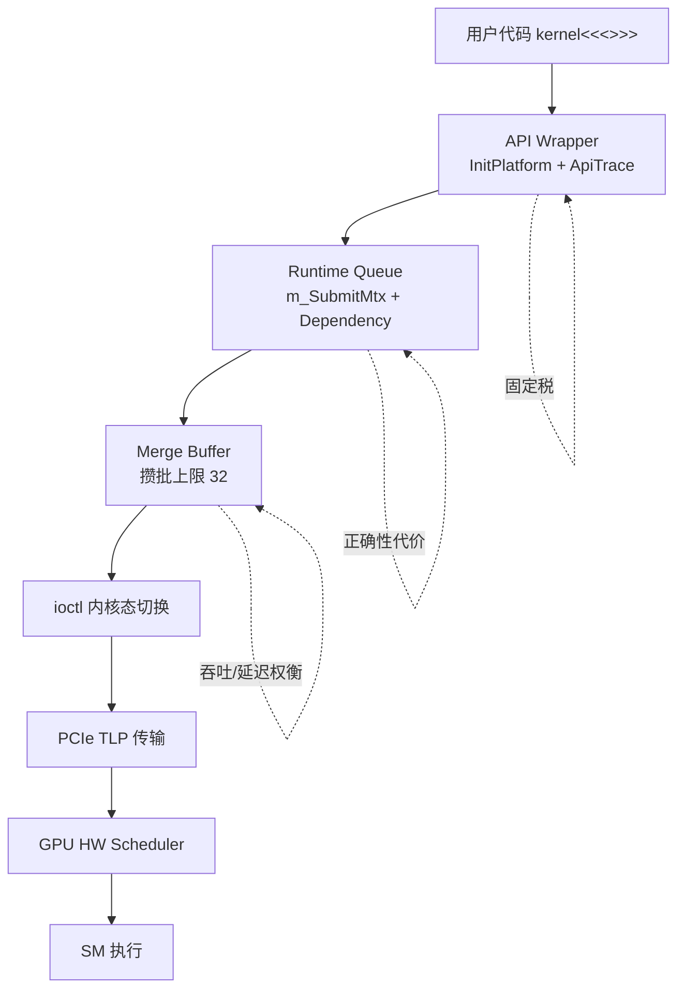

图示列出各层的必要性；它不能给出各层的具体耗时——那依赖硬件与工作负载，需实测。

#### 6. 拓展知识

- **CUDA Graph 消除 launch 开销的本质**：不是让单条命令变快，而是把 N 条命令的 N 次 launch 开销摊薄到 1 次 graph launch。这验证了"固定税"是 launch 成本大头之一——因为摊薄固定税能带来显著收益。
- **User-mode driver趋势**：把部分 runtime 逻辑移到用户态（如 CUDA's VM model），可以消除 ioctl 切换代价，但 PCIe 传输和硬件调度不可消除。
- **与 E003 的关系**：launch 是"发起"路径，完成是"回传"路径，两者各自的延迟来源不同但都不可消除。

#### 7. 常见追问及回答要点

1. **问：CUDA Graph 把 launch 延迟降到接近 0 了，是不是反驳了"launch 延迟不可消除"？**
   答：不反驳。CUDA Graph 把 N 次 API 调用合并为 1 次 graph replay，摊薄了固定税。但单次 graph replay 仍然要走 ioctl + PCIe + HW调度，只是每个 kernel 分摊的部分变小了。当 kernel 数量→∞ 时 per-kernel launch→0，但绝对下界仍在。
2. **问：MUSA 的合并上限是 32，改成 1 是不是消除合并延迟？**
   答：是的，合并延迟为 0，但 HAL 调用次数上升为 N 倍，总吞吐反而下降。这是一个典型的延迟-吞吐权衡：降低延迟、提高单次成本；32 是工程上的平衡点 [推断]。
3. **问：为什么不能把 runtime 直接编译进 kernel driver 消除用户态/内核态边界？**
   答：历史上有过（如 early CUDA），代价是每次 API 错误会导致整个驱动崩溃，且失去用户态的多版本兼容性、tracing、工具插桩能力。分层是有意的工程取舍，不是技术限制。

#### 8. 易错点与反例

- 反例："launch 延迟只是软件开销，优化好了可以到 0"——不可消除的硬件部分（PCIe 传输、HW scheduler）给出了物理下界。
- 反例："用多线程并发提交可以消除排队延迟"——多线程只是把多个 launch 的排队并行化，但每个线程内部仍需持锁，且总吞吐受硬件 command queue 深度限制。
- 易错：把"launch 延迟"与"kernel 执行时间"混为一谈——前者是提交路径的成本，后者是设备计算的耗时；launch 延迟高不等于 kernel 执行慢。

#### 9. 实践与验证

[待验证] 设计：
- 输入：一个空 kernel（空 body）在不同 launch 模式：普通 launch、32 批合并、CUDA Graph replay、用户态提交（如可行）。
- 步骤：分别测量 per-kernel launch wall-clock time（10^6 次取平均），采集 CPU-side API 时间、排队时间、提交时间。
- oracle：普通 launch ≈ API税 + 锁 + ioctl；32 合并 ≈ API税 + 锁 + 合并等待；graph replay ≈ 一次 setup + 几乎 0 的单 kernel 启动。
- 当前未执行目标机实验，具体数字不写死。

#### 10. 评分标准

- 不合格：只能说出"launch 慢因为 runtime 多层"，不能指出每层的必要成本。
- 合格：能列出至少三层成本来源并解释为什么不能消除。
- 良好：给出 launch 延迟的理论下界公式，理解合并/背压的吞吐-延迟权衡。
- 优秀：理解 CUDA Graph 摊薄固定税的本质，能对比 user-mode driver 与传统模型的取舍。

**证据与来源：** [已确认] `musa/99-roadmap/performance-guide.md:42-59`（API 固定开销、命令提交合并、容量背压）；[已确认] `musa/01-modules/M06-stream-command/design.md:20-28,56-59`（分层边界、HAL 提交入口）；[推断] 硬件层调度与 PCIe 成本为原理推导。

---

## AIInfra-E003. 异步执行的完成语义：从硬件信号到 runtime 回调，如何构建"完成证据链"？

- 难度：专家级
- 知识域：K02 驱动与运行时（关联 K11 可靠性）
- 考察能力：跨层推理、完成语义建模、故障边界分析
- 题型：原理推导与系统设计
- 面试频率：高频
- 前置知识：Event/Callback/Stream、异步状态机、happens-before
- 关联题目：AIInfra-E002（launch 路径）、AIInfra-E009（checkpoint 恢复）、AIInfra-E015（事故模型）
- 事实状态：[已确认] [推断]

#### 1. 背景知识

GPU 异步执行的核心难题是：**API 返回成功不等于任务完成，任务完成不等于下游可见。** 完成证据链（completion evidence chain）就是把"硬件信号 → runtime 状态更新 → 用户可感知"这一路上的每一步都变成可验证的。

M06 Stream/Command 的状态机给出了清晰的证据链模型 [已确认] `musa/01-modules/M06-stream-command/design.md:31-38`：
- `Command::Status` 用 CAS 保证单向推进：`created → queued → built → submitted → completed` [已确认] `musa/01-modules/M06-stream-command/design.md:31-38`。
- 完成通知由等待线程统一处理，`Query`/`Wait` 只读状态 [已确认] `musa/01-modules/M06-stream-command/design.md:49`。
- `shared_ptr<Command>` 在四个队列间转移保证资源活到命令完成 [已确认] `musa/01-modules/M06-stream-command/design.md:31-38`。

CANN 文档同样明确：主机 API 成功、Runtime 元数据变化、Driver 接受请求和设备任务完成是四个不同时刻 [已确认] `cann/90-cross-module/memory-and-resource-lifecycle.md:24-25`。

#### 2. 问题分析

1. 先定义"完成证据链"：从设备发出完成信号到用户代码能安全消费结果之间，每一跳的因果传递。
2. 从硬件到用户逐层分析：每层可能出现"证据断裂"的位置。
3. 给出一个统一的完成状态机模型，以及在该模型下如何设计防御。

#### 3. 具体答案

面试中可以这样回答：

> 完成证据链的核心不变量是：**资源可复用 ⇔ 完成已被证明**。这条链从下往上包括五跳：
>
> **跳一：设备完成信号。** GPU/硬件通过 command queue 的 doorbell 或 mailbox 标记完成。这是最底层的证据，不可伪造。断裂场景：硬件 hang ——永远不发信号。
>
> **跳二：驱动捕获。** 内核态驱动通过中断或 polling 读取完成标志，更新 driver 层的 command 状态。断裂场景：中断丢失或 driver 自身 bug ——硬件完成了但 driver 不知道。
>
> **跳三：Runtime 状态推进。** Runtime 把 driver 的状态变化翻译成 `completed` 状态，推进 `Command::Status` 状态机。M06 用 CAS 保证单调推进 [已确认] `musa/01-modules/M06-stream-command/design.md:31-38`。断裂场景：Runtime 内部异常——driver 已通知但 Runtime 崩溃。
>
> **跳四：Event/Callback 触发。** Runtime 设置 Event 为 signaled、执行 user callback。断裂场景：callback 中抛异常或死锁——Event 已 set 但用户没拿到。
>
> **跳五：用户可见。** 用户代码通过 `EventQuery`/`StreamSynchronize`/`Callback` 感知完成。断裂场景：用户拿到信号但误解语义——把"提交成功"当成"设备完成"。
>
> 设计原则是：**每一跳的证据只能从更底层获得，不能跨跳推断。** 这就是为什么 M06 把完成通知集中到等待线程而非分散在提交路径 [已确认] `musa/01-modules/M06-stream-command/design.md:49`——集中化降低证据断裂风险。

#### 4. 技术洞察

```text
完成证据链的不变量：
  ∀ resource R, task T:
    R.reusable == true  ⇔  T.completion is proven
    T.completion is proven  ⇔  evidence chain unbroken from HW → user

证据断裂的常见模式：
  1. 硬件沉默（HW hang）     → 需要 watchdog/timeout
  2. 驱动丢失（中断异常）     → 需要 sticky error + reset
  3. 状态机违例（CAS 失败）   → 需要 error 状态短路
  4. Callback 失败（用户代码） → 需要 callback 异常隔离
  5. 语义误解（"API 返回即完成"）→ 需要文档与工具教育
```

#### 5. 图文说明

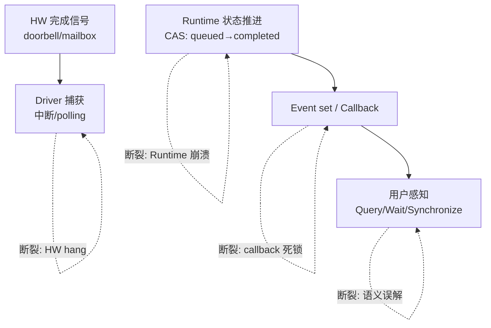

图示展示证据链每跳的断裂模式；它不能给出各跳的具体延迟——延迟依赖硬件与系统负载。

#### 6. 拓展知识

- **Sticky error 模式**：M06 把 error 放在 `Stream::m_LastError`，后续命令直接短路 [已确认] `musa/01-modules/M06-stream-command/design.md:20-28`。这是"错误一旦发生就不可忽略"的设计——防止错误被后续命令覆盖丢失。但副作用是流不可自动恢复（清除路径未见）[已确认] `musa/01-modules/M06-stream-command/design.md:20-28`。
- **幂等性约束**：拿到完成证据前重试可能导致副作用重复（两次写入、两次发送）。完成证据链的存在意义之一就是让重试在幂等边界内。
- **与 E015 的关系**：训练 hang 事故中，"证据断裂"往往发生在跳二或跳三——设备完成了但 runtime 不知道，或者反过来。

#### 7. 常见追问及回答要点

1. **问：如果用 polling 代替 interrupt，能消除"驱动捕获"这一跳的断裂风险吗？**
   答：不能消除，只是改变了断裂模式。Polling 不会丢失中断，但 polling 间隔过长会导致"延迟感知"——证据链不断裂但延迟增大。极端情况下 polling 线程被调度饿死也会错过窗口。Trade-off：polling 牺牲 CPU 换可靠性，interrupt 牺牲延迟换 CPU 效率。
2. **问：M06 的 CAS 保证单调推进，但多线程下 CAS 失败后怎么办？**
   答：CAS 失败意味着另一个线程先推进了状态，这是正常并发而非错误。需要重读当前状态并重新判断。只有当 CAS 反复失败且状态不前进时才可能是硬件/驱动异常。源码用整数编码"越大越早"保证方向可判断 [已确认] `musa/01-modules/M06-stream-command/design.md:20-28`。
3. **问：为什么不让 Event 直接与硬件信号绑定，跳过 Runtime 层？**
   答：硬件信号是设备局部的，而 Event 可能需要跨设备同步（如多卡集合通信）。Runtime 层的全局视图是必要的——它协调多个命令、多个流、多个设备的完成状态。跳过 Runtime 等于放弃全局一致性。

#### 8. 易错点与反例

- 反例："`cudaStreamSynchronize` 返回成功就证明设备完成了所有工作"——只证明 runtime 感知到完成，设备侧如果硬件发生 silent error（ECC bit flip），runtime 无法感知。
- 反例："用 callback 代替 event wait 就不需要证据链了"——callback 只是证据链跳四的一种实现形式，callback 本身的执行失败或遗漏仍然是证据断裂。
- 易错：把"完成证据链"与"数据一致性"混为一谈——前者是"任务是否跑完"，后者是"结果是否正确"。两者独立：任务完成了但结果可以是错的。

#### 9. 实践与验证

[待验证] 设计：
- 输入：一个会"假装完成"的故障注入层（在 driver 或 runtime 层注入：提交成功但永不发完成信号）。
- 步骤：分别用 polling-event、interrupt-callback、timeout-wait 三种模式提交任务，观察各模式的检测能力与延迟。
- oracle：timeout-wait 在超时后应返回 error；polling-event 应在下一轮 polling 发现；interrupt-callback 如果中断丢失则永不触发——这证明了各模式的脆弱点。
- 当前未执行硬件实验。

#### 10. 评分标准

- 不合格：把"API 返回成功"当成完成证据，不能区分各层。
- 合格：能列出至少三跳证据链并指出断裂场景。
- 良好：理解 sticky error 的短路设计、CAS 单调推进的意义、polling vs interrupt 的取舍。
- 优秀：能从不变量角度统一解释完成语义，指出 silent error 超越证据链的能力边界。

**证据与来源：** [已确认] `musa/01-modules/M06-stream-command/design.md:31-38`（Command::Status CAS 状态机）；[已确认] `musa/01-modules/M06-stream-command/design.md:49`（完成通知集中到等待线程）；[已确认] `musa/01-modules/M06-stream-command/design.md:20-28`（sticky error）；[已确认] `cann/90-cross-module/memory-and-resource-lifecycle.md:24-25`（四时刻区分）。

---

## AIInfra-E004. 从分配器一致性模型出发：并发 stream 下显存池的锁与回滚设计（splay 树案例）

- 难度：专家级
- 知识域：K03 显存管理
- 考察能力：并发数据结构分析、一致性建模、故障恢复设计
- 题型：原理推导与代码分析
- 面试频率：中频
- 前置知识：内存分配器、并发控制、lock-free vs locking、事务回滚
- 关联题目：AIInfra-E003（完成语义）、AIInfra-E013（计时陷阱）
- 事实状态：[已确认] [推断]

#### 1. 背景知识

显存池的核心操作是分配与释放，它们必须满足两个不变量：(1) 同一块显存不能同时被两个分配持有（互斥性）；(2) 分配失败时必须恢复所有副作用（原子性）。在并发 stream 场景下，多个线程同时对池做 allocate/free 时，这两个不变量都需要显式设计。

MUSA M05 的 RCA 案例揭示了 splay 树在并发分配中的正确性灾难 [已确认] `musa/99-roadmap/rca-splaytree-memmgr.md:14-52`：
- `MemMgr::Allocate` / `MemMgr::Free` 四处都持 `std::lock_guard<std::mutex> lg(m_Lock)` [已确认] `musa/99-roadmap/performance-guide.md:37-38`——分配与释放串行化在一把锁上。
- 锁内走 `SplayTree::Splay` 旋转 [已确认] `musa/99-roadmap/performance-guide.md:37-38`。
- `SplayTree::Search` 两个递归分支方向互换——对已存在的键也会 miss [已确认] `musa/99-roadmap/rca-splaytree-memmgr.md:29-43`。
- `Get` 返回"最近节点"而非精确命中，`MemMgr` 多处直接解引用未判空 [已确认] `musa/99-roadmap/rca-splaytree-memmgr.md:14-25`。

M05 的 async-rollback 分析进一步揭示了非原子事务的回滚矩阵 [已确认] `musa/01-modules/M05-memory-mempool/async-rollback-and-locking.md:25-34`：

| 失败阶段 | 已建立状态 | 可见回滚 |
|---|---|---|
| CreateMemory 失败 | virt/VA 已置空 | 调用 DestroyMemory(null) |
| physical Init 失败 | virtual allocation 进入 tracker/set | DestroyMemory(virt) |
| ModifyAccess 失败 | VA、physical、Bind 已建立 | Unbind + DestroyMemory(virt) |

#### 2. 问题分析

1. 先建立"显存池的分配-释放是一个需要串行化的事务"这个基本事实，解释为什么需要锁。
2. 分析 splay 树案例中锁粒度与回滚矩阵的关系：锁解决了并发互斥但不能解决事务原子性。
3. 给出一个更健壮的回滚设计方案。

#### 3. 具体答案

面试中可以这样回答：

> 并发 stream 下显存池的设计必须同时满足**互斥性**与**可回滚性**，两者是独立的挑战：
>
> **互斥性：为什么必须持锁。** 多个线程同时 `Allocate` 或 `Free` 时，它们共享同一棵 splay 树（或伙伴系统、空闲链表）。不持锁则链表指针可能被并发修改，导致 double-alloc 或 use-after-free。MUSA MemMgr 用 `std::lock_guard<std::mutex>` 把分配和释放串行化在一把锁上 [已确认] `musa/99-roadmap/performance-guide.md:37-38`。这是最简单也是最安全的做法——代价是多线程竞争时分配延迟增大。
>
> **可回滚性：事务的原子视图。** 一次 async allocate 不是单个原子操作，而是多个阶段：VA 保留 → physical 创建 → Bind → paging 映射 [已确认] `musa/01-modules/M05-memory-mempool/async-rollback-and-locking.md:13-23`。任何阶段失败都需要回滚前面的阶段。M05 的回滚矩阵显示了一个关键问题：**回滚是不完备的**——physical Init 失败时的 cleanup 返回值被忽略 [已确认] `musa/01-modules/M05-memory-mempool/async-rollback-and-locking.md:25-34`，这意味着回滚本身也可能失败。
>
> **splay 树的教训：正确性保障不能依赖运行时检查。** `Search` 分支方向互换导致已存在键也 miss [已确认] `musa/99-roadmap/rca-splaytree-memmgr.md:29-43`。这个 bug 如果发生在线程安全的锁内，不会导致数据竞争，但会导致错误的池分配——`Get` 返回"最近节点"而非精确键 [已确认] `musa/99-roadmap/rca-splaytree-memmgr.md:45-47`，`Free` 可能把内存归还到错误的池 [已确认] `musa/99-roadmap/rca-splaytree-memmgr.md:17`。
>
> 健壮设计方案应该：(1) 精确命中 + 判空作为查找契约；(2) 回滚矩阵的每一行都有测试覆盖；(3) 关键元数据变更用 CAS 而非锁（如 size-class 的 counter）。

#### 4. 技术洞察

```text
显存池设计的三个层次：
  L1 并发互斥: lock / CAS / lock-free list
  L2 事务原子: 多阶段 allocate 的回滚矩阵
  L3 查找正确: 数据结构的精确语义 + 契约

M05 的设计评估：
  L1 ✓ (mutex 串行化)
  L2 ✗ (回滚不完备，返回值被忽略)
  L3 ✗ (Splay 分支反转 + Get 最近语义)

理想模型：
  allocate = reserve_va + create_physical + bind + map
  任一步失败 → 按反向顺序 undo，每步 undo 必须成功
  若 undo 也失败 → 标记 pool 为不可恢复，记录 sticky error
```

#### 5. 图文说明

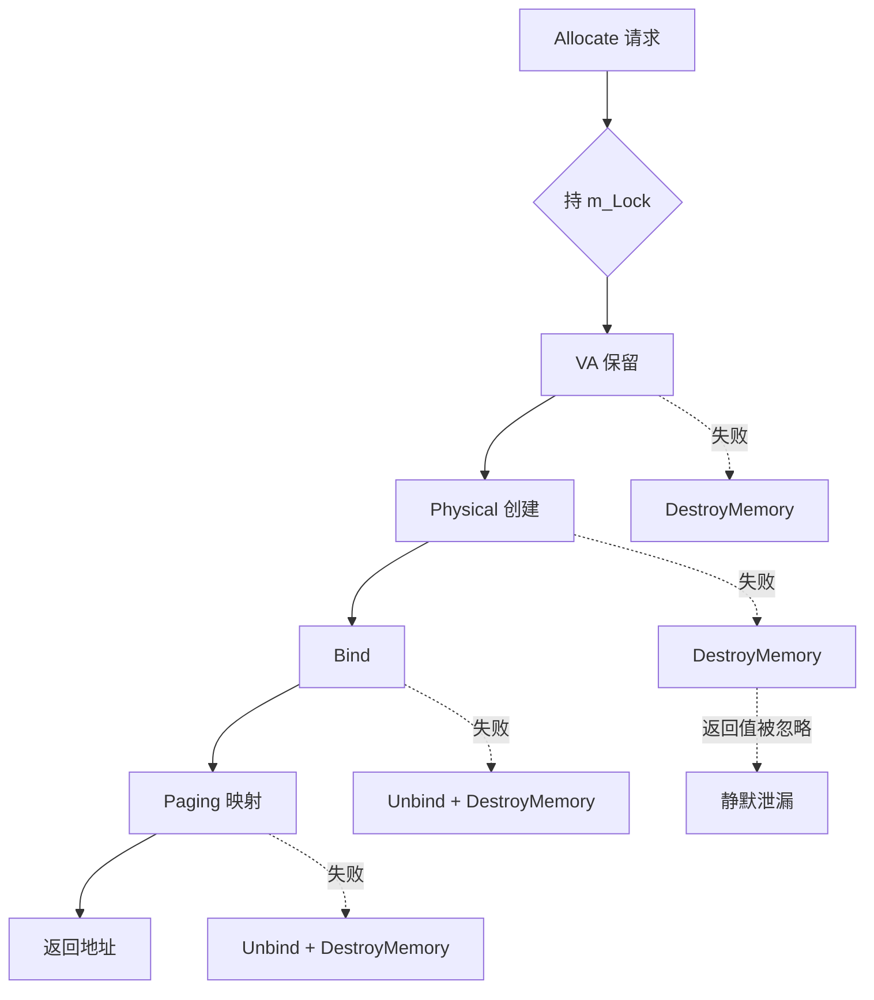

图示显示回滚的不完备性；它不能证明泄漏的实际频率——那需要故障注入验证。

#### 6. 拓展知识

- **Best-Fit vs First-Fit**：CANN SOMA 用 Best-Fit（按 size 升序的 `SegmentComparator`，`lower_bound` 取最小满足块）[已确认] `cann/memory_pool_analysis.md:74`。Best-Fit 减少内部碎片但增加查找时间；First-Fit 更快但碎片更多。并发场景下 Best-Fit 的树旋转成本更高。
- **Lock-free allocator**：如 CUDA's `cudaMallocAsync` 用 per-stream pool + global pool 的两层结构，per-stream 无锁、全局有锁。这把 L1 的锁粒度从"全局一把"细化到"全局偶尔"。
- **与 E013 的关系**：分配器自身的计时会影响 GPU benchmark 的准确性——如果在 benchmark 循环内做 allocate/free，分配器的锁竞争会混入 kernel 时间。

#### 7. 常见追问及回答要点

1. **问：如果 SplayTree 的 Search bug 发生在持锁的情况下，为什么还会出错？**
   答：锁只保证互斥——同一时刻只有一个线程在操作。但 Search 分支反转是逻辑错误，它导致在"正确的互斥"下仍然查错节点、归错池。锁保护的是并发安全，不是算法正确性。
2. **问：async free 的 callback 为什么用 raw pointer 捕获 virt/pPool 而不是 shared_ptr？**
   答：[已确认] `musa/01-modules/M05-memory-mempool/async-rollback-and-locking.md:39-55`。raw pointer 不延长 pool 的引用计数，callback 存在本身不保证 pool 存活。如果 pool 先于 callback 被 destroy，callback 中的 raw pointer 就是 dangling。这是设计选择——避免引用环——但代价是生命周期耦合风险。
3. **问：如何测试回滚矩阵的完备性？**
   答：对每一行做故障注入——mock 底层接口在特定阶段返回错误，验证清理后的状态是否一致（VA 全释放、tracker 无残留、logical bytes 归零）。

#### 8. 易错点与反例

- 反例："加一把大锁就能解决所有显存池并发问题"——锁解决互斥，不解决回滚原子性和查找正确性。
- 反例："async free 的 callback 是资源释放的可靠证据"——callback 的 raw pointer 可能在 dangling 后执行，且 callback 提交本身也可能失败 [已确认] `musa/01-modules/M05-memory-mempool/async-rollback-and-locking.md:39-55`。
- 易错：把"锁的持有"当成"操作的原子"——锁内的多阶段操作不是原子的，任一回滚失败都可能让池处于中间状态。

#### 9. 实践与验证

[待验证] 设计：
- 输入：M05 allocate/free 路径，注入故障（physical Init 失败、paging 失败）。
- 步骤：分别验证每个失败点的 cleanup 路径是否完整——VA 是否归还、logical bytes 是否一致、tracker 是否无残留。
- oracle：任何失败路径执行后，pool 的不变量（Σ allocated + Σ free = pool_total）仍然成立。
- 当前未执行，M05 风险登记已指出回收路径未验证 [已确认] `musa/01-modules/M05-memory-mempool/async-rollback-and-locking.md:6`。

#### 10. 评分标准

- 不合格：不能区分"锁的互斥性"和"事务的原子性"。
- 合格：能分析 splay 树案例的正确性 bug 与锁的关系，指出回滚矩阵的不完备。
- 良好：理解 async free 的 raw pointer 生命周期耦合风险，能设计更健壮的回滚方案。
- 优秀：从三个层次（并发互斥、事务原子、查找正确）统一评估设计，指出 lock-free allocator 的取舍。

**证据与来源：** [已确认] `musa/99-roadmap/rca-splaytree-memmgr.md:14-52`（Splay 分支反转、Get 最近语义、崩溃链）；[已确认] `musa/99-roadmap/performance-guide.md:37-38`（m_Lock 串行化）；[已确认] `musa/01-modules/M05-memory-mempool/async-rollback-and-locking.md:13-55`（回滚矩阵、raw pointer 风险）；[已确认] `cann/memory_pool_analysis.md:74`（Best-Fit 策略）。

---

## AIInfra-E005. 从一致性与传输语义出发：GPUDirect RDMA 相比 host 中转消除了哪些拷贝、引入了哪些生命周期耦合？

- 难度：专家级
- 知识域：K04 网络与互联
- 考察能力：系统权衡分析、DMA 传输模型、跨域推理
- 题型：原理推导与系统设计
- 面试频率：中频
- 前置知识：RDMA、DMA、PCIe P2P、NCCL、GPUDirect
- 关联题目：AIInfra-E010（故障相关性）、AIInfra-E003（完成证据链）
- 事实状态：[推断] [待验证]

#### 1. 背景知识

GPUDirect RDMA 允许 NIC 直接从 GPU HBM 读取/写入数据而不经过 host CPU 拷贝。对比传统的"host 中转"路径：

**传统路径（无 GPUDirect）：**
1. GPU → HBM to host memory（cudaMemcpy D2H）
2. host CPU 可能做打包/路由
3. host memory → NIC（RDMA send）

**GPUDirect 路径：**
1. GPU HBM → NIC（DMA directly via PCIe P2P）

每一步的"拷贝"实际上是 DMA 传输——GPUDirect 消除了第一步（D2H）和可能的第二步。

#### 2. 问题分析

1. 从 DMA 传输路径角度分析两种方式的拷贝次数与带宽瓶颈。
2. 引入"传输语义"概念——"远端何时可见"在两模型中的差异。
3. 分析 GPUDirect RDMA 引入的新耦合：buffer 注册、NIC-GPU 拓扑依赖、错误传播。

#### 3. 具体答案

面试中可以这样回答：

> GPUDirect RDMA 的核心收益是**减少拷贝次数、降低延迟、减少 CPU 参与**。但每一份收益都引入了新的耦合：
>
> **消除的拷贝：** 传统路径至少 1 次 D2H DMA + 1 次 host→NIC DMA。GPUDirect 把这些合并为 1 次 GPU→NIC P2P DMA。消除的不只是拷贝本身，还有 host 内存带宽的消耗和 CPU 的调度参与。对于大规模 all-reduce（如 Megatron 中 TP 的 all-reduce），每步的通信量可达数 GB，省掉 host 中转意味着通信带宽提升和 host 内存压力下降。[推断]
>
> **引入的耦合一：Buffer 注册。** GPUDirect 要求 NIC 在传输前"知道"目标 GPU 内存的物理地址——这需要 buffer 注册操作（pin memory、更新 NIC 页表）。注册有成本，且注册的 buffer 不可随意释放——必须等待传输完成。这是把"内存生命周期"和"网络传输生命周期"耦合在一起。[推断]
>
> **引入的耦合二：PCIe 拓扑依赖。** GPU 与 NIC 之间的 P2P 传输依赖 PCIe 拓扑——它们必须在同一个 PCIe switch 域内才能高效通信。如果 GPU 和 NIC 不在同一域，流量需要 upstream 到 CPU 的 root complex 再回来，延迟大增甚至退化为 host 中转 [推断]。这是把"硬件排布"和"通信性能"耦合。
>
> **引入的耦合三：错误传播路径。** host 中转时，CPU 可以在中转时做 checksum、重试、错误恢复。GPUDirect 路径中 DMA 错误的传播链更复杂——NIC 的 RDMA 错误可能需要通过 GPU driver 的 callback 上报，跨厂商时兼容性问题更突出 [推断]。
>
> **结论：** GPUDirect RDMA 是"用拓扑耦合换拷贝减少"——它成立的前提是 GPU 与 NIC 拓扑正确、buffer 生命周期管理得当、错误处理路径完善。

#### 4. 技术洞察

```text
传统路径通信时间 ≈ t_D2H + t_host_process + t_H2NIC
GPUDirect 路径通信时间 ≈ t_P2P_DMA

节省 = t_D2H + t_host_process （毫秒级 → 微秒级）

代价：
  1. buffer_register_cost (amortized over lifetime)
  2. topology_constraint (GPU-NIC must be same PCIe domain)
  3. error_propagation_complexity (NIC error → GPU driver callback)
  4. lifecycle_coupling (buffer不可释放直到RDMA完成)
```

#### 5. 图文说明

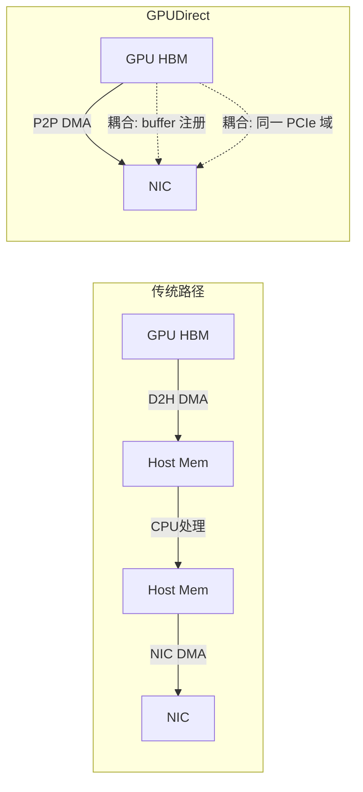

图示对比两种路径；不能给出具体延迟数字——依赖硬件拓扑与消息大小。

#### 6. 拓展知识

- **NCCL 的传输选择**：NCCL 自动选择 GPUDirect RDMA（如果可用）或 host 中转。选择依据包括：拓扑检测、buffer 是否 registered、消息大小阈值（小消息可能反而走 host 中转更高效，因为注册开销摊薄不足）。
- **与 Megatron TP 的关系**：TP all-reduce 是每层 4 个原语 × L 层的通信 [已确认] `insights/05-megatron-architecture.md:1156-1163`，GPUDirect 对 TP 的收益最大——因为 TP 通信在同一节点 NVLink 域内 + GPUDirect 组合实现最小延迟。
- **RoCE 细节**：RoCEv2 在 UDP/IP 层之上实现 RDMA，相比 InfiniBand 的 RDMA 多了一层 IP/UDP 头，对 GPUDirect 的 P2P 路径有轻微额外延迟 [待验证]。

#### 7. 常见追问及回答要点

1. **问：如果 GPU 和 NIC 不在同一 PCIe 域，GPUDirect RDMA 还能用吗？**
   答：技术上能用，但性能退化。流量需要经过 CPU 的 root complex 做 PCIe switch 间路由，等效于"host 中转"的带宽但延迟更高——因为路径更长。生产部署时应确保 GPU-NIC 在同一 PCIe switch 下 [推断]。
2. **问：buffer 注册的 pin memory 开销如何摊薄？**
   答：通常是"一次注册、多次使用"——在模型初始化时注册所有通信 buffer（NCCL 的 send/recv buffer），训练期间不再重复注册。摊薄前提是 buffer 生命周期跨越多个通信步骤。如果每步都分配新 buffer 然后注册，注册开销可能超过节省的拷贝开销。
3. **问：GPUDirect RDMA 的完成通知走什么路径？**
   答：NIC 的 RDMA completion queue entry（CQE）通知传输完成。NCCL 在自己的 stream 上 polling CQE，完成后触发 NCCL 内部的完成事件。这条路径比 host 中转的 CPU polling 更复杂——涉及 NIC interrupt → NCCL callback → CUDA event [推断]。

#### 8. 易错点与反例

- 反例："GPUDirect 消除了所有拷贝"——消除了 host 中转的拷贝，但 GPU→NIC 的 P2P DMA 仍然是"拷贝"（从 HBM 读到 NIC 的 send buffer），只是不需要 host 参与。
- 反例："GPUDirect 一定比 host 中转快"——小消息场景下，注册开销 + P2P 路径选择的开销可能让 GPUDirect 反而更慢。NCCL 通常对小消息有阈值判断 [推断]。
- 易错：把"零拷贝"理解为"零传输"——GPUDirect 的"零"指的是零 host 拷贝，不是零网络传输。

#### 9. 实践与验证

[待验证] 设计：
- 输入：同一 all-reduce 操作，分别通过 GPUDirect RDMA 和 host 中转（设置 NCCL 环境变量切换）。
- 步骤：固定消息大小（1KB / 1MB / 1GB 三档），测量端到端延迟与吞吐；用 PCIe 拓扑扫描工具验证 GPU-NIC 是否在同一个 PCIe domain。
- oracle：大消息（>1MB）GPUDirect 延迟显著低于 host 中转；小消息差异不显著或 GPUDirect 更慢；跨 PCIe domain 时 GPUDirect 性能退化到接近 host 中转。
- 当前未执行。

#### 10. 评分标准

- 不合格：只说"GPUDirect 更快因为少了拷贝"，不能指出引入了什么新耦合。
- 合格：能列出消除的拷贝和引入的 buffer 注册、拓扑依赖两个耦合。
- 良好：理解生命周期耦合的本质（buffer 不可释放直到传输完成），能分析 PCIe 拓扑对性能的影响。
- 优秀：从系统权衡角度给出 GPUDirect 的适用条件与失效边界，理解 NCCL 的自动选择逻辑。

**证据与来源：** [推断] 基于 RDMA 与 DMA 原理的传输路径分析；[推断] NCCL 传输选择机制；[已确认] `insights/05-megatron-architecture.md:1156-1163`（TP 通信频率）；[待验证] RoCE 细节与 GPUDirect 实际性能数字。

---

## AIInfra-E006. 从隔离的技术谱系出发：namespace/cgroup、MPS、MIG、SR-IOV 在故障域与性能隔离上的本质差异

- 难度：专家级
- 知识域：K05 容器与 K8s
- 考察能力：技术谱系建模、隔离维度分析、系统设计权衡
- 题型：原理推导与对比分析
- 面试频率：中频
- 前置知识：Linux 容器、GPU 虚拟化、多租户调度
- 关联题目：AIInfra-E007（gang scheduling）、AIInfra-E012（PD 分离权衡）
- 事实状态：[推断] [待验证]

#### 1. 背景知识

GPU 多租户隔离是一个从"软件切分"到"硬件切分"的谱系，每级在故障域（blast radius）和性能隔离（noisy neighbor）上有本质不同：

| 技术 | 隔离层 | 故障域 | 性能隔离 | 共享粒度 |
|---|---|---|---|---|
| namespace/cgroup | 主机 OS | 共享内核，一个 host crash 全租户受影响 | CPU/Mem 可限，GPU 不可限（同一 GPU 上的进程共享 SM） | 进程级 |
| MPS (Multi-Process Service) | GPU 软件 | 共享 GPU 硬件，一个 context 错误可影响所有 client | 共享 SM/带宽，无硬分区 | SM 时间分片 |
| MIG (Multi-Instance GPU) | GPU 硬件 | 硬件分区，一个 instance 故障不扩散到同 GPU 的其他 instance | 显存、SM、带宽硬分区 | 设备级 |
| SR-IOV | 硬件 + 虚拟化 | 每个 VF 有独立 address domain | 近硬件级 | Virtual Function |

[推断] 上表为原理对比，具体实现依赖厂商与型号。

#### 2. 问题分析

1. 先建立"隔离是一个多维度问题"——故障域、性能隔离、资源共享效率三者相互制约。
2. 从最弱到最强逐层分析：为什么 namespace 不能隔离 GPU noise、为什么 MPS 有上下文污染风险、为什么 MIG 最安全但最不灵活。
3. 给出不同租户场景下的选择原则。

#### 3. 具体答案

面试中可以这样回答：

> 隔离的本质是**故障不扩散 + 资源不干扰**。四种技术在这两个维度上给出不同的取舍：
>
> **namespace/cgroup：最弱隔离。** 它隔离的是"看到什么"——每个容器看到独立的 PID mount network namespace。但所有容器共享同一个 host kernel 和同一块 GPU。故障域是整个 host：一个 OOM 或 kernel panic 影响所有租户。性能隔离方面，cgroup 能限 CPU 和 host memory，但 **GPU 的 SM、显存带宽、L2 cache 完全共享**——一个跑满的 kernel 会让所有同 GPU 上的进程饿死。[推断]
>
> **MPS：GPU 软件级隔离。** MPS 把多个进程的 CUDA context 合并为一个 shared context，由 MPS server 做时间分片调度。好处是解决了"多个小 kernel 占满 SM"的碎片化问题，提升利用率。代价：**所有 MPS client 共享同一个 GPU context**——一个 client 的非法内存访问（OOB）可以污染整个 GPU，影响其他 client。故障域从"host 级"缩小到"GPU context 级"。[推断]
>
> **MIG：硬件级隔离。** A100/H100 的 MIG 把 GPU 切成多个独立 instance——每个 instance 有自己的 SM partition、显存 partition、L2 cache partition、copy engine。一个 instance 的故障（包括 OOB、kernel crash）**不会影响**同一 GPU 的其他 instance。故障域降到"instance 级"。代价是灵活性：partition 组合固定（如 7 种配置），且 instance 之间无法共享显存。[推断]
>
> **SR-IOV：虚拟化级隔离。** 每个 VM 拿到独立的 Virtual Function，硬件强制地址隔离。故障域是 VF 级——一个 VM 的 driver crash 不影响其他 VM。但 GPU 的 SR-IOV 支持有限——不是所有 GPU 型号都支持，且 VF 数量有限（通常 ≤ 16）。[推断]
>
> 选择原则：多租户训练用 MIG（安全第一），推理小模型共享用 MPS（利用率第一），开发/实验用 namespace/cgroup（灵活第一），多租户 VM 用 SR-IOV（合规第一）。

#### 4. 技术洞察

```text
隔离强度光谱：
  namespace < MPS < SR-IOV ≤ MIG
  （弱）                              （强）

成本光谱（反向）：
  灵活性：namespace > MPS > SR-IOV > MIG
  利用率：namespace > MPS > MIG > SR-IOV
  安全性：MIG > SR-IOV > MPS > namespace

选择矩阵：
  训练多租户  → MIG（故障隔离优先级最高）
  推理共享    → MPS（利用率优先级最高）
  开发环境    → namespace（灵活优先级最高）
  VM 多租户   → SR-IOV（虚拟化合规）
```

#### 5. 图文说明

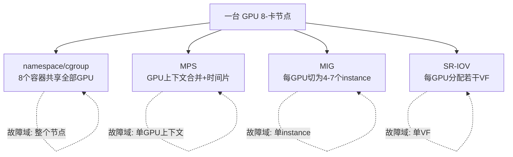

图示展示隔离粒度的差异；它不能给出各技术的实际可用性——依赖硬件型号与驱动版本。

#### 6. 拓展知识

- **MIG + MPS 组合**：MIG instance 之上可以再跑 MPS，实现"硬分区内软共享"——兼顾安全与利用率。但故障域仍然是 instance 级。
- **与 E007（gang scheduling）的关系**：MIG 分区后，每个 instance 是一个独立资源单位——gang scheduling 不再需要跨 instance 协调，但 MIG 之间的通信需要通过 PCIe 而非 NVLink。
- **与 E012（PD 分离）的关系**：PD 分离可以用 MIG 实现物理隔离（prefill 和 decode 在不同 instance），也可以用 MPS 实现时间共享。选择取决于 SLO 严格程度。

#### 7. 常见追问及回答要点

1. **问：MPS 的 context 污染具体怎么发生的？**
   答：MPS 把多个 CUDA context 合并为一个——client A 的 OOB 写操作可能覆盖 client B 的显存。MPS server 做 kernel 调度但不做显存地址隔离——那是 driver/HW 层的职责。在 MPS 模式下 driver 不做 per-client 地址边界检查 [推断]。
2. **问：MIG 的 partition 组合为什么是固定的？**
   答：因为 SM、显存、L2、copy engine 的切分必须满足硬件拓扑约束——不是任意组合都能保证 isolation 完整。例如不能把一个 SM 同时分给两个 instance。可用组合由厂商定义，取决于 die 的物理布局 [推断]。
3. **问：SR-IOV 在 GPU 上为什么不如网卡普及？**
   答：GPU 的计算模型高度依赖连续的大地址空间（unified memory、cudaMalloc 的大块分配）。把显存切为多个独立的 VF address domain 会破坏这个假设，需要 driver 做更多地址重映射，且很多 CUDA feature（如 unified memory across GPUs）在 VF 模式下受限 [推断]。

#### 8. 易错点与反例

- 反例："cgroup 能隔离 GPU"——cgroup v1/v2 只能限 CPU、memory、IO，**不能**限 GPU 的 SM 使用率或 HBM 带宽。GPU 隔离必须靠 MIG/SR-IOV/MPS。
- 反例："MIG 后每个 instance 就是一个独立 GPU"——MIG instance 仍然是同一块 die 上的分区，共享 PCIe 通道和供电。一个 instance 的 kernel hang 不会杀死其他 instance，但物理故障（如供电异常）仍然影响整个 GPU。
- 易错：把"隔离"等同于"调度"——调度决定"谁先跑、跑多久"，隔离决定"一个出错会不会影响别人"。两者互补但不替代。

#### 9. 实践与验证

[待验证] 设计：
- 输入：同一 GPU 上运行两个 stress kernel，分别通过 (a) namespace 共享 (b) MPS 共享 (c) MIG partition 三种方式。
- 步骤：测量各自吞吐变化——单跑 vs 双跑；然后让 kernel A 故意 OOB 写，观察 kernel B 是否受影响。
- oracle：namespace 下双跑吞吐各自降 50%+（noisy neighbor），B 会被 A 污染；MPS 下利用率更高但 B 仍会被 A 污染；MIG 下 B 完全不受 A 影响但各自吞吐固定为 partition 比例。
- 当前未执行。

#### 10. 评分标准

- 不合格：只能背出四种技术的名字，不能说出隔离的本质差异。
- 合格：能区分故障域和性能隔离两个维度，指出 namespace 不能限 GPU 的原因。
- 良好：理解 MPS 的 context 污染风险、MIG 的 partition 约束、SR-IOV 的虚拟化代价。
- 优秀：能给出不同租户场景下的选择矩阵，理解"隔离强度 vs 灵活性"的光谱关系。

**证据与来源：** [推断] 基于 CUDA 编程模型与 GPU 虚拟化原理的推导；[推断] MPS/MIG/SR-IOV 隔离机制对比；[待验证] 各技术的实际可用性与性能数字。

---

## AIInfra-E007. 从调度理论出发：GPU 集群调度中 gang scheduling 的必要性论证——部分启动为何必须被避免

- 难度：专家级
- 知识域：K06 调度
- 考察能力：调度理论应用、死锁/活锁分析、集群资源建模
- 题型：原理推导与系统分析
- 面试频率：高频
- 前置知识：分布式调度、集合通信、资源分配死锁
- 关联题目：AIInfra-E006（隔离）、AIInfra-E010（故障相关性）
- 事实状态：[已确认] [推断]

#### 1. 背景知识

GPU 集群训练的核心特征是：一个训练 job 需要**同时**占用多块 GPU（如 TP8×PP8 = 64 卡）。这 64 卡必须同时可用才能启动——如果只分配了 63 卡，剩下的 1 卡永远等不到，job 永远跑不起来。这就是 gang scheduling（群组调度）的必要性。

Megatron 的并行策略要求严格的资源整除性：world_size 必须能被 T×P×C×DP 整除 [已确认] `insights/05-megatron-architecture.md:329-336`。Ray 的 placement group 需要同时分配一组资源 [已确认] `ray/01-modules/M04-raylet-scheduling/README.md:41`。

#### 2. 问题分析

1. 从资源分配理论出发：gang scheduling 解决的是"多维资源的同时分配"问题——类比操作系统的"一次性分配所有资源"防死锁策略。
2. 分析"部分启动"为什么是反模式：不只是浪费资源，还会造成 head-of-line blocking 和级联饿死。
3. 给出 gang scheduling 的失效场景：资源碎片化时 gang scheduling 会导致大量 pending job。

#### 3. 具体答案

面试中可以这样回答：

> Gang scheduling 的必要性可以从"分布式死锁"角度严格论证：
>
> **论证一：部分启动导致资源泄漏。** 一个 64 卡训练 job 如果只分配到 63 卡就启动，它会卡在 NCCL 的 `all-reduce` 等集合通信上——集合通信要求所有 rank 参与 [推断]。这 63 卡上的进程在"空转等待"，但它们已经持有了 GPU 资源不释放。此时调度器有两种选择：(a) 杀掉这 63 个进程——浪费了已分配的算力和时间；(b) 等最后 1 卡——其他 job 也无法用这 63 卡。这就是经典的"持有并等待"死锁条件。
>
> **论证二：head-of-line blocking。** 假设集群有 64 卡，Job A（64 卡）排在前面，Job B（8 卡）排在后面。如果 A 在等 1 卡（被别的碎片化了），即使 B 的 8 卡全部可用也不能启动——因为调度器要么按 FIFO 等 A 先拿到完整资源（A 永远拿不到），要么让 B 先跑（A 被"插队"）。Gang scheduling 的规则是"要么全分，要么不分"——避免这种两难。
>
> **论证三：多维资源分配的数学约束。** 训练 job 的资源需求是多维的——不只是 GPU 数，还包括 GPU 型号、NVLink 拓扑、内存大小。Megatron 要求 world_size 被 T×P×C×DP 整除 [已确认] `insights/05-megatron-architecture.md:329-336`。Gang scheduling 必须在这个多维空间里找到一个"超立方体"全部空闲的切片。找不到就不能启动——这正是为什么集群利用率通常远低于 100%。
>
> **gang scheduling 的失效边界：** 当集群负载高、资源碎片化严重时，gang scheduling 会导致大量 job 饿死——每个 job 都在等资源"凑整"。此时需要 backfill（允许小 job 插队）或弹性训练（world_size 可变）来缓解。

#### 4. 技术洞察

```text
gang scheduling 的数学描述：
  给定 job j 需要资源向量 R_j = (gpu_count, gpu_type, topology, memory)
  集群状态 C = {(node_i, gpu_k, state_ik)}
  分配条件: ∃ subset S ⊆ C, |S| = gpu_count,
            ∀ (node, gpu) ∈ S: state = FREE,
            topology(R_j, S) 满足通信约束

不满足 → 整个 job 等待（不部分分配）

对比操作系统理论：
  一次性分配所有资源 → 破坏"持有并等待"条件 → 无死锁
  gang scheduling = 分布式系统的"一次性分配所有资源"
```

#### 5. 图文说明

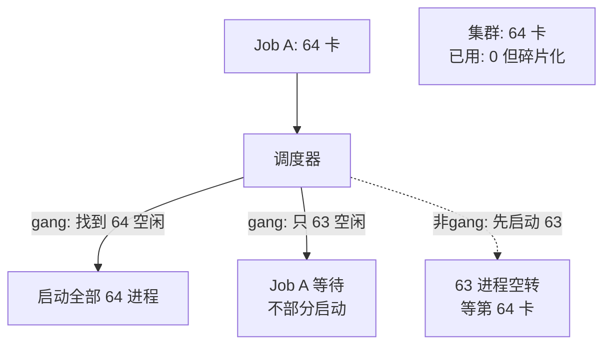

图示展示 gang vs 非 gang 的区别；它不能给出集群利用率的数字——那依赖 workload 分布。

#### 6. 拓展知识

- **Ray Placement Group**：实现了 gang scheduling 的抽象——`STRICT_PACK` 要求所有资源在同一节点同时分配，`STRICT_SPREAD` 要求分散到不同节点 [已确认] `ray/01-modules/M04-raylet-scheduling/README.md:41`。
- **Elastic Training**：PyTorch Elastic / Megatron 的弹性 world_size 允许 job 在部分资源下启动——代价是需要调整并行度配置（重新计算 TP/PP/DP），且 NCCL group 需要重建 [推断]。
- **与 E010 的关系**：gang scheduling 在同交换机域/同电力域的故障相关性下，如果一整个域故障，整个 job 需要全部 gang-reschedule——这是为什么多故障域部署需要更细粒度的调度。

#### 7. 常见追问及回答要点

1. **问：gang scheduling 会不会导致集群利用率低？**
   答：会。这是 gang scheduling 的核心代价——为了保证"同时分配"，必须牺牲部分利用率。缓解方案：(1) backfill 允许小 job 插队利用碎片；(2) 弹性训练允许 job 动态调整 world_size；(3) 异构集群按型号分区减少碎片。
2. **问：如果 job 只用 1 卡，还需要 gang scheduling 吗？**
   答：不需要。单卡 job 的 gang scheduling 退化为普通调度——只要 1 个 GPU 空闲即可。Gang scheduling 的"gang"指的是"多资源协同"。
3. **问：Kubernetes 的默认 scheduler 支持 gang scheduling 吗？**
   答：原生不支持。K8s default scheduler 是"逐 pod 分配"的——每个 pod 独立调度。这会导致多 pod 的分布式 job 死锁（pod A 拿到了资源等 pod B，pod B 拿到了资源等 pod C...）。需要 volcano / koord-scheduler 等扩展来实现 gang scheduling [推断]。

#### 8. 易错点与反例

- 反例："gang scheduling 就是给一个 job 分配所有资源"——gang scheduling 是"同时分配"，不是一次性全部分配到同一节点。它可以跨节点——只要所有节点同时满足。
- 反例："部分启动不一定会死锁"——如果 job 不依赖集合通信（如 DP-only 的多个独立 job），部分启动不会死锁。但 TP/PP 的 job 必须 gang。
- 易错：把 gang scheduling 和"资源亲和性"混为一谈——亲和性（affinity）是"偏好同节点"，gang 是"同时满足"。

#### 9. 实践与验证

[待验证] 设计：
- 输入：一个 64 卡集群，注入资源碎片化（通过 preempt/占用部分 GPU）。
- 步骤：分别用 gang scheduler 和独立 pod scheduler 提交一个 32 卡 TP 训练 job。
- oracle：gang scheduler 在碎片化时不启动 job（wait）；独立 scheduler 启动了 16 个进程后卡死——验证了部分启动的危害。
- 当前未执行。

#### 10. 评分标准

- 不合格：只说"gang scheduling 就是一起调度"，不能从死锁理论论证。
- 合格：能说明部分启动导致"持有并等待"和 head-of-line blocking。
- 良好：从操作系统资源分配理论（一次性分配所有资源）出发统一解释，知道 gang 的失效场景与缓解方案。
- 优秀：理解多维资源约束的复杂性（拓扑+型号+数量），能分析弹性训练对 gang scheduling 的挑战。

**证据与来源：** [已确认] `insights/05-megatron-architecture.md:329-336`（整除校验、并行组合约束）；[已确认] `ray/01-modules/M04-raylet-scheduling/README.md:41`（placement group 资源分配）；[推断] gang scheduling 理论推导、K8s 调度局限。

---

## AIInfra-E008. 从数据系统出发：训练数据的幂等性与血缘——如何证明"这次训练用的数据和上次一致"？

- 难度：专家级
- 知识域：K07 数据管道
- 考察能力：数据系统设计、可复现性验证、幂等性建模
- 题型：系统设计
- 面试频率：中频
- 前置知识：数据血缘、幂等性、内容寻址、ETL pipeline
- 关联题目：AIInfra-E009（checkpoint 恢复）、AIInfra-E015（事故模型）
- 事实状态：[推断] [待验证]

#### 1. 背景知识

训练数据的可复现性是 AI infra 中最容易被忽视也最危险的问题之一。"同一模型、同一配置、不同数据"会导致无法复现的 loss 曲线偏移——而排查这种偏移比排查代码错误难得多。

数据管道的典型链路：原始语料 → 清洗/过滤 → tokenize → pack → shuffle → batch。每一步都可能引入不确定性：过滤条件变更、tokenizer 版本更新、shuffle seed 变化、文件系统乱序读取。

#### 2. 问题分析

1. 先定义"数据一致性"的三个层次：位级一致（bit-exact）、语义级一致（same content）、统计级一致（same distribution）。
2. 从内容寻址（content-addressable）出发：如何为每一步的产出做不可篡改的标识。
3. 分析训练场景下的一致性要求——哪些步骤必须完全确定、哪些可以容忍随机性（只要可记录）。

#### 3. 具体答案

面试中可以这样回答：

> "证明这次训练用的数据和上次一致"需要从**数据血缘**（data lineage）和**幂等性**两个角度设计：
>
> **层次一：内容寻址的幂等性。** 每一步 ETL 操作的输出应该由其**输入内容 + 操作代码版本 + 参数**唯一确定。如果相同输入+相同代码+相同参数 → 相同输出，那么这步是幂等的。我们可以用输出的 hash（如 SHA-256 of token sequence）作为这步的"指纹"。如果两次训练同一阶段的 hash 相同，则数据一致。[推断]
>
> **层次二：血缘链的完整性。** 完整的血缘链是：raw_corpus_version → filter_code_v2 + filter_params → tokenize_v3 + tokenizer_hash → shuffle_seed → pack_strategy → final_dataset_hash。任何一步的变化都会导致下游 hash 变化。训练时记录整条血缘链 + final hash，下次训练复现血缘链 + 比对 hash。[推断]
>
> **层次三：可容忍的随机性。** shuffle 的随机性是必要的（防止 batch 内相关性影响收敛），但它必须是**可记录的**——记录 seed 而非记录排列。如果 seed 相同且上游数据相同，shuffle 的结果相同——这仍然是幂等的。同理，dropout/数据增强的随机性也需要 seed 记录。
>
> **不可证明一致的场景：** (1) 流式数据源（如网络爬取）——上游内容变化无法回溯；(2) 多 worker 并发读取文件且读取顺序不确定——即使 seed 相同，token 序列也可能不同；(3) 浮点 tokenizer 的数值精度——不同硬件/库版本可能产生微妙差异 [推断]。

#### 4. 技术洞察

```text
数据幂等性的形式化定义：
  step_i(input, code_version, params, seed) == step_i(input, code_version, params, seed)
  ∀ i ∈ pipeline stages

验证方案：
  1. 每个 stage 输出 content_hash
  2. 训练时记录 lineage_log = [(stage, code_v, params, seed, in_hash, out_hash)]
  3. 复现时重新执行，逐 stage 比对 out_hash
  4. 若全部 match → 数据一致
  5. 若任一 mismatch → 沿血缘追溯变化来源

不可控变量（[待验证]）：
  - 文件系统读取顺序（多 worker）
  - 浮点精度跨硬件差异
  - 第三方库版本隐式行为变化
```

#### 5. 图文说明

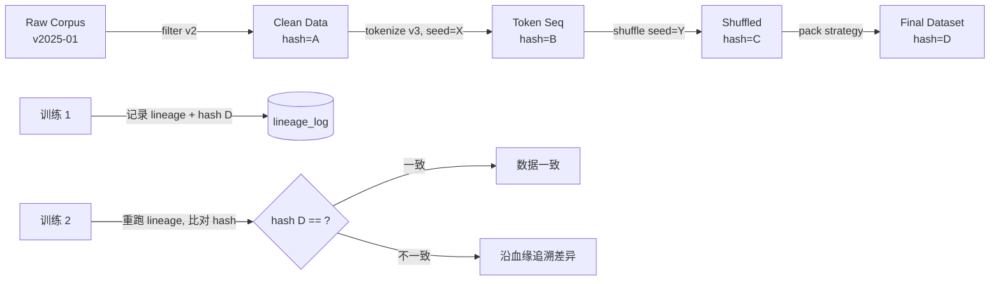

图示展示血缘链验证流程；它不能证明 hash 碰撞的概率——SHA-256 的碰撞概率可忽略。

#### 6. 拓展知识

- **WebDataScale / Megatron 数据管线**：Megatron 用 `BlendedMegatronDatasetBuilder` 按采样权重混合 15 个数据集 [已确认] `insights/05-megatron-architecture.md:1231-1235`。混合权重本身是数据血缘的一环——权重变化直接改变数据分布。
- **DVC / MLflow 数据版本化**：开源工具为数据文件提供版本追踪，但很少深入到 token-level hash 粒度。
- **与 E009 的关系**：数据幂等性是 checkpoint 恢复后"数学等价性"的前提——如果恢复后数据读取顺序变了，即使 checkpoint 相同，继续训练也不等价。

#### 7. 常见追问及回答要点

1. **问：内容寻址的 hash 计算在 TB 级数据集上是否可行？**
   答：计算可行（SHA-256 在 GPU 加速下数百 GB/s），存储不可行（不能存全量 token hash）。实际做法是：(1) 分 shard 计算 hash；(2) 对 shard 列表做 merkle tree；(3) 只存 root hash。验证时重算各 shard hash 再对比 root。[推断]
2. **问：shuffle 记录 seed 的幂等性，在分布式读取时还成立吗？**
   答：不一定。如果多个 worker 并行读取文件分片且读取顺序不确定（如基于文件系统的 glob 顺序），即使 seed 相同，不同 worker 看到的 local shuffle 可能不同。解决：用**全局 shuffle 后分片**而非分片后各自 shuffle。[推断]
3. **问：数据血缘和 checkpoint 的关系是什么？**
   答：checkpoint 保存的是模型状态（参数+优化器），数据血缘保存的是训练数据状态。两者共同构成"训练可复现性"——checkpoint + lineage 才能完整复现一次训练。见 E009 的详细分析。

#### 8. 易错点与反例

- 反例："记录数据集版本号就够了"——版本号只说明"用了哪份数据"，不说明数据管道的处理逻辑是否变化。同一数据集用不同 filter 条件产出完全不同的 token 序列。
- 反例："tokenize 是确定性的，不用记录"——tokenizer 版本升级（如从 transformers v4.28 → v4.30）可能改变 tokenize 结果（特殊字符处理、空格规则变化）。tokenizer 本身的 version 也是血缘的一环。
- 易错：把"数据一致性"和"数据正确性"混为一谈——一致性是两次训练之间的可比性，正确性是当前数据是否符合预期。

#### 9. 实践与验证

[待验证] 设计：
- 输入：一个包含 filter → tokenize → shuffle → pack 的完整数据管道。
- 步骤：第一次运行记录完整 lineage log；修改 filter 条件中的一个阈值（+0.01），重跑，观察 hash 变化是否能追溯到 filter 层。
- oracle：(1) 未修改任何参数 → 两次 hash 完全一致；(2) 修改 filter → hash 变化，lineage 追溯到 filter 层；(3) 修改 shuffle seed → hash 变化，lineage 追溯到 shuffle 层。
- 当前未执行。

#### 10. 评分标准

- 不合格：只能说出"记录数据版本"，不能区分三层一致性。
- 合格：能设计内容寻址的验证方案，指出 shuffle seed 记录的重要性。
- 良好：理解不可证明一致的场景（流式数据、多 worker 顺序），能用 merkle tree 方案解决大规模验证问题。
- 优秀：把数据血缘和 checkpoint 恢复统一到"训练可复现性"框架，理解幂等性在每一步的形式化含义。

**证据与来源：** [推断] 数据血缘与内容寻址设计为原理推导；[已确认] `insights/05-megatron-architecture.md:1231-1235`（混合数据集权重作为血缘一环）；[待验证] 分片 hash 方案的实际性能。

---

## AIInfra-E009. 从一致性模型出发：异步 checkpoint 与梯度累积窗口内，恢复后数学等价性的边界在哪里

- 难度：专家级
- 知识域：K08 分布式训练
- 考察能力：一致性建模、恢复语义分析、数学等价性证明
- 题型：原理推导与边界分析
- 面试频率：高频
- 前置知识：checkpoint、梯度累积、异步保存、数据并行
- 关联题目：AIInfra-E008（数据幂等）、AIInfra-E015（事故模型）
- 事实状态：[已确认] [推断]

#### 1. 背景知识

Megatron-Core 的分布式 checkpoint 设计：每 rank 管理局部 shard，支持并行度变化时 reshard [已确认] `insights/05-megatron-architecture.md:1217`。Checkpoint 保存可以做后台异步（async save）——保存期间训练继续 [推断]。

训练 step 的三阶段模型 [推断] `insights/05-megatron-architecture.md:176-183`：
1. forward：计算 loss
2. backward：计算梯度
3. optimizer step：更新参数

梯度累积（gradient accumulation）是多个 micro-batch 的梯度求均值后再做 optimizer step——等效于更大 batch 但显存可控。Megatron 用 microbatch 数 = gradient_accumulation_steps [已确认] `insights/05-megatron-architecture.md:287-303`。

#### 2. 问题分析

1. 从"数学等价性"的定义出发：什么条件下两次训练（一次从头、一次从 checkpoint 恢复）会产生相同的模型参数轨迹。
2. 分析异步 checkpoint 的一致性问题：如果在 step N 期间做异步 save，save 完成后 step N 的 optimizer 已经执行了——此时 save 的是"step N 的参数"还是"step N-1 的参数"？
3. 分析梯度累积窗口：如果 save 触发在 micro-batch K（K < accumulation_steps）的 forward 之后，恢复时 gradient 缓冲区应该是什么状态？

#### 3. 具体答案

面试中可以这样回答：

> "恢复后数学等价"的严格定义是：**从 checkpoint 恢复后的模型状态 + 相同的数据流 + 相同的代码版本 → 后续所有 step 的参数轨迹与原始训练一致。** 这条等式成立的边界由三个条件决定：
>
> **边界一：checkpoint 必须包含完整训练状态。** 不仅仅是模型参数（`model.state_dict()`），还包括优化器状态（momentum、variance）、梯度缓冲区（正在累积的梯度）、当前 step 数、data pipeline 状态（当前读到哪个 shard、shuffle state）、RNG state。Megatron-Core 的 `save_distributed_checkpoint` 保存参数+优化器分片 [已确认] `insights/05-megatron-architecture.md:1217`，但**不一定保存梯度缓冲区和 pipeline 状态**——这取决于实现。如果梯度缓冲区未保存，恢复时该累积窗口内的梯度丢失——等价性在该窗口内破坏。[推断]
>
> **边界二：异步 checkpoint 的一致性级别。** 异步 save 期间训练继续——save 完成后参数可能已经前进了几步。此时 checkpoint 反映的是"save 开始时的参数"还是"save 完成时的参数"？如果不做显式同步（在 save 前做一次 optimizer step barrier），checkpoint 就是一个**不一致快照**——参数可能是 step N、优化器状态可能是 step N+1、梯度缓冲区可能是 step N+2。恢复后从"快照对应的步数"继续，可能跳过或重复某些 micro-batch 的梯度贡献——数学不等价。[推断]
>
> **边界三：梯度累积窗口的原子性。** 假设 gradient_accumulation_steps=4，在 micro-batch 2 的 forward 之后触发 save。此时梯度缓冲区中有 2 个 micro-batch 的累积梯度。恢复时，应该：(a) 丢弃已累积的 2 个梯度，从 micro-batch 0 重新开始——但这需要数据管道支持回溯；(b) 保留已累积的 2 个梯度，从 micro-batch 2 继续——但这要求 checkpoint 保存了梯度缓冲区的中间状态。两种选择都不完美：(a) 浪费了 2 个 forward 的计算，(b) 要求 checkpoint 语义扩展到"梯度缓冲区"。[推断]
>
> **实践中的工程取舍：** 大多数系统在 save 前做一次 `optimizer.barrier()` 或等待当前累积窗口结束——把 checkpoint 限制在"step 边界"，等价性只在 step 级别成立，不在 micro-batch 级别。

#### 4. 技术洞察

```text
数学等价的充要条件：
  restored_state == original_state_at_save_point
  AND data_pipeline_position == original_position
  AND rng_state == original_rng

异步 checkpoint 的一致性分级：
  Level 0 (unsafe): save 期间不暂停训练 → 快照可能不一致
  Level 1 (step boundary): save 前等当前 step 完成 → 等价
  Level 2 (window boundary): save 前等当前累积窗口完成 → 更细粒度等价
  Level 3 (global barrier): 所有 rank 同步到同一步 → 最强但最贵

梯度累积窗口的影响：
  若 save 在窗口 K 处触发（K < acc_steps）:
    - 选项 A: 丢弃 K 个梯度,从 0 重跑 → 等价但浪费计算
    - 选项 B: 保存梯度缓冲区 + 恢复后从 K 继续 → 需要扩展 checkpoint 语义
    - 选项 C: 等窗口结束再 save → 等价且简单,但增加 save 延迟
```

#### 5. 图文说明

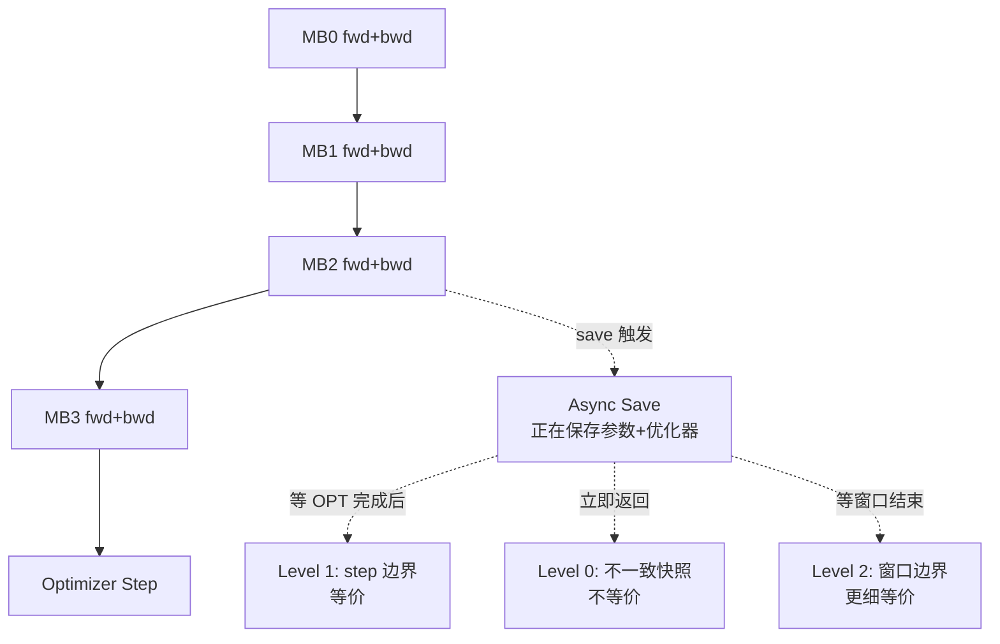

图示展示异步 save 的三种一致性级别；它不能给出各级别的 save 延迟——依赖存储带宽。

#### 6. 拓展知识

- **与 E008 的关系**：checkpoint 恢复后的数据 pipeline 位置由 lineage 记录。如果 lineage 不支持"精确定位到 micro-batch K"，恢复后只能回到 step 边界——这就是 E008 的数据血缘问题在 checkpoint 维度的投影。
- **MFU 与 checkpoint 的交互**：checkpoint 保存会占用存储带宽和通信带宽（sharded checkpoint 涉及跨 rank 写入），在高 MFU 训练中可能导致短暂吞吐下降 [推断]。
- **Megatron 的 checkpoint 实践**：`save_distributed_checkpoint` 每 rank 管理局部 shard 并支持 reshard [已确认] `insights/05-megatron-architecture.md:1217`。但文中未明确保存梯度缓冲区和 pipeline 状态——这需要代码核实。

#### 7. 常见追问及回答要点

1. **问：异步 checkpoint 的"不一致快照"具体会导致什么后果？**
   答：最轻微的情况——恢复后从"错误的 step 数"继续，loss 曲线可能有微小偏移但训练收敛。最严重的情况——优化器状态（如 Adam 的 m/v）与参数不匹配，导致恢复后第一步的梯度更新完全错误——loss 可能 spike 甚至发散。[推断]
2. **问：DP 和 TP 在 checkpoint 恢复时有不同的等价性约束吗？**
   答：有。DP 的恢复需要保证每个 rank 的数据 pipeline 位置一致（否则 all-reduce 的梯度不一致）；TP 的恢复需要保证权重分片对齐（否则 TP 通信的 rank 映射错误）。Megatron-Core 支持 reshard——改变并行度后可以重新映射 [已确认] `insights/05-megatron-architecture.md:1217`。
3. **问：如何验证 checkpoint 恢复后的等价性？**
   答：在相同数据、相同 seed 下，原始训练到 step N 的 loss 与恢复后从 step N 再跑 M 步的 loss 应该一致（浮点误差容差内）。验证脚本应比对 loss 曲线、参数 diff、梯度 diff。[推断]

#### 8. 易错点与反例

- 反例："checkpoint 恢复后 loss 相同就说明等价"——loss 相同只能说明"最终状态等价"，不能保证"轨迹等价"。两次训练可能通过不同的参数路径到达同一个 loss 值。
- 反例："异步 checkpoint 总比同步 checkpoint 好"——异步的收益是"训练不暂停"，代价是一致性风险。在关键训练阶段（如学习率切换点），同步 checkpoint 更安全。
- 易错：把"参数保存"等同于"状态保存"——优化器状态、梯度缓冲区、data pipeline 位置都是状态的一部分，漏掉任何一环都可能破坏等价性。

#### 9. 实践与验证

[待验证] 设计：
- 输入：一个 Megatron-Core 训练 job，gradient_accumulation_steps=4，启用 async checkpoint。
- 步骤：(1) 在 step 100 触发 save，期间训练继续到 step 103；(2) 从 checkpoint 恢复后继续训练 50 步；(3) 比对原始训练（不中断）的 loss 轨迹。
- oracle：如果 checkpoint 是 Level 0（不一致快照），loss 轨迹应出现偏移；如果是 Level 1（step 边界），轨迹应一致。
- 当前未执行。

#### 10. 评分标准

- 不合格：只说"checkpoint 就是保存参数"，不知道需要保存哪些状态。
- 合格：能列出完整训练状态（参数+优化器+梯度+data pipeline+RNG），理解异步 checkpoint 的风险。
- 良好：能分析梯度累积窗口内 save 的三种处理方案及其等价性含义，理解 consistency level 分级。
- 优秀：能从数学等价性的充要条件出发，统一分析 checkpoint + data lineage 的共同约束。

**证据与来源：** [已确认] `insights/05-megatron-architecture.md:1217`（分布式 checkpoint、reshard）；[已确认] `insights/05-megatron-architecture.md:176-183`（训练三阶段）；[已确认] `insights/05-megatron-architecture.md:287-303`（microbatch 梯度累积）；[推断] 异步 checkpoint 一致性分级为原理推导；[待验证] 全部实验数字。

---

## AIInfra-E010. 从故障相关性出发：同交换机/同电力域的相关性故障如何影响并行策略选择

- 难度：专家级
- 知识域：K08 分布式训练
- 考察能力：故障模型分析、并行策略设计、风险评估
- 题型：系统设计
- 面试频率：中频
- 前置知识：TP/PP/DP 通信模式、故障域、MTTR
- 关联题目：AIInfra-E005（GPUDirect RDMA）、AIInfra-E007（gang scheduling）
- 事实状态：[推断] [待验证]

#### 1. 背景知识

大规模训练集群的故障不是独立的——同一交换机下的 GPU 可能同时断连，同一电力域下的节点可能同时掉电。这种**相关性故障**（correlated failure）对并行策略的影响是：如果并行策略把"紧密耦合的通信"放在"同一故障域内"，一次相关性故障可能导致整个 job 挂掉。

Megatron 的拓扑感知排布法则 [已确认] `insights/05-megatron-architecture.md:116-119`：
- TP 通信量最大 → 同节点 NVLink 域
- DP 其次 → 优先同节点或近邻节点
- PP 通信量最小 → 可跨节点

#### 2. 问题分析

1. 从故障相关性模型出发：把集群建模为"故障域树"——节点级、机架级（交换机+电力）、数据中心级。
2. 分析每种并行维度与故障域的耦合关系：哪个维度"最怕"哪个级别的故障。
3. 给出"故障感知的并行策略设计原则"。

#### 3. 具体答案

面试中可以这样回答：

> 相关性故障对并行策略的影响可以用"**故障域 × 通信耦合度**"矩阵来分析：
>
> **矩阵一：TP × 故障域。** TP 的通信频率最高（每层 4 个原语）[已确认] `insights/05-megatron-architecture.md:1156-1163`，通信延迟最敏感。TP 的 GPU 通常在同一个 NVLink 域内——而 NVLink 域通常与机架/交换机域对齐。如果 TP 8 路在同一个机架内，**一次机架级故障（交换机 crash / 掉电）同时杀死 TP 组的所有 GPU → 整个 job 挂掉。** 但如果 TP 8 路分布在 8 个不同机架，跨机架 NVLink 的延迟会大幅增加（降级为 PCIe 或甚至 RDMA），MFU 下降。这是"故障安全 vs 性能"的权衡。[推断]
>
> **矩阵二：PP × 故障域。** PP 的通信频率最低（只在 stage 边界做 P2P send/recv）[已确认] `insights/05-megatron-architecture.md:1156-1163`。PP 天生适合跨节点——跨交换机甚至跨机架。**PP 的一个 stage 故障只影响该 stage 的 GPU**——但由于 pipeline 的级联依赖，一个 stage 挂掉会导致所有 stage 的 bubble 急剧增大（整个 pipeline 停滞）。PP 对相关性故障的"弹性"比 TP 好——因为故障不会"同时杀死多个 stage"除非故障域覆盖了多个 stage。[推断]
>
> **矩阵三：DP × 故障域。** DP 的通信是 all-reduce——所有 DP rank 参与。如果一个 DP rank 掉线，all-reduce 失败，整个 job 挂掉。但 DP 的 rank 可以分布在任意故障域——不像 TP 必须在同一 NVLink 域。**DP 的最佳实践是把 DP rank 尽量分散到不同机架/交换机**——这样一次机架级故障只杀死一个 DP rank（job 挂掉但不影响其他 job 或需要整个重启），而不是杀死"8 个 TP rank"。[推断]
>
> **设计原则：** (1) TP 放同机架是性能最优但不是最安全的——如果故障恢复时间 (MTTR) 长，考虑把 TP 的一部分跨机架；(2) PP 天生跨机架——把 PP 的 stage 分布在不同故障域，降低相关性故障概率；(3) DP 分散到最多故障域——这是"故障分散"性价比最高的维度。

#### 4. 技术洞察

```text
故障相关性矩阵：
              | 节点故障 | 机架故障(交换机/电力) | 数据中心故障
TP(同机架)    | 高影响   | 极高影响(全组 kill)    | 致命
PP(跨机架)    | 中影响   | 中影响(部分 stage)     | 高影响
DP(分散)      | 低影响   | 低影响(1/N 概率 kill)  | 中影响

并行策略选择原则：
  若 MTTR 长(小时级) → 优先故障分散: 减小 TP, 增大 DP, PP 跨域
  若 MTTR 短(分钟级) → 优先性能: TP 同机架, PP 跨节点, DP 同域
```

#### 5. 图文说明

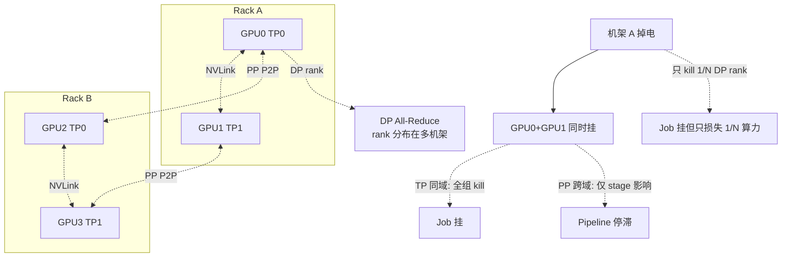

图示展示相关性故障对不同并行维度的影响；它不能给出故障概率——依赖硬件可靠性数据。

#### 6. 拓展知识

- **Checkpoint 频率与故障域**：如果 MTTR 短（快速恢复），checkpoint 频率可以降低——因为恢复成本低。MTTR 长时，需要更频繁的 checkpoint + 多故障域分布 [推断]。
- **与 E007 的关系**：gang scheduling 在多故障域部署时，应该把"一整个 gang"分散到多个故障域——避免一个故障域杀死整个 gang。
- **MT-NLG 的经验**：530B 模型 280 卡/副本——如果一次机架级故障杀死整个副本，checkpoint 恢复时间以小时计。这就是为什么 PP 跨节点、DP 跨域是必须的 [推断]。

#### 7. 常见追问及回答要点

1. **问：如果只能选一种维度来最大化故障弹性，选哪个？**
   答：DP。因为 DP 的通信模式（all-reduce）允许 rank 分布在任意位置，且一个 rank 掉线只损失 1/N 的算力。相比之下，TP 的 rank 必须在一起（通信紧耦合），PP 的 stage 虽然可以分散但级联依赖让单点故障变成全局影响。
2. **问：NVLink 域和机架边界不对齐怎么办？**
   答：这是一个真实的工程问题。如果 NVLink 的 8 卡跨了两个机架（比如超融合架构），那么 TP 8 路天然跨机架——相关性故障概率上升。此时需要与硬件团队协调排布，或在软件层面做"跨机架 TP 的故障感知重调度"——某机架故障时自动降级 TP 4 路 [推断]。
3. **问：如何量化"一次相关性故障对训练吞吐的影响"？**
   答：用"有效训练时间比" = (MTBF) / (MTBF + MTTR × recovery_overhead)。如果 MTBF=100h、MTTR=1h、checkpoint 恢复+重调度=0.5h → 有效比 ≈ 98%。如果相关性故障让 MTBF 降为 10h（10× 更频繁），有效比降为 ≈ 95%——吞吐损失 3%。[推断]

#### 8. 易错点与反例

- 反例："TP 必须同节点"——TP 的最优是同 NVLink 域，但不一定是同节点。NVSwitch 架构（如 DGX A100）可以在多节点内提供 NVLink 带宽——TP 可以跨节点但仍在同一 NVLink 域 [推断]。
- 反例："DP 放同一节点更快所以应该集中"——DP 放同一节点确实通信快（NVLink），但相关性故障风险高。正确做法是：如果 MTTR 短可以集中；如果 MTTR 长或 SLA 严格，应该分散。
- 易错：把"故障域"和"性能域"混为一谈——它们经常对齐（同一机架 = 高带宽 + 高故障相关性），但不总是。

#### 9. 实践与验证

[待验证] 设计：
- 输入：一个 128 卡集群（4 机架 × 32 卡），分别用 (a) TP8 同机架 (b) TP4 跨机架 两种配置跑同一训练 job。
- 步骤：注入机架级故障（断开一个机架网络），测量两种配置下的 job 恢复时间与有效吞吐。
- oracle：TP8 同机架下机架故障导致整个 job 挂掉（需从 checkpoint 恢复）；TP4 跨机架下只损失部分 rank，恢复更快。
- 当前未执行。

#### 10. 评分标准

- 不合格：不能区分不同并行维度对故障的敏感度。
- 合格：能说出 TP 同域的风险、PP 跨域的优势、DP 分散的价值。
- 良好：能从"故障域 × 通信耦合度"矩阵出发系统分析，给出 MTTR-aware 的策略选择。
- 优秀：能量化分析相关性故障对训练有效时间比的影响，理解 NVLink 域与机架边界不对齐的工程挑战。

**证据与来源：** [已确认] `insights/05-megatron-architecture.md:116-119`（拓扑感知排布法则）；[已确认] `insights/05-megatron-architecture.md:1156-1163`（通信频率）；[推断] 故障相关性矩阵为原理推导；[待验证] 全部实验数字。

---

## AIInfra-E011. 从排队论出发：decode 阶段为何近似"带宽受限的单服务器"，这对 autoscaling 意味着什么

- 难度：专家级
- 知识域：K09 推理
- 考察能力：排队论应用、autoscaling 设计、性能建模
- 题型：原理推导与系统设计
- 面试频率：高频
- 前置知识：排队论、M/M/1 模型、autoscaling、KV cache
- 关联题目：AIInfra-E001（带宽受限）、AIInfra-E012（PD 分离）
- 事实状态：[推断] [待验证]

#### 1. 背景知识

推理引擎的 decode 阶段每步为每个 request 生成一个 token。SGLang 的 decode batch 是多个 request 的连续批处理 [已确认] `sglang/01-modules/M04-scheduler-batching/README.md:11-16`。每步的核心操作：
1. 读取全模型权重一次（带宽受限，见 E001）
2. 读取/写入 KV cache 一步
3. 做 GEMM 计算

因为 decode 是带宽受限的，其 per-token 生成时间近似恒定——不依赖于输入长度（不同于 prefill，prefill 时间 ∝ input_len² 或 input_len）。

#### 2. 问题分析

1. 用 M/M/1 排队模型建立 decode 服务模型：到达过程（Poisson）、服务时间（近似恒定）、单服务者。
2. 分析"带宽受限 → 服务时间恒定"如何简化模型——相比 prefill 的变长服务时间。
3. 推导 autoscaling 的公式：给定目标 P99 延迟，需要多少 decode instance？

#### 3. 具体答案

面试中可以这样回答：

> **为什么 decode 近似"带宽受限的单服务器"：**
>
> Decode 的每步时间 = 权重读取时间（≈ 常数）+ KV 读写时间（≈ 常数）+ 计算时间（带宽受限下 ≈ 权重读取时间的小百分比）。因此 **decode per-token time 几乎恒定**——无论上下文长度是 100 还是 10000，每步读的权重一样多、KV 增长带来的额外读取是线性且占比小。[推断]
>
> 排队论建模：把 decode instance 看作 M/D/1 队列（Poisson 到达 + Deterministic 服务时间）。"Deterministic"来自带宽受限带来的恒定服务时间。对比 prefill——prefill 服务时间 ∝ O(input_len) 或 O(input_len²)（attention 项），是高度变异的——应该建模为 M/G/1 甚至更复杂的分布。
>
> **Autoscaling 的含义：**
>
> 对于 M/D/1 队列，给定到达率 λ 和服务率 μ（每 instance 每步处理 batch_size 个 token），利用率 ρ = λ / (μ × N)，N 为 instance 数。P99 延迟 ≈ 服务时间 × f(ρ)——其中 f(ρ) 随 ρ→1 急剧上升（排队效应）。[推断]
>
> 关键推论：
> 1. **Decode 的 autoscaling 阈值可以很精确**——因为服务时间恒定，基于利用率的扩缩几乎无超调。不像 prefill 的变长服务会导致"扩缩震荡"。
> 2. **最优 batch 与服务时间 trade-off**——增大 batch 提升吞吐（更多 token/step），但 P99 延迟增大（batch 内最后一个 token 等最久）。这是一个经典的 delay-throughput trade-off。
> 3. **KV cache 是隐式容量约束**——每个 running request 占用 KV slot。当 KV 满时新请求被 retract（SGLang 的 `retract_decode`）[已确认] `sglang/01-modules/M04-scheduler-batching/README.md:51`。这意味着 **decode 的"服务器数量"不是独立变量，而是受 KV 容量约束的**——autoscaling 不能只看 CPU/GPU 利用率，还要看 KV 占用率。

#### 4. 技术洞察

```text
decode 排队模型：
  到达: Poisson(λ) requests/s
  服务: Deterministic(μ) tokens/s, μ = batch_size / step_time
  step_time ≈ constant (bandwidth bound, see E001)

  M/D/1 队列:
    avg_queue_time = ρ / (2μ(1-ρ))
    P99 queue_time ≈ f(ρ), f grows rapidly as ρ → 1

autoscaling 规则:
  N_instances = ceil(λ / (μ × target_utilization))
  target_utilization ≈ 0.6-0.8 (保留排队余量)

  KV 约束:
    max_concurrent_requests = KV_capacity / avg_kv_per_request
    effective_N = min(N_instances, KV_limited_N)
```

#### 5. 图文说明

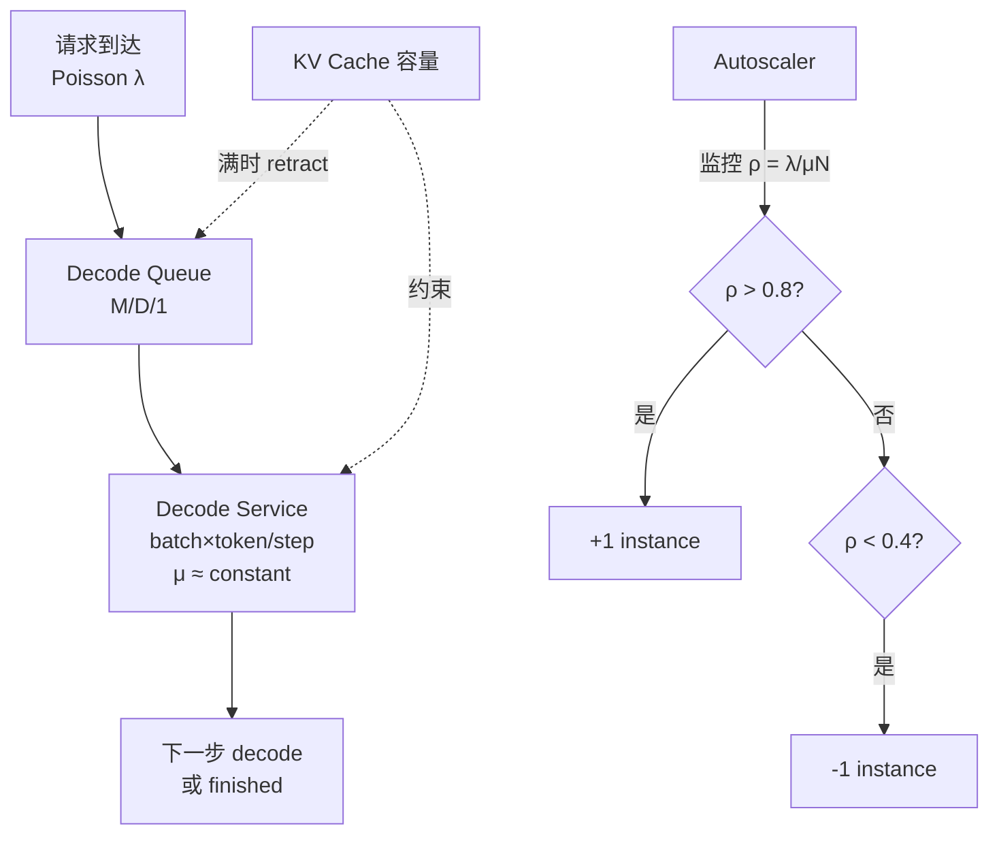

图示展示 decode 的排队模型与 autoscaling 逻辑；它不能给出 P99 的具体公式——M/D/1 的 P99 无闭式解，需数值方法。

#### 6. 拓展知识

- **PD 分离与 decode 排队**：如果把 prefill 和 decode 分离到不同实例 [已确认] `sglang/01-modules/M13-disaggregation-hicache/README.md:18-32`，decode 实例可以独立 autoscale——不再受 prefill 的变长服务时间干扰。这是 PD 分离的核心优势之一。
- **Continuous batching 对排队模型的影响**：传统 batching 等当前 batch 才接新请求 → 利用率低。Continuous batching（SGLang 的核心特性）[已确认] `sglang/01-modules/M04-scheduler-batching/README.md:11-16` 让服务更连续 → 更接近 M/D/1 的"永不空"假设。
- **与 E012 的关系**：PD 分离后 decode 的 M/D/1 模型更纯——没有 prefill 的 M/G/1 干扰。但 PD 分离引入了新的排队环节（KV transfer queue）。

#### 7. 常见追问及回答要点

1. **问：如果 batch size 增大，decode 的"恒定服务时间"假设还成立吗？**
   答：batch 增大使 GEMM 矩阵变大——arithmetic intensity 提升，计算时间占比增大。当 batch 大到越过 roofline 拐点时，decode 变成算力受限——服务时间不再是常数而是 batch_size 的函数。此时模型从 M/D/1 退化为 M/G/1。[推断]
2. **问：KV cache 的 retraction 对排队模型有什么影响？**
   答：retraction 相当于"服务拒绝"——请求被踢出 running batch 后重新进入 waiting queue。这是排队论中的"balking/reneging"行为。它引入了反馈循环：retraction → 请求重新排队 → 增加队列长度 → 更多 retraction。如果 KV 持续不足，系统可能进入"thrashing"——吞吐骤降。[推断]
3. **问：autoscaling 时用 P99 还是 P95 作为阈值更好？**
   答：P99 更保守（少超调但多扩容），P95 更激进（节省成本但偶发超限）。对于 LLM 推理——用户体验对尾部延迟极其敏感（一个慢请求让用户感知"卡了"），通常用 P99 或 P999。[推断]

#### 8. 易错点与反例

- 反例："decode 的 autoscaling 就是 GPU 利用率超过 80% 扩容"——GPU 利用率不等于排队系统的 ρ。GPU 利用率高但 batch 小、队列短时，P99 可能仍然很低。正确指标是请求队列长度或 P99 延迟。
- 反例："decode 时间完全恒定"——KV cache 的增长使每步的 KV 读取量线性增加；序列极长时 KV 读写可能成为变量。"恒定"是近似，成立条件是 KV 读写占比不大。
- 易错：把 M/M/1 和 M/D/1 混为一谈——decode 的服务时间低方差（Deterministic），用 M/M/1（指数分布）建模会高估排队延迟。

#### 9. 实践与验证

[待验证] 设计：
- 输入：固定模型（70B bf16），固定 batch=32，逐步增加请求到达率 λ。
- 步骤：测量 step_time 标准差（验证"恒定"假设）、P99 延迟随 λ 变化曲线、KV retraction 率。
- oracle：低 λ 时 step_time 方差小（验证 D 近似）；P99 在 ρ→1 时急剧上升；retraction 率应随 λ 增加而非线性增长。
- 当前未执行。

#### 10. 评分标准

- 不合格：不能建立排队模型，只凭经验说"GPU 满了就扩容"。
- 合格：能解释 decode 的 M/D/1 近似、带宽受限 → 恒定服务时间的推导。
- 良好：理解 KV cache 作为隐式容量约束的含义、retraction 的 thrashing 风险、PD 分离对排队模型纯化的作用。
- 优秀：能从 delay-throughput trade-off 角度分析最优 batch 选择，理解 batch 过大时 M/D/1 退化为 M/G/1 的边界。

**证据与来源：** [推断] M/D/1 排队论建模；[已确认] `sglang/01-modules/M04-scheduler-batching/README.md:11-16,51`（continuous batching、retract_decode）；[已确认] `sglang/01-modules/M13-disaggregation-hicache/README.md:18-32`（PD 分离）；[待验证] 全部性能数字。

---

## AIInfra-E012. 从系统权衡出发：PD 分离不是银弹——什么条件下它劣于混合部署

- 难度：专家级
- 知识域：K09 推理
- 考察能力：系统权衡分析、边界条件推导、反直觉判断
- 题型：原理推导与批判性分析
- 面试频率：高频
- 前置知识：PD 分离、KV transfer、prefill/decode 特性、资源利用率
- 关联题目：AIInfra-E011（decode 排队）、AIInfra-E001（带宽受限）
- 事实状态：[已确认] [推断]

#### 1. 背景知识

PD 分离（Prefill-Decode Disaggregation）将 prefill 和 decode 放到不同 runtime/实例，通过 KV transfer 连接 [已确认] `sglang/01-modules/M13-disaggregation-hicache/README.md:18-32`。SGLang 的实现中：
- `BaseKVSender` / `BaseKVReceiver` 负责 KV chunk 传输 [已确认] `sglang/01-modules/M13-disaggregation-hicache/README.md:36-39`
- `StagingBuffer` 管理传输中间态 [已确认] `sglang/01-modules/M13-disaggregation-hicache/README.md:43-46`
- 支持 NIXL/Mooncake/Mori 等 backend [已确认] `sglang/01-modules/M13-disaggregation-hicache/README.md:36-39`

#### 2. 问题分析

1. 先建立 PD 分离的收益模型——什么场景下它优于混合部署。
2. 然后重点分析失效边界——什么场景下它劣于混合部署。
3. 给出选择 PD 分离的决策框架。

#### 3. 具体答案

面试中可以这样回答：

> PD 分离的核心收益是**让 prefill 和 decode 互不干扰**——prefill 的算力密集型计算不会挤占 decode 的延迟敏感服务。但这个收益不是无成本的，它劣于混合部署的条件包括：
>
> **条件一：低并发或小上下文。** PD 分离引入了 KV transfer 开销——prefill 完成后需要把 KV 从 prefill 实例传到 decode 实例。如果并发请求数少（如 < 10），decode 实例的 GPU 本来就有空闲，prefill 造成的干扰极小；而 KV transfer 的固定开销（网络传输 + staging + scatter）可能超过"让 prefill 在 decode 实例上跑"的成本。[推断]
>
> **条件二：prefill 与 decode 的负载不均衡。** PD 分离后 prefill 实例和 decode 实例需要独立 autoscale。如果 prefill 和 decode 的请求比例波动大（如突发大量 prefill），PD 分离会导致一侧空闲另一侧排队。混合部署天然"共享 GPU"——prefill 和 decode 可以动态分配 GPU 资源。PD 分离的资源利用率上限受限于"min(prefill 利用率, decode 利用率)"。[推断]
>
> **条件三：KV cache 容量受限场景。** 如果 GPU 的 KV cache 能装下所有 running request（如 7B 模型 + 中等并发），PD 分离让 prefill 和 decode 各自拥有独立的 KV 总容量——总可用 KV = prefill_KV + decode_KV < 混合部署的 KV（因为混合部署的 KV 可以被 prefill 和 decode 共享使用）。PD 分离后"KV 边界"是硬划分——不能动态调整。[推断]
>
> **条件四：传输延迟不可接受。** KV transfer 走 RDMA/网络——延迟约数十 μs 到数 ms [待验证]。如果业务 SLA 要求 TTFT < 50ms，KV transfer 的延迟可能占 TTFT 的 10-50%。混合部署中 KV 不需要传输——TTFT 更短。[推断]
>
> **决策框架：** 高并发 + 长上下文 + 负载均衡 + TTFT 容忍度高 → PD 分离。低并发 + 短上下文 + 负载波动大 + TTFT 极严格 → 混合部署。

#### 4. 技术洞察

```text
PD 分离的收益成本公式：
  收益 = prefill 不再干扰 decode 的 P99 latency
  成本 = KV_transfer_overhead + 资源碎片化 + KV硬划分

  PD 优于混合 ⟺
    gain(prefill_isolation) > cost(KV_transfer + KV_fragmentation + autoscale_overhead)

失效边界（PD 劣于混合）：
  1. 并发 < threshold: KV_transfer_cost > prefill_interference_cost
  2. 负载波动 > threshold: 资源碎片化导致利用率下降
  3. 模型小 + 上下文短: KV 不需要分区,硬划分浪费
  4. TTFT SLA 极严格: KV_transfer 延迟不可接受
  5. 传输带宽不足: KV_transfer 成为瓶颈
```

#### 5. 图文说明

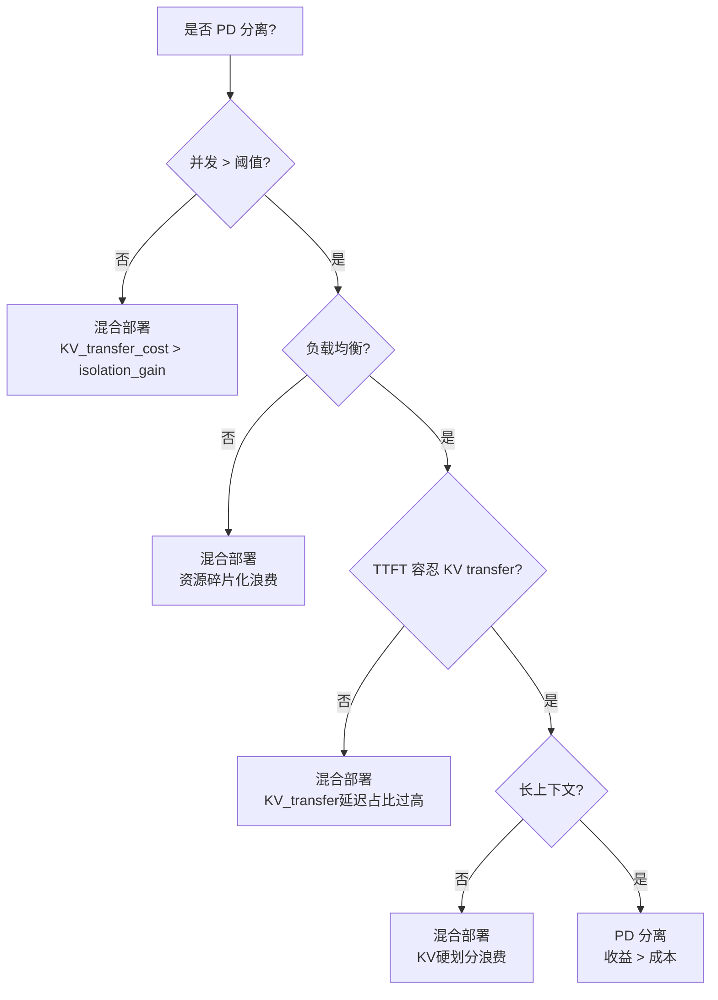

图示展示决策框架；它不能给出各阈值——依赖模型、硬件和 SLO。

#### 6. 拓展知识

- **HiCache 与 PD 分离的关系**：HiCache 是 PD 分离的延伸——在 GPU KV 之外增加 host/storage 层 [已确认] `sglang/01-modules/M13-disaggregation-hicache/README.md:14-16`。如果 HiCache 的 hit rate 高，PD 分离的"prefill 干扰 decode"问题可以缓解——因为 prefix KV 来自 host 层而非 prefill 实例。
- **与 E011 的关系**：PD 分离后 decode 实例的 M/D/1 排队模型更纯——没有 prefill 的 M/G/1 干扰。但新增了 KV transfer queue——这个 queue 的服务时间取决于传输带宽和 KV 大小。
- **Mooncake / NIXL 的传输后端**：不同 backend 的 KV transfer 延迟差异大——NIXL 优化了 GPU-GPU 直接传输 [推断]。

#### 7. 常见追问及回答要点

1. **问：PD 分离后 prefill 实例怎么 autoscale？**
   答：Prefill 实例的负载 ∝ 到达率 × 平均 input_len × 算力需求。到达率高、input_len 长 → 需要更多 prefill 实例。但 prefill 的"峰值"往往是突发的——大量用户同时发请求。如果 prefill 实例扩容慢（GPU 启动时间 ≈ 数秒），突发期间请求会在队列中堆积。混合部署无此问题——GPU 已经在运行，只是资源在 prefill/decode 间动态切换。[推断]
2. **问：PD 分离对 MoE 模型的影响是否不同？**
   答：MoE 模型的 prefill 计算量受路由影响（不同 token 激活不同 expert）——prefill 和 decode 的计算量差异更大。PD 分离对 MoE 的收益可能更大（prefill 的 expert 加载对 decode 干扰更强），但 KV transfer 也更大（MoE 的 KV 通常更大因为层数多）[推断]。
3. **问：有没有"部分 PD 分离"的中间方案？**
   答：有。(1) Chunked prefill：把一个长 prefill 切成小 chunk，与 decode 交替执行——这是 SGLang 的默认模式 [已确认] `sglang/01-modules/M04-scheduler-batching/README.md:11-16`。(2) Overlap scheduler：prefill 和 decode 在同一 GPU 但不同 stream 并发执行——降低干扰但不如 PD 分离彻底。

#### 8. 易错点与反例

- 反例："PD 分离总是更好的"——低并发下 KV transfer 开销可能超过收益。
- 反例："PD 分离只影响 TTFT，不影响 throughput"——PD 分离的 KV 硬划分降低了总可用 KV 容量，可能降低最大并发数 → 降低 throughput。
- 易错：把"PD 分离"和"prefill 优先级调度"混为一谈——优先级调度（decode 优先）可以在混合部署中部分实现 PD 分离的效果，但不引入 KV transfer 开销。

#### 9. 实践与验证

[待验证] 设计：
- 输入：70B bf16 模型，分别用混合部署和 PD 分离部署，固定总 GPU 数（如 16 卡）。
- 步骤：从低并发（5 req/s）到高并发（200 req/s），分别测量 TTFT、TPOT、throughput。
- oracle：低并发时混合部署 TTFT 更优（无 KV transfer 延迟），throughput 相同或混合更优；高并发时 PD 分离的 TPOT P99 更优（无 prefill 干扰），但 TTFT 可能略差。
- 当前未执行。

#### 10. 评分标准

- 不合格：只说"PD 分离更好因为解耦"，不能分析失效场景。
- 合格：能列出至少两个 PD 分离劣于混合部署的条件（低并发、KV transfer 开销）。
- 良好：能建立收益成本公式，理解 KV 硬划分对容量的影响、MoE 场景的特殊性。
- 优秀：能给出完整的决策框架，理解"部分 PD 分离"（chunked prefill、overlap）的中间态。

**证据与来源：** [已确认] `sglang/01-modules/M13-disaggregation-hicache/README.md:14-46`（PD 分离机制、KV transfer、StagingBuffer）；[已确认] `sglang/01-modules/M04-scheduler-batching/README.md:11-16`（continuous batching、chunked prefill）；[推断] 收益成本分析为原理推导；[待验证] 全部性能数字与阈值。

---

## AIInfra-E013. 从测量理论出发：GPU benchmark 的计时陷阱（event 计时、异步、流水线气泡）如何系统规避

- 难度：专家级
- 知识域：K10 性能工程
- 考察能力：测量方法论、误差分析、实验设计
- 题型：原理推导与实验设计
- 面试频率：高频
- 前置知识：CUDA Event、GPU 异步执行、warmup、计时方法论
- 关联题目：AIInfra-E002（launch 路径）、AIInfra-E001（roofline）
- 事实状态：[已确认] [推断] [待验证]

#### 1. 背景知识

GPU 性能测量面临的核心挑战是：**GPU 是异步的——API 调用返回不等于 kernel 完成。** MUSA 性能指南明确警告：[已确认] `musa/99-roadmap/performance-guide.md:6` "全部为静态分析，未验证——本快照没有执行任何 benchmark、profiler 或目标机运行，本文不给出任何数字。" 这个原则适用于所有 GPU benchmark。

SGlang 的分阶段测量法 [已确认] `sglang/99-roadmap/performance-guide.md:15-24` 提供了一种系统方案：请求侧、prefill、decode、worker、输出侧分别测量。CANN 调试指南 [已确认] `cann/99-roadmap/debugging-guide.md:26-25` 指出观测点必须静态定位且动态验证。

#### 2. 问题分析

1. 识别 GPU benchmark 中的三类计时陷阱：event 计时的精度陷阱、异步执行的语义陷阱、warmup/稳态陷阱。
2. 对每类陷阱给出具体的规避方案——不是"用更好的 timer"，而是从测量方法论层面消除误差来源。
3. 给出一个系统化的 benchmark 实验设计清单。

#### 3. 具体答案

面试中可以这样回答：

> GPU benchmark 的计时陷阱可以从三个层次系统分析：
>
> **陷阱一：Event 计时的精度与语义。** CUDA Event / MUSA Event 的计时原理是把时间戳写入 GPU command queue，GPU 执行到该点时写回。这有两个陷阱：(1) Event 计时测的是"GPU 执行时间"而非"wall-clock 端到端时间"——如果 kernel 之间有 gap（等待内存分配、host 侧排队），Event 不计入；(2) `cudaEventElapsedTime` 的分辨率有限（≈ 0.5 μs），对于 < 100 μs 的 kernel，Event 计时误差可能 > 1%。[推断]
>
> **规避方案：** (a) 对 < 100 μs 的 kernel，增大输入规模让执行时间 > 1 ms 再测；(b) 同时用 host timer（`std::chrono::high_resolution_clock`）测 wall-clock——两个计时之差 = launch overhead；(c) 用 profiler（nsys/MUpti）的硬件时间戳而非 Event。
>
> **陷阱二：异步执行的语义误读。** 最常见的错误是用 CPU 侧计时测 GPU kernel——`kernel<<<>>>()` 在 GPU 上还没开始执行，CPU 侧函数就返回了。如果 CPU 计时只包在 kernel launch 外，测的是 launch latency 而非 kernel 时间。正确做法：CPU 计时必须包住 `cudaDeviceSynchronize()` / `muSynchronize()`——但这引入了额外的同步开销。[推断]
>
> **规避方案：** (a) 用 Event 测 GPU 时间（陷阱一的方案）；(b) 用足够大的循环（1000+ 次）让 GPU 队列充满——CPU 计时 ≈ GPU 总时间 / N；(c) 明确区分"launch time"和"execution time"，不要混淆。
>
> **陷阱三：warmup 与稳态。** GPU 在 cold start 时有大量一次性开销：L2 cache 冷、branch predictor 未训练、TLB 未预热、GPU 时钟从 idle boost 到工作频率、CUDA context 初始化。如果第一次 run 就计时，数字偏大。[推断]
>
> **规避方案：** (a) warmup 轮数 ≥ 10-50 轮（让 cache/branch/TLB 充分训练）；(b) 稳态判定：连续 N 轮（如 5 轮）的变异系数 < 1% 才算稳态；(c) 报告统计量（中位数 + IQR）而非单轮数字；(d) 控制 GPU 频率与温度——thermal throttling 会引入系统性漂移。

#### 4. 技术洞察

```text
GPU benchmark 计时误差来源：

  E_total = E_timer_resolution + E_async_gap + E_warmup_drift + E_thermal + E_background

  E_timer_resolution:    Event 分辨率 ≈ 0.5μs, host timer ≈ 100ns
  E_async_gap:           kernel 间 gap 不计入 Event,计入 wall-clock
  E_warmup_drift:        cold start 偏大,需 10-50 轮 warmup
  E_thermal:             boost clock → thermal throttle 系统性漂移
  E_background:          其他 GPU 进程干扰(共享 ECC/SM 等)

系统规避清单：
  1. 选择计时工具: Event(>1ms kernel) / host_timer(wall-clock) / profiler(硬件时间戳)
  2. 循环: 1000+ 次取平均(CPU计时) / 100+ 次(Event计时)
  3. warmup: 10-50 轮丢弃
  4. 稳态判定: 连续5轮 CV < 1%
  5. 报告: median + IQR, 注明 warmup 轮数/重复次数/频率/温度
  6. 控制变量: GPU 型号、驱动版本、频率锁定、无其他进程
```

#### 5. 图文说明

```mermaid
flowchart TD
  START[开始 benchmark] --> WARM[Warmup 20 轮<br/>不计入结果]
  WARM --> LOOP[循环 100 次]
  LOOP --> KERNEL[Launch kernel]
  SYNC[同步点] --> EVENT_RECORD[Event record]
  EVENT_RECORD --> GPU_TIME[GPU time<br/>t_gpu = event_elapsed]
  CPU_TIME[CPU time<br/>t_cpu = wall_clock]
  CPU_TIME --> DIFF[t_cpu - t_gpu<br/>= launch + sync overhead]

  REPORT[报告: median(t_gpu)<br/>± IQR, 注明条件]
```

图示展示计时流程；它不能给出具体误差数字——依赖 kernel 大小与硬件。

#### 6. 拓展知识

- **nsys / MUpti 的硬件时间戳**：绕过 Event 计时直接使用 GPU performance counter——分辨率更高（≈ 10 ns 级）且不受 async gap 影响 [推断]。
- **与 E002 的关系**：launch overhead 是 GPU 时间的一部分——但如果只测 kernel 时间则不计入。区分"launch 时间"和"kernel 时间"是避免混淆的关键。
- **流水线气泡**：在 CUDA Graph replay 场景下，graph launch 把多个 kernel 打包提交——Event 计时测的是整个 graph 的 GPU 时间，无法区分单个 kernel。此时需要 profiler 或把 kernel 拆开单独测 [推断]。

#### 7. 常见追问及回答要点

1. **问：用 `std::chrono` 测 wall-clock 时，应该包住 synchronize 吗？**
   答：取决于你要测什么。如果测"用户感知的端到端时间"——包住 synchronize。如果测"kernel 纯执行时间"——用 Event 或只包住 launch（不含 sync）。包住 synchronize 测的是"launch + execute + sync"——对 benchmark kernel 自身不公平，因为 sync 引入了 host-side 等待。
2. **问：warmup 轮数怎么确定？**
   答：没有固定数字——取决于 kernel 大小和缓存行为。判定方法：画 warmup 轮数 vs 每轮时间的曲线——曲线稳定（波动 < 1%）后就是稳态。小 kernel（< 1ms）可能 10 轮就够；大 kernel（涉及全 HBM 扫描）可能需要 50+ 轮让 L2 预热。[推断]
3. **问：GPU thermal throttling 怎么控制？**
   答：(1) 锁定 GPU 时钟频率；(2) 每 100 轮检查一次 GPU 温度——如果温度持续上升说明 cooling 不足；(3) 在两个 kernel 之间加足够间隔让 GPU 散热——但间隔本身会引入 cache 重新冷启动的误差。[推断]

#### 8. 易错点与反例

- 反例："Event 计时最准确"——Event 有分辨率限制，且不计入 kernel 间的 async gap。
- 反例："跑一次就够了，GPU 是确定性的"——GPU 不是完全确定性的：thermal 漂移、background 进程、cache 状态都会引入变异。
- 易错：把"CPU 侧 wall-clock"当成"GPU 执行时间"——两者差一个 launch + sync overhead，可能差数十 μs 到 ms。

#### 9. 实践与验证

[待验证] 设计：
- 输入：一个 70B bf16 decode kernel，batch=32。
- 步骤：分别用 (a) CPU wall-clock 含 sync (b) Event 计时 (c) nsys 硬件时间戳 三种方式测量。每种做 100 轮，记录 warmup 10 轮 + 稳态 90 轮的分布。
- oracle：CPU wall-clock ≥ Event time（差 = launch + sync overhead）；Event time ≈ nsys 硬件时间戳（差异 < 1%）；稳态 CV < 1%。
- 当前未执行。

#### 10. 评分标准

- 不合格：只说"用 chrono 计时"，不知道 GPU 异步会导致计时错误。
- 合格：能识别 Event 计时和 CPU 计时的差异，理解 warmup 的必要性。
- 良好：能系统列出五类误差来源并给出规避方案，理解稳态判定方法。
- 优秀：知道 nsys 硬件时间戳的使用，能分析 thermal throttling 的系统性影响，理解 CUDA Graph 场景下的计时特殊性。

**证据与来源：** [已确认] `musa/99-roadmap/performance-guide.md:6`（未执行 benchmark 不给出数字的原则）；[已确认] `sglang/99-roadmap/performance-guide.md:15-24`（分阶段测量法）；[已确认] `cann/99-roadmap/debugging-guide.md:26-25`（静态定位+动态验证）；[推断] 计时误差分类与规避方案为原理推导；[待验证] 全部实验数字。

---

## AIInfra-E014. 从 Amdahl/Gustafson 定律出发：并行效率的理论上限如何约束扩展策略

- 难度：专家级
- 知识域：K10 性能工程
- 考察能力：并行理论应用、扩展策略设计、理论约束推导
- 题型：原理推导与系统设计
- 面试频率：中频
- 前置知识：Amdahl 定律、Gustafson 定律、MFU、扩展效率
- 关联题目：AIInfra-E001（带宽受限）、AIInfra-E007（gang scheduling）
- 事实状态：[已确认] [推断]

#### 1. 背景知识

Megatron 的吞吐计算公式 [已确认] `insights/05-megatron-architecture.md:1085-1098`：

```text
step_time ≈ compute_time + communication_time + idle_time
compute   = 总 FLOPs / (GPU数 × 单卡峰值FLOPs × MFU)
comm      = Σ(每个原语的通信体积 / 有效带宽) + 原语次数×延迟
idle      = bubble（PP）+ 未重叠的等待 + kernel 启动开销
```

扩展效率报告示例 [已确认] `insights/05-megatron-architecture.md:1108-1110`：
- 8.3B 在 512 GPU 上整体 76% 扩展效率
- 530B 在 2240 A100 上 MFU 54.2%

#### 2. 问题分析

1. Amdahl 定律和 Gustafson 定律各自描述什么场景——固定问题规模 vs 固定时间规模。
2. 把训练并行映射到 Amdahl/Gustafson 框架：哪个部分对应"串行比例 f"？
3. 推导 MFU 随 GPU 数变化的曲线——理论上限在哪里。
4. 给出扩展策略选择的理论指导。

#### 3. 具体答案

面试中可以这样回答：

> Amdahl 定律和 Gustafson 定律描述了并行扩展的两个不同视角——它们不是矛盾的，而是适用于不同的扩展目标：
>
> **Amdahl 定律（固定问题规模）：** S(N) = 1 / (f + (1-f)/N)，其中 f 是不可并行的比例。当 N→∞ 时，S → 1/f。对于训练 job，f 对应"必须串行执行的部分"——如 DP 的 all-reduce、TP 的 f/g 同步、PP 的 pipeline bubble、optimizer step 的全局同步。Amdahl 定律告诉我们：**如果 f=10%（即 90% 可并行），最大加速比 = 10×，无论多少 GPU。**[推断]
>
> **Gustafson 定律（固定时间规模）：** S(N) = N - f×(N-1)。含义：增加 GPU 时我们让问题规模（batch size）同步增长——不是"同一 job 加速"，而是"同一时间做更多工作"。对训练来说：增加 GPU → 增大 global batch → 每个 GPU 做的计算量不变，但总 throughput 提升。Gustafson 定律的乐观场景是：**线性扩展在"工作量随 N 增长"时是可达的。**[推断]
>
> **训练的实际扩展模型——混合 Amdahl-Gustafson：** 训练是两者的混合：
> - **强扩展（Strong Scaling）：** 固定 global batch size（Amdahl 场景）——加速比受 f 限制。Megatron 512 GPU 的 76% 扩展效率意味着 f ≈ 0.3%（由 0.76 = 1/(f + (1-f)/512) 推得）[推断]。
> - **弱扩展（Weak Scaling）：** 固定 per-GPU batch size，增大 global batch（Gustafson 场景）——扩展效率可以保持很高，因为通信量/计算量比不变。
>
> **MFU 约束：** MFU = 实际 FLOPs / (N × 峰值 × 时长)。MFU 随 N 增大而下降——因为通信时间占比增大（Amdahl 的 f）。Megatron 报告 530B 在 2240 GPU 上 MFU 54.2% [已确认] `insights/05-megatron-architecture.md:1110`。这意味着即使"弱扩展"场景下，MFU 也随规模下降——绝对吞吐上升但效率下降。
>
> **扩展策略的理论指导：** (1) 在 Amdahl 场景下，不要盲目加 GPU——超过 1/f 后收益骤减；(2) 在 Gustafson 场景下，尽量让工作量随 N 增长——训练 job 的 global batch 可以调整；(3) 降低 f 的值比增加 N 更有效——这就是 overlap 通信、减少 bubble 的意义。

#### 4. 技术洞察

```text
训练并行的 Amdahl 映射:
  f_total = f_communication + f_bubble + f_launch + f_optimizer_sync
  S_max = 1 / f_total

  实际测量: 512 GPU, 76% efficiency
  → 0.76 = 1 / (f + (1-f)/512) → f ≈ 0.3%

  MFU 与 N 的关系:
  MFU(N) = peak_mfu × (1 - f_total - comm_ratio(N))
  comm_ratio(N) ∝ communication_volume(N) / compute_per_gpu
  → 当 N 增大, comm_ratio 增大, MFU 下降

  扩展策略选择:
  若目标是"最小化训练时间"(强扩展) → Amdahl 约束,存在最优 N*
  若目标是"最大化 tokens/day"(弱扩展) → Gustafson 场景,线性可达
  N* = argmin_N(step_time(N) + checkpoint_overhead(N))
```

#### 5. 图文说明

```mermaid
flowchart TD
  Q[扩展目标?] --> A{固定 batch 大小?}
  A -->|是| AMD[Amdahl 场景<br/>S(N) = 1/(f+(1-f)/N)<br/>N→∞ → S≤1/f]
  A -->|否| GUS[Gustafson 场景<br/>S(N) = N-f(N-1)<br/>线性可达]

  AMD --> OPT[最优 N* 存在<br/>超过后收益骤减]
  GUS --> LINEAR[持续扩展<br/>但 MFU 下降]

  OPT -.降低 f 比增加 N 更有效.-> OVERLAP[通信重叠<br/>减少 bubble]
```

图示展示两种扩展场景的理论边界；它不能给出 f 的精确值——需实测 profile。

#### 6. 拓展知识

- **PP bubble 与 Amdahl：** PP 的 bubble 比例 ≈ (PP-1) / MB [已确认] `insights/05-megatron-architecture.md:116-119`。这是 Amdahl 的 f 的一个直接贡献——PP=4、MB=16 时 bubble ≈ 19%。这就是为什么 1F1B 限制在飞 microbatch 数等于 stage 数而非总 MB 数——把 bubble 从 O(MB) 降到 O(PP) [已确认] `insights/05-megatron-architecture.md:116-119`。
- **TP 通信的 Amdahl 贡献：** TP 每层 4 个原语、与 t 无关 [已确认] `insights/05-megatron-architecture.md:1291`。但原语延迟（数十 μs）乘以 L 层累积——L=80 时累计数 ms。这是 f 的另一贡献。
- **与 E001 的关系：** 带宽受限任务在 Gustafson 场景下扩展更好——因为增加 batch 提升 arithmetic intensity → 降低 f（通信占比下降）。

#### 7. 常见追问及回答要点

1. **问：Amdahl 定律说"存在最大加速比"，是不是意味着训练不能无限扩展？**
   答：Amdahl 描述的是**强扩展**（固定问题规模）。训练通常做**弱扩展**（增大 batch），此时 Gustafson 定律更适用——线性扩展是可达的。但 MFU 仍然下降（因为通信量/计算量比随 N 增加），所以"线性扩展"不等于"线性效率"。
2. **问：Megatron 的 overlap 通信如何从 Amdahl 角度理解？**
   答：Overlap 的本质是把通信时间"藏"进计算时间——从 Megatron 公式看：step_time = compute + comm + idle，overlap 让 comm → 0（因为 comm 与 compute 并行）。这等价于**减小 f**——Amdahl 的不可并行部分减小了。[推断]
3. **问：如何测量实际训练中的 f 值？**
   答：用 profiler（nsys/NCCL）采集通信时间、idle 时间、计算时间。f = (comm + idle) / total_step_time。Megatron 内置 timer 可以统计 per-iteration、per-microbatch 的耗时 [已确认] `insights/05-megatron-architecture.md:1248-1252`。

#### 8. 易错点与反例

- 反例："Amdahl 定律对所有场景都适用"——Amdahl 假设固定问题规模。训练通常调整 batch，应该用 Gustafson。
- 反例："增加 GPU 总能提升吞吐"——在强扩展场景下，超过最优 N* 后增加 GPU 反而可能降低吞吐（通信开销 > 计算收益）。
- 易错：把"扩展效率"和"MFU"混为一谈——扩展效率 = 实际加速比 / 线性加速比，MFU = 实际 FLOPs / 峰值 FLOPs。两者相关但不同：扩展效率考虑了"是否用更多 GPU"，MFU 只看"当前 GPU 利用率"。

#### 9. 实践与验证

[待验证] 设计：
- 输入：同一模型（70B bf16），分别在 64/128/256/512 GPU 上训练固定 global batch。
- 步骤：用 nsys 采集 step_time、comm_time、idle_time、compute_time；计算各 N 下的扩展效率和 f 值。
- oracle：f 应随 N 增大而增大（通信占比上升）；扩展效率应从 64 GPU 的 ~90% 逐步下降到 512 GPU 的 ~70%。
- 当前未执行。

#### 10. 评分标准

- 不合格：只说"Amdahl 定律"名字，不能写出公式并映射到训练场景。
- 合格：能区分 Amdahl 和 Gustafson 的适用场景，把通信/bubble 映射到 f。
- 良好：能从 Megatron 公式推导 f 的组成（comm + bubble + launch），理解 overlap 降低 f 的机制。
- 优秀：能给出"最优 N*"的存在性证明思路，理解弱扩展场景下 MFU 下降但吞吐仍上升的反直觉现象。

**证据与来源：** [已确认] `insights/05-megatron-architecture.md:1085-1098`（step_time 三组分公式）；[已确认] `insights/05-megatron-architecture.md:1108-1110`（MFU 报告示例）；[已确认] `insights/05-megatron-architecture.md:116-119`（PP bubble 公式、1F1B 限制）；[已确认] `insights/05-megatron-architecture.md:1248-1252`（timer 统计）；[推断] Amdahl/Gustafson 映射为原理推导；[待验证] 全部实验数字。

---

## AIInfra-E015. 从事故模型出发：区分"根因、触发条件、放大因素"——用一个训练 hang 事故说明三层如何分别治理

- 难度：专家级
- 知识域：K11 可靠性
- 考察能力：事故分析框架、分层治理设计、系统性思维
- 题型：事故分析与治理设计
- 面试频率：高频
- 前置知识：根因分析、故障注入、训练稳定性
- 关联题目：AIInfra-E003（完成证据链）、AIInfra-E009（checkpoint 恢复）
- 事实状态：[已确认] [推断] [建议]

#### 1. 背景知识

HRS 稳定性框架将"稳定"拆为正确性、可用性、资源安全、可恢复性和可诊断性的交集 [已确认] `interview/heterogeneous-resource-stability-interview-bank/01-question-bank/beginner.md:46-54`。CANN 错误模型要求保留底层错误码、设备 ID、Context/Stream 标识和调用阶段 [已确认] `interview/heterogeneous-resource-stability-interview-bank/01-question-bank/beginner.md:388`。MUSA 调试指南强调"找到第一个失败边界" [已确认] `musa/99-roadmap/debugging-guide.md:26-25`。

一个典型训练 hang 场景：某次 128 卡训练在 step 2037 后所有 rank 停止前进——NCCL all-reduce 超时，但超时后系统没有自动恢复，卡了 6 小时才被值班人员发现。

#### 2. 问题分析

1. 先建立"三层事故模型"：根因（root cause）→ 触发条件（trigger condition）→ 放大因素（amplifier）。三层各自独立——治理策略完全不同。
2. 用一个具体训练 hang 事故逐层分析：根因是什么、什么条件触发了它、什么因素把影响放大了。
3. 给出每层的治理方案——根因要消除、触发条件要检测、放大因素要降级。

#### 3. 具体答案

面试中可以这样回答：

> 事故分析的核心误区是"找到根因就结案"——实际上一个事故需要三层分别治理：
>
> **第一层：根因（Root Cause）。** 底层 bug 或设计缺陷——没有它事故不会发生。在我们的训练 hang 场景中：根因是 **NCCL 超时后没有自动 abort，而是进入无限等待**——这是 NCCL 的配置行为（默认 timeout 后抛异常但上层没有捕获）。[推断]
> - **治理：** 修复或消除根因。设置 `NCCL_TIMEOUT` 为合理值 + 在训练框架中捕获 NCCL 异常并触发 graceful shutdown。这是"让事故不可能发生"。
>
> **第二层：触发条件（Trigger Condition）。** 让根因被激活的具体场景。在我们的场景中：触发条件是 **step 2037 时 GPU3 的一个 NVLink lane 出现 transient ECC error → NCCL 重传 → 偶发超时**。这个 ECC error 是随机硬件事件，不经常出现。[推断]
> - **治理：** 检测 + 快速恢复。即使根因存在，如果能"在触发条件出现时快速恢复"，影响也可控。具体方案：(1) GPU 健康监控——ECC error rate 超阈值时 preempt 该 GPU；(2) NCCL 操作的超时检测 + 自动 checkpoint 回滚到上一个 step。这是"让事故发生后能快速恢复"。
>
> **第三层：放大因素（Amplifier）。** 让事故影响扩大的设计缺陷。在我们的场景中：放大因素是 **"hang 6 小时无人发现"**——因为 (a) 没有 heartbeat 监控训练进度；(b) checkpoint 间隔是 100 step——step 2037 离上次 checkpoint 2000 已有 37 step 的进度损失；(c) 自动恢复机制不存在。[推断]
> - **治理：** 降低事故影响范围。具体方案：(1) 训练 heartbeat——每 N step 打一个 timestamp，超过 2N step 无新 timestamp 则告警；(2) 缩短 checkpoint 间隔或启用 async checkpoint（见 E009 的分析）；(3) 自动恢复：检测到 hang 后从最近 checkpoint 重启训练。这是"让事故的影响有限"。
>
> **三层治理的关系：** 根因治理是"预防"，触发条件治理是"检测+快速恢复"，放大因素治理是"止损"。三层的投资回报不同——根因治理最彻底但最难（需要找到 bug），放大因素治理最廉价但只做"事后止损"。生产系统的最佳策略是三层同时投入。

#### 4. 技术洞察

```text
三层事故模型：
  根因(Root Cause):     没有它事故不发生 → 消除/修复
  触发条件(Trigger):    让它被激活的场景  → 检测/预防
  放大因素(Amplifier):  让影响扩大的设计  → 降级/止损

治理优先级（成本效益）：
  高 ROI: 放大因素治理（加 heartbeat + 缩短 checkpoint）
  中 ROI: 触发条件治理（ECC 监控 + preempt）
  低 ROI: 根因治理（需代码修复 + 长验证周期）

不变量（治理后必须满足）：
  1. hang 检测时间 < 5 min（heartbeat 间隔）
  2. 单次 hang 进度损失 < 10 step（checkpoint 间隔）
  3. 自动恢复成功率 > 99%（从 checkpoint 重启）
```

#### 5. 图文说明

```mermaid
flowchart TD
  ECC[GPU3 NVLink<br/>transient ECC error] --> NCCL_NCCL 超时<br/>触发条件]
  NCCL_NCCL --> HANG[训练 hang<br/>根因: NCCL 无限等待]
  HANG --> DETECT[6 小时后<br/>值班发现<br/>放大因素: 无监控]
  HANG --> LOSS[37 step 进度损失<br/>放大因素: checkpoint 间隔大]

  subgraph 三层治理
    FIX[根因治理<br/>NCCL timeout + graceful shutdown]
    MONITOR[触发条件治理<br/>ECC 监控 + preempt]
    LIMIT[放大因素治理<br/>heartbeat + 短 checkpoint + 自动恢复]
  end
```

图示展示三层分别治理的思路；它不能给出各层的具体成本——依赖团队与基础设施。

#### 6. 拓展知识

- **与 E003 的关系**：训练 hang 本质是"完成证据链断裂"——设备完成了（或没完成）但 runtime 不知道（跳二或跳三断裂）。证据链治理是"触发条件治理"的一部分。
- **与 E009 的关系**：checkpoint 频率和一致性级别直接影响"放大因素"——异步 checkpoint 的 Level 0 不一致快照可能让恢复后的等价性破坏，反而引入新的"根因"。
- **CANN 的错误边界**：CANN 将错误分为配置/初始化、数值/收敛、系统/通信三类 [已确认] `cann/99-roadmap/debugging-guide.md:13-19`。训练 hang 属于第三类——需要先判断"常驻还是偶发"：常驻查拓扑/group，偶发查 overlap 与资源竞争 [已确认] `cann/99-roadmap/debugging-guide.md:13-19`。

#### 7. 常见追问及回答要点

1. **问：如果找不到根因，只能治理触发条件和放大因素，够不够？**
   答：这是大多数生产系统的常态——根因可能是一个极难复现的硬件 corner case 或第三方库 bug。只治理触发条件和放大因素足以将 MTTR 从"6 小时"降到"5 分钟"——虽然事故仍会发生，但影响可控。这是"接受根因存在，控制影响"的工程务实。
2. **问：heartbeat 检测会不会误报？**
   答：会。如果某 step 的计算量异常大（如长序列 prefill 混入 decode batch），heartbeat 可能超时——但这本身就是"异常"信号。合理的方案是：heartbeat 超时后不立即判定 hang，而是先查 GPU 利用率——如果利用率 > 80% 说明在正常计算只是慢，< 10% 才判定为 hang。[推断]
3. **问：自动恢复（从 checkpoint 重启）会不会造成"恢复震荡"——反复 hang 反复重启？**
   答：可能。如果触发条件是"某 GPU 持续不稳定"，每次重启后都会在同一 GPU 上再次 hang。治理方案：自动恢复时把故障 GPU 标记为 unhealthy，从 gang scheduling 的资源池中排除它（缩小 world_size 或替换）。这需要弹性训练支持（见 E007 的弹性训练讨论）。[推断]

#### 8. 易错点与反例

- 反例："找到根因就结案"——根因治理是必要的但不充分。如果只修根因不加 heartbeat，下次不同根因导致的事故仍然会 hang 6 小时。
- 反例："放大因素不是事故原因，不用治理"——放大因素不导致事故但决定事故损失。"hang 6 小时"和"hang 30 秒自动恢复"的根因可能相同，但业务影响天差地别。
- 易错：把"触发条件"当成"根因"——GPU3 的 ECC error 不是根因（它只是暴露了 NCCL 无限等待的 bug），治理 ECC 不能防止其他触发条件（如网络 switch 闪断）激活同一个根因。

#### 9. 实践与验证

[待验证] 设计：
- 输入：一个 128 卡训练集群，注入 ECC error（通过故障注入工具模拟 NVLink lane 错误）。
- 步骤：分别验证三层治理的效果——(a) 只有根因治理（NCCL timeout 但无 heartbeat）；(b) 加触发条件监控（ECC 告警）；(c) 加放大因素治理（heartbeat + checkpoint 20 step + 自动恢复）。
- oracle：(a) hang 后自动 abort 但需要人工发现；(b) ECC 告警提前发出但训练仍中断；(c) 30 秒内自动检测 + 从 checkpoint 恢复 + 排除故障 GPU。
- 当前未执行。

#### 10. 评分标准

- 不合格：只说"找根因修复"，不能区分三层。
- 合格：能正确识别训练 hang 场景的根因、触发条件和放大因素，给出各层的治理方向。
- 良好：理解三层治理的成本效益差异，知道"找不到根因时"的工程务实方案。
- 优秀：能抽象为通用事故模型，理解自动恢复与弹性训练的耦合，知道 heartbeat 误判的排除方法。

**证据与来源：** [已确认] `interview/heterogeneous-resource-stability-interview-bank/01-question-bank/beginner.md:388,422-434`（HRS-B001/B004 稳定性的契约+状态+证据模型、三态结果）；[已确认] `cann/99-roadmap/debugging-guide.md:13-19`（错误分类、常驻vs偶发排查）；[已确认] `musa/99-roadmap/debugging-guide.md:26-25`（找到第一个失败边界）；[推断] 三层事故模型为原理推导；[待验证] 全部实验数字。

---

