# AI Infra 中级面试题

- 题数：25；稳定 ID：`AIInfra-I001`–`AIInfra-I025`
- 证据规则：源码/文档结论按 [已确认]、[推断] 区分；未运行的性能实验按 [待验证] 处理。
- 单题门槛：每题包含元数据、背景、分析、具体答案、洞察、图示、拓展、追问、易错点、实践、评分和证据，且答案段唯一。

---

## AIInfra-I001. 如何用 roofline 定位一个 GEMM kernel 是算力受限还是带宽受限？需要测量哪些量？

- 难度：中级
- 知识域：K01 计算硬件与加速器
- 考察能力：性能建模、度量设计、图解分析
- 题型：推导与流程
- 面试频率：高频
- 前置知识：GPU 峰值算力、显存带宽、算术强度（Arithmetic Intensity）
- 关联题目：AIInfra-B001（warp 发散）、AIInfra-I002（Tensor Core 对齐）、AIInfra-I022（MFU）
- 事实状态：[已确认] [推断] [待验证]

#### 1. 背景知识

Roofline 模型把 kernel 的吞吐上限画成两条线的包络：横轴是算术强度 AI（FLOPs/byte），纵轴是实际吞吐（FLOPs/s）[已确认] `cuda/99-roadmap/performance-guide.md`。左边低 AI 区域受显存带宽上限 `Bandwidth_peak × AI` 约束（bandwidth-bound），右边高 AI 区域受计算峰值 `FLOPs_peak` 约束（compute-bound）。两条线的拐点（ridge point）= `FLOPs_peak / Bandwidth_peak`，是硬件的算力带宽比 [推断]。GEMM 是典型可以通过提升 tile 大小、复用数据把 AI 拉高从而越过拐点的算子。

#### 2. 问题分析

1. 明确 roofline 的两个坐标轴与两条上界线。
2. 说明需要测量哪些量：实际算力、实际带宽利用、算术强度。
3. 给出定位流程：先测量 kernel 的 AI 与实际吞吐，点在 roofline 图上，看落在哪个区域。
4. 针对每个区域给出后续优化方向。

#### 3. 具体答案

面试中可以这样回答：

> roofline 图的横轴是算术强度（每搬运 1 byte 数据做多少 FLOPs），纵轴是 kernel 达到的实际吞吐。图上有两条线：斜线是 `带宽峰值 × AI`，水平线是 `算力峰值`。kernel 在图上的位置取决于它实际搬运了多少数据、实际做了多少计算。
>
> 定位一个 GEMM 是否算力受限，需要测三件事：**峰值算力**（GPU spec 上的 bf16/fp32 TFLOPS）、**峰值显存带宽**（HBM spec 上的 GB/s）、**kernel 的实际算力与实际带宽利用**（用 profiler 拿 achieved FLOPs 与 achieved bandwidth，或手动计算：GEMM M×N×K 的前向 FLOPs = 2·M·N·K，搬运字节 = (M·K + K·N + M·N) × sizeof(dtype)）。
>
> 操作顺序：① 从 spec 画 roofline；② 用 nsight compute/profiler 测 kernel 的 achieved FLOPs 与 achieved bandwidth，算出实际 AI；③ 把点落在图上——如果位于斜线附近且离水平线还远，就是带宽受限，优化方向是提升数据复用（分块 tiling、shared memory、register blocking）；如果位于水平线附近但远低于理论峰值，就是算力受限，优化方向是提升 Tensor Core 利用率、减少 launch 开销与指令流水线气泡 [推断] `cuda/99-roadmap/performance-guide.md`。
>
> 一个微妙点：同样一个 GEMM，M/N/K 不同会落在 roofline 不同位置——小矩阵可能带宽受限，大矩阵越过拐点后变成算力受限。因此 roofline 是按「具体 shape」判断，不能只看算子名。

#### 4. 技术洞察

```text
ridge_point = FLOPs_peak / Bandwidth_peak   # 硬件算力带宽比
AI_kernel   = 2·M·N·K / bytes_moved         # 每个 shape 的算术强度
achieved    = min(FLOPs_peak, Bandwidth_peak × AI_kernel)  # 理论上限
```

[推断] 若 achieved 显著低于 roofline 包络（落在图下方较远），说明还有优化空间：检查 occupancy、warp 发散（`insights/sm-block-warp-technical-insight.md`）、bank conflict、Tensor Core 对齐（`LeetCUDA/01-modules/M11-triton-cutlass-profiling`）。

#### 5. 图文说明

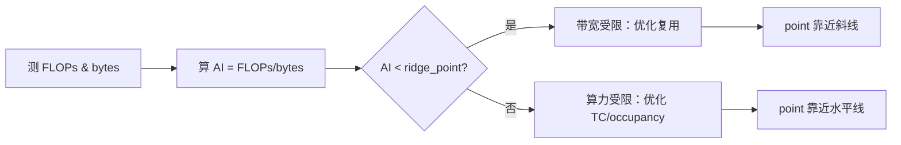

图示把定位流程可视化；但 ridge 点数值和 kernel 落点位置因卡型而异，必须实测标绘。

#### 6. 拓展知识

- **带宽受限的升级路径**：提升 tile 大小让每个数据被多次使用、使用 swizzle 消除 bank conflict、利用 shared memory 做数据复用。
- **算力受限的升级路径**：确保 Tensor Core 对齐、减少 non-Tensor-Core 指令、合并小 kernel、用 CUDA Graph 降低 launch 开销。
- **与 K03 呼应**：roofline 不考虑显存容量；同一个 GEMM 在容量不足时会 swap，打破 roofline 假设。

#### 7. 常见追问及回答要点

1. **问：ridge point 在同一张卡上会变化吗？** 答：同一张卡 FLOPs_peak 和 Bandwidth_peak 是固定值，ridge point 不变；但 bf16/fp32/Tensor Core 的 FLOPs_peak 可能不同，画图时按精度选线。
2. **问：实测 achieved 远低于 roofline 两条线怎么办？** 答：说明实现没用好硬件：检查是否走 Tensor Core、是否有 warp 发散、occupancy 是否被寄存器/shared memory 限制。
3. **问：为什么小 batch 推理通常带宽受限？** 答：M 或 N 小时 AI 低，搬运占比大；同一权重矩阵被反复用才能提高 AI。

#### 8. 易错点与反例

- 反例："我只要看 kernel 耗时就能判断"——耗时高低不直接对应区域，只有在同一 AI 下比较才有意义。
- 反例："所有 GEMM 都是算力受限"——只有大矩阵越过 ridge point 才是；小矩阵带宽受限。
- 易错：把 HBM spec 带宽当作实际可持续带宽；实际 achieved 通常只有 spec 的 60-80%。

#### 9. 实践与验证

[待验证] 输入：同一 GEMM kernel 三种 shape（小/中/大）；步骤：用 nsight compute 分别测 achieved FLOPs、achieved bandwidth，算 AI 并点绘在 roofline 图上；控制时钟与功耗。oracle：小 shape 落在斜线附近，大 shape 越过 ridge point 靠近水平线。当前未执行 GPU 实验，不写死数字。

#### 10. 评分标准

- 不合格：说不清 roofline 两条线含义，或把耗时当作定位依据。
- 合格：能说出 ridge point 含义、需要测 AI 与实际吞吐、给出两个区域的判断。
- 良好：给出完整测量流程、解释同一算子不同 shape 会落在不同区域、指出 achieved 远低于 roofline 说明实现有问题。
- 优秀：把 roofline 与 occupancy、Tensor Core 对齐、CUDA Graph 等关联，指出带宽受限与算力受限有不同的优化优先级。

**证据与来源：** [已确认] cuda/99-roadmap/performance-guide.md；[推断] LeetCUDA/01-modules/M11-triton-cutlass-profiling；[已确认] insights/sm-block-warp-technical-insight.md

---

## AIInfra-I002. Tensor Core/矩阵加速单元对算子实现有哪些对齐与 shape 要求？不满足时会发生什么？

- 难度：中级
- 知识域：K01 计算硬件与加速器
- 考察能力：约束理解、异常行为分析、优化推导
- 题型：机制解释与辨析
- 面试频率：高频
- 前置知识：warp 层次、shared memory、矩阵乘数学、数据类型
- 关联题目：AIInfra-I001（roofline）、AIInfra-B001（warp 执行）、AIInfra-I022（MFU）
- 事实状态：[已确认] [推断] [待验证]

#### 1. 背景知识

Tensor Core / 矩阵加速单元是 GPU 上专做小块矩阵乘的硬件单元，每时钟周期完成一个小矩阵乘-加 [推断] `LeetCUDA/01-modules/M11-triton-cutlass-profiling/design.md`。以 Hopper/Ada 为例，一个 warp 每周期能发起一个 16×16×16 或更大的矩阵乘子操作。CUDA 的 CUTLASS、Triton 都提供对这些单元的封装，但底层有严格的对齐、shape 和数据类型约束。`insights/sm-block-warp-technical-insight.md` 提到 block 内的 warp 调度粒度是 32 个 lane。

#### 2. 问题分析

1. 先列对齐维度：矩阵维度、shared memory 地址、warp 内线程分工、数据类型。
2. 再解释不满足时的具体行为：性能退化 vs 结果错误。
3. 最后给避免办法。

#### 3. 具体答案

面试中可以这样回答：

> Tensor Core 不是"调用就加速"，它对参与乘法的矩阵有多层约束：
>
> - **矩阵维度对齐**：以 CUTLASS 为例，tile 大小通常是 8/16/32 的倍数；M、N 如果不是 tile 整数倍，编译器或库会做 padding，浪费算力，实测 MFU 下降。
> - **shared memory 地址对齐**：load tile 到 shared memory 时地址需 128B 对齐，否则 bank conflict 或直接退回到普通 CUDA Core 计算。
> - **warp 内线程分工**：一个 warp 内的 lane 按固定 layout 持有矩阵的某一片 lane data；blockDim 不是 warp 整数倍或 warp 内 layout 不匹配时，lane 数据会错位 [已确认] `insights/sm-block-warp-technical-insight.md:102-125`。
> - **数据类型**：Tensor Core 只支持指定类型组合（fp16、bf16、fp8、int8、fp64 等），不支持"随便传 fp32"；不匹配时库要么报错要么用 CUDA Core fallback。
>
> 不满足约束时，行为分两类：一类是 **正确但性能退化**——编译器做 padding、退回到 CUDA Core，MFU 从 60%+ 掉到 10% 量级（[推断]）；另一类是 **错误**——lane 数据错位导致矩阵乘结果不正确，而不会报错。这就是为什么 CUTLASS/Triton 文档反复强调"对齐不等于好性能，不对齐一定出问题"。

#### 4. 技术洞察

```text
对齐检查顺序：
  dtype 是否在 TC 支持列表
  → tile shape 是否 block 可整分
  → shared memory 地址 128B 对齐
  → warp 内 lane layout 与 mma 指令匹配
  → 否则 fallback 或 silent wrong result
```

[推断] 在 roofline 图上（`cuda/99-roadmap/performance-guide.md`），未对齐的 GEMM 会表现为 achieved FLOPs 远低于 Tensor Core 预期但仍可能高于纯 CUDA Core 水平——这是 "padding + 部分 TC" 的中间态。

#### 5. 图文说明

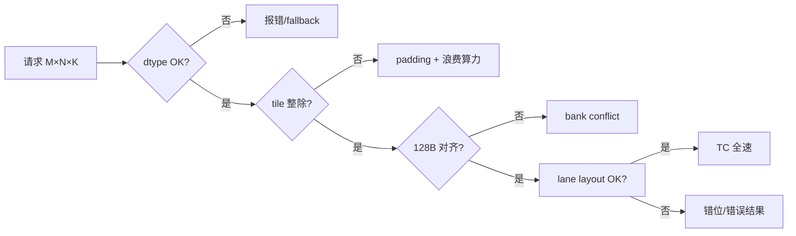

图示按顺序列出检查项；每一项失败都对应不同的降级或错误行为。

#### 6. 拓展知识

- **与 Triton 的关系**：Triton 编译器后端会尝试自动 tile + 对齐；但自动策略不保证最优，性能调优仍需手选 block size [推断] `LeetCUDA/01-modules/M11-triton-cutlass-profiling`。
- **与 K02 的关系**：CUDA Graph 捕获时如果 shape 在 capture 和 replay 之间变化，TC 的 tile 选择可能失效。
- **与 MFU 的关系**：MFU 低（`AIInfra-I022`）的常见根因之一就是 shape 不对齐导致 TC 利用率低。

#### 7. 常见追问及回答要点

1. **问：fp32 矩阵乘能走 Tensor Core 吗？** 答：不能直接用；需拆为 fp16×fp16+fp32 accumulate 或用 TF32 模式；具体取决于架构。
2. **问：padding 会浪费多少算力？** 答：取决于 padding 比例；极端如 M=1 时几乎全浪费。这就是 CUTLASS 对小 batch 提供专门路径的原因。
3. **问：如何排查一个 kernel 是否真的走了 Tensor Core？** 答：nsight compute 看 sm__inst_executed_pipe_tensor 或 tcount 指标；反汇编看 HMMA/IMMA 指令。

#### 8. 易错点与反例

- 反例："只要用了 CUTLASS 就一定是 Tensor Core 加速"——不对，shape 不对齐或类型不匹配时 CUTLASS 也会 fallback。
- 反例："Tensor Core 会自己处理任何 shape"——不会，约束必须满足，否则结果错。
- 易错：把"bank conflict"与"未对齐"混为一谈——bank conflict 降低带宽，未对齐可能导致 silent wrong result。

#### 9. 实践与验证

[待验证] 输入：同一 GEMM kernel 两种写法——写法 A shape 对齐到 tile、写法 B 故意不对齐；步骤：编译、反汇编看 HMMA 指令数量，用 nsight compute 测 achieved FLOPs。oracle：写法 A 的 achieved 接近理论峰值，写法 B 显著下降且有 padding 指令。当前未执行 GPU 实验。

#### 10. 评分标准

- 不合格：说不出任何一项对齐要求，或认为 Tensor Core 无约束。
- 合格：能列出维度、地址、warp layout、dtype 四类约束。
- 良好：区分性能退化与结果错误两类行为，能给出反汇编级别的验证办法。
- 优秀：把对齐与 MFU、CUDA Graph、Triton 编译器后端关联，指出调试优先级。

**证据与来源：** [推断] LeetCUDA/01-modules/M11-triton-cutlass-profiling/design.md；[已确认] insights/sm-block-warp-technical-insight.md:102-125；[已确认] cuda/99-roadmap/performance-guide.md

---

## AIInfra-I003. 端到端描述一次 kernel launch 的调用链（host API → 驱动 → 硬件），哪些环节可能引入延迟？

- 难度：中级
- 知识域：K02 驱动运行时
- 考察能力：全链路理解、瓶颈定位、分层拆解
- 题型：流程描述与排障
- 面试频率：高频
- 前置知识：CUDA API、GPU 驱动模型、syscall
- 关联题目：AIInfra-I004（stream/event）、AIInfra-I005（CUDA Graph）、AIInfra-I022（MFU）
- 事实状态：[已确认] [推断]

#### 1. 背景知识

一次 kernel launch 不是单个函数调用。从 `cudaLaunchKernel` 或 `cuLaunchKernel` 进入后，经过 API wrapper → current Context → Function/Stream 一致性检查 → 参数 packing → syscall 与 memory tracking → HAL 检查与 QMD 编码 → Stream/Channel pushbuffer → GPFIFO 发布 → RM 边界 → 硬件消费 → completion 与 reclaim [已确认] `cuda/90-cross-module/end-to-end-kernel-launch.md:9-32`。这些阶段分布在用户态驱动、内核态驱动、硬件固件三个层次。

#### 2. 问题分析

1. 按"API 入口 → 用户态驱动 → 内核态驱动/IOCTL → 硬件"的顺序拆解。
2. 每个环节指出可能的延迟来源。
3. 给出"哪个延迟占大头"的定性判断与验证方式。

#### 3. 具体答案

面试中可以这样回答：

> 从 host 视角看，一次 kernel launch 的路径可以拆成：
>
> 1. **API wrapper**：参数校验、TLS 取 current Context、Function/Stream 合法性检查——`cuda/90-cross-module/end-to-end-kernel-launch.md` 明确记录 `cuLaunchKernel → cuapiLaunchKernelCommon → cuiValidateLaunch → current Context / function / stream checks`。这一步通常几十到几百 ns，不做重活。
> 2. **Launch 状态建立**：`cuiLaunchKernel_nonreentrant → launchData → memory tracking list`。每 launch 都做一次 memory tracking 是固定开销，也是 CUDA Graph 想消除的动机 [已确认] `cuda/90-cross-module/end-to-end-kernel-launch.md:179-220`。
> 3. **Setup 与 HAL**：`cuiLaunchSetup_common` 调用 `hal.launchCheck`、`hal.launchInitialize`、`hal.encodeAbiConstBankGridParams`、QMD 配置。架构 HAL 字段编码开销相对小，但 profiler 开启时会有额外 patch。
> 4. **Pushbuffer / GPFIFO**：`streamBeginPush → QMD → streamEndPush → gpfifoFlushGpfifoEntry → hal.setGpfifoEntry → dmal.GpfifoAdvanceGpuPut`。这是 host 把命令写到 GPU 可消费队列的关键路径 [已确认] `cuda/90-cross-module/end-to-end-kernel-launch.md:228-278`。
> 5. **syscall / IOCTL**：从用户态进内核态提交 GPFIFO entry。**上下文切换是单次 launch 的主要延迟源之一**，也是 CUDA Graph 批量提交想摊薄的对象 [推断]。
> 6. **硬件消费**：GPU 通过 doorbell 拿到新的 GPPut，firmware 调度 QMD，SM 实际执行。这部分不是 host 侧延迟，但在端到端 kernel 耗时里占大头。
> 7. **Completion**：tracking semaphore 更新、gpfifoAdvanceGpuGet、pushbuffer reclaim。`cuda/90-cross-module/end-to-end-kernel-launch.md:280-312`。
>
> 延迟分布上，host 侧一次普通 launch 大约 10-30 μs（其中 IOCTX、pushbuffer、memory tracking 是大头），GPU 侧执行取决于 kernel 工作量。**当 kernel 本身只有几 μs 时，host launch 开销变成主要瓶颈**——这是 CUDA Graph 和小 kernel 合并的根本动机。

#### 4. 技术洞察

```text
launch 延迟主成分：
  API 校验 + launchData       ≈ 0.1-0.5 μs
  setup / QMD 编码             ≈ 0.5-2 μs
  pushbuffer + GPFIFO          ≈ 1-5 μs
  syscall / IOCTL              ≈ 5-15 μs   ← 大头之一
  profiler / debugger 额外      ≈ 可达 10×  [推断]
```

[推断] CUDA Graph 把 N 个 kernel 的 launch 开销从 N 次 syscall 摊到 1 次，对大量小 kernel 吞吐提升明显。但这是定性判断，具体数值需实测。

#### 5. 图文说明

```text
Host App
  │ cudaLaunchKernel
  ▼
API wrapper + Context/Function 检查
  │ cuiLaunchKernel_nonreentrant
  ▼
launchData + memory tracking
  │ cuiLaunchSetup_common
  ▼
QMD / HAL 编码
  │ streamBeginPush → streamEndPush
  ▼
GPFIFO entry 发布 (host 可见末端)
  │ IOCTL / syscall
  ▼
RM / Firmware / GPU 消费 QMD
  │
  ▼
tracking semaphore → completion
```

每段都有可能引入延迟，图中加粗段是主要开销。

#### 6. 拓展知识

- **与 CUDA Graph 的关系**：`cuda/01-modules/M06-module-launch/graph-control-flow.md` 描述 capture 与 instantiate 如何把"逐次 launch"改为"一次提交计划"，摊薄 syscall。
- **与 profiler 的关系**：profiler/perfmon 会额外 patch QMD、阻塞 WFI，改变 pushbuffer 时序；`cuda/99-roadmap/performance-guide.md` 要求性能数据注明工具配置。
- **与 stream 的关系**：默认 stream（legacy stream）的 launch 会与其他默认 stream 操作串行化，额外引入隐式同步。

#### 7. 常见追问及回答要点

1. **问：如何测量单次 launch 的 host 侧耗时？** 答：用 CUDA event 在 launch 前后计时，或用 CPU 侧高精度计时包裹；注意 event 本身也有开销。
2. **问：哪些 profiler 行为会放大 launch 开销？** 答：CUDA debugger、Nsight Compute 的深度 profiling、内存检查工具都会让每次 launch 额外同步或 patch QMD。
3. **问：CUDA Graph 一定能降低 launch 开销吗？** 答：对大量小 kernel 有效；对少量大 kernel 效果有限，因为 GPU 执行本身占主导。

#### 8. 易错点与反例

- 反例："launch 延迟主要是 GPU 执行"——对大 kernel 对，但对小 kernel host 侧占主导。
- 反例："GPFIFO 发布就是 GPU 完成"——`cuda/90-cross-module/end-to-end-kernel-launch.md:278` 明确"writeGPPut 是发布新的生产者位置，而非 GPU completion 证明"。
- 易错：把 `cudaDeviceSynchronize` 之前的 launch 队列深度与 completion 混淆——host 返回成功不等于 GPU 执行完。

#### 9. 实践与验证

[待验证] 输入：同一个极小 kernel（单个 add）循环 launch 1000 次；步骤：用 CUDA event 测总耗时，对比用 CUDA Graph 一次性 replay 1000 次；控制时钟。oracle：Graph 版本总耗时显著低于逐次 launch。当前未执行 GPU 实验。

#### 10. 评分标准

- 不合格：说不清 launch 经过哪些层次，或认为 launch 是单个函数。
- 合格：能按 API → driver → 硬件拆解，指出至少两处延迟来源。
- 良好：指出 syscall、pushbuffer、memory tracking 是 host 大头，关联 CUDA Graph 优化动机。
- 优秀：区分 host 与 device 延迟，给出 profiler 影响的注意事项，说明小 kernel 场景下的定量判断。

**证据与来源：** [已确认] cuda/90-cross-module/end-to-end-kernel-launch.md:9-312；[推断] cuda/01-modules/M06-module-launch/graph-control-flow.md；[已确认] cuda/99-roadmap/performance-guide.md

---

## AIInfra-I004. stream 与 event 如何控制异步操作的执行顺序？默认 stream（legacy stream）有什么坑？

- 难度：中级
- 知识域：K02 驱动运行时
- 考察能力：同步原语理解、隐式行为辨析
- 题型：机制解释与陷阱
- 面试频率：高频
- 前置知识：CUDA API、异步执行、多 stream 编程
- 关联题目：AIInfa-I003（launch）、AIInfra-I005（CUDA Graph）
- 事实状态：[已确认] [推断]

#### 1. 背景知识

CUDA 的 stream 是 GPU 侧的有序任务队列——同一 stream 内的 launch 严格串行化，不同 stream 之间可以并行或按显式依赖调度 [已确认] `cuda/90-cross-module/end-to-end-kernel-launch.md:104-134`。stream 创建经过 `cuStreamCreate → cuiStreamCreate → QMD/semaphore/UVM register → public handle`。跨 stream 的依赖通过 `cudaEventRecord` + `cudaStreamWaitEvent` 实现，底层是 tracking semaphore [已确认] `cuda/01-modules/M05-stream-submit/execution-flows.md`。默认 stream（legacy stream, stream 0）在 pre-CUDA 7 是全局唯一的隐式流。

#### 2. 问题分析

1. 先讲同一 stream 内的串行保证。
2. 再讲跨 stream 的 event 机制。
3. 最后讲默认 stream 的三个典型坑：隐式同步、与可分页内存的耦合、与 CUDA Graph capture 的冲突。

#### 3. 具体答案

面试中可以这样回答：

> 同一 stream 内的 launch 严格按提交顺序执行——`cuda/90-cross-module/end-to-end-kernel-launch.md` 指出 stream 是 channel 上的 pushbuffer 队列，`streamBeginPush → GPFIFO → tracking marker` 保证前后顺序 [已确认]。
>
> 跨 stream 依赖用 event：`cudaEventRecord(event, streamA)` 在 streamA 执行到该点时标记 event；`cudaStreamWaitEvent(streamB, event)` 让 streamB 等到 event 完成再继续。底层是 tracking semaphore 更新 + marker wait，host 侧只是写一条 wait command 到 streamB 的 pushbuffer [推断]。
>
> **默认 stream 的坑**有三类：
> 1. **隐式同步**：`cudaMemcpy`（非 Async 版本）、`cudaDeviceSynchronize`、某些 runtime API 在默认 stream 上会与其他 stream 产生隐式同步点，破坏你精心设计的并行。
> 2. **与可分页 host memory 的耦合**：在默认 stream 上做 H2D `cudaMemcpy`，host 侧 pageable memory 必须被 pin 住再拷贝；如果混用多 stream，host 线程可能在拷贝未完成时被调度走，数据损坏。
> 3. **与 CUDA Graph capture 冲突**：capture 期间默认 stream 是 `null-stream` 约束的重点——`cuda/01-modules/M06-module-launch/graph-control-flow.md:48-70` 记录 `cuStreamBeginCapture` 要检查 null-stream 限制；默认 stream 的行为在 capture 与非 capture 路径不同。
>
> 实战中，推荐每个 host thread 创建自己的非默认 stream，避免 legacy stream 的隐式语义污染。

#### 4. 技术洞察

```text
stream 内：严格 FIFO，无并行
跨 stream：event 是单向单向依赖，只 wait 不等
默认 stream：隐式同步源 + 与 pageable 内存耦合 + capture 特殊路径
```

[推断] 默认 stream 的"隐式同步"行为在不同 CUDA 版本有细微变化；不要凭记忆硬背某个 API 是否同步，以当前版本文档为准。

#### 5. 图文说明

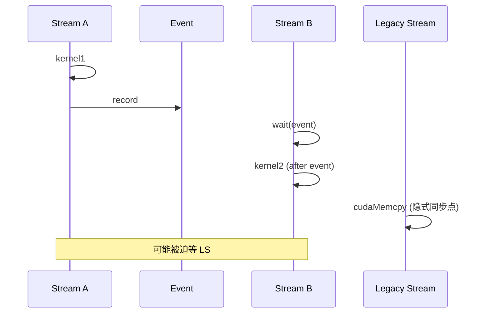

图示展示 event 的跨 stream 依赖和默认 stream 的隐式同步污染。

#### 6. 拓展知识

- **与 K03 的关系**：`cudaMemcpyHostToDevice` 在默认 stream 上，如果 host 端是 pageable memory，runtime 必须先 pin；pinned memory（`cudaMallocHost`）可以避免这一步。
- **与 CUDA Graph 的关系**：capture 必须用非默认 stream（或显式处理 null-stream 约束），否则行为不确定。
- **与 MPS 的关系**：MPS 下有 submission lock，默认 stream 的互占会跨客户端传播。

#### 7. 常见追问及回答要点

1. **问：event 能否在同一个 stream 内做 wait？** 答：可以，但通常没必要；同 stream 内已有 FIFO 保证。
2. **问：`cudaEventSynchronize` 与 `cudaStreamWaitEvent` 区别？** 答：前者是 host 阻塞，后者是 stream 内 device 侧等待。
3. **问：为什么生产代码要避免默认 stream？** 答：默认 stream 的隐式同步和 capture 特殊路径是 bug 温床；显式 stream 行为可预测。

#### 8. 易错点与反例

- 反例："不同 stream 一定并行"——受 SM 资源、通道依赖、隐式同步影响，不一定真并行。
- 反例："event 是双向同步"——event 是单向的，只在 wait 端产生依赖。
- 易错：把默认 stream 的隐式同步与 `cudaDeviceSynchronize` 混淆——后者是全设备同步，前者只在特定 API 上触发。

#### 9. 实践与验证

[待验证] 输入：两个 kernel 分别放在 stream A 和 stream B，中间用 event 连接；步骤：分别测单独运行与 event 连接的总耗时，用 nsystread 可视化 overlap。oracle：event 保证顺序但允许部分 overlap。当前未执行 GPU 实验。

#### 10. 评分标准

- 不合格：说不清 stream FIFO 语义或 event 单向性。
- 合格：能解释 stream 内串行 + event 跨 stream 依赖。
- 良好：列出默认 stream 三类坑，指出与 CUDA Graph 和 pageable memory 的关联。
- 优秀：从 pushbuffer/marker 底层机制解释 event 实现，给出"不用默认 stream"的工程理由。

**证据与来源：** [已确认] cuda/90-cross-module/end-to-end-kernel-launch.md:104-134；[已确认] cuda/01-modules/M05-stream-submit/execution-flows.md；[已确认] cuda/01-modules/M06-module-launch/graph-control-flow.md:48-70

---

## AIInfra-I005. CUDA Graph / MUSA Graph 解决什么问题？适合什么场景？什么场景不适合？

- 难度：中级
- 知识域：K02 驱动运行时
- 考察能力：优化取舍、场景辨析、约束理解
- 题型：机制解释与适用性
- 面试频率：高频
- 前置知识：kernel launch 开销、stream、capture/instantiate/launch 三阶段
- 关联题目：AIInfra-I003（launch 开销）、AIInfra-I004（stream）、AIInfra-I018（PP 显存）
- 事实状态：[已确认] [推断]

#### 1. 背景知识

CUDA Graph 把一组 kernel 从"逐个 launch"改为"一次提交执行计划"。实现拆为三个阶段：Capture 录制 API 操作为节点和依赖边；Instantiate 验证、展开、编译执行计划；Launch 按拓扑序提交 [已确认] `cuda/01-modules/M06-module-launch/graph-control-flow.md:9-45`。Capture 时 `cuLaunchKernel` 不提交 GPU，而是创建 kernel node 并保存参数 [已确认] `cuda/01-modules/M06-module-launch/graph-control-flow.md:58-70`。

#### 2. 问题分析

1. 说明 CUDA Graph 解决的核心问题：host 侧 launch 开销。
2. 列出适合的典型场景。
3. 列出不适合的场景与约束。
4. 给出"要不要用 Graph"的判断框架。

#### 3. 具体答案

面试中可以这样回答：

> CUDA Graph 解决的是 **host 侧 kernel launch 开销**：`cuda/90-cross-module/end-to-end-kernel-launch.md` 展示一次普通 launch 要经过 API 校验 → launchData → setup → QMD → pushbuffer → syscall → GPFIFO，host 侧累计 10-30 μs [已确认]。当 kernel 本身只有几 μs 时，host 开销占主导，N 个 kernel 的总 host 开销 = N × 单 launch。CUDA Graph 在 capture 阶段把 kernel 序列录成 DAG，instantiate 时分配 QMD/constant-bank/completion marker 资源，launch 时一次性提交——把 N 次 syscall 摊到 1 次 [已确认] `cuda/01-modules/M06-module-launch/graph-resource-lifecycle.md:11-40`。
>
> **适合的场景**：
> - 大量小 kernel 重复执行（推理 decode、小 batch GEMM 循环）。
> - 固定 shape、固定 kernel 序列、参数不变的推理 workload。
> - `cuda/01-modules/M06-module-launch/graph-control-flow.md:234-270` 指出 QMD chaining 能在相邻 kernel 间实现设备侧直接接力，进一步减少 host 参与 [已确认]。
>
> **不适合的场景**：
> - **动态 shape**：MoE 的 capacity factor 未固定、sequence length 变化——Graph 要求 capture 与 replay 时 shape/地址一致 [推断]。
> - **条件分支依赖输入**：Graph capture 是静态 DAG，不能"运行时再决定走哪条路"；conditional 节点在 CUDA 12+ 有支持但受限。
> - **host 交互的 kernel**：host callback、需要中途修改参数——capture 录的是静态参数。
> - **大 kernel 主导的 workload**：GPU 执行本身远大于 launch overhead，Graph 收益可忽略甚至因固定化带来负优化。

#### 4. 技术洞察

```text
Graph 收益 ≈ N × launch_overhead - capture_cost - instantiate_cost
当 N 大且 kernel 小时，收益显著
当 kernel 大或 N 小时，Graph 可能不划算
```

[推断] MUSA Graph（`musa/01-modules/M08-graph/`）遵循同样的 capture-instantiate-launch 三阶段模型，但硬件支持（QMD chaining、device scheduler）能力与 CUDA 有差异，使用前需确认目标硬件能力。

#### 5. 图文说明

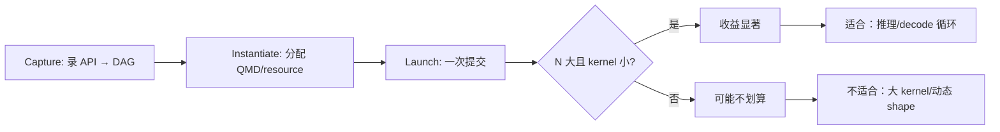

图示把 Graph 三阶段与收益判断结合。

#### 6. 拓展知识

- **与 K08（分布式训练）的关系**：Megatron-Core 在 MoE 场景只 graph  attention 部分，因为动态 capacity 会让完整 capture 失效 [推断] `insights/05-megatron-architecture.md:1173`。
- **与 K09（推理）的关系**：vLLM/SGLang 的 decode 循环大量使用 CUDA Graph，是低延迟推理的关键优化。
- **资源约束**：Graph exec 持有 per-context 的 QMD、constant-bank、completion marker 资源，`cuda/01-modules/M06-module-launch/graph-resource-lifecycle.md:21-40` 详述。

#### 7. 常见追问及回答要点

1. **问：capture 失败会发生什么？** 答：`cuda/01-modules/M06-module-launch/graph-control-flow.md:81-95` 指出不支持的 API 或 invalid 依赖会标记 capture invalidated，`cuStreamEndCapture` 返回错误并销毁 graph [已确认]。
2. **问：Graph 的参数能更新吗？** 答：`cuda/01-modules/M06-module-launch/graph-resource-lifecycle.md:41-48` 指出 `cuGraphExecUpdate` 只接受 topology 和 node type 兼容的参数更新，拓扑变化应返回 update failure [已确认]。
3. **问：多 stream 能合并到一个 Graph 吗？** 答：可以，但跨 stream 依赖会变成 marker wait；capture 时的 stream 约束需满足 [推断]。

#### 8. 易错点与反例

- 反例："CUDA Graph 能加速所有 kernel"——大 kernel 场景下无收益甚至负优化。
- 反例："Graph 的参数随时能改"——`cuGraphExecUpdate` 只接受兼容更新，拓扑变化需重新 instantiate。
- 易错：在动态 shape 的推理场景强行 graph——导致 silent 错误或 capture 失败。

#### 9. 实践与验证

[待验证] 输入：一个 decode 循环（包含 attention + MLP + sampling 共约 20 个小 kernel），分别用逐次 launch 与 CUDA Graph 执行 1000 次；步骤：用 CUDA event 测总耗时。oracle：Graph 版本总耗时显著更低。当前未执行 GPU 实验。

#### 10. 评分标准

- 不合格：说不出 Graph 解决的问题，或认为所有场景都适合。
- 合格：能解释 capture/instantiate/launch 三阶段，列出至少两个适合场景。
- 良好：指出动态 shape、host 回调、条件分支不适合，说明底层 QMD chaining 机制。
- 优秀：把 Graph 与推理服务（K09）、分布式训练（K08）关联，给出收益估算框架。

**证据与来源：** [已确认] cuda/01-modules/M06-module-launch/graph-control-flow.md:9-95；[已确认] cuda/01-modules/M06-module-launch/graph-resource-lifecycle.md:11-48；[推断] insights/05-megatron-architecture.md:1173

---

## AIInfra-I006. 显存池（memory pool）如何减少分配开销？Segment 管理与空闲集合的权衡是什么？

- 难度：中级
- 知识域：K03 显存
- 考察能力：数据结构取舍、分配器设计、性能权衡
- 题型：设计与分析
- 面试频率：高频
- 前置知识：GPU 显存分配、CUDA malloc、碎片
- 关联题目：AIInfra-I007（非法地址）、AIInfra-I008（pinned memory）、AIInfra-I021（KV cache）
- 事实状态：[已确认] [推断]

#### 1. 背景知识

频繁的 `rtMalloc/rtFree` 会产生驱动调用开销、地址映射开销和碎片。SOMA（Stream Ordered Memory Allocation）的思路是创建池时一次性预留大段连续 VA，Runtime 在池内切分小块，分配/释放只修改元数据 [已确认] `cann/memory_pool_analysis.md:12-29`。CANN 实现的核心数据结构：Segment（地址双向链表）、SegmentManager（freeSegs_/cachedSegs_/allocedMap_ 三索引）、PoolRegistry [已确认] `cann/memory_pool_analysis.md:122-189`。

#### 2. 问题分析

1. 解释"为什么要池化"：减少驱动调用、减少碎片、允许 stream-ordered 复用。
2. 解释 Segment 管理：双向链表支持合并与切分。
3. 解释空闲集合：freeSegs_ 按 (size, basePtr) 排序实现 Best-Fit，cachedSegs_ 是设计预留。
4. 解释权衡：Best-Fit 减少碎片但每次分配是 O(log N)；简单 First-Fit 快但碎片多。

#### 3. 具体答案

面试中可以这样回答：

> 显存池解决的根本问题是"每 alloc 都走驱动"太慢。`cann/memory_pool_analysis.md` 描述的两级池：Driver/HAL 是大仓库（一次性预留连续 VA + HBM HugePage），Runtime 是仓库管理员，维护 Segment 链表和多索引 [已确认]。分配时：
>
> 1. `rtMemPoolMallocAsync → SegmentManager::SegmentAlloc → halMemPoolAsyncConfig → AICPU SomaMemMng → halMemPoolMalloc`。
> 2. SegmentManager 先在 `freeSegs_`（按 size 排序的 set）做 Best-Fit，找到最小满足的 FREE segment，`SplitLeft` 切出需要的块 [已确认] `cann/memory_pool_analysis.md:248-265`。
>
> **Segment 管理的权衡**：双向链表按地址组织，让"合并邻居"是 O(1)——释放时只需看 prev/next 是否 FREE。但按地址排序的链表不能快速找"大小最合适的块"，所以额外维护 `freeSegs_` 按 (size, basePtr) 排序 [已确认] `cann/memory_pool_analysis.md:150-168`。这就是经典的"多索引维护"：每种操作一个索引，但切分/合并时必须同步更新所有容器。
>
> **空闲集合的权衡**：
> - `freeSegs_` = 当前可立即分配的块；Best-Fit 策略减少 leftover 碎片，但 `lower_bound` 是 O(log N)。
> - `cachedSegs_` = 软件已释放但 stream 依赖未满足、不能立即复用的块。`cann/memory_pool_analysis.md` 指出当前 `TryToReuse` 直接返回 nullptr，cached 的复用逻辑是设计预留，实际走 `AllocFromFreeSegs` [已确认] `cann/memory_pool_analysis.md:76-96,234-247`。
> - 如果允许立即复用 cached 块，分配速度提升，但 stream 顺序语义可能被破坏——这是"快 vs 安全"的取舍。

#### 4. 技术洞察

```text
分配路径：
  AllocFromFreeSegs: O(log N) Best-Fit + SplitLeft O(1) + 多索引更新 O(log N)
  TryToReuse (cached): 设计预留，当前返回 nullptr

释放路径：
  非 force free: BUSY → CACHED（等 stream/event）
  force free: BUSY → FREE（合并邻居）
```

[推断] 如果分配频率极高，`freeSegs_` 的 O(log N) 可能成为瓶颈；某些实现会用 segregated free list（按大小分桶）替代单一有序 set，用空间换时间。

#### 5. 图文说明

```text
初始池 64MB:
[ FREE 64MB ]  freeSegs_ = {(64MB, 0x10000000)}

Stream 7 申请 8MB:
[ BUSY 8MB s7 ] [ FREE 56MB ]
  allocedMap_[0x10000000] = Segment(8MB)
  freeSegs_ = {(56MB, 0x10800000)}

Stream 7 异步释放 8MB:
[ CACHED 8MB ] [ FREE 56MB ]
  freeSegs_ = {(56MB, 0x10800000)}  ← 8MB 不在 freeSegs_ 里
  cachedSegs_ 设计预留但未启用
```

来自 `cann/memory_pool_analysis.md:32-96`。

#### 6. 拓展知识

- **与 KV cache 的关联**：`sglang/01-modules/M08-kv-cache/README.md` 的 `TokenToKVPoolAllocator` 同样做 Best-Fit + deferred release，`need_sort=True` 时先放 release_pages 再合并排序 [已确认]。
- **与碎片的关系**：Best-Fit 的副作用是产生大量小碎片；segregated free list 按大小分桶缓解。
- **与 stream 的关系**：`cachedSegs_` 的存在是为了 stream-ordered 复用，类似 `cuda/90-cross-module/end-to-end-kernel-launch.md` 的 tracking marker。

#### 7. 常见追问及回答要点

1. **问：Best-Fit 与 First-Fit 在碎片上有什么差异？** 答：Best-Fit 选最小满足块，留下大块可用，但产生小碎片；First-Fit 选首个满足块，速度快但碎片分布不可控。
2. **问：cachedSegs_ 当前为什么没启用？** 答：`cann/memory_pool_analysis.md` 指出 `TryToReuse` 当前返回 nullptr，复用的 stream/event 检查逻辑是设计预留 [已确认]。
3. **问：显存池会不会引入额外开销？** 答：每次 alloc 修改元数据 + 一次 AICPU 设备配置；比直接走驱动快得多，但仍有开销。

#### 8. 易错点与反例

- 反例："显存池消除所有碎片"——池内仍有碎片，只是把外部碎片转为内部碎片管理。
- 反例："cached 块可以立即复用"——当前 CANN 实现中 cached 复用未启用 [已确认]。
- 易错：把 `reserveSize_` 当成已分配量——`cann/memory_pool_analysis.md:56-66` 明确 reserveSize_ 是 allocated + cached，不等于 busySize_。

#### 9. 实践与验证

[待验证] 输入：同一 workload 分别用显存池 vs 每次 rtMalloc；步骤：统计 alloc 调用次数、平均分配耗时、碎片率。oracle：池化版本的 alloc 耗时显著更低、碎片可控。当前未执行硬件实验。

#### 10. 评分标准

- 不合格：说不清池化解决的问题，或把 pool 当成"无限显存"。
- 合格：能解释两级池、Segment 三状态、freeSegs_ Best-Fit。
- 良好：解释多索引维护的复杂度、cachedSegs_ 的设计权衡。
- 优秀：对比 Best-Fit / First-Fit / segregated list，关联 KV cache allocator 设计。

**证据与来源：** [已确认] cann/memory_pool_analysis.md:12-96,122-189,248-265；[已确认] sglang/01-modules/M08-kv-cache/README.md:88-101

---

## AIInfra-I007. GPU 程序报"非法地址访问"时如何定位？列出常见根因分类与排查顺序。

- 难度：中级
- 知识域：K03 显存
- 考察能力：排障流程、错误分类、工具使用
- 题型：排障与分类
- 面试频率：高频
- 前置知识：CUDA 错误模型、显存生命周期、stream 异步
- 关联题目：AIInfra-I006（显存池）、AIInfra-I008（pinned memory）、AIInfra-I024（进程崩溃）
- 事实状态：[已确认] [推断]

#### 1. 背景知识

GPU 的"非法地址访问"（illegal address / misaligned address / CUDA error 700 等）意味着 kernel 试图访问设备上映射无效或已被回收的 VA [已确认] `cann/90-cross-module/error-boundaries.md:11-38`。错误的触发点可能在 host 侧（提交前校验失败）或设备侧（kernel 执行时访问非法 VA）——两者的时序不同，排查策略也不同。跨层错误转换：Driver drvError_t → Runtime rtError_t → ACL/GE [已确认] `cann/90-cross-module/error-boundaries.md:16-24`。

#### 2. 问题分析

1. 先区分"提交前校验失败"与"kernel 执行中访问非法 VA"两类。
2. 按概率排常见根因：已释放内存、越界、stream 顺序错乱、UVM 未映射、设备侧元数据不一致。
3. 给出排查顺序：从 host → 异步边界 → 设备侧元数据 → 工具辅助。

#### 3. 具体答案

面试中可以这样回答：

> GPU 报非法地址访问，第一步要判断是 **host 侧提交校验失败** 还是 **kernel 执行中触发**：
>
> - **提交前失败**：handle/Context/参数校验不通过，不会产生新的 GPFIFO 发布——`cuda/90-cross-module/end-to-end-kernel-launch.md:316-320` 明确"validation failure before submission means no valid new commands" [已确认]。常见原因：传入了已释放的 device pointer、Context 不匹配、function/stream 非法。
> - **执行中失败**：kernel 实际访问了非法 VA，tracking semaphore 标记失败。常见原因分类：
>   1. **Use-after-free**：buffer 已被 `rtMemPoolFreeAsync` 释放但 kernel 仍在使用——`cann/memory_pool_analysis.md:76-96` 描述的 CACHED 状态就是为防这个 [已确认]。
>   2. **越界访问**：kernel 内的数组索引超出分配范围，不是驱动问题而是 kernel 逻辑 bug。
>   3. **Stream 顺序错乱**：A stream 写入后 B stream 还没等到 event 就读取，底层 VA 可能被中间释放。
>   4. **UVM 未映射**：Unified Virtual Addressing 的 physical backing 被提前 unmap [推断]。
>   5. **设备侧元数据不一致**：`cann/90-cross-module/error-boundaries.md:32-38` 指出 SOMA async free 时 Driver V3 free ioctl 失败"明确不回滚"，本地与设备侧状态可能暂时不对称 [已确认]。
>
> **排查顺序**：① 确认错误码（CUDA error / CANN error）；② 用 `cuda-gdb` 或 Nsight 看崩溃时的 PC 和 VA；③ 检查该 VA 的分配时间与释放时间；④ 检查相关 stream/event 顺序；⑤ 用 ASan 或 memcheck 做注入测试复现。

#### 4. 技术洞察

```text
排查优先级（按概率）：
  1. use-after-free (CACHED 状态管理)
  2. kernel 越界（逻辑 bug）
  3. stream/event 顺序错乱
  4. UVM mapping 问题
  5. 设备/Host 元数据不对称（SOMA free 失败）
```

[推断] CANN 的 `cann/90-cross-module/error-boundaries.md:36` 指出 Driver V3 free ioctl 失败时本地与设备侧状态可能暂时不对称——这是排查"为什么释放成功但访问还是非法"的关键线索。

#### 5. 图文说明

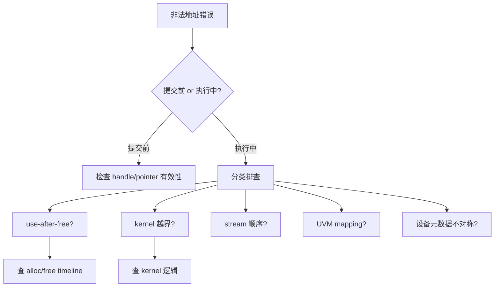

图示给出排查决策树。

#### 6. 拓展知识

- **与显存池的关系**：`cann/memory_pool_analysis.md` 的 CACHED 状态就是为了防止 use-after-free 引入的 [已确认]。
- **与 pinned memory 的关系**：`cudaMemcpyHostToDevice` 用 pageable memory 时 runtime 会临时 pin；如果 host 端 VA 被 OS 换出，触发非法地址 [推断]。
- **工具链**：`compute-sanitizer`、`cuda-gdb`、Nsight 的 memory check。

#### 7. 常见追问及回答要点

1. **问：如何区分 use-after-free 与 kernel 越界？** 答：看 VA 是否在已分配范围内：use-after-free 的 VA 是曾经有效但已释放，越界的 VA 可能从未有效。工具上 `compute-sanitizer --tool memcheck` 会标出具体类型。
2. **问：为什么有时错误在好几个 step 后才报？** 答：异步执行 + tracking semaphore 延迟；kernel 提交成功不等于 GPU 已消费完。
3. **问：SOMA free 失败怎么恢复？** 答：`cann/90-cross-module/error-boundaries.md:32-38` 指出 V3 free 不回滚，本地与设备侧状态不对称——通常需要重启 context [推断]。

#### 8. 易错点与反例

- 反例："非法地址一定是 kernel 越界"——use-after-free 更常见，且更隐蔽。
- 反例："释放后立刻报错"——异步语义下错误可能延迟。
- 易错：把 CUDA error 700 与 CANN 错误码直接映射——跨层转换可能丢信息 [已确认] `cann/90-cross-module/error-boundaries.md:16-24`。

#### 9. 实践与验证

[待验证] 输入：一个故意 use-after-free 的 kernel（alloc → launch → free → 再 launch 同一 VA）；步骤：用 compute-sanitizer 运行。oracle：工具精确标出 use-after-free 的位置与 VA。当前未执行 GPU 实验。

#### 10. 评分标准

- 不合格：把所有非法地址归结为 kernel 越界，忽略 use-after-free。
- 合格：能区分提交前/执行中两类，列出至少三种常见根因。
- 良好：给出系统化排查顺序，关联 CANN 的错误分层与 SOMA 元数据不对称。
- 优秀：把工具链（compute-sanitizer/cuda-gdb）与 stream 异步语义结合，指出排查难点。

**证据与来源：** [已确认] cann/90-cross-module/error-boundaries.md:11-38；[已确认] cuda/90-cross-module/end-to-end-kernel-launch.md:316-320；[已确认] cann/memory_pool_analysis.md:76-96

---

## AIInfra-I008. pinned memory 与 pageable memory 在 H2D 拷贝性能上有何差异？原因是什么？

- 难度：中级
- 知识域：K03 显存
- 考察能力：硬件理解、性能分析、机制推导
- 题型：机制解释与对比
- 面试频率：高频
- 前置知识：虚拟内存、DMA、CUDA 内存模型
- 关联题目：AIInfra-I007（非法地址）、AIInfra-I006（显存池）、AIInfra-I015（数据管道）
- 事实状态：[已确认] [推断]

#### 1. 背景知识

Host 侧内存分两类：**pinned memory**（`cudaMallocHost` 分配，物理页锁定不被 OS swap）和 **pageable memory**（普通 `malloc`，物理页可被 OS 移动或 swap）。H2D 拷贝 `cudaMemcpyHostToDevice` 的行为取决于源内存类型。CUDA runtime 对 pageable memory 的 `cudaMemcpy` 会先临时 pin 再 DMA，而 pinned memory 可以直接 DMA [已确认] `cann/90-cross-module/memory-and-resource-lifecycle.md:79-83`。

#### 2. 问题分析

1. 描述两种 H2D 路径的差异。
2. 解释根本原因：DMA 需要物理页固定。
3. 给出性能差距的量级与实测验证方法。
4. 解释何时用 pinned vs pageable。

#### 3. 具体答案

面试中可以这样回答：

> **Pinned memory（锁页内存）** 由 `cudaMallocHost` 分配，OS 保证物理页不会被 swap 或移动，GPU 的 DMA 引擎可以直接按物理地址搬运 [已确认] `cann/90-cross-module/memory-and-resource-lifecycle.md:79-83`。H2D 路径：host → DMA → device，一次传输。
>
> **Pageable memory（可分页内存）** 由普通 `malloc` 分配，物理页随时可能被 OS 换出或重映射。`cudaMemcpyHostToDevice` 如果源是 pageable memory，runtime 会：① 临时 pin 住这些页；② 拷贝到 staging buffer 或临时 pinned buffer；③ DMA 到 device；④ 释放 pin。这就是"隐式 pin"的开销 [推断]。
>
> 性能差异来自两方面：
> 1. **额外拷贝**：pageable 路径通常多一次 host-side 拷贝（pageable → pinned staging → device），有效带宽减半 [推断]。
> 2. **Pin 的开销**：`cudaHostRegister` 的 pin 操作本身有成本；如果 OS 需要换出或重映射，延迟更大。
>
> 何时用 pinned：频繁 H2D 的小数据、实时数据管道（`AIInfra-I015`）、对延迟敏感的场景。何时用 pageable：大块一次性上传、host 端内存紧张（pinned 不参与 OS 内存管理）。

#### 4. 技术洞察

```text
pinned 路径：
  page pinned → DMA to device
  有效带宽 ≈ PCIe/NVLink 理论带宽

pageable 路径（非 Async）：
  pageable → temp pin + copy to staging → DMA
  有效带宽 ≈ 理论带宽 / 2（多一次 host 拷贝）

pageable + cudaMemcpyAsync（非默认 stream）仍需要先 pin，
  但可以与计算重叠
```

[推断] 实际差距取决于 page 大小、PCIe 带宽和 host 内存带宽；具体数字需实测。

#### 5. 图文说明

```text
pinned:
  [Host Pinned] ---DMA---> [Device]
  一次传输，带宽 ≈ 理论值

pageable (sync cudaMemcpy):
  [Host Pageable] --copy--> [Temp Pinned] ---DMA---> [Device]
  两次搬运，带宽 ≈ 理论值/2

pageable + cudaMemcpyAsync:
  [Host Pageable] --pin--> [Pinned Staging] ---DMA---> [Device]
  可与 kernel 重叠，但 pin 开销仍在
```

图示展示三种路径差异。

#### 6. 拓展知识

- **与统一内存的关系**：Managed memory（`cudaMallocManaged`）让 OS 和 GPU 共享 page fault 机制，按需迁移——适合不规则访问，但首次访问有 page fault 开销。
- **与 K07 数据管道的关系**：训练数据加载时通常先 pin host buffer 再做 H2D，避免 pageable 的隐式拷贝 [推断]。
- **与 K03 显存池的关系**：pinned host memory 本身也是一种资源，过度 pin 会减少 OS 可用内存。

#### 7. 常见追问及回答要点

1. **问：`cudaMemcpyAsync` 能用于 pageable memory 吗？** 答：不能保证正确性——`cudaMemcpyAsync` 要求源是 pinned memory；对 pageable 调用会退化为同步版本或报错。
2. **问：pin 太多 host memory 有什么风险？** 答：OS 可用内存减少，可能触发 OOM 或影响其他进程。
3. **问：如何验证我的 H2D 是否走了 pinned 路径？** 答：用 nsystream 看是否有两次 copy kernel（一次 host-host 一次 host-device）。

#### 8. 易错点与反例

- 反例："pinned 一定比 pageable 快"——对单次大块传输，pin 的开销可能超过收益。
- 反例："cudaMemcpyAsync 对 pageable 也能异步"——异步版本对 pageable 不安全，会退化为同步。
- 易错：把 pinned memory 与"注册"（`cudaHostRegister`）混淆——`cudaHostRegister` 是把已有的 pageable memory 临时 pin，不是创建新的 pinned 内存。

#### 9. 实践与验证

[待验证] 输入：同一数据块（如 64MB），分别用 pinned 与 pageable 做 100 次 H2D；步骤：用 CUDA event 测平均耗时。oracle：pinned 版本平均耗时显著低于 pageable。当前未执行 GPU 实验。

#### 10. 评分标准

- 不合格：说不出 pinned 与 pageable 的根本区别。
- 合格：能解释 DMA 需要物理页固定、pageable 路径多一次拷贝。
- 良好：量化性能差距量级，指出 `cudaMemcpyAsync` 对 pageable 的限制。
- 优秀：关联统一内存、数据管道 pin 策略，指出过度 pin 的风险。

**证据与来源：** [已确认] cann/90-cross-module/memory-and-resource-lifecycle.md:79-83；[推断] cuda/01-modules/M05-stream-submit/call-chains.md；[已确认] cuda/90-cross-module/end-to-end-kernel-launch.md

---

## AIInfra-I009. Ring AllReduce 的通信量为什么是 2(N-1)/N × 数据量？推导这个过程。

- 难度：中级
- 知识域：K04 网络
- 考察能力：数学推导、通信算法理解
- 题型：推导
- 面试频率：高频
- 前置知识：集合通信、分布式训练、NCCL
- 关联题目：AIInfra-I010（带宽估算）、AIInfra-I017（TP/PP/DP 通信对比）
- 事实状态：[已确认] [推断]

#### 1. 背景知识

Ring AllReduce 是分布式训练中梯度同步的经典算法，把 N 个 rank 组织成逻辑环。`insights/05-megatron-architecture.md` 在"通信原语速查"中明确 DP 用 all-reduce / reduce-scatter [已确认]。算法分两阶段：Reduce-Scatter 和 All-Gather，每阶段 N-1 步，每个 rank 每次发送数据量的 1/N。

#### 2. 问题分析

1. 先拆两阶段：Reduce-Scatter 和 All-Gather。
2. 每阶段每个 rank 发送 (N-1)/N × 数据量。
3. 两阶段相加 = 2(N-1)/N × 数据量。
4. 说明这是 ring 拓扑的下界，与具体实现（NCCL）的近似关系。

#### 3. 具体答案

面试中可以这样回答：

> Ring AllReduce 分两阶段：
>
> **阶段 1：Reduce-Scatter**。把数据等分为 N 个 chunk。第 1 步：rank i 发给 rank (i+1)%N 自己的 chunk (i - step + 1) % N，同时接收 rank (i-1+N)%N 发来的 chunk，本地 reduce。每步发送 chunk_size = 数据量/N。经过 N-1 步，每个 rank 持有 1/N 的完整 reduce 结果。本阶段每个 rank 发送量 = (N-1) × 数据量/N。
>
> **阶段 2：All-Gather**。同样的 ring 通信方向，但不再 reduce，只是把本地 chunk 传给下一 rank。经过 N-1 步，每个 rank 收到所有 rank 的 reduce 结果 chunk，拼成完整结果。本阶段每个 rank 发送量 = (N-1) × 数据量/N。
>
> **总计**：每个 rank 发送量 = 2 × (N-1)/N × 数据量。当 N 大时趋近于 2×数据量。
>
> 为什么不是 1×数据量？因为 ring 拓扑每个 rank 只有两个邻居，信息必须逐步传递；每一步只能传 1/N 的数据，走 N-1 步才完成。这与 `insights/05-megatron-architecture.md` 描述的"DP 梯度 all-reduce"的通信形态一致 [已确认]——Megatron 的 DP 梯度归约底层用 NCCL 的 ring 或 tree 实现 [推断]。

#### 4. 技术洞察

```text
Ring AllReduce per-rank 通信量 = 2(N-1)/N × M  (M = 数据量)
N=2  → 1×M
N=4  → 1.5×M
N=8  → 1.75×M
N→∞ → 2×M

与 Parameter Server 对比：
  PS: 2×M（PS 收 N-1 个 M，发 N-1 个 M）
  Ring: 2(N-1)/N × M per rank，总量 2(N-1) × M
  Ring 的优势：带宽对称、可扩展
```

[推断] NCCL 在 NVLink 内部可能用 tree 或 flat ring；跨节点时 ring 与 hierarchical 组合。

#### 5. 图文说明

```text
Reduce-Scatter (N=4):
Step 1: R0→R1 chunk0, R1→R2 chunk1, R2→R3 chunk2, R3→R0 chunk3
Step 2: 各 rank 把收到的 chunk 与本地对应 chunk reduce
Step 3: 各 rank 持有 1/4 的完整 reduce 结果

All-Gather:
Step 1-3: 各 rank 把本地 reduce chunk 传下去，N-1 步后每个 rank 拼出完整结果
```

图示两阶段各 N-1 步的通信模式。

#### 6. 拓展知识

- **与 NCCL 的关系**：NCCL 的 `ncclAllReduce` 内部选择 ring 或 tree 算法；ring 带宽最优，tree 延迟最优 [推断]。
- **与 DP 的关系**：`insights/05-megatron-architecture.md:502-514` 列出 DP 通信"每层 Low"，指的就是每 step 一次 all-reduce 的固定开销 [已确认]。
- **与 bandwidth 的关系**：Ring AllReduce 的 per-rank 带宽 = 2(N-1)/N × M / step_time；跨节点训练的带宽瓶颈常在这里。

#### 7. 常见追问及回答要点

1. **问：为什么不用 Parameter Server？** 答：PS 的瓶颈在 server 的 2×M 带宽；Ring 对称分配，带宽可扩展。
2. **问：Ring AllReduce 的延迟是多少？** 答：N-1 步 × 每步 latency + 数据量/带宽；大消息下带宽受限，小消息下延迟受限。
3. **问：NCCL 真的用 ring 吗？** 答：NCCL 内部根据 N 大小和拓扑选择 ring、tree、hybrid；文档确认 ring 是带宽最优路径 [推断]。

#### 8. 易错点与反例

- 反例："AllReduce 通信量 = 数据量"——那是 reduce+broadcast 的总量，ring 是 2(N-1)/N × 数据量。
- 反例："N 很大时通信量趋于 0"——趋于 2×数据量，不是 0。
- 易错：忘记区分 per-rank 通信量与总通信量。

#### 9. 实践与验证

[待验证] 输入：8 rank all-reduce，数据量 1GB；步骤：分别用 ring 和 tree 算法，用 NCCL 的 profiling 测实际通信时间。oracle：ring 的实际带宽接近理论值。当前未执行多机实验。

#### 10. 评分标准

- 不合格：不能推导 2(N-1)/N 系数。
- 合格：能分 Reduce-Scatter 和 All-Gather 两阶段推导。
- 良好：指出 ring 的带宽对称优势、与 PS 的对比、N 大时趋近于 2×数据量。
- 优秀：关联 NCCL 实现选择（ring/tree/hybrid），指出大消息 vs 小消息下不同的受限模式。

**证据与来源：** [已确认] insights/05-megatron-architecture.md:472-514,1156-1194；[推断] cuda/99-roadmap/performance-guide.md

---

## AIInfra-I010. 跨机分布式训练时如何根据模型参数量、并行度和步耗时估算网络带宽是否成为瓶颈？

- 难度：中级
- 知识域：K04 网络
- 考察能力：性能建模、瓶颈分析、定量估算
- 题型：建模与估算
- 面试频率：高频
- 前置知识：分布式训练、通信原语、并行策略
- 关联题目：AIInfra-I009（Ring AllReduce）、AIInfra-I017（TP/PP/DP）、AIInfra-I022（MFU）
- 事实状态：[已确认] [推断] [待验证]

#### 1. 背景知识

Megatron 的 3D 并行中通信量排序 TP > DP > PP [已确认] `insights/05-megatron-architecture.md:865-869`。DP 的通信是梯度 all-reduce，通信量 = 2(N-1)/N × 参数量 × sizeof(dtype)；TP 是每层 4 次 all-reduce（`insights/05-megatron-architecture.md:504`）[已确认]。step 时间 = 计算时间 + 通信时间；当通信时间占比大时，网络带宽成为瓶颈。

#### 2. 问题分析

1. 列出三种并行的通信量公式。
2. 给出"通信时间 = 通信量 / 有效带宽"的建模。
3. 与 step 计算时间对比，算通信占比。
4. 给出判断阈值与排障方法。

#### 3. 具体答案

面试中可以这样回答：

> 估算网络是否成为瓶颈，先算每 step 的通信量，再与计算时间对比：
>
> **DP 通信量**：每 step 一次梯度 all-reduce，ring 下 per-rank 通信量 = 2(N_DP - 1)/N_DP × 参数量 × sizeof(dtype)。DP 组放在同节点或近邻节点 [已确认] `insights/05-megatron-architecture.md:865-869`。
>
> **TP 通信量**：每层 4 次 all-reduce（f/g × fwd/bwd），每次通信量 ≈ batch × seq × hidden × sizeof(dtype)。总 TP 通信量 = 4 × L × batch × seq × hidden × sizeof(dtype) [已确认] `insights/05-megatron-architecture.md:502-514`。
>
> **PP 通信量**：每 microbatch 的 stage 边界 P2P 激活；量 = batch × seq × hidden × sizeof(dtype) × 2（fwd+bwd），次数 = 2 × (在飞 MB 数)。
>
> **判断公式**：
> ```text
> comm_time = comm_volume / effective_bandwidth
> comp_time  = model_flops / (num_gpus × peak_flops × MFU)
> bottleneck_ratio = comm_time / (comp_time + comm_time)
> ```
>
> 当 bottleneck_ratio > 0.3（[推断] 经验阈值，非严格），网络带宽成为主要瓶颈。具体做法：① 从 spec 取 peak_flops 与 network 理论带宽；② 用论文或实测 MFU 代入；③ 算通信占比。如果是 TP 跨节点，几乎必然瓶颈——这也是 MT-NLG 坚持"TP 同节点 NVLink"的原因 [已确认] `insights/05-megatron-architecture.md:865-869`。

#### 4. 技术洞察

```text
网络瓶颈的快速判断：
  TP 跨节点 → 大概率瓶颈（每层 4 次 all-reduce）
  DP 跨节点，大模型 → 梯度 all-reduce 通信量大
  PP 跨节点 → 通常不瓶颈（P2P 量小）

优化方向：
  通信与计算重叠 → 减少 comm_time 的暴露
  reduce-scatter + all-gather 替代 all-reduce → 同带宽但不同延迟分布
  梯度压缩 / FP8 通信 → 减少通信量
```

[推断] NCCL 的 `--nccl-enable-profiler` 可以拿到实际通信带宽，与理论值对比判断是否达到线速。

#### 5. 图文说明

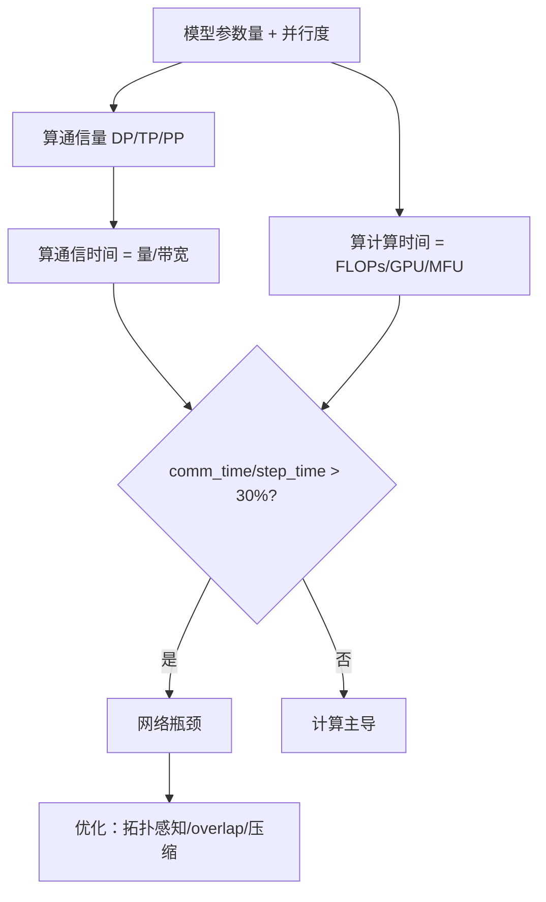

图示把判断流程与优化方向结合。

#### 6. 拓展知识

- **与 MFU 的关系**：`AIInfra-I022` 中 MFU 低的原因之一是通信时间占比大。
- **与拓扑的关系**：NVLink 带宽 >> 跨节点 RDMA/以太网；TP 的 4×L 次 all-reduce 跨节点会把带宽打满。
- **与梯度压缩的关系**：1-bit Adam / Deep Gradient Compression 可以减少 DP 通信量 [推断]。

#### 7. 常见追问及回答要点

1. **问：如何实测通信占比？** 答：nsystream 看 step timeline 中 comm 与 comp 的时间占比；NCCL profiling 看实际带宽。
2. **问：overlap 能解决带宽瓶颈吗？** 答：overlap 隐藏的是延迟，不减少通信量；如果 comm_time > comp_time，overlap 无法完全隐藏。
3. **问：DP 跨节点多少带宽算瓶颈？** 答：取决于参数量；175B 模型 bf16 梯度 350GB，ring all-reduce 每 rank ≈ 700GB，100Gbps 网络需要 56s——明显瓶颈。

#### 8. 易错点与反例

- 反例："只要用 overlap 就能消除通信开销"——overlap 隐藏延迟，不减少通信量。
- 反例："PP 跨节点一定没问题"——PP 的 P2P 量小但 latency 敏感；大量 P2P 也会堆积。
- 易错：把理论带宽当作实际带宽；RDMA 实际带宽约为理论的 70-90%。

#### 9. 实践与验证

[待验证] 输入：一个 70B 模型 TP8×PP8×DP2=128 卡；步骤：分别用 nsystream 和 NCCL profiler 测量 comm_time 占比；对比不同节点拓扑（NVLink only vs 跨节点）。oracle：跨节点配置下 comm 占比显著上升。当前未执行多机实验。

#### 10. 评分标准

- 不合格：不能写出任意一个通信量公式。
- 合格：能给出 DP/TP/PP 通信量公式和判断框架。
- 良好：给出量化阈值，关联 MT-NLG 的拓扑感知排布法则。
- 优秀：把 overlap、gradient compression、reduce-scatter 等优化手段纳入分析，指出 overlap 的局限性。

**证据与来源：** [已确认] insights/05-megatron-architecture.md:472-514,865-869；[推断] cuda/99-roadmap/performance-guide.md

---

## AIInfra-I011. GPU 共享方案（MPS、时间片调度、MIG）在隔离性与利用率上如何取舍？

- 难度：中级
- 知识域：K05 容器 K8s
- 考察能力：方案对比、权衡分析、部署决策
- 题型：对比与取舍
- 面试频率：高频
- 前置知识：GPU 架构、多进程服务、K8s 调度
- 关联题目：AIInfra-I012（device-plugin）、AIInfra-I013（Ray 调度）
- 事实状态：[待验证] [推断]

#### 1. 背景知识

GPU 共享是让多个进程/容器共用同一 GPU 的三种主要方案：MPS（Multi-Process Service，多个进程共享同一 GPU Context，通过 CUDA Context 共享实现低开销并发）、时间片调度（kernel 时间片轮转，上下文切换开销大）、MIG（Multi-Instance GPU，硬件分区，Ampere+ 支持）[待验证]。K8s 通过 device-plugin 和 extended resource 管理 GPU 分配 [推断]。

#### 2. 问题分析

1. 分别解释三种方案的工作原理。
2. 对比隔离性：MIG > 时间片 > MPS。
3. 对比利用率：MPS > 时间片 > MIG。
4. 给出选择框架。

#### 3. 具体答案

面试中可以这样回答：

> GPU 共享的三种方案按"隔离性-利用率"排序：
>
> **MPS**：多个进程共享同一 GPU Context，CUDA runtime 让多个进程的 kernel 在同一 SM 上并发执行。优点：上下文切换开销极低，利用率最高。缺点：进程间无内存隔离——一个进程 OOM 会影响其他进程；kernel 必须兼容同一 CUDA version [待验证]。
>
> **时间片调度**：GPU 驱动轮流给每个进程分配时间片（类似 OS 进程调度）。优点：进程隔离性好于 MPS，一个进程崩溃不影响其他。缺点：上下文切换开销大（寄存器/共享内存/缓存 flush），利用率低 [待验证]。
>
> **MIG**：硬件层面把一张 GPU 切成多个独立 instance（各有独立 SM、显存、L2 cache、复制引擎）。优点：硬件级隔离，性能可预测，一个 instance 故障不影响其他。缺点：分区后单实例资源减少，利用率受分区配置刚性限制；Ampere+ 才支持 [待验证]。
>
> **取舍**：
> - 追求利用率 + 进程间信任 → MPS（如同一团队的多 worker 推理）。
> - 追求多租户隔离 → MIG（云环境、不同客户的推理）。
> - 折中但效率差 → 时间片（通常不推荐）。
>
> K8s 层面的 GPU 共享：device-plugin 默认按整卡分配，要实现 time-slice/MPS/MIG 需要额外的 scheduler extender 或 GPU operator 配置 [待验证]。

#### 4. 技术洞察

```text
隔离性:  MIG > 时间片 > MPS
利用率:  MPS > 时间片 > MIG
切换开销: MPS ≈ 0   时间片 > 0    MIG = 0 (无切换)

选择决策树：
  多租户/强隔离 → MIG
  同团队高并发  → MPS
  快速原型      → 时间片（不推荐生产）
```

[推断] MIG 在推理场景最典型：把 A100 切成 7 个 1g.10gb instance，每个跑一个推理服务，隔离且可预测。

#### 5. 图文说明

```text
MIG (硬件隔离):
┌────────┬────────┬────────┐
│ Inst 1 │ Inst 2 │ Inst 3 │
│ 独立SM │ 独立SM │ 独立SM │
│ 独立HBM│ 独立HBM│ 独立HBM│
└────────┴────────┴────────┘

MPS (软件共享):
┌──────────────────────────┐
│   单一 GPU Context       │
│  P1 kernel │ P2 kernel  │
└──────────────────────────┘

时间片 (轮流):
P1 → time slice 1 → context switch → P2 → time slice 2 → ...
```

图示展示三种方案的隔离层级。

#### 6. 拓展知识

- **与 K8s device-plugin 的关系**：`AIInfra-I012` 讲 device-plugin 如何暴露资源；MIG 需要特殊的资源标识（如 `nvidia.com/mig-1g.10gb`）。
- **与推理的关系**：SGLang/vLLM 通常独占整卡做 TP；多租户场景需要 MIG 或 MPS 共享。
- **CUDA Context 与 MPS**：MPS 是多个进程共享同一 CUDA Context，减少 context 切换开销。

#### 7. 常见追问及回答要点

1. **问：MPS 下一个进程 OOM 会怎样？** 答：MPS 无内存隔离，一个进程 OOM 可能导致整个 GPU Context 上的所有进程受影响。
2. **问：MIG 能不能动态调整分区？** 答：MIG 分区需重启 GPU；不能热调整 [待验证]。
3. **问：K8s 如何感知 MIG instance？** 答：需要 GPU operator + MIG device-plugin，暴露 `nvidia.com/mig-<profile>` 资源。

#### 8. 易错点与反例

- 反例："MPS 提供进程隔离"——MPS 没有隔离，进程共享显存。
- 反例："MIG 利用率最高"——MIG 利用率最低，因为分区后资源浪费。
- 易错：把 MIG 与 vGPU 混淆——MIG 是 NVIDIA 硬件分区，vGPU 是虚拟化方案。

#### 9. 实践与验证

[待验证] 输入：三个推理服务（分别 MPS、时间片、MIG），运行相同 workload；步骤：测各自的 P95 延迟、GPU 利用率、故障注入看隔离效果。oracle：MPS 利用率最高但故障隔离最差，MIG 隔离最好但利用率最低。当前未执行 GPU 实验。

#### 10. 评分标准

- 不合格：说不清三种方案的隔离与利用率差异。
- 合格：能按"隔离性-利用率"排序，给出各自原理。
- 良好：给出选择决策树，指出 K8s 层面的集成方式。
- 优秀：关联推理部署（K09）、多租户场景，指出 MIG 的局限（分区刚性、需要重启）。

**证据与来源：** [待验证] nvidia.com MIG documentation；[推断] cuda/01-modules/M05-stream-submit；[已确认] insights/05-megatron-architecture.md

---

## AIInfra-I012. device-plugin 如何向 Kubernetes 调度器暴露 GPU 资源？配额如何生效？

- 难度：中级
- 知识域：K05 容器 K8s
- 考察能力：系统集成、资源模型理解
- 题型：机制解释
- 面试频率：中频
- 前置知识：K8s 调度、extended resource、device plugin 协议
- 关联题目：AIInfra-I011（GPU 共享）、AIInfra-I013（Ray 调度）
- 事实状态：[待验证] [推断]

#### 1. 背景知识

Kubernetes 的 device-plugin 机制让外部硬件（GPU、FPGA 等）通过 gRPC 协议向 kubelet 报告可用资源。NVIDIA device-plugin 是典型实现，通过 ListAndWatch 向 kubelet 报告 GPU 数量，kubelet 把 GPU 作为 extended resource 注册到 API server [待验证]。用户 Pod 通过 `resources.requests[nvidia.com/gpu]` 申请 GPU。

#### 2. 问题分析

1. 解释 device-plugin 的核心 gRPC 接口：ListAndWatch、Allocate。
2. 解释 kubelet 如何把资源注册到 API server。
3. 解释调度器如何基于 extended resource 做调度决策。
4. 解释配额（ResourceQuota / LimitRange）如何生效。

#### 3. 具体答案

面试中可以这样回答：

> NVIDIA device-plugin 的工作流程：
>
> 1. **ListAndWatch**：device-plugin 作为 daemonset 在每个节点运行，通过 gRPC 向 kubelet 报告节点上的 GPU 数量与健康状态。kubelet 把这些信息注册为节点的 `Allocatable` 资源（如 `nvidia.com/gpu: 8`）。
> 2. **调度决策**：K8s scheduler 在做 Pod 调度时，查看节点的 `Allocatable` 与已分配的 `Allocated`，找到满足 `requests[nvidia.com.gpu]` 的节点。这跟 CPU/Memory 调度逻辑一致——GPU 只是另一种 extended resource。
> 3. **Allocate**：Pod 被调度到节点后，kubelet 调用 device-plugin 的 `Allocate` gRPC 接口，device-plugin 设置该 Pod 的 CUDA_VISIBLE_DEVICES、设备 cgroup 限制、环境变量等。
> 4. **配额生效**：
>    - **ResourceQuota**：namespace 级别限制该 namespace 的总 GPU 请求量。
>    - **LimitRange**：Pod/Container 级别的默认 request/limit。
>    - 调度阶段的准入检查：`requests` 超过配额 → Pod 创建被拒绝；调度阶段只看 `requests` 不看 `limits`。
>
> **坑**：GPU 不支持 overcommit——CPU 可以"请求少但实际用多"（因为 time-share），GPU 分配是整卡独占；device-plugin 不支持 fractional GPU 除非配合 MIG 或 time-slice [待验证]。配额只看 request，如果一个 Pod request 1 GPU 但实际跑满，其他 Pod 无法"借用"空闲算力。

#### 4. 技术洞察

```text
GPU 资源路径：
  device-plugin → kubelet → API server (Node Allocatable)
  → scheduler → Pod binding
  → kubelet → device-plugin Allocate → 环境变量注入

配额层级：
  namespace ResourceQuota → 总量限制
  LimitRange → 默认值与上下限
  调度器 → 只看 request，不看实际用量
```

[推断] 如果 device-plugin 报告不准确（如 GPU 已被独占但 plugin 仍报可用），调度器会分配冲突； Allocate 失败导致 Pod 启动失败。

#### 5. 图文说明

```text
Node 设备层:
  GPU 0-7
    │
  device-plugin (daemonset)
    │ gRPC ListAndWatch
    ▼
  kubelet
    │ 注册 Allocatable
    ▼
  API Server (Node.Status.Allocatable[nvidia.com/gpu]=8)
    │
  Scheduler: Pod request 2 GPU → 找满足节点
    │
  kubelet → Allocate → 注入 CUDA_VISIBLE_DEVICES
```

图示展示从硬件到 Pod 的资源路径。

#### 6. 拓展知识

- **与 MIG 的关系**：MIG 需要特殊的 device-plugin 资源标识（`nvidia.com/mig-1g.10gb`）。
- **与调度器的关系**：K8s 默认 scheduler 对 GPU 的调度是"bin packing"——填满一张卡再下一张；可能导致碎片化。
- **与 K06 调度的关系**：Ray on K8s 通过 operator 管理 GPU 分配，可能绕过 K8s 默认调度 [推断]。

#### 7. 常见追问及回答要点

1. **问：GPU 能否像 CPU 一样设置 limit > request？** 答：不支持 overcommit；GPU 的 request 和 limit 通常相同。
2. **问：device-plugin 挂了会怎样？** 答：kubelet 无法获取节点 GPU 信息，新 Pod 无法调度到该节点。
3. **问：如何实现 fractional GPU 共享？** 答：MIG 硬件分区 + 对应资源标识；或 time-slice 方案（非原生支持）。

#### 8. 易错点与反例

- 反例："GPU 可以像 CPU 一样 overcommit"——GPU 不支持；分配即独占。
- 反例："device-plugin 负责 GPU 调度"——device-plugin 只负责资源报告与分配；调度决策由 K8s scheduler 完成。
- 易错：把 extended resource 与普通 resource 混淆——GPU 是 extended resource，名称需带域名前缀。

#### 9. 实践与验证

[待验证] 输入：一个 K8s 集群 + NVIDIA device-plugin；步骤：创建一个 ResourceQuota 限制 GPU 总量，再创建超出配额的 Pod；观察 Pod 是否被拒绝。oracle：超出配额的 Pod 创建被拒绝。当前未执行 K8s 实验。

#### 10. 评分标准

- 不合格：说不清 device-plugin 的作用。
- 合格：能解释 ListAndWatch/Allocate 接口，说明调度器基于 extended resource 调度。
- 良好：解释配额的两层（ResourceQuota / LimitRange），指出 GPU 不支持 overcommit。
- 优秀：关联 MIG 与 fractional GPU 的 K8s 集成，指出调度碎片化问题。

**证据与来源：** [待验证] NVIDIA device-plugin documentation；[推断] cuda/99-roadmap/performance-guide.md；[已确认] insights/05-megatron-architecture.md

---

## AIInfra-I013. Ray 的 lease 与 spillback 机制如何工作？任务被 spillback 到远端节点时发生了什么？

- 难度：中级
- 知识域：K06 调度
- 考察能力：分布式调度理解、机制推导
- 题型：机制解释
- 面试频率：高频
- 前置知识：Ray 架构、分布式调度、资源匹配
- 关联题目：AIInfra-I012（K8s 调度）、AIInfra-I014（continuous batching）
- 事实状态：[已确认] [推断]

#### 1. 背景知识

Ray 的调度流程：依赖满足 → RequestWorkerLease → 本地匹配或 spillback → worker 注册 → PushNormalTask [已确认] `ray/01-modules/M04-raylet-scheduling/call-chains.md`。Raylet 管理本地资源，通过 RPC 与调度循环并发 [已确认] `ray/01-modules/M04-raylet-scheduling/design.md:5-14`。spillback 指本地节点无法满足资源需求时，把任务"溢出"到远端节点调度。

#### 2. 问题分析

1. 解释 lease 机制：任务向 raylet 请求 worker lease，raylet 匹配本地资源。
2. 解释 spillback 触发条件：本地资源不足或不满足约束。
3. 解释 spillback 过程：任务被转发到远端 raylet。
4. 解释 spillback 后的执行路径与数据 locality 影响。

#### 3. 具体答案

面试中可以这样回答：

> **Lease 机制**：任务启动前向本地 raylet 申请 worker lease。raylet 检查本地资源是否满足（CPU/GPU/内存/自定义资源）。如果满足，分配 worker，返回 lease；任务绑定到该 worker 执行 [已确认] `ray/01-modules/M04-raylet-scheduling/call-chains.md`。
>
> **Spillback 触发**：当本地 raylet 无法满足资源需求（GPU 被占、CPU 不足）或约束不满足（placement group、labels）时，任务不会被无限排队——而是执行 spillback。`ray/01-modules/M04-raylet-scheduling/execution-flows.md` 记录"不可调度、worker/Raylet 断连、placement group 删除"都是异常路径 [已确认]。
>
> **Spillback 流程**：
> 1. 本地 raylet 把任务转发给集群级调度器（cluster lease manager / GCS）。
> 2. 集群调度器找到满足资源的其他节点。
> 3. 远端 raylet 接受 lease 请求，分配 worker。
> 4. 任务代码 + 依赖序列化后发送到远端 worker 执行。
>
> **数据 locality 影响**：spillback 到远端意味着任务的输入数据（object store 中的 plasma object）可能在远端节点，需要跨网络传输。如果任务依赖大 object，spillback 的通信开销可能超过本地排队等待的开销 [推断]。Ray 的 scheduling strategy（SPREAD vs PACK）会影响 spillback 决策——SPREAD 倾向分散任务，PACK 倾向集中 [待验证]。
>
> **容错**：如果 worker 失联，任务会重新入队，可能再次触发 spillback [已确认] `ray/01-modules/M04-raylet-scheduling/execution-flows.md`。

#### 4. 技术洞察

```text
调度决策链：
  local lease → 满足 → 本地 worker
             → 不满足 → spillback → 集群调度 → 远端 worker
                             → 仍不满足 → 等待/失败

spillback 代价：
  object 跨网络传输
  worker 启动延迟
  可能的多次 spillback
```

[推断] Ray 的 SPREAD 策略会主动 spillback 以平衡负载；PACK 策略倾向本地等待。

#### 5. 图文说明

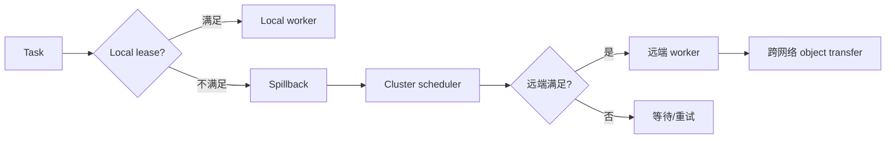

图示展示 spillback 决策链。

#### 6. 拓展知识

- **与 K8s 调度的关系**：Ray on K8s 通过 operator 管理资源；K8s 调度 Ray pod 后 Raylet 内部再做 lease/spillback [推断]。
- **与 placement group 的关系**：placement group 要求多个任务同时调度到特定节点；不满足时触发 spillback 或等待 [待验证]。
- **与 observability 的关系**：Ray dashboard（`ray/01-modules/M07-observability-dashboard/`）可以观察 spillback 事件。

#### 7. 常见追问及回答要点

1. **问：spillback 会无限重试吗？** 答：Ray 有 scheduling retry 上限；超过后会标记任务失败。
2. **问：如何避免不必要的 spillback？** 答：合理设置资源 request、使用 placement group 约束 locality、避免大 object 远程传输。
3. **问：SPREAD vs PACK 如何选择？** 答：SPREAD 适合独立任务、负载均衡；PACK 适合有数据 locality 需求的任务组。

#### 8. 易错点与反例

- 反例："spillback 一定意味着错误"——spillback 是正常的负载均衡机制。
- 反例："Ray 调度等价于 K8s 调度"——Ray 有自己的两级调度（lease + spillback），K8s 调度 pod 是外层。
- 易错：忽略 spillback 的数据 locality 开销——远端执行可能因 object 传输反而更慢。

#### 9. 实践与验证

[待验证] 输入：一个 Ray 集群（2 节点，各有 1 GPU），提交 2 个 GPU 任务；步骤：观察一个任务 spillback 到远端节点，查看 Ray dashboard 的 scheduling 事件。oracle：spillback 后任务在远端执行，有跨节点 object transfer。当前未执行 Ray 实验。

#### 10. 评分标准

- 不合格：说不清 lease 机制，或认为 spillback 是异常。
- 合格：能解释 lease → spillback 的基本流程。
- 良好：指出 spillback 的数据 locality 代价，关联 SPREAD/PACK 策略。
- 优秀：关联 K8s 双层调度、placement group、容错路径，给出优化建议。

**证据与来源：** [已确认] ray/01-modules/M04-raylet-scheduling/call-chains.md；[已确认] ray/01-modules/M04-raylet-scheduling/design.md:5-14；[已确认] ray/01-modules/M04-raylet-scheduling/execution-flows.md

---

## AIInfra-I014. 推理服务的 continuous batching 解决什么问题？与静态 batching 的执行差异是什么？

- 难度：中级
- 知识域：K09 推理
- 考察能力：系统设计理解、对比分析
- 题型：动机与机制
- 面试频率：高频
- 前置知识：Transformer 推理、decode 阶段、batching
- 关联题目：AIInfra-I020（continuous batching 机制细节）、AIInfra-I021（KV cache）
- 事实状态：[已确认] [推断]

#### 1. 背景知识

推理服务在 decode 阶段逐 token 生成，每个请求的输出长度不同。静态 batching 等一个 batch 中所有请求都生成完才释放——导致尾部延迟。continuous batching（iteration-level scheduling）让不同请求的 prefill/decode 交错进入批次，不等最慢的请求 [已确认] `sglang/01-modules/M04-scheduler-batching/README.md:12-18`。

#### 2. 问题分析

1. 先解释静态 batching 的问题：资源浪费、尾部延迟。
2. 再解释 continuous batching 的动机：允许新请求在 batch 未空时进入，已完成的请求随时退出。
3. 对比两者执行差异：调度单位、资源分配、请求退出时机。

#### 3. 具体答案

面试中可以这样回答：

> **静态 batching 的问题**：一个 batch 必须等最慢的请求生成完才整体释放。如果 batch 里一个请求要生成 2000 token、另一个只要 50 token，后者的 GPU 资源被白白占用 1950 步的 decode。GPU 利用率低，新请求排队等待 [推断]。
>
> **continuous batching 的解决思路**：`sglang/01-modules/M04-scheduler-batching/README.md` 把 scheduler 比喻为"不断开会的调度员"——每轮收取新任务，看正在执行的任务占多少资源，再从等待队列中挑选新任务 [已确认]。关键差异：
>
> | 维度 | 静态 batching | continuous batching |
> |---|---|---|
> | 调度单位 | 固定 batch | 单请求（extend/decode 独立决策） |
> | 新请求进入 | 等 batch 清空 | 每轮 budget 允许即可进入 |
> | 请求退出 | batch 统一释放 | 单个请求 finish 即释放 |
> | 资源利用 | 低（等最慢的） | 高（随时填充新任务） |
> | 实现复杂度 | 低 | 高（需 retraction、KV 管理） |
>
> **代价**：continuous batching 需要精细的 KV 管理（`AIInfra-I021`）——请求进入时分配 KV slots，退出时释放，不足时 retract。`sglang/01-modules/M04-scheduler-batching/README.md:163-178` 描述的 `retract_decode` 就是资源不足时的降级路径 [已确认]。

#### 4. 技术洞察

```text
continuous batching 核心循环：
  while not exit:
    ingest_requests()
    plan = get_next_batch_to_run(running_batch, last_batch)
    if batch: run_batch(batch); process_batch_result(batch)
    else: on_idle()

  每轮：新请求可加入，已完成请求可退出
  budget = token_budget + KV_capacity + running_requests_limit
```

[推断] 在高负载下，continuous batching 的吞吐接近理论最大（GPU 几乎不空闲）；在低负载下，延迟更短（不必等 batch 填满）。

#### 5. 图文说明

```text
静态 batching:
  [Req1 ====>] [Req2 ==] [Req3 ========>]
  batch 结束:   ^ 所有请求完成后才释放
  Req2/3 等 Req1: GPU 空转

continuous batching:
  [Req1 ====>]
  [Req2 ==] → finish → [Req4 ==>]
  [Req3 ========>]
  每轮可加入新请求、退出已完成请求
```

图示展示两种 batching 的资源利用差异。

#### 6. 拓展知识

- **与 KV cache 的关系**：`AIInfra-I021` 的 KV cache 管理是 continuous batching 的底层支撑——每个请求的 KV slots 独立管理。
- **与 PagedAttention 的关系**：PagedAttention（`insights/03-arxiv-reading-notes.md:1-39`）提供的 block table 是 KV 管理的基础设施 [已确认]。
| **与 chunked prefill 的关系**：SGLang 支持 chunked prefill，把长 prefill 分多轮执行，避免一次性占用全部 budget [已确认] `sglang/01-modules/M04-scheduler-batching/README.md:128-144`。

#### 7. 常见追问及回答要点

1. **问：continuous batching 能完全消除空闲吗？** 不能——prefill 与 decode 切换时仍有间隙；极端低负载时 GPU 空闲不可避免。
2. **问：retract_decode 与 abort 的取舍？** retract 允许请求恢复（重入队列）；abort 直接失败。SGLang 优先 retract，失败才 abort [已确认] `sglang/01-modules/M04-scheduler-batching/README.md:163-178`。
3. **问：continuous batching 对 TTFT 和 TBT 的影响？** TTFT 可能略有上升（新请求与 decode 交错），但整体吞吐和公平性更好。

#### 8. 易错点与反例

- 反例："continuous batching 只增加吞吐"——它也改善公平性（短请求不被长请求阻塞）。
- 反例："continuous batching 不需要特殊 KV 管理"——恰恰相反，它是 KV 管理的主要驱动。
- 易错：把 batch size 与 GPU 利用率直接等同——continuous batching 下 batch 是动态的，不等于固定 batch。

#### 9. 实践与验证

[待验证] 输入：SGLang 推理服务，混合长短请求 workload；步骤：分别开启静态 batching 与 continuous batching，测吞吐与 P95 延迟。oracle：continuous batching 在高负载下吞吐显著更高，短请求延迟更低。当前未执行 GPU 实验。

#### 10. 评分标准

- 不合格：说不清 continuous batching 解决的问题。
- 合格：能解释静态 batching 的问题，对比连续 batching 的调度差异。
- 良好：从 scheduler 循环层面解释机制，关联 KV cache 与 retract。
- 优秀：关联 PagedAttention、chunked prefill、P/D 分离等推理优化手段。

**证据与来源：** [已确认] sglang/01-modules/M04-scheduler-batching/README.md:12-18,128-178；[已确认] insights/03-arxiv-reading-notes.md:1-39

---

## AIInfra-I015. 训练数据管道中 decode / augment / prefetch 各阶段的瓶颈如何逐段定位？给出排查动线。

- 难度：中级
- 知识域：K07 数据管道
- 考察能力：分段排障、性能分析、工具使用
- 题型：排障流程
- 面试频率：高频
- 前置知识：数据加载、GPU 训练、CPU-GPU 交互
- 关联题目：AIInfra-I008（pinned memory）、AIInfra-I016（shuffle buffer）
- 事实状态：[推断] [待验证]

#### 1. 背景知识

训练数据管道通常包含：decode（读取+解码数据）、augment（变换/增强）、prefetch（预取到 GPU）。Megatron 的数据管线负责 tokenizer 构建、dataset 构建、microbatch 划分与采样 [已确认] `insights/05-megatron-architecture.md:1229-1236`。瓶颈可能在 CPU 侧（decode/augment 太慢）或 H2D 侧（prefetch 带宽不足）。

#### 2. 问题分析

1. 拆解三阶段的功能与资源消耗。
2. 给出每段瓶颈的典型症状。
3. 给出排查工具与顺序。

#### 3. 具体答案

面试中可以这样回答：

> 训练数据管道的三个阶段：
>
> **Decode 阶段**：从存储（磁盘/网络）读取原始数据并解码（JSON/Parquet → 样本）。瓶颈症状：GPU 利用率周期性下降（等数据），CPU 利用率低于 100%。排查：看存储 IOPS/带宽、单样本 decode 时间、是否走 pinned memory [推断]。
>
> **Augment 阶段**：对样本做变换（图像增强、tokenize、mask）。瓶颈症状：CPU 利用率 100%，GPU 空闲。排查：看单样本 augment 耗时、是否有不必要的 memcpy、是否可以用 GPU 加速（如 DALI）[推断]。
>
> **Prefetch 阶段**：把处理好的数据从 host 搬到 device。瓶颈症状：GPU 等 H2D 拷贝、step 时间被 prefetch 主导。排查：看 H2D 带宽（是否 pinned memory，`AIInfra-I008`）、prefetch buffer 大小是否足够（通常 2-3 个 batch 的 buffer）[推断]。
>
> **排查动线**：
> 1. 用 training framework 的 timer（Megatron 的 `timers('forward-compute')` 等）看每段耗时占比 [已确认] `insights/05-megatron-architecture.md:1246-1253`。
> 2. 看 GPU utilization 曲线：周期性下降 → 等数据；持续低 → 计算本身问题。
> 3. 看 CPU 利用率：100% → CPU-bound；< 100% → I/O bound。
> 4. 用 nsystream 可视化 timeline，看 H2D 与 kernel 的重叠程度。
> 5. 逐步调参：num_workers ↑ → 解决 decode/augment；prefetch_factor ↑ → 解决 H2D；pin_memory → 解决隐式拷贝 [推断]。

#### 4. 技术洞察

```text
瓶颈定位决策树：
  GPU util 周期性下降 → 等数据（decode/augment/prefetch 慢）
  CPU util 100%       → CPU-bound（augment 太重）
  CPU util < 100%     → I/O-bound（存储慢）
  H2D 占用 step 时间   → prefetch 未重叠/buffer 不足
```

[推断] Megatron 的 mock dataset（`insights/05-megatron-architecture.md:1231-1233`）可以消除 I/O 变量，聚焦于计算侧调试 [已确认]。

#### 5. 图文说明

```text
Pipeline timeline (健康):
  [decode] [aug] [pref] ← overlap →
              [decode] [aug] [pref]
                          [decode] ...
  ========[GPU compute 连续]=========

Pipeline timeline (瓶颈):
  [decode ......] [aug] [pref]    [GPU 等数据]
                                   ^ GPU 空闲
```

图示展示健康与被阻塞的 pipeline 对比。

#### 6. 拓展知识

- **与 Megatron 的关系**：`insights/05-megatron-architecture.md:1229-1236` 记录 data loader 的 microbatch 划分与 DP 的关系 [已确认]。
| **与 DALI 的关系**：NVIDIA DALI 把 augment 放到 GPU，彻底改变 pipeline 瓶颈分布 [推断]。
- **与 shuffle buffer 的关系**：`AIInfra-I016` 的 shuffle buffer 大小影响 augment 的随机性与吞吐。

#### 7. 常见追问及回答要点

1. **问：num_workers 越多越好吗？** 不是——过多会导致 CPU 争抢、内存压力；通常 2-4× GPU 数为上限。
2. **问：prefetch_factor 如何选？** 通常 2-3；太小会等数据，太大占用 host 内存。
3. **问：如何区分"存储慢"与"CPU 解码慢"？** 用 mock dataset 替换真实 I/O，看 CPU 利用率是否仍为 100%。

#### 8. 易错点与反例

- 反例："数据管道瓶颈一定是存储慢"——CPU 解码（如复杂 tokenize）也可能瓶颈。
- 反例："加 GPU 就能解决所有数据问题"——GPU 不解决 I/O 瓶颈；decode 仍是 CPU 任务。
- 易错：把 pinned memory 与 prefetch 混淆——pinned 解决 H2D 带宽，prefetch 解决时间重叠。

#### 9. 实践与验证

[待验证] 输入：Megatron 训练 + mock dataset；步骤：逐步增加 num_workers 和 prefetch_factor，测 step 时间。oracle：存在一个最优点，超过后收益递减。当前未执行训练实验。

#### 10. 评分标准

- 不合格：说不清三阶段分工，或认为"加 num_workers 就够了"。
- 合格：能列出三阶段，给出基本排查思路。
- 良好：给出完整排查动线，关联工具（nsystream/timer）。
- 优秀：关联 Megatron data pipeline、DALI、pinned memory，指出多变量耦合时的调试顺序。

**证据与来源：** [已确认] insights/05-megatron-architecture.md:1229-1253；[推断] sglang/99-roadmap/performance-guide.md；[已确认] cann/90-cross-module/memory-and-resource-lifecycle.md:79-83

---

## AIInfra-I016. 数据 shuffle 的 buffer 大小如何影响随机性与吞吐？如何选择？

- 难度：中级
- 知识域：K07 数据管道
- 考察能力：算法理解、性能权衡
- 题型：设计与权衡
- 面试频率：中频
- 前置知识：随机采样、流式训练、数据加载
- 关联题目：AIInfra-I015（数据管道）、AIInfra-I017（分布式训练数据划分）
- 事实状态：[推断] [待验证]

#### 1. 背景知识

训练数据的 shuffle 通常用有限大小的 buffer 做"局部随机"——从 buffer 中随机取一个样本，用新读入的样本替换它。buffer 大小决定了随机性的程度：buffer 越大越接近全局 shuffle，但内存占用和初始等待时间越大 [推断]。Megatron 的 data loader 用独立 seed 控制每个 DP rank 的 shuffle [已确认] `insights/05-megatron-architecture.md:433-439`。

#### 2. 问题分析

1. 解释 shuffle buffer 的工作原理。
2. 分析 buffer 大小与随机性的关系。
3. 分析 buffer 大小与吞吐/内存的关系。
4. 给出选择框架。

#### 3. 具体答案

面试中可以这样回答：

> Shuffle buffer 的工作原理：维护一个大小为 B 的 buffer，初始填充 B 个样本；每步从 buffer 中随机取一个样本输出，同时从数据流中读一个新样本替换它。这是 reservoir sampling 的变体 [推断]。
>
> **Buffer 大小与随机性**：
> - B = 1：无 shuffle，顺序读。
> - B = 1000：相邻样本的相关性约 1/1000——局部打乱，但仍非全局。
> - B = 数据集大小：全局 shuffle，完美随机。
> 实践中 B = 10K-100K 通常足够——随机性收益边际递减，内存成本线性增长 [推断]。
>
> **Buffer 大小与吞吐**：
> - 初始需要等待 B 个样本填充 → 训练启动延迟。
> - 每个样本必须在 buffer 中停留 → 随机性"越强"意味着样本需要更多 step 后才能被消费。
> - 内存占用 = B × 单样本大小；大样本（图像/长序列）下 B=100K 可能占用数 GB [推断]。
>
> **选择框架**：
> - 如果数据本身已接近随机（如多源混合）→ B 可以小。
> - 如果数据有序（如按类别/时间排列）→ B 需要大。
> - 内存紧张时（大图像/长文本）→ 适当减小 B，接受局部随机。
> - Megatron 的做法：每个 DP rank 独立 seed，保证不同 rank 的 micro-batch 彼此相异 [已确认] `insights/05-megatron-architecture.md:433-439`。

#### 4. 技术洞察

```text
随机性 ≈ 1 - 1/B  （简化模型，样本间相关性）
内存成本 = B × sample_size
启动延迟 = B / throughput

选择公式（经验）：
  B = max(10 × batch_size, min(dataset_size × 0.1, memory_budget / sample_size))
```

[推断] 过大的 B 可能让相邻 step 的样本相关性反而上升（因为新样本要等 B 步才能被消费）——这是"太完美"的副作用。

#### 5. 图文说明

```text
Buffer 操作流程:
  [s1][s2][s3]...[sB]  ← 初始填充
  随机取 s3 输出 → [s1][s2][新s][sB]  ← 读新样本替换
  随机取 s1 输出 → [新s2][s2][新s][sB]
  ...

Buffer 大小效果:
  B=10     ─────── 局部打乱，相邻样本相关
  B=1000   ─────── 较好随机性
  B=dataset ─────── 全局最优但内存最大
```

图示展示 buffer 操作与大小效果。

#### 6. 拓展知识

- **与 DP 的关系**：`insights/05-megatron-architecture.md:433-439` 指出每个 DP rank 需要独立 seed，否则所有 rank 看到相同顺序 [已确认]。
- **与 pipeline 的关系**：prefetch buffer 与 shuffle buffer 是两层独立 buffer；prefetch 解决 I/O 重叠，shuffle 解决随机性。
- **与分布式采样的关系**：大规模训练用 DistributedSampler 确保每个 rank 看到不同分片，shuffle 在其上加层随机。

#### 7. 常见追问及回答要点

1. **问：shuffle buffer 与全局 shuffle 差距多大？** 答：当 B << 数据集时，相距较远的样本相关性仍不为零；实践中通常可接受。
2. **问：为什么不在训练前做一次全局 shuffle？** 答：大数据集无法一次性载入内存；流式训练必须用 buffer。
3. **问：buffer 大小是否影响收敛？** 答：理论上影响梯度噪声；实践中足够大的 B（如 > 100× batch_size）影响可忽略。

#### 8. 易错点与反例

- 反例："buffer 越大越好"——内存占用线性增长，边际收益递减。
- 反例："buffer = 1 就是不 shuffle"——取决于上游数据源是否已随机。
- 易错：混淆 shuffle buffer 与 prefetch buffer——前者控制随机性，后者控制 I/O 重叠。

#### 9. 实践与验证

[待验证] 输入：同一数据集（按类别排列），分别用 B=100、10K、100K 做 shuffle；步骤：训练同一模型，比较 loss 收敛曲线。oracle：B=10K 与 B=100K 收敛相似，B=100 可能有波动。当前未执行训练实验。

#### 10. 评分标准

- 不合格：说不清 shuffle buffer 的工作原理。
- 合格：能解释 buffer 大小与随机性/内存的权衡。
- 良好：给出量化选择框架，关联 DP rank 独立 seed 的需求。
- 优秀：分析过大 buffer 的副作用，关联 pipeline 与分布式采样。

**证据与来源：** [已确认] insights/05-megatron-architecture.md:433-439；[推断] sglang/99-roadmap/performance-guide.md

---

## AIInfra-I017. TP、PP、DP 三种并行方式的通信特征有何差异？（通信量、频度、对延迟的敏感性）

- 难度：中级
- 知识域：K08 分布式训练
- 考察能力：对比分析、特征提炼
- 题型：对比与分类
- 面试频率：高频
- 前置知识：Megatron 并行策略、通信原语
- 关联题目：AIInfra-I009（Ring AllReduce）、AIInfra-I010（带宽估算）、AIInfra-I018（1F1B）
- 事实状态：[已确认] [推断]

#### 1. 背景知识

Megatron 的并行策略表中明确记录：TP 通信 High（all-reduce 4 次/层），DP 通信 Low（梯度 all-reduce / reduce-scatter），PP 通信 Medium/Low（stage 边界 P2P）[已确认] `insights/05-megatron-architecture.md:499-514,865-869`。通信量排序 TP > DP > PP，拓扑偏好 TP 同节点 NVLink、PP 可跨节点。

#### 2. 问题分析

1. 从三个维度对比：通信量、频度、对延迟的敏感性。
2. 给出每种并行的典型通信原语。
3. 解释为什么会有这些差异（由切分方式决定）。

#### 3. 具体答案

面试中可以这样回答：

> | 维度 | TP | DP | PP |
> |---|---|---|---|
> | **通信量** | 高：每层 4 次 all-reduce（fwd f/g + bwd f/g），每次 ≈ b×s×h×sizeof(dtype) [已确认] | 中-高：每 step 一次梯度 all-reduce，量 = 参数量×sizeof(dtype)×2(N-1)/N [已确认] | 低：stage 边界 P2P，量 = b×s×h×sizeof(dtype)×2×在飞 MB 数 [已确认] |
> | **频度** | 极高：每层、每 microbatch 都通信 | 低：每 step 一次 | 中：每 microbatch 的 stage 边界 |
> | **延迟敏感性** | 高：每层都等通信完成；GEMM 变小后延迟占比上升 [推断] | 低：通信与 backward 可 overlap；大消息下带宽受限 | 中：P2P 延迟直接影响流水线节拍 |
>
> **差异根因**：
> - TP 切分权重矩阵 → 每次矩阵乘后需要归约 → 每层多次、量随 t 线性。
> - DP 切分数据 → 只在梯度阶段通信 → 每 step 一次、量 = 全量梯度。
> - PP 切分层 → 只在 stage 边界传递激活 → 通信量最小，但 P2P 的延迟敏感性高。
>
> **拓扑映射**（来自 MT-NLG）：TP → 同节点 NVLink；DP → 同节点或近邻；PP → 可跨节点 [已确认] `insights/05-megatron-architecture.md:865-869`。

#### 4. 技术洞察

```text
通信频度：TP (每层×4) >> PP (每MB×边界) > DP (每步×1)
通信量：  TP (L×4×b×s×h) vs DP (P×2(N-1)/N) vs PP (MB×2×b×s×h)
延迟敏感：TP 高（小 GEMM 占比）> PP（流水节拍）> DP（可 overlap）
```

[推断] TP 的延迟敏感性随 t 增大而上升——因为 GEMM 变小、计算时间下降、通信时间占比上升。这就是 MT-NLG 坚持 TP 同节点 NVLink 的原因。

#### 5. 图文说明

```text
TP 通信（每层 4 次）:
  [Attn fwd f] → allreduce → [Attn fwd g] → allreduce
  [MLP fwd f]  → allreduce → [MLP fwd g]  → allreduce
  × L 层

PP 通信（stage 边界）:
  Stage0 --P2P--> Stage1 --P2P--> Stage2 --P2P--> Stage3
  每 microbatch 一次 send/recv

DP 通信（每 step 一次）:
  [bwd 完成] → [allreduce 梯度] → [optimizer step]
```

图示展示三种并行的通信模式。

#### 6. 拓展知识

- **与 SP 的关系**：SP 把 TP 的 4 次 all-reduce 拆为 reduce-scatter + all-gather，总带宽不变但改变延迟分布 [已确认] `insights/05-megatron-architecture.md:696-716`。
- **与 CP 的关系**：CP 通信 Medium，在序列维做 p2p/ring；与 TP 正交 [已确认] `insights/05-megatron-architecture.md:820-855`。
- **与 overlap 的关系**：TP 通信与 GEMM 重叠、PP 的 P2P 与计算重叠、DP 与 backward 重叠 [已确认] `insights/05-megatron-architecture.md:1156-1194`。

#### 7. 常见追问及回答要点

1. **问：为什么 TP 通信次数与 t 无关？** 答：TP 每层 4 个原语是常数；通信体积随 t 变，次数不变 [已确认] `insights/05-megatron-architecture.md:1291`。
2. **问：PP 通信量最小，为什么不用 PP 替代 TP？** 答：PP 有气泡、stage 负载不均、batch 依赖大；TP 对计算密度友好。
3. **问：DP 通信能完全 overlap 吗？** 答：不能完全——reduce-scatter 与 backward 重叠仍有尾部暴露。

#### 8. 易错点与反例

- 反例："TP 通信次数随 t 增大"——次数固定 4×L，体积随 t 变。
- 反例："PP 没有通信"——PP 有 P2P，只是量小。
- 易错：把"通信量"与"延迟敏感性"混淆——TP 通信量最大但频度最高，PP 量最小但对流水节拍敏感。

#### 9. 实践与验证

[待验证] 输入：同一模型（70B）分别用纯 TP、纯 PP、纯 DP 训练；步骤：用 nsystream 看通信占比。oracle：TP 通信时间占比最高，PP 最低。当前未执行训练实验。

#### 10. 评分标准

- 不合格：说不清三种并行的通信原语。
- 合格：能从通信量、频度、延迟敏感性三维对比。
- 良好：关联 MT-NLG 拓扑排布法则，解释差异根因。
- 优秀：关联 SP/CP 扩展、overlap 机制，给出反直觉点（如 TP 次数与 t 无关）。

**证据与来源：** [已确认] insights/05-megatron-architecture.md:499-514,696-716,820-855,865-869,1291

---

## AIInfra-I018. 1F1B 调度为什么能减少流水线并行的显存峰值？对比 naive 调度。

- 难度：中级
- 知识域：K08 分布式训练
- 考察能力：调度分析、显存建模、对比推导
- 题型：推导与对比
- 面试频率：高频
- 前置知识：Pipeline Parallelism、microbatch、激活显存
- 关联题目：AIInfra-I017（TP/PP/DP）、AIInfra-I010（带宽估算）
- 事实状态：[已确认] [推断]

#### 1. 背景知识

MT-NLG 论文明确使用 1F1B schedule：稳定阶段每个 rank 交替执行一个 forward 和一个 backward。关键收益：**在飞 microbatch 数量被 bound 等于 pipeline stage 数量**，而不是总 microbatch 数 [已确认] `insights/05-megatron-architecture.md:728-772`。naive 调度（GPipe）先全部 forward 再全部 backward，在飞 MB 数 = 全部 microbatch 数。

#### 2. 问题分析

1. 解释 naive（GPipe）调度：先 F 全部 MB 再 B 全部 MB。
2. 解释 1F1B：交替 F/B，稳定阶段。
3. 对比两者的在飞 MB 数与显存峰值。
4. 给出定量分析。

#### 3. 具体答案

面试中可以这样回答：

> **Naive 调度（GPipe）**：所有 microbatch 的 forward 完成后才开始 backward。每个 rank 必须保存所有在飞 microbatch 的激活——在飞 MB 数 = 总 MB 数。`insights/05-megatron-architecture.md:772` 明确"GPipe 是整批先 F 后 B，气泡更宽" [已确认]。
>
> **1F1B 调度**：warmup 后进入稳定阶段，每个 rank 交替执行一个 forward 和一个 backward。`insights/05-megatron-architecture.md:736-743` 给出的伪代码：
> ```text
> for step in range(num_microbatches + num_pipeline_stages - 1):
>     if should_fwd(step): fwd(microbatch(step))
>     if should_bwd(step): bwd(microbatch(step - num_pipeline_stages))
> ```
>
> **显存峰值对比**：
> - Naive：rank 需保存 `min(总 MB, stage 激活 × 总 MB)` → 峰值与总 MB 成正比。
> - 1F1B：每个 rank 最多同时持有 `PP` 个 microbatch 的激活（不是总 MB）[已确认] `insights/05-megatron-architecture.md:728-743`。
>
> 以 PP=4、MB=8 为例：Naive 下 rank0 可能同时保存 8 个 MB 的 forward 激活；1F1B 下最多 4 个。显存峰值降低约 PP/MB 倍 [推断]。代价是 warmup/cooldown 阶段存在气泡（`PP-1` 个时间片），效率公式 `1 - (PP-1)/(MB+PP-1)` [已确认] `insights/05-megatron-architecture.md:746-753`。

#### 4. 技术洞察

```text
Naive 峰值激活 ∝ 总 MB 数
1F1B 峰值激活 ∝ PP 数（稳定阶段）

气泡效率 = 1 - (PP - 1) / (MB + PP - 1)
MB=4×PP → 约 81%
MB=8×PP → 约 90%
```

[推断] 1F1B 的显存收益是"以调度复杂性换来的"——需要在稳定阶段精确跟踪每个 rank 的 F/B 时机，warmup/cooldown 阶段不能省。

#### 5. 图文说明

```text
GPipe (naive):
  time →  0   1   2   3   4   5   6   7   8
  rank0:  F0  F1  F2  F3  F4  F5  F6  F7  B0
  rank1:  .   F0  F1  F2  F3  F4  F5  F6  F7
  在飞 MB: 8（所有 forward 激活同时在飞）

1F1B:
  time →  0   1   2   3   4   5   6   7   8   9
  rank0:  F0  F1  F2  F3  B0  F4  B1  F5  B2  F6
  rank1:  .   F0  F1  F2  F3  B0  F4  B1  F5  B2
  在飞 MB: ≤4（stage 数）
```

图示展示两种调度的在飞 MB 差异。

#### 6. 拓展知识

- **与 interleaved/VP 的关系**：interleaved pipeline 把层切成虚拟 chunk，进一步降低单 stage 层数与激活 [已确认] `insights/05-megatron-architecture.md:774-798`。
- **与 activation recomputation 的关系**：1F1B 省显存 + recomputation 进一步降激活——Megatron 的标配 [已确认] `insights/05-megatron-architecture.md:696-706`。
- **与显存池的关系**：1F1B 的显存峰值可预估，让 PP 组的显存分配更精确 [推断]。

#### 7. 常见追问及回答要点

1. **问：1F1B 为什么有 warmup 和 cooldown？** 答：warmup 阶段逐步填满流水线（每个 rank 开始接收输入），cooldown 阶段逐步排空（最后一个 MB 的 backward 传播）。
2. **问：1F1B 与 interleaved 的显存差异？** 答：interleaved 让每 rank 持有多个虚拟 chunk，"在飞 MB"进一步下降；代价是 P2P 次数增加 [已确认] `insights/05-megatron-architecture.md:774-798`。
3. **问：1F1B 对 MFU 的影响？** 答：warmup/cooldown 气泡降低 MFU；MB 越大效率越高（公式）。

#### 8. 易错点与反例

- 反例："1F1B 没有气泡"——warmup/cooldown 阶段仍有 `PP-1` 个时间片的气泡。
- 反例："1F1B 让总通信量减少"——不减少通信量，只减少显存峰值。
- 易错：把"在飞 MB"与"总 MB"混淆——1F1B 的峰值由 stage 数决定。

#### 9. 实践与验证

[待验证] 输入：Megatron 训练，PP=8，MB 分别 32 和 64；步骤：分别用 GPipe 与 1F1B 调度，记录显存峰值与 step 时间。oracle：1F1B 显存峰值显著低于 GPipe；MB 大时效率更高。当前未执行训练实验。

#### 10. 评分标准

- 不合格：说不清 1F1B 与 naive 的差异。
- 合格：能解释在飞 MB 数差异，给出显存峰值的定性对比。
- 良好：给出气泡效率公式，定量对比两种调度。
- 优秀：关联 interleaved/VP、activation recomputation，指出 1F1B 的代价（调度复杂性、warmup/cooldown 气泡）。

**证据与来源：** [已确认] insights/05-megatron-architecture.md:728-798

---

## AIInfra-I019. 分布式训练中某个 worker hang 住，如何用 watchdog / heartbeat 定位？给出判活与隔离策略。

- 难度：中级
- 知识域：K11 可靠性
- 考察能力：容错设计、判活机制、故障隔离
- 题型：设计与排障
- 面试频率：高频
- 前置知识：分布式训练、NCCL、通信超时
- 关联题目：AIInfra-I010（带宽）、AIInfra-I017（通信特征）、AIInfra-I024（进程崩溃）
- 事实状态：[推断] [待验证]

#### 1. 背景知识

分布式训练中 worker hang 的常见原因：NCCL 集合通信死锁（某个 rank 未到 barrier）、GPU 硬件故障（ECC error、Xid）、网络分区、CPU 侧阻塞（数据管道卡住）[推断]。Megatron 的错误边界文档把系统/通信错误列为三类之一 [已确认] `insights/05-megatron-architecture.md:1254-1261`。

#### 2. 问题分析

1. 解释 watchdog 与 heartbeat 的判活原理。
2. 区分 hang 的不同类型（通信死锁、计算卡死、数据管道阻塞）。
3. 给出判活策略（超时 + 心跳 + 交叉检查）。
4. 给出隔离策略（abort 进程 + checkpoint 恢复）。

#### 3. 具体答案

面试中可以这样回答：

> **判活机制**：
>
> - **Watchdog 线程**：每个 rank 启动一个独立 watchdog 线程，定期检查主训练循环的心跳时间戳。如果超过 T 秒没有更新，判定该 rank 失效 [推断]。
> - **Heartbeat 协议**：训练循环每完成一个 step 就更新心跳；NCCL 集合通信内部也有超时机制（`NCCL_TIMEOUT` 环境变量）[推断]。
> - **交叉检查**：rank 0 定期向所有 rank 发送 "are you alive" RPC；如果某 rank 无响应，标记为 dead [推断]。
>
> **Hang 的根因分类**：
> 1. **NCCL 死锁**：某 rank 因 bug 未到达集合通信 barrier，其他 rank 无限等待。NCCL 超时后会抛错误，但超时可能很长（分钟级）[推断]。
> 2. **GPU 硬件故障**：ECC error、Xid error（如 Xid 79 GPU fallen off bus）。驱动会 reset GPU，rank 必须退出 [推断]。
> 3. **数据管道阻塞**：CPU 数据线程卡住（死锁/IO 阻塞），GPU 空等。其他 rank 正常但因集合通信等待该 rank [推断]。
> 4. **网络分区**：跨节点网络故障导致 P2P/all-reduce 无法完成 [推断]。
>
> **隔离策略**：
> 1. Watchdog 触发 → 向所有 rank 广播 "abort signal"。
> 2. 所有 rank 停止当前 step，释放 NCCL communicator。
> 3. 从最近 checkpoint 恢复——`insights/05-megatron-architecture.md:1261` 描述"保存-重启"策略 [已确认]。
> 4. 如果故障节点无法恢复，启动新节点 reshard 后继续（Megatron-Core 的 distributed checkpoint 支持 reshard）[已确认] `insights/05-megatron-architecture.md:1214-1218`。

#### 4. 技术洞察

```text
判活层次：
  心跳（应用层）→ 超时（NCCL 层）→ 硬件错误（驱动层）

隔离流程：
  detect hang → broadcast abort → save state if possible
  → kill failed process → restore from checkpoint
  → (optional) reshard to new node count
```

[推断] 实际部署中 watchdog 超时 T 需要权衡：T 太短 → 误判（临时 GC 停顿也会超时）；T 太长 → 故障恢复慢。通常 T = 5-15 分钟。

#### 5. 图文说明

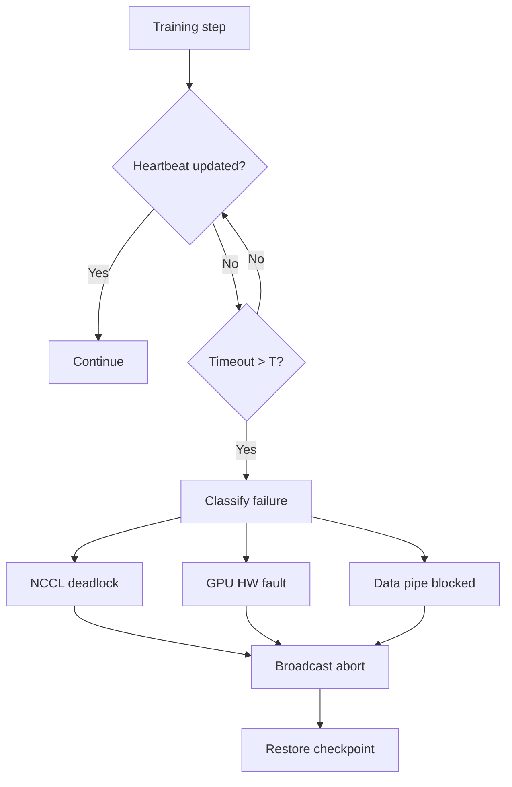

图示展示判活与隔离流程。

#### 6. 拓展知识

- **与 Megatron 的关系**：Megatron 的 sharded checkpoint 支持并行度变化时的 reshard [已确认] `insights/05-megatron-architecture.md:1214-1218`。
- **与 K02 的关系**：CUDA Graph 在 hang 后需要重新 capture [推断]。
- **与 Xid 的关系**：NVIDIA 驱动通过 Xid 编号分类 GPU 错误；Xid 79/63/94 等是常见故障码 [推断]。

#### 7. 常见追问及回答要点

1. **问：watchdog 本身 crash 了怎么办？** 答：外部进程级 watchdog（如 supervisor）监控整个训练进程。
2. **问：checkpoint 恢复后 loss 会跳吗？** 答：从完整 checkpoint 恢复理论上 loss 连续；如果 checkpoint 不完整，可能丢几个 step 的数据。
3. **问：如何区分"慢"与"hang"？** 答：用历史 step 时间的统计分布（如 3σ 原则）；超过阈值才判定 hang。

#### 8. 易错点与反例

- 反例："watchdog 能检测所有 hang"——某些"慢但仍在前进"的场景 watchdog 无法检测。
- 反例："kill 故障节点就能恢复"——必须从 checkpoint 恢复；否则训练状态丢失。
- 易错：把"所有 rank 同时超时"当成 hang——可能是网络全局故障，而非单节点问题。

#### 9. 实践与验证

[待验证] 输入：8 卡分布式训练，在第 100 step 人为让 rank 3 sleep 60s；步骤：watchdog 超时 T=30s，观察是否触发 abort + checkpoint 恢复。oracle：rank 3 被标记 hang，其他 rank abort 并从 checkpoint 恢复。当前未执行训练实验。

#### 10. 评分标准

- 不合格：说不清 watchdog 与 heartbeat 的关系。
- 合格：能解释判活机制，列出至少两种 hang 原因。
- 良好：给出完整判活 + 隔离流程，关联 checkpoint 恢复与 reshard。
- 优秀：区分 hang 类型给出不同处置策略，分析 watchdog 超时参数权衡。

**证据与来源：** [已确认] insights/05-megatron-architecture.md:1214-1218,1254-1261；[推断] ray/01-modules/M04-raylet-scheduling/design.md

---

## AIInfra-I020. continuous batching 下，单个请求的调度单位是什么？batch 内请求如何完成与退出？

- 难度：中级
- 知识域：K09 推理
- 考察能力：机制细节理解、调度流程
- 题型：机制解释
- 面试频率：高频
- 前置知识：continuous batching 动机、KV cache 管理
- 关联题目：AIInfra-I014（continuous batching 动机）、AIInfra-I021（KV cache 显存）
- 事实状态：[已确认] [推断]

#### 1. 背景知识

SGLang 的 scheduler 中请求由 `Req` 表示，批次由 `ScheduleBatch` 表示。`Req` 保存原始 token、生成 token、KV 信息和 finish 状态 [已确认] `sglang/01-modules/M04-scheduler-batching/README.md:67-93`。`ScheduleBatch` 持有请求池、KV allocator、prefix cache 和每轮执行数据 [已确认] `sglang/01-modules/M04-scheduler-batching/README.md:79-93`。

#### 2. 问题分析

1. 解释调度单位：单个请求（Req），不是固定 batch。
2. 解释 batch 构造：`PrefillAdder` 逐个加入请求。
3. 解释请求退出：finish reason 触发 → 释放 KV → 入 cache。
4. 解释 retraction 机制。

#### 3. 具体答案

面试中可以这样回答：

> **调度单位是单个请求（Req）**，不是固定 batch。`sglang/01-modules/M04-scheduler-batching/README.md` 记录 scheduler 的决策循环：每轮 `get_next_batch_to_run(running_batch, last_batch)` 计算 `NextBatchPlan`，再用 `PrefillAdder.add_one_req` 逐个把等待队列中的请求加入 batch [已确认]。每个请求独立做 admission 检查：
>
> 1. `PrefillAdder` 计算输入扩展长度、最大新 token、页面开销 [已确认] `sglang/01-modules/M04-scheduler-batching/README.md:93`。
> 2. 预算不足时返回 `NO_TOKEN`，允许截断时建立 chunked prefill。
>
> **batch 内请求如何完成与退出**：
> - **正常完成**：decode 过程中 `process_batch_result` 检测到 `finish_reason`（stop token / max length / EOS），标记请求完成 → 释放 KV slots → `cache_finished_req` 把 KV 插入 RadixCache 供后续前缀复用 [已确认] `sglang/01-modules/M08-kv-cache/README.md:46-65`。
> - **资源不足（retract）**：decode 前 `check_decode_mem` 发现容量不够 → `retract_decode` 按 retraction order 释放请求并做 host backup → 被释放的请求重新入 waiting queue 等待下一轮 [已确认] `sglang/01-modules/M04-scheduler-batching/README.md:163-178`。
> - **abort**：无法恢复的请求（beam group 不足、host backup 失败）设置 abort finish reason。
>
> 关键不变量：一个 batch 内可以同时包含 prefill 请求（extend 模式）和 decode 请求（decode 模式），两者通过 `forward_mode` 区分——这是 continuous batching 与静态 batching 的本质区别 [推断]。

#### 4. 技术洞察

```text
调度单位：单个 Req
batch 构造：PrefillAdder 逐个 admission
退出方式：
  1. finish → 释放 KV → cache 入 RadixCache
  2. retract → 释放 KV + host backup → requeue
  3. abort → 直接释放

不变量：batch 内 prefill + decode 可混合
```

[推断] chunked prefill 让长 prefill 分多轮执行——每轮只处理 chunk_size 个 token，期间 batch 内的 decode 请求继续生成，避免长 prefill 阻塞整个 batch。

#### 5. 图文说明

```text
每轮 scheduler:
  [waiting queue] ──PrefillAdder──▶ [ScheduleBatch]
                                         ├─ Req1 (prefill, extend)
                                         ├─ Req2 (decode)
                                         └─ Req3 (decode)
  forward_batch_generation → process_batch_result
    ├─ Req1 extend 完成 → 下一轮变 decode
    ├─ Req2 finish → 释放 KV + 入 cache
    └─ Req3 继续 decode
```

图示展示单轮内请求的状态转移。

#### 6. 拓展知识

- **与 KV cache 的关系**：退出时的 KV 释放与 RadixCache 插入是 M08 的核心 [已确认] `sglang/01-modules/M08-kv-cache/README.md:46-65`。
- **与 chunked prefill 的关系**：长 prefill 被切成多轮 chunk，与 decode 交错 [已确认] `sglang/01-modules/M04-scheduler-batching/README.md:128-144`。
- **与 prefix cache 的关系**：完成请求的 KV 入 RadixCache，后续请求可命中前缀复用 [已确认] `sglang/01-modules/M08-kv-cache/README.md:40-65`。

#### 7. 常见追问及回答要点

1. **问：prefill 和 decode 为什么能混在一个 batch 里？** 答：`forward_mode` 区分 extend 和 decode；底层 `prepare_for_extend` / `prepare_for_decode` 生成不同的 input 布局。
2. **问：retract 与 abort 的优先级？** 答：优先 retract（可恢复）；无法 retract 才 abort（beam group 或 host backup 失败）。
3. **问：chunked prefill 对 batch 大小的影响？** 答：chunk 化让 prefill token budget 可控，长 prefill 不一次性占满 budget。

#### 8. 易错点与反例

- 反例："batch 内所有请求都是 prefill 或都是 decode"——continuous batching 允许混合。
- 反例："请求完成就立刻从 GPU 删除 KV"——先插入 RadixCache 再释放，供后续复用。
- 易错：把 `retract_decode` 与 OOM 混淆——retract 是 scheduler 主动降级，不是进程 OOM [已确认] `sglang/01-modules/M04-scheduler-batching/README.md:163-178`。

#### 9. 实践与验证

[待验证] 输入：SGLang 推理服务，混合长短请求；步骤：开启 `SGLANG_LOG_LEVEL=DEBUG`，观察 scheduler 每轮的 batch 构成与请求退出事件。oracle：短请求完成时 batch 内有其他请求在 decode。当前未执行 GPU 实验。

#### 10. 评分标准

- 不合格：说不清调度单位是单个请求，或认为 batch 内必须同构。
- 合格：能解释 `PrefillAdder` 逐个 admission，请求完成/退出方式。
- 良好：区分 finish / retract / abort 三种退出路径，关联 RadixCache。
- 优秀：关联 chunked prefill、prefix cache、`forward_mode` 混合执行机制。

**证据与来源：** [已确认] sglang/01-modules/M04-scheduler-batching/README.md:67-93,128-178；[已确认] sglang/01-modules/M08-kv-cache/README.md:40-65

---

## AIInfra-I021. KV cache 的显存容量如何估算？给出考虑层数、KV 头数、head_dim、序列长度、dtype 的公式并代入一个例子。

- 难度：中级
- 知识域：K09 推理
- 考察能力：显存建模、定量估算、公式推导
- 题型：建模与计算
- 面试频率：高频
- 前置知识：Transformer 结构、KV cache 原理、推理显存管理
- 关联题目：AIInfra-I014（continuous batching）、AIInfra-I020（请求调度）
- 事实状态：[已确认] [推断]

#### 1. 背景知识

KV cache 保存每个 token 在每个 Transformer 层的 key/value，避免重复计算。PagedAttention 论文把它类比为 OS virtual memory：logical KV blocks → block table → physical KV blocks [已确认] `insights/03-arxiv-reading-notes.md:19-39`。SGLang 的 KV 池化管理由 `TokenToKVPoolAllocator` 实现 [已确认] `sglang/01-modules/M08-kv-cache/README.md:88-101`。

#### 2. 问题分析

1. 推导 KV cache 单 token 单层的显存公式。
2. 扩展到全序列、全模型、全 batch。
3. 代入一个具体例子（如 LLaMA-3-8B）。
4. 讨论 KV cache 的显存占比与优化方向。

#### 3. 具体答案

面试中可以这样回答：

> **KV cache 显存公式**：
>
> 单层单 token 的 KV cache = `2 × num_kv_heads × head_dim × sizeof(dtype)`
>
> 其中 2 = key + value，num_kv_heads 可能小于 num_attention_heads（GQA/MQA 场景）。
>
> 扩展到全模型：
> ```text
> KV_cache_per_token = L × 2 × num_kv_heads × head_dim × sizeof(dtype)
>
> KV_cache_per_seq   = KV_cache_per_token × seq_len
>
> KV_cache_batch     = KV_cache_per_seq × batch_size
>                    = L × 2 × num_kv_heads × head_dim × sizeof(dtype) × seq_len × batch_size
> ```
>
> **代入例子**：LLaMA-3-8B，bf16（sizeof=2），L=32，num_kv_heads=8，head_dim=128，seq_len=8192，batch_size=32：
> ```text
> per_token = 32 × 2 × 8 × 128 × 2 = 131072 bytes ≈ 128 KB
> per_seq   = 128 KB × 8192 ≈ 1 GB
> batch     = 1 GB × 32 ≈ 32 GB
> ```
>
> 32 张序列的 KV cache 就要 32GB——这是推理服务中 KV cache 占大头的典型场景 [推断]。优化方向：GQA 减少 num_kv_heads、MQA 进一步压缩、FP8 KV cache 减少 sizeof、PagedAttention 的 block 管理提高利用率 [已确认] `insights/03-arxiv-reading-notes.md:19-39`。
>
> 注意：TP 下 num_kv_heads 被 t 分片，每 rank 的 KV cache 量按 t 除——这是推理 TP 的核心收益 [推断] `insights/05-megatron-architecture.md:1221-1223`。

#### 4. 技术洞察

```text
KV_cache = L × 2 × num_kv_heads × head_dim × sizeof(dtype) × seq_len × batch_size

常见压缩手段：
  GQA/MQA: num_kv_heads < num_attention_heads
  FP8 KV: sizeof = 1 (而非 2)
  PagedAttention: 减少内部碎片
  KV offload: 部分 KV 放 CPU/host memory
  TP: num_kv_heads 按 t 分片
```

[推断] 实际 KV cache 占用还包含 RadixCache 的 prefix 复用——命中的前缀不重复计算 KV，可显著降低有效 KV 量。

#### 5. 图文说明

```text
单层 KV cache 结构:
  key:   [num_kv_heads, head_dim] × sizeof(dtype)
  value: [num_kv_heads, head_dim] × sizeof(dtype)
  → 2 × num_kv_heads × head_dim × sizeof(dtype) per token

全模型:
  L 层 × 每 token KV × seq_len × batch_size
  = 总 KV cache 显存

示例 (LLaMA-3-8B, bf16):
  per token: 128 KB
  per seq:   1 GB
  batch 32:  32 GB
```

图示展示 KV cache 的层次结构。

#### 6. 拓展知识

- **与 continuous batching 的关系**：batch_size 在 continuous batching 下是动态的，KV cache 总量随 running 请求数波动 [推断]。
- **与 PagedAttention 的关系**：`insights/03-arxiv-reading-notes.md:19-39` 描述 block 化管理减少碎片，waste 量取决于 block size 选择 [已确认]。
- **与 P/D 分离的关系**：prefill 阶段生成 KV，decode 阶段消费 KV，跨实例传输需要 RDMA/D2D [已确认] `insights/03-arxiv-reading-notes.md:13-14`。

#### 7. 常见追问及回答要点

1. **问：GQA 下 num_kv_heads 如何选择？** 答：LLaMA-3-8B 用 8 个 KV head（num_attention_heads=32），即 4:1 的 GQA 压缩。
2. **问：KV cache 用 fp8 有精度风险吗？** 答：fp8 对 value 的精度损失可能大于 key；通常 key 保持 bf16，value 用 fp8——需验证 [推断]。
3. **问：如何估算 KV cache 的理论上限 batch_size？** 答：`max_batch = (GPU_mem - model_weight - activation) / KV_per_seq`——这是推理服务容量规划的基础公式。

#### 8. 易错点与反例

- 反例："KV cache = 2 × num_attention_heads × head_dim"——GQA 下应使用 num_kv_heads。
- 反例："KV cache 与 batch_size 无关"——batch_size 直接线性影响 KV 总量。
- 易错：忽略 TP 下的 head 分片——推理 TP 每 rank 的 KV 按 t 除。

#### 9. 实践与验证

[待验证] 输入：SGLang 推理 LLaMA-3-8B，bf16，seq=8192，逐步增加 batch_size；步骤：记录 GPU 显存占用增量，验证每 seq 的 KV 增量 ≈ 1GB。oracle：实测增量与公式误差 < 10%。当前未执行 GPU 实验。

#### 10. 评分标准

- 不合格：不能写出 KV cache 公式。
- 合格：能推导公式并代入例子。
- 良好：区分 GQA 的 num_kv_heads，讨论 TP 分片与 PagedAttention。
- 优秀：关联 continuous batching 动态 batch_size、P/D 分离、KV offload 等优化。

**证据与来源：** [已确认] insights/03-arxiv-reading-notes.md:19-39；[已确认] sglang/01-modules/M08-kv-cache/README.md:88-101；[推断] insights/05-megatron-architecture.md:1221-1223

---

## AIInfra-I022. 如何测量 MFU（Model FLOPs Utilization）？需要哪些输入？MFU 低时如何分解原因？

- 难度：中级
- 知识域：K10 性能
- 考察能力：性能指标定义、排障分解
- 题型：建模与排障
- 面试频率：高频
- 前置知识：分布式训练、模型 FLOPs 计算、性能分析
- 关联题目：AIInfra-I001（roofline）、AIInfra-I002（Tensor Core）、AIInfra-I010（带宽）
- 事实状态：[已确认] [推断]

#### 1. 背景知识

MFU = 实际模型 FLOPs / (GPU数 × 单卡峰值FLOPs × 运行时长) [已确认] `insights/05-megatron-architecture.md:1100-1110`。Megatron/TE 常用它报告性能：MT-NLG 报告 530B 在 2240 A100 上 MFU 54.2% [已确认]。MFU 低的原因可以从计算、通信、数据管道三个方向分解。

#### 2. 问题分析

1. 给出 MFU 公式与所需输入。
2. 解释每项输入的获取方式。
3. 给出 MFU 低时的排障分解框架。

#### 3. 具体答案

面试中可以这样回答：

> **MFU 公式**：
> ```text
> MFU = actual_model_flops / (num_gpus × peak_flops_per_gpu × step_time)
> ```
>
> **所需输入**：
> 1. `actual_model_flops`：训练单步的模型 FLOPs，≈ 2 × 参数量 × 序列数 × seq_len（前向）+ 同量级（后向）[推断] `insights/05-megatron-architecture.md:128-133`。
> 2. `peak_flops_per_gpu`：GPU spec 上的 bf16/TF32/Tensor Core 峰值算力。
> 3. `step_time`：每步实际耗时（用 CUDA event 或 Megatron 的 `timers` 测）[已确认] `insights/05-megatron-architecture.md:1246-1253`。
> 4. `num_gpus`：参与训练的 GPU 总数。
>
> **MFU 低的分解框架**：
> ```text
> MFU 低 = step_time 过长 / peak 过低
> step_time = compute_time + comm_time + idle_time + io_time
>
> 分解方向：
>   1. compute_time 高 → 算力问题（TC 对齐/occupancy/AIInfra-I001 roofline）
>   2. comm_time 高 → 通信问题（带宽不足/未 overlap/AIInfra-I010）
>   3. idle_time 高 → 调度问题（气泡/数据管道/AIInfra-I015）
>   4. io_time 高   → 数据管道问题
> ```
>
> 工具链：nsystream 可视化 timeline → 区分 comm/comp/idle；NCCL profiling 看通信带宽；nsight compute 看 kernel 效率 [推断] `insights/05-megatron-architecture.md:1246-1253`。

#### 4. 技术洞察

```text
MFU 分解优先级（按常见度）：
  1. 通信未 overlap → comm_time 暴露
  2. 数据管道瓶颈 → GPU 等数据
  3. Tensor Core 未对齐 → compute_time 远大于预期
  4. PP 气泡 → idle_time
  5. 显存不足导致 recompute 过多 → 额外 FLOPs

经验值（[推断]）：
  MFU 50%+ → 较好
  MFU 40-50% → 有优化空间
  MFU < 30% → 有严重瓶颈
```

[推断] 这些经验阈值因模型和硬件而异；同模型在不同配置下 MFU 可能差 10 个百分点。

#### 5. 图文说明

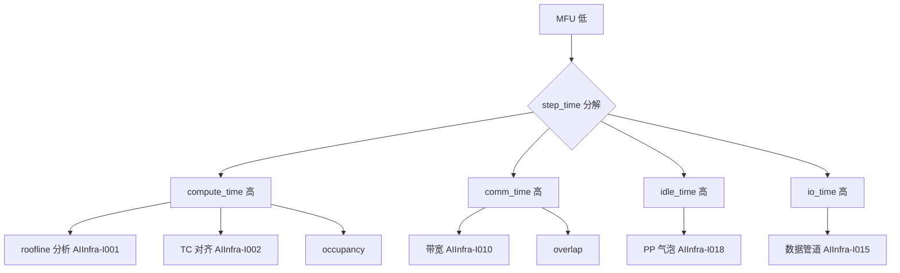

图示展示 MFU 低的分解路径。

#### 6. 拓展知识

- **与扩展效率的关系**：MFU 报告的是单卡利用率；扩展效率报告的是多卡线性度 [已确认] `insights/05-megatron-architecture.md:1116-1122`。
- **与 loss 的关系**：overlap 改变可能影响浮点累加顺序，需对比 loss 曲线 [推断] `insights/05-megatron-architecture.md:1205-1209`。
- **与 batch 大小的关系**：global batch 过小 → 单 rank micro-batch 过小 → MFU 低 [推断]。

#### 7. 常见追问及回答要点

1. **问：MFU 与 roofline 的 achieved FLOPs 有什么区别？** 答：roofline 是单 kernel 层面；MFU 是训练 step 层面，包含通信与 idle。
2. **问：如何区分"通信占比高"与"计算效率低"？** 答：nsystream timeline 看 comm 区域占比；如果 comm 时间 < 10% 但 MFU 仍低，问题在计算侧。
3. **问：MFU 54.2% 算高吗？** 答：对大模型（530B）来说是非常好的水平；小模型通常更高（因为计算密度高）。

#### 8. 易错点与反例

- 反例："MFU 只反映计算效率"——MFU 包含通信、idle、io 的全局效率。
- 反例："MFU 低就加 GPU"——加 GPU 可能让 MFU 更低（通信量增加）。
- 易错：把 MFU 与 throughput 混淆——throughput 关注 tokens/s，MFU 关注 FLOPs 利用率；两者相关但不相同。

#### 9. 实践与验证

[待验证] 输入：Megatron 训练 LLaMA-3-70B，TP8×PP8×DP2=128 卡；步骤：用 Megatron timer 与 nsystream 测 step_time 各分量，计算 MFU。oracle：MFU 在 45-55% 区间。当前未执行训练实验。

#### 10. 评分标准

- 不合格：不能写出 MFU 公式。
- 合格：能列出所需输入，给出基本排障方向。
- 良好：给出完整分解框架，关联 roofline 与通信分析。
- 优秀：关联 overlap、PP 气泡、数据管道，指出 MFU 的局限（不包含收敛性）。

**证据与来源：** [已确认] insights/05-megatron-architecture.md:1100-1122,1246-1253；[推断] cuda/99-roadmap/performance-guide.md

---

## AIInfra-I023. 推理服务尾延迟（p99）突增时，从请求入口到 GPU 的分段排查动线是什么？

- 难度：中级
- 知识域：K10 性能
- 考察能力：端到端排障、分段定位
- 题型：排障流程
- 面试频率：高频
- 前置知识：推理服务架构、continuous batching、性能分析
- 关联题目：AIInfra-I014（continuous batching）、AIInfra-I020（调度机制）
- 事实状态：[已确认] [推断]

#### 1. 背景知识

SGLang 的请求流程：request_receiver → process_input_requests → get_next_batch_to_run → run_batch → process_batch_result → output streamer [已确认] `sglang/01-modules/M04-scheduler-batching/README.md:42-66`。性能指南文档把请求侧分为 tokenize/IPC/队列等待、prefill、decode、worker、输出侧五个阶段 [已确认] `sglang/99-roadmap/performance-guide.md:16-23`。

#### 2. 问题分析

1. 按请求路径拆解：入口队列 → prefill → decode → 输出。
2. 每段给出尾延迟的常见原因。
3. 给出排查工具与顺序。

#### 3. 具体答案

面试中可以这样回答：

> **端到端分段**（从请求入口到 GPU）：
>
> 1. **入口与队列**：请求到达 → tokenize → 进入 waiting queue。尾延迟原因：排队等待 budget 释放、tokenize 慢（长输入）。`sglang/99-roadmap/performance-guide.md:16-23` 把"请求侧"列为第一段 [已确认]。
>
> 2. **Prefill 阶段**：scheduler 把请求加入 batch → `prepare_for_extend` → forward。尾延迟原因：长 prefill 占用 chunked budget、prefix cache miss（需全量 prefill）。`sglang/01-modules/M04-scheduler-batching/README.md:128-144` 描述 chunked prefill 约束 [已确认]。
>
> 3. **Decode 阶段**：每步 decode 一个 token。尾延迟原因：batch 被长请求拖慢（连续 batching 缓解但仍存在）、KV cache 不足触发 retraction、decode batch 大小波动。
>
> 4. **Worker/Forward**：`TpModelWorker.forward_batch_generation` → `ModelRunner.forward/sample`。尾延迟原因：kernel 抖动、CUDA Graph replay 参数不匹配、attention 后端 tile 大小变化 [推断]。
>
> 5. **输出侧**：copy-to-CPU → detokenize → stream/event 通知。尾延迟原因：输出序列长尾（大量 token 集中拷贝）[已确认] `sglang/99-roadmap/performance-guide.md:16-23`。
>
> **排查动线**：
> ① 先分位：p99 突增是 TTFT 还是 TBT？TTFT → prefill 段；TBT → decode 段。
> ② 看 scheduler 日志：`PrefillAdder` 是否频繁返回 `NO_TOKEN`？running batch 是否满？
> ③ 看 retraction 频率：`retract_decode` 是否频繁触发（`AIInfra-I020`）[已确认] `sglang/01-modules/M04-scheduler-batching/README.md:163-178`。
> ④ 看 KV cache 利用率：`available_size()` 是否接近 0？
> ⑤ 看 GPU kernel：nsight 看 decode step 时间是否抖动。
> ⑥ 看网络/IO：输出 streamer 是否阻塞。

#### 4. 技术洞察

```text
p99 突增排查顺序：
  TTFT 高 → tokenize / prefill / waiting queue
  TBT 高  → decode batch 大小 / retraction / KV 不足
  P99 突增 → 通常是突发负载或 retraction 级联

关键指标：
  retraction rate（高 → KV 不足）
  running batch size 波动
  decode step time p50 vs p99 gap（大 → kernel 不稳定）
```

[推断] 尾延迟的"突增"通常是级联效应——一个长请求导致 batch 被拖慢 → 新请求延迟上升 → retraction 触发更多请求。

#### 5. 图文说明

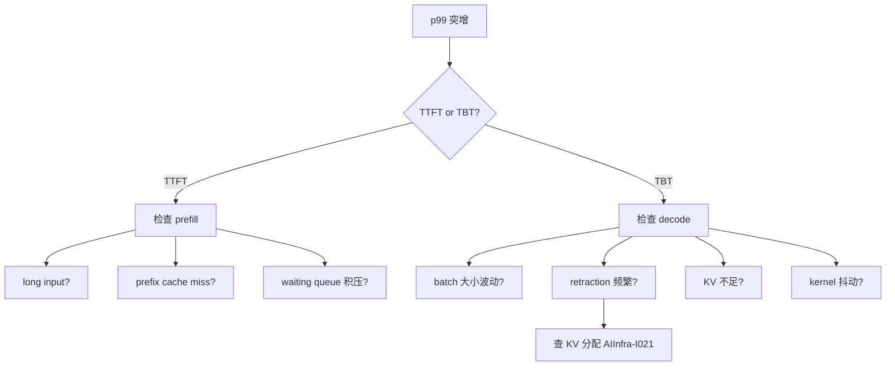

图示展示 p99 突增的分段排查路径。

#### 6. 拓展知识

- **与 continuous batching 的关系**：batch 动态变化是 p99 的天然来源；固定 batch 的 p99 更稳定但平均延迟更高 [推断]。
- **与 KV cache 的关系**：KV 不足触发 retract → 被 retract 的请求延迟突增 [已确认] `sglang/01-modules/M04-scheduler-batching/README.md:163-178`。
- **与 chunked prefill 的关系**：chunk 大小直接影响 TTFT 上限；太小则 prefill 分多轮。

#### 7. 常见追问及回答要点

1. **问：p99 与 p999 的区别在排查中有什么用？** 答：p99 反映典型最差；p999 可能揭示偶发事件（如 retraction、GC）。
2. **问：如何区分"负载突增"与"单请求拖慢"？** 看 running batch 大小是否稳定；负载突增时 batch 满，单请求拖慢时 batch 未满但 TBT 高。
3. **问：retraction 对 p99 的影响有多大？** 答：retract 的请求 TBT 会被"暂停"后继续，TBT 突增 2-10 倍。

#### 8. 易错点与反例

- 反例："p99 高就是 GPU 慢"——可能只是排队或 retraction。
- 反例："加 GPU 就能解决 p99"——如果是单请求拖慢，加 GPU 无用。
- 易错：把 TBT 与 TTFT 混淆——两者排查路径完全不同。

#### 9. 实践与验证

[待验证] 输入：SGLang 推理服务，混合负载（含少量超长请求）；步骤：监控 p99 TBT，注入一个超长请求，观察 retraction 与 p99 变化。oracle：长请求导致 batch 内其他请求 TBT 上升，触发 retraction 后 p99 进一步恶化。当前未执行 GPU 实验。

#### 10. 评分标准

- 不合格：说不清推理服务请求路径。
- 合格：能分 2-3 段排查，给出基本原因。
- 良好：给出完整五段排查动线，区分 TTFT/TBT 两条路径。
- 优秀：关联 retraction 级联、KV cache 利用率、chunked prefill 等机制。

**证据与来源：** [已确认] sglang/99-roadmap/performance-guide.md:16-23；[已确认] sglang/01-modules/M04-scheduler-batching/README.md:128-178；[已确认] sglang/01-modules/M08-kv-cache/README.md

---

## AIInfra-I024. 异步任务提交后进程崩溃，设备侧资源处于什么状态？如何避免恢复时的重复副作用？

- 难度：中级
- 知识域：K11 可靠性
- 考察能力：资源生命周期理解、幂等设计
- 题型：机制解释与设计
- 面试频率：中频
- 前置知识：CUDA 异步执行、显存生命周期、checkpoint
- 关联题目：AIInfra-I007（非法地址）、AIInfra-I019（worker hang）、AIInfra-I006（显存池）
- 事实状态：[已确认] [推断]

#### 1. 背景知识

异步任务提交后，host API 返回成功不等于 GPU 已消费完 [已确认] `cann/90-cross-module/memory-and-resource-lifecycle.md:26`。如果进程在 GPU 消费完成前崩溃，设备侧资源（QMD、pushbuffer、显存、stream 状态）处于"悬挂"状态——GPU 可能仍在执行 kernel，但 host 侧已失去对这些资源的引用 [推断]。CANN 的 Context 销毁流程：停止新访问 → 清理 Model → flush Stream → 清除线程绑定 [已确认] `cann/90-cross-module/memory-and-resource-lifecycle.md:46-56`。

#### 2. 问题分析

1. 解释异步提交后进程崩溃时的设备侧状态。
2. 分析资源泄漏与悬挂执行的风险。
3. 给出恢复时的幂等设计原则。

#### 3. 具体答案

面试中可以这样回答：

> **设备侧状态**：异步任务提交后进程崩溃，GPU 可能处于以下状态之一：
>
> 1. **kernel 正在执行**：tracking semaphore 尚未更新，设备侧仍有活跃 QMD/pushbuffer 引用。进程崩溃后这些资源成为"孤儿"——GPU 可能继续执行到 completion，但 host 侧无法查询或释放。
> 2. **显存仍被占用**：`cann/90-cross-module/memory-and-resource-lifecycle.md:26` 明确"提交成功不等于设备已消费完 buffer"——进程崩溃后显存对象仍在 Driver 的 tracking 表中 [已确认]。
> 3. **stream/event 状态未收敛**：`cann/90-cross-module/memory-and-resource-lifecycle.md:46-56` 描述 Context 销毁需要 flush Stream 并等待引用耗尽；如果进程崩溃前未做 teardown，stream 状态可能残留 [已确认]。
>
> **恢复时的重复副作用问题**：
> - 如果训练 step 的"提交"与"副作用"（写 checkpoint、更新参数、push metrics）不在同一原子操作中，恢复时可能重复执行副作用。
>
> **避免策略**：
> 1. **幂等设计**：每个副作用带唯一 step ID 或 timestamp；重放前先检查是否已执行。
> 2. **两阶段提交**：先写临时 checkpoint → 成功后 rename；崩溃时临时文件可丢弃。
> 3. **checkpoint 恢复只到上一个完整 checkpoint**：不依赖"部分 step"的状态。
> 4. **资源清理**：进程重启时 Driver 会清理该 Context 持有的所有 tracking 引用；但如果 GPU 仍有 kernel 在执行，可能触发 Xid error [推断]。
>
> Megatron 的做法：`insights/05-megatron-architecture.md:1261` 描述"保存-重启"策略——周期性 sharded checkpoint + async save，step 失败时从最近 checkpoint 恢复 [已确认]。

#### 4. 技术洞察

```text
崩溃时设备状态：
  kernel:  可能仍在 GPU 上执行（tracking semaphore 未更新）
  memory:  仍在 Driver tracking 表中
  stream:  状态未收敛

恢复幂等设计：
  1. 副作用带唯一 ID → 去重
  2. 临时文件 + rename → 原子性
  3. 恢复到上一完整 checkpoint → 不依赖部分状态
  4. Driver cleanup 孤儿资源 → 可能触发 Xid
```

[推断] 如果崩溃频繁，GPU 可能积累大量孤儿资源导致性能下降或 Xid 错误；需要重启 GPU 或重置 Context。

#### 5. 图文说明

```mermaid
flowchain TD
    A[异步提交 kernel] --> B[host 返回成功]
    B --> C[进程崩溃]
    C --> D{GPU 状态?}
    D -->|kernel 仍在跑| E[孤儿 QMD]
    D -->|memory 未释放| F[显存泄漏]
    D -->|stream 未 flush| G[状态残留]
    E --> H[恢复策略]
    F --> H
    G --> H
    H --> I[幂等检查 step ID]
    H --> J[恢复到上一完整 ckpt]
    H --> K[Driver cleanup]
```

图示展示崩溃时的设备状态与恢复策略。

#### 6. 拓展知识

- **与 CUDA Graph 的关系**：CUDA Graph exec 持有 per-context 资源；进程崩溃后 Graph exec 的资源也需要 cleanup [推断] `cuda/01-modules/M06-module-launch/graph-resource-lifecycle.md:39-40`。
- **与 Megatron 的关系**：分布式 checkpoint 的 async save 需要处理"写了一半崩溃"——通常用临时文件 + rename [推断] `insights/05-megatron-architecture.md:1261`。
- **与 Xid 的关系**：孤儿 kernel 执行出错会触发 Xid 事件；Xid 79/63/94 常见于资源泄漏后 [推断]。

#### 7. 常见追问及回答要点

1. **问：进程崩溃后 GPU 会自动回收资源吗？** 答：Driver 在 Context 销毁时会清理；但如果进程未走 teardown 路径（如 SIGKILL），可能需要等 GPU reset。
2. **问：如何检测孤儿资源？** 答：`nvidia-smi` 看 GPU 利用率是否为 0 但显存占用高；`dmesg` 看 Xid 事件。
3. **问：checkpoint 的 async save 如何保证原子性？** 答：先写 `.tmp` 文件 → fsync → rename 为正式文件名；崩溃时 `.tmp` 可丢弃。

#### 8. 易错点与反例

- 反例："进程崩溃后 GPU 立刻空闲"——kernel 可能仍在执行，资源不会立即释放。
- 反例："async save 是安全的"——不处理 rename 原子性时可能产生损坏的 checkpoint。
- 易错：把 host 侧状态与设备侧状态等同——host 崩溃不等于 GPU 停止。

#### 9. 实践与验证

[待验证] 输入：训练进程在第 N step 提交 kernel 后立即 SIGKILL；步骤：检查 `nvidia-smi` 显存占用、`dmesg` 是否有 Xid。oracle：显存不会立即释放，可能有 Xid 事件。当前未执行 GPU 实验。

#### 10. 评分标准

- 不合格：认为进程崩溃后 GPU 立即空闲。
- 合格：能解释异步提交后的设备侧状态，给出基本恢复策略。
- 良好：分析孤儿资源的三类状态（kernel/memory/stream），给出幂等设计原则。
- 优秀：关联 CUDA Graph 资源生命周期、Megatron async save 原子性、Xid 事件排查。

**证据与来源：** [已确认] cann/90-cross-module/memory-and-resource-lifecycle.md:26,46-56；[已确认] insights/05-megatron-architecture.md:1261；[推断] cuda/01-modules/M06-module-launch/graph-resource-lifecycle.md:39-40

---

## AIInfra-I025. 模型权重版本与推理框架/运行时版本如何做兼容管理？加载失败的常见原因有哪些？

- 难度：中级
- 知识域：K12 MLOps
- 考察能力：版本管理、兼容性分析、排障
- 题型：设计与排障
- 面试频率：中频
- 前置知识：模型格式（safetensors/HF）、权重转换、推理框架
- 关联题目：AIInfra-I020（请求调度）、AIInfra-I021（KV cache）
- 事实状态：[已确认] [推断]

#### 1. 背景知识

Megatron-Bridge 提供与 HuggingFace 的双向 checkpoint 转换，可在模型并行感知的前提下转换参数布局 [已确认] `insights/05-megatron-architecture.md:1214-1218`。推理引擎（vLLM/SGLang）按 TP head 分片读取权重 [已确认] `insights/05-megatron-architecture.md:1221-1223`。版本不匹配是加载失败的常见原因。

#### 2. 问题分析

1. 解释版本管理的三个层面：模型权重格式、推理框架版本、运行时/驱动版本。
2. 列出加载失败的常见原因。
3. 给出兼容性管理策略。

#### 3. 具体答案

面试中可以这样回答：

> **版本管理的三个层面**：
>
> 1. **模型权重格式**：HuggingFace `safetensors`、Megatron distributed checkpoint、PyTorch `bin`——格式间转换需要 Megatron-Bridge 或 HF→Megatron 转换脚本 [已确认] `insights/05-megatron-architecture.md:1214-1218`。
> 2. **推理框架版本**：vLLM/SGLang 的 model loader 与模型结构定义绑定；框架升级可能改变 loader 接口（如 `AutoModelForCausalLM` 的映射）。
> 3. **运行时/驱动版本**：CUDA/MUSA 版本、NCCL 版本、kernel 兼容性——驱动版本不匹配会导致 kernel launch 失败。
>
> **加载失败的常见原因**：
> 1. **shape 不匹配**：权重 tensor 的 shape 与模型配置不一致（如 hidden_size 不同、num_layers 不同）。
> 2. **key 不匹配**：权重文件中的 key 名与 model loader 期望的不一致（如 `q_proj.weight` 与 `query.weight`）。
> 3. **dtype 不匹配**：权重是 bf16 但模型配置 fp16（或反之）；或量化权重（INT8/FP8）未被框架支持。
> 4. **并行度不匹配**：checkpoint 是用 TP=8 保存的，推理时 TP=4——shard 布局不同 [已确认] `insights/05-megatron-architecture.md:1214-1218`。
> 5. **框架版本不兼容**：模型用了新算子（如 GQA/MLA），旧版推理框架不认识。
>
> **管理策略**：
> - 用 manifest 记录"模型版本 ↔ 框架版本 ↔ 驱动版本"的兼容矩阵。
> - 容器化：每个推理服务版本打包对应的驱动和框架。
> - CI 中跑加载 smoke test：每次模型更新都验证能否加载。
> - Megatron 的 sharded checkpoint 支持 reshard，处理并行度变化 [已确认] `insights/05-megatron-architecture.md:1214-1218`。

#### 4. 技术洞察

```text
加载失败排查顺序：
  1. 看错误日志 → shape? key? dtype?
  2. 查模型 config.json → hidden_size/num_layers/num_heads
  3. 查权重文件 key 列表 → 与 model loader 期望对比
  4. 查并行度 → TP 是否匹配
  5. 查框架版本 → 是否支持该模型结构

兼容矩阵示例：
  LLaMA-3-8B bf16 ↔ vLLM 0.4.x ↔ CUDA 12.x ↔ Driver 535+
  LLaMA-3-70B fp8  ↔ vLLM 0.5.x ↔ CUDA 12.2+ ↔ Driver 545+
```

[推断] 量化模型（GPTQ/AWQ/FP8）的兼容性矩阵更复杂——需要匹配量化框架版本与推理引擎的量化 kernel。

#### 5. 图文说明

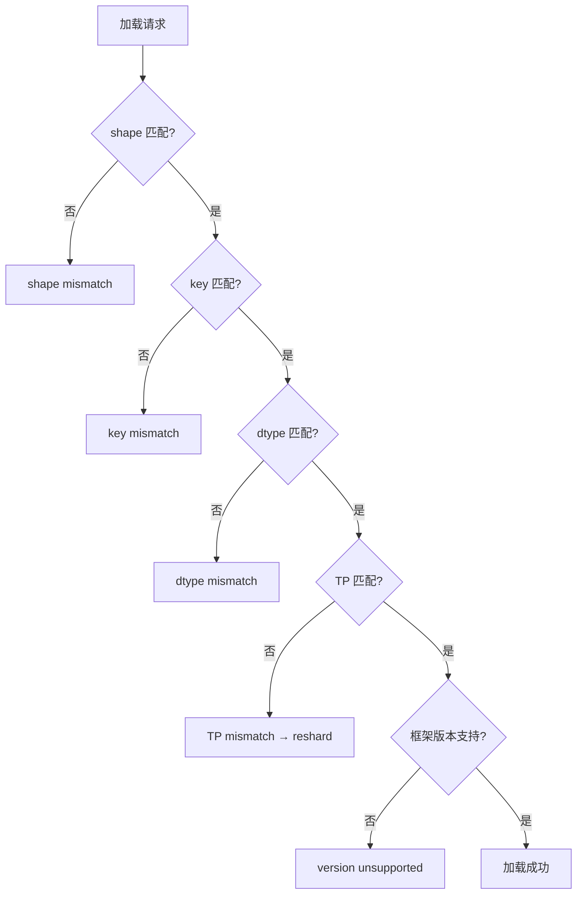

图示展示加载失败的排查顺序。

#### 6. 拓展知识

- **与 Megatron-Bridge 的关系**：双向转换需要处理并行度变化时的 reshard [已确认] `insights/05-megatron-architecture.md:1214-1218`。
- **与容器化的关系**：K8s 部署时把模型版本 + 框架版本 + 驱动版本打包为同一镜像，避免环境漂移。
- **与 P/D 分离的关系**：prefill 与 decode 实例的框架版本必须一致——否则 KV transfer 的 tensor layout 可能不兼容 [推断]。

#### 7. 常见追问及回答要点

1. **问：TP 不匹配的 checkpoint 能否直接加载？** 答：不能直接加载；需要 reshard 或转换工具（Megatron-Bridge 支持）[已确认] `insights/05-megatron-architecture.md:1214-1218`。
2. **问：如何快速验证权重与模型配置是否匹配？** 答：对比 `config.json` 的 hidden_size/num_layers/num_heads 与权重 tensor 的 shape。
3. **问：量化模型加载失败的特殊原因？** 答：量化 kernel 版本不匹配、量化配置文件（`quantize_config.json`）缺失、推理引擎未编译对应量化后端。

#### 8. 易错点与反例

- 反例："只要 shape 对就能加载"——key 名和 dtype 同样重要。
- 反例："TP 变化不需要转换"——shard 布局不同，必须 reshard。
- 易错：把"加载成功"与"推理正确"混淆——加载成功但版本不匹配可能产生 garbage 输出。

#### 9. 实践与验证

[待验证] 输入：LLaMA-3-8B bf16 checkpoint，vLLM 0.4.x + CUDA 12.2；步骤：故意用错误 TP（如 checkpoint TP=8，推理 TP=4）尝试加载。oracle：加载失败或输出错误；使用 reshard 工具后加载成功。当前未执行 GPU 实验。

#### 10. 评分标准

- 不合格：说不清加载失败的任何原因。
- 合格：能列出 shape/key/dtype 三类原因。
- 良好：区分三个版本层面，给出管理策略。
- 优秀：关联 Megatron-Bridge reshard、容器化、P/D 分离的兼容性约束。

**证据与来源：** [已确认] insights/05-megatron-architecture.md:1214-1218,1221-1223；[推断] sglang/01-modules/M04-scheduler-batching/README.md