# 异构资源稳定性：高级面试题

- 题数：15；稳定 ID：`HRS-A001`–`HRS-A015`
- 证据规则：源码/文档结论按 `[已确认]`、`[推断]` 区分；硬件、网络、多进程和性能实验按 `[待验证]` 处理。

## HRS-A001. 如何用故障域和可用度模型定量设计异构资源稳定性？

- 难度：高级
- 知识域：K01 稳定性目标、边界与故障模型
- 考察能力：系统建模、定量分析、故障域设计
- 题型：系统设计与定量分析
- 面试频率：高频
- 前置知识：HRS-B001、SLO/SLI、串并联可用度与排队基础
- 关联题目：前置 `HRS-B001`；后续 `HRS-A009`、`HRS-A013`
- 事实状态：`[已确认]` `[推断]` `[待验证]` `[建议]`

#### 1. 背景知识

高级设计不能只说“系统要稳定”，而要给出可计算的可用度目标、故障域划分和损失上界。异构资源系统由 CPU、NPU、设备内存、Stream/Queue、互联链路和 Driver 组成，它们的失败并非独立：共享机房供电、共享交换机、共享 Driver 进程或共享 HAL 版本都会让多个单元同时失效。CANN 文档明确把主机 API 成功、Runtime 元数据变化、Driver 接受请求和设备任务完成视为不同时刻，因此可用度必须绑定到明确的观测边界。[已确认] 来源：[cann/90-cross-module/memory-and-resource-lifecycle.md:25]

高级题还要求把“故障域”落到部署拓扑上：单卡、单板、单节点（多卡共享 NUMA 与 PCIe Switch）、机架（共享 ToR 交换机和供电）、可用区。选择哪个粒度作为隔离单元，直接决定爆炸半径和冗余成本。

#### 2. 问题分析

设计时先固定四个量，再做计算，而不是先选冗余方案：

1. **SLO 分解**：把端到端可用度 `A_slo` 分解到接入层、调度层、执行层和设备层，串行链路的可用度按乘积计算；
2. **故障域枚举**：列出独立故障域和共享故障点，区分“单域失效”与“共因失效”；
3. **冗余模型**：确定每域内的副本数 `R`、是否独立、是否可热替换；
4. **恢复预算**：给定检测时间、隔离时间、替换/自愈时间和容量余量，计算最大可容忍失效域数。

只有把“共因失效”和“恢复时间”显式建模，冗余数的计算才有意义；否则会得到乐观到无法兑现的可用度。

#### 3. 具体答案

面试中我会先给出串并联模型，再落到故障域：

```text
串行链路（任一环节失败即整体失败）：
    A_chain = Π A_i

域内独立冗余 R 份：
    A_ind = 1 - (1 - a)^R

存在共因失效概率 p_shared（例如共享交换机/供电/Driver 进程）：
    A_corr = 1 - p_shared - (1 - p_shared) * (1 - a)^R

爆炸半径（期望受影响请求数，λ 为到达率，T_blind 为未隔离时间）：
    E[affected] ≈ λ * T_blind * f_domain
```

设计结论：**先缩小故障域，再叠加冗余**。把一个大域拆成两个独立域，往往比在单个域内增加副本更能提升 `A_corr`，因为共因概率 `p_shared` 被降低。对设备级故障，优先把单个 NPU 及其 Stream/内存作为最小隔离单元；对网络相关故障，则按 ToR/可用区隔离，并把 collective 参与者限制在同一故障域内。

#### 4. 技术洞察

三个关键不变量：

```text
不变量 1：任一请求只能有一个终态，且终态必须在明确的完成边界上判定
不变量 2：隔离动作不得跨越故障域，重试不得放大拥塞
不变量 3：容量规划必须扣除最大单域损失后仍满足 SLO
```

定量上，可用度目标必须与恢复时间一起看。若单域平均恢复时间 `MTTR` 为 `Tr`，检测+隔离时间 `Td`，则一年内可容忍的计划外停机预算 `B` 对应允许的失效次数 `n ≈ B / (Td + Tr)`。冗余 `R` 只有在“单次失效能被 `Td + Tr` 覆盖”时才有意义，否则副本再多也会被共因或级联拖垮。

示例（假设值，仅演示数学，非实测）：若每卡 `a=0.999`、`64` 卡串行且完全独立，则 `A≈0.999^64≈0.938`；若其中 4 处共享一个可用度 `0.98` 的交换机，则整体受该共因主导，增加卡内副本收益有限。这段计算说明“共因通常主导结果”，但具体数值必须在目标环境用真实 MTBF/MTTR 替换。[推断]

#### 5. 图文说明

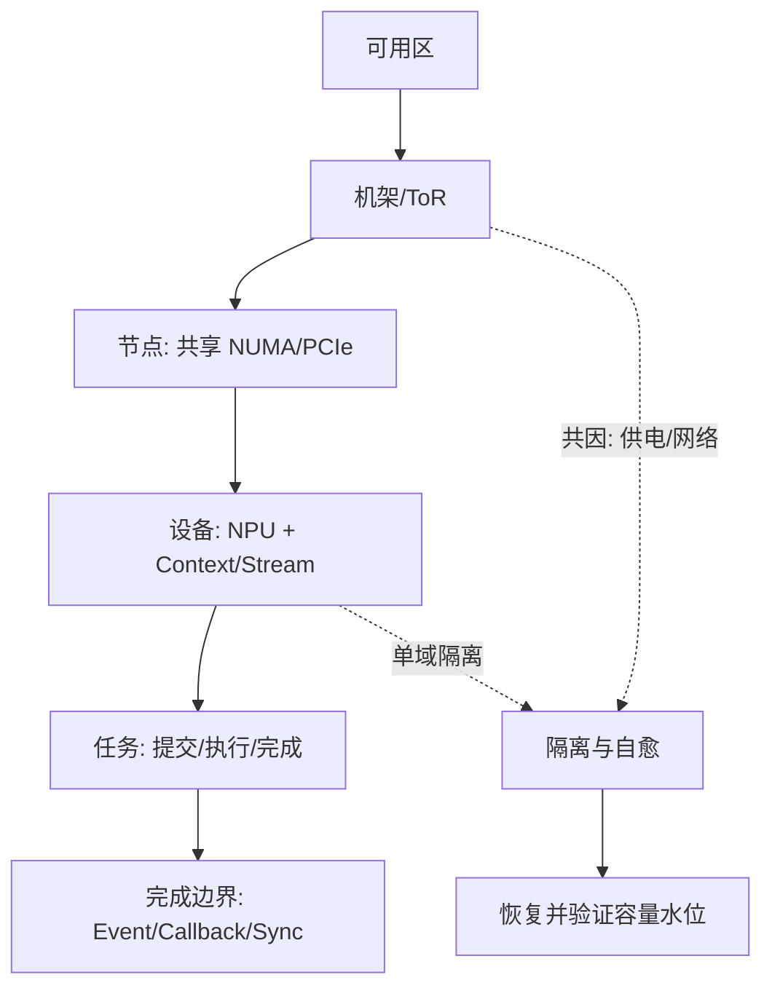

图中每层是候选故障域；实线是包含关系，虚线是隔离和恢复动作。关键是把恢复动作限制在对应域内：设备故障不应触发整节点重启，网络故障不应清空无关设备的 Context。图示不证明任何真实 MTTR 或 MTBF。

#### 6. 拓展知识

可继续学习可用度工程（串并联、共因失效、Markov/半 Markov 模型）、FMEA、混沌工程、错误预算和 SRE 的工作量模型。对异构系统还需理解 N-1/N-2 容量、冗余切换时间和 degrade mode 的正确性验证。

#### 7. 常见追问及回答要点

1. **为什么不用平均可用度 99.9% 就够了？**
   - 平均可用度会掩盖共因失效和尾部长停机；要分解到故障域，并给出单域与共因的分别预算。
2. **增加副本一定提升可用度吗？**
   - 只有副本独立、且切换时间被冗余覆盖时才成立；共享资源、共享版本和级联重试都会削弱收益。
3. **故障域选得越小越好吗？**
   - 域越小隔离越精细，但状态、调度和迁移成本越高；需在爆炸半径与运行成本之间取舍。

#### 8. 易错点与反例

- 把“多副本”当万能药：共享 Driver 进程崩溃会让同机所有副本同时失效。
- 用平均可用度代替故障域预算：平均值掩盖了机架级共因导致的批量停机。
- 只算 MTTR 不算 Td：检测慢时，未隔离窗口的爆炸半径可能远超计划停机预算。

#### 9. 实践与验证

[待验证] 用纯模型验证故障域设计：

- 输入：故障域层级（设备/节点/机架/区）、每域可用度假设、检测时间 `Td`、恢复时间 `Tr`、到达率 `λ`；
- 步骤：分别计算独立冗余、共因冗余和串行链路的 `A`，对故障注入事件重放爆炸半径；
- 预期结果：单域失效不越界，N-1 后容量仍满足 SLO，共因被单独预算；
- oracle：注入的失效集合与受影响请求集合一致，未隔离请求数为 0；
- 指标：`A`、爆炸半径、N-1 余量、检测/隔离/恢复时间和误隔离率；
- 失败判断：若单域失效导致跨域请求失败，或 N-1 后仍按满负载接纳，说明故障域或容量模型错误。

真实 NPU、网络和共因失效统计未采集，全部量化结论待目标环境验证。

#### 10. 评分标准

- 不合格：只说“加副本、加监控”，没有故障域和定量预算。
- 合格：能区分串并联与共因，给出可用度公式和爆炸半径。
- 良好：能把故障域映射到部署拓扑，给出 N-1 容量和恢复时间预算。
- 优秀：能结合共因、级联重试、迁移成本和错误预算，说明不同 SLO 下的冗余取舍，并给出验证 oracle。

**证据与来源：** `[已确认]` `cann/90-cross-module/memory-and-resource-lifecycle.md:25,91-97`；`[已确认]` `cann/00-overview/global-error-model.md:29-42`；`[推断]` 可用度模型与故障域划分；真实 MTBF/MTTR 与共因统计为 `[待验证]`。

## HRS-A002. 如何设计异构设备兼容矩阵并实现可控的能力降级？

- 难度：高级
- 知识域：K02 设备发现、拓扑、能力协商与兼容
- 考察能力：方案对比、矩阵建模、降级设计
- 题型：系统设计与方案取舍
- 面试频率：高频
- 前置知识：HRS-B002、版本配套、ABI/API 兼容
- 关联题目：前置 `HRS-B002`；后续 `HRS-A015`
- 事实状态：`[已确认]` `[推断]` `[待验证]` `[建议]`

#### 1. 背景知识

设备兼容不是单一版本号比对，而是一个多维元组：SoC 型号、Toolkit、Driver、Firmware、Runtime/ACL、GE 组件版本，以及任务所需的 dtype、算子、拓扑和内存能力。CANN 架构文档指出跨仓构建和发布存在 ABI、头文件、二进制符号和版本配套代价，因此“某设备可用”必须绑定完整版本矩阵，而不是只看设备 ID。[已确认] 来源：[cann/00-overview/architecture.md:50-54] 同时项目文档要求选择配套的 CANN 版本与 Git 标签，使用 master 可能产生版本不匹配。[已确认] 来源：[cann/00-overview/project-overview.md:30]

高级题要求比较两类准入策略：**严格拒绝（fail-closed）** 与 **能力降级（graceful degradation）**，并给出矩阵规模与降级代价的量化。

#### 2. 问题分析

把兼容问题拆成三层，再决定各层的动作：

1. **静态兼容层**：版本元组、dtype/算子、拓扑、权限；不兼容时是拒绝、降级还是路由；
2. **动态资源层**：内存、队列、带宽和配额；不足时是排队、迁移还是限流；
3. **任务语义层**：降级后的精度、时延和成本是否仍在业务预算内。

决策轴是“**精确性 vs 可用性 vs 运维成本**”：严格拒绝最安全但降低可用性；无限降级提高接纳率但可能悄悄违反精度或成本 SLO。合理做法是分级降级，并把每级降级的业务影响写成契约。

#### 3. 具体答案

我会用“版本元组 + 能力向量 + 降级阶梯”三段式：

```text
version_tuple = (soc, toolkit, driver, firmware, runtime, ge)
capability_vector = (dtypes, ops, peer_p2p, queue_limit, mem_bytes, numa_zone)

degration_ladder（按业务代价排序，逐级放宽）：
  L0 原样执行
  L1 等价重编译（同一设备，换算子实现）
  L2 精度降级（fp32->bf16/fp16，需精度 oracle）
  L3 设备迁移（换卡/换节点，需拓扑与带宽满足）
  L4 CPU 回退（正确但慢）
  L5 明确拒绝（返回结构化原因，不静默失败）
```

准入判定写成可审计的布尔表达式：

```text
admit = static_compatible ∧ topology_compatible ∧ dynamic_budget_available
ladder_choice = min{ level : supports(level, task) ∧ cost(level) ≤ budget }
```

关键是**用能力探测代替版本号猜测**：优先检测目标能力是否可用，而不是仅凭版本区间推断。能力快照必须带采集时间、设备序列号、探测错误和版本，提交前还要在分配点二次验证。

#### 4. 技术洞察

定量上要关注三个量：

```text
矩阵规模 ≈ Π |component_i|，用于估算测试组合数量
准入延迟 L_admit = L_probe + L_match + L_secondary_check
降级代价 Δ = α*Δlatency + β*Δcost + γ*Δaccuracy
```

若矩阵有 6 个维度、每维 5 个取值，则满组合约 `5^6≈15625`，不可能全测；因此必须用**等价类**和**关键组合（pairwise/n-wise）**压缩到可执行的 CI 规模，并显式列出“未覆盖组合按 fail-closed 处理”。

降级必须可控：每级降级都要有**精度 oracle**和**回退阈值**。精度降级不能只验证“能跑”，还要验证结果相对原精度的误差在预算内，否则降级会把稳定性问题转化为正确性问题。

#### 5. 图文说明

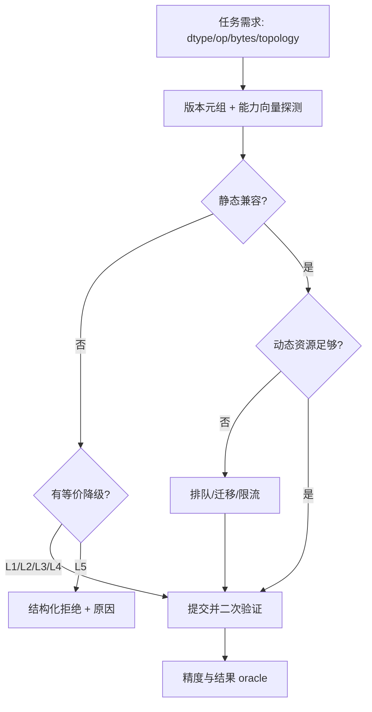

图中版本元组和能力向量是输入，降级阶梯是决策分支，`二次验证` 表示分配点重新核对动态水位。图示不承诺降级后的正确性，必须由 oracle 判定。

#### 6. 拓展知识

可继续学习 feature flag、能力探测（capability probing）、semver 与 ABI 兼容、pairwise 测试生成、兼容矩阵自动化和发布准入。异构系统还要理解 SoC 条件编译分支导致的产品差异，以及闭源固件带来的不可探测能力。

#### 7. 常见追问及回答要点

1. **版本号相同就一定兼容吗？**
   - 不一定；SoC 条件编译、flag、页面策略和固件版本都可能改变行为，应以能力探测和契约测试为准。
2. **降级到什么程度必须拒绝？**
   - 当降级违反精度预算、成本预算或语义契约时；此时应返回结构化原因，而不是静默退化。
3. **如何控制兼容矩阵的测试规模？**
   - 用等价类和 n-wise 组合压缩，明确未覆盖组合的 fail-closed 策略，并保留关键组合的设备回归。

#### 8. 易错点与反例

- 只比对版本号：同名版本在不同 SoC 分支行为不同，导致“通过编译但设备失败”。
- 无限降级：把不支持的任务一路降到 CPU，可用性上去了，但延迟 SLO 静默失守。
- 快照当永久真相：探测时有资源，提交时被其他租户抢占，造成误准入。

#### 9. 实践与验证

[待验证] 用表驱动方式验证兼容与降级：

- 输入：版本元组的等价类集合、能力向量、降级阶梯和精度预算；
- 步骤：对每个等价类运行准入，注入静态不兼容、动态不足和拓扑缺失；对降级级次运行精度 oracle；
- 预期结果：静态不兼容进入正确降级级次或明确拒绝；动态不足进入排队/迁移；
- oracle：拒绝原因集合与预设一致，降级结果误差在预算内，未覆盖组合按 fail-closed 处理；
- 指标：准入延迟、拒绝原因分布、降级级次分布、精度偏差、误准入率和矩阵覆盖率；
- 失败判断：若快照不支持却提交成功，或降级后精度超预算仍被接纳，测试失败。

真实设备矩阵、固件行为和拓扑组合未运行，结论待目标环境验证。

#### 10. 评分标准

- 不合格：只说“检查设备型号和版本号”。
- 合格：能列出多维版本元组和基本能力检查。
- 良好：能设计降级阶梯、精度 oracle 和结构化拒绝，说明矩阵压缩方法。
- 优秀：能定量讨论矩阵规模、准入延迟和降级代价，结合共因、版本配套和契约测试给出 fail-closed 策略。

**证据与来源：** `[已确认]` `cann/00-overview/architecture.md:50-54`；`[已确认]` `cann/00-overview/project-overview.md:30`；`[建议]/[推断]` 为降级阶梯与矩阵压缩设计；真实设备矩阵行为为 `[待验证]`。

## HRS-A003. 如何在执行生命周期中保证状态一致性并完成安全回收？

- 难度：高级
- 知识域：K03 Context、Stream、Event 与 Queue 生命周期
- 考察能力：状态机设计、资源回收、跨模块分析
- 题型：系统设计与实现分析
- 面试频率：高频
- 前置知识：HRS-B003、HRS-B004、引用计数与并发控制
- 关联题目：前置 `HRS-B003`；后续 `HRS-A005`
- 事实状态：`[已确认]` `[推断]` `[待验证]` `[建议]`

#### 1. 背景知识

高级生命周期题的核心不是“先创建后释放”的顺序，而是**在并发、异步完成和 teardown 失败下保持状态一致**。CANN Runtime 文档记录了显式 Context 的创建与销毁顺序：创建时校验设备、retain Device、Setup 分配器与 Stream，最后置为 `ACTIVE`；销毁时先拒绝 Primary Context 显式 destroy，取得唯一 teardown 执行权并切换 `ACTIVE→FINALIZING`，清理 Model、Stream、线程绑定，最后在引用耗尽后切换 `DEINITIALIZING`、移出 Registry 并删除。[已确认] 来源：[cann/90-cross-module/memory-and-resource-lifecycle.md:43-56]

文档还指出：Stream 清理失败且仍有合法 child handle 时，代码会恢复 owner stream 以支持重试。[已确认] 来源：[...:51] 这为高级题提供了“可重试 teardown”的具体依据。

#### 2. 问题分析

要同时跟踪三类一致性：

1. **对象一致性**：Context/Stream/Event 的软件状态与句柄是否自洽；
2. **引用一致性**：任务、回调、Model 对资源的引用是否在销毁前归零；
3. **设备一致性**：设备侧是否仍有 pending task 引用该资源。

对 teardown 策略要比较三种方案：**同步等待（block until done）**、**异步延迟删除（deferred destroy）** 和 **返回 busy 由调用方重试**。三者在延迟、吞吐和实现复杂度上取舍不同。

#### 3. 具体答案

我会用显式状态机和回收不变量来回答：

```text
Context 状态机：
NEW -> SETTING_UP -> ACTIVE -> FINALIZING -> DEINITIALIZING -> DESTROYED
                    \-> FAILED(局部初始化失败)

回收不变量：
reclaim(resource) 仅当
    pending_tasks == 0 ∧ child_handles == 0 ∧ owner_refs == 0 ∧ completion_proven

teardown 失败处理：
    保留对象与所有权，记录 pending/child，回到可重试状态，禁止 free 底层句柄
```

三种 teardown 策略的取舍：

| 策略 | 延迟 | 吞吐影响 | 实现复杂度 | 适用 |
|---|---|---|---|---|
| 同步等待 | 高（阻塞） | teardown 期间占用执行权 | 低 | 短任务、退出路径 |
| 异步延迟删除 | 低 | 低 | 高（需回收队列/epoch） | 高频创建销毁 |
| 返回 busy 重试 | 中 | 中 | 中 | 长任务、需显式编排 |

高级场景还要处理**跨模块影响**：修改 teardown 顺序会同时影响 GE 模型执行、异步 callback、SOMA Stream/Event sequence、DFX/profiling 和设备 reset；文档把这些列为必须同步检查的对象。[已确认] 来源：[cann/90-cross-module/memory-and-resource-lifecycle.md:120]

#### 4. 技术洞察

生命周期安全本质是**依赖图的逆拓扑回收**，而不是简单逆序：

```text
依赖边：Context <- Stream <- Task -> {Memory, Model, Event, callback_data}
回收序：先停止新访问 -> 等待/处理 pending -> 逆拓扑释放被依赖对象 -> 释放 owner
```

定量上关注 `teardown 延迟` 和 `回收失败率`。若平均 teardown 延迟为 `Tt`、创建速率为 `r`，则延迟删除需要的回收队列深度约为 `r*Tt`（Little 定律），据此决定队列容量和背压阈值。若失败重试次数无上界，会形成回收风暴，因此必须给重试设上限并进入死信隔离。

#### 5. 图文说明

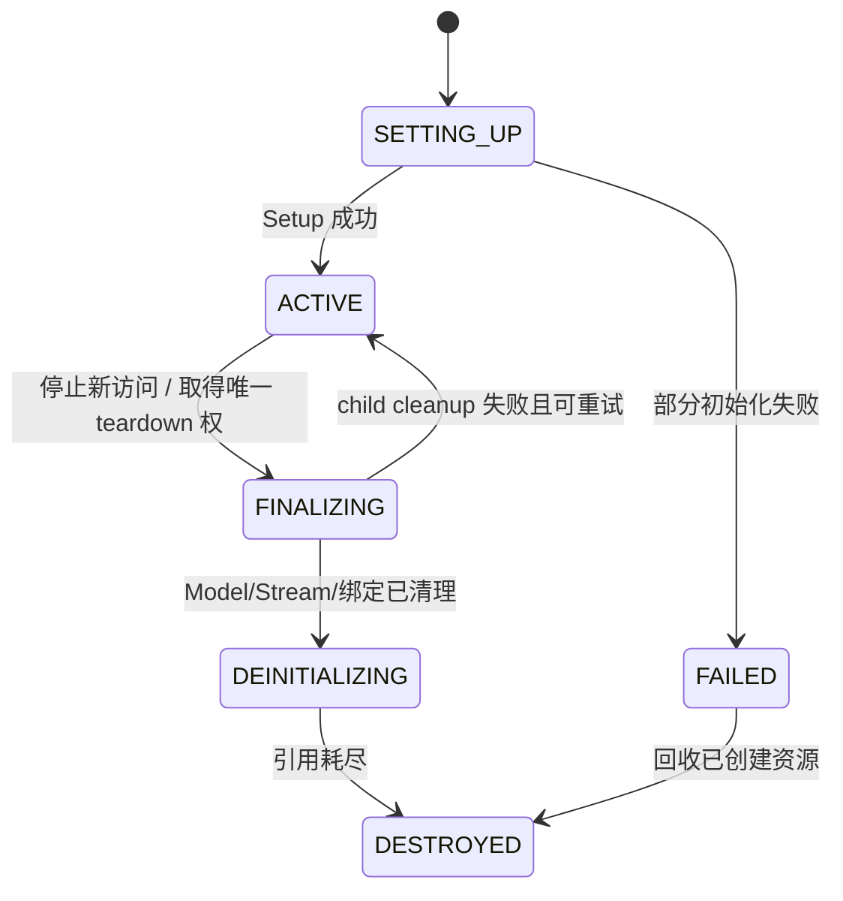

状态表示软件生命周期；`ACTIVE→FINALIZING` 是管理动作，不代表设备任务已完成；`DEINITIALIZING→DESTROYED` 还需引用与 child handle 归零。图示不证明所有 Runtime 提供同名状态。

#### 6. 拓展知识

可继续学习 RAII、引用计数、epoch/hazard pointer 回收、异步析构、stream-ordered allocation、句柄 ABA 风险、设备 reset 语义和进程退出清理。高级还需讨论热升级期间如何迁移 pending 任务。

#### 7. 常见追问及回答要点

1. **teardown 返回 busy 时能否直接删除对象？**
   - 不能；保留对象和所有权，记录 pending/child，等待明确完成或按策略重试。
2. **如何避免回收风暴？**
   - 给重试设上限和退避，超出后进入死信隔离并告警，而不是无限重试。
3. **延迟删除会带来什么风险？**
   - 若回收队列无背压，创建速率超过回收速率会导致内存/句柄耗尽；必须监控队列深度和水位。

#### 8. 易错点与反例

- 句柄非空就 destroy：对象可能处于 `FINALIZING/FAILED` 或仍有 child handle。
- 用 sleep 代替完成证明：固定等待无法覆盖长任务和异常路径。
- 忽略跨模块影响：只改 Context teardown 而未同步检查模型执行、callback 和 SOMA sequence。

#### 9. 实践与验证

[待验证] 用纯软件模型验证依赖图与状态机：

- 输入：Context、两个 Stream、Event、Model、被任务引用的 Memory，以及故障点 `submit/wait/callback/cleanup`；
- 步骤：提交跨 Stream 任务，尝试提前销毁 Model/Stream/Context，并注入 cleanup 失败与重复完成；
- 预期结果：有 pending 或 child 时拒绝销毁；失败后保留可重试状态；终态只出现一次；
- oracle：非法顺序返回明确状态错误，成功路径无悬挂引用，回收队列最终清空；
- 指标：pending 数、child 数、teardown 重试次数、回收延迟、最终泄漏数与死信数；
- 失败判断：若 Context 已销毁但 Stream 仍可提交，或失败清理后句柄既不可用又无法回收，测试失败。

真实设备 pending task、busy 返回值和 reset 语义未验证。

#### 10. 评分标准

- 不合格：只背“创建后释放”的顺序。
- 合格：能解释状态机和引用归零条件。
- 良好：能比较三种 teardown 策略，讨论重试与回收背压。
- 优秀：能从依赖图不变量、跨模块影响、回收风暴和设备一致性给出可验证设计。

**证据与来源：** `[已确认]` `cann/90-cross-module/memory-and-resource-lifecycle.md:43-56,120`；`[推断]` 状态机、回收不变量与三种策略取舍；设备完成语义和 busy 返回为 `[待验证]`。

## HRS-A004. 如何量化内存池碎片并做容量规划？

- 难度：高级
- 知识域：K04 设备/主机内存、地址空间与内存池
- 考察能力：定量分析、方案对比、容量建模
- 题型：定量分析与系统设计
- 面试频率：高频
- 前置知识：HRS-B002、HRS-B003、分配器与碎片基础
- 关联题目：前置 `HRS-B003`；后续 `HRS-A014`
- 事实状态：`[已确认]` `[推断]` `[待验证]` `[建议]`

#### 1. 背景知识

CANN 的池化不是单条 allocator 链，而是四层叠加：Runtime `MemoryPool/MemoryList`（固定 2 MiB backing 上 first-fit 分割）、Runtime SOMA（`Segment` 的 `FREE/BUSY/CACHED` 状态与 Best-Fit）、Driver SVM cache（V2 heap 多树 / V3 range-area）、以及 GE 编译期 offset 复用与 SHMEM 的 VA 窗口。[已确认] 来源：[cann/90-cross-module/pooling-and-resource-management.md:12-17]

文档记录了关键差异：`MemoryList::GetBlock` 为 first-fit，整块命中删除节点、部分命中切割前缀，且源码未显示释放相邻块的合并，因此碎片会随请求顺序累积；SOMA 的 `freeSegs_` 用按 `(size, basePtr)` 升序的 `std::set` 和 `lower_bound` 选择最小满足块，即 Best-Fit。[已确认] 来源：[...:37-43,59] 这些为碎片定量分析提供了依据。

#### 2. 问题分析

碎片分两类，必须分别度量：

1. **内部碎片**：分配粒度/对齐造成的浪费，`Σ(rounded_size - requested_size)`；
2. **外部碎片**：空闲总量够但无连续大块，导致大请求失败。

容量规划要回答：给定峰值并发、请求大小分布和分配策略，需要预留多少设备内存才能把 OOM 概率压到目标以下。关键是区分**总额**、**可用额**和**可分配连续额**——文档明确指出不能用固定池的 `usedSize_` 推断全局 HBM 可用量。[已确认] 来源：[...:41]

#### 3. 具体答案

我会给出碎片与容量的定量模型：

```text
外部碎片率：
    F_ext = 1 - (size_of_largest_free_block) / (total_free_bytes)

容量需求（含碎片与峰值余量）：
    C_required = Peak_live * (1 + f_frag) + Reserve_margin

首次适配的期望浪费（近似，请求均匀分布，块大小 s、平均请求 r）：
    E[waste] ≈ s/2  （部分命中切割后平均剩余）

worst-case 连续性：需要满足最大单次请求 max_req，
    否则必须先 trim/合并或走 Driver 普通分配
```

方案对比：

| 策略 | 碎片特性 | 复杂度 | 适用 |
|---|---|---|---|
| First-Fit（2 MiB 固定池） | 易累积外部碎片，无邻接合并 | 低 | 小型 kernel/参数 |
| Best-Fit（SOMA FREE） | 减少大块浪费，保留大块 | 中（有序集合） | stream-ordered 大块 |
| Cache + merge（Driver 红黑树） | 释放时合并相邻 area | 高 | 通用普通内存 |

结论：**按工作负载选择策略，而不是全局统一**。小对象密集场景用固定池降低开销，但必须监控外部碎片；大块且生命周期多样的场景应依赖带合并的 cache，并显式 trim。

#### 4. 技术洞察

关键不变量与量化边界：

```text
不变量：Σ allocated + Σ free == pool_capacity（闭合），否则存在泄漏或记账错误
可分配性：alloc(size) 成功 ⇔ ∃ free_block.b_size >= size
trim 约束：minBytesToKeep ≥ busy_size，且 ≤ pool_size（文档确认越界返回错误）
```

示例（假设值，仅演示数学）：若峰值活跃 `8 GiB`、碎片率 `15%`、预留余量 `10%`，则 `C_required ≈ 8*1.15*1.10 ≈ 10.1 GiB`。这里碎片率和余量是假设参数，真实值必须在目标负载下用分配日志统计得到。[推断]

还要注意文档提示的“**当前 `TryToReuse` 直接返回 nullptr**”，即缓存段的复用入口尚未接入统一分配路径，因此不能把 cached 驻留当作已实现的复用收益。[已确认] 来源：[...:59,118] 容量规划必须基于当前实际控制流，而非设计接口。

#### 5. 图文说明

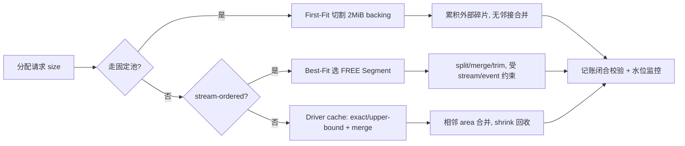

图中三条分配路径对应不同碎片行为，`记账闭合校验` 用于检测泄漏和记账漂移。图示不给出命中率或碎片率，需要实测。

#### 6. 拓展知识

可继续学习分配器算法（bump/free-list/tlsf/slab/buddy）、碎片度量、arena 设计与 NUMA 感知分配、pin/map 生命周期，以及编译期 offset 复用的依赖约束（跨 stream 复用需 event/internal dependency 证明）。[已确认] 来源：[...:83]

#### 7. 常见追问及回答要点

1. **总显存减去已用就是可分配吗？**
   - 不是；要看碎片、对齐、池/module 限制和连续大块可用性，文档明确不能由固定池 `usedSize_` 推断全局可用量。
2. **为什么 cached 段不能算作已复用？**
   - 当前 `TryToReuse` 为 no-op，复用入口未接入；cached 只表示驻留，不代表可被分配复用。
3. **如何降低外部碎片？**
   - 引入邻接合并或按大小分级，控制请求大小分布，必要时显式 trim；需评估合并开销。

#### 8. 易错点与反例

- 把总显存当容量：忽略池、对齐、碎片和其他租户，导致规划偏乐观。
- 混用不同层统计：用 Kernel pool 的 `usedSize_` 推断 SOMA busy/reserved，结论失真。
- 把设计接口当收益：文档已确认 `TryToReuse` 当前 no-op，不能宣称跨 stream 复用已生效。

#### 9. 实践与验证

[待验证] 用分配日志与压力测试验证碎片模型：

- 输入：请求大小分布、并发峰值、首末适配策略、对齐与池上限；
- 步骤：回放真实分配序列，注入 Big-Block-Then-Small 与 Small-Block-Then-Big 两种顺序；
- 预期结果：记账闭合，最大可分配连续块满足 `max_req`，trim 阈值合法；
- oracle：`Σalloc+Σfree==capacity`，`F_ext` 与统计一致，OOM 仅发生在真实容量不足时；
- 指标：`F_ext`、内部碎片率、OOM 次数、trim 回收量、峰值水位与分配延迟分位；
- 失败判断：若出现空闲总量足够但大请求失败且无法通过合并/trim 缓解，说明碎片控制不足。

真实设备分配、SOMA async AICPU 行为和 Driver cache 命中率未运行。

#### 10. 评分标准

- 不合格：只会说“看显存够不够”。
- 合格：能区分内部/外部碎片和三条分配路径。
- 良好：能给出碎片与容量公式，比较 First-Fit/Best-Fit/merge 的取舍。
- 优秀：能结合 stream/event 约束、`TryToReuse` 现状和记账闭合，给出可验证的容量规划和碎片治理。

**证据与来源：** `[已确认]` `cann/90-cross-module/pooling-and-resource-management.md:12-17,37-43,59,83,118`；`[已确认]` `cann/90-cross-module/memory-and-resource-lifecycle.md:62-64`；`[推断]` 碎片与容量公式；真实碎片率和命中率为 `[待验证]`。

## HRS-A005. 异步完成如何保证可见性，一致性代价如何取舍？

- 难度：高级
- 知识域：K05 异步提交、完成语义与内存可见性
- 考察能力：一致性分析、代价建模、方案取舍
- 题型：系统设计与定量分析
- 面试频率：高频
- 前置知识：HRS-B004、内存模型、事件/回调与同步原语
- 关联题目：前置 `HRS-B004`；后续 `HRS-A008`
- 事实状态：`[已确认]` `[推断]` `[待验证]` `[建议]`

#### 1. 背景知识

异步路径的完成边界与可见性不是同一件事。CANN 文档强调普通任务、SOMA AICPU 操作和模型执行不应把提交成功解释为设备已消费完 buffer，设备消费发生在 Driver queue/HDC/esched 和设备侧调度链中；除非执行设备同步、Stream 同步、Event wait 或已确认 callback，否则应保留被引用的 memory、model、stream、event 和 callback data。[已确认] 来源：[cann/90-cross-module/memory-and-resource-lifecycle.md:91] 文档还确认 `rtFreeWithDevSync`/`rtFreeHostWithDevSync` 会先同步设备再释放，是显式区别于普通 free 的契约。[已确认] 来源：[...:101]

#### 2. 问题分析

要区分四个边界：**提交可见（提交方 local）**、**设备消费（device visible）**、**完成证明（event/callback）**、**主机可见（host visible）**。不同步方式在这四个边界上的保证和代价不同：

1. 轮询/自旋：延迟低，CPU 占用高；
2. Event wait：阻塞或异步，延迟/CPU 平衡；
3. Callback：无阻塞，但需线程安全和生命周期管理；
4. 内存栅栏/acquire-release：保证顺序可见，但可能有缓存同步代价。

高级题要求比较这些方式的**延迟-吞吐-CPU 三元代价**，并说明一致性边界。

#### 3. 具体答案

我会先声明不变量，再选同步原语：

```text
可见性不变量：
  host_read(result) 合法 ⇔ completion_proven（event/callback/sync）
  reuse(buffer) 合法 ⇔ completion_proven ∧ refs==0

同步代价模型：
  T_completion = T_issue + T_device + T_signal
  CPU_cost(spin) ≈ C_spin * T_wait
  CPU_cost(event) ≈ C_wake（唤醒开销）
  CPU_cost(callback) ≈ C_dispatch（无等待但需上下文）
```

选择策略：

| 机制 | 完成延迟 | CPU 代价 | 复杂度 | 适用 |
|---|---|---|---|---|
| 自旋轮询 | 最低 | 高（空转） | 低 | 极短等待、独占线程 |
| Event wait | 中 | 低 | 中 | 通用同步点 |
| Callback | 最低（无阻塞） | 低但突发 | 高 | 高并发流水线 |
| 全设备同步 | 高（全局） | 低 | 低 | 阶段边界、退出 |

结论：**在流水线中用 Event/Callback 保持异步，只在必要的阶段边界用同步**。全设备同步会把并行度压成串行，应避免作为常规控制流。

#### 4. 技术洞察

可见性的核心是**完成证明先行**：

```text
prove_completion(event) -> 允许读取与复用
不变量：不得用 sleep 或 API 返回值替代完成证明
跨设备：P2P/collective 还需确认对端可见，而非仅本地完成
```

定量上，同步点的开销会随频率累积。若每秒 `k` 次同步、每次 `T_sync`，则同步开销占比约为 `k*T_sync`；当它接近单任务执行时间时，异步收益被抵消。优化方向是**减少同步次数**（批量提交、阶段边界同步），而不是单纯换更快的同步原语。

#### 5. 图文说明


图中 `提交可见` 只到入队，`设备消费起点` 到 Driver/设备链，`完成证明` 才解锁主机读取与资源复用。图示不承诺每个平台具有相同同步语义。

#### 6. 拓展知识

可继续学习内存序（acquire/release/sequentially consistent）、流序分配、事件与栅栏语义、异步 callback 生命周期、批处理与流水线并行，以及跨设备一致性。多设备 collective 的完成语义属于 K08。

#### 7. 常见追问及回答要点

1. **提交返回成功能否读取结果？**
   - 不能；必须等待明确完成证明，否则读到未定义或陈旧数据。
2. **为什么全设备同步不好？**
   - 它把并行流压成串行，损失流水线收益；应尽量用 stream/event 级同步。
3. **callback 能替代 event wait 吗？**
   - 在正确实现生命周期和线程安全时可以，但需处理回调丢失、重复和异常路径。

#### 8. 易错点与反例

- 用 sleep 代替完成证明：长任务或异常路径下不成立。
- 用 API 返回值当完成：提交成功只说明当前层未拒绝。
- 忽略对端可见：P2P 场景本地完成不代表对端已可见。

#### 9. 实践与验证

[待验证] 用软件状态机与延迟注入验证可见性：

- 输入：完成边界 `issue/consume/complete/visible`、同步机制和延迟分布；
- 步骤：注入延迟、重复完成、回调丢失和乱序可见，分别在无完成证明与有完成证明下读取/复用；
- 预期结果：无证明时读取/复用被判非法，有证明时可安全消费；
- oracle：任意读写/复用都发生在完成证明之后，无陈旧读；
- 指标：同步次数、同步开销占比、CPU 占用、端到端延迟分位与回调丢失下的检测时间；
- 失败判断：若存在未证明完成即读取或复用，说明可见性契约被破坏。

真实设备完成时序、信号延迟和跨设备可见性未运行，均为 `[待验证]`。

#### 10. 评分标准

- 不合格：把提交返回值当完成。
- 合格：能区分提交、消费、完成和主机可见。
- 良好：能比较同步机制的延迟/CPU/复杂度取舍，指出全同步的代价。
- 优秀：能从内存序、同步频率与跨设备可见性给出可验证的异步契约和优化方向。

**证据与来源：** `[已确认]` `cann/90-cross-module/memory-and-resource-lifecycle.md:91-101`；`[已确认]` `cann/00-overview/global-error-model.md:42`；`[推断]` 可见性不变量与代价模型；设备完成与跨设备可见性为 `[待验证]`。

## HRS-A006. 多租户共享异构设备时如何做调度隔离与 QoS？

- 难度：高级
- 知识域：K06 调度、并发、隔离、优先级与配额
- 考察能力：排队建模、隔离设计、方案取舍
- 题型：系统设计与定量分析
- 面试频率：高频
- 前置知识：HRS-B003、排队论基础、优先级与配额
- 关联题目：前置 `HRS-B004`；后续 `HRS-A014`
- 事实状态：`[已确认]` `[推断]` `[待验证]` `[建议]`

#### 1. 背景知识

共享异构设备需要在队列、公平性、优先级、租户配额、背压和故障隔离之间取舍。CANN 的性能文档把“主机逐任务下发和频繁同步”“Stream/Event 资源竞争和 Driver queue/HDC 往返”列为潜在瓶颈，并用 profiler/trace 区分 GE 计划、Runtime 调度、Driver 往返和设备 Kernel。[已确认] 来源：[cann/90-cross-module/performance-critical-paths.md:31] [cann/99-roadmap/performance-guide.md:17]

多租户场景的难点是**尾延迟**：平均利用率高不代表 SLO 达标，noisy neighbor、优先级反转和饥饿都会破坏尾部分位。

#### 2. 问题分析

先明确 QoS 目标（吞吐、P50/P99、公平性或隔离度），再选机制：

1. **时间片/轮转**：公平但上下文切换开销；
2. **静态分区**：隔离最好，但利用率低；
3. **优先级 + 配额**：灵活，但需防饥饿和优先级反转；
4. **背压/准入**：控制入口，防止过载拖垮所有租户。

用排队模型量化：到达率 `λ`、服务率 `μ`、利用率 `ρ=λ/μ`。M/M/1 下平均等待 `Wq = ρ / (μ(1-ρ))`，可见 `ρ→1` 时等待急剧上升，说明**高利用率必然放大尾延迟**。

#### 3. 具体答案

我会用“隔离层级 + 配额 + 背压”组合：

```text
隔离设计：
  强隔离：静态分区，物理或逻辑独占队列/内存段
  中隔离：优先级 + 配额上限 + 抢占点
  弱隔离：共享队列 + 公平调度（仅适合同优先级批处理）

QoS 约束（每个租户 i）：
  bandwidth_i <= quota_i
  P99_i <= SLO_i
  公平性指标：max_i |allocated_i/asked_i - fair_share|

背压策略：
  队列深度到达高水位 -> 拒绝/排队/降级（见 HRS-A014）
```

结论：**对延迟敏感的租户用中到强隔离，对吞吐型批任务用弱隔离并共享空闲容量**。隔离度越高，碎片化利用率越低，需在 SLO 与成本间取舍。

#### 4. 技术洞察

关键是**用排队模型而不是平均利用率做容量决策**：

```text
Little 定律：L = λ * W（队列长度 = 到达率 * 停留时间）
M/M/1 等待：Wq = ρ / (μ(1-ρ))
尾延迟放大：ρ从0.8升到0.95，Wq 约放大 3 倍以上（模型值，需实测校准）
隔离代价：静态分区利用率上界约为 Σ(peak_i)/capacity，通常 < 1
```

优先级反转的防护：不要让低优先级租户持有高优先级所需的锁/队列槽；必要时用优先级继承或预留通道。

#### 5. 图文说明

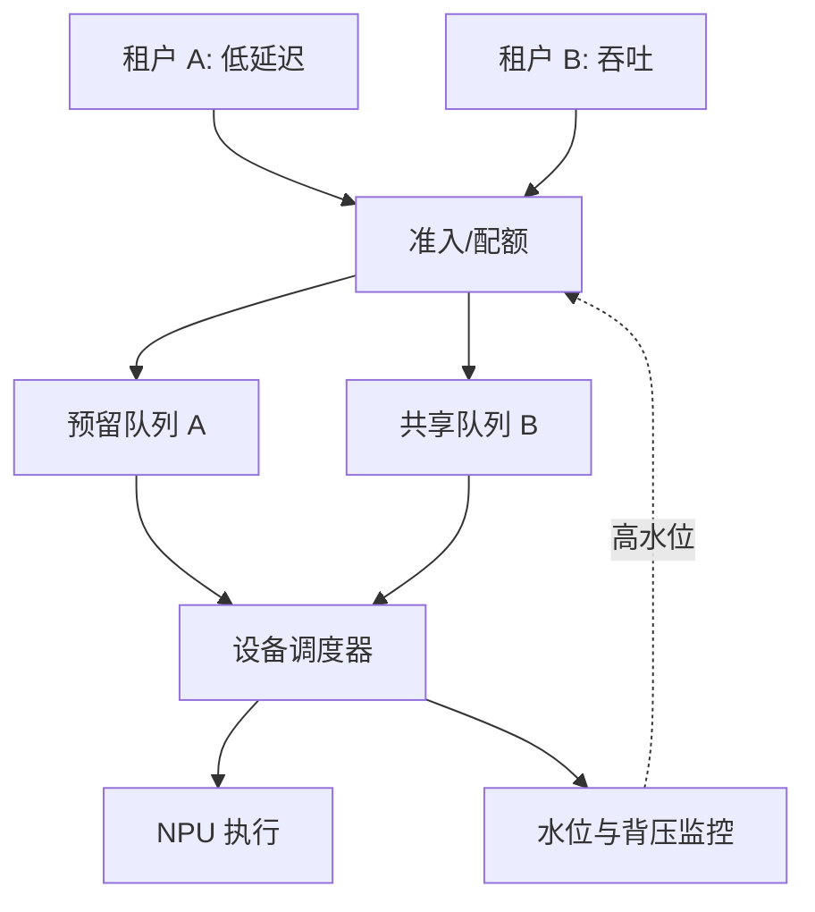

图中准入/配额是入口控制，预留队列提供隔离，共享队列提升利用率，水位监控驱动背压。图示不证明具体调度器实现或公平性。

#### 6. 拓展知识

可继续学习 CFS/统计复用、MPS/MIG 式隔离、token bucket/leaky bucket、公平队列、优先级继承、尾延迟 SLO 和 isolation-aware 调度。异构系统还要处理设备内存配额与队列配额的一致性问题。

#### 7. 常见追问及回答要点

1. **平均利用率高就够了吗？**
   - 不够；`ρ→1` 会放大尾延迟，必须用分位 SLO 和排队模型评估。
2. **静态分区一定更安全吗？**
   - 隔离更强，但利用率低；应按租户 SLO 分层，而不是全局静态分区。
3. **如何防止优先级反转？**
   - 避免共享锁持有时长跨优先级边界，使用优先级继承或预留资源。

#### 8. 易错点与反例

- 只追平均利用率：P99 超标但均值漂亮，SLO 实际失守。
- 无配额共享：一个租户突发拖垮所有租户，形成 noisy neighbor。
- 忽略队列往返：Driver queue/HDC 往返本身是瓶颈，共享队列设计不当会放大它。

#### 9. 实践与验证

[待验证] 用排队仿真与压力测试验证 QoS：

- 输入：多租户到达分布、服务时间分布、隔离机制、配额与背压阈值；
- 步骤：改变 `ρ`、注入突发、改变优先级、逼近高水位；
- 预期结果：各租户 P99 满足 SLO，突发不越界影响其他租户，高水位触发背压；
- oracle：隔离度与公平性指标达标，无租户饥饿，无优先级反转导致的超时；
- 指标：各租户 P50/P95/P99、公平性偏差、饥饿时长、背压触发率、利用率和隔离开销；
- 失败判断：若一个租户突发使另一租户 P99 越界，或高水位不触发背压，测试失败。

真实调度器、队列与设备并发行为未运行，均为 `[待验证]`。

#### 10. 评分标准

- 不合格：只说“加优先级、加配额”。
- 合格：能区分隔离、配额和背压，指出尾延迟问题。
- 良好：能用排队模型解释 `ρ` 与等待的关系，给出隔离层级设计。
- 优秀：能结合优先级反转、公平性指标、成本与 SLO 给出分层 QoS 与验证 oracle。

**证据与来源：** `[已确认]` `cann/90-cross-module/performance-critical-paths.md:31`；`[已确认]` `cann/99-roadmap/performance-guide.md:15-21`；`[推断]` 排队模型与隔离分层；真实调度行为为 `[待验证]`。

## HRS-A007. 如何对传输拓扑做带宽-延迟取舍并规划数据搬运？

- 难度：高级
- 知识域：K07 Host-device 传输、NUMA、IOMMU 与 P2P
- 考察能力：定量建模、拓扑分析、方案取舍
- 题型：定量分析与系统设计
- 面试频率：高频
- 前置知识：HRS-B002、DMA/pin/map、NUMA 与 PCIe 基础
- 关联题目：前置 `HRS-A005`；后续 `HRS-A008`
- 事实状态：`[已确认]` `[推断]` `[待验证]` `[建议]`

#### 1. 背景知识

传输路径受内存位置、pin/map、DMA、NUMA、IOMMU、PCIe 和 P2P 能力共同约束。CANN 文档确认 host 分配按 32-byte 对齐，host register 在 pin/map 能力不足时要维护 Runtime 软件表，且 host free/unregister 的顺序必须与 location、map、pin 状态相符。[已确认] 来源：[cann/90-cross-module/memory-and-resource-lifecycle.md:82] 性能文档把“Host-device 拷贝、未对齐 buffer 或不必要的内存分配”列为潜在瓶颈。[已确认] 来源：[cann/90-cross-module/performance-critical-paths.md:28]

#### 2. 问题分析

传输成本由延迟和带宽两部分组成，不同路径的参数差异很大：

1. **Pinned host memory**：可 DMA，带宽高，但 pin 有容量和生命周期成本；
2. **Pageable host memory**：需 staging，带宽低，延迟高；
3. **P2P（设备间）**：绕过主机，带宽/延迟依赖拓扑；
4. **跨 NUMA 节点**：额外的内存控制器跳数，带宽下降、延迟上升。

决策轴：**传输量 vs 复用次数 vs 拓扑约束**。小数据高频率适合设备常驻，大数据一次性适合批量搬运，跨节点应尽量 P2P 或减少往返。

#### 3. 具体答案

用带宽-延迟模型规划：

```text
单次传输时间（含固定延迟）：
    T = α + M / B_eff
    α: 启动延迟（μs 级，取决于路径）
    B_eff: 有效带宽（受 pin、NUMA、IOMMU、对齐影响）

重叠（双缓冲流水线）：
    T_pipe ≈ max(T_compute, T_transfer) + α   （理想重叠）
    无重叠：T = T_compute + T_transfer

有效带宽退化因子：
    B_eff = B_peak * η_numa * η_iommu * η_align
    （η∈(0,1]，具体值需实测）
```

方案对比：

| 路径 | 有效带宽 | 延迟 | 成本 | 适用 |
|---|---|---|---|---|
| Pageable H2D | 低 | 高 | 低 | 一次性小数据 |
| Pinned H2D | 高 | 中 | pin 成本 | 高频搬运 |
| P2P D2D | 高 | 低 | 拓扑约束 | 设备间共享 |
| 跨 NUMA | 中 | 中高 | 部署约束 | 需避免热数据 |

结论：**先测量 `B_eff` 再决定是否值得优化**；只有传输占比大时才投入 pin/P2P/重叠。

#### 4. 技术洞察

核心不变量与公式：

```text
不变量：设备可见 ≠ 传输完成；必须等完成证明再消费
算术强度 A = FLOPs / Bytes
若 A 低（内存/带宽瓶颈），优化传输；若 A 高（计算瓶颈），优化 Kernel
流水线收益：重叠后 T≈max(T_c,T_tr)，收益上界 = min(T_c,T_tr)
```

定量判据：若 `T_transfer / T_total > θ`（θ 为优化阈值，示例取 0.2，需按场景定），则传输是瓶颈，值得投入；否则优先优化计算或减少同步。

#### 5. 图文说明

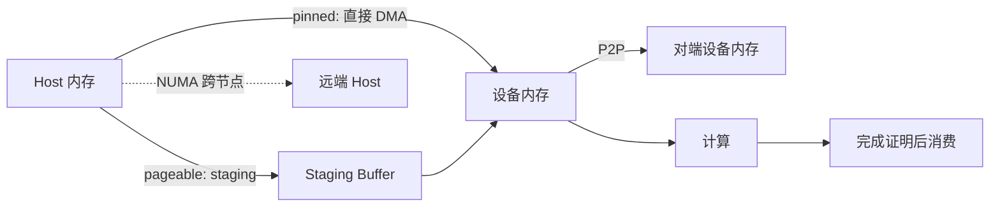

图中不同箭头代表不同路径与带宽/延迟特性；虚线表示跨 NUMA 的额外代价。图示不给出具体带宽数值。

#### 6. 拓展知识

可继续学习 DMA、IOMMU/SMMU、pin/pageable 差异、zero-copy、GPUDirect/RDMA、NUMA 亲和性和流水线双缓冲。性能测量方法参考 performance-guide 的“分离传输与计算时间”。[已确认] 来源：[cann/99-roadmap/performance-guide.md:15]

#### 7. 常见追问及回答要点

1. **指针能访问就说明 DMA 高效吗？**
   - 不能；pageable 需要 staging，pin 才有高带宽，且 NUMA/IOMMU 会进一步退化。
2. **什么时候值得做 P2P？**
   - 当设备间频繁交换且拓扑支持、绕过主机收益大于实现成本时；需实测带宽和延迟。
3. **如何判断瓶颈在传输？**
   - 用 trace 分离传输与计算时间，计算算术强度；传输占比高才是瓶颈。

#### 8. 易错点与反例

- 把能访问指针当高效 DMA：忽略 staging 和 pin 差异。
- 忽略 NUMA：跨节点搬运看似本地，实际带宽腰斩。
- 不做重叠：串行传输+计算，白丢流水线收益。

#### 9. 实践与验证

[待验证] 用传输/计算计时验证模型：

- 输入：数据量 `M`、路径（pageable/pinned/P2P/跨 NUMA）、对齐、并发传输数；
- 步骤：分别测单次 `T(M)`、拟合 `α` 与 `B_eff`，再测串行与双缓冲重叠；
- 预期结果：`T` 随 `M` 线性且截距为 `α`；重叠接近 `max(T_c,T_tr)`；
- oracle：拟合残差小，重叠收益与理论一致，无对齐/跨 NUMA 导致的大幅偏差未解释；
- 指标：`B_eff`、`α`、退化因子 `η`、传输占比、流水线吞吐与 CPU 占用；
- 失败判断：若拟合不线性、或重叠无收益，说明存在未建模的 staging/同步开销。

真实设备带宽、IOMMU 和 NUMA 行为未测量，结论待目标环境验证。

#### 10. 评分标准

- 不合格：只说“用 pinned memory 更快”。
- 合格：能区分 pageable/pinned/P2P 和基本传输模型。
- 良好：能给出 `T=α+M/B_eff` 模型、重叠收益和退化因子。
- 优秀：能结合算术强度、NUMA/IOMMU 代价和实测方法给出传输规划与优化取舍。

**证据与来源：** `[已确认]` `cann/90-cross-module/memory-and-resource-lifecycle.md:82`；`[已确认]` `cann/90-cross-module/performance-critical-paths.md:28`；`[已确认]` `cann/99-roadmap/performance-guide.md:15`；`[推断]` 传输模型与退化因子；真实带宽/延迟为 `[待验证]`。

## HRS-A008. 集合通信如何选择算法并处理 RDMA 拥塞？

- 难度：高级
- 知识域：K08 跨卡/跨节点通信、集合通信与 RDMA
- 考察能力：算法分析、拥塞建模、故障域设计
- 题型：系统设计与定量分析
- 面试频率：高频
- 前置知识：HRS-A007、AllReduce 基础、RDMA 与拥塞控制
- 关联题目：前置 `HRS-A007`；后续 `HRS-A009`
- 事实状态：`[已确认]` `[推断]` `[待验证]` `[建议]`

#### 1. 背景知识

集合通信要求参与者、顺序、拓扑、缓冲区和完成协议一致，局部失败可能导致全局阻塞。CANN 文档把 SOMA 相关异步路径、Driver VMM/ioctl 往返列为潜在开销，并把“跨节点集合通信参与者不一致和集体调用死锁”归入高级内容。[已确认] 来源：[cann/90-cross-module/performance-critical-paths.md:30] [cann/90-cross-module/memory-and-resource-lifecycle.md:112]

#### 2. 问题分析

算法选择取决于 `N`（参与者数）、`M`（消息大小）和拓扑：

1. **Ring**：带宽最优，延迟随 `N` 线性增长，适合大消息；
2. **Tree / recursive halving-doubling**：延迟随 `log N` 增长，适合中小消息；
3. **Hierarchical**：先节点内（高带宽 NVLink/片间），再跨节点（RDMA），减少跨节点流量。

RDMA 拥塞是跨节点的主要风险：PFC（优先级流控）、ECN、DCQCN 等机制需配合，否则会出现 PFC 风暴、队头阻塞和尾延迟放大。

#### 3. 具体答案

给出标准成本模型并按消息大小切换：

```text
Ring AllReduce（带宽最优，α 为单跳延迟，B 为链路带宽）：
    T_ring ≈ 2*(N-1)/N * M/B + 2*(N-1)*α

Tree/Halving-Doubling AllReduce（延迟最优）：
    T_tree ≈ 2*log2(N)*α + 2*(N-1)/N * M/B

选择阈值（近似令 T_ring = T_tree）：
    M* ≈ (2*log2(N)*α - 2*(N-1)... )   取使两者相等的大消息边界
    经验：M 大 -> Ring；M 小 -> Tree/Halving-Doubling
```

拥塞控制：为集合通信流量配置独立优先级/队列，启用 ECN/DCQCN 并监控 PFC pause 帧；避免全局重试，使用 collective 层超时与故障域隔离。

结论：**按消息大小和拓扑分层选择算法，把跨节点流量压到最小，并为 RDMA 配置端到端拥塞控制**。

#### 4. 技术洞察

关键不变量与量化：

```text
不变量：collective 参与者集合、顺序、缓冲区必须一致，否则死锁或数据错
木桶效应：T_collective >= max_i T_i，任一 straggler 拖慢全局
拥塞信号：PFC pause 次数、ECN 标记率、重传率
层次化收益：跨节点流量从 O(N) 降到 O(N/节点内卡数)
```

示例（假设值，仅演示）：节点内 8 卡、共 64 卡，若层次化后跨节点只交换节点级规约结果，则跨节点消息量与参与者从 64 降到 8，跨节点带宽压力显著下降。具体收益需实测。[推断]

#### 5. 图文说明

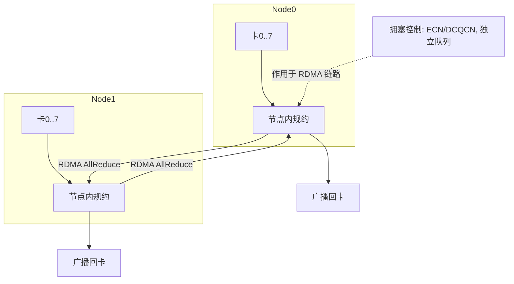

图中先节点内高带宽规约，再跨节点 RDMA 规约，最后广播；拥塞控制作用于跨节点链路。图示不给出具体带宽或延迟。

#### 6. 拓展知识

可继续学习 NCCL/HCCL 的 ring/tree/hierarchical 实现、shard allreduce、PFC/ECN/DCQCN、incast 问题、collective 超时与容错、拓扑感知 rank 放置。异构集群还需处理链路不对称和故障域对齐。

#### 7. 常见追问及回答要点

1. **Ring 总是最优吗？**
   - 大消息时带宽最优，小消息因 `N` 倍延迟反而不如 Tree/HD。
2. **为什么建议层次化？**
   - 把跨节点流量降到节点级，减少 RDMA 压力和拥塞风险。
3. **collective 超时怎么办？**
   - 不能无限重试；应隔离故障域并保证各 rank 一致退出，避免死锁。

#### 8. 易错点与反例

- 只在单卡测通信：忽略拓扑和跨节点拥塞。
- 对 collective 超时无限重试：导致全局阻塞和资源泄漏。
- 忽略 straggler：一个慢 rank 拖垮整个 collective。

#### 9. 实践与验证

[待验证] 用通信基准与拥塞注入验证：

- 输入：参与者数 `N`、消息大小 `M`、拓扑（节点内/跨节点）、rank 放置；
- 步骤：对比 ring/tree/hierarchical 在不同 `M` 下的时间；注入链路拥塞与慢 rank；
- 预期结果：算法切换阈值与模型一致；层次化降低跨节点流量；拥塞下 PFC/ECN 生效且不风暴；
- oracle：collective 结果正确、各 rank 时间差在预算内、无死锁；
- 指标：`T_collective`、有效带宽、PFC/ECN 计数、重传率、straggler 偏差和超时次数；
- 失败判断：若小消息仍用 ring 且明显更慢，或拥塞导致无限重试，测试失败。

真实 RDMA 链路、PFC 和拓扑行为未运行，均为 `[待验证]`。

#### 10. 评分标准

- 不合格：只会说“用集合通信库”。
- 合格：能区分 ring/tree 并知道大消息用 ring。
- 良好：能给出成本公式、层次化设计和基本拥塞控制。
- 优秀：能结合拓扑、straggler、RDMA 拥塞、超时容错和故障域给出算法选择与验证。

**证据与来源：** `[已确认]` `cann/90-cross-module/performance-critical-paths.md:30`；`[已确认]` `cann/90-cross-module/memory-and-resource-lifecycle.md:112`；`[推断]` ring/tree 成本模型与层次化收益；真实带宽/拥塞行为为 `[待验证]`。

## HRS-A009. 如何设计故障传播控制与恢复策略？

- 难度：高级
- 知识域：K09 错误传播、超时、取消、恢复与故障注入
- 考察能力：故障建模、恢复设计、方案取舍
- 题型：系统设计与故障分析
- 面试频率：高频
- 前置知识：HRS-B004、HRS-A001、幂等性与熔断
- 关联题目：前置 `HRS-A001`；后续 `HRS-A013`
- 事实状态：`[已确认]` `[推断]` `[待验证]` `[建议]`

#### 1. 背景知识

错误要跨 Driver/HAL/Runtime/ACL/GE 保留上下文，并以状态机区分失败、成功和未知。CANN 错误模型要求保留最底层错误码、设备 ID、Context/Stream、模型/Graph 标识和调用阶段，不能只记录顶层 `ACL_ERROR`。[已确认] 来源：[cann/00-overview/global-error-model.md:41] 文档还给出错误分层路径：Driver `drvError_t`/ioctl → HAL → Runtime `rtError_t` → ACL/GE → 同步返回或异步回调。[已确认] 来源：[cann/90-cross-module/error-boundaries.md:16-24]

#### 2. 问题分析

先分类故障，再设计恢复，而不是一律重试：

1. **参数/状态错误**：调用方修正，不重试同一请求；
2. **资源错误**：按策略清理/重试；
3. **设备/驱动错误**：检查驱动、固件、设备日志；
4. **异步错误**：等待完成通知并保留原始上下文。

方案取舍：**stop-and-fix（停机修复）**、**graceful degradation（降级）** 与 **fail-fast（快速失败）**。选择取决于爆炸半径、幂等性和业务可容忍的降级程度。

#### 3. 具体答案

我会用“三态结果 + 故障域隔离 + 幂等恢复”：

```text
结果三态：SUCCESS / FAILURE / UNKNOWN
    UNKNOWN（超时/进程异常）不得直接判为成功或失败

恢复决策：
    if 幂等 ∧ 无不可逆副作用 ∧ 资源可控:
        限次重试（退避 + 熔断）
    elif 可降级:
        切换降级路径（HRS-A002 的阶梯）
    else:
        fail-fast + 人工补偿

故障域隔离：
    停止新提交 -> 隔离受影响域 -> 采集证据 -> 恢复 -> 验证水位后再接纳
```

必须保留跨层证据链：时间戳、线程、设备、Context、Stream、模型/Graph、API 阶段、原始错误码和映射后错误码。[已确认] 来源：[cann/90-cross-module/error-boundaries.md:49]

#### 4. 技术洞察

核心不变量与量化：

```text
不变量 1：每个请求只有一个终态
不变量 2：UNKNOWN 不得转成 SUCCESS/FAILURE 而不经判定
不变量 3：恢复动作幂等，且不突破故障域
不变量 4：重试有上界，退避 + 熔断，防止放大拥塞

重试放大：若每层重试 r 次、层数 d，最坏请求数 ≈ r^d
恢复时间：MTTR = T_detect + T_isolate + T_recover + T_verify
```

定量判据：若重试放大 `r^d` 超过下游容量，则必须减少重试层级并前置熔断。恢复时间必须与错误预算对齐（见 HRS-A001）。

#### 5. 图文说明

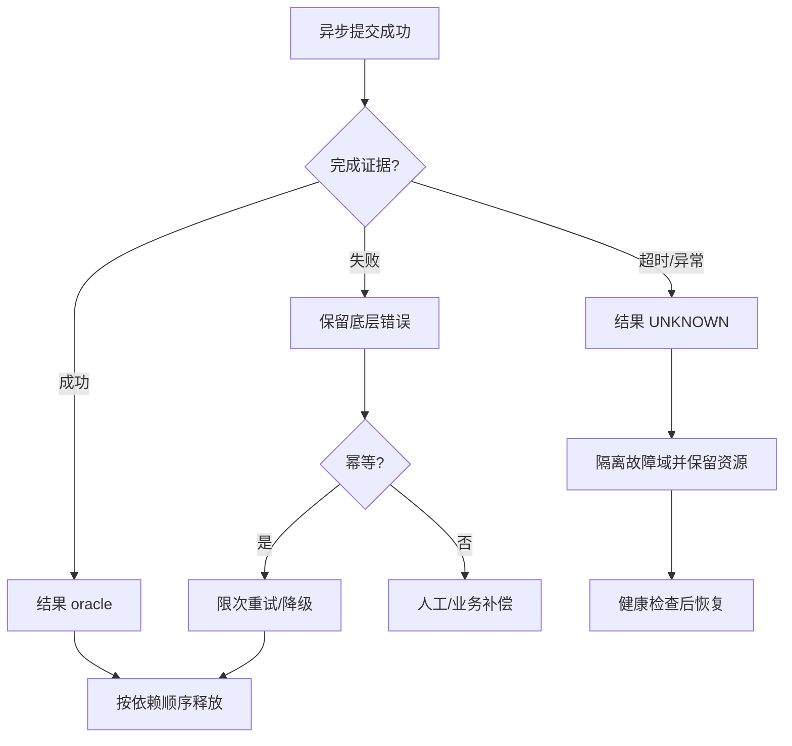

图中三态分支决定恢复动作，`隔离故障域` 是爆炸半径控制点。图示不承诺重启或 reset 必然清理设备资源。

#### 6. 拓展知识

可继续学习 bulkhead、circuit breaker、retry budget、两阶段提交式思路、幂等键、事务性 outbox、watchdog 和混沌工程。跨节点集合通信的参与者不一致处理属于 K08 的高级延伸。

#### 7. 常见追问及回答要点

1. **超时后能立即重试吗？**
   - 先判幂等与副作用；UNKNOWN 下盲目重试可能重复副作用或放大拥塞。
2. **如何控制爆炸半径？**
   - 用故障域隔离、bulkhead 和熔断，限制重试层级，避免跨域级联。
3. **只记录顶层错误码够吗？**
   - 不够；需保留原始错误、阶段、设备/Context/Stream/模型和时间线。

#### 8. 易错点与反例

- 直接重启：丢失证据，设备任务状态未知。
- 无限重试：队列拥塞、重复副作用、跨设备级联。
- 把超时当未执行：异步系统中超时只表示观察窗口内无完成证据。

#### 9. 实践与验证

[待验证] 用故障注入验证恢复设计：

- 输入：故障点 `submit/driver/device/wait/callback/cleanup`、幂等标志、重试/退避/熔断参数；
- 步骤：注入错误、延迟、重复完成、进程崩溃；执行隔离、限次重试、降级和熔断；
- 预期结果：每请求单一终态，UNKNOWN 不误判，重试放大有界，故障域不越界；
- oracle：状态转移合法、证据链字段完整、恢复动作幂等、无重复副作用；
- 指标：检测/隔离/恢复时间、重试放大倍数、重复副作用数、泄漏数、熔断触发率；
- 失败判断：出现无终态请求、重复终态、证据缺字段或 UNKNOWN 下提前释放，测试失败。

真实设备异常、驱动 reset 与多进程恢复未运行，均为 `[待验证]`。

#### 10. 评分标准

- 不合格：建议直接重启或无限重试。
- 合格：能按层排查并保留原始错误，区分三态。
- 良好：能设计幂等重试、熔断、降级和故障域隔离。
- 优秀：能定量讨论重试放大、恢复时间与错误预算，给出跨层证据链和验证 oracle。

**证据与来源：** `[已确认]` `cann/00-overview/global-error-model.md:29-42`；`[已确认]` `cann/90-cross-module/error-boundaries.md:16-24,49`；`[推断]` 恢复策略与重试放大模型；硬件恢复语义为 `[待验证]`。

## HRS-A010. 如何构建可观测性体系以支撑根因定位？

- 难度：高级
- 知识域：K10 日志、指标、Tracing、dump、SLO 与诊断证据链
- 考察能力：证据链设计、开销建模、根因分析
- 题型：系统设计与方案取舍
- 面试频率：高频
- 前置知识：HRS-B004、tracing、SLO/SLI
- 关联题目：前置 `HRS-A009`；后续 `HRS-A012`
- 事实状态：`[已确认]` `[推断]` `[待验证]` `[建议]`

#### 1. 背景知识

可观测性要关联时间、设备、Context、任务、资源、版本和错误边界，支持从症状回溯根因。CANN 调试指南要求固定版本/SoC/Toolkit/Driver/Firmware，记录 API 阶段、线程、设备、Context、Stream、Graph/Model 和原始错误码，找到**第一个失败边界**，再沿 `ACL → Runtime → HAL → SDK/kernel` 或 `GE → Runtime` 反查。[已确认] 来源：[cann/99-roadmap/debugging-guide.md:16-22] 错误边界文档建议跨层统一记录时间戳、线程、设备、Context、Stream、pool、VA、size、API 阶段和原始/映射错误码。[已确认] 来源：[cann/90-cross-module/error-boundaries.md:49]

#### 2. 问题分析

三类可观测性各有开销和用途，需按目的选择：

1. **指标（Metrics）**：低开销、聚合好，但缺单请求上下文；
2. **日志（Logging）**：上下文丰富，但高基数高开销；
3. **追踪（Tracing）**：端到端时间线，但采样和存储成本高。

决策轴：**定位能力 vs 采集开销 vs 存储成本**。关键是让三者在同一关联键（设备+Context+任务 ID+时间）上可 join，否则无法重建跨层时间线。

#### 3. 具体答案

我会设计“关联键 + 分层采样 + 诊断快照”：

```text
统一关联键：trace_id, device_id, context_id, stream_id, task_id, ts
分层采样：稳态低采样，异常/尾延迟全采样（tail-based sampling）
证据链：Driver drvError -> HAL -> Runtime rtError -> ACL/GE
       每层都带：阶段、原始错误码、上下文句柄、时间戳
诊断快照：故障时抓取队列深度、水位、碎片、pending task 和最近 N 条任务
```

结论：**稳态低开销、异常高保真**。不要为了稳态全量高基数日志而拖慢热路径，也不要在故障时缺少上下文。

#### 4. 技术洞察

开销模型与不变量：

```text
采集开销占比 ≈ Σ(事件率 * 单事件开销) / 任务时间
若开销占比接近热路径预算，则必须降采样或异步落盘

不变量 1：告警/指标不改变资源所有权（DFX 是旁路，文档确认）
不变量 2：证据链各层必须可关联，否则无法回放
不变量 3：异常路径必须全采样，稳态可采样
```

文档确认日志和 DFX 属于旁路诊断设施，不改变资源所有权。[已确认] 来源：[cann/00-overview/global-error-model.md:43] 因此埋点不能持有或延长资源生命周期。

#### 5. 图文说明

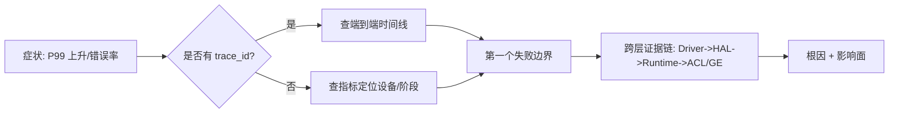

图中从症状出发，先定位阶段再回溯第一个失败边界，最后用跨层证据链定根因。图示不证明任何具体工具实现。

#### 6. 拓展知识

可继续学习 OpenTelemetry、tail-based sampling、高基数指标与直方图、exemplar、结构化日志、火焰图和 eBPF。异构系统还需区分 GE 计划、Runtime 调度、Driver 往返和设备 Kernel 的时间归因。[已确认] 来源：[cann/99-roadmap/performance-guide.md:17]

#### 7. 常见追问及回答要点

1. **只采集平均延迟行不行？**
   - 不行；需要分位、错误类型、队列等待和设备状态的联合视图。
2. **如何控制采集开销？**
   - 稳态采样、异常全采样、异步落盘，并监控采集开销占热路径比例。
3. **为什么需要跨层证据链？**
   - 顶层错误常掩盖第一个失败边界；没有跨层关联无法回放和定根因。

#### 8. 易错点与反例

- 只记录顶层错误码：丢失 Driver/HAL 的第一失败边界。
- 全量高基数日志：拖慢热路径，观测本身成为瓶颈。
- DFX 持有资源：旁路设施误延长资源生命周期，制造伪泄漏。

#### 9. 实践与验证

[待验证] 用故障注入验证可观测性与开销：

- 输入：关联键方案、采样策略、各层埋点、注入的故障类型；
- 步骤：注入设备错、超时、重复完成和进程崩溃，检查能否重建时间线和定位第一失败边界；
- 预期结果：每个故障可从症状回溯到根因，证据链字段完整可 join；
- oracle：第一失败边界定位准确、证据无缺字段、DFX 不改变资源所有权；
- 指标：采集开销占热路径比例、定位时间、证据完整率、误报率和存储成本；
- 失败判断：若无法重建时间线或采集开销超过预算，测试失败。

真实设备故障、跨进程与 trace 关联未运行，均为 `[待验证]`。

#### 10. 评分标准

- 不合格：只会说“加日志和监控”。
- 合格：能区分指标/日志/追踪并说明关联键。
- 良好：能设计分层采样、异常全采样和跨层证据链，讨论开销。
- 优秀：能从开销模型、旁路不变量、根因定位效率和成本给出可验证的可观测性体系。

**证据与来源：** `[已确认]` `cann/99-roadmap/debugging-guide.md:16-22`；`[已确认]` `cann/90-cross-module/error-boundaries.md:49`；`[已确认]` `cann/00-overview/global-error-model.md:41-43`；`[推断]` 采样与开销模型。

## HRS-A011. 如何建立性能容量与成本模型并做降级决策？

- 难度：高级
- 知识域：K11 性能、容量、碎片、成本与降级
- 考察能力：容量建模、成本分析、方案取舍
- 题型：定量分析与系统设计
- 面试频率：高频
- 前置知识：HRS-A006、HRS-A004、排队与成本模型
- 关联题目：前置 `HRS-A006`；后续 `HRS-A014`
- 事实状态：`[已确认]` `[推断]` `[待验证]` `[建议]`

#### 1. 背景知识

稳定性容量要同时建模吞吐、尾延迟、队列、内存、碎片、通信和成本，并设计可验证降级。CANN 性能文档要求分别测量编译、Load、首轮、稳态、同步、传输、普通内存分配、SOMA 和卸载，并记录 batch/shape、Stream 数、设备型号、频率和配置；同时强调没有真实 NPU 时只能做静态复杂度分析。[已确认] 来源：[cann/90-cross-module/performance-critical-paths.md:40,44] [cann/99-roadmap/performance-guide.md:15-19] 性能指南还要求每次优化比较正确性、峰值内存、尾延迟和错误恢复，而不只看平均吞吐。[已确认] 来源：[...:19]

#### 2. 问题分析

容量与成本模型要回答三个问题：

1. **能做多少**：在 SLO（含 P99）下的有效吞吐；
2. **要多少资源**：满足目标吞吐的设备/内存/带宽数量；
3. **划不划算**：扩容与优化的成本对比，何时降级。

决策轴：**容量（预留冗余）vs 成本（利用率）vs 稳定性（尾延迟与恢复余量）**。三者冲突，必须显式取舍。

#### 3. 具体答案

给出容量与成本模型：

```text
有效吞吐（受尾延迟约束，非峰值吞吐）：
    Throughput_eff = min(Compute_cap, MemBW_cap, CommBW_cap) * η_slo
    η_slo < 1，随 P99 SLO 收紧而下降

资源数量（含冗余与碎片）：
    N_devices = ceil( Demand / (Per_device_eff * (1 - f_overhead)) ) * (1 + redundancy)

单位成本：
    Cost_per_job = (Device_cost * T_job + Energy_cost) / Utilization
    或 Cost_per_token = Device_hourly_cost / (tokens_per_sec)

扩容 vs 优化判据：
    扩容边际成本 C_scale > 优化边际成本 C_opt 时，优先优化
```

降级决策：当需求超过容量时，按业务优先级降级（降精度、降分辨率、排队），而不是让所有请求一起变慢。降级本身要有成本上界和正确性 oracle。

#### 4. 技术洞察

关键量化关系：

```text
利用率与成本：Cost ∝ 1/Utilization，但高利用率放大尾延迟（见 HRS-A006）
因此存在"成本-尾延迟"帕累托边界，最优利用率由 SLO 决定
碎片与通信开销：η_overhead = η_frag * η_comm * η_sync
```

示例（假设值，仅演示）：若设备峰值 1000 单位/s、SLO 约束的 `η_slo=0.7`、开销 `η_overhead=0.85`，则有效约 `1000*0.7*0.85≈595` 单位/s；若需求 5000，则至少需 9 台（不含冗余）。参数为假设，真实值必须实测。[推断]

必须警惕：文档明确“任何声称 SOMA 重用或隐式 trim 带来收益的结论，都必须先确认目标源码实现和设备测试结果”。[已确认] 来源：[cann/90-cross-module/performance-critical-paths.md:44] 因此成本模型中不能预先计入未验证的优化收益。

#### 5. 图文说明

```mermaid
flowchart TD
    D[需求: 吞吐/P99] --> E[计算有效吞吐 min(compute,mem,comm)*eta]
    E --> N[设备/内存/带宽数量 + 冗余 + 碎片]
    N --> C[单位成本模型]
    C --> P{扩容 vs 优化?}
    P -- 扩容便宜 --> S[扩容]
    P -- 优化便宜 --> O[定位瓶颈层并优化]
    P -- 需求超容量 --> G[按优先级降级 + oracle]
```

图中有效吞吐受尾延迟和开销折减，成本模型驱动扩容/优化决策，需求超容量时进入降级。图示不给出具体吞吐数字。

#### 6. 拓展知识

可继续学习 Amdahl 定律、roofline 模型、成本优化、容量预留、SLO 预算和降级分级。异构系统还需区分 GE 计划、Runtime 调度、Driver 往返和设备 Kernel 的成本来源。[已确认] 来源：[cann/99-roadmap/performance-guide.md:17]

#### 7. 常见追问及回答要点

1. **峰值吞吐能当容量吗？**
   - 不能；容量应基于 SLO 约束下的有效吞吐，含尾延迟和开销折减。
2. **为什么利用率不是越高越好？**
   - 高利用率放大尾延迟并压缩恢复余量，需在成本与 SLO 间取帕累托最优点。
3. **降级何时比扩容好？**
   - 当扩容边际成本高于业务可接受的降级成本，且降级有正确性 oracle 时。

#### 8. 常见结论与反例（易错点）

- 凭空承诺百分比收益：文档明确要求先确认实现和设备测试。
- 只算平均吞吐：掩盖尾延迟和恢复余量。
- 忽略碎片与通信开销：有效容量被高估，实际提前过载。

#### 9. 实践与验证

[待验证] 用基准与模型校准验证容量成本模型：

- 输入：各 cap（compute/mem/comm）、`η_slo`、`η_overhead`、需求曲线与 SLO；
- 步骤：分阶段测吞吐/尾延迟/内存/通信，拟合 `η`，代入数量与成本公式，触发超容量降级；
- 预期结果：预测吞吐与实测在预算内一致；超容量时按优先级降级且 oracle 通过；
- oracle：有效吞吐误差在阈值内，降级后正确性/精度达标，成本模型与账单一致；
- 指标：有效吞吐、P99、`η_frag/η_comm/η_sync`、单位成本、降级触发率与降级精度偏差；
- 失败判断：若预测严重偏离实测，或降级破坏正确性，测试失败。

真实设备吞吐、通信和成本数据未采集，结论待目标环境验证。

#### 10. 评分标准

- 不合格：只报平均吞吐或凭感觉估算。
- 合格：能给出基本容量与成本公式。
- 良好：能区分有效吞吐、尾延迟和开销折减，比较扩容/优化/降级。
- 优秀：能结合 roofline、帕累托边界、碎片/通信开销和验证 oracle 给出可复现的容量成本模型。

**证据与来源：** `[已确认]` `cann/90-cross-module/performance-critical-paths.md:40,44`；`[已确认]` `cann/99-roadmap/performance-guide.md:15-19`；`[推断]` 容量成本模型与 `η` 因子；真实吞吐/成本为 `[待验证]`。

## HRS-A012. 生产架构演进中如何设计灰度迁移与安全回滚？

- 难度：高级
- 知识域：K12 生产架构、发布迁移、灾备与前沿演进
- 考察能力：演进设计、兼容分析、风险控制
- 题型：系统设计与方案取舍
- 面试频率：高频
- 前置知识：HRS-A002、HRS-A015、发布与灰度策略
- 关联题目：前置 `HRS-A002`；后续 `HRS-A015`
- 事实状态：`[已确认]` `[推断]` `[待验证]` `[建议]`

#### 1. 背景知识

生产系统需跨设备、版本、节点和故障域进行灰度、兼容、迁移、回滚和灾备治理。CANN 架构文档指出跨仓版本配套和 ABI 兼容要求高，错误码、头文件和二进制符号需要同步。[已确认] 来源：[cann/00-overview/architecture.md:54] 项目文档要求四个仓库独立构建发布，通过稳定的头文件、符号、错误码和 CMake package 协作，且版本必须配套。[已确认] 来源：[cann/00-overview/project-overview.md:13,30]

高级难点在于：设备相关状态（Context、Stream、设备内存、队列）不能像无状态服务那样随意滚动重建，迁移期间必须保证在途任务的安全。

#### 2. 问题分析

比较三种演进策略：

1. **蓝绿**：新环境整体就绪后切换，回滚快，但资源翻倍；
2. **金丝雀**：小流量验证后逐步放量，风险低，但验证周期长；
3. **滚动**：逐节点替换，资源省，但混合版本共存期最长。

决策轴：**回滚速度 vs 资源成本 vs 混合版本风险**。设备状态使“无状态滚动”不成立，需按故障域（节点/设备）分批，并保证批次间互不影响。

#### 3. 具体答案

我会用“分批 + 兼容窗口 + 双跑验证 + 快速回滚”：

```text
迁移批次（按故障域）：
    for batch in fault_domains:
        drain(batch)            # 停止新提交，等待在途任务完成
        migrate_state(batch)    # 重建 Context/Stream/内存
        warmup + verify(batch)  # 容量、精度、错误率
        admit(batch)            # 重新接纳流量
    回滚条件：错误预算/尾延迟越界 -> 回滚该批次

兼容窗口：新旧版本必须能共存的时长 = 迁移总时长 + 回滚时长
```

关键顺序：**先 drain 再迁移，先验证再放量**。迁移期间新版本不能共享会冲突的设备状态，必要时用独立 Context/流隔离。

#### 4. 技术洞察

量化与不变量：

```text
回滚时间 T_rollback = T_drain + T_state_restore + T_warmup
迁移风险 ≈ Σ_batch (P(batch 失败) * blast_radius(batch))
错误预算约束：迁移期间新增错误 <= 剩余错误预算
兼容窗口 >= max_batch_duration * batch_count + T_rollback
```

不变量：**任一时刻，在途任务要么在原环境完成，要么在新环境被明确重建，不能在两者间悬挂**。否则会出现同一资源被两次使用或丢失。

#### 5. 图文说明

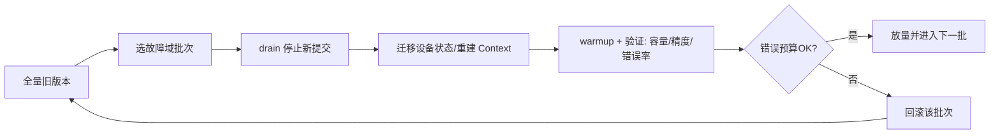

图中每批按故障域推进，验证门控放量，预算越界即回滚。图示不证明任何具体编排工具的能力。

#### 6. 拓展知识

可继续学习蓝绿/金丝雀/滚动、功能开关、契约测试、双跑（shadow）、回滚演练、灾备 RTO/RPO 和混沌工程。异构系统还需理解设备状态迁移的不可逆性和固件升级的不可回滚风险。

#### 7. 常见追问及回答要点

1. **能像无状态服务一样滚动吗？**
   - 不能；设备状态和 Context/Stream 需要 drain 与重建，否则在途任务不安全。
2. **兼容窗口怎么定？**
   - 至少覆盖迁移总时长与回滚时长之和，否则混合版本期会出现不兼容调用。
3. **回滚一定安全吗？**
   - 不一定；固件/设备状态迁移可能不可逆，回滚前必须确认可恢复性并演练。

#### 8. 易错点与反例

- 把单环境成功当可发布：未验证混合版本共存，上线后 ABI 冲突。
- 无 drain 直接切换：在途任务被中断或资源悬挂。
- 忽略不可逆步骤：固件/设备状态升级后无法回滚，导致回滚预案失效。

#### 9. 实践与验证

[待验证] 用灰度演练与回滚测试验证：

- 输入：故障域划分、批次大小、兼容窗口、错误预算、回滚预案；
- 步骤：模拟分批迁移，注入版本不兼容、验证失败和预算越界，执行回滚；
- 预期结果：在途任务无悬挂，混合版本期调用兼容，回滚在预算内完成；
- oracle：迁移前后结果一致、无双重消费、回滚后水位恢复；
- 指标：迁移时长、回滚时间（RTO）、混合版本期错误率、预算消耗、容量水位与批次成功率；
- 失败判断：若出现悬挂任务、混合版本调用失败或回滚超时，测试失败。

真实设备状态迁移、固件升级和多节点编排未运行，均为 `[待验证]`。

#### 10. 评分标准

- 不合格：只说“用金丝雀发布”。
- 合格：能区分蓝绿/金丝雀/滚动并说明基本流程。
- 良好：能设计按故障域分批、drain、双跑验证和回滚，给出兼容窗口。
- 优秀：能定量讨论回滚时间、错误预算、爆炸半径和不可逆风险，给出可演练的演进方案。

**证据与来源：** `[已确认]` `cann/00-overview/architecture.md:54`；`[已确认]` `cann/00-overview/project-overview.md:13,30`；`[建议]`/`[推断]` 为迁移编排与回滚设计；真实迁移行为为 `[待验证]`。

## HRS-A013. 设备级故障如何隔离并实现自愈？

- 难度：高级
- 知识域：K09 错误传播、超时、取消、恢复与故障注入
- 考察能力：故障域设计、自愈策略、容量建模
- 题型：系统设计与故障分析
- 面试频率：高频
- 前置知识：HRS-A009、HRS-A001、健康检查与 N-1 容量
- 关联题目：前置 `HRS-A009`；后续 `HRS-A014`
- 事实状态：`[已确认]` `[推断]` `[待验证]` `[建议]`

#### 1. 背景知识

设备级故障（硬件错误、ECC、驱动/固件异常、任务 hang）需要在最小故障域内隔离并自愈。CANN 文档确认 Driver ordinary cache 失败不是单一错误：V2 可能在 mapped cache、idle size 或新 heap 之间回退，V3 的 cache area 不足会先扩展 normal backing，V3 底层返回 `DRV_ERROR_BUSY` 时进入 recycle segment；但底层内核/固件的最终物理资源状态仍未验证。[已确认] 来源：[cann/90-cross-module/error-boundaries.md:38] 这提示自愈必须处理“软件状态已知、硬件状态未知”的窗口。

#### 2. 问题分析

自愈设计要回答：

1. **如何判定故障**：健康评分来自错误率、延迟、ECC、任务 hang；
2. **如何隔离**：把设备标记为 suspect/quarantine，停止新提交并 drain；
3. **如何自愈**：in-place reset、驱动重载，还是换设备/节点；
4. **如何回归**：验证容量与正确性后再接纳。

方案取舍：**in-place reset**（快，但可能不彻底或影响同域）、**drain-and-replace**（稳，但恢复慢、需要余量）、**节点级重启**（彻底，但爆炸半径大）。

#### 3. 具体答案

我会用设备健康状态机 + N-1 容量 + 分级自愈：

```text
状态机：HEALTHY -> SUSPECT -> QUARANTINED -> RECOVERING -> HEALTHY
健康评分：score = w1*err_rate + w2*lat_p99 + w3*ecc + w4*hang
    连续低于阈值 -> SUSPECT；持续越界 -> QUARANTINED

自愈阶梯：
    L1 in-place reset（同设备）
    L2 驱动/进程重启（同节点，受影响域收集）
    L3 drain-and-replace（迁移到备用设备）
    L4 节点级隔离（最后手段）

N-1 容量：Admit_capacity = Total_capacity / (N-1) * (1 - f_overhead)
```

结论：**优先 in-place reset，失败则升级自愈级别**，同时保证任意单设备故障后剩余容量仍满足 SLO。

#### 4. 技术洞察

量化与不变量：

```text
MTTR = T_detect + T_drain + T_reset + T_verify + T_warmup
可用容量约束：N-1 后 Throughput_eff >= Demand
自愈风险：reset 不彻底 -> 故障复发（flapping），需冷却期与复发计数
```

不变量：**自愈动作不得突破故障域，且不得在硬件状态未知时把设备标记为 HEALTHY**。文档提示底层物理状态未验证，因此验证步骤不可省略。复发（flapping）会放大自愈开销，需设冷却期和升级阈值。

#### 5. 图文说明

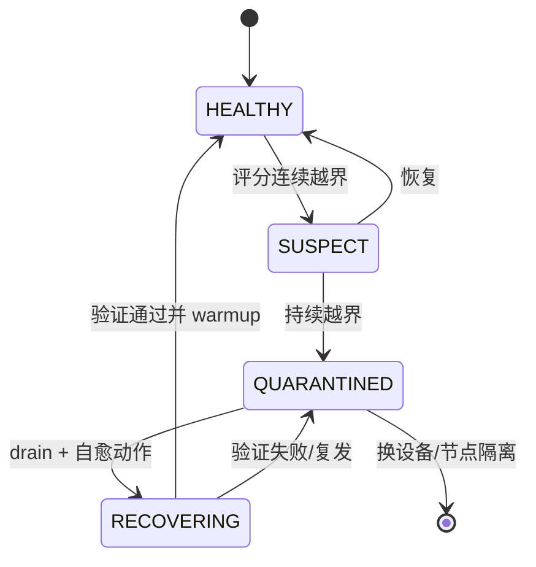

状态表示设备健康生命周期；`drain + 自愈动作` 保证域内隔离，`验证通过` 才回归。图示不证明 reset 能清理全部硬件状态。

#### 6. 拓展知识

可继续学习健康评分与 EWMA、看门狗、N-1/N-2 容量、自愈抖动防护、故障复发与背靠背隔离、设备 reset 语义和固件恢复。多设备共因故障需结合 HRS-A001 的共因模型。

#### 7. 常见追问及回答要点

1. **reset 后就一定好了吗？**
   - 不一定；底层物理状态未验证，必须验证+预热后再接纳，否则易复发。
2. **如何防止自愈风暴？**
   - 冷却期、复发计数和升级阈值；反复失败进入换设备/节点隔离。
3. **为什么需要 N-1 容量？**
   - 保证单设备被隔离时剩余容量仍满足 SLO，否则自愈会导致过载。

#### 8. 易错点与反例

- 直接把 suspect 标回健康：未验证硬件状态，故障复发。
- 全局重启修复单设备：爆炸半径远超必要。
- 无 N-1 余量：隔离一台设备即触发集群过载。

#### 9. 实践与验证

[待验证] 用故障注入与演练验证自愈：

- 输入：健康评分权重与阈值、自愈阶梯、冷却期、N-1 容量；
- 步骤：注入错误突增、延迟、ECC、任务 hang 和 reset 后复发；
- 预期结果：故障设备按状态机隔离，自愈级别正确升级，N-1 下吞吐仍满足 SLO；
- oracle：隔离不越域、回归前必经验证、无 flapping、无悬挂任务；
- 指标：检测时间、隔离时间、MTTR、复发率、N-1 余量、自愈成功率和误隔离率；
- 失败判断：若未验证即回归、或 N-1 下吞吐越界、或频繁复发，测试失败。

真实设备错误、reset 语义和物理状态未验证，均为 `[待验证]`。

#### 10. 评分标准

- 不合格：只会说“坏了就重启”。
- 合格：能设计健康判定和基本隔离。
- 良好：能设计自愈阶梯、N-1 容量和回归验证。
- 优秀：能结合硬件状态未知、复发防护、爆炸半径和 MTTR 给出可演练的自愈设计。

**证据与来源：** `[已确认]` `cann/90-cross-module/error-boundaries.md:38`；`[已确认]` `cann/00-overview/global-error-model.md:35-37`；`[推断]` 健康状态机、自愈阶梯与 N-1 模型；真实设备行为为 `[待验证]`。

## HRS-A014. 如何设计资源水位与过载保护机制？

- 难度：高级
- 知识域：K11 性能、容量、碎片、成本与降级
- 考察能力：水位设计、过载控制、定量分析
- 题型：系统设计与定量分析
- 面试频率：高频
- 前置知识：HRS-A006、HRS-A011、Little 定律与背压
- 关联题目：前置 `HRS-A006`；后续 `HRS-A015`
- 事实状态：`[已确认]` `[推断]` `[待验证]` `[建议]`

#### 1. 背景知识

过载保护要在资源耗尽前拒绝、排队或降级，防止级联崩溃。CANN 错误模型把资源不足（内存、Stream、Queue、HDC）归为需要记录上下文并按策略清理/重试的一类，并要求不以 `ACL_SUCCESS` 推断设备任务完成。[已确认] 来源：[cann/00-overview/global-error-model.md:34,42] 池化文档还记录了 trim 阈值约束（`minBytesToKeep` 不得小于 busy、不得大于 pool），可作为水位语义的参考。[已确认] 来源：[cann/90-cross-module/pooling-and-resource-management.md:63]

#### 2. 问题分析

过载保护要处理多个维度：内存水位、队列深度、带宽、任务并发和碎片。核心是**在哪个水位做什么动作**：

1. **低水位**：正常接纳；
2. **高水位（软）**：限流/降级/排队；
3. **临界水位（硬）**：拒绝新请求，保护在途任务；
4. **恢复水位**：加迟滞（hysteresis）防止抖振。

方案取舍：**拒绝（reject）** 快速但损失请求、**排队（queue）** 平滑但增加延迟、**降级（degrade）** 保留服务但改变语义。

#### 3. 具体答案

我会用“多级水位 + 迟滞 + 动作映射”：

```text
水位等级：
    W_low  < W_soft < W_hard < W_critical
    恢复阈值加迟滞：W_recover = W_soft - Δ（避免抖动）

动作映射：
    < W_soft      : 接纳
    [W_soft,W_hard): 限流 + 排队 + 触发降级候选
    [W_hard,W_crit): 拒绝低优先级，保护高优先级在途
    >= W_critical : 全量拒绝新请求，drain 保护资源

队列控制（Little 定律）：L = λ * W
    若 W 目标为 SLO 允许的最大等待，则队列上限 L_max = λ * W_max
```

结论：**用硬水位保底、软水位调节、迟滞防抖**，并让排队长度有明确上界，而不是无界排队。

#### 4. 技术洞察

量化与不变量：

```text
不变量 1：过载动作不得使在途任务失败（保护已接纳）
不变量 2：迟滞区间必须大于水位采样噪声，否则抖振
不变量 3：拒绝必须快速且明确，不能悄悄排队到超时
排队延迟：W ≈ L/λ（Little 定律），无界 L -> 无界 W
```

水位设计要区分“总量水位”和“连续可分配量”：文档强调不能用固定池 `usedSize_` 推断全局可用量。[已确认] 来源：[cann/90-cross-module/pooling-and-resource-management.md:41] 因此水位应基于真实可分配能力和碎片状态，而非单一记账值。

#### 5. 图文说明

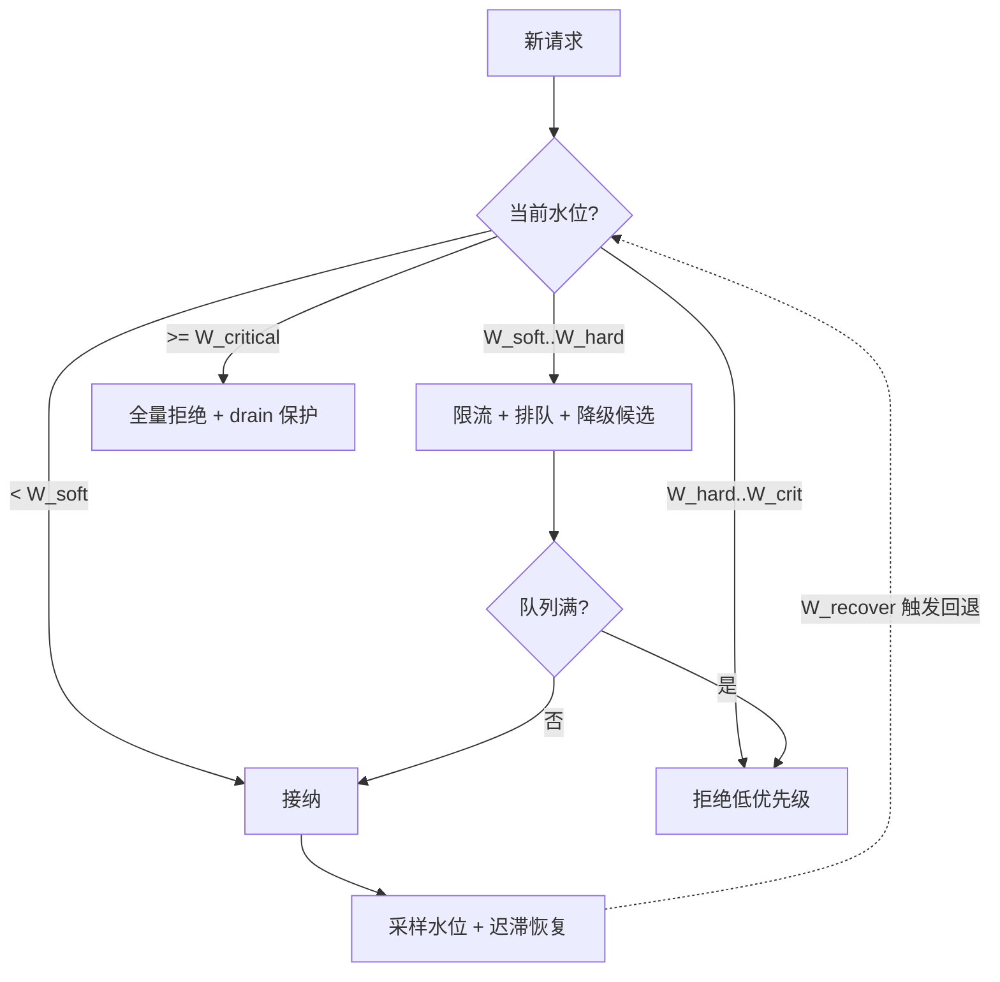

图中多级水位驱动不同动作，硬水位保护在途任务，迟滞防止抖振。图示不给出具体水位数值。

#### 6. 拓展知识

可继续学习 backpressure、admission control、load shedding、token bucket、hysteresis、同步/异步拒绝和 SLO-aware 过载控制。异构系统还需区分内存、队列、带宽和碎片的联合水位。

#### 7. 常见追问及回答要点

1. **为什么需要迟滞？**
   - 水位在阈值附近抖动会导致反复接纳/拒绝，迟滞区间可稳定行为。
2. **排队为何要有上界？**
   - 无界排队会使等待时间无界（Little 定律），最终全部超时并放大拥塞。
3. **拒绝和降级如何选？**
   - 低优先级请求可拒绝；高优先级或可降级请求优先降级，以保核心 SLO。

#### 8. 易错点与反例

- 无界排队：看似平滑，实则等待无界、超时雪崩。
- 无迟滞：水位抖动导致行为抖振，稳定性下降。
- 只看单一记账水位：忽略碎片与真实连续可分配量，误判临界。

#### 9. 实践与验证

[待验证] 用负载与水位注入验证过载保护：

- 输入：各级水位阈值、迟滞区间、队列上限、优先级与降级策略；
- 步骤：逐步加压到软/硬/临界水位，注入突发和碎片化负载，再降压观察恢复；
- 预期结果：软水位限流、硬水位拒绝低优先级、临界水位保护在途；恢复无抖振；
- oracle：在途任务不因过载失败，队列延迟有界，水位抖动次数在阈值内；
- 指标：各级触发点、队列延迟分位、拒绝率、降级率、在途成功率、抖振次数和恢复时间；
- 失败判断：若在途任务因过载失败，或水位在阈值附近反复抖动，测试失败。

真实设备队列、内存与过载行为未运行，均为 `[待验证]`。

#### 10. 评分标准

- 不合格：只会说“加限流”。
- 合格：能给出高低水位和基本动作。
- 良好：能设计多级水位、迟滞、队列上界和优先级拒绝。
- 优秀：能结合 Little 定律、碎片/真实可分配量、抖动防护和 SLO 给出可验证的过载保护。

**证据与来源：** `[已确认]` `cann/00-overview/global-error-model.md:34,42`；`[已确认]` `cann/90-cross-module/pooling-and-resource-management.md:41,63`；`[推断]` 水位分级与迟滞模型；真实过载行为为 `[待验证]`。

## HRS-A015. 如何治理版本兼容与运行时契约？

- 难度：高级
- 知识域：K12 生产架构、发布迁移、灾备与前沿演进
- 考察能力：契约治理、兼容分析、跨模块影响
- 题型：系统设计与方案取舍
- 面试频率：高频
- 前置知识：HRS-A002、HRS-A012、ABI/API 兼容
- 关联题目：前置 `HRS-A002`；后续 `HRS-A012`
- 事实状态：`[已确认]` `[推断]` `[待验证]` `[建议]`

#### 1. 背景知识

异构运行时由多层独立组件构成：GE、ACL、Runtime、Driver 各自独立构建发布，通过头文件、共享库符号、错误码和 CMake package 协作；版本必须配套，否则编译、加载或执行失败。[已确认] 来源：[cann/00-overview/project-overview.md:13,30] 架构文档指出跨仓版本配套和 ABI 兼容要求高，错误码、头文件和二进制符号需要同步。[已确认] 来源：[cann/00-overview/architecture.md:54] 变更影响地图进一步列出：修改 Runtime C API/handle 需查 ACL 包装、GE Executor、Driver HAL 和所有客户端；修改 HAL 函数/结构体需查 Runtime 链接、SDK-driver、内核 ioctl 和所有产品分支。[已确认] 来源：[cann/90-cross-module/change-impact-map.md:21,26]

#### 2. 问题分析

版本治理比较三类策略：

1. **全量钉死（pin-all）**：最安全，但升级耦合、回滚困难；
2. **区间兼容（ranges）**：灵活，但需维护兼容矩阵和契约测试；
3. **N-2 支持窗口**：允许渐进升级，治理成本居中。

决策轴：**安全性 vs 灵活性 vs 维护成本**。关键是区分**API 兼容、ABI 兼容和行为兼容**——同名版本可能因 SoC 条件编译或 flag 产生行为差异。

#### 3. 具体答案

我会用“版本元组 + 契约测试 + 能力探测 + 弃用策略”：

```text
版本元组：{soc, firmware, driver, hal, runtime, acl, ge, toolkit, 3rd_party}
治理规则：
  1. 发布绑定完整元组，禁止"部分升级"
  2. 接口变更（C API/HAL 结构体/错误码）必须过契约测试
  3. 优先用能力探测而非版本号推断，规避 SoC/flag 差异
  4. 弃用走两阶段：标记 + 共存窗口 >= 最大迁移时长
  5. 回滚必须可执行，不可逆步骤（固件）单独评估

契约测试覆盖：
  ABI: 结构体布局、导出符号、错误码取值范围
  API: 调用序列、生命周期、所有权
  Behavior: 精度、时序、错误映射
```

结论：**全量钉死于生产、区间兼容于开发、契约测试保底**；任何跨仓接口变更都必须同步更新错误映射、生命周期文档、DFX 字段和测试矩阵。[已确认] 来源：[cann/90-cross-module/change-impact-map.md:35-38]

#### 4. 技术洞察

量化与不变量：

```text
矩阵规模 ≈ Π|component_i|；用 n-wise 压缩测试组合，未覆盖组合 fail-closed
兼容窗口 >= max_migration_duration + rollback_time（见 HRS-A012）
契约测试分层：无设备 mock UT -> 跨仓集成 -> 真实设备回归
```

不变量：**运行时行为由 (版本元组, 能力探测, 配置) 共同决定，不能用单一版本号替代**。文档列出配置影响（`ASCEND_INSTALL_PATH`、`CANN_3RD_LIB_PATH`、`ENABLE_OPEN_SRC`、`DRIVER/DRIVER_COMPAT`、SoC/产品宏），说明构建配置同样影响兼容结果。[已确认] 来源：[cann/90-cross-module/configuration-impact-map.md:15-24] 技术债文档也把“生成公共头文件、导出符号、错误码和结构体 ABI 清单”列为待补项。[已确认] 来源：[cann/99-roadmap/technical-debt.md:22]

#### 5. 图文说明

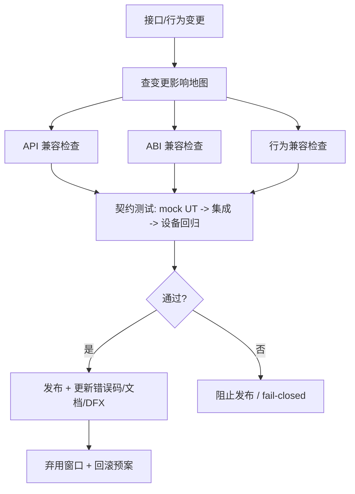

图中变更先经影响地图，再分别做 API/ABI/行为兼容检查，通过分层契约测试后发布，并保留弃用窗口与回滚。图示不证明任何具体测试框架的覆盖度。

#### 6. 拓展知识

可继续学习 semver、ABI 稳定性、符号版本、接口契约测试、golden/consent 测试、弃用策略和能力探测。异构系统还需处理 SoC 条件编译、闭源固件不可探测能力和跨语言（C/Python/框架）绑定的一致性。

#### 7. 常见追问及回答要点

1. **版本号相同就兼容吗？**
   - 不一定；SoC 条件编译、flag 和固件都可能改变行为，需契约测试与能力探测。
2. **区间兼容如何防止踩坑？**
   - 维护兼容矩阵、n-wise 契约测试，未覆盖组合 fail-closed。
3. **为什么优先能力探测？**
   - 行为差异常无法从版本号推出，探测目标能力可规避 SoC/flag 差异。

#### 8. 易错点与反例

- 部分升级：只升 Runtime 不升 Driver，ABI 不匹配导致加载失败。
- 只看版本号：忽略 SoC/flag 行为差异，测试通过但生产失败。
- 无弃用窗口：直接移除接口，客户端未迁移即中断。

#### 9. 实践与验证

[待验证] 用兼容矩阵与契约测试验证治理：

- 输入：版本元组的等价类、接口清单（API/ABI/错误码）、契约测试集、弃用计划；
- 步骤：对每个等价类跑契约测试；注入部分升级、结构体变更和错误码变更；
- 预期结果：不兼容组合被 fail-closed，兼容组合通过三层测试；
- oracle：ABI/API/行为断言全过，错误映射一致，弃用窗口满足迁移时长；
- 指标：矩阵覆盖率、契约测试通过率、误放过率、升级/回滚时长和接口稳定性指标；
- 失败判断：若不兼容组合被放行，或行为断言缺失，测试失败。

真实版本组合、固件行为和跨语言绑定未运行，均为 `[待验证]`。

#### 10. 评分标准

- 不合格：只说“用 semver 管版本”。
- 合格：能区分 API/ABI 兼容并给出版本元组。
- 良好：能设计契约测试、能力探测和弃用窗口，说明矩阵压缩。
- 优秀：能结合变更影响地图、行为兼容、fail-closed 和回滚可执行性给出可验证的版本治理体系。

**证据与来源：** `[已确认]` `cann/00-overview/project-overview.md:13,30`；`[已确认]` `cann/00-overview/architecture.md:54`；`[已确认]` `cann/90-cross-module/change-impact-map.md:21,26,35-38`；`[已确认]` `cann/90-cross-module/configuration-impact-map.md:15-24`；`[已确认]` `cann/99-roadmap/technical-debt.md:22`；`[推断]` 契约治理流程；真实兼容性为 `[待验证]`。
