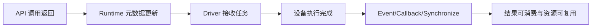
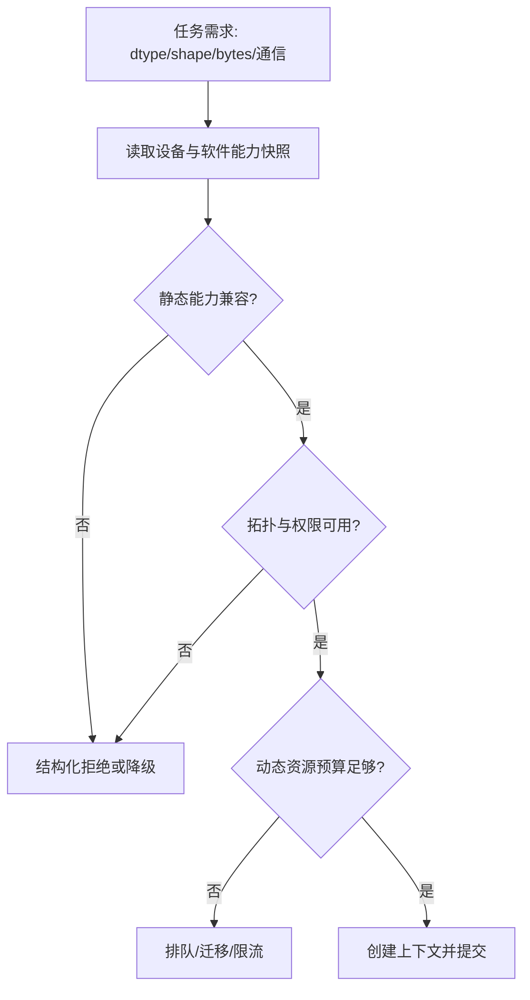
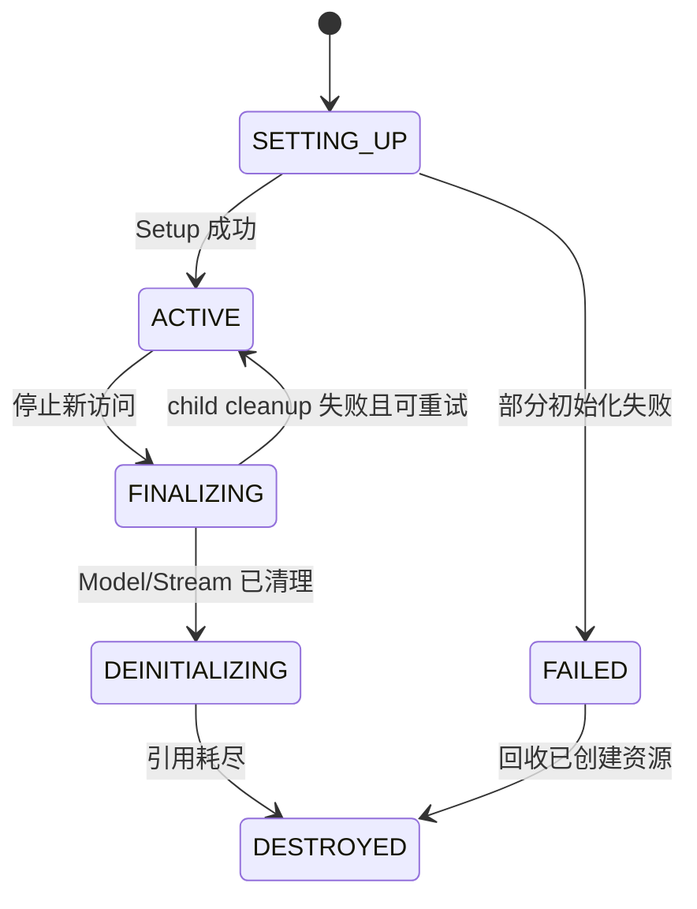
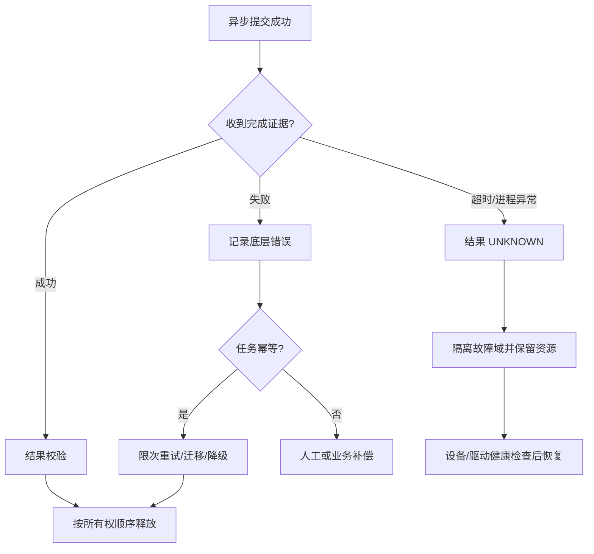

# 异构资源稳定性：入门级面试题

- 题数：15；稳定 ID：`HRS-B001`–`HRS-B015`
- 证据规则：源码/文档结论按 `[已确认]`、`[推断]` 区分；硬件、网络、多进程和性能实验按 `[待验证]` 处理。
- 单题门槛：每题包含元数据、背景、分析、答案、洞察、图示、拓展、追问、反例、实践、评分和证据。
- 选题说明：HRS-B001–HRS-B004 为早期手写精选题（含 CANN 文档行号引用），予以保留；B005 起为差异化重写题。

## HRS-B001. 如何定义异构资源系统的稳定性，并区分它与“服务可用”？

- 难度：入门级
- 知识域：K01 稳定性目标、边界与故障模型
- 考察能力：概念解释、原理推导、边界辨析
- 题型：概念解释与辨析
- 面试频率：高频
- 前置知识：操作系统中的进程/线程、基本可靠性指标和资源生命周期
- 关联题目：后续 `HRS-B002`、`HRS-B003`、`HRS-B004`
- 事实状态：`[已确认]` `[推断]` `[建议]`

#### 1. 背景知识

异构资源系统同时使用 CPU、GPU、NPU、设备内存、主机内存、执行队列和互联链路。**稳定性**应描述系统在正常输入、资源紧张和局部故障下，是否仍能保持正确、可用、资源安全、可恢复和可诊断。**可用性**只是其中一项，通常回答“请求是否能在约定时间内得到成功或明确失败的结果”。

还要区分三个时刻：主机 API 返回成功、Runtime/驱动接受任务、设备真正完成任务。它们不必同时发生。[已确认] CANN 文档明确将主机 API 成功、Runtime 元数据变化、Driver 接受请求和设备任务完成视为不同时间点。[cann/90-cross-module/memory-and-resource-lifecycle.md:24-25]

#### 2. 问题分析

先把“稳定”拆成可观察属性，而不是把“不崩溃”当定义：

1. 正确性：结果、顺序、数据可见性和资源归属正确；
2. 可用性：成功率、延迟和明确失败符合 SLO；
3. 资源安全：无泄漏、越界、重复释放、死锁和无界耗尽；
4. 可恢复性：可重试、迁移、降级或回滚，且不扩大故障；
5. 可诊断性：保留设备、Context、Stream/Queue、任务阶段和原始错误证据。

然后用反例检验：一个 API 返回成功但设备随后执行失败的请求，可能“提交可用”但“业务不可用”；一个结果正确但每次分配后泄漏的程序，短测可用但长期不稳定；一个吞吐很高但 P99 超出 SLO 的系统，也不能称为满足服务稳定性目标。

#### 3. 具体答案

面试中可以这样回答：

> 异构资源稳定性不是“进程不退出”，而是在明确的硬件、软件版本、负载和故障模型下，同时满足正确性、可用性、资源安全、可恢复性和可诊断性。可用性只关心请求是否完成，稳定性还关心结果是否正确、异步资源是否安全、局部失败能否隔离恢复，以及我们能否用证据定位问题。
>
> 例如，提交 kernel 返回成功只说明请求通过了当前层的检查或进入队列，不能证明设备已经完成；在完成事件或同步边界之前，不能提前复用输入 buffer、销毁 Stream 或释放模型。稳定性契约需要明确输入、输出、状态转移、资源所有权、完成信号和失败动作。
>
> 实际设计时，我会为每一类资源定义不变量：任务引用的内存不能在完成前释放；每个请求只能有一个终态；一个故障域内的失败不能无限阻塞其他请求；每个错误要保留最底层上下文。再用成功率、P99、OOM/设备错误率、队列深度、资源水位和恢复时间验证这些目标。

#### 4. 技术洞察

稳定性的核心是“契约 + 状态 + 证据”。可以用一个简化模型表示：

```text
稳定性 = 正确性 ∩ 可用性 ∩ 资源安全 ∩ 可恢复性 ∩ 可诊断性
```

这是交集而不是并集：只满足其中一项不能掩盖另一项失败。另一个关键不变量是：

```text
resource.reusable == true  ⇔  task completion is proven
```

`task completion is proven` 必须绑定具体完成机制，例如同步返回、Event wait、callback 已确认完成，而不能把“提交函数返回 0”当作证明。[推断] 这条不变量由 CANN 资源生命周期文档中的异步边界和同步释放规则推得，具体设备的完成语义仍需目标环境验证。

#### 5. 图文说明



- A 只代表主机调用完成；
- B 代表软件对象或状态发生变化；
- C 代表请求进入更下游的承载路径；
- D 是设备执行语义，具体时序待验证；
- E 是应用可以采用的完成证据；
- F 才是通常可以安全消费结果、复用 buffer 或释放相关资源的边界。

该图不能证明特定平台的每个 API 都有相同的同步语义，也不能给出性能或完成延迟。

#### 6. 拓展知识

可继续学习线性一致性与异步 API 的完成契约、SLO/SLA/SLI、故障域、资源配额、幂等重试、错误预算和 graceful degradation。对比“高可用”和“高可靠”：前者强调可服务时间，后者还包含正确性、持久性和恢复能力，具体定义需结合组织语境。

#### 7. 常见追问及回答要点

1. **如果 API 返回成功但业务结果错误，算稳定吗？**
   - 不能只看 API 返回值；检查设备异步错误、输入/输出 buffer、dtype/shape、结果 oracle 和错误传播。
2. **为什么不能简单地每次失败都重试？**
   - 先判断任务是否已执行、操作是否幂等、资源是否部分提交，以及重试是否会重复副作用或放大拥塞。
3. **稳定性指标应该只看平均延迟吗？**
   - 不应；至少区分成功率、P50/P95/P99、错误类型、队列等待、设备利用率和恢复时间。

#### 8. 易错点与反例

- 错误直觉：“进程没崩就是稳定。”反例：后台队列死锁，进程仍存活但请求永不完成。
- 错误直觉：“返回成功就是任务完成。”反例：异步提交后设备执行失败，错误在同步或 callback 处才出现。
- 错误直觉：“只要增加资源就能恢复。”反例：根因是错误的 Context/Stream 生命周期，增加设备只会扩大泄漏范围。

#### 9. 实践与验证

[待验证] 设计一个不依赖真实设备的状态机练习：

- 输入：任务状态 `NEW/SUBMITTED/COMPLETED/FAILED/CANCELLED`，资源状态 `HELD/REUSABLE/RELEASED`；
- 步骤：枚举提交成功、设备失败、超时、取消、重复完成五种事件；
- 预期结果：任何终态只出现一次；未确认完成时资源不能转为 `REUSABLE`；
- 判定准则（oracle）：状态转移表中的非法边全部被拒绝，资源引用计数最终归零；
- 指标：终态重复数、未释放资源数、错误上下文完整率；
- 失败判断：若 `SUBMITTED → RELEASED` 无完成证据，说明生命周期不变量被破坏。

真实 GPU/NPU 执行、异步时序和性能数据本批未运行。

#### 10. 评分标准

- 不合格：把稳定性等同于不崩溃或平均延迟，无法解释异步完成。
- 合格：能区分正确性、可用性和资源安全，并举出提交成功不等于完成的例子。
- 良好：能定义资源复用、请求终态和错误证据不变量，给出指标和验证 oracle。
- 优秀：能结合故障域、幂等性、降级、恢复时间和成本约束，说明不同 SLO 下的取舍。

**证据与来源：** `[已确认]` `cann/90-cross-module/memory-and-resource-lifecycle.md:24-25,88-100`；`[已确认]` `cann/00-overview/global-error-model.md:29-42`；推断和实验边界见 [00-overview/sources-and-evidence.md](../00-overview/sources-and-evidence.md)。

## HRS-B002. 如何在提交任务前完成异构设备的能力协商？

- 难度：入门级
- 知识域：K02 设备发现、拓扑、能力协商与兼容
- 考察能力：原理推导、配置分析、验证设计
- 题型：原理推导与算法分析
- 面试频率：高频
- 前置知识：设备枚举、版本号、基本数据类型和矩阵/张量 shape
- 关联题目：前置 `HRS-B001`；后续 `HRS-B003`
- 事实状态：`[已确认]` `[推断]` `[待验证]` `[建议]`

#### 1. 背景知识

设备 ID 只是索引，不是完整能力描述。能力协商应至少收集设备类型和型号、驱动/固件/Runtime 版本、支持的数据类型和算子、显存/内存容量、拓扑和 P2P/通信能力、可用队列或并发限制，以及当前资源水位。CANN 架构文档指出跨仓构建和发布存在 ABI、头文件、二进制符号及版本配套代价。[已确认] 来源：[cann/00-overview/architecture.md:50-53]

#### 2. 问题分析

把准入问题分成四层：

1. **身份层**：设备是否存在、可访问，驱动和 Runtime 是否匹配；
2. **能力层**：任务所需 dtype、shape、算子、内存和队列能力是否支持；
3. **拓扑层**：数据需要跨卡、跨 NUMA 节点或跨节点时，链路是否可用；
4. **资源层**：此刻是否有足够内存、队列、带宽和配额。

先生成不可变的 `capability_snapshot`，再根据任务需求计算 `admission_result`。不要在任务已提交后才发现设备不支持某个 dtype；也不要把“枚举成功”当成“可运行”。

#### 3. 具体答案

建议的最小流程如下：

```python
from dataclasses import dataclass

@dataclass(frozen=True)
class Capability:
    device_id: int
    kind: str
    runtime_version: str
    supported_dtypes: frozenset[str]
    memory_bytes: int
    peer_devices: frozenset[int]
    available: bool

def admit(cap: Capability, req: dict) -> tuple[bool, list[str]]:
    reasons = []
    if not cap.available:
        reasons.append("device_unavailable")
    if req["dtype"] not in cap.supported_dtypes:
        reasons.append("dtype_unsupported")
    if req["bytes"] > cap.memory_bytes:
        reasons.append("insufficient_memory_snapshot")
    if req.get("peer") is not None and req["peer"] not in cap.peer_devices:
        reasons.append("topology_not_supported")
    return not reasons, reasons
```

生产实现还要校验版本兼容、权限、上下文创建和实时资源水位；上面代码只是能力协商的可读模型，不代表任一厂商 API 的完整实现。准入失败应返回结构化原因，并选择其他设备、排队等待、降级或明确拒绝，而不是无上下文地重试。

#### 4. 技术洞察

能力快照有时间属性，`memory_bytes` 和可用队列数会变化。因此它不是永久真相，只能作为“提交前准入检查”；提交后仍需要处理竞态：其他租户可能抢占资源、设备可能进入错误状态、拓扑链路可能失效。[推断] 稳定设计应将静态能力和动态水位分离，并在真正分配/提交处再次验证。

一个简单准入关系是：

```text
admit(task, device) = static_compatible ∧ topology_compatible ∧ dynamic_budget_available
```

任何一项为假都不能把任务标记为可运行。能力快照还应记录采集时间、版本、设备序列/逻辑标识和探测错误，便于复盘。

#### 5. 图文说明



任务需求是输入；快照提供候选约束；三个判断分别表示静态能力、拓扑/权限和动态资源。`创建上下文并提交` 仍不是完成边界，须由 K03/K05 的生命周期和同步规则继续保证。图示没有证明设备侧最终执行一定成功。

#### 6. 拓展知识

进一步可学习 capability negotiation、feature flag、设备插件、异构调度器、拓扑感知调度、版本矩阵、ABI/API 兼容、资源预留和 admission control。对于统一抽象层，必须保留厂商特有能力和“不支持”状态，不能把所有设备强行降到同一个最小接口后丢失诊断信息。

#### 7. 常见追问及回答要点

1. **能力快照刚刚显示有显存，为什么分配仍可能失败？**
   - 快照有时效性；还要考虑碎片、对齐、池/模块限制、并发竞争、权限和 Driver/HAL 失败。
2. **发现 GPU 不支持某 dtype 时应如何降级？**
   - 明确精度和正确率预算，选择转换、CPU/NPU 替代或拒绝；必须记录降级原因并验证结果 oracle。
3. **多卡调度只看显存是否够吗？**
   - 不够；还要看 P2P/互联拓扑、NUMA、通信带宽、集合通信参与者和故障域。

#### 8. 易错点与反例

- 把设备编号当能力：同一逻辑编号在不同节点可能代表不同型号或软件栈。
- 把总显存当可分配显存：碎片、对齐、缓存池和其他租户都会改变实际可用量。
- 只检查静态版本，不检查动态资源：启动时通过，稳态高峰仍可能 OOM 或排队超时。

#### 9. 实践与验证

[待验证] 使用模拟设备注册表完成表驱动测试：

- 输入：三台设备，分别缺少 dtype、缺少 peer 链路、动态预算不足；任务包含 `dtype`、`bytes`、`peer` 和版本约束；
- 步骤：生成快照，运行 `admit`，再改变动态预算并重复提交；
- 预期结果：静态不兼容始终拒绝；动态不足进入排队/降级分支；
- oracle：拒绝原因集合与预设原因完全一致，不能只返回笼统的 `unavailable`；
- 指标：准入延迟、拒绝原因分布、快照年龄、误准入率；
- 失败判断：若快照显示不支持却提交成功，或动态预算变化后结果不变，说明准入边界错误。

真实设备能力、拓扑和版本组合未运行，结果标为 `[待验证]`。

#### 10. 评分标准

- 不合格：只说“检查设备 ID 和显存”。
- 合格：能列出设备型号、版本、dtype、内存和拓扑等基本条件。
- 良好：能分离静态能力、拓扑和动态资源，设计结构化拒绝及降级路径。
- 优秀：能讨论快照竞态、版本矩阵、故障域、准入误判指标和运行时二次验证。

**证据与来源：** `[已确认]` `cann/00-overview/architecture.md:50-53`；`[建议]/[推断]` 为本题的通用准入设计；动态设备行为需在目标环境验证。

## HRS-B003. 如何解释 Context、Stream 和设备任务的生命周期顺序？

- 难度：入门级
- 知识域：K03 Context/Device/Stream/Event/Queue 生命周期
- 考察能力：流程追踪、实现分析、资源生命周期推理
- 题型：流程/调用链/数据流追踪
- 面试频率：高频
- 前置知识：HRS-B001、线程局部状态、句柄和引用计数
- 关联题目：前置 `HRS-B002`；后续 `HRS-B004`
- 事实状态：`[已确认]` `[推断]` `[待验证]`

#### 1. 背景知识

Context 通常把线程、设备和相关资源联系起来；Stream/Queue 表达任务提交顺序或依赖；Event/Callback/Synchronize 用于观察某个完成边界。不同厂商的主 Context、显式 Context 和句柄语义可能不同，不能仅凭名称推断完全相同的行为。

CANN Runtime 文档记录：显式 Context 创建时会校验设备、保留设备引用、初始化分配器和 Stream，最后才把状态设为 `ACTIVE`；销毁时先清理模型和 Streams，再清除线程绑定，并等待引用条件满足。[已确认] 来源：[cann/90-cross-module/memory-and-resource-lifecycle.md:38-55]

#### 2. 问题分析

生命周期题要同时跟踪对象状态和所有权：

- Context 是否已创建、绑定当前线程并处于 `ACTIVE`；
- Stream 是否属于某 Context，是否仍有 pending task；
- Event 是否已经记录，等待是否真的跨过设备完成边界；
- Model、Kernel、Memory 和 callback data 是否仍被任务引用；
- teardown 是否取得唯一执行权，失败后能否重试。

安全销毁的关键不是调用顺序“看起来合理”，而是先停止新访问，再等待/处理未完成任务，最后销毁被依赖对象。若 Stream 清理失败，不能无条件 delete Context。

#### 3. 具体答案

一个可解释的顺序是：

```text
设备发现
  -> 创建/取得 Context
  -> Context Setup 与默认 Stream
  -> 创建其他 Stream/Event/Model/Memory
  -> 在 Stream 上提交任务
  -> 通过 Event/Callback/Synchronize 证明完成
  -> 停止新提交
  -> 清理 Model、Stream、Event 和绑定
  -> 释放 Context 与设备引用
```

Context 是生命周期的上层边界，Stream 和任务依赖它；任务又可能引用 Model、Memory、Event 和 callback data。因此销毁通常是依赖图的逆拓扑序，而不是简单的创建逆序。CANN 文档给出的资源顺序是“停止新访问 → 清理 Model → flush/清理 Stream → 清除线程绑定 → 等待引用耗尽 → 移除 Registry → 删除 Context”。[已确认] 来源：[cann/90-cross-module/memory-and-resource-lifecycle.md:46-55]

#### 4. 技术洞察

可以用状态机表达 Context：

```text
NEW -> SETTING_UP -> ACTIVE -> FINALIZING -> DEINITIALIZING -> DESTROYED
             \\-> FAILED
```

`ACTIVE` 才允许正常提交；`FINALIZING` 拒绝新访问但允许清理；`FAILED` 的局部资源必须按已成功初始化的子集回收。[推断] 采用状态机能避免把“句柄非空”误认为“对象可用”。

资源释放必须满足：

```text
destroy(context) only when pending_tasks == 0
                         and child_handles == 0
                         and owner_refs == 0
```

实际实现可能选择同步等待、异步延迟删除或返回 busy；具体策略需查目标 Runtime。CANN 文档确认某些 teardown 失败时会恢复 owner stream 以支持重试，但设备 pending task 的具体行为未在硬件上验证。

#### 5. 图文说明



状态表示 Context 的软件生命周期；箭头是合法事件或清理结果。`ACTIVE → FINALIZING` 是管理动作，不代表设备任务已经完成；`DEINITIALIZING → DESTROYED` 还需要引用和 child handle 条件。图示不证明所有 Runtime 都提供同名状态。

#### 6. 拓展知识

可继续学习 RAII、引用计数、hazard pointer、epoch reclamation、异步析构、primary context、stream-ordered allocation、对象注册表、句柄 ABA 风险和进程退出清理。高级场景还需讨论设备 reset、Context 隔离、热升级和 pending callback 的取消语义。

#### 7. 常见追问及回答要点

1. **为什么不能先销毁 Context 再销毁 Stream？**
   - Stream 属于或依赖 Context，任务和回调可能仍访问 Context；先销毁会产生悬空句柄和未定义行为。
2. **teardown 返回 busy 时怎么办？**
   - 保留对象和所有权，记录 pending task/child handle，等待明确完成或按策略重试；不要直接 free 底层句柄。
3. **线程绑定和 Context 所有权有什么关系？**
   - 线程局部 current context 只是访问路径之一，不能代替全局对象引用；销毁前需清除绑定并确认其他引用。

#### 8. 易错点与反例

- 把 Context 当成整数 device ID：Context 还承载分配器、Stream 和线程/设备关系。
- 看到指针非空就调用 destroy：对象可能处于 `FINALIZING`、`FAILED` 或已有 child handle。
- 用 sleep 代替完成确认：固定等待不能证明长任务、异常任务或不同负载下已经完成。

#### 9. 实践与验证

[待验证] 用纯软件模型验证依赖图：

- 输入：Context、两个 Stream、一个 Event、一个 Model 和两块被任务引用的 Memory；
- 步骤：提交跨 Stream 任务，分别尝试提前销毁 Model、Stream、Context；再注入 Stream cleanup 失败；
- 预期结果：有 pending task 或 child handle 时拒绝销毁；清理失败后 Context 保留在可重试状态；
- oracle：所有非法顺序返回明确状态错误，成功路径无悬挂引用；
- 指标：pending task 数、child handle 数、teardown 重试次数、最终泄漏数；
- 失败判断：若 Context 已销毁但 Stream 仍可提交，或失败清理后句柄既不可用又无法回收，说明状态机不完整。

真实 CANN/GPU/NPU teardown 语义、设备 reset 和 busy 返回值未运行验证。

#### 10. 评分标准

- 不合格：只会说“创建 Context、创建 Stream、最后释放”。
- 合格：能解释 Context、Stream、Event 的角色和基本逆序清理。
- 良好：能画状态机，说明 pending task、引用和 teardown 失败后的重试。
- 优秀：能从依赖图、不变量、异步析构、故障域和版本差异分析销毁策略及验证方法。

**证据与来源：** `[已确认]` `cann/90-cross-module/memory-and-resource-lifecycle.md:38-55`；`[推断]` 状态机和不变量；设备 pending task 的具体行为为 `[待验证]`。

## HRS-B004. 如何用状态机和伪代码处理异步任务提交后的设备或进程异常？

- 难度：入门级
- 知识域：K03 Context/Stream/Event/Queue 生命周期（关联 K09 错误、恢复与故障注入）
- 考察能力：实现分析、故障排查、资源生命周期分析
- 题型：代码、伪代码或配置分析
- 面试频率：高频
- 前置知识：HRS-B003、错误码、日志和最小复现
- 关联题目：前置 `HRS-B003`；后续 `HRS-B005`
- 事实状态：`[已确认]` `[推断]` `[待验证]` `[建议]`

#### 1. 背景知识

异步路径中，提交函数返回成功只说明当前调用阶段没有立即拒绝。错误可能在 Driver、设备执行、Event wait、callback 或后续同步时才暴露。CANN 错误模型要求保留底层错误码、设备 ID、Context/Stream、模型/Graph 标识和调用阶段，不能只记录顶层 `ACL_ERROR`。[已确认] 来源：[cann/00-overview/global-error-model.md:29-42]

进程异常还会使 Runtime 元数据、Driver 句柄、设备任务和主机记录处于不同状态。重启服务不等于资源一定被清理，必须依据设备和驱动的清理契约验证。

#### 2. 问题分析

按排障顺序处理，而不是先重启：

1. 保护系统：限流、停止新提交、标记受影响故障域，避免继续扩大损害；
2. 固定证据：版本、设备、进程、线程、Context、Stream、任务 ID、时间戳和原始错误；
3. 找第一个失败边界：提交前参数、Driver 接收、设备执行、同步/回调、结果校验或清理；
4. 建立最小复现和单卡/单任务对照组；
5. 判断任务是否执行、是否可重试、资源是否仍被引用；
6. 按所有权顺序清理，并验证资源水位和后续新任务。

这种顺序符合 CANN 调试建议：固定版本/SoC/工具链，记录 API 阶段和上下文，找到第一个失败边界，再沿 ACL → Runtime → HAL → SDK/kernel 反查。[已确认] 来源：[cann/99-roadmap/debugging-guide.md:13-30]

#### 3. 具体答案

我会先将请求标为 `UNKNOWN`，而不是直接判定成功或失败：

```text
提交返回成功
  -> 等待完成证据
       -> 完成成功：校验结果，释放资源
       -> 完成失败：保留原始错误，按幂等性决定重试/降级
       -> 超时：隔离故障域，停止新提交，采集诊断
       -> 进程异常：执行恢复流程，验证设备/驱动状态后再接纳流量
```

临时措施是保护用户和资源，例如暂停受影响设备、限制重试次数、把请求路由到健康设备或返回明确的可重试错误。永久修复要补上状态机、错误上下文、超时和取消语义、清理验证以及回归测试。

清理时保守处理：在未证明任务完成前，不复用其 Memory、Model、Stream 和 callback data；优先使用目标 Runtime 提供的同步、事件等待或设备恢复 API；若设备处于错误状态，按照运维手册隔离或 reset，并记录 reset 的故障域影响。[建议] 具体 reset 是否安全、是否释放所有 backing，需要目标硬件验证。

#### 4. 技术洞察

核心是区分三态结果：`SUCCESS`、`FAILURE`、`UNKNOWN`。超时或进程崩溃后，不能把 `UNKNOWN` 直接转换成 `FAILURE` 并重试，因为任务可能已经产生外部副作用；也不能直接转换成 `SUCCESS` 并释放资源。

故障排查证据表可写为：

| 现象 | 假设 | 证据 | 动作 |
|---|---|---|---|
| 提交成功后无回调 | Driver/设备卡住或 callback 丢失 | 队列深度、设备状态、日志、超时栈 | 隔离并停止新提交 |
| 同步返回设备错误 | 任务执行失败 | 原始 Driver/HAL 错误、任务 ID | 按幂等性决定恢复 |
| 重启后仍不可分配 | 设备/驱动残留或资源未回收 | 设备重置日志、资源水位 | 扩大隔离并人工确认 |

#### 5. 图文说明



“完成证据”可以是同步、Event 或已确认 callback；“结果校验”是业务 oracle，不是单纯 API 返回值；“保留资源”表示先保护可能仍被设备引用的对象。图示没有承诺重启或 reset 必然清理设备资源。

#### 6. 拓展知识

可继续学习两阶段提交式思路、幂等键、事务性 outbox、熔断器、bulkhead 隔离、指数退避、设备 watchdog、故障注入、core dump、分布式 tracing 和 postmortem。跨节点集合通信还要处理参与者不一致和集体调用死锁，属于 K08/K09 的高级内容。

#### 7. 常见追问及回答要点

1. **超时后能否立即释放 buffer？**
   - 不能默认释放；先确认设备完成/取消语义，或把设备和相关资源隔离到可证明安全的恢复边界。
2. **什么情况下可以重试？**
   - 明确任务幂等、未产生不可逆副作用、原资源状态可控，并设置次数、退避和熔断。
3. **只记录最终错误码够吗？**
   - 不够；要记录原始错误、层级映射、设备/Context/Stream、阶段、任务 ID、版本和时间线。

#### 8. 易错点与反例

- 直接重启：可能丢失证据，且设备任务或驱动资源仍处于未知状态。
- 无限重试：会增加队列拥塞、重复副作用和跨设备级联故障。
- 只看顶层错误：`ACL_ERROR` 可能掩盖 Runtime、HAL 或 Driver 的第一个失败边界。
- 把超时当作任务未执行：异步系统中超时只说明在观察窗口内没有完成证据。

#### 9. 实践与验证

[待验证] 构造纯软件故障注入测试：

- 输入：异步任务状态机和故障点 `submit/driver/device/wait/callback/cleanup`；
- 步骤：在每个故障点注入错误、延迟、重复 callback、进程崩溃标记；执行限流、隔离和清理流程；
- 预期结果：每个请求只有一个终态；未知结果不会未经判定进入成功或可重试分支；资源引用不会在完成证据前归零；
- oracle：状态转移合法、原始错误上下文完整、清理操作幂等；
- 指标：检测时间、隔离时间、恢复时间、重复副作用数、泄漏数、重试放大倍数；
- 失败判断：出现无终态请求、重复终态、错误上下文缺字段或未知状态下提前释放，测试失败。

真实设备异常、驱动 reset、callback 丢失和多进程恢复未执行，均为 `[待验证]`。

#### 10. 评分标准

- 不合格：建议直接重启或无限重试，无法区分提交和完成。
- 合格：能按现象、日志、设备和同步边界排查，并说明暂不释放资源。
- 良好：能建立 `SUCCESS/FAILURE/UNKNOWN` 状态，讨论幂等、限次重试和故障隔离。
- 优秀：能设计跨层证据链、故障注入、恢复/回滚、SLO 影响和防复发治理。

**证据与来源：** `[已确认]` `cann/00-overview/global-error-model.md:13-42`；`[建议/已确认: 文档化流程建议]` `cann/99-roadmap/debugging-guide.md:13-30`；`[已确认]` `cann/90-cross-module/memory-and-resource-lifecycle.md:88-100`；硬件恢复语义为 `[待验证]`。

## HRS-B005. 设备内存和主机内存在分配、地址空间与内存池上有什么本质区别？

- 难度：入门级
- 知识域：K04 设备/主机内存、地址空间与内存池
- 考察能力：概念解释、原理推导、实现分析
- 题型：概念解释与辨析
- 面试频率：高频
- 前置知识：HRS-B003；虚拟内存、页、DMA 与地址对齐基础
- 关联题目：前置 `HRS-B003`、`HRS-B004`；后续 `HRS-B006`、`HRS-B014`
- 事实状态：`[已确认]` `[推断]` `[待验证]`

#### 1. 背景知识

设备内存（HBM/DDR）与主机内存位于不同的物理介质和不同的地址域，设备通过自己的地址空间访问，主机通过 CPU 页表访问，两者之间要建立映射才能互相看到对方的内存。

[已确认] CANN 文档记录：`rtMalloc` 先由 `ApiImpl::DevMalloc` 解析 memory type、policy、advise、module/device config，并按 32-byte 对齐；DVPP 走专用 Driver 分支，普通请求进入 `NpuDriver::DevMemAlloc`。[cann/90-cross-module/memory-and-resource-lifecycle.md:78-82]

[已确认] Driver 按 online/offline/AICPU-scheduler 选择路径，并把页类型、HBM/DDR/P2P、节点和 module ID 编进 HAL flags，最终调用 `halMemAlloc`。[cann/90-cross-module/memory-and-resource-lifecycle.md:78-82]

[已确认] Host allocation 同样按 32-byte 对齐，host register 还要在 pin/map 能力不足时维护 Runtime 软件表；host free/unregister 的顺序必须与 location、map、pin 状态相符。[cann/90-cross-module/memory-and-resource-lifecycle.md:78-82]

[已确认] Runtime 存在不止一种池：KernelMemoryPool 从 Driver 一次申请 2 MiB HBM backing 再做 first-fit 分割；SOMA 以 `FREE/CACHED/BUSY` 的 Segment 管理 stream-ordered 异步内存；Driver 侧还有 V2/V3 普通 cache allocator。[cann/90-cross-module/pooling-and-resource-management.md:35-43,51-75]

#### 2. 问题分析

这道题要同时讲清三个维度，而不是只背“一个是显存一个是内存”：

1. **物理与地址域**：设备内存挂在与设备相关的一致性域，主机内存挂在 CPU 域；设备访问主机内存通常需要固定页（pin）和映射，主机访问设备内存需要映射出的地址。
2. **分配路径与属性**：设备分配要带 memory type、policy、页类型、节点、module ID 等属性；主机分配要对齐并区分 pin/map 状态。属性不同，释放前置条件也不同。
3. **池化层次**：上层应用调用、ACL/GE、Runtime 池、Driver cache、HAL 是不同层。`usedSize_` 之类的指标只描述某一层，不能代表全局可用量。

因此“可用内存”必须绑定到“哪一层的哪一类内存、在哪个设备/节点、什么属性下”。

#### 3. 具体答案

面试中可以这样回答：

> 设备内存和主机内存的区别不止是“显存 vs 内存”。第一，它们在不同的地址域和一致性域里：设备有独立的地址空间，主机要通过映射和固定页才能让设备安全地 DMA 访问。
>
> 第二，分配接口带着不同的属性。设备分配会解析 memory type、policy、对齐、页类型、节点和 module，再经 Runtime 到 Driver/HAL；主机分配同样要对齐，还要区分 pin/map 和 location，释放顺序必须和这些状态一致，否则会留下映射或 pin 泄漏。
>
> 第三，分配是分层的：应用、ACL/GE、Runtime 内存池、Driver cache、HAL 各自管理一部分。Runtime 的 2 MiB 固定池只服务小资源，SOMA 管 stream-ordered 的异步段，Driver 还有普通 cache。看到某一层“还有空闲”不能推断整条链路都能分到，因为碎片、对齐、属性不匹配和池/模块限制都会让上层请求失败。
>
> 落地时我会把“内存可用性”写成带层、带设备、带属性的水位，并对每层定义所有权和释放前置条件，而不是用一个笼统的 free 字节数。

#### 4. 技术洞察

分配可以抽象成一条带属性的分层路径：

```text
request(size, align, type, policy, page, node, module)
  -> ACL/GE 语义
  -> Runtime 池命中? (KernelMemoryPool / SOMA)
  -> 否则 NpuDriver::DevMemAlloc
  -> HAL flags 编码 (HBM/DDR/P2P, node, module)
  -> halMemAlloc -> backing
```

一个可核对的不变量是：**属性必须端到端一致**。分配时写入 HAL flags 的页类型、节点和 module，必须在释放时以同样的键回收，否则会落到错误的 cache 或 heap。

```text
alloc_key = (device, memory_type, policy, page_type, node, module, align)
free_key  == alloc_key   // 否则可能无法命中同一 backing
```

池的复用语义也不同：[已确认] KernelMemoryPool 的 first-fit 没有显式邻接合并，碎片会随请求顺序累积；SOMA 的 FREE Segment 用按 `(size, basePtr)` 升序集合的 `lower_bound` 选最小满足块，即 Best-Fit。[cann/90-cross-module/pooling-and-resource-management.md:35-43,51-65] 这说明“池”不是同义词，选错层会得到不同的碎片和复用行为。

#### 5. 图文说明

| 维度 | 设备内存 | 主机内存 |
|---|---|---|
| 地址域 | 设备独立地址空间 | CPU 地址空间 |
| DMA 前提 | 映射到设备地址 | 常需 pin + 映射 |
| 分配入口 | `rtMalloc` → `DevMemAlloc` → `halMemAlloc` | `rtMallocHost` / mmap + register |
| 对齐 | 32-byte（文档记录） | 32-byte（文档记录） |
| 关键属性 | memory type、页类型、HBM/DDR/P2P、node、module | location、pin、map |
| 释放前置 | 完成同步、属性一致 | unregister 状态一致 |

| 池层次 | 粒度 | 复用特征 |
|---|---|---|
| KernelMemoryPool | 2 MiB backing 上的小块 | first-fit，未见邻接合并 |
| SOMA | stream-ordered Segment | FREE/CACHED/BUSY，Best-Fit |
| Driver V3 cache | range/area | 按 `(devid, flag)`，exact/upper-bound |

表只描述已确认的静态结构，不含任何真实设备上的命中率或性能数据。

#### 6. 拓展知识

可继续学习统一虚拟地址（UVA）、地址域与一致性域、DMA 与 IOMMU 映射、页表与 TLB、huge page、stream-ordered allocation、内存池的 first-fit/best-fit/buddy/slab 对比、跨进程共享内存和 pinned memory 的成本。进一步还要理解为什么“池指标”必须标注所属层，否则会误导容量规划。

#### 7. 常见追问及回答要点

1. **为什么设备内存分配要做 32-byte 对齐？**
   - 对齐服务于硬件访问粒度、DMA 和页管理；文档记录该实现按 32-byte 对齐，但具体对齐收益需在目标硬件验证。
2. **主机内存为什么要区分 pin/map？**
   - 设备要 DMA 访问主机页通常需要固定页并建立映射；pin/map 状态与 location 不一致时，释放会留下泄漏或悬空映射。
3. **看到 SOMA 池还有空闲，为什么另一次分配仍失败？**
   - 请求可能超过池适用条件（如大小、类型），或走了另一条路径；不同层和不同属性的池不能互相代表。

#### 8. 易错点与反例

- 把“显存总容量”当“此刻可分配量”：碎片、对齐、属性和其他租户会改变实际可用量。
- 用某一层 `usedSize_` 推断全局可用：Runtime 固定池只覆盖小资源，不能代表 SOMA 或 Driver cache。
- 分配用的键和释放用的键不一致：页类型、节点或 module 不同会导致回收落到错误路径。

#### 9. 实践与验证

[待验证] 用模拟分配器验证分层与属性一致性：

- 输入：设备/主机两类内存，带 `(device, type, policy, page, node, module, align)` 的分配请求，容量和碎片模型；
- 步骤：构造小请求命中固定池、大请求走普通路径、属性缺省和属性齐全两组；再按相同键和不同键释放；
- 预期结果：只有键一致时命中同一 backing 并正确回收；属性不匹配时报错而非静默套用；
- oracle：分配-释放配对表闭合，无重复释放和残留；
- 指标：碎片率、失败原因分布、属性错配次数、未回收块数；
- 失败判断：若不同键释放后池计数仍减少，或某一层“空闲”被当作全局可用，测试失败。

真实 NPU 的页行为、DMA 映射和跨节点内存未在本批执行，均为 `[待验证]`。

#### 10. 评分标准

- 不合格：只说“显存和内存大小不同”，无法解释地址域和属性。
- 合格：能区分设备/主机内存的分配入口、对齐和释放前置条件。
- 良好：能讲清多层池化和属性一致性，指出池指标不能跨层外推。
- 优秀：能结合 UVA、IOMMU、碎片行为和容量规划，说明不同层选择对稳定性与成本的影响。

**证据与来源：** `[已确认]` `cann/90-cross-module/memory-and-resource-lifecycle.md:78-82`；`[已确认]` `cann/90-cross-module/pooling-and-resource-management.md:35-43,51-75`；UVA/IOMMU 与硬件页行为为 `[推断]`/`[待验证]`。

## HRS-B006. 异步提交返回成功后，如何判断结果可读、内存可见？

- 难度：入门级
- 知识域：K05 异步提交、完成语义与内存可见性
- 考察能力：原理推导、流程追踪、边界辨析
- 题型：原理推导与算法分析
- 面试频率：高频
- 前置知识：HRS-B003、HRS-B004；异步编程、内存模型和缓存一致性基础
- 关联题目：前置 `HRS-B003`、`HRS-B005`；后续 `HRS-B007`、`HRS-B010`
- 事实状态：`[已确认]` `[推断]` `[待验证]`

#### 1. 背景知识

[已确认] CANN 文档把“主机 API 返回成功、Runtime 元数据改变、Driver 接受请求、设备任务完成”视为四个不同时刻，尤其普通异步任务、SOMA AICPU 操作和模型执行，不能把提交成功当成设备已消费完 buffer。[cann/90-cross-module/memory-and-resource-lifecycle.md:24-25]

[已确认] Stream 只是提交顺序和依赖的 Runtime 对象，真正的设备消费发生在 Driver queue/HDC/esched 和设备侧调度链中；除非调用 `rtDeviceSynchronize`、stream synchronize、Event wait 或已确认 callback 完成，否则应保留被任务引用的 memory、model、stream、event 和 callback data。[cann/90-cross-module/memory-and-resource-lifecycle.md:88-92]

[已确认] `rtFreeWithDevSync` 和 `rtFreeHostWithDevSync` 显式先同步设备再释放，它们不是普通 free 的别名。[cann/90-cross-module/memory-and-resource-lifecycle.md:99-101]

[已确认] 诊断原则要求不以 `ACL_SUCCESS` 或 `GRAPH_SUCCESS` 推断设备任务已完成，异步路径必须同步或等待事件。[cann/00-overview/global-error-model.md:39-43]

#### 2. 问题分析

“结果可读、内存可见”要同时满足两个条件：

1. **完成**：设备任务已经执行结束，并且失败信息已经被观察到；
2. **可见**：写入对下一个观察者（CPU 或另一设备任务）可见，缓存/一致性已被正确同步。

只看提交返回值会同时漏掉这两点。常见观察手段各有边界：

- `rtDeviceSynchronize`：等待设备侧全部完成，范围最大但粒度最粗；
- stream synchronize：等待该 Stream 上此前任务完成，顺序语义清晰；
- Event wait：等待某个完成标记，适合细粒度和跨 Stream 依赖；
- callback：异步通知，必须确认 callback 本身已完成且错误被读取。

选择哪种取决于需要多细的边界、是否需要与其它 Stream 建立依赖，以及是否愿意阻塞。

#### 3. 具体答案

面试中可以这样回答：

> 提交成功只说明请求通过了当前层的检查或进入队列，不能证明设备已经写完、更不能证明 CPU 能看到结果。要判断结果可读，必须拿到一个明确的完成证据：设备级同步、Stream 同步、Event wait，或一个已确认完成的 callback。
>
> 内存可见性分两种情况。CPU 要读取设备写出的结果，通常需要一次同步边界，把设备的一致性状态收尾；设备任务之间要看到彼此的写入，则要用同一条 Stream 的顺序语义，或 Event/依赖关系建立 happens-before，而不是靠 sleep 或“看起来跑完了”。
>
> 所以我在代码里会显式标注每块 buffer 的“完成证据来源”，并在证据获得前保留 buffer、model、stream、event 和 callback data。释放时优先用带同步语义的接口，例如文档里明确记录的 `rtFreeWithDevSync`，而不是把普通 free 当作隐式同步。
>
> 验证时我会构造“提交后立刻读”和“同步后读”的对照，确认前者不可靠、后者稳定，并对不同大小的任务和不同 Stream 组合重复。

#### 4. 技术洞察

可以用 happens-before 关系表达：

```text
submit(t) -> ... -> completion_evidence(t)  =>  result(t) is readable
completion_evidence(t) must be observed, not assumed from submit return
```

一个最小状态机：

```text
SUBMITTED --(completion evidence)--> DONE
SUBMITTED --(error observed)-------> FAILED
SUBMITTED --(window expired)--------> UNKNOWN
DONE  => buffer/result 可消费
UNKNOWN => 不得释放、不得重试，先隔离观察
```

需要强调：`UNKNOWN` 不是失败，也不是成功。超时只说明在观察窗口内没有拿到完成证据，任务可能仍在设备上运行。此时复用 buffer 或释放资源都可能造成数据损坏或悬空引用。

#### 5. 图文说明

| 完成手段 | 覆盖范围 | 典型用途 | 代价/边界 |
|---|---|---|---|
| `rtDeviceSynchronize` | 设备侧整体 | 收尾、退出前 | 粒度粗、阻塞 |
| Stream synchronize | 该 Stream 前序任务 | 顺序消费结果 | 只覆盖该 Stream |
| Event wait | 指定完成标记 | 跨 Stream 依赖 | 需正确 record/wait |
| Callback | 异步通知 | 流水线 | 须确认回调完成并读错误 |

```text
CPU 读结果:  submit -> [同步边界] -> read
设备间依赖:  stream A 写 -> event record -> stream B wait -> 读A结果
错误路径:    submit -> 无完成证据 -> 标 UNKNOWN -> 隔离, 不释放
```

#### 6. 拓展知识

可继续学习 happens-before、C++/CUDA 内存模型、memory fence、stream-ordered semantics、event 与 barrier、异步错误传播、回调线程上下文、以及轮询与阻塞两种等待策略的取舍。分布式场景还要考虑跨设备完成信号如何聚合。

#### 7. 常见追问及回答要点

1. **用 sleep 等一会儿再读可以吗？**
   - 不可以作为正确性依据；固定等待不能证明长任务、错误任务或不同负载下已经完成，只能用于探测。
2. **Event wait 和 Stream synchronize 怎么选？**
   - 需要细粒度或跨 Stream 依赖时用 Event；只需要该 Stream 前序顺序时用 synchronize。
3. **提交成功多久能释放 buffer？**
   - 拿到完成证据之后，并且确认没有其它任务仍引用；未确认前保持资源。

#### 8. 易错点与反例

- 提交成功即读结果：可能读到旧数据或半成品。
- 用固定睡眠代替同步边界：负载变化或长任务时会误判。
- 超时后立刻释放：任务可能仍在设备上，释放会破坏数据并使错误更难定位。

#### 9. 实践与验证

[待验证] 纯软件事件模拟验证可见性：

- 输入：一个写入任务、一个读取任务、一个可注入延迟的完成事件、一个 CPU 读取动作；
- 步骤：分别在提交后立即读、Event 后读、Stream 同步后读，并注入“完成事件延迟到达”；
- 预期结果：只有等待完成证据后读取才稳定正确；延迟到达时进入 `UNKNOWN` 而非误判成功；
- oracle：读取值与写入值的对照表，配合状态机终态检查；
- 指标：错误读次数、误判率、等待放大、`UNKNOWN` 比例；
- 失败判断：无完成证据却读到一致结果，或 `UNKNOWN` 被当作 DONE 释放资源，测试失败。

真实设备的缓存一致性、event 完成语义和异步错误时序未在本批验证。

#### 10. 评分标准

- 不合格：认为提交成功就等于完成，或依赖 sleep。
- 合格：能说清完成证据和内存可见需要同步边界。
- 良好：能区分不同同步手段的覆盖范围，并说明 `UNKNOWN` 状态的处理。
- 优秀：能从 happens-before、异步错误传播和资源所有权分析正确的消费与释放边界。

**证据与来源：** `[已确认]` `cann/90-cross-module/memory-and-resource-lifecycle.md:24-25,88-101`；`[已确认]` `cann/00-overview/global-error-model.md:39-43`；具体设备一致性时序为 `[待验证]`。

## HRS-B007. 多个 Stream 和多个租户并发时，Runtime 如何调度、隔离和分配优先级？

- 难度：入门级
- 知识域：K06 调度、并发、隔离、优先级与配额
- 考察能力：原理推导、流程追踪、边界辨析
- 题型：原理推导与算法分析
- 面试频率：高频
- 前置知识：HRS-B003、HRS-B005；线程、队列和调度基础
- 关联题目：前置 `HRS-B003`；后续 `HRS-B015`
- 事实状态：`[已确认]` `[推断]` `[建议]` `[待验证]`

#### 1. 背景知识

[已确认] `rtSetDevice` 不是简单写入 device ID：它 retain Primary Context，把引用对象写入线程局部容器，校验 Context/default Stream，设置 SatMode，清除显式 current Context 并发出设备状态回调。[cann/90-cross-module/memory-and-resource-lifecycle.md:45]

[已确认] 显式 Context 创建会初始化 module allocator、申请 overflow address；主 Context 复用设备 Primary Stream，非主 Context 创建并 Setup default Stream，满足 feature/run-mode 时初始化 online fast CQ，最后才把状态设为 `ACTIVE`。[cann/90-cross-module/memory-and-resource-lifecycle.md:43]

[已确认] Stream 只是提交顺序和依赖的 Runtime 对象，真正的设备消费发生在 Driver queue/HDC/esched 和设备侧调度链中。[cann/90-cross-module/memory-and-resource-lifecycle.md:89-91]

[已确认] Runtime `BufferAllocator` 用 Bitmap 管理 item id 到连续 backing 数组的占用状态，`LINEAR` 按 `initCount` 增长，`EXPONENTIAL` 按 2 倍增长；说明部分固定槽资源是 ID/对象槽复用。[cann/90-cross-module/pooling-and-resource-management.md:45-49]

#### 2. 问题分析

“调度、隔离、优先级、配额”在异构栈里分散在多层，不能只谈其中一层：

1. **主机侧**：Context 与线程绑定、Stream 提交顺序、API 是否阻塞；
2. **Runtime 侧**：Stream/Event/队列对象、固定槽资源池、上下文隔离；
3. **Driver/设备侧**：queue/HDC/esched 的设备侧调度，以及可能的优先级通道；
4. **租户侧**：不同进程/Context 之间的资源竞争和配额。

其中第 1、2 层在文档中有可核对的控制流；优先级和配额的具体语义在闭源设备侧，需标为 `[推断]` 或 `[待验证]`。隔离首先要回答“隔离什么”：地址域、队列、内存池、还是时间片。不同答案对应不同机制。

#### 3. 具体答案

面试中可以这样回答：

> 我会把并发调度拆成主机提交、Runtime 对象和 Driver/设备调度三段。主机段由 Context 和线程绑定、以及 Stream 的提交顺序决定；Runtime 段负责 Stream/Event 对象和固定槽资源；真正的执行顺序在 Driver queue/HDC/esched 和设备侧调度链里。
>
> 隔离要分层做。地址和上下文隔离靠 Context，让不同租户或任务不共享可写状态；队列和提交顺序隔离靠 Stream，保证依赖和顺序正确；内存和槽资源隔离靠各自的池和池所有权；时间维度的隔离和优先级通常落在设备调度侧，这部分的具体行为必须绑定目标版本验证。
>
> 优先级更多是“影响排队和抢占”的建议，而不是可以随意假设的硬保证。工程上我会用显式优先级通道、独立 Stream、限额和背压来近似，并用队列等待时间、尾延迟和资源水位来验证是否真的隔离住了。
>
> 配额上，我会给每类资源定义上限和水位，并在固定槽资源上注意它的增长策略，避免并发突发时在扩容点上抖动。

#### 4. 技术洞察

可以用一个“提交到执行”的排队模型：

```text
tenant -> Context(地址/隔离)
       -> Stream(顺序/依赖)
       -> Runtime 对象/槽池(限资源)
       -> Driver queue/HDC/esched(设备侧调度)
       -> 设备执行
```

一个简化的配额水位不变量：

```text
for each class r:  used(r) + reserved(r) <= quota(r)
admit(task) requires  forall r: used(r) + demand(task, r) <= quota(r)
```

固定槽资源还有一个易错点：扩容策略决定了并发突发的行为。[已确认] `LINEAR` 和 `EXPONENTIAL` 只决定扩容节奏，不是地址区间的 best-fit。[cann/90-cross-module/pooling-and-resource-management.md:45-49] 说明“加并发”会同时改变资源上限和 backing 分配压力。

#### 5. 图文说明

| 隔离维度 | 机制（文档可核对） | 需验证部分 |
|---|---|---|
| 地址域 | Context / Primary Context | 跨进程隔离细节 |
| 顺序依赖 | Stream、Event | 跨 Stream 依赖聚合 |
| 固定槽资源 | BufferAllocator Bitmap | 高并发扩容行为 |
| 时间/优先级 | 设备侧 queue/esched | 优先级是否硬保证 |
| 租户配额 | 上层配额 + 池所有权 | 设备侧强制能力 |

```text
租户A --StreamA--\
                  > Runtime 对象/槽池 -- Driver queue -- 设备
租户B --StreamB--/
隔离点: Context(地址) | Stream(顺序) | 池(资源) | 调度(时间)
```

#### 6. 拓展知识

可继续学习 CFS/实时调度与优先级反转、cgroup 与资源配额、QoS 与 SLO、背压与限流、公平性与饥饿、队头阻塞、以及 GPU/NPU 的 MPS/MIG 式分区思想。多租户还要考虑噪声邻居和隔离的代价。

#### 7. 常见追问及回答要点

1. **优先级高就一定能抢占吗？**
   - 不一定；设备侧调度语义取决于目标版本，需验证，不能假设硬抢占。
2. **多了 Stream 就并行了？**
   - Stream 只表达顺序和依赖，实际并行度受 Driver queue/HDC/设备和资源限制。
3. **隔离只要把任务放不同进程就行吗？**
   - 不够；还要考虑共享设备、内存池、队列和设备侧调度是否真正隔离。

#### 8. 易错点与反例

- 把 Stream 数量当并行度：提交很多 Stream 也可能在 Driver/设备处排队。
- 假设优先级是硬保证：缺少设备证据时会把“建议优先级”当契约。
- 配额只算瞬时用量：忽略预留、碎片和扩容点，突发时仍会击穿。

#### 9. 实践与验证

[待验证] 队列模型验证隔离与配额：

- 输入：两个租户、多个 Stream、带优先级的任务、每类资源配额和固定槽池；
- 步骤：构造突发流量、长短任务混合、优先级反转场景；改变扩容策略并重复；
- 预期结果：租户用量不超过配额；高优先级在设备侧（若支持）获得更短等待；扩容点无抖动性失败；
- oracle：配额不变量始终成立，队列等待时间分布与预期方向一致；
- 指标：各租户队列等待、尾延迟、槽池扩容次数、资源水位；
- 失败判断：某租户超过配额、或优先级设置后等待时间无任何变化且无设备证据，结论不成立。

真实设备侧优先级、抢占和队列行为未验证。

#### 10. 评分标准

- 不合格：只说“用多个 Stream 就并行”，无隔离概念。
- 合格：能区分主机提交、Runtime 对象和设备调度三段。
- 良好：能分层说明地址、顺序、资源和时间隔离，并给出配额不变量。
- 优秀：能结合优先级反转、噪声邻居、扩容抖动和 SLO 讨论隔离代价与验证方法。

**证据与来源：** `[已确认]` `cann/90-cross-module/memory-and-resource-lifecycle.md:43,45,89-91`；`[已确认]` `cann/90-cross-module/pooling-and-resource-management.md:45-49`；设备侧优先级/配额语义为 `[推断]`/`[待验证]`。

## HRS-B008. 同一份数据放到主机内存和设备内存，传输代价和 NUMA、IOMMU、P2P 表现为什么不同？

- 难度：入门级
- 知识域：K07 Host-device 传输、NUMA、IOMMU 与 P2P
- 考察能力：原理推导、配置分析、验证设计
- 题型：原理推导与算法分析
- 面试频率：中频
- 前置知识：HRS-B005；总线、DMA、IOMMU 和 NUMA 基础
- 关联题目：前置 `HRS-B005`；后续 `HRS-B009`、`HRS-B012`
- 事实状态：`[已确认]` `[推断]` `[待验证]` `[建议]`

#### 1. 背景知识

[已确认] Host allocation 按 32-byte 对齐；host register 在 pin/map 能力不足时维护 Runtime 软件表；host free/unregister 的顺序必须与 location、map、pin 状态相符。[cann/90-cross-module/memory-and-resource-lifecycle.md:78-82]

[已确认] Driver 把页类型、HBM/DDR/P2P、节点和 module ID 编进 HAL flags，再调用 `halMemAlloc`；这表明节点（NUMA）和 P2P 属性会直接影响 backing 的选择。[cann/90-cross-module/memory-and-resource-lifecycle.md:78-82]

[已确认] Driver V3 `cache_init` 根据 host/device、P2P、huge-page 组合创建多类 allocator，并按 `(devid, flag)` 建立全局 allocator 表。[cann/90-cross-module/pooling-and-resource-management.md:67-71]

[已确认] SHMEM 初始化后端会为 P2P/RDMA/SDMA 建立 host/device heap base 指针数组，说明传输路径与后端类型相关。[cann/90-cross-module/pooling-and-resource-management.md:87-93]

#### 2. 问题分析

“同一份数据”的传输代价取决于几个独立因素：

1. **位置**：数据在主机哪个 NUMA 节点、对应哪个设备，决定跨越哪些链路；
2. **映射**：是否需要 pin、是否建立 IOMMU/设备映射，决定首次访问的固定成本；
3. **方向**：H2D、D2H、D2D（同卡不同地址、跨卡 P2P）；
4. **后端**：经 PCIe、P2P 直连，还是 RDMA/SDMA；不同后端的语义和成本不同。

工程上要区分“首帧成本”和“稳态带宽”：pin/map、页固定、allocator 首次建 backing 属于一次性成本，稳态则受链路带宽、对齐和并发影响。文档只确认了属性和后端的选择逻辑，没有设备实测数据，因此具体数值必须 `[待验证]`。

#### 3. 具体答案

面试中可以这样回答：

> 传输代价不是只有一个“拷贝时间”。首先看数据在主机哪块内存、设备挂在哪个节点，跨 NUMA 会多走一段互连。其次看映射：主机内存要被设备 DMA 访问，通常需要 pin 和映射，这部分往往是首次成本；映射没维护好还会在释放时出问题。
>
> 再看方向和后端。H2D、D2H、同卡 D2D 和跨卡 P2P 走的是不同链路；P2P 能绕开主机内存，但需要拓扑和属性支持，Driver 会把 HBM/DDR/P2P、节点和 module 编进 flags，并可能按 `(devid, flag)` 选不同 allocator。跨节点时还可能走 RDMA/SDMA。
>
> 所以我会先确认数据的实际位置、是否需要 pin、传输方向和可用后端，再把首帧固定成本和稳态带宽分开测量。没有设备实测前，我不会给出任何带宽或延迟数字。
>
> 优化上，我会先保证属性一致、对齐正确，再考虑用 P2P 或异步拷贝重叠计算，而不是盲目增加并发。

#### 4. 技术洞察

一个传输成本模型：

```text
cost = pin_map_setup(once, if host)
     + route_penalty(src_node, dst_node, link)
     + size / effective_bandwidth(link, align, concurrency)
     + visibility_sync(completion_evidence)   // 见 HRS-B006
```

分配属性与传输能力的一致性：

```text
transfer(src, dst) requires
    flag(src) compatible flag(dst)
    and topology(src, dst) supports chosen backend (P2P / RDMA / SDMA / DMA)
```

其中 `topology` 是否支持、`effective_bandwidth` 具体数值都不由文档给出，需目标环境测量。

#### 5. 图文说明

```text
H2D:  主机内存 --(pin/map, 互连)--> 设备内存
D2H:  设备内存 --(同步/事件)--> 主机内存 --(可见性)--> CPU 读
D2D:  设备内存 --(同卡DMA / 跨卡P2P / RDMA)--> 设备内存
```

| 因素 | 影响 | 证据状态 |
|---|---|---|
| NUMA 节点 | 跨节点多一段链路 | `[推断]`（flags 含 node） |
| pin/map | 首次固定成本、释放前置 | `[已确认]` |
| P2P | 可能绕开主机，需拓扑支持 | `[已确认]`（flags/后端选择） |
| huge page | 影响映射粒度与 TLB | `[已确认]`（allocator 组合） |
| 带宽/延迟 | 具体数值 | `[待验证]` |

#### 6. 拓展知识

可继续学习 PCIe/NVLink 类互连、IOMMU 与地址转换、NUMA 亲和与首次触碰、pinned memory 与 zero-copy、RDMA/SDMA 语义、P2P DMA 与对等一致性、异步拷贝与流水线重叠。还要理解拓扑感知放置如何影响端到端延迟。

#### 7. 常见追问及回答要点

1. **P2P 一定能用吗？**
   - 不一定；需要拓扑、属性和后端支持，文档确认 flags 会编码 P2P，但实际可用性需目标环境验证。
2. **为什么首次传输更慢？**
   - 往往包含 pin/map、页固定和 allocator 建 backing 等一次性成本，后续稳态才体现链路带宽。
3. **传输后直接读主机内存安全吗？**
   - 需要完成证据和可见性同步，见 HRS-B006；不能只看拷贝 API 返回。

#### 8. 易错点与反例

- 忽略 NUMA：数据在远端节点，跨节点互连抬高延迟。
- 忘记 pin/map 一致：释放时留下映射或 pin 泄漏，长期耗尽资源。
- 用单次大拷贝外推稳态带宽：未区分一次性成本和稳态。

#### 9. 实践与验证

[待验证] 传输模型与拓扑实验设计：

- 输入：主机不同 NUMA 节点上的 buffer、同卡/跨卡设备、H2D/D2H/D2D 三类方向；
- 步骤：分别测量首次传输和重复稳态传输，改变对齐、并发和是否 P2P；
- 预期结果：首帧与稳态可分离；跨节点、非对齐和缺 P2P 时表现更差（方向性预期，不是具体倍数）；
- oracle：完成证据存在且数据逐字节一致；
- 指标：首帧成本、稳态带宽、延迟分布、pin/map 调用次数；
- 失败判断：数据不一致，或释放后 pin/map 计数不归零，测试失败。

真实链路带宽、P2P 可用性和 IOMMU 行为未在本批执行。

#### 10. 评分标准

- 不合格：只回答“拷贝要时间”。
- 合格：能区分传输方向和 pin/map 前置。
- 良好：能结合 NUMA、P2P 和后端说明代价差异，并分离首帧与稳态。
- 优秀：能给出成本模型、拓扑感知放置方案和可验证实验设计。

**证据与来源：** `[已确认]` `cann/90-cross-module/memory-and-resource-lifecycle.md:78-82`；`[已确认]` `cann/90-cross-module/pooling-and-resource-management.md:67-71,87-93`；NUMA/IOMMU 细节与实测数据为 `[推断]`/`[待验证]`。

## HRS-B009. 跨卡和跨节点做集合通信时，Runtime 需要保证哪些资源与完成语义？

- 难度：入门级
- 知识域：K08 跨卡/跨节点通信、集合通信与 RDMA
- 考察能力：原理推导、资源生命周期推理、验证设计
- 题型：原理推导与算法分析
- 面试频率：中频
- 前置知识：HRS-B006、HRS-B008；集合通信和进程对称性基础
- 关联题目：前置 `HRS-B006`、`HRS-B008`；后续 `HRS-B010`、`HRS-B015`
- 事实状态：`[已确认]` `[推断]` `[建议]` `[待验证]`

#### 1. 背景知识

[已确认] SHMEM 的 VMM 实现按 `rankCnt * aligned segment size` 保留全局 VA，每个 PE 获得固定窗口；`AllocLocalMemory` 在容量约束通过后调用 `HalMemCreate`，创建 `MemSlice`、导出 fabric handle 并 `HalMemMap` 到本地 VA；释放按 Unmap → HalMemRelease → erase slice 顺序执行。[cann/90-cross-module/pooling-and-resource-management.md:87-93]

[已确认] SHMEM init backend 为 P2P/RDMA/SDMA 建立 host/device heap base 指针数组；`remove_heap` 释放数组并 unmap，`release_heap` 先 unreserve VA 再 destroy entity；任一步失败都可能留下部分状态，调用方依赖 `firstError` 和 collective status gate 保持各 rank 一致。[cann/90-cross-module/pooling-and-resource-management.md:87-93]

[已确认] GE V2 执行的步骤包含 `SpecifyInputs/Outputs`、`OccupyStreamResource`、`ExecuteGraph`，随后跨越到 Runtime 和 Driver。[cann/90-cross-module/cross-module-call-chains.md:28-40]

[已确认] 集合/异步路径同样遵守四时刻规则：提交成功不等于传输和消费已完成。[cann/90-cross-module/memory-and-resource-lifecycle.md:24-25]

#### 2. 问题分析

集合通信的稳定性要同时保证三类东西：

1. **对称性**：各 rank 的 VA 窗口、buffer 结构、调用顺序必须匹配，否则会出现局部映射成功、局部失败；
2. **完成语义**：集合操作是一组 rank 的共同完成，不能用单 rank 的本地返回代表整体完成；
3. **资源生命周期**：fabric handle、MemSlice、映射和 heap base 数组必须在完成后按顺序释放，失败时保持各 rank 一致。

因此设计要点是“先对齐、再执行、共同判定”。任何单方面提前返回、提前释放，都会让其他 rank 卡在等待或读到错误数据。

#### 3. 具体答案

面试中可以这样回答：

> 集合通信不是单卡操作的放大版。第一要保证对称性：所有参与 rank 的 VA 窗口、buffer 布局和调用顺序要对齐，因为底层是按 rank 数量预留地址窗口、每个 PE 有自己的固定窗口。
>
> 第二是完成语义。集合操作要等所有参与者共同完成，不能拿某一个 rank 的本地提交返回当作整体完成。协议上要用统一的完成判定，失败时用 firstError 加 collective gate 让各 rank 看到一致的结果，而不是一部分成功一部分超时。
>
> 第三是资源生命周期。远端可见的内存要靠 fabric handle 和映射，释放要按顺序做，先解除映射、再释放，最后清掉 slice 和 heap base。任一步失败都可能留下局部状态，所以回收也要有集体判定。
>
> 落地时我会把集合通信看成一个事务：进入前对齐配置和资源，执行中用明确的完成证据，退出时按集体结果统一清理或统一重试。

#### 4. 技术洞察

一个集合操作的状态机：

```text
ALIGNED --all ranks ready--> RUNNING --collective complete--> DONE
RUNNING --any rank error----> FAILED (broadcast free/abort)
ALIGNED --timeout----------> UNKNOWN (do not partially free)
```

资源释放顺序（与文档一致）：

```text
Unmap -> HalMemRelease -> erase slice
release_heap: unreserve VA -> destroy entity
```

对称性不变量：

```text
forall rank r: window(r) valid and buffer_layout(r) == expected
collective_result == reduce(all rank local results via firstError/gate)
```

#### 5. 图文说明

```text
rank0 --\                                  /-- mem slice + fabric handle
rank1 --- > 全局VA窗口(rankCnt*seg) -- map -+-- 本地VA
rank2 --/                                  \-- 释放: Unmap->Release->erase
完成判定: 各 rank local result --firstError/gate--> 统一结论
```

| 保证项 | 机制 | 证据状态 |
|---|---|---|
| 地址窗口对称 | per-PE 固定窗口 | `[已确认]` |
| 远端可见 | export/import + HalMemMap | `[已确认]` |
| 集体完成 | firstError + collective gate | `[已确认]` |
| 释放一致 | Unmap→Release→erase 顺序 | `[已确认]` |
| 超时/取消语义 | — | `[待验证]` |

#### 6. 拓展知识

可继续学习 AllReduce/Broadcast/AllGather 等集合算子、ring/tree/递归倍增算法、NCCL/HCCL 类库、RDMA 的 verbs 与 completion queue、SDMA、进程对称性和集合通信死锁、以及单卡失败时的容错与重建。还要理解通信与计算重叠。

#### 7. 常见追问及回答要点

1. **一个 rank 失败会怎样？**
   - 可能造成其余 rank 永久等待；需要 collective gate 和 firstError 统一失败，不能局部继续。
2. **能用本地返回代表集合完成吗？**
   - 不能；集合是共同完成，必须用统一的完成判定。
3. **释放乱序有什么后果？**
   - 可能留下未映射的 VA、悬空 fabric handle 或部分释放的 entity，导致后续重建失败。

#### 8. 易错点与反例

- 各 rank buffer 布局不一致：出现局部成功、局部错误数据。
- 单 rank 提前返回或提前释放：其他 rank 卡死或读到失效内存。
- 忽略 fabric handle 生命周期：重建时地址或句柄冲突。

#### 9. 实践与验证

[待验证] 多 rank 集合通信模拟：

- 输入：N 个模拟 rank、每个的 VA 窗口和 slice、可注入某 rank 延迟或失败；
- 步骤：执行一次对齐的集合操作，再注入单 rank 失败、单 rank 超时、释放乱序；
- 预期结果：对齐时共同完成；任一 rank 失败时全体一致失败；释放按顺序执行且计数归零；
- oracle：所有 rank 结果经 gate 后一致，资源引用最终归零；
- 指标：完成时间分布、失败传播时间、释放残留数、重建成功率；
- 失败判断：出现部分 rank 永久等待、或释放后仍有未映射资源，测试失败。

真实多卡/多节点网络、RDMA/SDMA 和 fabric 行为未在本批执行。

#### 10. 评分标准

- 不合格：把集合通信当作单卡操作或串行拷贝。
- 合格：能说明对称性和共同完成的基本概念。
- 良好：能描述完成判定和释放顺序，指出单 rank 失败的影响。
- 优秀：能结合 collective gate、firstError、容错重建和通信计算重叠设计可验证方案。

**证据与来源：** `[已确认]` `cann/90-cross-module/pooling-and-resource-management.md:87-93`；`[已确认]` `cann/90-cross-module/memory-and-resource-lifecycle.md:24-25`；`[已确认]` `cann/90-cross-module/cross-module-call-chains.md:28-40`；真实网络与集合算法性能为 `[待验证]`。

## HRS-B010. 一次异步任务经过超时、错误传播和取消后，最终可能落在哪些状态？

- 难度：入门级
- 知识域：K09 错误传播、超时、取消与故障注入
- 考察能力：故障排查、实现分析、边界辨析
- 题型：代码、伪代码或配置分析
- 面试频率：高频
- 前置知识：HRS-B004、HRS-B006；错误码、日志和故障域基础
- 关联题目：前置 `HRS-B004`、`HRS-B006`；后续 `HRS-B011`
- 事实状态：`[已确认]` `[推断]` `[待验证]` `[建议]`

#### 1. 背景知识

[已确认] 错误沿“设备/驱动 → Runtime `rtError_t` → ACL `aclError` 或 GE `graphStatus` → 同步返回/异步回调/日志”向上传播，转换点包括 Runtime 统一错误门面和 ACL 设备包装。[cann/90-cross-module/error-boundaries.md:14-24]

[已确认] 错误按类别区分：参数、状态、资源、设备/驱动、编译/模型、异步；不同类别对应不同调用方动作。[cann/00-overview/global-error-model.md:29-37]

[已确认] SOMA V3 free ioctl 失败时源码明确标注“不回滚”，上层 Runtime 元数据、Driver 用户态 VMM segment、远端设备 pool client 和 AICPU 操作可能短暂处于不同状态，形成必须测试的故障窗口。[cann/90-cross-module/memory-and-resource-lifecycle.md:93-97]

[已确认] 诊断应优先保存最底层错误码、设备 ID、Context/Stream、模型/Graph 标识和调用阶段。[cann/00-overview/global-error-model.md:39-43]

#### 2. 问题分析

超时、错误传播和取消是三条不同的路径，汇合到一个“未知”风险：

- **错误传播**：底层错误可能只在上层映射成一个笼统码，第一个失败边界需要反查；
- **超时**：只说明观察窗口内没有完成证据，任务可能仍在设备上；
- **取消**：能否真正停下设备任务取决于目标 Runtime，取消不等于资源已回收。

关键是把结果三分为 `SUCCESS`、`FAILURE`、`UNKNOWN`，并明确每种状态下资源的所有权。不能把超时当失败直接重试，也不能当成功直接释放。

#### 3. 具体答案

面试中可以这样回答：

> 我会先把请求标成 `UNKNOWN`，而不是急着判成功或失败。错误传播上，底层错误经 Runtime、ACL/GE 逐层映射，顶层错误码可能掩盖第一个失败边界，所以要保留原始错误和阶段。
>
> 超时只说明在这个窗口里没拿到完成证据，任务可能还在跑，所以不能直接释放资源或无限重试。取消是否真的生效也要看目标 Runtime 是否支持，取消成功和资源回收是两件事。
>
> 这三条路径最后可能落到几个状态：正常完成、明确失败、超时未判定、取消未确认。对 `UNKNOWN` 我会先隔离故障域、停新提交、采集证据，再按幂等性决定重试或降级。
>
> 资源清理要保守：在证明任务已结束前，保留被引用的 memory、model、stream 和 callback data；如果设备处于错误状态，按手册隔离或 reset，并记录故障域影响。

#### 4. 技术洞察

```text
SUCCESS: 完成证据 + 结果校验通过 -> 释放
FAILURE: 观察到明确错误      -> 按幂等性重试/降级
UNKNOWN: 超时/取消未确认      -> 隔离, 不释放, 不盲重试
```

错误传播链：

```text
device/driver -> HAL -> rtError_t -> aclError / graphStatus -> 同步/回调/日志
```

一个必须测试的故障窗口（文档确认“不回滚”）：

```text
SOMA free: 删除本地 VMM segment --(ioctl 失败)--> 设备侧未回滚
=> 本地元数据与设备侧状态可能不一致
```

#### 5. 图文说明

| 事件 | 立即结论 | 允许动作 | 禁止动作 |
|---|---|---|---|
| 完成成功 | SUCCESS | 校验并释放 | 未校验即当业务正确 |
| 完成失败 | FAILURE | 按幂等重试/降级 | 无脑重试 |
| 超时 | UNKNOWN | 隔离、采集证据 | 直接释放或当失败重试 |
| 取消 | 视 Runtime 而定 | 确认完成后再释放 | 认为取消=已回收 |

```text
submit -> {done | fail | timeout | cancel} -> 三态判定 -> 清理或隔离
```

#### 6. 拓展知识

可继续学习错误码分层与映射、幂等键与两阶段提交、熔断与退避、故障注入框架、watchdog、cancellation token、超时预算与级联超时、以及 UNKNOWN 状态下的补偿事务。跨节点还要处理参与者不一致。

#### 7. 常见追问及回答要点

1. **超时后能重试吗？**
   - 先确认任务是否幂等、是否可能已产生副作用；不能默认重试。
2. **取消成功就安全了吗？**
   - 取消成功不等于资源已回收，仍需完成证据和所有权确认。
3. **顶层错误码够用吗？**
   - 不够；要保留原始错误、层级映射、阶段和资源上下文。

#### 8. 易错点与反例

- 超时当失败：重复执行副作用，放大拥塞。
- 把 UNKNOWN 当 SUCCESS 释放：破坏仍被设备引用的数据。
- 只看顶层 `ACL_ERROR`：掩盖 Driver/HAL 的第一个失败边界。

#### 9. 实践与验证

[待验证] 故障注入状态机测试：

- 输入：异步任务状态机和故障点 `submit/driver/device/wait/callback/cleanup`；
- 步骤：在每个点注入错误、延迟、取消、重复回调，并模拟“ioctl 失败不回滚”；
- 预期结果：每个请求只有一个终态；UNKNOWN 不进入成功/重试分支；未证明完成前引用不归零；
- oracle：状态转移合法、原始错误上下文完整、清理幂等；
- 指标：检测/隔离/恢复时间、重复副作用数、残留资源数；
- 失败判断：出现无终态、重复终态、上下文缺字段或 UNKNOWN 下提前释放，测试失败。

真实设备错误、驱动 reset 和取消语义未在本批验证。

#### 10. 评分标准

- 不合格：建议超时即重试或重启，无法区分三态。
- 合格：能按类别排查错误并说明暂不释放资源。
- 良好：能建立 `SUCCESS/FAILURE/UNKNOWN`，讨论幂等、限次重试和隔离。
- 优秀：能设计故障注入、错误上下文链和不一致窗口的验证与治理。

**证据与来源：** `[已确认]` `cann/90-cross-module/error-boundaries.md:14-24`；`[已确认]` `cann/00-overview/global-error-model.md:29-43`；`[已确认]` `cann/90-cross-module/memory-and-resource-lifecycle.md:93-97`；硬件取消/reset 语义为 `[待验证]`。

## HRS-B011. 线上故障时，怎样用日志、指标、Tracing 和 dump 串起可复现的证据链？

- 难度：入门级
- 知识域：K10 日志、指标、Tracing、dump 与 SLO 诊断证据链
- 考察能力：故障排查、实现分析、验证设计
- 题型：流程/调用链/数据流追踪
- 面试频率：高频
- 前置知识：HRS-B004、HRS-B010；可观测性三支柱和 SLO 基础
- 关联题目：前置 `HRS-B004`、`HRS-B010`；后续 `HRS-B013`
- 事实状态：`[已确认]` `[推断]` `[建议]` `[待验证]`

#### 1. 背景知识

[已确认] 跨层建议统一记录：时间戳、线程、设备、Context、Stream、Graph/Model、pool、VA、size、API 阶段、原始错误码、映射后错误码和资源句柄。[cann/90-cross-module/error-boundaries.md:47-49]

[已确认] 日志和 DFX 能力属于旁路诊断设施，不改变资源所有权。[cann/00-overview/global-error-model.md:39-43]

[已确认] 调试指南要求先固定版本、SoC、Toolkit、Driver/Firmware 和构建选项，记录 API、阶段、线程、设备、Context、Stream、Graph/Model 和原始错误码，找到第一个失败边界，再沿 `ACL → Runtime → HAL → SDK/kernel` 或 `GE → Runtime` 反查。[cann/99-roadmap/debugging-guide.md:14-21]

[已确认] 每层记录 API 名称、设备 ID、模型/Graph ID、Context/Stream、底层错误码、线程和时间戳，从最上层失败点反查最后一个成功边界。[cann/90-cross-module/cross-module-call-chains.md:54-56]

#### 2. 问题分析

证据链的目标是“可复现、可定位、可回归”，不是堆日志。四个要素分工：

1. **日志**：离散事件和错误上下文，回答“发生了什么”；
2. **指标**：时间序列和水位，回答“整体是否异常、何时开始”；
3. **Tracing**：跨层调用链和耗时，回答“卡在哪一跳”；
4. **dump**：某个时刻的资源快照，回答“当时持有什么、谁还引用”。

串起来的关键是统一的关联键：同一请求应在四类证据里共享设备、Context、Stream、Graph/Model、请求 ID 和时间戳。缺了关联键，证据只能各自为战。

#### 3. 具体答案

面试中可以这样回答：

> 我会先固定环境：版本、SoC、工具链、驱动固件和构建选项，否则证据不可复现。然后按“现象—假设—证据—动作”组织排查。
>
> 日志回答发生了什么，重点是保留原始错误码、设备、Context/Stream、Graph 和阶段；指标回答什么时候开始异常，看成功率、尾延迟、队列深度、资源水位和错误率；Tracing 回答卡在哪一跳，沿 ACL→Runtime→HAL→SDK/kernel 看每层耗时；dump 回答当时持有什么资源，谁还引用着没释放。
>
> 这四类证据要用同一个关联键串起来，比如请求 ID 加上设备、Context、Stream 和时间戳。这样才能从最上层失败点反查到最后一个成功边界。
>
> 还要注意观测本身的开销和副作用：DFX 是旁路，不能为了观测改变资源所有权，dump 也可能很重，要有采样和开关。

#### 4. 技术洞察

证据链可写成一个统一的诊断记录：

```text
record = {
  ts, thread, device, context, stream, graph_or_model,
  pool, va, size, api_stage,
  raw_error, mapped_error, resource_handle,
  trace_id
}
```

排查方向可以规范化：

```text
SLO 异常(指标) -> 影响面(日志分组) -> 定位跳数(Tracing) -> 持有快照(dump)
-> 反查最后成功边界 -> 最小复现 -> 回归
```

DFX 旁路不变量：

```text
enabling_logging/dump 不得改变 resource ownership 或完成语义
```

#### 5. 图文说明

| 支柱 | 回答的问题 | 关键字段 | 关注开销 |
|---|---|---|---|
| 日志 | 发生了什么 | 原始错误、阶段、Context/Stream | 量大、影响延迟 |
| 指标 | 何时异常、范围 | SLO、队列、水位 | 采样、聚合 |
| Tracing | 卡在哪一跳 | 跨层耗时、trace_id | 采样率 |
| dump | 当时持有何物 | 句柄、引用、池状态 | 很重、按需 |

```text
用户现象 -> 指标(何时/多大) -> 日志(是什么错) -> Trace(哪一跳) -> dump(谁占用)
                                    \-> 反查最后成功边界 -> 最小复现
```

#### 6. 拓展知识

可继续学习 OpenTelemetry、trace/span 与上下文传播、结构化日志、指标基数与直方图、火焰图与 profiling、core dump 与现场快照、SLO/错误预算、以及脱敏与合规。还要理解观测成本与稳定性之间的取舍。

#### 7. 常见追问及回答要点

1. **日志能替代 Tracing 吗？**
   - 不能；日志是离散事件，Tracing 提供跨层因果和耗时。
2. **如何保证证据可复现？**
   - 固定版本/SoC/工具链/驱动固件，并记录阶段、设备和关联键。
3. **开全量观测有问题吗？**
   - 有大开销和副作用风险；DFX 应是旁路、可采样、可关闭，且不改变资源所有权。

#### 8. 易错点与反例

- 只留顶层错误码：丢失第一个失败边界。
- 四类证据无关联键：无法把指标、Trace 和 dump 对齐到同一请求。
- 观测改变行为：为采集而加锁或改动生命周期，引入观测副作用。

#### 9. 实践与验证

[待验证] 证据链贯通实验设计：

- 输入：一个跨 ACL→Runtime→HAL 的模拟调用链，注入一个中途失败；
- 步骤：分别采集日志、指标、Tracing 和一个资源 dump，用统一关联键串联，再复现；
- 预期结果：能从指标定位时间、从日志定位错误、从 Trace 定位跳数、从 dump 定位占用；
- oracle：四类证据在该请求上关联一致，反查得到同一个第一失败边界；
- 指标：定位时间、关联命中率、字段完整率、复现成功率；
- 失败判断：任一证据缺关键字段或无法关联，判定证据链不成立。

真实系统的观测开销、dump 内容和采集完整性未在本批执行。

#### 10. 评分标准

- 不合格：只说“看日志”，无结构。
- 合格：能区分日志、指标、Tracing、dump 的用途。
- 良好：能用统一关联键串起证据，并沿层反查第一失败边界。
- 优秀：能设计证据链贯通实验、SLO 驱动排查和观测成本控制方案。

**证据与来源：** `[已确认]` `cann/90-cross-module/error-boundaries.md:47-49`；`[已确认]` `cann/00-overview/global-error-model.md:39-43`；`[已确认]` `cann/99-roadmap/debugging-guide.md:14-21`；`[已确认]` `cann/90-cross-module/cross-module-call-chains.md:54-56`；观测开销数据为 `[待验证]`。

## HRS-B012. 为什么显存还有空闲却分配失败？碎片、容量、成本和降级怎么权衡？

- 难度：入门级
- 知识域：K11 性能、容量、碎片、成本与降级
- 考察能力：原理推导、配置分析、验证设计
- 题型：原理推导与算法分析
- 面试频率：高频
- 前置知识：HRS-B005、HRS-B008；分配器、碎片和 SLO 基础
- 关联题目：前置 `HRS-B005`；后续 `HRS-B013`
- 事实状态：`[已确认]` `[推断]` `[建议]` `[待验证]`

#### 1. 背景知识

[已确认] Runtime KernelMemoryPool 在固定 2 MiB HBM backing 上做 first-fit 分割，源码未显示释放时对相邻块执行合并，因此碎片会随请求顺序累积。[cann/90-cross-module/pooling-and-resource-management.md:35-43]

[已确认] 超过 2 MiB 或不满足 KernelMemoryPool 条件的请求会走普通 Runtime→Driver/HAL 路径；不能用固定池的 `usedSize_` 推断全局 HBM 可用量。[cann/90-cross-module/pooling-and-resource-management.md:35-43]

[已确认] SOMA 的 FREE Segment 用按 `(size, basePtr)` 升序集合的 `lower_bound` 选择最小满足块，即 Best-Fit；当前 `TryToReuse` 直接返回 nullptr，cached 段候选重用尚未接入统一入口。[cann/90-cross-module/pooling-and-resource-management.md:51-65]

[已确认] Driver V3 cache allocator 由页大小推导 alloc threshold、shrink threshold、2 MiB expand granularity 和 page alignment，并可 shrink 回收 backing。[cann/90-cross-module/pooling-and-resource-management.md:67-71]

#### 2. 问题分析

“有空闲却失败”通常来自四类原因，需要逐一区分：

1. **碎片**：总量够但没有连续满足对齐/大小的块；
2. **路径/池不匹配**：请求超过某池适用条件，落到另一条路径，而那条路径已紧张；
3. **属性限制**：页类型、节点、module 不匹配，目标 backing 不可用；
4. **缓存策略**：backing 被缓存或 shrink 阈值未达到，看似占用但未释放。

成本和降级就是在“保连续大块”“提复用率”“省内存”之间取舍。KernelMemoryPool 不合并邻接块强调复用效率，但长期小块请求会碎片化；SOMA 的 Best-Fit 降低浪费但可能产生小块残留；Driver cache 通过 shrink 回收但需要阈值。不同策略有不同碎片和成本曲线。

#### 3. 具体答案

面试中可以这样回答：

> 显存有空闲却分配失败，第一反应不是“容量不够”，而是区分碎片、路径和属性。总量够但碎片化时，可能没有满足对齐的连续块；请求超过某池条件时会走另一条路径，那条路径可能已经很紧张；页类型、节点或 module 不匹配时目标 backing 也不可用。
>
> 还要看缓存策略，backing 可能被缓存着没真正释放，或 shrink 阈值没达到。所以我不会用一个全局空闲字节数下结论，而是分层看：哪个池、哪条路径、什么属性、碎片率多少。
>
> 碎片治理要选策略：固定池 first-fit 不合并邻接块，长期小块请求会累积碎片；SOMA 用 Best-Fit 减少浪费；Driver cache 用 shrink 回收。可以调整池/阈值、对齐、请求批处理或预分配来缓解。
>
> 降级上我会先保关键路径：把非关键任务降精度、排队、迁移或明确拒绝，并记录降级原因。成本和容量取舍最终要用尾延迟、OOM 率和资源水位验证，而不是猜。

#### 4. 技术洞察

分层可用量模型：

```text
available(request) = free_on_path(request)
   where path = pool_match(size, type, policy) ? pool : ordinary
   and free_on_path depends on fragmentation, attributes, cache/shrink
```

碎片示意（first-fit 不合并）：

```text
[ used ][ free ][ used ][ free ]  total_free 足够
request > 任一 free 块 -> 分配失败 (外部碎片)
```

成本-复用的取舍：

```text
higher reuse  -> lower capacity cost, higher fragmentation risk
aggressive shrink -> lower resident cost, higher realloc churn
```

#### 5. 图文说明

| 失败原因 | 表现 | 缓解方向 | 证据状态 |
|---|---|---|---|
| 外部碎片 | 空闲够但无连续块 | 调整池/对齐/批处理 | `[已确认]`（无合并） |
| 路径不匹配 | 大请求走普通路径 | 分层看水位 | `[已确认]` |
| 属性不匹配 | 目标 backing 不可用 | 保证键一致 | `[已确认]` |
| 缓存/未 shrink | 显示占用但未释放 | 调 shrink 阈值 | `[已确认]` |

```text
[used][free][used][free]  --碎片--> 大请求失败
成本取舍: 复用率 ↑ 碎片风险 ↑ ; shrink 激进 -> 重分配抖动 ↑
```

#### 6. 拓展知识

可继续学习内部/外部碎片、buddy/slab/region allocator、GC 与压缩、内存水位与预留、背压与准入、降级与优先级、以及成本模型（容量、功耗、单位请求成本）。还要理解缓存与 shrink 对延迟分布的影响。

#### 7. 常见追问及回答要点

1. **为什么不干脆每次都合并空闲块？**
   - 合并提升连续性但增加开销和元数据复杂度，是否合并取决于策略，文档确认固定池未显示合并。
2. **SOMA 比固定池更好吗？**
   - 不是绝对；Best-Fit 减少浪费，但仍有残留，且当前 reuse 入口是 no-op，行为要绑定实现。
3. **降级会伤害业务吗？**
   - 会，所以要先定义精度/质量预算和 SLO，再选降级顺序并记录原因。

#### 8. 易错点与反例

- 用总空闲判定可分配：忽略碎片和属性。
- 跨层外推：用固定池 `usedSize_` 代表全局 HBM。
- 认为 shrink 一定省成本：可能带来重分配抖动和延迟上升。

#### 9. 实践与验证

[待验证] 碎片与降级实验设计：

- 输入：模拟固定池（first-fit 不合并）、SOMA 式 Best-Fit 池、可调 shrink 阈值的 cache；
- 步骤：施加交替小块请求制造碎片，再做一次大请求；调整阈值观察 resident 与重分配；
- 预期结果：碎片化后大请求失败；shrink 提高 resident 回收但增加重分配次数；
- oracle：分配-释放配对闭合，失败原因可归因且可复现；
- 指标：碎片率、失败率、重分配次数、resident 内存、尾延迟；
- 失败判断：若“总空闲够”时仍失败却无法归因到碎片/属性/路径，或释放后计数不闭合，测试失败。

真实 NPU 的 HBM 碎片、阈值效果和降级收益未在本批验证。

#### 10. 评分标准

- 不合格：只说“显存不够，加卡”。
- 合格：能提出碎片和路径两种可能。
- 良好：能分层归因并描述不同池策略的取舍。
- 优秀：能结合 shrink 成本、SLO 驱动降级和验证方案做容量与成本权衡。

**证据与来源：** `[已确认]` `cann/90-cross-module/pooling-and-resource-management.md:35-43,51-65,67-71`；`[已确认]` `cann/90-cross-module/performance-critical-paths.md:25-33`；实测碎片与成本数据为 `[待验证]`。

## HRS-B013. 生产环境做发布、迁移和灾备时，异构资源栈的演进约束有哪些？

- 难度：入门级
- 知识域：K12 生产架构、发布迁移与灾备演进
- 考察能力：配置分析、流程追踪、边界辨析
- 题型：流程/调用链/数据流追踪
- 面试频率：中频
- 前置知识：HRS-B011、HRS-B012；版本管理、灰度发布和灾备基础
- 关联题目：前置 `HRS-B011`、`HRS-B012`；后续进阶题
- 事实状态：`[已确认]` `[推断]` `[建议]` `[待验证]`

#### 1. 背景知识

[已确认] CANN 四仓可独立构建和发布，好处是解耦，代价是跨仓版本配套和 ABI 兼容要求高，错误码、头文件和二进制符号需要同步；并且没有设备时只能做有限验证。[cann/00-overview/architecture.md:51-54]

[已确认] Driver 要求 HDC client 必须无活动 session 才能销毁。[cann/90-cross-module/cross-module-call-chains.md:42-52]

[已确认] Driver V3 cache 在设备反初始化前先执行 `svm_cache_shrink` 再销毁 allocator；初始化失败会反向销毁已创建的 flag；CRIU reset/restore 通过 recycle range 重新登记。[cann/90-cross-module/pooling-and-resource-management.md:67-71]

[已确认] Context 销毁顺序为“停止新访问 → 清理 Model → flush/清理 Stream → 清除线程绑定 → 等待引用耗尽 → 移除 Registry → 删除 Context”。[cann/90-cross-module/memory-and-resource-lifecycle.md:49-55]

#### 2. 问题分析

发布、迁移和灾备在异构栈上的共同约束是“版本、资源、状态三者要一起动”：

1. **版本配套**：四仓独立发布，必须维护兼容矩阵，发布时同时更新错误码、头文件和符号；
2. **资源排空**：迁移/升级前要停止新访问、清空 pending 任务和活动 session，按依赖顺序释放；
3. **状态可恢复**：reset/restore、recycle range 等机制要求登记和释放顺序正确，否则恢复后出现地址冲突或泄漏；
4. **验证能力**：没有设备时只能做有限验证，发布门禁要明确哪些必须上设备。

灾备还要定义 RTO/RPO、切换粒度和回滚路径，并确认驱动/固件版本在目标节点可配套。

#### 3. 具体答案

面试中可以这样回答：

> 异构栈的演进约束可以概括为版本、资源、状态一起动。四仓独立发布带来了灵活性，但也要求跨仓版本配套，错误码、头文件和二进制符号必须同步，否则运行期会出现难查的 ABI 问题。
>
> 发布和迁移前要排空资源：停止新访问，等 pending 任务完成，确认没有活动 session，再按依赖顺序释放。驱动侧有明确要求，比如 HDC client 必须没有活动 session 才能销毁；Context 也要按“停新访问、清 Model、清 Stream、清绑定、等引用耗尽、移除登记、删除”的顺序来。
>
> 灾备要考虑状态恢复。像 cache 在反初始化前要先 shrink，CRIU reset/restore 依赖 recycle range 重新登记；顺序错了恢复后会出现地址冲突或泄漏。所以要定义 RTO/RPO、切换粒度和回滚路径。
>
> 最后是验证门禁：没有设备时只能做有限验证，所以发布计划要明确哪些必须上真实设备、哪些可以静态验证，并保留可回滚的旧版本。

#### 4. 技术洞察

发布/迁移状态机：

```text
RUNNING --stop new access--> DRAINING --pending==0 and sessions==0--> DRAINED
DRAINED --release deps--> RELEASED --upgrade/migrate--> RESTARTED
any stage --fail--> ROLLBACK
```

版本与资源约束：

```text
deploy requires: version_matrix_consistent(GE, ACL, Runtime, Driver)
migrate requires: pending_tasks == 0 and active_sessions == 0
recover requires: recycle/registry 状态先登记, 再映射/分配
```

#### 5. 图文说明

| 阶段 | 关键动作 | 证据状态 |
|---|---|---|
| 版本配套 | 同步错误码/头文件/符号 | `[已确认]` |
| 排空 | 停新访问、等 pending、清 session | `[已确认]` |
| 释放 | 依赖逆序释放，先 shrink | `[已确认]` |
| 恢复 | recycle range / registry 重新登记 | `[已确认]` |
| 切换/回滚 | RTO/RPO、切换粒度 | `[建议]` |
| 验证 | 有设备/无设备门禁 | `[已确认]`（无设备受限） |

```text
RUNNING -> DRAINING -> DRAINED -> RELEASED -> RESTARTED
                    \-> 失败 -> ROLLBACK
```

#### 6. 拓展知识

可继续学习滚动/蓝绿/金丝雀发布、兼容性矩阵与 ABI/soname、CRIU 与检查点恢复、灰度与回滚、容量预留、灾备演练（DR drill）、以及版本漂移治理。还要理解驱动/固件升级的特殊约束。

#### 7. 常见追问及回答要点

1. **能热升级驱动吗？**
   - 取决于目标平台；一般需要排空活动 session 和 pending 任务，具体能力需验证。
2. **迁移前最重要的一步？**
   - 排空：停新访问、等待完成、确认无活动 session，再按序释放。
3. **没有设备怎么做发布验证？**
   - 做静态、构建和 UT 级验证，但明确设备相关行为必须在目标环境补验。

#### 8. 易错点与反例

- 跳过排空直接重启：残留 session 或 pending 任务导致升级失败。
- 版本不同步发布：跨仓 ABI 不匹配，错误难定位。
- 恢复顺序错误：recycle/registry 未先登记，出现地址冲突或泄漏。

#### 9. 实践与验证

[待验证] 发布/迁移/灾备演练设计：

- 输入：模拟四仓版本矩阵、活动 session、pending 任务、可注入的升级失败；
- 步骤：执行排空→释放→升级/迁移→恢复，并在每步注入失败触发回滚；
- 预期结果：排空后才释放；失败可回滚到旧版本且资源计数归零；恢复后无地址冲突；
- oracle：状态机终态合法、版本矩阵一致、资源无残留；
- 指标：排空时间、切换时间、回滚成功率、恢复后残留数；
- 失败判断：出现半排空、版本错配或恢复后地址冲突，测试失败。

真实驱动/固件升级、CRIU restore 和灾备切换未在本批执行。

#### 10. 评分标准

- 不合格：只说“停服务、换版本、起服务”。
- 合格：能指出排空和版本配套的必要性。
- 良好：能描述排空、释放、恢复顺序和回滚路径。
- 优秀：能结合 RTO/RPO、兼容矩阵、状态恢复和验证门禁设计演进方案。

**证据与来源：** `[已确认]` `cann/00-overview/architecture.md:51-54`；`[已确认]` `cann/90-cross-module/cross-module-call-chains.md:42-52`；`[已确认]` `cann/90-cross-module/pooling-and-resource-management.md:67-71`；`[已确认]` `cann/90-cross-module/memory-and-resource-lifecycle.md:49-55`；RTO/RPO 与真实升级行为为 `[建议]`/`[待验证]`。

## HRS-B014. 内存别名、复用和释放顺序出错时，会出现哪些典型故障？

- 难度：入门级
- 知识域：K04 设备/主机内存、地址空间与内存池（内存别名与生命周期）
- 考察能力：资源生命周期推理、实现分析、故障排查
- 题型：流程/调用链/数据流追踪
- 面试频率：高频
- 前置知识：HRS-B003、HRS-B005、HRS-B006
- 关联题目：前置 `HRS-B005`、`HRS-B006`；后续 `HRS-B015`
- 事实状态：`[已确认]` `[推断]` `[待验证]`

#### 1. 背景知识

[已确认] SOMA 的 `SegmentFree` 默认进入 CACHED，并会与相邻同状态、同 stream、同 graph/event/seq 的 segment 合并；`forceFree=true` 才直接进入 FREE 集合。[cann/90-cross-module/pooling-and-resource-management.md:57-65]

[已确认] GE 的 `MemReuseStrategy` 根据 thread scope、stream id、引用节点和跨 stream 拓扑分析是否可复用；跨 stream 的复用必须由 event/internal dependency 证明，不能只按 tensor size 判断。[cann/90-cross-module/pooling-and-resource-management.md:77-85]

[已确认] `BufferPoolMemAssigner` 把多个图节点放进预留 buffer，但不代表节点可以在任意 stream 上重叠执行。[cann/90-cross-module/pooling-and-resource-management.md:77-85]

[已确认] Context 销毁顺序要求先停止新访问、清理 Model、flush/清理 Stream、清除线程绑定，再等待引用耗尽。[cann/90-cross-module/memory-and-resource-lifecycle.md:49-55]

#### 2. 问题分析

别名和复用本质是“同一块内存被多个逻辑对象或时间点共享”。风险来自两个维度：

1. **空间别名**：多个句柄/offset 指向同一 backing，一处写入影响另一处；
2. **时间复用**：同一地址在不同时刻给不同用途，必须由依赖（stream/event）证明前者已不再使用。

典型故障包括：跨 stream 复用无依赖导致写覆盖、缓冲区释放后又提交使用导致悬空、依赖顺序错误导致读到半成品、以及合并/切分下的地址计算错误。释放顺序错误还会让仍被引用的内存提前回收。

#### 3. 具体答案

面试中可以这样回答：

> 别名和复用出错，本质是同一块内存在空间或时间上被多个使用方共享，但没有正确建立“谁先谁后、谁还在引用”的关系。空间别名下，两个用途写到同一地址会互相覆盖；时间复用下，如果跨 stream 重叠却没有 event 或依赖证明前一个已经结束，也会写覆盖。
>
> 典型后果有三类：一是数据损坏，读到旧值或半成品；二是悬空访问，buffer 已经释放但任务还在用；三是地址计算错误，尤其在 segment 切分和合并之后。
>
> 所以我会坚持一个原则：复用必须有证明。同 stream 内的顺序可以复用，跨 stream 必须用 event 或内部依赖证明，而不是只看 tensor 大小或“看起来先后执行”。释放要按依赖逆序，并且只有在完成证据之后才能回收。
>
> 实践中我会给每块 buffer 标出它的别名集合和使用区间，并在释放路径上检查引用是否归零，避免提前回收。

#### 4. 技术洞察

复用条件：

```text
reuse(prev, next) allowed iff
    (same stream and ordered) or
    (event/internal dependency proves prev completed before next starts)
```

释放前置：

```text
free(buf) only when pending_tasks(buf) == 0 and refs(buf) == 0
```

别名风险示意：

```text
offset A ---\
             > 同一 backing  -> 一处写影响另一处
offset B ---/
时间复用无依赖: [write1][read2] 重叠 -> 数据竞态
```

#### 5. 图文说明

| 故障类型 | 触发条件 | 表现 | 证据状态 |
|---|---|---|---|
| 写覆盖 | 跨 stream 复用无依赖 | 结果不正确、非确定 | `[已确认]`（需依赖） |
| 悬空访问 | 释放后仍被任务引用 | 崩溃或随机错误 | `[已确认]` |
| 半成品读取 | 顺序/依赖错误 | 读到旧值 | `[推断]` |
| 地址错算 | 切分/合并后计算错误 | 越界或错位 | `[推断]` |

```text
offsetA --\               时间复用:
           > backing          write1 --- read2  (需依赖, 否则竞态)
offsetB --/
释放: pending==0 && refs==0 才可 free
```

#### 6. 拓展知识

可继续学习别名分析、内存消解（memory disambiguation）、SSA 与生命周期分析、stream-ordered allocation、引用计数与所有权、RAII、以及编译期 offset 复用与运行期复用的区别。并发场景还要理解竞态检测工具。

#### 7. 常见追问及回答要点

1. **同 stream 内能无条件复用吗？**
   - 同一 Stream 有顺序语义时通常可以，但仍要保证前一个不再被引用。
2. **怎么防止写覆盖？**
   - 跨 stream 复用必须用 event/依赖证明先后，不能只按大小复用。
3. **释放顺序为什么重要？**
   - 提前释放会产生悬空访问；按依赖逆序并在完成证据后释放才安全。

#### 8. 易错点与反例

- 跨 stream 按大小复用：无依赖时写覆盖。
- 释放后继续提交使用：悬空访问，错误随机难查。
- 忽略切分/合并后的地址偏移：计算错位导致越界。

#### 9. 实践与验证

[待验证] 别名与生命周期模拟：

- 输入：可切分/合并的 Segment、两个逻辑 buffer、跨 stream 复用场景、引用计数；
- 步骤：构造同 stream 复用、跨 stream 无依赖复用、释放后使用、切分后地址复用；
- 预期结果：同 stream 正确；跨 stream 无依赖出现写覆盖；有依赖时正确；提前释放被拒绝；
- oracle：结果一致性对照 + 引用计数最终归零；
- 指标：写覆盖检测次数、悬空访问次数、非法释放拒绝率；
- 失败判断：无依赖复用却结果正确（检测器失灵），或释放后仍可访问，测试失败。

真实设备的缓存一致性与 segment 合并行为未在本批验证。

#### 10. 评分标准

- 不合格：不理解别名和复用，认为内存不会互相影响。
- 合格：能说出写覆盖和悬空访问两类故障。
- 良好：能给出复用需依赖证明、释放需完成证据的原则。
- 优秀：能从空间/时间复用、地址计算和引用生命周期设计检测与验证方案。

**证据与来源：** `[已确认]` `cann/90-cross-module/pooling-and-resource-management.md:57-65,77-85`；`[已确认]` `cann/90-cross-module/memory-and-resource-lifecycle.md:49-55`；地址错算与硬件一致性问题为 `[推断]`/`[待验证]`。

## HRS-B015. 多设备、多租户下如何保证资源隔离和配额水位不被击穿？

- 难度：入门级
- 知识域：K06 调度、并发、隔离、优先级与配额（多设备/多租户）
- 考察能力：原理推导、配置分析、验证设计
- 题型：原理推导与算法分析
- 面试频率：中频
- 前置知识：HRS-B005、HRS-B007、HRS-B009
- 关联题目：前置 `HRS-B007`、`HRS-B009`
- 事实状态：`[已确认]` `[推断]` `[建议]` `[待验证]`

#### 1. 背景知识

[已确认] Driver V3 `cache_allocator` 按 `(devid, flag)` 建立全局 allocator 表，`cache_init` 根据 host/device、P2P、huge-page 组合创建多类 allocator。[cann/90-cross-module/pooling-and-resource-management.md:67-71]

[已确认] Runtime Context 创建时 retain Device，`rtSetDevice` 把引用对象写入线程局部容器并管理 Primary Context；Primary Context 不能被显式 destroy。[cann/90-cross-module/memory-and-resource-lifecycle.md:31,45]

[已确认] SOMA 的 `PoolRegistry` 用 `poolOwnership_` 保存 `shared_ptr<SegmentManager>`，查询 shared_ptr 会延长 manager 生命周期；删除 stream/event 时清理依赖 metadata。[cann/90-cross-module/memory-and-resource-lifecycle.md:31-37]

[已确认] SHMEM 按每 PE 固定虚拟窗口保留地址，说明多设备/多参与者下存在按设备或 rank 划分的资源边界。[cann/90-cross-module/pooling-and-resource-management.md:87-93]

#### 2. 问题分析

多设备多租户的隔离要考虑“边界在哪、谁拥有、水位怎么算”：

1. **设备边界**：Driver 以 `(devid, flag)` 分表，说明资源天然按设备分开；租户跨设备时不能只在一个设备上记账；
2. **所有权边界**：Context 绑定设备，池有 owner 和 shared ownership，查询会延长生命周期，隔离要尊重所有权；
3. **水位边界**：`used + reserved <= quota` 的不变量要在每个设备、每类资源上分别成立；
4. **共享风险**：Primary Context、共享池和 collective 会让“看似隔离”的租户互相影响。

配额水位被击穿通常来自：只算本设备、忽略预留/碎片、共享资源未单独记账、以及优先级/抢占带来的反压。

#### 3. 具体答案

面试中可以这样回答：

> 多设备多租户的隔离要按边界来设计。首先是设备边界：底层 allocator 是按设备加属性分表的，所以记账也必须按设备分开，跨设备租户不能只看一个设备的用量。
>
> 其次是所有权边界。Context 绑定设备，池有明确的 owner 和共享所有权，查询句柄可能延长生命周期，隔离方案要尊重这些所有权，不能随便把别人的资源回收掉。
>
> 然后是水位边界。我会对每个设备、每类资源维护 used 和 reserved，并保证 used 加 reserved 不超过配额。特别要注意预留、碎片和共享资源，这些容易被漏算，导致“看起来没超”却击穿了。
>
> 最后是共享风险。Primary Context、共享池和集合通信会让租户互相影响，所以要么显式隔离，要么用配额和背压限制互相干扰。验证时我会做多租户压力测试，检查每个设备的配额不变量和尾延迟。

#### 4. 技术洞察

分层配额不变量：

```text
forall device d, resource r:
    used(d, r) + reserved(d, r) <= quota(d, r)
```

准入检查：

```text
admit(tenant, task) requires
    forall d in task.devices, r in task.resources:
        used(d, r) + demand(task, d, r) <= quota(d, r)
```

多租户风险示意：

```text
租户A --\          共享设备/Primary Context/池
        >  设备d  --  未单独记账 -> 配额被击穿
租户B --/
```

#### 5. 图文说明

| 边界 | 机制 | 证据状态 |
|---|---|---|
| 设备 | `(devid, flag)` allocator 表 | `[已确认]` |
| 所有权 | Context 绑定设备、池 owner/shared | `[已确认]` |
| 地址窗口 | per-PE/per-device 窗口 | `[已确认]` |
| 配额水位 | used+reserved<=quota | `[建议]` |
| 共享隔离 | Primary Context/共享池 | `[推断]` |

```text
设备1: used+reserved<=quota  设备2: used+reserved<=quota
租户 -----------\+-----------/
              跨设备需分别记账, 否则单设备超限
```

#### 6. 拓展知识

可继续学习多租户调度、资源配额与限流、公平性与饥饿、MIG/MPS 式分区、NUMA/拓扑感知放置、噪声邻居与 QoS，以及共享池的所有权与回收治理。灾备与迁移时还要考虑配额随设备迁移的调整。

#### 7. 常见追问及回答要点

1. **只在单设备记账够吗？**
   - 不够；资源按设备分表，跨设备租户要逐设备检查配额。
2. **查询句柄会影响回收吗？**
   - 会；共享所有权和查询可能延长生命周期，隔离方案要尊重这一点。
3. **共享资源怎么隔离？**
   - 用配额、背压和显式分区，或者避免共享；仅靠“不同租户不同线程”不够。

#### 8. 易错点与反例

- 跨设备只看总用量：单设备超限。
- 忽略预留和碎片：`used` 未超但实际已满。
- 无视共享所有权：过早回收他人仍引用的池或 Context。

#### 9. 实践与验证

[待验证] 多租户配额实验设计：

- 输入：两个租户、多个设备、每设备每资源配额、共享池和 Primary Context；
- 步骤：施加并发负载，构造预留、碎片和跨设备任务，观察配额与回收；
- 预期结果：每个设备的配额不变量始终成立；共享资源单独记账；无过早回收；
- oracle：逐设备、逐资源的 used+reserved<=quota 检查通过，引用计数归零；
- 指标：各设备水位、超限次数、尾延迟、过早回收次数；
- 失败判断：出现单设备超限、共享资源未记账或回收仍在引用的对象，测试失败。

真实多设备调度、共享池行为和隔离收益未在本批验证。

#### 10. 评分标准

- 不合格：认为不同租户天然隔离。
- 合格：能指出按设备分表记账的必要性。
- 良好：能给出逐设备逐资源的配额不变量和共享风险。
- 优秀：能结合所有权、共享池、优先级和噪声邻居设计可验证的隔离方案。

**证据与来源：** `[已确认]` `cann/90-cross-module/pooling-and-resource-management.md:67-71,87-93`；`[已确认]` `cann/90-cross-module/memory-and-resource-lifecycle.md:31-37,45`；配额水位与共享隔离细节为 `[建议]`/`[推断]`，真实设备行为为 `[待验证]`。
