# 异构资源稳定性：专家级面试题

- 题数：15；稳定 ID：`HRS-E001`–`HRS-E015`
- 证据规则：源码/文档结论按 `[已确认]`、`[推断]` 区分；硬件、网络、多进程和性能实验按 `[待验证]` 处理。

## HRS-E001. 如何为异构资源系统定义一组可检查的稳定性不变量？

- 难度：专家级
- 知识域：K01 稳定性目标、边界与故障模型
- 考察能力：形式化建模、不变量设计、边界辨析
- 题型：概念解释与设计
- 面试频率：高频
- 前置知识：HRS-B001、异步 API 完成契约、引用计数与所有权
- 关联题目：前置 `HRS-B001`；后续 `HRS-E002`、`HRS-E003`
- 事实状态：`[已确认]` `[推断]` `[建议]`

#### 1. 背景知识

CANN 文档把主机 API 返回成功、Runtime 元数据改变、Driver 接受请求和设备任务完成列为四个不同时刻。[已确认] 来源：`cann/90-cross-module/memory-and-resource-lifecycle.md:24-25`。这决定了稳定性不能定义为“进程不退出”，而应定义为在明确硬件/软件版本、负载分布和故障模型下，同时满足正确性、可用性、资源安全、可恢复性和可诊断性。

专家级要求更进一步：这些性质要能被“检查”，而不是只停留在口号。检查意味着存在一组从可观测状态（返回值、事件、句柄表、资源水位、日志字段）判定真伪的谓词，并且在部分失败和长期运行下持续成立。

#### 2. 问题分析

先把稳定性拆成可判定的谓词，再区分安全性与活性。安全性（safety）表达“坏事情永不发生”，如“已释放的内存不会被任务引用”；活性（liveness）表达“好事情终将发生”，如“每个提交的请求最终进入终态”。二者需要不同证据：安全性可用不变量和断言证明，活性需要公平性和完成机制保证。

接着识别可检查维度：对象的终态唯一性、资源引用计数、完成证据与可复用性的耦合、故障域边界、错误上下文的完整性。每个维度都必须绑定一个观测源，否则该不变量不可检查，只是期望。

#### 3. 具体答案

我会给出一组可检查不变量，并声明其适用范围仅限“可观测状态可判定”的部分：

- INV-1（终态唯一）：每个请求至多经历一次 `SUCCESS`/`FAILURE`/`CANCELLED`；观测源为状态表与回调去重计数。
- INV-2（完成先于复用）：资源转为可复用之前，必须存在同步、Event wait 或已确认 callback 作为完成证据。[推断] 由资源生命周期文档的异步边界推得。
- INV-3（引用收敛）：销毁对象前 `pending_tasks == 0 ∧ child_handles == 0 ∧ owner_refs == 0`。[已确认] 来源：`.../memory-and-resource-lifecycle.md:46-56`。
- INV-4（错误保真）：底层原始错误码、设备 ID、Context/Stream、阶段和任务 ID 在跨层映射中不丢失。[已确认] 来源：`cann/00-overview/global-error-model.md:39-43`。
- INV-5（故障域有界）：任一层失败引起的阻塞或资源消耗被限制在预先声明的故障域内。
- INV-6（未知不外溢）：`UNKNOWN` 结果不得在缺少判定证据时被改写为 `SUCCESS` 或可重试的 `FAILURE`。
- INV-7（快照不冒充真相）：提交前能力/水位快照不构成提交后仍成立的承诺，准入必须二次校验。
- INV-8（可诊断充分）：任一失败都能重建时间线并定位第一个失败边界。

面试时要强调：这组不变量是推理和测试模型，不是任一厂商 Runtime 的 API 契约；其可检查性依赖目标环境提供相应观测能力。

#### 4. 技术洞察

可以把不变量表达为时序属性：安全性写成 `G(¬bad)`，活性写成 `F(good)`，其中 `G`/`F` 分别为“始终”和“最终”。例如终态唯一可写作 `G(¬(state==terminal ∧ next==terminal))`；完成先于复用可写作 `G(reusable → completion_proven)`。

关键设计决策是“把完成证明物化为显式令牌”。若系统只暴露“提交返回 0”，则不变量不可检查；若引入 Event、Promise、确认 callback 或引用计数作为令牌，则每条不变量都有落点。这个决策的代价是额外同步和状态存储，收益是可证明的资源安全。

残余风险在于：任何依赖设备侧物理行为的断言（真实完成时序、硬件丢中断）都无法仅凭软件模型证明。

#### 5. 图文说明

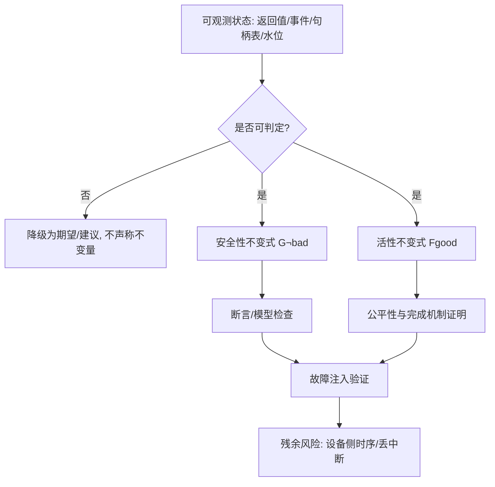

图中“可判定”是入口门槛；不可判定的性质只能作为建议。断言与模型检查覆盖软件状态，故障注入覆盖事件时序；最后一行明确残余风险不会被前两行消除。

#### 6. 拓展知识

可继续学习线性时序逻辑（LTL）、契约式设计（design by contract）、TLA+/Alloy 建模、refinement 与仿真关系、panic/halt 语义、错误预算。对比“高可用”和“高可靠”：前者强调可服务时间，后者还包含正确性、持久性和恢复能力。

#### 7. 常见追问及回答要点

1. **不变量怎么落地到 CI？**
   - 把每条不变量映射为可由日志/事件/句柄表判定的断言，并纳入故障注入用例的 oracle，而不是只写文档。
2. **可检查性不足怎么办？**
   - 先补观测点和完成令牌；无法补时明确降级为建议，不能把不可判定的性质写成“已确认”。
3. **如何避免不变量之间冲突？**
   - 明确优先级：资源安全高于吞吐；终态唯一高于重试收益；冲突时以安全性和可诊断性为准。

#### 8. 易错点与反例

- 把“不崩溃”当成不变量：进程存活但队列死锁时活性失败。
- 把提交成功当成完成证据：违反 INV-2，可能在设备仍引用 buffer 时复用。
- 把快照当承诺：违反 INV-7，准入通过后仍可能因并发争抢失败。
- 用平均值掩盖尾部分布：P99 超 SLO 的系统即便均值达标也不满足可用性目标。

#### 9. 实践与验证

[待验证] 构造纯软件的状态与事件模型做模型检查与故障注入：

- 输入：任务状态集 `NEW/SUBMITTED/COMPLETED/FAILED/CANCELLED`，资源状态集 `HELD/REUSABLE/RELEASED`，事件集 `submit/device_fail/timeout/cancel/duplicate_complete/teardown_fail`；
- 步骤：对全部事件序列做穷举或随机注入，统计非法转移；
- 预期结果：任何终态只出现一次；无完成证据时资源不进入 `REUSABLE`；`UNKNOWN` 不自动改写；
- oracle：七条不变量的判定谓词全部为真，非法边被显式拒绝；
- 指标：终态重复数、未释放资源数、错误上下文缺失字段数、恢复时间；
- 失败判断：出现多终态、未知状态提前释放或错误字段缺失即判定失败。

真实 NPU 的设备完成时序、丢中断和 reset 行为本批未运行，相关结论保持 `[待验证]`。

#### 10. 评分标准

- 不合格：把稳定性等同于不崩溃或平均延迟。
- 合格：能列出正确性、可用性、资源安全等维度并给出示例。
- 良好：能把维度写成可判定的安全性/活性谓词，并绑定观测源。
- 优秀：能给出形式化不变量集合、说明可检查性门槛、设计故障注入 oracle，并明确设备侧残余风险。

**证据与来源：** `[已确认]` `cann/90-cross-module/memory-and-resource-lifecycle.md:24-25,46-56`；`[已确认]` `cann/00-overview/global-error-model.md:14-43`；不变量形式化为 `[推断]`，验证环境为 `[待验证]`。

## HRS-E002. 如何把设备兼容性从清单检查升级为带证明义务的形式化契约？

- 难度：专家级
- 知识域：K02 设备发现、拓扑、能力协商与兼容
- 考察能力：契约设计、证明义务分解、版本矩阵推理
- 题型：设计论证与算法分析
- 面试频率：高频
- 前置知识：HRS-B002、ABI/API 兼容、类型与算子的可支持性
- 关联题目：前置 `HRS-E001`；后续 `HRS-E003`、`HRS-E014`
- 事实状态：`[已确认]` `[推断]` `[建议]` `[待验证]`

#### 1. 背景知识

CANN 由 GE、ACL、Runtime、Driver 四个独立仓库组成，通过头文件、共享库符号、错误码和 CMake 包查找协作；文档明确指出跨仓构建和发布存在 ABI、头文件、二进制符号及版本配套代价。[已确认] 来源：`cann/00-overview/architecture.md:53-54`。依赖文档进一步要求 GE、ACL、Runtime、Driver、Firmware、Toolkit、算子包和模型格式按同一发布线组合。[已确认] 来源：`cann/00-overview/dependency-map.md:38-44`。

因此“设备兼容”并不是只比较一个 device ID，而是对多层版本矩阵、能力集合和拓扑约束做联合判定。

#### 2. 问题分析

把兼容性写成带证明义务的契约：对每个任务需求，给出一个可判定的前置条件，并说明由谁、在哪一时刻、用什么证据保证其成立。证明义务应分层：

1. 二进制义务：头文件、导出符号、SONAME、结构体布局、ioctl 位宽一致；
2. 语义义务：算子、dtype、shape、内存类型的语义支持；
3. 拓扑义务：P2P、NUMA、跨节点链路可用；
4. 运行义务：提交后动态水位与状态仍满足契约。

关键在于区分“静态兼容”（一次判定长期成立）与“动态准入”（每次提交都要验证）。把两者混在一张清单里会产生竞态。

#### 3. 具体答案

我会设计一个三段式契约 `Compat = Binary ∧ Semantic ∧ Topology` 作为静态部分，再加 `Admit = Compat ∧ DynamicBudget` 作为提交点检查：

```text
Binary(task, build)   := symbol_set(task) ⊆ export_set(build)
                       ∧ layout_fingerprint(task) == layout_fingerprint(build)
Semantic(task, dev)   := dtype(task) ∈ dtype_set(dev)
                       ∧ op(task) ∈ op_set(dev, version)
                       ∧ capacity(task) ≤ capacity(dev)
Topology(task, dev)   := ∀peer ∈ peers(task): peer ∈ reachable(dev)
Admit(task, dev, t)   := Compat ∧ budget(t) ≥ demand(task)
```

每个义务绑定证据来源：`export_set` 来自导出表，`layout_fingerprint` 来自头文件/结构体定义，`dtype_set/op_set` 来自能力探测，`reachable` 来自拓扑发现，`budget(t)` 来自实时水位。任何义务缺乏证据时，结论必须是“未知”而不是“通过”。

#### 4. 技术洞察

核心开放决策是“兼容判定的时机与粒度”。选项包括：构建时静态绑定、加载时一次性校验、每次提交前校验、或运行中持续校验。粒度越细越能捕获动态变化，但代价是延迟和状态开销。

一个可用的折中是：静态义务（二进制、语义）在加载时冻结为不可变快照并加版本指纹；动态义务（拓扑、预算）在提交点复查，并允许失败时降级或迁移。这样既避免“用启动快照冒充运行时真相”，也避免每次全量重算。

残余风险集中在：闭源 Driver/固件的行为无法从用户态符号证明，模型格式与算子包的兼容只覆盖到文档声明，真实组合需设备矩阵验证。

#### 5. 图文说明

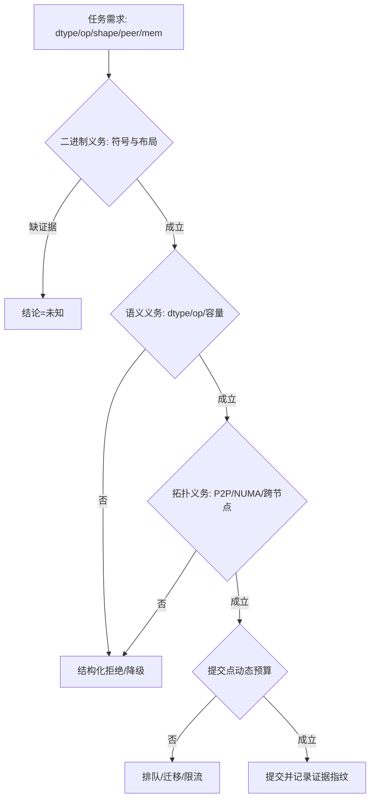

每个菱形对应一条证明义务；`结论=未知` 明确禁止在缺证据时判定通过。提交成功后记录指纹，用于事后复核“当时依据的兼容性快照”。

#### 6. 拓展知识

可继续学习 feature negotiation、ABI/API 版本策略、符号可见性与 SONAME、结构体版本化、契约式编程、兼容性测试矩阵、canary 与灰度发布。对于统一抽象层，必须保留厂商特有能力和“不支持”状态，不能把设备强行降到最小公共接口后丢失诊断信息。

#### 7. 常见追问及回答要点

1. **为什么静态兼容还不够？**
   - 静态判定不覆盖动态水位、拓扑失效和并发争抢，提交点仍需二次校验。
2. **能力探测自身失败怎么处理？**
   - 记录探测错误和缺字段，判定为“未知”，进入保守分支而非默认为支持。
3. **如何防止兼容性回退？**
   - 冻结兼容指纹并纳入契约测试，任何字段或布局变动都需同步升级版本并回归。

#### 8. 易错点与反例

- 把 device_id 当完整能力：同一逻辑编号在不同节点可能对应不同型号或软件栈。
- 把总容量当可用容量：碎片、对齐（文档记录普通内存按 32-byte 对齐）和并发会改变实际可用量。[已确认] 来源：`.../memory-and-resource-lifecycle.md:80`
- 只做启动时校验：稳态高峰仍可能 OOM 或排队超时。
- 缺证据时判定“通过”：把未知当成立，是兼容契约最常见的错误。

#### 9. 实践与验证

[待验证] 用表驱动与属性测试验证契约：

- 输入：多台模拟设备，分别缺 dtype、缺 peer 链路、动态预算不足、导出符号缺失、布局指纹不一致；任务组合覆盖正常与边界；
- 步骤：生成不可变能力快照，运行 `Compat` 与 `Admit`，再改变预算与拓扑重复提交；
- 预期结果：静态不兼容始终拒绝并给出精确原因；动态不足进入排队/迁移分支；缺证据返回“未知”；
- oracle：拒绝原因集合与预设义务一一对应，不允许笼统的“unavailable”；
- 指标：准入延迟、拒绝原因分布、快照年龄、误准入率、降级触发次数；
- 失败判断：快照显示不支持却提交成功，或预算变化后结论不变，即判定契约边界错误。

真实多卡拓扑、跨节点链路和设备版本组合未运行，保持 `[待验证]`。

#### 10. 评分标准

- 不合格：只比较设备 ID 和显存大小。
- 合格：能列出型号、版本、dtype、容量、拓扑等条件。
- 良好：能把兼容性拆成带证据来源的多层义务，并区分静态与动态判定。
- 优秀：能给出形式化契约、证明义务分解、缺证据时的“未知”语义、降级/迁移路径与残余风险治理。

**证据与来源：** `[已确认]` `cann/00-overview/architecture.md:53-54`；`[已确认]` `cann/00-overview/dependency-map.md:38-44`；`[已确认]` `.../90-cross-module/memory-and-resource-lifecycle.md:80`；契约形式化为 `[推断]`，多设备矩阵为 `[待验证]`。

## HRS-E003. 如何为执行生命周期建立可验证的形式化状态机？

- 难度：专家级
- 知识域：K03 Context/Device/Stream/Event/Queue 生命周期
- 考察能力：状态机建模、依赖图分析、可达性验证
- 题型：原理推导与形式化设计
- 面试频率：高频
- 前置知识：HRS-B003、HRS-B004、引用计数、hazard pointer
- 关联题目：前置 `HRS-E002`；后续 `HRS-E004`、`HRS-E009`
- 事实状态：`[已确认]` `[推断]` `[待验证]`

#### 1. 背景知识

CANN Runtime 文档记录了显式 Context 的生命周期：创建时校验设备、retain Device、执行 `Context::Setup`、初始化分配器和 Stream，最后才把状态设为 `ACTIVE`；销毁时先取唯一 teardown 权、切换 `ACTIVE→FINALIZING`，删除 Model、清理 owner Stream、清除线程绑定，最后在引用耗尽后从 Registry 移除并删除。[已确认] 来源：`cann/90-cross-module/memory-and-resource-lifecycle.md:38-56`。

文档还指出 Stream 清理失败且仍有合法 child handle 时会恢复 owner stream 以支持重试，这为状态机引入了一条“回退边”。

#### 2. 问题分析

形式化状态机要回答三个问题：状态集是否完整、转移关系是否确定、是否可达非法状态。我会把生命周期表达为带守卫（guard）的迁移系统，并把“不可逆释放”作为唯一吸收态。

需要显式建模的量包括：对象状态、`pending_tasks`、`child_handles`、`owner_refs`。非法状态用不变量刻画：`DESTROYED → 存在 child_handle`、`FINALIZING → 接受新提交`、`FAILED → 泄漏已初始化子资源`。

#### 3. 具体答案

Context 的生命周期可建模为：

```text
NEW -> SETTING_UP -> ACTIVE -> FINALIZING -> DEINITIALIZING -> DESTROYED
         |               ^          |
         v               |          v
       FAILED --------(rollback)  ACTIVE (child cleanup 失败且可重试)
```

转移守卫示例：

```text
SETTING_UP -> ACTIVE        if setup_ok
SETTING_UP -> FAILED        if partial_init
ACTIVE -> FINALIZING        if stop_new_access
FINALIZING -> DEINITIALIZING if child_handles==0 ∧ model_cleared ∧ streams_cleared
FINALIZING -> ACTIVE        if child_cleanup_failed ∧ retryable
DEINITIALIZING -> DESTROYED  if owner_refs==0
FAILED -> DESTROYED          if reclaimed(all_initialized_children)
```

安全销毁条件为 `destroy only when pending_tasks==0 ∧ child_handles==0 ∧ owner_refs==0`。[推断] 由文档给出的清理顺序与引用条件推得。`FINALIZING→ACTIVE` 回退边是文档确认的“清理失败恢复 owner stream”行为的形式化。[已确认] 来源同上。

#### 4. 技术洞察

形式化验证的目标不是证明“永不出错”，而是证明两类性质：(a) 安全性——不存在通往非法状态的可达路径；(b) 活性——在公平调度和完成证据存在时，`ACTIVE` 的请求最终离开活动集。

开放决策是“回退边的语义”：把 `FINALIZING→ACTIVE` 设计为幂等重试，还是设计为进入 `FAILED` 并整体回收。前者保留可用性但延长不确定窗口，后者保证一致性但可能损失已完成工作。该决策应与上层 SLO 和故障域共同确定。

另一个决策是“销毁是同步还是延迟”。文档描述的引用耗尽与 Registry 移除暗示异步延迟删除的可能，但设备侧 pending task 的具体行为未在硬件上验证。[待验证]

#### 5. 图文说明

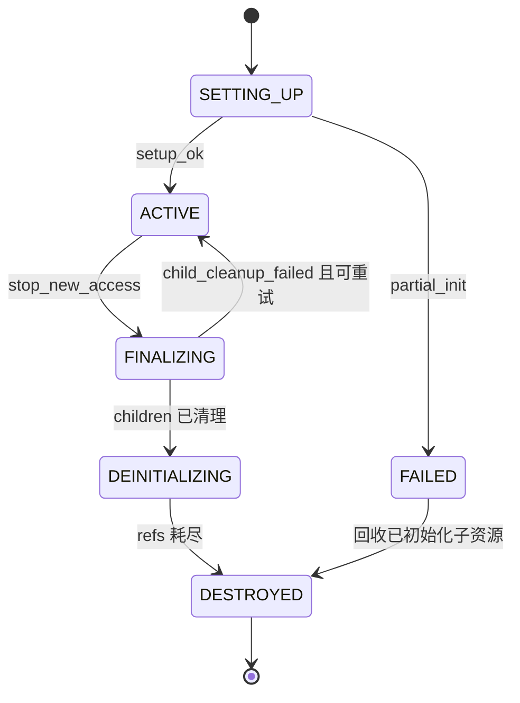

图中每个箭头带守卫条件；`FINALIZING→ACTIVE` 是唯一回退边，对应文档确认的失败恢复行为。该图不声称所有 Runtime 提供同名状态。

#### 6. 拓展知识

可继续学习 TLA+ 迁移系统、refinement、reachability 与 model checking、RAII 与异步析构、epoch reclamation、句柄 ABA 问题、primary context 语义、设备 reset 与热升级。可以练习用状态爆炸分析估算验证复杂度。

#### 7. 常见追问及回答要点

1. **为什么要单独建模回退边？**
   - 因为清理失败是文档确认存在的路径，忽略它会漏掉“既不可用又不可回收”的悬挂状态。
2. **如何验证状态机无死锁？**
   - 构造可达图并检查是否存在无出边且非吸收态的状态；对每个阻塞条件给出超时或强制回收路径。
3. **`FAILED` 状态如何回收部分初始化的资源？**
   - 按已成功初始化的子集反向回收，并保证回收操作幂等、可重入。

#### 8. 易错点与反例

- 把句柄非空当作对象可用：对象可能处于 `FINALIZING` 或 `FAILED`。
- 忽略回退边：清理失败后直接把对象标为 `DESTROYED`，产生悬挂 child handle。
- 用固定 sleep 代替完成证据：长任务或异常任务下无法保证已越过完成边界。
- 逆拓扑序清理：先销毁 Context 再销毁 Stream，可能产生悬空引用。

#### 9. 实践与验证

[待验证] 用模型检查器验证迁移系统：

- 输入：上述状态机，含一条回退边和一组子对象（Context、两个 Stream、一个 Event、一个 Model、两块被引用 Memory）；
- 步骤：枚举 `setup_fail/stream_cleanup_fail/ref_leak/early_destroy` 等注入；对每条序列搜索可达状态；
- 预期结果：不存在 `DESTROYED ∧ child_handle>0`、不存在 `FINALIZING ∧ accept_new`；
- oracle：安全性不变量的反例搜索返回空，活性在公平性假设下成立；
- 指标：可达状态数、反例长度、悬挂引用数、回退重试次数；
- 失败判断：发现任一非法可达状态即判定模型不完整。

真实设备 pending task、busy destroy 拒绝/等待语义和 reset 行为未运行，保持 `[待验证]`。

#### 10. 评分标准

- 不合格：只会描述“创建-使用-释放”的线性顺序。
- 合格：能画出基本状态转移并说明逆序清理。
- 良好：能把 `pending_tasks`、`child_handles`、`owner_refs` 纳入守卫，处理回退边。
- 优秀：能用可达性分析证明安全性、讨论活性条件、指出异步删除与设备侧残余风险。

**证据与来源：** `[已确认]` `cann/90-cross-module/memory-and-resource-lifecycle.md:38-56`；状态机与守卫为 `[推断]`；设备侧完成与 reset 语义为 `[待验证]`。

## HRS-E004. 如何证明内存子系统的资源安全（无泄漏、无越界、无重复释放）？

- 难度：专家级
- 知识域：K04 Device/Host/Pinned/Peer memory 与内存池
- 考察能力：资源不变量证明、分配器分析、故障窗口推理
- 题型：设计论证与源码分析
- 面试频率：高频
- 前置知识：HRS-E003、虚拟内存与 DMA、分配器数据结构
- 关联题目：前置 `HRS-E003`；后续 `HRS-E005`、`HRS-E011`
- 事实状态：`[已确认]` `[推断]` `[待验证]`

#### 1. 背景知识

CANN 文档把内存管理划分为四种不同粒度：Runtime `MemoryPool/MemoryList`（固定 2 MiB backing 上的 first-fit）、Runtime SOMA（stream-ordered segment，`FREE/CACHED/BUSY`）、Driver SVM cache（普通内存 backing range，exact/upper-bound 复用）以及 GE 编译期 offset 复用与 SHMEM 每 PE 虚拟窗口。[已确认] 来源：`cann/90-cross-module/pooling-and-resource-management.md:10-18`。

文档还确认 SOMA 的 async free 会把 Segment 从 `allocedMap_` 移入 CACHED，而 Driver V3 free ioctl 失败时源码明确标注“不回滚”。[已确认] 来源同上`:53-63,95`。这些机制意味着资源安全必须在多个所有权层级上分别证明。

#### 2. 问题分析

资源安全可分解为三条可证明性质：无泄漏（分配必有回收路径）、无越界（访问落在所属区间内）、无重复释放（每个所有权令牌至多消费一次）。证明需要引入“所有权令牌”抽象：每次分配产生唯一令牌，回收消费令牌。

难点在于跨层故障窗口：上层 Runtime 元数据、Driver 用户态 VMM segment、远端设备 pool client 与 AICPU 操作可能短暂处于不同状态。文档称之为“必须测试的故障窗口”。[已确认] 来源：`.../memory-and-resource-lifecycle.md:96-97`

#### 3. 具体答案

我会为每类内存定义令牌不变量：

```text
I1: alloc → token ∈ LIVE ∧ region ∉ LIVE_REGIONS
I2: free(token) → token ∈ LIVE; token := DEAD; region → FREE
I3: access(a) → a ∈ region(token) ∧ token == LIVE
I4: ∀t: count(alloc) - count(free) == |LIVE|
```

并以文档确认的清理矩阵作为回滚义务来源：Context Setup 失败调用 `TearDown` 后 delete；Kernel pool Init 失败删除新池；SOMA HAL create 失败释放已保留 VA；Context/Stream teardown 失败恢复 owner stream 或保留对象以便重试。[已确认] 来源：`.../memory-and-resource-lifecycle.md:103-114`

对于确认“不回滚”的路径（SOMA V3 free ioctl 失败），契约必须显式记录残留学段并进入恢复流程，而不能假设资源已归还。

#### 4. 技术洞察

三类分配器的安全证明难度不同。KernelMemoryPool 的 `MemoryList` 用 first-fit 且文档确认未显示邻接合并，证明重点在链表闭合与节点分配失败回滚。[已确认] 来源：`.../pooling-and-resource-management.md:37-43` SOMA 的证明重点在 Segment 双向链与 `allocedMap_` 一致性，以及 CACHED 不等于已启用重用。[已确认] 来源：`.../pooling-and-resource-management.md:55-63`、`cann/90-cross-module/pooling-and-resource-management.md:118`。Driver cache 的证明重点在多树（VA/size/mapped）一致性，文档已将其列为“多树状态不一致导致 double free、VA 重叠、缓存泄漏”的风险并建议保留 rwlock 与一致性检查。[已确认] 来源：`.../pooling-and-resource-management.md:119`

开放决策：是否为跨层操作引入“两阶段提交”语义。若 free 涉及本地元数据与设备侧 VMM，两步之间崩溃会留下不一致；要么设计可重放的日志/幂等回收，要么接受并在恢复时以设备侧为准重建。

#### 5. 图文说明

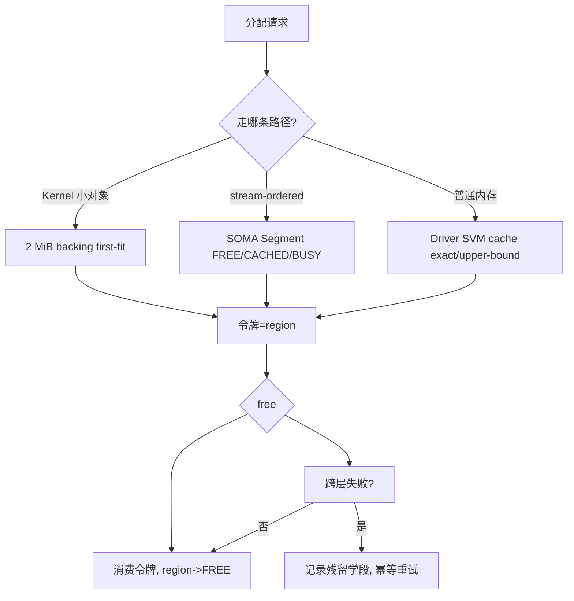

图中三条分配路径最终都必须落到令牌消费；跨层失败进入显式恢复分支，而不是假设回收成功。

#### 6. 拓展知识

可继续学习分离式分配、buddy/slab、引用计数与 GC、内存标签与 ASAN、IOMMU 保护、DMA 重映射、CRIU 检查点恢复、double free 检测。文档提到 Driver 通过 recycle range 记录“异步释放但暂不能立即复用”的 VA 段并支持 CRIU reset/restore。[已确认] 来源：`.../pooling-and-resource-management.md:75`

#### 7. 常见追问及回答要点

1. **CACHED 是否等于可立即重用？**
   - 不等同；文档明确 CACHED 当前不代表重用已启用，`TryToReuse` 为 no-op，不能把 cached 驻留写成已获得收益。
2. **free ioctl 失败后如何处理？**
   - 按文档“不回滚”事实进入显式恢复，记录残留学段并保证后续重试幂等。
3. **如何检测重复释放？**
   - 用令牌/代际号（generation）标记每次分配，消费时校验代际，防止 ABA。

#### 8. 易错点与反例

- 用 `usedSize_` 推断全局可用量：Kernel pool 的 used size 只反映其 backing，不能推导 SOMA 或全局 HBM。
- 把 cached 当 free：导致过度承诺容量。
- 把普通 device 指针当 SOMA pool 地址：文档明确非 SOMA free 走 HostFunc 与普通 Driver free 路径。[已确认] 来源：`.../shared-data-and-types.md:36`
- 忽略跨层窗口：在设备仍引用时复用或释放。

#### 9. 实践与验证

[待验证] 构造分配器与跨层故障注入测试：

- 输入：三路径分配器模型，故障点 `backing_fail/node_fail/hal_create_fail/free_ioctl_fail/partial_map`；
- 步骤：注入失败并执行回滚，检查令牌与区间表闭合；
- 预期结果：`|LIVE|` 最终为 0 或落入显式残留学段；无区间重叠；无重复消费；
- oracle：令牌不变量 I1–I4 全部成立，区间表两两不交；
- 指标：泄漏块数、重叠区间数、双重释放数、恢复时间；
- 失败判断：出现泄漏、越界或双重释放即判定资源安全失败。

真实 Driver 内核/固件物理页行为、busy destroy 与 CRIU 未运行，保持 `[待验证]`。

#### 10. 评分标准

- 不合格：只会说“用完就 free，注意别泄漏”。
- 合格：能区分 KernelMemoryPool、SOMA、普通内存三条路径。
- 良好：能用令牌不变量刻画无泄漏/无越界/无重复释放，并引用文档回滚矩阵。
- 优秀：能处理跨层故障窗口、设计幂等恢复、分析多树一致性风险并明确残余风险。

**证据与来源：** `[已确认]` `cann/90-cross-module/pooling-and-resource-management.md:10-18,37-63,75,95,118-119`；`[已确认]` `cann/90-cross-module/memory-and-resource-lifecycle.md:96-114`；`[已确认]` `cann/90-cross-module/shared-data-and-types.md:36`；令牌证明为 `[推断]`，内核/固件行为为 `[待验证]`。

## HRS-E005. 如何为异步完成语义定义一个可推理的一致性模型？

- 难度：专家级
- 知识域：K05 异步提交、完成语义、同步与可见性
- 考察能力：内存模型推理、可见性分析、完成证据设计
- 题型：概念解释与形式化设计
- 面试频率：高频
- 前置知识：HRS-B004、HRS-E004、内存一致性模型
- 关联题目：前置 `HRS-E004`；后续 `HRS-E006`、`HRS-E010`
- 事实状态：`[已确认]` `[推断]` `[待验证]`

#### 1. 背景知识

文档将四个时刻明确区分：主机 API 返回成功、Runtime 元数据改变、Driver 接受请求、设备任务完成，并特别指出普通异步任务、SOMA AICPU 操作和模型执行都不应把提交成功解释为设备已消费完 buffer。[已确认] 来源：`cann/90-cross-module/memory-and-resource-lifecycle.md:24-25`

错误模型进一步规定：不以 `ACL_SUCCESS` 或 `GRAPH_SUCCESS` 推断设备任务已完成，异步路径必须同步或等待事件。[已确认] 来源：`cann/00-overview/global-error-model.md:39-43`

#### 2. 问题分析

异步系统的一致性模型要回答两个问题：完成在何时“发生”，以及完成之前/之后哪些读写是可见的。前者是完成语义，后者是可见性语义。

可按强度分层定义：提交顺序（program order）、队列顺序（stream order）、跨流依赖（event/notify）、设备全局可见（device fence/synchronize）。不同 API 可能只保证其中一段。文档提到 `rtFreeWithDevSync` 与 `rtFreeHostWithDevSync` 显式先同步设备再释放，不是普通 free 的别名，说明 API 一致性强度本身存在差异。[已确认] 来源：`.../memory-and-resource-lifecycle.md:99-101`

#### 3. 具体答案

我会定义四段一致性契约，并对每个资源标注其保证强度：

```text
C0 程序序:    同一线程内 my writes before my reads
C1 流序:      same-stream tasks execute in submission order
C2 跨流可见:  write happens-before read if joined by event/notify
C3 设备全局:  after device/stream synchronize, device-visible effects observable
```

完成证据设计为显式令牌：同步返回、Event wait、已确认 callback、且 callback 内存必须在完成前保持有效。资源复用的守卫是 `reuse(resource) requires completion_token(resource) ∈ CONSUMED`。

对 `rtMalloc`/`rtMemPoolMallocAsync` 等不同家族，采用不同默认强度：普通 free 与 SOMA async free 的可见性保证不同；跨流复用必须由 event/internal dependency 证明，文档在 GE 复用策略中明确“跨 stream 复用必须由 event/internal dependency 证明，不能只按 tensor size 判断”。[已确认] 来源：`.../pooling-and-resource-management.md:83`

#### 4. 技术洞察

一致性模型的价值在于把“感觉应该完成了”变成可判定的 `happens-before` 关系。关键开放决策是：默认提供哪种强度。强一致（每任务 fence）最易推理但代价高；弱一致（仅流序）性能好但要求调用者显式建立依赖。

可以借鉴 acquire/release 语义：完成令牌相当于 release，等待令牌相当于 acquire，二者配对形成可见性边。未被任何令牌连接的读写之间，不假设可见性。

残余风险在于设备侧真实完成时序与中断行为无法从软件契约证明，尤其 SOMA async free 的“先删 VMM segment、ioctl 失败不回滚”产生窗口。[已确认] 来源：`.../memory-and-resource-lifecycle.md:95`

#### 5. 图文说明

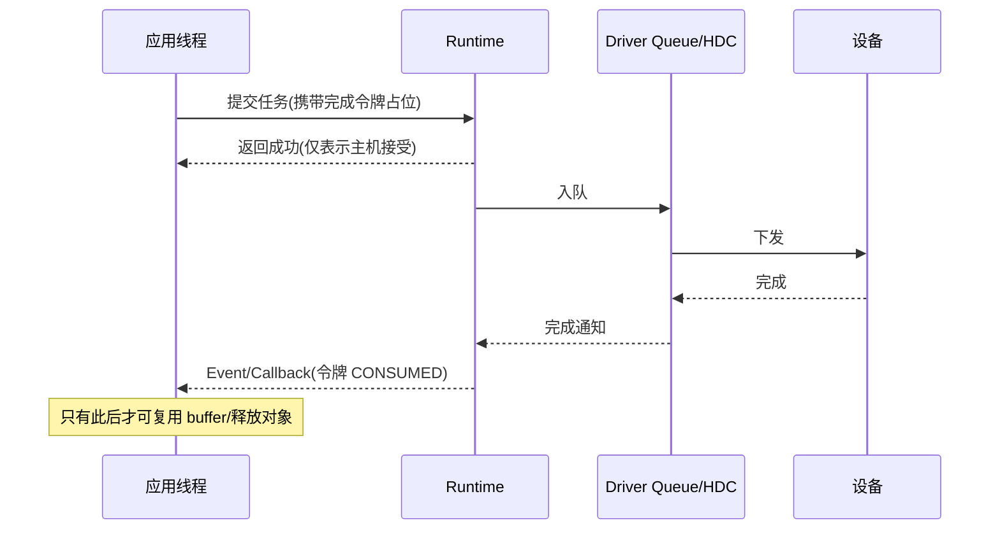

时序图区分“返回成功”与“令牌消费”；只有最后一步建立可见性边，之前的读写在无其他依赖时不可假设可见。

#### 6. 拓展知识

可继续学习 release/acquire、fence 与 scope、RCU、happens-before 图、流序与图捕获、event record/wait 语义、notify 的跨节点基地址计算。[推断] 文档提到跨节点 Notify 需按拓扑计算基地址，构造成本高于普通 Event。[已确认] 来源：`cann/memory_graph_analysis.md:1512`（该文件位于知识源根目录）

#### 7. 常见追问及回答要点

1. **提交返回 0 能否释放输入 buffer？**
   - 不能；必须等到完成令牌被消费，否则设备可能仍在引用。
2. **跨流复用需要什么证据？**
   - event 或 internal dependency 建立的 happens-before 边，而非 tensor 大小。
3. **超时是不是“未执行”？**
   - 不是；超时只表示观察窗口内无完成证据，结果应标为 `UNKNOWN`。

#### 8. 易错点与反例

- 把返回成功当完成：最常见的可见性错误。
- 用 sleep 代替 event：无法覆盖长任务与异常任务。
- 假设所有 free 语义相同：忽略普通 free 与 `rtFreeWithDevSync` 的强度差异。
- 无依赖地跨流复用：数据竞争与静默数据损坏。

#### 9. 实践与验证

[待验证] 用并发压测与故障注入验证一致性模型：

- 输入：两条 Stream、一个 Event、一个 callback，任务读写共享缓冲区；故障点 `callback_missing/reorder/timeout/early_reuse`；
- 步骤：在无依赖、有 event 依赖两种配置下并发运行，检查数据竞争与可见性断言；
- 预期结果：无依赖配置出现竞争或竞争检测告警；有依赖配置满足 C2；提前复用触发断言；
- oracle：`happens-before` 图与完成令牌消费记录一致；
- 指标：竞争次数、可见性违例、完成延迟分布、提前复用次数；
- 失败判断：出现未被依赖覆盖的读写竞争即判定模型被破坏。

真实设备完成时序与丢中断未运行，保持 `[待验证]`。

#### 10. 评分标准

- 不合格：认为提交成功即完成。
- 合格：能区分提交、入队、完成三个时刻。
- 良好：能给出分层一致性契约与完成令牌，说明跨流依赖。
- 优秀：能用 happens-before 推理、设计可见性 oracle、指出设备侧时序残余风险与不同 API 的强度差异。

**证据与来源：** `[已确认]` `cann/90-cross-module/memory-and-resource-lifecycle.md:24-25,95-101`；`[已确认]` `cann/00-overview/global-error-model.md:39-43`；`[已确认]` `cann/90-cross-module/pooling-and-resource-management.md:83`；`[推断]` `cann/memory_graph_analysis.md:1512`；时序实验为 `[待验证]`。

## HRS-E006. 如何在共享异构设备上设计调度隔离、公平性与准入控制？

- 难度：专家级
- 知识域：K06 调度、并发、隔离、优先级与配额
- 考察能力：调度设计、公平性形式化、隔离机制分析
- 题型：系统设计与取舍分析
- 面试频率：中频
- 前置知识：HRS-E002、队列理论、OS 调度
- 关联题目：前置 `HRS-E002`；后续 `HRS-E007`、`HRS-E011`
- 事实状态：`[已确认]` `[推断]` `[建议]`

#### 1. 背景知识

CANN 的调度相关能力分散在多层：Runtime 提供任务调度与 Stream/Event，Driver 侧包含 `esched`（Event Schedule）事件调度、queue 队列上下文与 HDC 通信。[已确认] 来源：`cann/01-modules/module-registry.md:19-20` Driver 的 queue open/release 管理进程 queue context，HDC client 在存在活动 session 时不能销毁。[已确认] 来源：`cann/00-overview/design-principles.md:19`、`cann/90-cross-module/end-to-end-flows.md:55`

文档未提供调度公平性或配额算法的源码级细节，因此本题的公平性与准入设计属于 `[建议]/[推断]`，需以目标版本的 esched/queue 实现和设备验证为准。

#### 2. 问题分析

共享设备上要实现三件事：隔离（一个租户的失败或过载不拖垮其他租户）、公平（资源在竞争方之间按约定分配）、准入（超出容量或配额的请求被拒绝或排队而非压垮系统）。

形式化目标可写为：隔离使得故障域内资源占用有上界；公平使得任意两个活跃租户的归一化服务量之差有界；准入使得 `demand ≤ capacity` 时才进入执行集。

#### 3. 具体答案

我建议的分层设计：

- 配额层：为每个租户/Context 定义内存、队列深度、并发任务数上界；
- 优先级层：区分延迟敏感与吞吐型任务，避免低优先级无限饥饿；
- 队列层：在 Driver queue/esched 侧按租户分区，限制单队列 backlog；
- 准入层：提交前做 `Admit = quota_ok ∧ capacity_ok`，失败返回结构化原因并支持排队/降级；
- 隔离层：故障域绑定到设备/queue，实现 bulkhead，避免跨租户级联。

公平性用 max-min 或加权公平排队刻画，并明确“公平”的度量口径（吞吐、时延还是资源占比）。文档在风险登记中把“全局锁/缓存与多设备并发”列为死锁/竞态风险，因此隔离设计还需覆盖锁顺序与状态污染。[已确认] 来源：`cann/99-roadmap/risk-register.md:21`

#### 4. 技术洞察

核心开放决策是“隔离放在哪一层”。在 Runtime 层做准入成本低、覆盖广，但无法阻止绕过 Runtime 的低层请求；在 Driver 层做隔离更彻底，但修改 ABI 风险高（文档变更影响地图要求 HAL/ioctl 变更同步所有调用方）。[已确认] 来源：`cann/90-cross-module/change-impact-map.md:26-28`

另一个决策是“公平与优先级冲突时的裁决”。严格优先级会牺牲公平并可能饥饿；纯公平会牺牲延迟敏感任务的尾延迟。常见折中是分层加权 + 老化（aging）机制。

残余风险：调度实际行为依赖闭源固件与设备侧调度链，公平性指标无法仅凭用户态源码证明。

#### 5. 图文说明

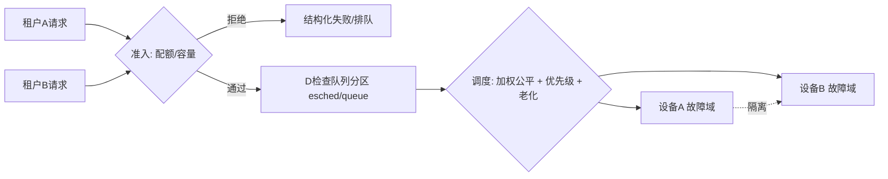

准入在队列之前拦截过载；调度器在设备故障域内分配；虚线表示隔离边界，确保一个设备域的拥塞不传播到另一个。

#### 6. 拓展知识

可继续学习 max-min fairness、加权公平排队、drr、CFS、admission control、token bucket、bulkhead、circuit breaker、cgroup/device plugin、MPS 类共享机制。可对比批处理与在线推理的不同调度目标。

#### 7. 常见追问及回答要点

1. **严格优先级会不会导致饥饿？**
   - 会；需要老化或预留配额，并定义饥饿检测与告警。
2. **准入拒绝会不会伤害可用性？**
   - 明确拒绝优于无界排队；应返回可重试语义并配合退避与降级。
3. **隔离如何与故障域对齐？**
   - 把租户映射到独立设备/queue 故障域，锁与缓存状态按域分区，避免全局锁放大影响。

#### 8. 易错点与反例

- 只加并发度不加隔离：过载从单设备扩散为系统级故障。
- 用全局锁保护所有设备：一个慢设备阻塞全部租户。
- 把公平当吞吐最大化：忽视时延敏感的尾部分布。
- 准入只查总量不查碎片：容量充足仍可能分配失败。

#### 9. 实践与验证

[待验证] 用多进程压测验证调度设计：

- 输入：两到三个租户，各自设定配额，混合延迟敏感与吞吐型任务；
- 步骤：逐步提高单租户负载直至超配额，观察其他租户的吞吐与尾延迟；注入单设备故障；
- 预期结果：超配额请求被拒绝/排队且不侵占他租户；单设备故障被隔离，其他域指标平稳；
- oracle：隔离下界（他租户吞吐下降不超过声明边界）、公平偏差有界、准入拒绝原因可解释；
- 指标：Jain 公平指数、P99 延迟、队列深度、拒绝率、隔离恢复时间；
- 失败判断：出现跨租户尾延迟传播或故障域外资源耗尽即判定隔离失败。

真实多进程、esched/queue 行为和固件调度未运行，保持 `[待验证]`。

#### 10. 评分标准

- 不合格：只谈“加队列、控并发”。
- 合格：能说明配额、优先级、队列和准入的基本层次。
- 良好：能形式化隔离、公平和准入目标，并给出分层隔离方案。
- 优秀：能讨论隔离层级取舍、优先级与公平的裁决、老化机制、故障域对齐，并明确固件残余风险。

**证据与来源：** `[已确认]` `cann/01-modules/module-registry.md:19-20`；`[已确认]` `cann/00-overview/design-principles.md:19`；`[已确认]` `cann/99-roadmap/risk-register.md:21`；`[已确认]` `cann/90-cross-module/change-impact-map.md:26-28`；调度公平性与准入设计为 `[建议]/[推断]`，多进程实验为 `[待验证]`。

## HRS-E007. 如何设计拓扑感知的传输路径优化，并保证其正确性不被优化牺牲？

- 难度：专家级
- 知识域：K07 Host-device 传输、DMA、NUMA、IOMMU、P2P
- 考察能力：拓扑分析、路径优化设计、正确性与性能解耦
- 题型：设计论证与性能路径分析
- 面试频率：高频
- 前置知识：HRS-E004、PCIe/NUMA、DMA 与粘性内存
- 关联题目：前置 `HRS-E004`；后续 `HRS-E008`、`HRS-E011`
- 事实状态：`[已确认]` `[推断]` `[建议]` `[待验证]`

#### 1. 背景知识

CANN 的内存路径区分 HBM/DDR、P2P、Huge Page、NUMA 等属性。文档指出普通 `rtMalloc` 会按页类型、HBM/DDR/P2P、节点和 module ID 编进 HAL flags 后调用 `halMemAlloc`。[已确认] 来源：`cann/90-cross-module/memory-and-resource-lifecycle.md:80` Driver 侧 V3 的 `cache_init` 根据 host/device、P2P、huge-page 组合创建多类 allocator，而 NUMA 无指定节点是 cache 判定的一个条件。[已确认] 来源：`cann/90-cross-module/pooling-and-resource-management.md:71`、`cann/01-modules/M04-driver/driver-memory-pool-analysis.md:1132-1152`

SHMEM 侧按 `rankCnt × aligned segment size` 保留全局 VA，每个 PE 获得固定窗口，并通过 fabric handle 导出/映射 slice。[已确认] 来源：`.../pooling-and-resource-management.md:91`

#### 2. 问题分析

拓扑感知传输优化的目标是选一条在正确性约束下延迟/带宽最优的路径。正确性约束包括：数据必须落在可被目标设备访问的内存类型、跨节点访问必须使用可用的 fabric 通道、映射必须成功且各 rank 对称。

优化维度：就近放置（NUMA-aware）、P2P 直连替代主机中转、大页减少映射开销、异步拷贝与计算重叠。每个维度都必须有降级路径，否则优化即脆弱点。

#### 3. 具体答案

我会把路径选择写成带正确性守卫的代价函数：

```text
valid(p) := memtype_ok(p) ∧ peer_reachable(p.src,p.dst) ∧ map_ok(p)
cost(p)  := α·latency(p) + β/bandwidth(p) + γ·setup(p)
select   := argmin_{p: valid(p)} cost(p),  fallback = host_staged
```

其中 `memtype_ok` 要求数据位于目标可访问内存（如 P2P 内存、Huge Page 或正确 NUMA 节点），`peer_reachable` 依赖拓扑发现，`map_ok` 要求 fabric handle 映射成功。若无任何有效 P2P 路径，回退到经主机的分阶段拷贝，而不是强行 P2P。

文档确认的复用/opt 决策（split/merge/shrink、exact/upper-bound）会影响 setup 代价，因此代价函数需结合缓存命中状态。[已确认] 来源：`.../pooling-and-resource-management.md:69-75`

#### 4. 技术洞察

最关键的设计决策是“优化不得改变可观察语义”。P2P 与主机中转的结果必须逐位一致，否则不是优化而是语义变更。因此每次路径切换都需要结果校验 oracle。

开放决策：是否允许在运行时动态重选路径。动态重选能适应拓扑变化，但会引入非确定性并可能与内存复用、cache 状态交互。可行做法是把路径作为图/任务属性在编译或加载时确定，运行时仅在失效时回退。

残余风险：NUMA、IOMMU、PCIe 拓扑与 fabric 的实际带宽和错误行为依赖硬件与固件；文档明确当前无设备性能数据，相关结论必须标为 `[待验证]`。[已确认] 来源：`cann/90-cross-module/performance-critical-paths.md:6,40`

#### 5. 图文说明

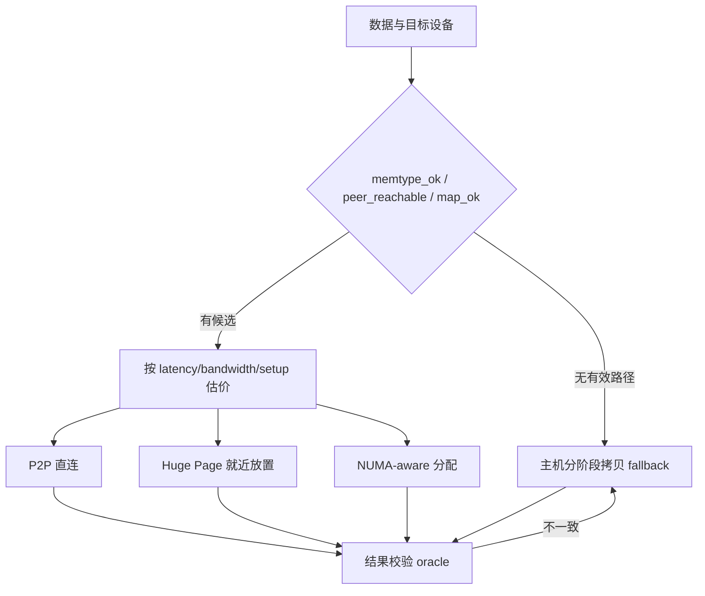

所有候选路径都经过同一结果校验 oracle；一旦结果不一致立即回退到语义等价的主机路径。

#### 6. 拓展知识

可继续学习 NUMA 亲和、first-touch、IOMMU/SMMU、ATS/PASID、PCIe P2P、GPUDirect、DMA 引擎、零拷贝、通信与计算重叠、SM occupancy 与拷贝引擎竞争。可研究大页（文档提及 Huge Page 与 1GB 大页策略）对映射开销的影响。[已确认] 来源：`cann/memory_graph_analysis.md:52-53`

#### 7. 常见追问及回答要点

1. **P2P 优化会不会改变结果？**
   - 不应；必须用结果 oracle 证明逐位等价，否则回退主机路径。
2. **拓扑变化时怎么办？**
   - 预先声明有效集，失效时回退到 always-valid 的主机路径并记录事件。
3. **如何量化收益而不造假？**
   - 分离测量 setup、传输、同步时间，记录拓扑与配置；无设备时不给出性能数字。

#### 8. 易错点与反例

- 假设所有 P2P 对称：实际链路可达性和带宽可能不同（文档提到跨节点 Notify 需按拓扑计算基地址）。[推断]
- 忽略 NUMA：跨节点访问导致带宽下降而正确性仍“看起来对”。
- 用总带宽估可用带宽：未计入并发争抢与拷贝引擎竞争。
- 把编译期 offset 复用率当运行期节省：文档明确二者不是同一件事。[已确认] 来源：`.../pooling-and-resource-management.md:85`

#### 9. 实践与验证

[待验证] 用拓扑模拟与结果校验验证路径选择：

- 输入：若干模拟拓扑（同 NUMA、跨 NUMA、有/无 P2P），数据块与目标设备；
- 步骤：对每种拓扑运行路径选择与传输，比较 P2P 与主机路径结果的逐位一致性；注入映射失败；
- 预期结果：结果始终一致；映射失败时回退主机路径且事件被记录；
- oracle：`valid()` 守卫、逐位一致、回退路径可达；
- 指标：路径选择命中率、setup 时间、传输时间、回退次数；
- 失败判断：任一路径结果不一致或存在“无有效路径却不回退”即判定设计缺陷。

真实 NUMA/IOMMU/P2P/fabric 带宽与错误行为未运行，保持 `[待验证]`。

#### 10. 评分标准

- 不合格：只说“用 P2P 更快”。
- 合格：能识别内存类型、NUMA、P2P 等基本属性。
- 良好：能把路径选择写成带正确性守卫的代价函数，给出回退路径。
- 优秀：能证明优化不改变语义、讨论动态重选取舍、分离性能测量口径，并明确硬件残余风险。

**证据与来源：** `[已确认]` `cann/90-cross-module/memory-and-resource-lifecycle.md:80`；`[已确认]` `cann/90-cross-module/pooling-and-resource-management.md:69-75,71,85,91`；`[已确认]` `cann/01-modules/M04-driver/driver-memory-pool-analysis.md:1132-1152`；`[已确认]` `cann/90-cross-module/performance-critical-paths.md:6,40`；`[推断]` `cann/memory_graph_analysis.md:52-53,1512`；拓扑实验为 `[待验证]`。

## HRS-E008. 如何为跨卡/跨节点集合通信设计可扩展性与容错？

- 难度：专家级
- 知识域：K08 跨卡/跨节点通信、集合通信与 RDMA
- 考察能力：集合算法分析、容错设计、对称性推理
- 题型：系统设计与故障分析
- 面试频率：高频
- 前置知识：HRS-E007、集合通信基础、RDMA 基础
- 关联题目：前置 `HRS-E007`；后续 `HRS-E009`、`HRS-E010`
- 事实状态：`[已确认]` `[推断]` `[待验证]`

#### 1. 背景知识

SHMEM 的初始化后端为 P2P/RDMA/SDMA 建立 host/device heap base 指针数组；`remove_heap` 释放数组并 unmap，`release_heap` 先 unreserve VA 再 destroy entity。文档强调任一步失败都可能留下部分状态，调用方依赖 `firstError` 和 collective status gate 保持各 rank 一致。[已确认] 来源：`cann/90-cross-module/pooling-and-resource-management.md:93`

文档还把“SHMEM 对称性/映射失败”列为风险：某些 PE heap 未映射会导致 RDMA/SDMA 错误，并建议用 collective gate 记录 rank 状态。[已确认] 来源：`.../pooling-and-resource-management.md:121` 知识源另记录“检查协处理器 Stream 的 MC2/HCCL 能力”。[已确认] 来源：`cann/memory_graph_analysis.md:848`

#### 2. 问题分析

集合通信要同时满足：可扩展性（参与者增加时开销增长可控）、正确性（所有 rank 结果一致）、容错（部分参与者失败不导致集体死锁或数据错误）。

核心难点是集体操作的“全或无”语义：若一个 rank 失败而其他 rank 仍在等待，会出现集体死锁；若部分 rank 完成了数据交换而其他没有，会出现静默数据错误。文档的 `firstError` + collective status gate 正是为对齐各 rank 状态而设计的模式。

#### 3. 具体答案

我会设计三个机制：

- collective gate：每次集合操作前，各 rank 通过状态门对齐“是否继续”，任一 rank 报错则统一进入 abort 或重配置，而不是各自为政；
- firstError 传播：记录第一个失败及其 rank/链路/阶段，后续 rank 以此为准，避免用各自局部错误覆盖根因；
- 可重配置集合域：在参与者变化时重新建立通信组与 fabric handle，并保证旧资源按 Unmap→Release→erase 顺序释放。

可扩展性上用树形/环形拓扑替代全连接，并让通信组大小与 fabric 能力匹配。文档提到 SHMEM 按 `rankCnt × aligned segment size` 预留 VA，说明 VA 规划随 rank 数线性增长，是可扩展性的一个直接成本因素。[已确认] 来源：`.../pooling-and-resource-management.md:91`

#### 4. 技术洞察

关键开放决策是“失败时选择 abort 还是重配置”。abort 简单且避免错误数据，但牺牲可用性；重配置保留工作但需要一致的新视图和资源回收，复杂度高。工程上常结合故障域：单链路失败可重配置绕行，整 rank 失败进入 abort 并由上层重启该 rank。

另一个决策是“集合操作是否幂等/可重放”。只有当输入未改变且外部副作用可控时才能重放，否则应进入一致性恢复。

残余风险集中在多节点网络、RDMA 后端和异常 rank 回滚，文档明确这些需要硬件/网络实验，当前未验证。[已确认] 来源：`cann/90-cross-module/pooling-and-resource-management.md:141`

#### 5. 图文说明

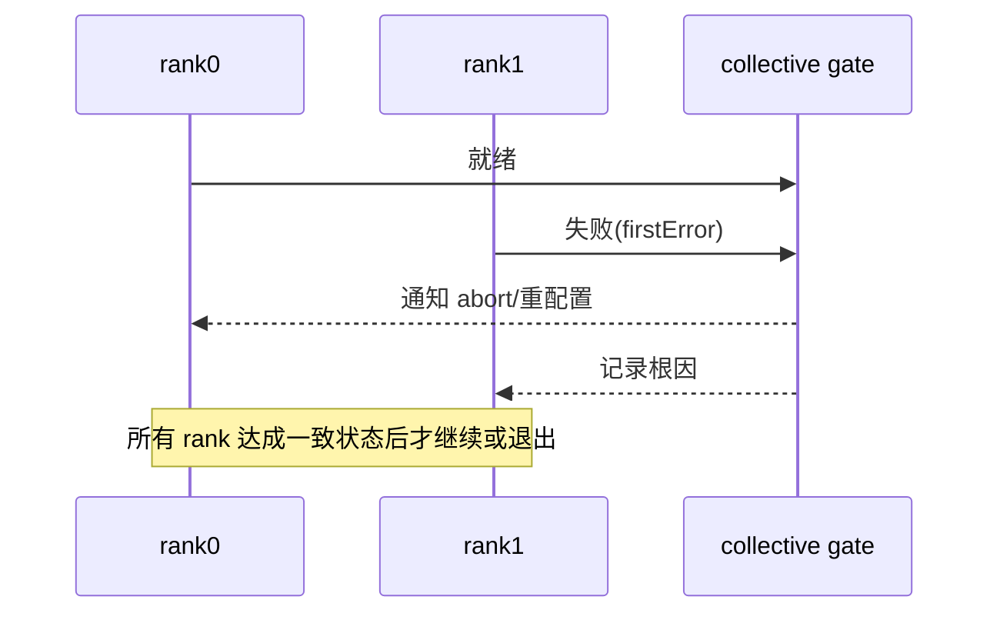

时序图强调 gate 的对齐作用：任一 rank 失败都会先对齐其他 rank，再统一进入 abort 或重配置，避免集体死锁。

#### 6. 拓展知识

可继续学习 ring/tree/recursive-doubling allreduce、NCCL/HCCL 梯度、RDMA verbs、RoCE 拥塞控制、in-network reduction、弹性训练与 rank 替换、故障检测心跳。可对比同步与异步集合的容错性质。

#### 7. 常见追问及回答要点

1. **一个 rank 失败为什么会导致死锁？**
   - 其他 rank 在等待其参与，缺少 collective gate 时无法形成一致决策。
2. **重配置比 abort 好在哪、风险在哪？**
   - 保留可用性，但需一致的新视图与资源回收，复杂度高且易引入数据错误。
3. **如何保证各 rank 结果一致？**
   - 用 gather/scatter 后的校验和或哈希比对，任何不一致触发 abort。

#### 8. 易错点与反例

- 各自处理局部错误：rank 间状态发散，导致死锁或错误数据。
- 忽略 VA 线性增长：rank 数增大时预留窗口和映射开销线性上升。
- 把 P2P 可用当 RDMA 可用：不同 fabric 后端能力不同。
- 释放顺序错误：未按 Unmap→Release→erase 顺序，留下部分映射。

#### 9. 实践与验证

[待验证] 用多进程/多节点故障注入验证容错：

- 输入：模拟集合域（N rank），故障点 `rank_fail/link_fail/partial_map/late_join`；
- 步骤：在集合操作中注入故障，观察 gate 行为与资源回收；
- 预期结果：各 rank 一致进入 abort 或重配置；无集体死锁；资源无泄漏；
- oracle：所有 rank 状态一致、firstError 根因被保留、映射表闭合；
- 指标：检测时间、重配置时间、不一致次数、泄漏句柄数；
- 失败判断：出现 rank 状态发散或集体死锁即判定容错设计失败。

真实多节点网络、RDMA/SDMA 后端与异常 rank 回滚未运行，保持 `[待验证]`。

#### 10. 评分标准

- 不合格：只说“用 allreduce、加超时”。
- 合格：能描述集合操作与基本失败模式。
- 良好：能设计 collective gate、firstError 传播和资源释放顺序。
- 优秀：能分析可扩展性成本（VA 线性增长、拓扑选择）、abort 与重配置取舍，并明确多节点残余风险。

**证据与来源：** `[已确认]` `cann/90-cross-module/pooling-and-resource-management.md:91,93,121,141`；`[已确认]` `cann/memory_graph_analysis.md:848`；容错机制设计为 `[推断]/[建议]`，多节点实验为 `[待验证]`。

## HRS-E009. 如何划分故障域并治理爆炸半径？

- 难度：专家级
- 知识域：K09 错误传播、超时、取消、重试、恢复与注入
- 考察能力：故障域建模、爆炸半径治理、恢复策略设计
- 题型：设计论证与故障分析
- 面试频率：高频
- 前置知识：HRS-E003、HRS-E008、幂等性
- 关联题目：前置 `HRS-E008`；后续 `HRS-E010`、`HRS-E013`
- 事实状态：`[已确认]` `[推断]` `[建议]` `[待验证]`

#### 1. 背景知识

CANN 风险登记列出了与故障域直接相关的条目：异步资源提前释放导致崩溃或数据损坏；错误跨层映射丢上下文导致定位困难；全局锁/缓存与多设备并发导致死锁、竞态或状态污染；SoC 条件编译分支不一致导致产品特定回归。[已确认] 来源：`cann/99-roadmap/risk-register.md:15-24`

错误边界文档给出了内存路径的失败窗口与残留学段表，例如 SOMA V3 free ioctl 失败“不回滚”、Context/Stream teardown 失败需保留对象以便重试。[已确认] 来源：`cann/90-cross-module/error-boundaries.md:26-38`

#### 2. 问题分析

故障域是“一个失败不会越过其边界传播”的资源集合。划分维度包括：设备/Die、Context/Stream、队列、进程、节点、租户。爆炸半径是失败影响到的最大范围。

治理目标是让任一单点失败的影响可预测且有界，并让恢复动作本身不扩大范围。这要求三件事：边界处有隔离（bulkhead）、跨越边界的信息最小化（避免全局状态）、恢复动作有界且幂等。

#### 3. 具体答案

我会定义故障域层级与对应治理动作：

```text
域层级: task ⊂ stream ⊂ context ⊂ device ⊂ node ⊂ cluster
隔离: 每个域拥有独立的队列/内存配额/锁分区
检测: 每域设置健康信号(完成率/队列深度/错误率)
恢复: 域内重试/取消 -> 域级隔离 -> 域级重建 -> 上层降级
有界性: blast_radius ≤ 声明的域上界
```

关键不变量：`recover(op)` 只在声明域内产生副作用，且 `recover(op)` 幂等；域的失败不得修改父域的鲁棒状态。文档建议保留底层错误、设备、Context/Stream、阶段和任务 ID，这是跨域追踪根因的基础。[已确认] 来源：`cann/90-cross-module/error-boundaries.md:47-49`

对确认“不回滚”的路径，恢复契约必须接受残留学段并要求人工或设备级重置后再接纳流量。[建议]

#### 4. 技术洞察

核心开放决策是“域粒度的取舍”。域越小，爆炸半径越小，但管理和检测开销越大、跨域协调（如集合通信）越复杂；域越大，管理简单，但一个失败影响面大。

另一个决策是“失败时的保守程度”：隔离过度会牺牲可用性，隔离不足会放大故障。文档调试指南强调先保护系统（限流、停止新提交、标记故障域）再定位根因，这一顺序与爆炸半径治理一致。[已确认] 来源：`cann/99-roadmap/debugging-guide.md:14-30`

残余风险：设备/固件级故障（如整卡 hang）可能使域内恢复无效，只能靠域级重建或更换设备；这类行为的真实影响需硬件验证。

#### 5. 图文说明

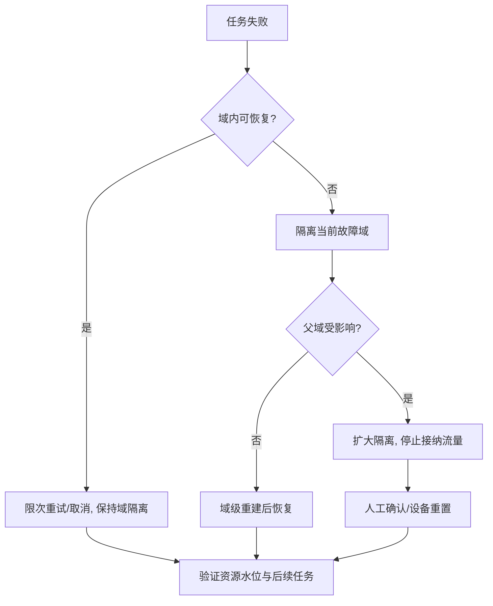

决策树体现“先域内、再域级、最后上层”的递进恢复；每一步都需验证资源水位，确保恢复动作不引入新泄漏。

#### 6. 拓展知识

可继续学习 bulkhead、circuit breaker、watchdog、watchdog reset、混沌工程、fault injection、fail-fast 与 fail-safe、graceful degradation、postmortem 与防复发。文档将“故障注入”列为验证异步生命周期的手段。[已确认] 来源：`cann/99-roadmap/testing-recipes.md:20`

#### 7. 常见追问及回答要点

1. **域粒度怎么定？**
   - 按“单点失败的自然边界”和 SLO 容忍度确定；设备/节点是常用天然边界。
2. **恢复如何保证不扩大半径？**
   - 恢复只操作声明域内资源，幂等且先隔离后重建，禁止跨域全局状态写入。
3. **不可恢复故障怎么办？**
   - 进入域级重建/替换，并向上层暴露明确失败，避免无界重试。

#### 8. 易错点与反例

- 全局重试：把单设备失败放大为全集群拥塞。
- 恢复动作写全局状态：污染其他域，破坏隔离。
- 把 `UNKNOWN` 当可重试失败：可能重复不可逆副作用。
- 无界等待：缺少 watchdog/超时导致队列永久阻塞。

#### 9. 实践与验证

[待验证] 用故障注入验证爆炸半径：

- 输入：域层级模型与故障点 `task_fail/stream_fail/context_fail/device_hang/node_partition`；
- 步骤：逐层注入并执行恢复，测量影响到的域范围；
- 预期结果：影响范围不超过声明上界；父域鲁棒状态不被修改；恢复幂等；
- oracle：`blast_radius ≤ bound` 且恢复后资源水位回归基线；
- 指标：爆炸半径、检测/隔离/恢复时间、跨域副作用数、重复副作用数；
- 失败判断：影响超出声明域或恢复引入跨域副作用即判定治理失败。

真实设备 hang、节点分区和多进程恢复未运行，保持 `[待验证]`。

#### 10. 评分标准

- 不合格：只建议重启或无限重试。
- 合格：能识别设备/进程等基本故障域。
- 良好：能给出分层域、隔离机制和递进恢复策略。
- 优秀：能形式化爆炸半径上界、设计幂等有界恢复、论证域粒度取舍，并明确硬件级残余风险。

**证据与来源：** `[已确认]` `cann/99-roadmap/risk-register.md:15-24`；`[已确认]` `cann/90-cross-module/error-boundaries.md:26-38,47-49`；`[已确认]` `cann/99-roadmap/debugging-guide.md:14-30`；`[已确认]` `cann/99-roadmap/testing-recipes.md:20`；域设计与恢复策略为 `[建议]/[推断]`，硬件故障实验为 `[待验证]`。

## HRS-E010. 如何设计全链路可观测性与可作证的证据体系？

- 难度：专家级
- 知识域：K10 日志、指标、Tracing、dump、SLO 与证据链
- 考察能力：证据链设计、字段建模、SLO 与诊断结合
- 题型：系统设计与方法论
- 面试频率：中频
- 前置知识：HRS-E005、HRS-E009、可观测性基础
- 关联题目：前置 `HRS-E009`；后续 `HRS-E011`、`HRS-E012`
- 事实状态：`[已确认]` `[推断]` `[建议]` `[待验证]`

#### 1. 背景知识

全局错误模型规定优先保存最底层错误码、设备 ID、Context/Stream、模型/Graph 标识和调用阶段，并明确日志和 DFX 属于旁路诊断设施，不改变资源所有权。[已确认] 来源：`cann/00-overview/global-error-model.md:39-43` 错误边界文档建议跨层统一记录时间戳、线程、设备、Context、Stream、Graph/Model、pool、VA、size、API 阶段、原始错误码、映射后错误码和资源句柄。[已确认] 来源：`cann/90-cross-module/error-boundaries.md:47-49`

Runtime 侧包含 log、profiling、dump、error manager 等维测设施。[已确认] 来源：`cann/01-modules/M03-runtime/README.md:15`

#### 2. 问题分析

可观测性要回答三问：问题发生在哪里、为什么、修复是否有效。证据体系的核心是“跨层可关联”：同一请求在 ACL、Runtime、Driver、设备的记录必须能通过一致的关联键串起来。

关键字段：关联 ID（请求/任务）、设备、Context、Stream、Graph/Model、阶段、原始错误码、时间戳、线程。没有关联键，跨层记录只是各自孤立的日志，无法重建时间线。

#### 3. 具体答案

我会设计一个带阶段的证据链模型：

```text
Trace = ordered[(stage, ts, device, ctx, stream, raw_err, mapped_err, handle)]
join_key = request_id
stage ∈ {admit, submit, enqueue, device_exec, complete, teardown}
```

规则：

- 每个阶段记录进入/退出与原始错误；
- 错误映射保留原始的 `raw_err`，`mapped_err` 附于其上而非替换；
- 旁路诊断不持有资源所有权，不能在诊断路径上释放对象；
- 与 SLO 绑定：成功率、P50/P95/P99、错误类型分布、队列等待、设备利用率、恢复时间。

文档调试指南给出的顺序与之一致：固定版本、记录上下文、找第一个失败边界、沿 `ACL→Runtime→HAL→SDK/kernel` 反查。[已确认] 来源：`cann/99-roadmap/debugging-guide.md:14-30`

#### 4. 技术洞察

核心开放决策是“采样与全量的取舍”。全量追踪信息最全但开销大，可能本身成为性能问题；采样式 tracing 开销低但可能漏掉低频故障。常见折中是 SLO 降级时提升采样率（tail-based sampling），并对错误路径强制全量。

另一个决策是“关联键的生成与传播位置”。若关联键在应用层生成并沿调用链传递，可实现端到端关联；若只在 Runtime 内生成，则应用与设备记录难以对齐。

残余风险：部分闭源层（内核/固件）可能不暴露阶段与原始错误，导致证据链在设备侧断裂；此时必须显式标注断点而非编造字段。

#### 5. 图文说明

```mermaid
flowchart LR
    A[admit] --> B[submit]
    B --> C[enqueue]
    C --> D[device_exec]
    D --> E[complete]
    E --> F[teardown]
    A -. raw/mapped err .-> K[(证据库 join_key=request_id)]
    B -. .-> K
    C -. .-> K
    D -. .-> K
    E -. .-> K
    F -. .-> K
    K --> S[SLO 指标: 成功率/尾延迟/错误分布/恢复时间]
```

每个阶段向证据库写入带 `request_id` 的记录；证据库既支持事后重建时间线，又汇聚为 SLO 指标。虚线表示旁路写入，不影响主执行路径的资源所有权。

#### 6. 拓展知识

可继续学习 OpenTelemetry、分布式 tracing、span 与 baggage、tail-based sampling、结构化日志、指标基数控制、profiling（`msprof` 类）、dump/adump、error budget 与 burn rate。

#### 7. 常见追问及回答要点

1. **日志能替代证据链吗？**
   - 不能；缺少关联键与阶段字段的日志无法重建时间线。
2. **高采样会不会影响性能？**
   - 会；应分层采样，错误路径全量、正常路径按比例，并单独测量诊断开销。
3. **错误码如何不丢上下文？**
   - 保留 `raw_err` 并叠加 `mapped_err`，禁止只留顶层映射码。

#### 8. 易错点与反例

- 只记录最终错误码：丢失第一个失败边界。
- 诊断路径持有并释放资源：违反“旁路不改所有权”。
- 关联键缺失：跨层记录无法对齐。
- 指标只看均值：掩盖尾部与错误分布。

#### 9. 实践与验证

[待验证] 用故障注入验证证据链完整性：

- 输入：正常请求与多类失败（参数/状态/资源/设备/编译/异步），覆盖各阶段；
- 步骤：注入失败后采集证据库，尝试仅凭证据重建时间线并定位第一失败边界；
- 预期结果：每个请求可重建完整阶段序列；错误含 raw/mapped 与上下文字段；
- oracle：时间线唯一可重建、第一失败边界可定位、字段完整率达标；
- 指标：时间线可重建率、字段缺失率、定位时间、诊断开销；
- 失败判断：出现无法定位第一失败边界或字段缺失即判定证据体系不足。

真实设备/固件阶段暴露程度与诊断开销未测，保持 `[待验证]`。

#### 10. 评分标准

- 不合格：只说“多打日志、上监控”。
- 合格：能列出设备、Context、错误码等基本字段。
- 良好：能设计带关联键和阶段的证据链，并结合 SLO 指标。
- 优秀：能处理采样取舍、保证旁路不改所有权、指出闭源层断点与残余风险。

**证据与来源：** `[已确认]` `cann/00-overview/global-error-model.md:39-43`；`[已确认]` `cann/90-cross-module/error-boundaries.md:47-49`；`[已确认]` `cann/01-modules/M03-runtime/README.md:15`；`[已确认]` `cann/99-roadmap/debugging-guide.md:14-30`；采样与关联策略为 `[建议]/[推断]`，诊断开销为 `[待验证]`。

## HRS-E011. 如何在容量、成本与可靠性之间做长期权衡治理？

- 难度：专家级
- 知识域：K11 性能、容量、碎片、成本与降级
- 考察能力：容量建模、成本可靠性权衡、降级设计
- 题型：系统设计与取舍分析
- 面试频率：高频
- 前置知识：HRS-E004、HRS-E006、排队论与基准
- 关联题目：前置 `HRS-E010`；后续 `HRS-E012`、`HRS-E015`
- 事实状态：`[已确认]` `[推断]` `[建议]` `[待验证]`

#### 1. 背景知识

文档指出多条潜在瓶颈：主机逐任务下发与频繁同步、Host-device 拷贝与未对齐 buffer、KernelMemoryPool 的 first-fit、固定 2 MiB backing 与缺少邻接合并带来的碎片、SOMA segment split/cache 与 HAL/Driver VMM 往返的开销、Stream/Event 资源竞争与 Driver queue/HDC 往返、编译与模型加载时间、DFX/profiling/dump 开销。[已确认] 来源：`cann/90-cross-module/performance-critical-paths.md:25-33`

性能指南要求分离编译、加载、首轮、稳态、同步、传输和卸载时间，并记录 shape/batch、Stream/Event 数、设备型号、频率、构建选项和 DFX 开销。[已确认] 来源：`cann/99-roadmap/performance-guide.md:14-21`

#### 2. 问题分析

容量、成本、可靠性三者相互制约：更高的冗余提升可靠性但增加成本与资源占用；更激进的复用提升容量利用率但增加碎片与故障风险；更低的延迟目标要求更多预留容量。治理的目标是给出可长期维持的运行点，而非单次最优。

可量化的量包括：容量水位、碎片率、cache 命中率、错误预算消耗、成本单位（每请求/每单元算力成本）、恢复时间。降级策略是把可靠性目标映射到可执行的资源让渡动作。

#### 3. 具体答案

我会建立一个带安全边界的运行模型：

```text
运行点 P = (reserved, usable, reserved_fraction = reserved/usable)
安全边界: fragment_rate ≤ f_max ∧ queue_depth ≤ q_max ∧ error_budget > 0
降级阶梯: 降采样 -> 降 batch -> 降并发 -> 拒新请求 -> 只读/排队
成本模型: cost = capacity_cost + spill_cost + failure_penalty
```

治理动作按“先观测后让渡”的顺序：先提升观测分辨率定位瓶颈属于 GE、Runtime、Driver 还是设备 Kernel，再改对应层；不能只优化 API 包装而忽略同步、队列和内存 backing 行为。[已确认] 来源：`.../performance-critical-paths.md:43`

碎片治理是长期问题的典型：文档确认 KernelMemoryPool 未显示邻接合并，碎片会随请求顺序累积。[已确认] 来源：`cann/90-cross-module/pooling-and-resource-management.md:37-43` 因此容量规划必须把碎片率作为一阶变量，而非把总容量当可用容量。

#### 4. 技术洞察

核心开放决策是“预留比例与降级阈值的联合设定”。预留过低会频繁触发降级与失败；预留过高浪费成本。可用历史错误预算消耗速率与尾延迟作为反馈信号动态调整。

另一个决策是“成本归因口径”：是按下发任务数、按设备占用时间还是按有效算力计费。口径不同会导致不同的优化激励，例如按任务数计费会偏好更大 batch。

残余风险：文档明确当前无设备性能数据，缓存命中率、碎片率与带宽收益均需目标环境实测；在缺少实测时任何容量结论都只能是模型假设。[已确认] 来源：`cann/90-cross-module/performance-critical-paths.md:6,37,40`

#### 5. 图文说明

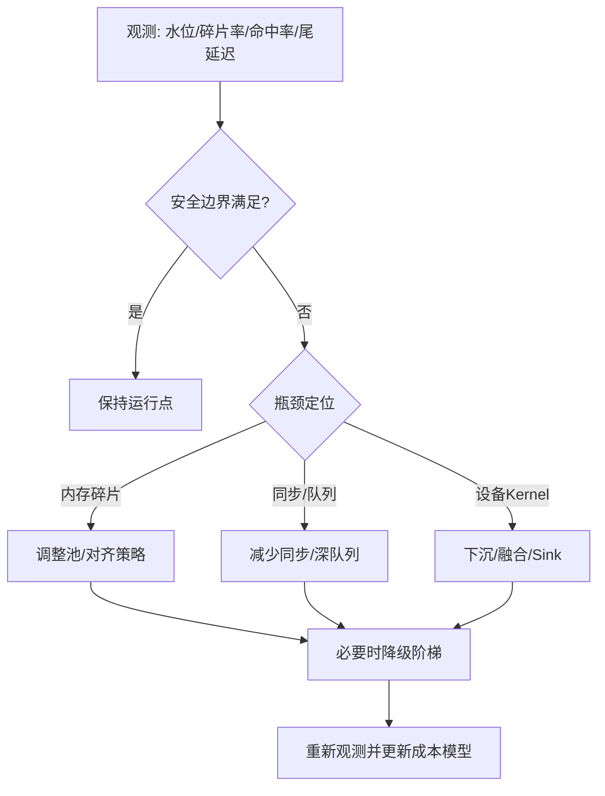

决策顺序强调先定性再让渡：只有定位到瓶颈层级后才修改对应层，降级是最后手段而非首选。

#### 6. 拓展知识

可继续学习排队论与利特尔法则、p99 尾延迟、容量规划、成本模型、autoscaling、优先级抢占、graceful degradation、垃圾回收对尾延迟的影响、碎片整理（compaction）。

#### 7. 常见追问及回答要点

1. **能不能只加容量解决？**
   - 不一定；若根因是碎片或生命周期错误，加设备可能扩大泄漏范围。
2. **降级顺序怎么定？**
   - 先影响可控且可逆的动作（降采样、降 batch），最后才拒绝请求，并保证每级可观测、可回滚。
3. **如何避免用平均值决策？**
   - 以 P95/P99、错误预算消耗和队列深度为主，均值仅作参考。

#### 8. 易错点与反例

- 用总容量估可用容量：忽略碎片与对齐。
- 只测稳态不测首轮：首轮编译/加载成本被掩盖。
- 把 cached 当可用：文档明确 CACHED 不等于重用启用。
- 优化 API 包装而忽略同步与队列：测量不到真实收益。

#### 9. 实践与验证

[待验证] 用分阶段基准与压力测试拟合容量模型：

- 输入：固定 shape/batch，变量为 Stream 数、并发、缓存状态；时间轴分离编译/加载/首轮/稳态/同步/传输/卸载；
- 步骤：逐步提高负载至安全边界，记录碎片率、命中率、尾延迟、错误预算消耗；触发降级阶梯；
- 预期结果：安全边界先于失败被触及；降级后指标回到界内且可回滚；
- oracle：`fragment_rate ≤ f_max`、`queue_depth ≤ q_max`、`error_budget > 0` 在稳定期成立；
- 指标：每级降级的收益/代价、成本单位、恢复时间；
- 失败判断：边界失效而系统仍无降级动作，或降级不可逆即判定治理失效。

真实设备性能和命中率未测，模型参数保持 `[待验证]`。

#### 10. 评分标准

- 不合格：只建议“加资源、调大 batch”。
- 合格：能识别容量、碎片、同步等基本成本源。
- 良好：能建立带安全边界的运行模型与降级阶梯，并强调分阶段测量。
- 优秀：能处理预留与降级阈值的联合优化、成本归因口径、碎片长期治理，并明确无实测时的模型边界。

**证据与来源：** `[已确认]` `cann/90-cross-module/performance-critical-paths.md:6,25-33,37,40,43`；`[已确认]` `cann/99-roadmap/performance-guide.md:14-21`；`[已确认]` `cann/90-cross-module/pooling-and-resource-management.md:37-43`；容量模型与降级策略为 `[建议]/[推断]`，性能数据为 `[待验证]`。

## HRS-E012. 如何制定平台化演进与兼容迁移战略？

- 难度：专家级
- 知识域：K12 生产架构、发布迁移、灾备与前沿演进
- 考察能力：演进策略设计、兼容矩阵治理、迁移风险控制
- 题型：架构设计与治理论证
- 面试频率：开放题
- 前置知识：HRS-E002、HRS-E010、发布工程
- 关联题目：前置 `HRS-E011`；后续 `HRS-E014`、`HRS-E015`
- 事实状态：`[已确认]` `[推断]` `[建议]`

#### 1. 背景知识

CANN 的演进现实是四仓独立构建与发布，且存在 V1/V2 两代 Executor 并行演进，架构文档把“V1/V2 Executor 可并行演进”列为设计优势，把“跨仓版本配套和 ABI 兼容要求高”列为代价。[已确认] 来源：`cann/00-overview/architecture.md:53-54` 决策记录 D-002 确认了 ACL/GE→Runtime→Driver 的分层主边界。[已确认] 来源：`cann/00-overview/decision-log.md:21-24`

变更影响地图要求：任何变更先确认真正产生副作用的实现，再检查 CMake target、安装库、导出表、HAL/SDK-driver ABI、AICPU 参数和动态依赖。[已确认] 来源：`cann/90-cross-module/change-impact-map.md:31-38`

#### 2. 问题分析

平台化演进要同时处理两条时间线：功能演进（新能力、新硬件、新执行器）与兼容维持（旧模型、旧 ABI、旧客户端）。战略目标是让两条线可独立推进而不互相阻塞。

迁移的关键风险是“版本错配”：文档明确只替换单个仓库可能导致编译、加载或运行时 ABI 不兼容，要求四仓与 Firmware/Toolkit/算子包/模型格式配套。[已确认] 来源：`cann/00-overview/dependency-map.md:38-44`

#### 3. 具体答案

我会采用“双轨 + 契约冻结”的战略：

- 能力双轨：新执行器/新硬件走新轨，旧轨进入维护模式，通过统一接口层（ACL/GE API）隔离底层差异；
- 契约冻结：对公共头文件、导出符号、错误码、结构体布局建立 ABI 清单并冻结，任何破坏性变更需新版本号与迁移期；
- 兼容矩阵：维护 GE/ACL/Runtime/Driver/Firmware/Toolkit/算子包/模型格式的兼容矩阵，作为发布门禁；
- 灰度迁移：新组合先在非关键路径灰度，观测错误率与性能，再逐级放量；
- 回退路径：每次迁移都保留可回退的旧组合与数据格式，验证回退可行性而非只验证前进。

文档的兼容矩阵原则与配置影响地图为上述做法提供了直接依据。[已确认] 来源：`cann/00-overview/dependency-map.md:38-44`、`cann/90-cross-module/configuration-impact-map.md:16-31`

#### 4. 技术洞察

核心开放决策是“接口层的厚度”。过薄的抽象层让上层直接依赖底层差异，迁移成本外溢到应用；过厚的抽象层强行使所有设备降到最小公共接口，丢失厂商特有能力和诊断信息。文档明确不赞成后者的信息丢失。[推断] 源自项目概览对“保留厂商特有能力和不支持状态”的论述。[已确认] 来源：`cann/01-modules/module-registry.md:22-27`

另一个决策是“迁移触发条件”：是按时间窗口固定节奏，还是按错误预算/性能回归触发。后者更能避免为迁移而迁移，但需要成熟的观测体系（依赖 E010）。

残余风险：模型文件与算子包的兼容只覆盖到文档声明，真实旧模型在新栈上的加载需要回归验证；闭源固件版本差异无法从用户态证明。

#### 5. 图文说明

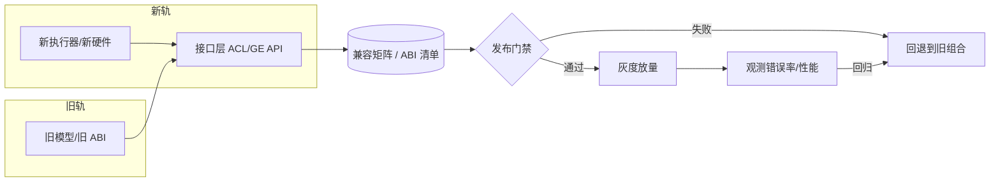

对新旧两条轨通过统一接口层收敛；兼容矩阵作为发布门禁；门禁或观测不达标即回退，回退路径与前进路径同等重要。

#### 6. 拓展知识

可继续学习语义化版本、ABI 稳定性、feature flag、blue-green/canary 部署、数据格式演进、schema migration、影子流量、兼容性测试矩阵、技术雷达与 EOL 政策。

#### 7. 常见追问及回答要点

1. **如何在不破坏兼容的前提下加能力？**
   - 只做兼容扩展（新增符号/字段），不重排或改变既有布局；破坏性变更走新版本号与迁移窗口。
2. **迁移失败如何止损？**
   - 预置回退路径并演练，确保旧组合与旧数据仍可用，回退不依赖未迁移组件。
3. **如何证明迁移安全？**
   - 用兼容矩阵 + 灰度观测 + 结果 oracle，而非仅凭新栈自测通过。

#### 8. 易错点与反例

- 单仓升级：忽略四仓与固件配套，导致 ABI 不兼容。
- 抽象层过厚：丢失厂商特有能力和诊断字段。
- 只验证前进不验证回退：回退路径失效导致故障无法止损。
- 把编译成功当运行成功：文档明确无硬件时不能这样等同。[已确认] 来源：`cann/00-overview/design-principles.md:26`

#### 9. 实践与验证

[待验证] 用兼容矩阵与灰度回归验证迁移战略：

- 输入：多为旧/新组合（四仓 commit、Firmware、模型格式），新执行器与旧模型；
- 步骤：在矩阵格点逐一构建/加载/执行，记录失败点；对通过组合做灰度与回退演练；
- 预期结果：矩阵内合法组合可运行；非法组合被门禁拦截；回退恢复成功；
- oracle：兼容矩阵判定与实测一致，回退后旧组合功能与性能恢复基线；
- 指标：门禁拦截率、灰度错误率、回退成功率、迁移耗时；
- 失败判断：出现未拦截的不兼容组合或回退失败即判定战略缺口。

真实多版本矩阵、固件与旧模型加载未运行，保持 `[待验证]`。

#### 10. 评分标准

- 不合格：只说“保持向后兼容、做好测试”。
- 合格：能说明版本配套与灰度发布的重要性。
- 良好：能给出双轨演进、契约冻结、兼容矩阵与回退路径。
- 优秀：能论证抽象层厚度取舍、迁移触发条件、回退可演练性，并明确模型/固件残余风险。

**证据与来源：** `[已确认]` `cann/00-overview/architecture.md:53-54`；`[已确认]` `cann/00-overview/decision-log.md:21-24`；`[已确认]` `cann/00-overview/dependency-map.md:38-44`；`[已确认]` `cann/90-cross-module/configuration-impact-map.md:16-31`；`[已确认]` `cann/90-cross-module/change-impact-map.md:31-38`；`[已确认]` `cann/00-overview/design-principles.md:26`；`[推断]` `cann/01-modules/module-registry.md:22-27`；迁移实验为 `[待验证]`。

## HRS-E013. 如何在整数级规模下构建可扩展的稳定性验证框架？

- 难度：专家级
- 知识域：K09 错误传播、超时、取消、恢复与故障注入
- 考察能力：验证框架设计、组合爆炸治理、验证 oracle 构造
- 题型：方法论设计与工程论证
- 面试频率：中频
- 前置知识：HRS-E009、属性测试、模型检查
- 关联题目：前置 `HRS-E009`；后续 `HRS-E015`
- 事实状态：`[已确认]` `[推断]` `[建议]` `[待验证]`

#### 1. 背景知识

测试配方给出的最小回归矩阵覆盖 API、生命周期、异步、跨模块、ABI 和设备六层，其中 ABI 层要求检查头文件、导出符号、结构体布局和 ioctl 32/64 位；设备层要求多设备、故障恢复和驱动/固件不匹配（需硬件）。[已确认] 来源：`cann/99-roadmap/testing-recipes.md:14-23`

测试配方还要求先跑各仓 UT、再跑跨仓集成和真实设备测试，并在报告中写明命令、环境、实际输出和未执行项，不以文档命令代替验证。[已确认] 来源：`cann/99-roadmap/testing-recipes.md:25-27`

#### 2. 问题分析

“整数级规模”带来组合爆炸：设备型号 × 软件版本 × 故障点 × 负载 × 并发 × 数据布局。逐条枚举不可行，必须用等价类、正交表和分层抽象把组合压到可控范围。

验证框架需要三个要素：可复现的输入生成、自动判定真伪的 oracle、能定位最小反例的搜索策略。缺少 oracle 的“跑一遍看有没有崩”不构成验证。

#### 3. 具体答案

我会设计分层验证框架：

```text
L0 无设备模型检查: 状态机/不变量, 覆盖非法转移
L1 各仓 UT:        参数/生命周期/句柄/ABI
L2 跨仓集成(模拟):  ACL->Runtime->HAL 错误映射, mock 设备
L3 单设备故障注入:  submit/driver/device/wait/callback/cleanup
L4 多设备/多节点:   故障域, 集合通信, 网络分区
L5 性能与长期运行:  泄漏/碎片/尾延迟/恢复时间
```

每层绑定 oracle：L0 用可达性，L1 用契约断言，L2 用错误映射对照表，L3+ 用状态与水位不变量。组合维度用正交表压缩，故障注入点作为可参数化维度。

文档的实验声明（写明命令、环境、实际输出和未执行项）应作为每层报告的强制格式。[已确认] 来源同上`:25-27`

#### 4. 技术洞察

核心开放决策是“验证强度的投入分配”。用属性测试与模型检查覆盖设计级不变量成本低、发现早期缺陷；用真实设备长稳测试覆盖物理行为成本高但不可替代。合理分配是把组合爆炸交给 L0–L2（成本低、迭代快），把 L3–L5 聚焦高风险路径和已知残余风险。

另一个决策是“如何生成最小反例”。采用 shrink/二分和确定性种子回放，使任何失败都能被最短序列复现。

残余风险：闭源固件与硬件的物理行为无法在 L0–L2 中被模拟；无硬件时只能做静态与模拟验证，必须显式标注未验证边界。[已确认] 来源：`cann/00-overview/analysis-state.md:96`

#### 5. 图文说明

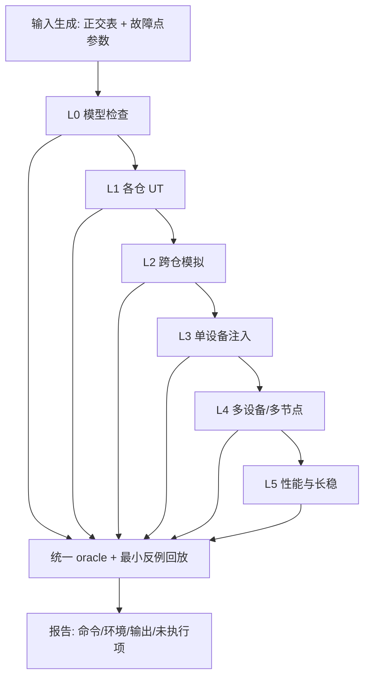

框架分层递进，所有层共享统一 oracle 与最小反例回放，报告强制记录未执行项，避免把模拟通过当作设备验证通过。

#### 6. 拓展知识

可继续学习 property-based testing、fuzzing、differential testing、metamorphic testing、正交实验设计、模型检查、shrink 与回放、覆盖率导向测试。

#### 7. 常见追问及回答要点

1. **组合爆炸怎么控？**
   - 正交表 + 等价类 + 分层抽象，把高成本维度留给高风险格点。
2. **模拟通过能否代替设备测试？**
   - 不能；模拟只覆盖软件契约，设备物理行为必须单独验证并标注。
3. **如何保证失败可复现？**
   - 固定随机种子、记录完整输入、实现 shrink 与最短序列回放。

#### 8. 易错点与反例

- 只跑“冒烟”无 oracle：无法判定正确与否。
- 用文档命令冒充测试结果：违反测试配方的实验声明要求。
- 忽略 ABI 32/64 位差异：头文件/结构体布局问题在集成时才暴露。
- 无种子随机测试：失败不可复现。

#### 9. 实践与验证

[待验证] 构建并运行分层框架：

- 输入：正交参数表（设备类型、版本、故障点、负载、并发、布局）+ 随机种子；
- 步骤：逐层执行 L0–L5，失败触发 shrink 生成最小反例并回放；
- 预期结果：每层 oracle 判定明确；最小反例可确定性复现；报告含未执行项；
- oracle：每层绑定独立判定谓词，任一失败给出最小复现与根因定位；
- 指标：缺陷检出率、最小反例长度、复现率、各层耗时、未验证边界覆盖率；
- 失败判断：出现不可复现失败或无 oracle 的“通过”即判定框架不合格。

真实多设备/多节点与长稳测试未运行，保持 `[待验证]`。

#### 10. 评分标准

- 不合格：只提“多做测试、多跑几台机器”。
- 合格：能列出回归矩阵的分层维度。
- 良好：能给出正交压缩、故障注入参数化与统一 oracle。
- 优秀：能设计最小反例回放、论证验证强度分配、强制未执行项标注，并明确模拟与设备的边界。

**证据与来源：** `[已确认]` `cann/99-roadmap/testing-recipes.md:14-27`；`[已确认]` `cann/00-overview/analysis-state.md:96`；框架设计为 `[建议]/[推断]`，多设备/长稳实验为 `[待验证]`。

## HRS-E014. 如何治理多代际、多厂商异构环境？

- 难度：专家级
- 知识域：K12 生产架构、发布迁移、灾备与前沿演进
- 考察能力：异构治理、抽象边界设计、逐步淘汰策略
- 题型：架构设计与治理论证
- 面试频率：开放题
- 前置知识：HRS-E002、HRS-E012、供应商管理
- 关联题目：前置 `HRS-E012`；后续 `HRS-E015`
- 事实状态：`[已确认]` `[推断]` `[建议]`

#### 1. 背景知识

CANN 已展示多代际并存的现实：V1/V2 Executor 并行演进；Driver 按产品编译选择不同的 ordinary cache（`ascend910B`/`ascend910_93` 为 V2，`ascend950` 为 V3）；配置影响地图把 SoC/产品宏列为影响 GE/Runtime/Driver 组件集合与核心数等能力的因素。[已确认] 来源：`cann/00-overview/architecture.md:53`、`cann/90-cross-module/pooling-and-resource-management.md:6`、`cann/90-cross-module/configuration-impact-map.md:22`

模块注册表也指出 ACL 仓与 Runtime 仓都含 `aclrt` 相关代码，最终链接哪个实现取决于目标 CANN 版本与打包清单。[已确认] 来源：`cann/01-modules/module-registry.md:38`

#### 2. 问题分析

多代际、多厂商治理的核心矛盾是“统一抽象”与“能力差异”。统一能降低运维与开发成本，但会抹平能力差异；不统一则碎片化，运维与兼容矩阵爆炸。

治理需要回答：抽象层暴露什么、隐藏什么；差异如何被声明和查询；旧代际如何退役；新厂商如何接入而不破坏既有契约。

#### 3. 具体答案

我会采用“能力声明 + 分层抽象 + 声明式差异”的治理模型：

- 能力声明：每个代际/厂商注册不可变能力快照（dtype、算子、内存类型、拓扑、配额），上层据此调度，缺证据时判定“未知”；
- 分层抽象：核心路径用统一接口，厂商特有能力和“不支持”状态显式保留，不降到最小公共接口；
- 差异查询：提供 `capability(dev, feature)` 查询接口，使上层自适应；
- 退役策略：为旧代际设 EOL 与功能冻结，新功能只在新代际实现，旧代际仅修复安全问题；
- 接入契约：新厂商通过兼容测试矩阵（依赖 E013）与契约冻结（依赖 E012）接入。

文档关于“保留厂商特有能力和不支持状态、不能丢失诊断信息”的取向支持这一设计。[推断] 来源：`cann/01-modules/module-registry.md:22-27`

#### 4. 技术洞察

核心开放决策是“抽象层是否对差异透明”。完全透明的抽象会把差异隐藏到运行期，调试困难；完全显式的抽象把差异上推给应用，增加复杂度。合理落点是：控制面（调度/准入）感知差异，数据面（语义）保持统一。

另一个决策是“代际隔离程度”：共享同一运行时能复用资源但增加耦合，独立运行时隔离更好但成本更高。可按故障域隔离（依赖 E009）与发布线隔离（依赖 E012）组合决定。

残余风险：厂商特有语义可能无法完全映射到统一模型，映射偏差会导致静默错误；必须用结果 oracle 与差分测试发现。

#### 5. 图文说明

```mermaid
flowchart TD
    A[上层请求] --> Q{capability(dev, feature)}
    Q -- 支持 --> U[统一接口路径]
    Q -- 特有 --> V[厂商特有路径]
    Q -- 未知 --> X[保守拒绝/降级]
    U --> R[结果 oracle]
    V --> R
    X --> R
    R --> M[兼容矩阵 + 契约冻结]
    M --> E[旧代际 EOL / 新代际接入]
```

控制面通过能力查询分派到统一或特有路径，未知一律保守处理；结果 oracle 与兼容矩阵共同把关，EOL 与接入由治理动作驱动。

#### 6. 拓展知识

可继续学习硬件抽象层设计、capability discovery、feature matrix、differential testing、供应商 SDK 版本策略、EOL 与长尾支持、可移植性层（如 SYCL/HIP 类抽象）。

#### 7. 常见追问及回答要点

1. **统一抽象会不会丢能力？**
   - 只统一核心语义，显式保留特有能力和不支持状态，避免信息丢失。
2. **旧代际如何退役？**
   - 设 EOL 与功能冻结，仅保留安全修复，并用兼容矩阵门禁阻止新功能误入旧代际。
3. **新厂商如何接入？**
   - 注册能力快照、跑兼容矩阵与差分测试、通过契约冻结后灰度放量。

#### 8. 易错点与反例

- 强降公共接口：丢失特有能力和诊断字段。
- 假设同名 API 语义相同：不同实现/版本存在差异，应列适用条件。[已确认] 来源：`cann/00-overview/glossary.md:44-46`
- 能力查询缺证据仍判支持：应回落“未知”。
- 映射偏差无 oracle：静默错误难以发现。

#### 9. 实践与验证

[待验证] 用差分测试与能力矩阵验证治理：

- 输入：两代际/两厂商设备模型，同一语义任务与能力快照；
- 步骤：对同一任务在统一路径与特有路径执行并比较结果；引入缺字段探测；
- 预期结果：结果逐位一致或差异被显式声明；缺证据回落“未知”并保守处理；
- oracle：差分一致性与能力矩阵判定；
- 指标：映射偏差数、未知回落率、EOL 覆盖率、接入耗时；
- 失败判断：出现未声明的语义差异或能力误判即判定治理失败。

真实多厂商设备与代际组合未运行，保持 `[待验证]`。

#### 10. 评分标准

- 不合格：只提“做统一接口”。
- 合格：能识别多代际并存的现实与兼容成本。
- 良好：能给出能力声明、分层抽象与退役/接入策略。
- 优秀：能论证抽象层透明度取舍、代际隔离、用差分测试发现映射偏差，并明确残余风险。

**证据与来源：** `[已确认]` `cann/00-overview/architecture.md:53`；`[已确认]` `cann/90-cross-module/pooling-and-resource-management.md:6`；`[已确认]` `cann/90-cross-module/configuration-impact-map.md:22`；`[已确认]` `cann/01-modules/module-registry.md:38`；`[已确认]` `cann/00-overview/glossary.md:44-46`；`[推断]` `cann/01-modules/module-registry.md:22-27`；差分实验为 `[待验证]`。

## HRS-E015. 如何做从单机到集群的稳定性架构演进决策？

- 难度：专家级
- 知识域：K01 稳定性目标、边界与故障模型
- 考察能力：架构演进决策、边界重定义、不变量扩展
- 题型：系统设计与取舍分析
- 面试频率：开放题
- 前置知识：HRS-E001、HRS-E013、HRS-E014、分布式系统基础
- 关联题目：前置 `HRS-E001`；后续 `HRS-E014`
- 事实状态：`[已确认]` `[推断]` `[建议]` `[待验证]`

#### 1. 背景知识

单机环境下，故障域边界通常是进程与设备；而扩展到集群后，新增了节点失效、网络分区和跨节点一致性等边界。文档中跨节点能力已有体现：SHMEM 为 RDMA/SDMA 建立 heap 指针并依赖 collective gate 对齐各 rank；跨节点 Notify 需按拓扑计算基地址。[已确认] 来源：`cann/90-cross-module/pooling-and-resource-management.md:93`、`cann/memory_graph_analysis.md:1512`

架构文档的分层模型（应用→ACL/GE→Runtime→Driver→NPU）在单机成立，集群演进本质上是在此之上叠加新的划分与协调层。[已确认] 来源：`cann/00-overview/architecture.md:13-35`

#### 2. 问题分析

演进决策要回答：哪些不变量在放大后仍成立，哪些必须重新定义。单机的“完成先于复用”“终态唯一”在集群中还要叠加“跨节点视图一致”“部分失败可隔离”。

关键变化是故障模型：单机主要是进程/设备故障，集群还要面对节点失效、网络分区、时钟漂移与部分可见。稳定性目标因此从“单请求正确完成”扩展为“集群在部分节点/网络失效下仍保持约定的可用性与正确性”。

#### 3. 具体答案

我会按“边界重定义 + 不变量扩展 + 分阶段演进”三部分决策：

- 边界重定义：把故障域从 `task/stream/device` 扩展到 `node/rack/zone`，并明确跨边界通信的一致性假设（依赖 E008 的 collective gate）；
- 不变量扩展：在 E001 的不变量集合上增加 `G(rank 视图一致)` 与 `G(网络分区不产生分裂决策)`，并要求跨节点完成证据与可见性（依赖 E005）；
- 分阶段演进：单机验证 → 单机多设备 → 多机单域 → 多机多域，每阶段引入新故障点并回归既有不变量，未通过则不进入下一阶段。

每一步都保留可回退形态，避免一次性跨越多个边界导致故障不可定位。

#### 4. 技术洞察

核心开放决策是“一致性强度”。强一致推理简单但跨节点代价高；最终一致性能好但要求上层处理冲突与重放。选择应基于业务可接受的数据丢失范围和 SLO，与 E001/E011 的权衡一致。

另一个决策是“控制面与数据面的耦合度”。控制面（调度/拓扑/准入）可集中以简化一致性，数据面（传输/集合）应尽量去中心化以避免单点。二者解耦是集群稳定性的常见基线。

残余风险：网络分区下的分裂决策、时钟漂移导致的顺序误判、跨节点 fabric 故障的传播，都需要真实多节点实验（文档明确相关行为未验证）。[已确认] 来源：`cann/00-overview/analysis-state.md:96`

#### 5. 图文说明

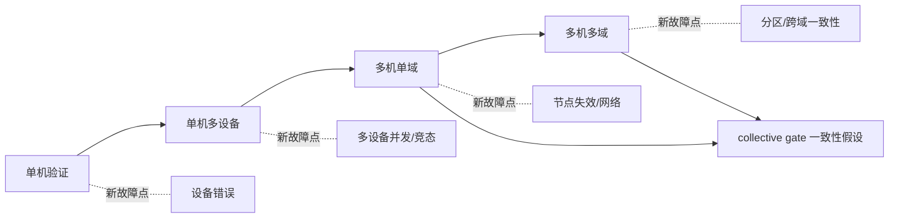

演进逐级引入新故障点，每一级都以“通过既有不变量回归”为准入门槛；跨节点阶段显式依赖 collective gate 的一致性假设。

#### 6. 拓展知识

可继续学习 CAP、PACELC、Raft/共识、gossip、分区分裂脑、幂等与去重、分布式 tracing、弹性扩缩、容灾演练、混沌工程、cell 架构。

#### 7. 常见追问及回答要点

1. **单机不变量放大后哪些会失效？**
   - 依赖单一全局视图的不变量会失效；需替换为跨节点一致性假设与对齐机制。
2. **为什么强调分阶段？**
   - 一次性跨多个边界会让根因归属困难；分级引入可用回归逐层收敛风险。
3. **一致性怎么选？**
   - 由业务可接受的数据丢失与 SLO 决定，并用错误预算监控一致性代价。

#### 8. 易错点与反例

- 直接把单机模型套用到集群：忽略分区与节点失效。
- 强一致无条件：跨节点开销拖垮尾延迟。
- 分裂决策：分区两端各自做出不兼容决策。
- 无阶段门槛：演进引入的故障无法定位到具体边界。

#### 9. 实践与验证

[待验证] 用分级故障注入验证演进假设：

- 输入：单机、单机多设备、多机单域、多机多域的模拟拓扑；
- 步骤：逐级注入 `device_fail/contention/node_fail/network_partition`，回归 E001 不变量集并检查新不变量；
- 预期结果：每级新故障被隔离且不违反既有不变量；跨节点视图一致；无分裂决策；
- oracle：不变量集在各级成立、分区下无分裂、恢复后视图收敛；
- 指标：各级故障检测/隔离/恢复时间、不一致窗口、可用性下降幅度；
- 失败判断：出现分裂决策或既有不变量被破坏即判定演进决策错误。

真实多节点网络分区、时钟与 fabric 行为未运行，保持 `[待验证]`。

#### 10. 评分标准

- 不合格：只说“上集群、加节点、加副本”。
- 合格：能识别节点失效与网络分区等新故障。
- 良好：能重定义故障域、扩展不变量集并给出分阶段演进路径。
- 优秀：能论证一致性强度与控制面/数据面耦合取舍、设计分级回归门槛，并明确跨节点残余风险。

**证据与来源：** `[已确认]` `cann/00-overview/architecture.md:13-35`；`[已确认]` `cann/90-cross-module/pooling-and-resource-management.md:93`；`[已确认]` `cann/memory_graph_analysis.md:1512`；`[已确认]` `cann/00-overview/analysis-state.md:96`；演进而与不变量扩展为 `[建议]/[推断]`，多节点实验为 `[待验证]`。
