# 异构资源稳定性：中等级面试题

- 题数：15；稳定 ID：`HRS-I001`–`HRS-I015`
- 证据规则：源码/文档结论按 `[已确认]`、`[推断]` 区分；硬件、网络、多进程和性能实验按 `[待验证]` 处理。

## HRS-I001. 如何用故障模型和边界定义中等级别的稳定性目标？

- 难度：中等级
- 知识域：K01 稳定性目标、边界与故障模型
- 考察能力：概念解释、边界辨析、故障建模
- 题型：概念解释与辨析
- 面试频率：高频
- 前置知识：HRS-B001、可靠性指标、资源生命周期
- 关联题目：前置 `HRS-B001`；后续 `HRS-I002`
- 事实状态：`[已确认]` `[推断]` `[待验证]` `[建议]`

#### 1. 背景知识

入门级只需要说明稳定性不等于“进程不退出”。中等级要进一步回答：在什么边界内、对哪些故障、用什么证据判定稳定。CANN 文档把主机 API 返回成功、Runtime 元数据改变、Driver 接受请求和设备任务完成视为四个不同时刻，并强调普通异步任务、SOMA AICPU 操作和模型执行都不能把提交成功直接解释为设备已消费完 buffer。[已确认] 来源：[cann/90-cross-module/memory-and-resource-lifecycle.md:24-25]

#### 2. 问题分析

先把“稳定”落到一个可判定的故障模型，而不是停留在形容词：

1. 边界：明确进程内还是跨进程、单卡还是多卡、单节点还是跨节点、是否含网络和存储；
2. 故障集：参数错误、状态错误、资源错误、设备/驱动错误、编译/模型错误和异步错误六类在 CANN 错误模型中有明确区分；[已确认] 来源：[cann/00-overview/global-error-model.md:29-37]
3. 触发点：每个故障可能发生在准入、提交、Driver 接收、设备执行、完成通知或清理阶段；
4. 不变量：任务仍可能引用的资源不能在完成证据之前复用；每个请求只能有一个终态；一个故障域内的失败不能无限阻塞其他请求；
5. 证据：记录最底层错误码、设备 ID、Context/Stream、模型/Graph 标识和调用阶段。[已确认] 来源：[cann/00-overview/global-error-model.md:39-43]

中等级区别于入门的关键，是把“不稳定”拆成“哪个边界内、哪类故障、落在了哪个阶段、有什么证据”。

#### 3. 具体答案

面试中可以这样回答：

> 定义中等级别的稳定性目标，我会先锁定边界和故障模型，再写不变量，最后绑定证据。边界包括线程/进程、单卡/多卡、单节点/跨节点，以及是否包含网络；故障模型至少覆盖参数、状态、资源、设备/驱动、编译/模型和异步六类。CANN 文档把主机 API 成功、Runtime 元数据变化、Driver 接受请求和设备完成当作四个不同时刻，所以我会把每个阶段的失败分别建模，而不是等一个总体错误码。
>
> 接着写不变量：未确认完成前资源不得复用；每个请求只能有一个终态；单故障域失败要被隔离；每个错误保留最底层上下文。
>
> 最后用可观测指标把目标量化：成功率、P50/P95/P99、队列等待、设备错误率、资源水位和恢复时间，并约定在什么条件下判定违反目标。这样稳定性结论就同时包含边界、故障覆盖、不变量和证据，而不是一句“系统很稳”。

#### 4. 技术洞察

中等级回答要能写出一个“故障阶段 × 处理动作”的二维模型。CANN 的错误分层链是“设备/驱动错误 → Runtime 错误码 → ACL/GE 状态 → 日志/回调/返回值”，[已确认] 来源：[cann/00-overview/global-error-model.md:16-23]；这意味着同一个业务失败在不同层可能有不同表现。可以抽象成：

```text
stability(boundary) = ∀ fault ∈ Model : invariant_holds(fault) ∧ evidence_preserved(fault)
```

“证据保留”本身是可验证的：如果只记录了顶层 `ACL_ERROR` 而丢掉 Driver、设备、Context/Stream 和阶段，就不满足中等级的可诊断性。故障模型还需要区分“提交可用”和“业务可用”，这与入门题的 `SUCCESS/FAILURE/UNKNOWN` 三态一致。

#### 5. 图文说明

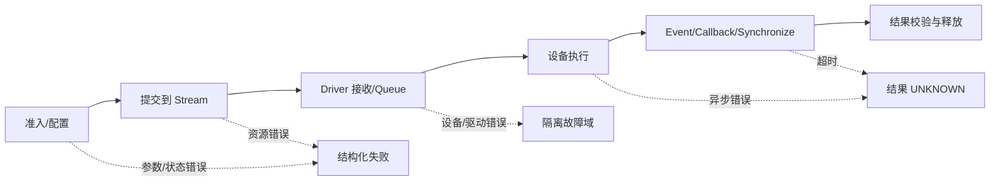

每一段既是执行阶段，也是错误可能暴露的阶段；`X/Y/Z` 表示三类不同的失败动作。图示只表达阶段与失败动作的对应关系，不证明任一平台的具体时序，设备侧完成时间仍需目标环境验证。

#### 6. 拓展知识

可继续学习故障注入、混沌工程、幂等性、超时与取消语义、故障域和错误预算。对比“可靠性”和“韧性”：前者强调故障前不失效，后者强调故障中和故障后仍能受控降级和恢复。

#### 7. 常见追问及回答要点

1. **边界为什么必须写进目标？**
   - 同样的实现，在单卡进程内稳定，在跨节点含网络时可能失效；边界决定故障集和证据来源，缺了边界就无法判定通过。
2. **只有顶层错误码，为什么不够？**
   - 顶层码会掩盖第一个失败边界；中等级要求保留 Device/Context/Stream、阶段和原始 Driver 错误，才能反查。
3. **怎样衡量“可恢复性”而不只是“可用性”？**
   - 用恢复时间、重试放大倍数、隔离范围和重复副作用数衡量，而不是只用成功率。

#### 8. 易错点与反例

- 把稳定性等同于平均延迟达标：反例是平均延迟正常但 P99 长期超 SLO。
- 用“提交返回成功”证明稳定：反例是异步任务随后失败，错误只在同步或回调处暴露。
- 故障模型只覆盖正常路径：反例是只测正常输入，未覆盖 OOM、设备错误和超时。

#### 9. 实践与验证

[待验证] 设计一个不依赖真实设备的故障阶段表驱动练习：

- 输入：六个故障阶段 `admission/submit/driver/device/complete/cleanup`，六类故障，以及资源状态 `HELD/REUSABLE/RELEASED`；
- 步骤：枚举每个阶段注入一类故障，记录失败动作和证据字段；
- 预期结果：每类故障都有明确失败动作，终态唯一，未确认完成时资源不得转为 `REUSABLE`；
- oracle：状态转移只允许合法边，证据字段集合完整；
- 指标：覆盖的故障比例、证据完整率、未释放资源数；
- 失败判断：出现无终态请求、重复终态或证据缺字段即失败。

真实 GPU/NPU 执行、跨进程和性能数据本批未运行。

#### 10. 评分标准

- 不合格：只重复“稳定=正确+可用+安全”，无法给出边界和故障集。
- 合格：能列出边界、故障类别和基本不变量。
- 良好：能给出故障阶段模型、证据字段和可量化目标。
- 优秀：能结合故障域、幂等、降级和错误预算，说明不同边界下目标的取舍。

**证据与来源：** `[已确认]` `cann/90-cross-module/memory-and-resource-lifecycle.md:24-25`；`[已确认]` `cann/00-overview/global-error-model.md:16-23,29-43`；故障阶段表和量化目标为 `[建议]`，硬件行为为 `[待验证]`。

## HRS-I002. 如何设计设备发现、拓扑采集与能力协商的准入链路？

- 难度：中等级
- 知识域：K02 设备发现、拓扑、能力协商与兼容
- 考察能力：流程追踪、配置分析、验证设计
- 题型：流程/调用链/数据流追踪
- 面试频率：高频
- 前置知识：HRS-B002、设备枚举、版本与 ABI 基础
- 关联题目：前置 `HRS-B002`；后续 `HRS-I003`、`HRS-I013`
- 事实状态：`[已确认]` `[推断]` `[待验证]` `[建议]`

#### 1. 背景知识

设备发现要区分“能不能查到设备”“能不能打开设备”“设备能力是否匹配任务”。CANN 的分层是应用/框架 → ACL/GE → Runtime → Driver HAL/SDK → NPU；[已确认] 来源：[cann/00-overview/architecture.md:17-35] 跨仓版本不配套会导致编译、加载或执行失败，Runtime README 要求源码版本配套。[已确认] 来源：[cann/00-overview/dependency-map.md:42-44]

#### 2. 问题分析

把准入拆成一条可追踪的调用链，再叠加静态能力和动态水位：

1. 发现：ACL `aclrtSetDevice` → `aclrtSetDeviceImpl` → `rtSetDevice` → `Api::Instance()->SetDevice`，这一层已确认；[已确认] 来源：[cann/01-modules/M02-acl/call-chains.md:14-26]
2. 身份：`halGetSocVersion` 通过设备信息查询 SoC 版本；[已确认] 来源：[cann/01-modules/M04-driver/call-chains.md:14-25]
3. 能力：dtype、shape、算子、内存类型与 P2P/huge 能力，需要与产品/SoC 能力对齐；
4. 拓扑：数据是否跨卡、跨 NUMA 节点或跨节点，链路是否可用；
5. 动态：此刻的内存、Queue、HDC 和配额是否足够。

配置投影是此题重点：`ASCEND_INSTALL_PATH`、`CANN_3RD_LIB_PATH`、`ENABLE_OPEN_SRC`、`DRIVER/DRIVER_COMPAT`、SoC 产品宏和 Toolkit/Driver/Firmware 版本都会改变发现结果和能力集合。[已确认] 来源：[cann/90-cross-module/configuration-impact-map.md:15-24]

#### 3. 具体答案

面试中可以这样回答：

> 我会把设备发现做成“静态能力快照 + 动态水位”的两段式准入。先沿 `aclrtSetDeviceImpl → rtSetDevice → Api::Instance()->SetDevice` 这条已确认链路拿到设备句柄，再用 `halGetSocVersion` 等接口采集型号、驱动和 Runtime 版本，然后补齐 dtype、算子、内存类型、P2P 和 NUMA 拓扑能力，形成不可变的 `capability_snapshot`。设备 ID 只是索引，不是能力描述。
>
> 动态水位单独采集，因为内存、队列和配额会变化；静态兼容通过不代表允许提交。
>
> 最后计算 `admit = static_compatible ∧ topology_compatible ∧ dynamic_budget_available`，任何一项为假都返回结构化原因，并选择其他设备、排队、降级或明确拒绝。配置变化会改变能力集合，所以每次调整 SoC 宏、安装路径或 Toolkit 版本都要重跑准入回归。

#### 4. 技术洞察

中等级要求把调用链和配置投影绑在一起。CANN 的端到端设备调用链确认了 `aclrtSetDevice` 到 `PrimaryContextRetain` 和线程局部引用的副作用，[已确认] 来源：[cann/90-cross-module/end-to-end-flows.md:32-43]；也就是说“设置设备”不是只写一个整数，而是引入了内核对象。可以写：

```text
admit(task, device) = static_compatible ∧ topology_compatible ∧ dynamic_budget_available
```

快照有时效性，因此它只能作为提交前检查，真正分配/提交处要二次校验。版本配套是硬约束：只替换单个仓库可能导致 ABI 不兼容。[已确认] 来源：[cann/00-overview/dependency-map.md:42-44]

#### 5. 图文说明

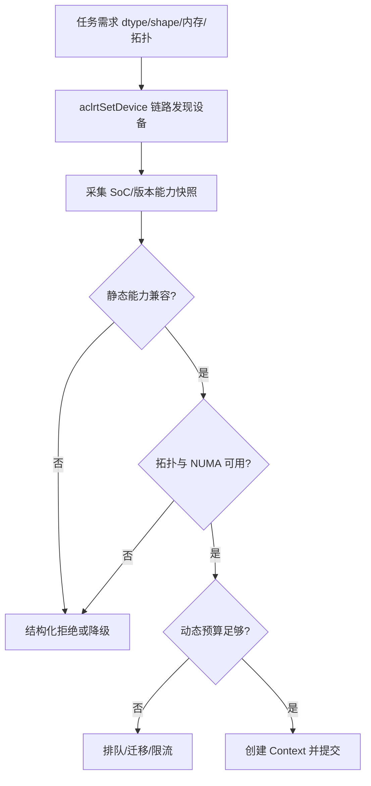

图示把发现、能力、拓扑和动态预算分成四步；`创建 Context 并提交` 仍不是完成边界。图示不证明任一平台的拓扑数据完整，跨节点链路需目标环境验证。

#### 6. 拓展知识

可继续学习 capability negotiation、device plugin、拓扑感知调度、NUMA 亲和、版本矩阵、ABI/API 兼容和 admission control。对统一抽象层要保留厂商特有能力和“不支持”状态，避免降级到最小接口后丢失诊断信息。

#### 7. 常见追问及回答要点

1. **为什么能力快照不能长期缓存？**
   - 内存和队列水位会变化，其他租户会抢占资源；快照只适合提交前检查，分配处要重新校验。
2. **跨卡调度只看显存吗？**
   - 不够；还要看 P2P 链路、NUMA、通信参与者和故障域。
3. **配置改了为什么必须重跑回归？**
   - SoC 宏、安装路径和 Driver 构建会改变组件集合与行为，能力集合随之变化。

#### 8. 易错点与反例

- 把设备编号当能力：同一编号在不同节点代表不同型号或软件栈。
- 把总显存当可分配显存：碎片、对齐、缓存池和其他租户都会改变可用量。
- 只查静态版本不查动态水位：启动通过，稳态高峰仍可能 OOM 或排队超时。

#### 9. 实践与验证

[待验证] 用模拟设备注册表做表驱动准入测试：

- 输入：三台设备分别缺少 dtype、缺少 peer 链路、动态预算不足；任务包含 dtype、bytes、peer 与版本约束；
- 步骤：生成快照，运行 `admit`，再改变动态预算并重复提交；
- 预期结果：静态不兼容始终拒绝，动态不足进入排队/降级分支；
- oracle：拒绝原因集合与预设完全一致，不能只返回笼统的 `unavailable`；
- 指标：准入延迟、拒绝原因分布、快照年龄、误准入率；
- 失败判断：快照显示不支持却提交成功，或预算变化后结果不变，即准入边界错误。

真实设备能力、拓扑和版本组合未运行，标为 `[待验证]`。

#### 10. 评分标准

- 不合格：只说“查设备 ID 和显存”。
- 合格：能列出型号、版本、dtype、内存和拓扑等基本条件。
- 良好：能分离静态能力、拓扑和动态水位，设计结构化拒绝与降级路径。
- 优秀：能结合调用链、配置投影、快照竞态和运行时二次校验设计验证。

**证据与来源：** `[已确认]` `cann/01-modules/M02-acl/call-chains.md:14-26`；`[已确认]` `cann/01-modules/M04-driver/call-chains.md:14-25`；`[已确认]` `cann/90-cross-module/configuration-impact-map.md:15-24`、`cann/00-overview/dependency-map.md:42-44`；通用准入设计为 `[建议]`。

## HRS-I003. 如何追踪 Context→Stream→Event→Queue 的生命周期状态机与销毁顺序？

- 难度：中等级
- 知识域：K03 Context/Stream/Event/Queue 生命周期
- 考察能力：流程追踪、状态机推理、资源生命周期分析
- 题型：代码、伪代码或配置分析
- 面试频率：高频
- 前置知识：HRS-B003、句柄、引用计数、逆拓扑序回收
- 关联题目：前置 `HRS-B003`；后续 `HRS-I004`、`HRS-I014`
- 事实状态：`[已确认]` `[推断]` `[待验证]`

#### 1. 背景知识

中等级要求把入门级的状态机延伸到 Queue 和跨层承载。CANN 的资源所有权表把 Context、Stream、SOMA manager、device memory、Host memory、Model/Kernel 的创建者、使用者和释放责任分开列出。[已确认] 来源：[cann/90-cross-module/memory-and-resource-lifecycle.md:29-37] Stream 只是提交顺序和依赖的 Runtime 对象，真正设备消费发生在 Driver queue/HDC/esched。[已确认] 来源：[cann/90-cross-module/memory-and-resource-lifecycle.md:91]

#### 2. 问题分析

沿调用链和状态机同时追踪：

1. 创建：显式 Context 创建校验 device ID、retain Device、执行 `Context::Setup`（初始化 allocator、overflow 地址、default Stream，条件满足时 fast CQ），最后设为 `ACTIVE`；[已确认] 来源：[cann/90-cross-module/memory-and-resource-lifecycle.md:43]
2. 绑定：`rtSetDevice` 会 retain Primary Context、写线程局部引用、设置 SatMode 并发出设备状态回调；[已确认] 来源：[cann/90-cross-module/memory-and-resource-lifecycle.md:45]
3. 提交：任务在 Stream 上排队，Queue 在 Driver 层承接；
4. 完成：Event/Callback/Synchronize 是完成边界；
5. 销毁：停止新访问 → 清理 Model → flush/清理 Stream → 清除线程绑定 → 等待引用耗尽 → 移除 Registry → 删除 Context；[已确认] 来源：[cann/90-cross-module/memory-and-resource-lifecycle.md:49-56]

故障定位要点：Stream 清理失败且仍有合法 child handle 时，代码会恢复 owner stream 以支持重试。[已确认] 来源：[cann/90-cross-module/memory-and-resource-lifecycle.md:51]

#### 3. 具体答案

面试中可以这样回答：

> 我会把生命周期画成两个状态机并叠加所有权。Context 的状态是 `NEW → SETTING_UP → ACTIVE → FINALIZING → DEINITIALIZING → DESTROYED`，局部失败进入 `FAILED`；Stream 有 pending task 和 owner 关系；Event 有记录和等待状态；Queue 在 Driver 侧有 session 生命周期。CANN 的销毁顺序是“停止新访问 → 清理 Model → flush/清理 Stream → 清除线程绑定 → 等待引用耗尽 → 移除 Registry → 删除 Context”，本质上是依赖图的逆拓扑序，而不是简单创建逆序。
>
> 破坏中等级答案的典型错误是认为“指针非空就能 destroy”。我会用三个条件约束销毁：pending task 为 0、child handle 为 0、引用计数为 0。Stream 清理失败时，如果仍有合法 child handle，Runtime 会恢复 owner stream 以便重试，所以销毁流程必须允许失败后保留可重试状态，而不是无条件 delete Context。

#### 4. 技术洞察

中等级回答的关键是把销毁写成带守卫的转移：

```text
destroy(context) only when pending_tasks == 0
                         and child_handles == 0
                         and owner_refs == 0
```

CANN 确认某些 teardown 失败时会恢复 owner stream 以支持重试，但设备 pending task 的具体行为未在硬件上验证。[已确认] 来源：[cann/90-cross-module/memory-and-resource-lifecycle.md:51] 因此“清理失败返回 busy”是一等公民，不能用 sleep 或忽略返回值代替。Queue 侧的 HDC client 也拒绝在活动 session 存在时销毁，[已确认] 来源：[cann/90-cross-module/cross-module-call-chains.md:44-52]，这提示不同层对象都有各自的 busy 语义。

#### 5. 图文说明

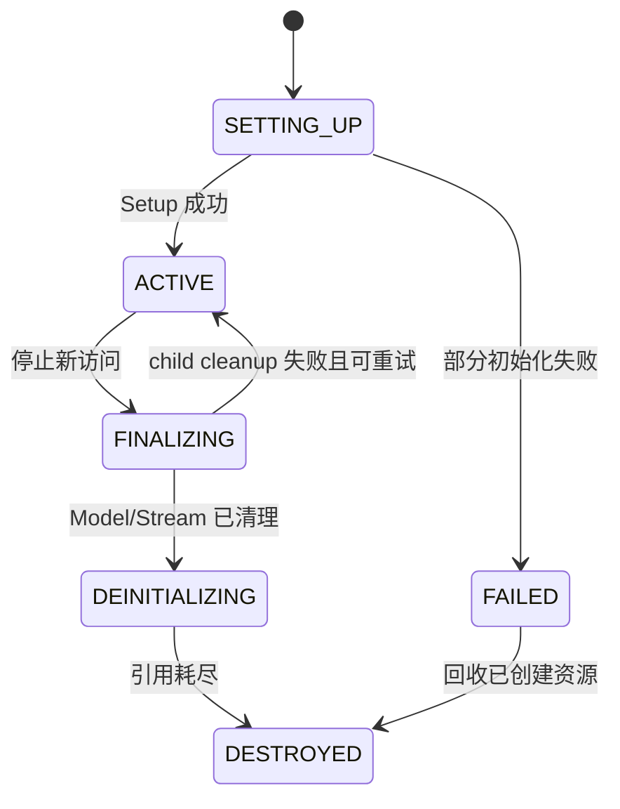

状态表示软件生命周期；`ACTIVE → FINALIZING` 是管理动作，不代表设备任务已完成。Queue 与 HDC session 的关闭是另一条独立子状态机，`DEINITIALIZING → DESTROYED` 还需要引用和 child handle 条件；具体策略需目标 Runtime 验证。

#### 6. 拓展知识

可继续学习 RAII、引用计数、hazard pointer、epoch reclamation、异步析构、primary context、stream-ordered allocation、对象注册表、句柄 ABA 风险和进程退出清理。Queue/HDC 的 busy 语义还需结合 Driver 文档。

#### 7. 常见追问及回答要点

1. **为什么销毁不是创建逆序？**
   - 任务依赖 Model、Memory、Event 和 callback data，销毁必须按依赖图逆拓扑序，先停新访问再等未完成任务。
2. **teardown 返回 busy 怎么办？**
   - 保留对象和所有权，记录 pending task/child handle，等待明确完成或按策略重试；不要直接 free 底层句柄。
3. **Queue/HDC 的销毁和 Context 有什么关系？**
   - 它们是更下游的承载，活动 session 存在时销毁会返回 busy；上层销毁前必须先停止提交并关闭 session。

#### 8. 易错点与反例

- 把 Context 当整数 device ID：它承载 allocator、Stream 和线程/设备关系。
- 看到指针非空就 destroy：对象可能处于 `FINALIZING`、`FAILED` 或仍有 child handle。
- 用 sleep 代替完成确认：固定等待不能证明长任务或异常任务已完成。

#### 9. 实践与验证

[待验证] 用纯软件模型验证依赖图与状态机：

- 输入：Context、两个 Stream、一个 Event、一个 Model 和两块被任务引用的 Memory；
- 步骤：提交跨 Stream 任务，尝试提前销毁 Model、Stream、Context；再注入 Stream cleanup 失败；
- 预期结果：有 pending task 或 child handle 时拒绝销毁；清理失败后 Context 保留可重试状态；
- oracle：非法顺序返回明确状态错误，成功路径无悬挂引用；
- 指标：pending task 数、child handle 数、teardown 重试次数、最终泄漏数；
- 失败判断：Context 已销毁但 Stream 仍可提交，或失败清理后句柄既不可用又无法回收，即状态机不完整。

真实 CANN/GPU/NPU teardown、设备 reset 和 busy 返回值未运行验证。

#### 10. 评分标准

- 不合格：只会说“创建 Context、创建 Stream、最后释放”。
- 合格：能解释各对象角色和基本逆序清理。
- 良好：能画状态机并说明 pending task、引用和 teardown 失败重试。
- 优秀：能把 Queue/HDC 子状态机、依赖图和故障域一起纳入销毁策略与验证。

**证据与来源：** `[已确认]` `cann/90-cross-module/memory-and-resource-lifecycle.md:29-56,91`；`[已确认]` `cann/90-cross-module/cross-module-call-chains.md:44-52`；状态机扩展和 Queue busy 行为为 `[推断]`，设备待验证项为 `[待验证]`。

## HRS-I004. 如何区分三条内存路径并映射到地址空间与内存池？

- 难度：中等级
- 知识域：K04 设备/主机内存、地址空间与内存池
- 考察能力：实现分析、资源生命周期推理、配置分析
- 题型：代码、伪代码或配置分析
- 面试频率：高频
- 前置知识：HRS-B002、虚拟内存、HBM/DDR 概念
- 关联题目：前置 `HRS-I002`；后续 `HRS-I005`、`HRS-I011`
- 事实状态：`[已确认]` `[推断]` `[待验证]`

#### 1. 背景知识

CANN 至少有三条不能混为一谈的内存路径：Runtime 内部 KernelMemoryPool、面向用户的 SOMA stream-ordered 内存池、以及普通 device/Host 内存。[已确认] 来源：[cann/01-modules/M03-runtime/memory-pool-analysis.md:19-29] 三条路径在对象、锁、回收和异步语义上都不同。

#### 2. 问题分析

沿调用链、地址空间和池化策略分别追踪：

1. KernelMemoryPool：`MemoryPool::Init` 固定申请 2 MiB HBM backing，`MemoryList::GetBlock` 是链表 first-fit，释放尾插，源码未显示邻接合并；[已确认] 来源：[cann/01-modules/M03-runtime/memory-pool-analysis.md:49-57]
2. SOMA：`freeSegs_`/`cachedSegs_` 按 `(size, basePtr)` 升序，`lower_bound` 选择最小满足请求的 Segment，即 Best-Fit；当前 `TryToReuse` 直接返回 `nullptr`；[已确认] 来源：[cann/01-modules/M03-runtime/memory-pool-analysis.md:27-28,93-107]
3. 普通内存：`rtMalloc` 解析 policy/type/align 后进入 `NpuDriver::DevMemAlloc` → `halMemAlloc`，可能进入 Driver V2/V3 ordinary cache；[已确认] 来源：[cann/90-cross-module/memory-and-resource-lifecycle.md:80,86]

地址空间映射是重点：SOMA 先保留 VA，再由 Driver/HAL 管理 backing 和设备侧协议；[已确认] 来源：[cann/01-modules/M03-runtime/memory-pool-analysis.md:129-131] Host 内存的 location、map、pin 状态必须一致。[已确认] 来源：[cann/90-cross-module/memory-and-resource-lifecycle.md:82]

#### 3. 具体答案

面试中可以这样回答：

> 我会先拒绝“内存池就是一个池”这个前提。CANN 里 KernelMemoryPool 服务 Kernel/Program/Binary，固定 2 MiB backing，链表 first-fit 且释放不合并；SOMA 对应 `rtMemPool*`，管理 FREE/CACHED/BUSY Segment，FREE 段按大小 Best-Fit，当前复用入口 `TryToReuse` 是 no-op；普通 `rtMalloc` 走 Driver 的 V2/V3 ordinary cache，命中取决于 size、align、flag、NUMA、产品和当前状态。
>
> 地址空间上，SOMA 先保留 VA 再建 backing，普通内存由 Driver 返回 VA，Host 内存要维护 location/map/pin 一致性。所以三者的“空闲量”和“可用地址”不能互相换算，也不能用一个 usedSize 指标覆盖三套实现。
>
> 排障时我会先确认指针属于哪条路径，再看对应的状态机和回滚规则，而不是套用同一种 free 语义。

#### 4. 技术洞察

中等级回答要能写出两条不变量：其一，池的单元不同——KernelMemoryPool 是固定 backing 内的块，SOMA 是带 stream/event 依赖的 Segment，Driver cache 是 range 内的 area；其二，释放语义不同——普通 SOMA free 只把 BUSY 变 CACHED，[已确认] 来源：[cann/01-modules/M03-runtime/memory-pool-analysis.md:111-113]，并不等于物理 backing 立即回收。类比关系可以写：

```text
KernelMemoryPool : 固定 2 MiB backing / First-Fit / 无显式 stream-order
SOMA             : 保留 VA + Segment 状态 / FREE Best-Fit / stream 依赖
Driver cache     : range + area / exact 或 upper-bound / 延迟 shrink
```

三条路径的统计、失败窗口和 trim 差异，见内存生命周期文档的错误回滚矩阵。[已确认] 来源：[cann/90-cross-module/memory-and-resource-lifecycle.md:105-114]

#### 5. 图文说明

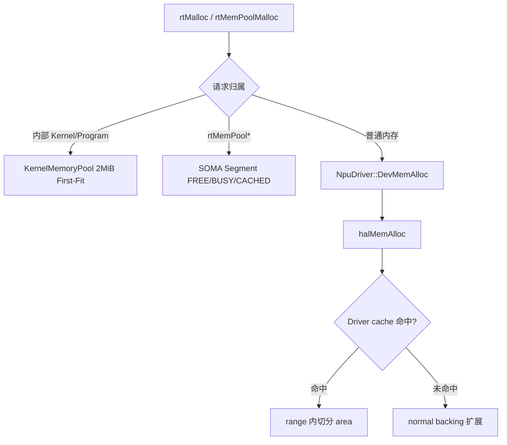

图示区分三条路径，`cache 命中` 受 flag/size/align/NUMA/产品影响。图示不证明任何一条路径的设备侧完成时间，物理 backing 行为仍需目标环境验证。

#### 6. 拓展知识

可继续学习 slab/buddy/size-class allocator、first-fit 与 best-fit 的碎片行为、slab 邻接合并、stream-ordered allocation、VA 保留与延迟映射、TOCTOU 和内存 cgroup 限制。

#### 7. 常见追问及回答要点

1. **为什么会分三条路径而不是一条？**
   - 服务对象和语义不同：内部小资源要低开销，用户流序分配要依赖管理，普通内存要灵活匹配硬件属性。
2. **SOMA 释放成功就代表内存安全可复用吗？**
   - 不代表；普通异步 free 只把本地 Segment 放入 CACHED，设备侧配置和 backing 仍由后续协议处理。
3. **如何确认一个指针属于哪条路径？**
   - 通过地址区间查询判断是否属于 SOMA pool，非 SOMA 指针走 HostFunc 和普通 Driver free。

#### 8. 易错点与反例

- 用 KernelMemoryPool 的 usedSize 推断全局 HBM 可用量：二者不是同一对象。
- 把普通 device pointer 当 SOMA pool 地址：会走错 free 路径。
- 以为 free 返回成功就除掉了 backing：Driver V3 free ioctl 失败明确不回滚，状态可能暂时不对称。

#### 9. 实践与验证

[待验证] 对三条路径分别做故障与统计一致性测试：

- 输入：Kernel pool backing 分配失败、MemoryList 节点分配失败；SOMA 覆盖 reuse miss/split/merge/trim 小于 busy；Driver 覆盖 cache miss 扩展与 shrink；
- 步骤：注入失败并在每层核对 used/空闲量与设备侧状态；
- 预期结果：每层错误有明确回滚或保留可重试状态，指针永远只走正确 free 路径；
- oracle：统计闭合、无重复释放、无 VA 重叠；
- 指标：碎片率、cache 命中率、失败回滚完整率、泄漏数；
- 失败判断：跨路径混用统计或 free 成功后底层仍被引用，即失败。

真实 SoC、物理 backing 与设备侧行为未验证，标为 `[待验证]`。

#### 10. 评分标准

- 不合格：把所有分配都描述成一个“内存池”。
- 合格：能说出三条路径并区分对象与常见策略。
- 良好：能解释各自分配/释放语义、地址空间和失败窗口。
- 优秀：能设计分路径的统计一致性、碎片与回滚验证，并说明产品/SoC 依赖。

**证据与来源：** `[已确认]` `cann/01-modules/M03-runtime/memory-pool-analysis.md:19-29,49-57,93-107,111-113,129-131`；`[已确认]` `cann/90-cross-module/memory-and-resource-lifecycle.md:80-86,105-114`；设备侧物理行为为 `[待验证]`。

## HRS-I005. 如何证明异步任务完成并保证内存可见性？

- 难度：中等级
- 知识域：K05 异步提交、完成语义与内存可见性
- 考察能力：原理推导、流程追踪、验证设计
- 题型：原理推导与算法分析
- 面试频率：高频
- 前置知识：HRS-B004、Stream/Event、并发内存模型
- 关联题目：前置 `HRS-I003`；后续 `HRS-I009`、`HRS-I014`
- 事实状态：`[已确认]` `[推断]` `[待验证]`

#### 1. 背景知识

异步系统里“提交成功”和“完成”是两件事。CANN 文档把主机 API 成功、Runtime 元数据改变、Driver 接受请求和设备任务完成列为四个不同时刻，并明确普通异步任务、SOMA AICPU 操作和模型执行都不能把提交成功解释为设备已消费完 buffer。[已确认] 来源：[cann/90-cross-module/memory-and-resource-lifecycle.md:24-25]

#### 2. 问题分析

从“证明完成”和“结果可见”两方面建模：

1. 完成证据：同步返回、`rtDeviceSynchronize`、Stream synchronize、Event wait 或已确认 callback；[已确认] 来源：[cann/90-cross-module/memory-and-resource-lifecycle.md:91]
2. 完成语义差异：`rtFreeWithDevSync` 先 `rtDeviceSynchronize` 再释放，不是普通 free 的别名；[已确认] 来源：[cann/90-cross-module/memory-and-resource-lifecycle.md:101]
3. 可见性：完成边界之前不能复用输入 buffer、销毁 Stream 或释放模型；
4. 三态结果：`SUCCESS/FAILURE/UNKNOWN`，超时或进程崩溃后不能把 `UNKNOWN` 直接当失败或成功；
5. 证据链：保留底层错误码、设备、Context/Stream、任务 ID 和阶段。[已确认] 来源：[cann/00-overview/global-error-model.md:39-43]

#### 3. 具体答案

面试中可以这样回答：

> 证明完成只能依赖显式完成边界：同步返回、Event wait 或已确认 callback。提交函数返回 0 只说明当前层没有立即拒绝。CANN 把 API 成功、Runtime 元数据变化、Driver 接受和设备完成分成四个时刻，所以我不会用提交返回值推断设备已完成。
>
> 可见性上，完成边界之前绝不复用输入 buffer、销毁 Stream 或释放模型；需要“先同步再释放”时用 `rtFreeWithDevSync` 这类显式同步接口，它和普通 free 契约不同。
>
> 超时或进程异常时，我会把结果标为 `UNKNOWN` 而不是 `FAILURE`，因为任务可能已经产生副作用；先隔离故障域、保留证据，再按幂等性决定是否重试。日志和 DFX 只是旁路诊断设施，不改变资源所有权，所以我不会用日志出现顺序判定完成。

#### 4. 技术洞察

中等级回答要能把完成语义写成契约而非猜测：

```text
resource.reusable == true  ⇔  completion_proven_by(Sync | Event | Callback)
```

并且要区分内存模型里的“写可见”与“对象可回收”。即使设备写已完成，主机侧还需要一个同步点保证读侧可见；反之，Event 记录后仍要确认等待确实跨过设备完成边界。CANN 指出错误流最终可能落到“同步返回 / 异步回调 / 日志”，[已确认] 来源：[cann/00-overview/global-error-model.md:16-23]，因此回调失败也属于完成路径的一部分，必须保留原始错误上下文。设备完成的具体时间在文档中标注为未验证。[已确认] 来源：[cann/90-cross-module/memory-and-resource-lifecycle.md:130]

#### 5. 图文说明

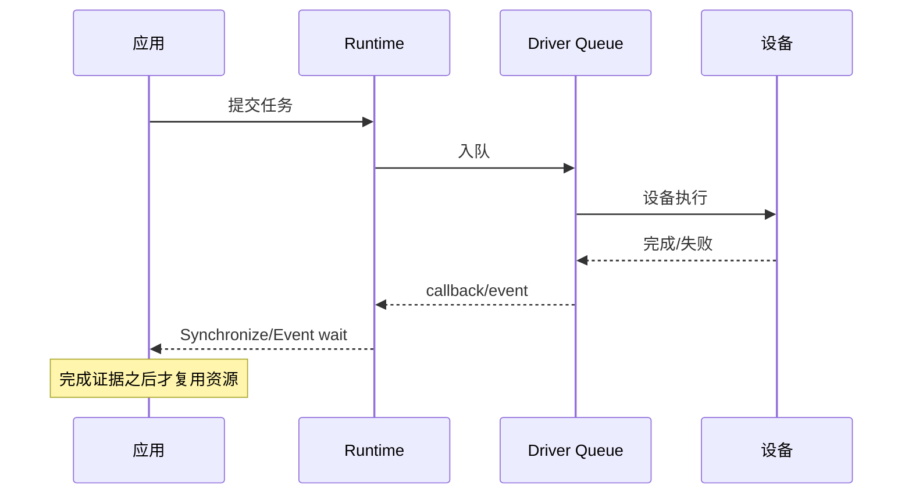

图中 `提交任务` 与 `完成` 之间是异步窗口；`完成证据` 是应用唯一可以据此复用 buffer、销毁 Stream 或释放模型的边界。图示不承诺设备完成时间，也不证明不同后端有相同同步语义。

#### 6. 拓展知识

可继续学习内存一致性模型、acquire/release 语义、stream-ordered memory、事件池、callback 重入、完成队列（CQ）、取消语义和两阶段提交。

#### 7. 常见追问及回答要点

1. **为什么普通 free 和同步 free 不同？**
   - 普通 free 只提交释放请求，`rtFreeWithDevSync` 先同步设备再释放；用错会导致未完成任务访问已释放内存。
2. **超时能否判为失败并重试？**
   - 不能；超时只表示观察窗口内没有完成证据，任务可能已产生副作用，应标为 `UNKNOWN`。
3. **日志顺序能当完成证据吗？**
   - 不能；日志/DFX 是旁路诊断设施，不改变资源所有权，也不保证跨设备可见性。

#### 8. 易错点与反例

- 把提交返回 0 当成完成：错误可能只在同步或回调处暴露。
- 用固定的 sleep 等待完成：长任务、异常任务或不同负载下都可能误判。
- 在完成证据前复用 buffer：会读到旧数据或触发未定义行为。

#### 9. 实践与验证

[待验证] 用纯软件事件模型验证完成与可见性：

- 输入：任务状态机与四种完成事件 `sync/event/callback/timeout`，一个共享 buffer；
- 步骤：在提交后立即尝试复用 buffer，再分别触发四种完成事件；
- 预期结果：只有完成证据出现后 buffer 才可复用；超时进入 `UNKNOWN` 而非终态；
- oracle：所有“未完成即复用”的尝试被拒绝，`UNKNOWN` 不进入成功或可重试分支；
- 指标：误复用次数、`UNKNOWN` 处理正确率、完成证据覆盖率；
- 失败判断：出现完成前复用或超时被当作失败重试，即失败。

真实设备完成时序、callback 重入和跨进程可见性未执行，标为 `[待验证]`。

#### 10. 评分标准

- 不合格：认为提交成功即完成。
- 合格：能说出同步/Event/callback 是完成边界。
- 良好：能区分可见性与可回收性，处理 `UNKNOWN` 三态。
- 优秀：能结合内存一致性、取消语义、故障域和证据链设计验证。

**证据与来源：** `[已确认]` `cann/90-cross-module/memory-and-resource-lifecycle.md:24-25,91,101,130`；`[已确认]` `cann/00-overview/global-error-model.md:16-23,39-43`；三态模型与验证 oracle 为 `[推断]/[建议]`。

## HRS-I006. 如何理解调度、并发、隔离与配额在多租户下的边界？

- 难度：中等级
- 知识域：K06 调度、并发、隔离、优先级与配额
- 考察能力：实现分析、并发推理、边界辨析
- 题型：原理推导与算法分析
- 面试频率：中频
- 前置知识：HRS-I003、锁、线程局部状态、资源配额
- 关联题目：前置 `HRS-I003`；后续 `HRS-I010`、`HRS-I011`
- 事实状态：`[已确认]` `[推断]` `[待验证]`

#### 1. 背景知识

Runtime 的对象层次包含 Device、Context、Stream/Event、Memory、Model/Kernel/Task，再下沉到 Driver client/queue/HDC session。[已确认] 来源：[cann/00-overview/runtime-model.md:16-28] 全局初始化和 Finalize 有锁保护，但细粒度的 Context、Stream 和 Driver queue 并发规则不能只从门面代码推断。[已确认] 来源：[cann/00-overview/runtime-model.md:49-51]

#### 2. 问题分析

把调度和隔离拆成四层，并逐层找证据：

1. 线程绑定：`rtSetDevice` 把 Primary Context 引用写入线程局部容器，线程与设备绑定是隐式状态；[已确认] 来源：[cann/90-cross-module/memory-and-resource-lifecycle.md:45]
2. 顺序与依赖：Stream 是提交顺序和依赖的软件对象，设备消费在 Driver queue/esched 发生；
3. 隔离：一个 Context 的失败、一个 Stream 的阻塞、一个租户的队列拥塞是否会扩散，取决于故障域边界；
4. 配额与优先级：内存类型、Queue/HDC 资源、stream 数量和池属性决定可用额度，`BufferAllocator` 的 `LINEAR/EXPONENTIAL` 只控制固定 ID 槽的扩容节奏。[已确认] 来源：[cann/90-cross-module/pooling-and-resource-management.md:45-49]

风险登记指出全局锁、缓存与多设备并发可能造成死锁、竞态或状态污染。[已确认] 来源：[cann/99-roadmap/risk-register.md:21]

#### 3. 具体答案

面试中可以这样回答：

> 我会先区分三层并发载体：线程局部绑定、Context/Stream 的对象级状态，以及 Driver queue/HDC 的会话。Runtime 的门面代码只能证明全局 init 有锁、以及 `rtSetDevice` 会改写线程局部引用；细粒度的 Stream/Queue 并发规则必须查具体实现和测试，不能只看门面。
>
> 隔离上我会问三个问题：一个租户的 OOM 会不会耗尽共享池；一个 Stream 的阻塞会不会占满 Queue；一个 Context 的 teardown 失败会不会拖住整个进程。答案需要落到故障域划分，而不是“加锁就安全”。
>
> 配额上我会区分“固定 ID 槽”和“可变大小区间”两类资源：`BufferAllocator` 用 bitmap 管 item id，扩容节奏是 LINEAR 或 EXPONENTIAL，不是块选择算法；SOMA 才是按大小的区间分配。把这两类混为一个“资源池”会导致容量和碎片评估错误。

#### 4. 技术洞察

中等级回答要能给出并发的“不变量 + 边界”表达：

```text
isolation(fault) = failure_contained_within(domain) ∧ budget_not_exhausted_by(fault)
```

`rtSetDevice` 的线程局部副作用意味着“同一个设备句柄在不同线程可能对应不同绑定状态”，所以多线程下不能假设全局唯一。CANN 的风险登记把版本兼容、异步生命周期、跨层错误映射、ioctl/DMA 校验、并发状态和硬件验证列为最高优先级，[已确认] 来源：[cann/99-roadmap/project-risks.md:17]，说明并发隔离需要专门的锁顺序文档和压力测试。

#### 5. 图文说明

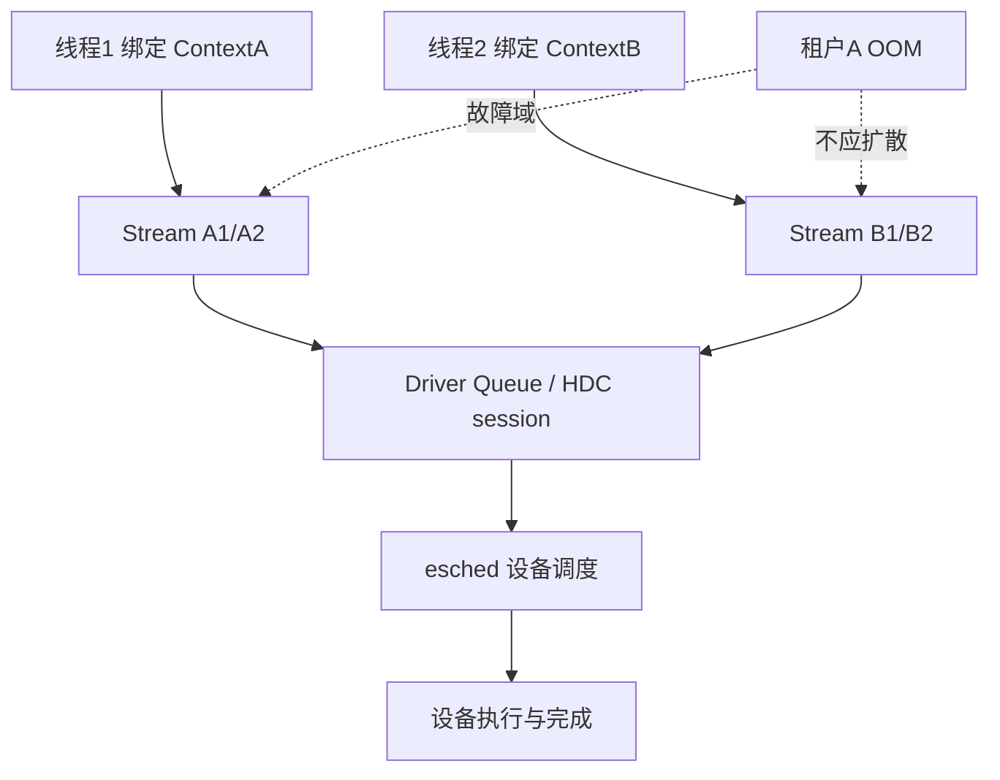

图示表达线程、Context、Stream 和 Driver 承载的分层，以及故障域应阻断跨租户扩散；图示不承诺实际调度顺序和隔离强度，设备侧调度与隔离需目标环境验证。

#### 6. 拓展知识

可继续学习 MPS/多进程服务、CUDA stream priority、cgroup 与 device plugin 配额、bulkhead 隔离、优先级反转、锁顺序和 TSAN 检测。

#### 7. 常见追问及回答要点

1. **加锁能否解决串扰？**
   - 不能；锁只保证互斥，不保证故障域隔离和配额公平，拥塞仍可能跨租户扩散。
2. **线程绑定为什么重要？**
   - `rtSetDevice` 改写线程局部引用，多线程下同一逻辑设备可能有不同绑定状态，影响 Context 归属和清理。
3. **固定槽池和区间池对容量评估有何不同？**
   - 前者的瓶颈是 item 数量和扩容节奏，后者是区间碎片；用同一指标会误判。

#### 8. 易错点与反例

- 认为“每个 Context 天然隔离”：共享 HBM 和 Driver queue 仍可能相互影响。
- 把所有池都叫“内存池”：固定 ID 槽和可变大小区间不可混算。
- 忽视线程局部绑定：多线程复用同一句柄可能得到错误的 current Context。

#### 9. 实践与验证

[待验证] 用并发模型做隔离与配额压力测试：

- 输入：两个租户，共享 SOMA pool 与固定槽池，注入 A 的 OOM、长任务和 teardown 失败；
- 步骤：观察 B 的成功率、队列等待和资源水位，运行锁顺序与 TSAN 检查；
- 预期结果：A 的故障不使 B 的请求永久阻塞，配额不因 A 的异常而失控；
- oracle：B 的成功率和 P99 在阈值内，无死锁和状态污染；
- 指标：跨租户串扰率、队列深度、锁等待时间、配额越界次数；
- 失败判断：A 的失败导致 B 超时或 Killed，即隔离失败。

真实多进程、NPU 调度和 TSAN 运行未执行，标为 `[待验证]`。

#### 10. 评分标准

- 不合格：认为“加锁即可隔离”，混淆固定槽池和区间池。
- 合格：能说出线程绑定、Context/Stream 和 Queue 的基本层次。
- 良好：能区分故障域、配额类型，指出门面代码的证据边界。
- 优秀：能设计并发隔离、锁顺序和配额压力验证，并分析跨租户串扰。

**证据与来源：** `[已确认]` `cann/00-overview/runtime-model.md:16-28,49-51`；`[已确认]` `cann/90-cross-module/memory-and-resource-lifecycle.md:45`；`[已确认]` `cann/90-cross-module/pooling-and-resource-management.md:45-49`；`[已确认]` `cann/99-roadmap/risk-register.md:21`、`cann/99-roadmap/project-risks.md:17`；隔离强度为 `[待验证]`。

## HRS-I007. 如何分析 Host-device 传输、NUMA、IOMMU 与 P2P 的稳定性？

- 难度：中等级
- 知识域：K07 Host-device 传输、NUMA、IOMMU 与 P2P
- 考察能力：原理推导、配置分析、故障定位
- 题型：原理推导与算法分析
- 面试频率：中频
- 前置知识：HRS-I004、DMA、虚拟地址与映射
- 关联题目：前置 `HRS-I004`；后续 `HRS-I008`、`HRS-I011`
- 事实状态：`[已确认]` `[推断]` `[待验证]`

#### 1. 背景知识

Host 内存和 device 内存的路径不同。`rtMallocHost` / host register 需要维护 location、pin/map 状态一致；当 Driver 不支持 pin register 时，Runtime 用软件表维护 mapped/pinned 信息。[已确认] 来源：[cann/90-cross-module/memory-and-resource-lifecycle.md:82] 普通 `rtMalloc` 会把页类型、HBM/DDR/P2P、节点和 module ID 编进 HAL flags。[已确认] 来源：[cann/90-cross-module/memory-and-resource-lifecycle.md:80]

#### 2. 问题分析

把传输稳定性拆成地址空间、拓扑和映射三块：

1. 地址空间：Host 指针 location 和 pin/map 状态必须一致，否则 DMA 目标可能无效；
2. NUMA：Driver 的 malloc manager 会综合 NUMA、flag、cache、size 和 align 判定分配路径；[已确认] 来源：[cann/01-modules/M04-driver/line-level-analysis.md:43]
3. 映射与缓存：`halMemAlloc`/`halMemFree` 的 cache 命中由 size/align/flag/NUMA/产品决定；[已确认] 来源：[cann/01-modules/M04-driver/interfaces.md:25]
4. P2P：P2P 属性通过 flags 传递，是否真正建立对等映射取决于设备和产品能力；
5. IOMMU/地址转换：用户态只能确认 flags 和映射边界，物理页与地址转换行为属闭源/硬件侧。[已确认] 来源：[cann/01-modules/M04-driver/risks-and-debt.md:28-30]

配置投影：product/SoC 宏、`DRIVER` 构建和 page type/P2P/huge flags 会改变路径。[已确认] 来源：[cann/90-cross-module/configuration-impact-map.md:20-22]

#### 3. 具体答案

面试中可以这样回答：

> 我会把 Host-device 传输看成“地址空间正确、拓扑匹配、映射有效”三件事。地址空间上，Host 内存要保证 location 与 pin/map 状态一致，Runtime 在 Driver 不支持 pin register 时用软件表兜底，所以 unregister 顺序必须和注册路径对称。
>
> 拓扑上，Driver 的 malloc manager 会综合 NUMA、flag、cache、size 和 align 决定落点，跨 NUMA 节点会改变带宽和延迟；P2P 属性只是 flag，真正建立对等映射还取决于设备和产品能力。
>
> 映射和地址转换的物理行为在闭源侧，用户态源码只能确认 flags、VA/映射元数据和 ioctl 边界，所以我不会把“halMemAlloc 成功”写成“跨设备访问一定可用”。
>
> 排障时我会先固定产品、SoC、Driver 和 page type，再核对 location/pin 状态、NUMA 落点和 cache 是否被绕过，最后才怀疑通信本身。

#### 4. 技术洞察

中等级回答要能指出“flag 不等于能力”。`rtMalloc` 会把页类型、HBM/DDR/P2P、节点和 module ID 编入 flags，[已确认] 来源：[cann/90-cross-module/memory-and-resource-lifecycle.md:80]，但实际是否命中 cache、是否建立映射还受产品构建与设备能力影响。可以写成：

```text
transfer_ok = address_valid ∧ topology_match ∧ mapping_established ∧ device_capability
```

任一为假都不能把传输标记为可用。IOMMU 和物理页属闭源/硬件边界，Driver 文档明确静态源码不能确认闭源内核中的物理页生命周期。[已确认] 来源：[cann/01-modules/M04-driver/risks-and-debt.md:28-30]

#### 5. 图文说明

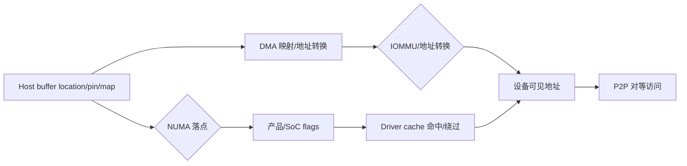

图示表达传输稳定性依赖地址、拓扑、映射和设备能力四者同时成立。IOMMU/物理页、P2P 对等性和 cache 命中率为硬件侧，需目标环境验证。

#### 6. 拓展知识

可继续学习 pinned memory、UVA、GPUDirect/RDMA、NUMA-aware allocation、IOMMU/SMMU、ATS/PASID、PCIe 拓扑和大页对齐。

#### 7. 常见追问及回答要点

1. **为什么 Host 指针 location 和 pin 状态必须一致？**
   - 不一致会导致 DMA 目标无效或 unregister 清理错误，出现悬空映射。
2. **P2P flag 设置后一定可用吗？**
   - 不一定；对等映射仍需设备、产品能力和拓扑支持。
3. **跨 NUMA 节点为什么会掉性能？**
   - 数据落点远离访问方，带宽和延迟受影响；malloc manager 会把 NUMA 纳入判定。

#### 8. 易错点与反例

- 把 page type 或 P2P flag 当能力保证：flags 只是请求属性，实际映射由设备决定。
- 忽略 pin/map 状态对称：注册和 unregister 不对称会造成映射泄漏。
- 认为源码能证明物理页行为：闭源内核/固件的物理页算法未验证。

#### 9. 实践与验证

[待验证] 设计跨 NUMA、P2P 与 pin 状态的传输矩阵：

- 输入：两个 NUMA 节点、两组 page type、pin 支持与不支持两种 Driver；
- 步骤：分配、注册、传输、unregister，并对每个组合记录落点和 cache 状态；
- 预期结果：地址 location 与 pin 状态始终一致，跨节点路径可被识别；
- oracle：无悬空映射、无重复注册、无非法 DMA 目标；
- 指标：跨节点带宽/延迟、pin 失败率、cache 命中/绕过比例；
- 失败判断：location 与 pin 状态不一致或 unregister 后仍可被 DMA 访问，即失败。

真实 NUMA、IOMMU、PCIe 和 P2P 硬件实验未执行，标为 `[待验证]`。

#### 10. 评分标准

- 不合格：只谈“拷贝慢”，不区分地址、拓扑和映射。
- 合格：能说出 Host pin/map、NUMA 和 P2P 的基本概念。
- 良好：能结合 flags、cache 和闭源边界说明能力与请求的区别。
- 优秀：能设计跨 NUMA/P2P/IOMMU 的传输矩阵与故障定位方法。

**证据与来源：** `[已确认]` `cann/90-cross-module/memory-and-resource-lifecycle.md:80-82`；`[已确认]` `cann/01-modules/M04-driver/line-level-analysis.md:43`、`cann/01-modules/M04-driver/interfaces.md:25`、`cann/01-modules/M04-driver/risks-and-debt.md:28-30`；`[已确认]` `cann/90-cross-module/configuration-impact-map.md:20-22`；IOMMU/物理页行为为 `[待验证]`。

## HRS-I008. 如何设计跨卡/跨节点集合通信与 RDMA 的稳定性验证？

- 难度：中等级
- 知识域：K08 跨卡/跨节点通信、集合通信与 RDMA
- 考察能力：流程追踪、验证设计、故障定位
- 题型：流程/调用链/数据流追踪
- 面试频率：中频
- 前置知识：HRS-I007、集合通信、rank/PE、RDMA 基础
- 关联题目：前置 `HRS-I007`；后续 `HRS-I009`、`HRS-I012`
- 事实状态：`[已确认]` `[推断]` `[待验证]`

#### 1. 背景知识

跨卡和跨节点通信需要对称的地址窗口与 fabric 句柄。SHMEM 的 `MemSegment` 按 `rankCnt * aligned segment size` 保留全局 VA，每个 PE 获得固定窗口，分配本地内存时创建 `MemSlice`、导出 fabric handle 并映射到本地 VA。[已确认] 来源：[cann/90-cross-module/pooling-and-resource-management.md:87-93] Driver 层包含 comm 和 RoCE 等通信组件。[已确认] 来源：[cann/01-modules/M04-driver/source-map.md:36]

#### 2. 问题分析

集合通信稳定性可从四方面分析：

1. 对称性：各 rank 的 VA 窗口和 heap 映射必须一致，否则某些 PE heap unmapped 会引发 RDMA/SDMA 错误；[已确认] 来源：[cann/90-cross-module/pooling-and-resource-management.md:121]
2. 参与者一致：集合调用要求所有 rank 参与，某 rank 缺席或失败会造成集体死锁；
3. 资源生命周期：`remove_heap` 释放数组并 unmap，`release_heap` 先 unreserve VA 再 destroy entity，任一步失败都可能留下部分状态；[已确认] 来源：[cann/90-cross-module/pooling-and-resource-management.md:93]
4. 失败传播：依赖 firstError 和 collective status gate 保持各 rank 一致。[已确认] 来源：[cann/90-cross-module/pooling-and-resource-management.md:93]

配置投影：RoCE/DVPP 等产品能力和 SoC 宏决定可用通信组件。[已确认] 来源：[cann/90-cross-module/configuration-impact-map.md:22]

#### 3. 具体答案

面试中可以这样回答：

> 跨卡/跨节点通信的核心是“对称 + 一致”。SHMEM 按 rank 数保留全局 VA，每个 PE 拿固定窗口并导出 fabric handle，所以任何 rank 的窗口或映射不一致都会让 RDMA/SDMA 失败。释放时 `release_heap` 先 unreserve VA 再 destroy entity，顺序错了会留下部分状态。
>
> 第二个关键是参与者一致：集合调用要求全部 rank 参与，一个 rank 卡死或退出会造成集体死锁，所以需要 collective status gate 和 firstError 把失败统一传播，避免健康 rank 无限等待。
>
> 验证上我会分三层：单进程多卡验证 P2P 和地址窗口；多进程单节点验证 rank 对称和失败传播；多节点验证 fabric handle、RDMA backend 和异常 rank 回滚。
>
> 我会明确区分“静态源码确认的 VA/slice/映射边界”和“必须硬件与网络验证的 fabric/RDMA 行为”，后者当前没有实验数据。

#### 4. 技术洞察

中等级回答要能给出对称性不变量：

```text
collective_ok = ∀ rank: va_window_equal ∧ mapping_symmetric ∧ all_ranks_present
```

CANN 明确 SHMEM 多节点 fabric handle、RDMA backend 和异常 rank 回滚仍需硬件/网络实验，[已确认] 来源：[cann/90-cross-module/pooling-and-resource-management.md:141]；并且当前未执行 NCCL/HCCL、多节点测试。[已确认] 来源：[cann/00-overview/analysis-state.md:96] 因此“集合通信稳定”在当前证据下只能是设计目标而非已验证结论。

#### 5. 图文说明

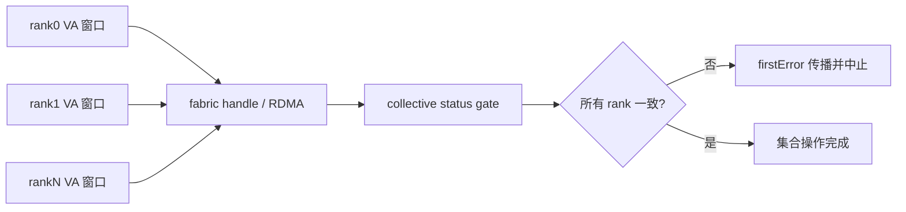

图示表达 rank 对称和一致性检查是集合通信稳定性的前提；fabric/RDMA 的实际带宽、失败注入和异常 rank 回滚需目标网络环境验证。

#### 6. 拓展知识

可继续学习 HCCL/NCCL 算法（ring/tree）、集合死锁、超时与熔断、RDMA RC/UD、RoCE 拥塞控制、rank 重映射和弹性训练。

#### 7. 常见追问及回答要点

1. **一个 rank 慢会不会拖垮集合通信？**
   - 会；集合通信是同步屏障，慢 rank 会放大尾延迟，必须有超时和熔断策略。
2. **为什么要用 collective status gate？**
   - 它把各 rank 状态统一，避免健康 rank 在失败后无限等待，保证失败传播一致。
3. **P2P 和 RDMA 是什么关系？**
   - P2P 是同节点设备间对等访问，RDMA 是跨节点网络通信；两者可能组合但边界和故障域不同。

#### 8. 易错点与反例

- 只测单 rank 正常路径：忽略集合参与者和对称性要求。
- 假设 VA 窗口天然对称：任何 rank 窗口或映射不同都会导致通信失败。
- 把源码静态确认的映射当作网络已验证：fabric/RDMA 行为未验证。

#### 9. 实践与验证

[待验证] 构造多层集合通信验证：

- 输入：单节点多卡、多进程单节点、多节点三种拓扑，注入慢 rank、rank 退出、unmap 失败；
- 步骤：建立 VA 窗口与 fabric handle，执行集合操作，注入故障并观察失败传播；
- 预期结果：对称性检查拒绝不一致配置，故障通过 gate 统一传播而非集体死锁；
- oracle：健康 rank 不会无限等待，资源最终可回收；
- 指标：集合完成时间、慢 rank 放大倍数、回滚成功率、死锁次数；
- 失败判断：出现集体死锁或异常 rank 后资源无法回收，即失败。

多节点网络、RDMA/HCCL 和异常 rank 回滚未执行，标为 `[待验证]`。

#### 10. 评分标准

- 不合格：只谈“多卡就是并行”，忽略对称性和一致性。
- 合格：能说出 VA 窗口、fabric handle 和集合参与者概念。
- 良好：能分析释放顺序、失败传播和 collective gate。
- 优秀：能设计多层拓扑与故障注入验证，并区分静态映射与网络行为边界。

**证据与来源：** `[已确认]` `cann/90-cross-module/pooling-and-resource-management.md:87-93,121,141`；`[已确认]` `cann/01-modules/M04-driver/source-map.md:36`；`[已确认]` `cann/90-cross-module/configuration-impact-map.md:22`、`cann/00-overview/analysis-state.md:96`；网络实验为 `[待验证]`。

## HRS-I009. 如何构建跨层错误传播、超时、取消与故障注入闭环？

- 难度：中等级
- 知识域：K09 错误传播、超时、取消、恢复与故障注入
- 考察能力：故障排查、实现分析、验证设计
- 题型：代码、伪代码或配置分析
- 面试频率：高频
- 前置知识：HRS-B004、HRS-I005、错误码与幂等
- 关联题目：前置 `HRS-I005`；后续 `HRS-I010`、`HRS-I015`
- 事实状态：`[已确认]` `[推断]` `[待验证]` `[建议]`

#### 1. 背景知识

CANN 的错误分层链是“Driver drvError_t/errno/ioctl → HAL → Runtime rtError_t → ACL aclError 或 GE Status → 同步返回/异步回调/日志”。[已确认] 来源：[cann/90-cross-module/error-boundaries.md:16-24] 内存路径还区分了提交前本地失败、跨层失败窗口和清理/残留风险。[已确认] 来源：[cann/90-cross-module/error-boundaries.md:26-38]

#### 2. 问题分析

按跨层证据链组织，而不是只看顶层错误：

1. 分层映射：Runtime 统一错误门面、ACL 映射 Runtime 错误、GE 异步回调记录失败并转换 Tensor；[已确认] 来源：[cann/90-cross-module/error-boundaries.md:24]
2. 失败分类：参数/句柄立即拒绝；状态/生命周期让调用方修正顺序；资源/设备保留最底层错误；模型/编译回到图与算子；异步以 callback/event/synchronize 为边界；[已确认] 来源：[cann/90-cross-module/error-boundaries.md:41-45]
3. 诊断字段：时间戳、线程、设备、Context、Stream、Graph/Model、pool、VA、size、API 阶段、原始和映射错误码、资源句柄；[已确认] 来源：[cann/90-cross-module/error-boundaries.md:47-49]
4. 回滚矩阵：Context Setup 失败、Stream Setup 失败、SOMA HAL/AICPU 失败、ordinary halMemAlloc 失败和 teardown 失败各有已确认清理和需验证残余状态。[已确认] 来源：[cann/90-cross-module/memory-and-resource-lifecycle.md:105-114]

#### 3. 具体答案

面试中可以这样回答：

> 我会先建立一条从 Driver 到 ACL/GE 的错误传播链，再在链上标出“第一个失败边界”。CANN 的分层是 Driver errno/ioctl → HAL → Runtime → ACL/GE → 同步返回或异步回调或日志；只记录顶层 `ACL_ERROR` 会丢掉原始上下文。
>
> 然后按错误类别决定动作：参数错误直接拒绝，状态错误按生命周期补齐，资源/设备错误保留底层错误并检查 Driver/固件，异步错误必须等完成通知。每个阶段都要保留诊断字段，尤其是设备、Context/Stream、阶段和原始错误码。
>
> 超时和取消上，我把结果标为 `UNKNOWN`，先隔离故障域、停止新提交，再按幂等性决定重试，并设置次数、退避和熔断。
>
> 故障注入上，我会用回滚矩阵逐个注入：Context Setup 失败、Stream Setup 失败、SOMA HAL/AICPU 失败、ordinary 分配失败和 teardown 失败，验证每种情况都能清理或保留可重试状态，而不是无条件重启。

#### 4. 技术洞察

中等级回答要能区分“已确认的清理”和“需验证的残余状态”。例如 SOMA V3 free ioctl 失败后已删除 VMM segment 且源码标注不回滚，[已确认] 来源：[cann/90-cross-module/memory-and-resource-lifecycle.md:112]，这意味着本地与设备侧状态可能暂时不对称，必须单独测试。可以用一个故障排查表把现象、假设、证据和动作绑定：

| 现象 | 假设 | 证据 | 动作 |
|---|---|---|---|
| 提交成功后无回调 | 队列卡住或 callback 丢失 | 队列深度、设备状态、超时栈 | 隔离并停止新提交 |
| 同步返回设备错误 | 任务执行失败 | 原始 Driver/HAL 错误、任务 ID | 按幂等性决定恢复 |
| 重启后仍不可分配 | 设备/驱动残留 | reset 日志、资源水位 | 扩大隔离并人工确认 |

该表是 `[建议]` 的工程结构，硬件恢复语义为 `[待验证]`。[推断] 这与 CANN 调试指南“固定版本、记录阶段、找第一个失败边界、沿 ACL→Runtime→HAL→SDK/kernel 反查”一致。[已确认] 来源：[cann/99-roadmap/debugging-guide.md:14-20]

#### 5. 图文说明

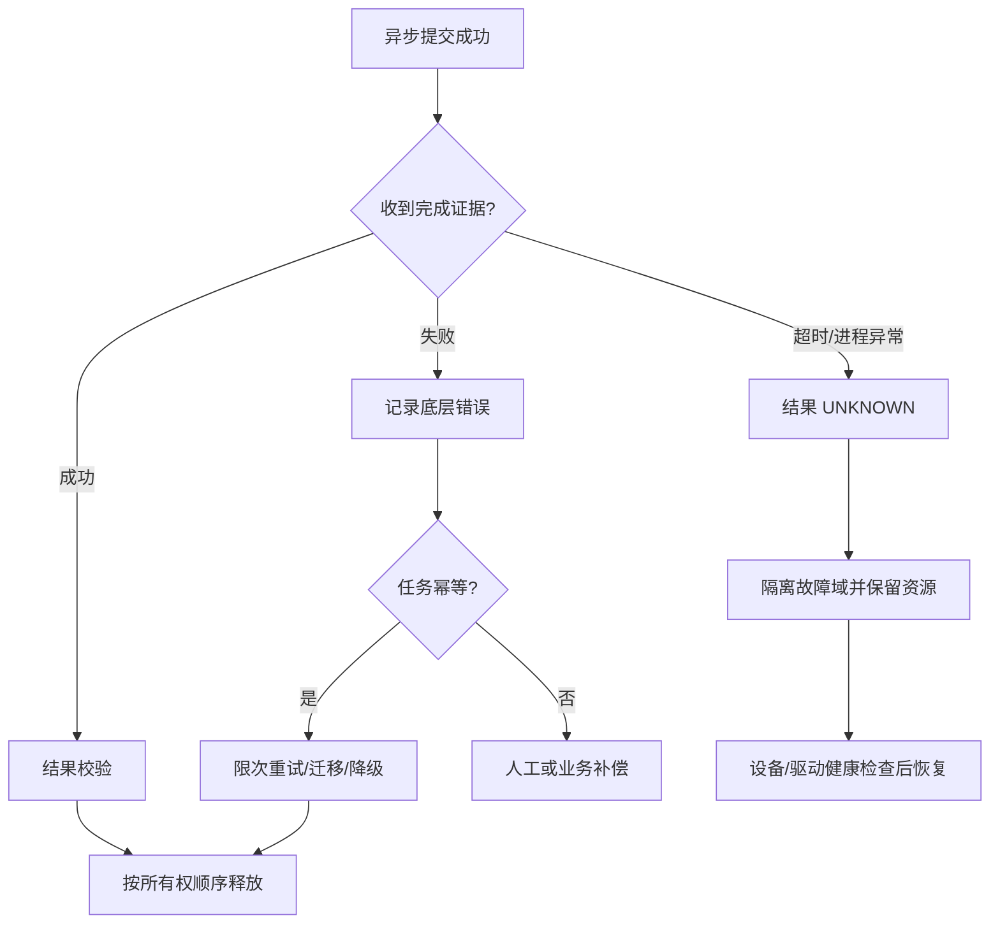

“完成证据”可以是同步、Event 或已确认 callback；“保留资源”表示先保护可能仍被设备引用的对象。图示没有承诺重启或 reset 必然清理设备资源。

#### 6. 拓展知识

可继续学习幂等键、指数退避、熔断器、bulkhead、watchdog、故障注入框架、core dump、分布式 tracing 和 postmortem。跨节点集合通信的参与者不一致属于 K08/K09 交界。

#### 7. 常见追问及回答要点

1. **超时后能否立即释放 buffer？**
   - 不能默认释放；先确认设备完成/取消语义，或把设备与资源隔离到可证明安全的边界。
2. **什么情况下可以重试？**
   - 任务幂等、未产生不可逆副作用、原资源状态可控，并设置次数、退避和熔断。
3. **只记录最终错误码够吗？**
   - 不够；要记录原始错误、层级映射、设备/Context/Stream、阶段、任务 ID 和时间线。

#### 8. 易错点与反例

- 直接重启：可能丢失证据，且设备任务或驱动资源仍处于未知状态。
- 无限重试：增加队列拥塞、重复副作用和跨设备级联故障。
- 只看顶层错误：`ACL_ERROR` 可能掩盖 Runtime、HAL 或 Driver 的第一个失败边界。

#### 9. 实践与验证

[待验证] 构造纯软件故障注入闭环：

- 输入：故障点 `submit/driver/device/wait/callback/cleanup`，错误类型、延迟、重复 callback、进程崩溃标记；
- 步骤：在每个故障点注入，执行限流、隔离和清理流程；
- 预期结果：每个请求只有一个终态，未知结果不进入成功或可重试分支，资源引用不会提前归零；
- oracle：状态转移合法、原始错误上下文完整、清理操作幂等；
- 指标：检测时间、隔离时间、恢复时间、重复副作用数、泄漏数、重试放大倍数；
- 失败判断：出现无终态请求、重复终态、错误上下文缺字段或未知状态下提前释放，即失败。

真实设备异常、Driver reset、callback 丢失和多进程恢复未执行，标为 `[待验证]`。

#### 10. 评分标准

- 不合格：建议直接重启或无限重试，无法区分提交与完成。
- 合格：能按现象、日志、设备和同步边界排查，并说明暂不释放资源。
- 良好：能建立三态结果，讨论幂等、限次重试和故障隔离。
- 优秀：能设计跨层证据链、故障注入、恢复回滚和防复发治理。

**证据与来源：** `[已确认]` `cann/90-cross-module/error-boundaries.md:16-49`；`[已确认]` `cann/90-cross-module/memory-and-resource-lifecycle.md:105-114`；`[已确认]` `cann/99-roadmap/debugging-guide.md:14-20`；排查表和硬件恢复为 `[建议]/[待验证]`。

## HRS-I010. 如何搭建可追溯的诊断证据链与可观测性体系？

- 难度：中等级
- 知识域：K10 日志、指标、Tracing、dump、SLO 与诊断证据链
- 考察能力：实现分析、证据链设计、故障定位
- 题型：流程/调用链/数据流追踪
- 面试频率：中频
- 前置知识：HRS-I009、日志与 profiling、错误分层
- 关联题目：前置 `HRS-I009`；后续 `HRS-I011`、`HRS-I015`
- 事实状态：`[已确认]` `[推断]` `[待验证]` `[建议]`

#### 1. 背景知识

诊断信息在 CANN 中属于“旁路传播”的数据类别：日志、错误码、profiling/dump/adump 数据在各层旁路流动，不改变资源所有权。[已确认] 来源：[cann/00-overview/global-data-flow.md:61] 错误边界文档建议跨层统一记录一组诊断字段。[已确认] 来源：[cann/90-cross-module/error-boundaries.md:47-49]

#### 2. 问题分析

把证据链设计成“能回答谁、何时、在哪、失败在哪一步”：

1. 关联键：设备、Context、Stream、Model/Graph、pool、VA、任务 ID 和 API 阶段，使日志、指标和 tracing 可互相 join；
2. 分层 trace：`aclrtSetDevice → rtSetDevice → Api::Instance()->SetDevice` 等已确认链路，[已确认] 来源：[cann/90-cross-module/cross-module-call-chains.md:16-24]，可作为 tracing 的骨架；
3. 指标：成功率、P50/P95/P99、队列等待、设备错误率、资源水位和恢复时间；
4. dump：在异常时保留设备、Context 和任务阶段原始证据；
5. 边界：DFX/profiling/dump 有开销，属于旁路设施，不能替代完成证据。[已确认] 来源：[cann/90-cross-module/performance-critical-paths.md:33]

调试指南要求固定版本、SoC、Toolkit、Driver/Firmware 和构建选项，并记录 API、阶段、线程、设备、Context/Stream、Graph/Model 和原始错误码。[已确认] 来源：[cann/99-roadmap/debugging-guide.md:14-20]

#### 3. 具体答案

面试中可以这样回答：

> 我会用统一关联键把日志、指标和 tracing 串成一条证据链：设备、Context、Stream、Model/Graph、pool、VA、任务 ID 和 API 阶段必须出现在各层，才能做 join。CANN 的端到端调用链已经给出 tracing 骨架，例如设备设置链和模型执行链，我按这些边界埋点。
>
> 指标上我会分成功率、尾延迟、队列等待、设备错误率和资源水位几组，并区分 GE 计划、Runtime 调度、Driver 往返和设备执行时间，避免只看到总耗时。
>
> dump 只在异常时保留设备、Context 和任务阶段证据，因为 profiling/dump 有开销，属于旁路设施，不能改变资源所有权，也不能当作完成证据。
>
> 排障流程固定版本、SoC 和驱动固件，先找第一个失败边界，再沿 ACL→Runtime→HAL→SDK/kernel 反查，而不是从最上层错误码猜原因。

#### 4. 技术洞察

中等级回答要能指出“可观测性不改变正确性”。日志和 DFX 只是旁路诊断设施，[已确认] 来源：[cann/00-overview/global-error-model.md:43]，所以不能因为日志显示成功就认为任务完成。证据链的价值在于把分散的层证据还原成一条时间线；跨层统一字段本身就是设计约束，要覆盖时间戳、线程、设备、Context/Stream、Graph/Model、pool、VA、size、API 阶段和原始/映射错误码。[已确认] 来源：[cann/90-cross-module/error-boundaries.md:47-49]

#### 5. 图文说明

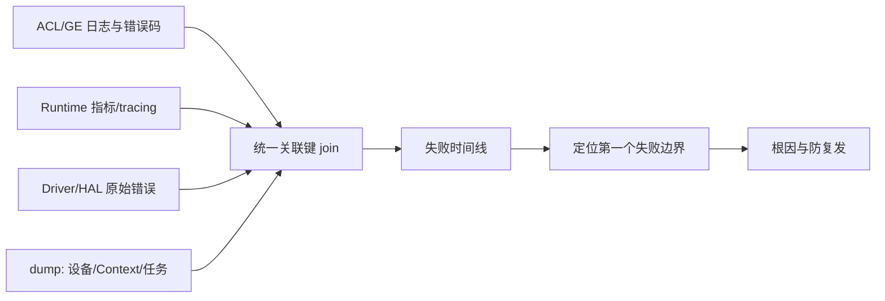

关联键是四点数据的公共维度；`失败时间线` 用于定位第一个失败边界。图示不表示日志时间戳在各层严格同步，跨进程/跨设备时钟对齐需目标环境验证。

#### 6. 拓展知识

可继续学习 OpenTelemetry、correlation ID、火焰图、eBPF、采样率与开销权衡、log sampling、ring buffer dump 和 postmortem 复盘方法。

#### 7. 常见追问及回答要点

1. **为什么需要统一关联键？**
   - 没有公共维度就无法把日志、指标和 tracing join 成一条线，也无法确认失败发生在哪一步。
2. **profiling 能当完成证据吗？**
   - 不能；DFX/profiling 是旁路设施，不改变资源所有权，完成仍须同步/Event/callback。
3. **如何降低观测开销？**
   - 用采样、分级日志和异常时才开启的高开销 dump，并记录采样策略避免误判。

#### 8. 易错点与反例

- 只靠日志顺序判断完成：日志不保证跨设备可见性。
- 指标缺关联键：出现错误无法回溯到具体设备/Context。
- 全量开启 dump：开销影响性能，反而掩盖真实瓶颈。

#### 9. 实践与验证

[待验证] 搭建纯软件证据链演练：

- 输入：模拟 ACL/Runtime/Driver 三层日志与指标，带公共关联键；注入一个在 Driver 层失败的任务；
- 步骤：汇聚日志/指标，按关联键 join，还原失败时间线；
- 预期结果：能定位到第一个失败边界并给出原始错误，而非只有顶层码；
- oracle：时间线完整、关联键无缺失、原始与映射错误码可对应；
- 指标：定位时间、字段完整率、join 成功率、误报率；
- 失败判断：无法从证据还原第一个失败边界，或关联键缺失导致无法 join，即失败。

真实 profiling/dump、跨进程时钟对齐和多设备 tracing 未执行，标为 `[待验证]`。

#### 10. 评分标准

- 不合格：只谈“多打日志”，没有关联键和时间线。
- 合格：能列出基本诊断字段和分层日志。
- 良好：能设计统一关联键、分层 trace 和指标分组。
- 优秀：能把观测开销、dump 边界、失败边界定位和防复发一起设计。

**证据与来源：** `[已确认]` `cann/00-overview/global-data-flow.md:61`；`[已确认]` `cann/90-cross-module/error-boundaries.md:47-49`；`[已确认]` `cann/90-cross-module/cross-module-call-chains.md:16-24`；`[已确认]` `cann/90-cross-module/performance-critical-paths.md:33`、`cann/99-roadmap/debugging-guide.md:14-20`；证据链演练为 `[待验证]`。

## HRS-I011. 如何做容量、碎片、成本与降级的稳定性权衡？

- 难度：中等级
- 知识域：K11 性能、容量、碎片、成本与降级
- 考察能力：性能分析、容量推理、取舍分析
- 题型：原理推导与算法分析
- 面试频率：中频
- 前置知识：HRS-I004、HRS-I006、分配器基础
- 关联题目：前置 `HRS-I004`；后续 `HRS-I012`、`HRS-I015`
- 事实状态：`[已确认]` `[推断]` `[待验证]` `[建议]`

#### 1. 背景知识

CANN 性能关键路径列出可能的瓶颈：主机逐任务下发和频繁同步、Host-device 拷贝和未对齐 buffer、KernelMemoryPool first-fit 与固定 2 MiB backing 的碎片、SOMA Best-Fit 的 Segment 分裂/缓存与 AICPU/HAL 往返、Stream/Event 资源竞争、Driver queue/HDC 往返、编译与模型加载、DFX/profiling/dump 开销。[已确认] 来源：[cann/90-cross-module/performance-critical-paths.md:25-34]

#### 2. 问题分析

把容量、碎片、成本和降级拆成可测量的量：

1. 容量：区分 KernelMemoryPool 的 `usedSize_`、SOMA 的 busy/reserved、Driver cache 的 range/area，三者不能互相换算；[已确认] 来源：[cann/01-modules/M03-runtime/memory-pool-analysis.md:65-67]
2. 碎片：KernelMemoryPool 释放尾插且无邻接合并，SOMA FREE 段 Best-Fit，Driver cache 支持 split/merge/shrink；[已确认] 来源：[cann/90-cross-module/performance-critical-paths.md:29-30]
3. 成本：编译、Load、首轮、稳态、同步、传输、分配和卸载要分别测量；[已确认] 来源：[cann/90-cross-module/performance-critical-paths.md:40]
4. 降级：OOM 时排队/迁移/降级，粒度、命中率和尾延迟是判定依据；
5. 边界：任何声称 SOMA 重用或隐式 trim 带来收益的结论，必须先确认目标源码实现和设备测试结果。[已确认] 来源：[cann/90-cross-module/performance-critical-paths.md:44]

#### 3. 具体答案

面试中可以这样回答：

> 我会先把容量指标分路径。KernelMemoryPool 的 usedSize 只描述它自己的 2 MiB backing，SOMA 的 busy/reserved 描述 stream-ordered 段，Driver cache 描述 range/area；三者不能互相换算，否则容量评估一定错。
>
> 碎片上，KernelMemoryPool 是链表 first-fit、释放尾插且没有邻接合并，长期小块请求容易碎片化；SOMA FREE 段按大小 Best-Fit，cached 复用入口当前是 no-op；Driver cache 支持 exact/upper-bound 复用、切分、相邻合并和延迟 shrink。这些差异决定我应该用碎片率、命中率和失败率而不是单一“内存占用”指标。
>
> 成本上我会分编译、Load、首轮、稳态、同步、传输、分配和卸载分别计时，记录 shape、Stream 数、设备型号和 DFX 开销。
>
> 降级上，容量不足时优先排队、迁移或降精度，但必须验证正确性 oracle 和峰值内存，不能只看平均吞吐。任何关于重用或 trim 的收益结论，我都会先核对当前源码实现是否启用，再等设备测量数据。

#### 4. 技术洞察

中等级回答要能把“设计接口”和“当前实现”分开。SOMA 的 cached 复用算法虽然存在，但统一入口 `TryToReuse` 当前直接返回 `nullptr`，[已确认] 来源：[cann/01-modules/M03-runtime/memory-pool-analysis.md:27]，隐式 trim 当前是 no-op。[已确认] 来源：[cann/01-modules/M03-runtime/memory-pool-analysis.md:29] 因此不能把设计意图写成已获得收益。可以用关系表达权衡：

```text
cost = compile + load + first_run + steady + sync + transfer + alloc + unload
capacity_gap = requested - min(path_limits)   # 分路径计算，不能合并
```

测量还要区分 GE 计划、Runtime 调度、Driver 往返和设备 Kernel，先证明瓶颈属于哪一层再优化。[已确认] 来源：[cann/90-cross-module/performance-critical-paths.md:44]

#### 5. 图文说明

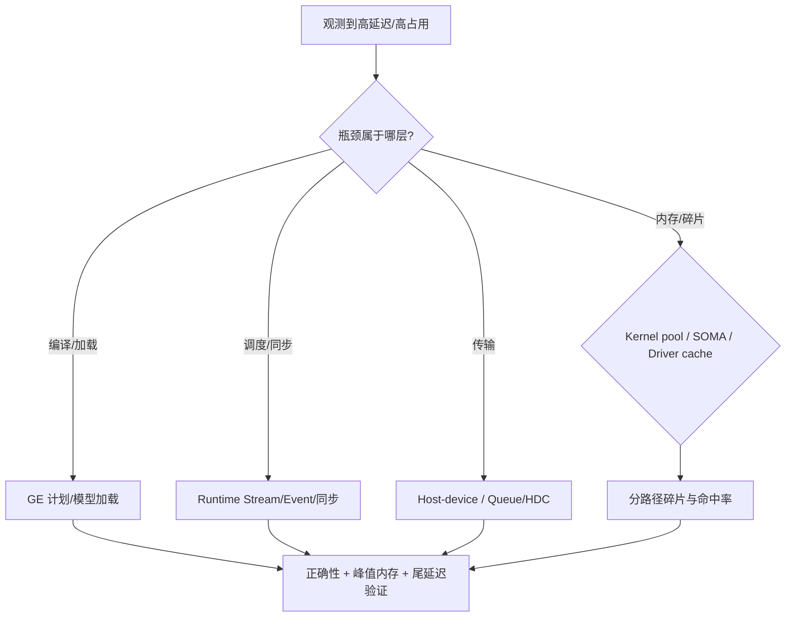

图示要求先定位瓶颈层，再按路径测量，最后统一用正确性、峰值内存和尾延迟验证优化。性能收益和碎片率需目标设备测量，当前无 NPU 数据。

#### 6. 拓展知识

可继续学习分配器碎片理论、size-class、内存池 shrink 策略、尾延迟放大、p99 与均值差异、容量规划（headroom）、Amdahl 定律、降级策略与成本模型。

#### 7. 常见追问及回答要点

1. **为什么三个池的容量不能合并算？**
   - 服务对象、backing 和释放语义不同，合并会掩盖真正的短板。
2. **SOMA 有 cached 复用就一定省内存吗？**
   - 不一定；当前统一复用入口是 no-op，需确认实现是否启用并有设备测量。
3. **优化后该看哪些指标？**
   - 不只看平均吞吐；还要看正确性、峰值内存、尾延迟和错误恢复。

#### 8. 易错点与反例

- 用平均吞吐证明优化成功：尾延迟和峰值内存可能变差。
- 把设计中的重用/trim 当已实现收益：会得出错误结论。
- 用一个“内存池”指标覆盖三套实现：容量和碎片评估失真。

#### 9. 实践与验证

[待验证] 分路径容量与碎片实验：

- 输入：Kernel pool 小块序列、SOMA 混合大小分配、Driver cache 命中/未命中请求；
- 步骤：分别测量 used/busy/reserved、碎片率、命中率和 shrink 时机；
- 预期结果：各路径指标闭合且可解释，优化只改变目标路径；
- oracle：正确性 oracle 通过，峰值内存不劣化，尾延迟在阈值内；
- 指标：碎片率、cache 命中率、shrink 命中率、P99、峰值内存；
- 失败判断：用合并指标掩盖短板，或优化牺牲正确性/峰值内存，即失败。

真实 NPU 频率、带宽和性能基线未采集，标为 `[待验证]`。

#### 10. 评分标准

- 不合格：把三个池当同一个容量，只看平均延迟。
- 合格：能列出容量、碎片和成本的基本维度。
- 良好：能分路径测量并与正确性/峰值内存/尾延迟一起验证。
- 优秀：能结合实现状态、产品差异、降级策略和成本模型给出取舍。

**证据与来源：** `[已确认]` `cann/90-cross-module/performance-critical-paths.md:25-34,40,44`；`[已确认]` `cann/01-modules/M03-runtime/memory-pool-analysis.md:27,29,65-67`；性能数据为 `[待验证]`。

## HRS-I012. 如何设计生产架构、发布迁移、灾备与演进路径？

- 难度：中等级
- 知识域：K12 生产架构、发布迁移、灾备与前沿演进
- 考察能力：架构分析、配置投影、风险推理
- 题型：概念解释与辨析
- 面试频率：中频
- 前置知识：HRS-I002、HRS-I008、版本与 ABI
- 关联题目：前置 `HRS-I002`；后续 `HRS-I013`
- 事实状态：`[已确认]` `[推断]` `[待验证]` `[建议]`

#### 1. 背景知识

CANN 是四个独立 Git 仓库，通过稳定头文件、共享库符号、错误码和 CMake package 查找关系协作；版本必须配套，Runtime README 明确要求选择配套 CANN 版本和 Git 标签。[已确认] 来源：[cann/00-overview/project-overview.md:13-33] 架构文档把“跨仓版本配套和 ABI 兼容要求高”列为代价。[已确认] 来源：[cann/00-overview/architecture.md:50-54]

#### 2. 问题分析

把生产架构、发布迁移和灾备拆成可验证约束：

1. 分层边界：应用/框架 → ACL/GE → Runtime → Driver HAL/SDK → NPU，发布时要整条链版本一致；[已确认] 来源：[cann/00-overview/architecture.md:17-35]
2. 配置矩阵：`ASCEND_INSTALL_PATH`、`CANN_3RD_LIB_PATH`、`ENABLE_OPEN_SRC`、`DRIVER/DRIVER_COMPAT`、SoC 宏和 Toolkit/Driver/Firmware 版本共同决定组件集合；[已确认] 来源：[cann/90-cross-module/configuration-impact-map.md:15-24]
3. 变更影响：Driver cache、Runtime C API、SOMA、HAL 和 SoC 分支都有必查模块；[已确认] 来源：[cann/90-cross-module/change-impact-map.md:15-30]
4. 灾备：CRIU reset/restore 通过 recycle range 重新登记，[已确认] 来源：[cann/90-cross-module/pooling-and-resource-management.md:71]；异常 rank 依赖 collective gate。
5. 演进：V1/V2 Executor 并行演进，Sink/SuperKernel 用于减少主机逐任务下发。[已确认] 来源：[cann/00-overview/runtime-model.md:36-37]

#### 3. 具体答案

面试中可以这样回答：

> 生产架构上，我会把四仓视为一个版本整体：发布清单锁定 GE、ACL、Runtime、Driver、Toolkit、Driver/Firmware、算子包和模型格式，因为这些是跨仓契约，只替换单个仓库会造成 ABI 或行为不兼容。
>
> 发布迁移按变更影响地图走：先确认真正产生副作用的实现，再分别检查 KernelMemoryPool、SOMA、普通内存和 HAL/SDK-driver ABI，更新错误映射、生命周期文档和测试矩阵，最后跑无设备 UT、跨仓集成和真实设备回归。
>
> 灾备上，我用 CRIU reset/restore 的 recycle range 机制理解内存重登记，并依赖 collective gate 保持多 rank 一致；设备故障时按故障域隔离，而不是整机重启。
>
> 演进上，V1/V2 并行和 Sink/设备下沉会改变主机下发路径，所以升级前要评估对同步代价、内存复用和诊断字段的影响，并保留回滚路径。

#### 4. 技术洞察

中等级回答要能指出“发布是配置投影问题”。同一份源码在不同 SoC 宏和构建选项下组件集合不同，[已确认] 来源：[cann/90-cross-module/configuration-impact-map.md:20-22]，因此发布矩阵必须按产品分别验证，不能外推。灾备的难点在于“恢复后句柄和资源是否一致”：CRIU restore 通过 recycle range 重新登记，[已确认] 来源：[cann/90-cross-module/pooling-and-resource-management.md:71]，但设备侧未完成任务的语义仍需验证。可以抽象为：

```text
release_ok = version_matrix_locked ∧ config_matrix_verified ∧ rollback_path_defined
```

#### 5. 图文说明

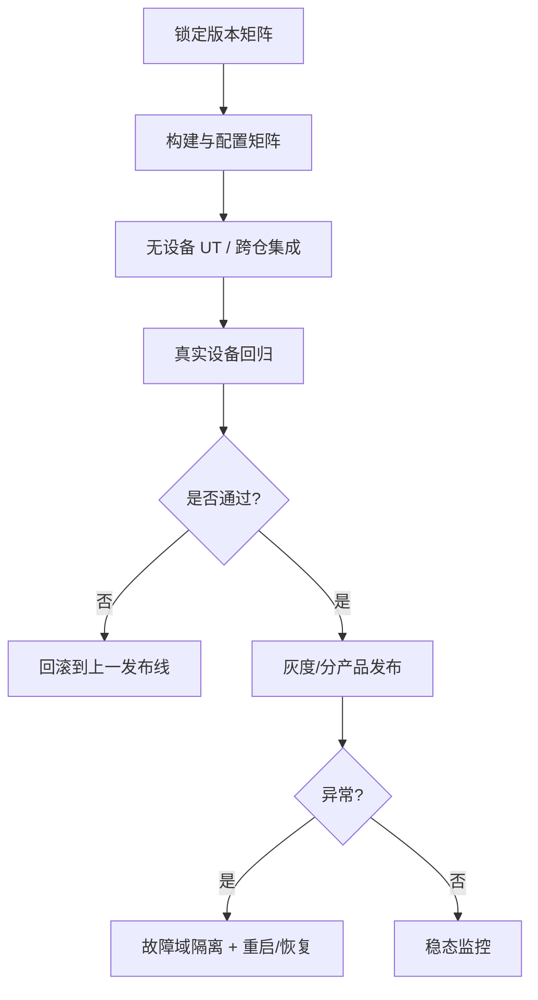

图示把发布、验证、回滚和灾备串成闭环；`真实设备回归` 与 `恢复` 依赖匹配硬件，当前未执行，属 `[待验证]`。

#### 6. 拓展知识

可继续学习 ABI 兼容与 SONAME、金丝雀与蓝绿发布、CRIU/checkpoint、灰度与回滚、发布矩阵、设备固件升级和 Sink 下沉对诊断的影响。

#### 7. 常见追问及回答要点

1. **为什么不能只升级 Runtime？**
   - 跨仓 ABI 和错误码需要同步，单仓替换可能编译、加载或运行失败。
2. **灾备恢复后最大风险是什么？**
   - 句柄、内存和异步任务状态不一致；需验证恢复后资源登记和未完成任务语义。
3. **发布回滚要准备什么？**
   - 锁定上一发布线、保留配置和模型格式兼容、定义回滚触发条件和验证步骤。

#### 8. 易错点与反例

- 认为“源码兼容即发布兼容”：配置矩阵和 SoC 宏会改变行为。
- 把设备恢复等同进程重启：设备/驱动侧资源语义不同。
- 忽略回滚路径：升级后发现问题却无法快速退化。

#### 9. 实践与验证

[待验证] 建立发布与灾备演练：

- 输入：四仓版本矩阵、配置矩阵、一个可回滚的发布包；注入构建不配套、设备故障和 CRIU reset/restore；
- 步骤：走发布→验证→回滚，以及故障注入→隔离→恢复流程；
- 预期结果：不配套组合被拒绝，回滚可完成，恢复后资源登记一致；
- oracle：版本校验通过、回滚时间在阈值内、恢复后无资源泄漏或重叠；
- 指标：发布验证覆盖度、回滚时间、恢复成功率、跨产品差异数；
- 失败判断：单仓替换后运行成功但行为不一致，或恢复后资源状态错乱，即失败。

真实多产品构建、设备固件升级和 CRIU 演练未执行，标为 `[待验证]`。

#### 10. 评分标准

- 不合格：把发布看作单独升级某个组件。
- 合格：能列出版本配套和基本发布/回滚步骤。
- 良好：能结合配置矩阵、变更影响和灾备机制说明约束。
- 优秀：能设计发布矩阵、灾备演练、演进影响和回滚治理。

**证据与来源：** `[已确认]` `cann/00-overview/project-overview.md:13-33`、`cann/00-overview/architecture.md:17-54`；`[已确认]` `cann/90-cross-module/configuration-impact-map.md:15-24`、`cann/90-cross-module/change-impact-map.md:15-30`、`cann/90-cross-module/pooling-and-resource-management.md:71`；`[已确认]` `cann/00-overview/runtime-model.md:36-37`；灾备与演练为 `[待验证]`。

## HRS-I013. 如何处理设备热插拔与在线升级的状态机与故障定位？

- 难度：中等级
- 知识域：K02 设备发现、拓扑、能力协商与兼容（设备热插拔）
- 考察能力：状态机推理、故障排查、验证设计
- 题型：代码、伪代码或配置分析
- 面试频率：中频
- 前置知识：HRS-I002、HRS-I003、Context 生命周期
- 关联题目：前置 `HRS-I002`；后续 `HRS-I014`
- 事实状态：`[已确认]` `[推断]` `[待验证]` `[建议]`

#### 1. 背景知识

设备热插拔和在线升级会把运行中的设备从可用状态移出。Driver 测试清单把“设备 reset、超时和热插拔（若平台支持）”列为故障注入项，[已确认] 来源：[cann/01-modules/M04-driver/testing.md:20]；Driver 风险清单也把“增加故障注入、DMA 边界、并发销毁、热插拔和长期压力测试”列为待办。[已确认] 来源：[cann/01-modules/M04-driver/risks-and-debt.md:35]

#### 2. 问题分析

把热插拔建模成设备状态机与资源回收的组合：

1. 设备状态：`PRESENT → OPEN → ACTIVE → REMOVING → ABSENT`，每一步对应不同的资源归属；
2. 上层依赖：Context 持有 device 引用，Stream/Queue/HDC 依赖设备，热插拔必须让这些对象进入可隔离状态；
3. 完成边界：设备移除时未完成任务的结果是 `UNKNOWN`，不能判为失败直接重试；[推断] 与 HRS-I005 三态一致
4. 清理顺序：参考 Context 销毁的“停止新访问 → 清理 Model → flush/清理 Stream → 清除绑定 → 等待引用耗尽 → 移除 Registry”；[已确认] 来源：[cann/90-cross-module/memory-and-resource-lifecycle.md:49-56]
5. 在线升级：固件/驱动升级需要版本配套和 collective 一致性，发布迁移见 HRS-I012。

#### 3. 具体答案

面试中可以这样回答：

> 我会先给设备建一个状态机：`PRESENT → OPEN → ACTIVE → REMOVING → ABSENT`。热插拔的难点不在移除本身，而在于运行中的 Context、Stream、Queue 和 HDC session 都还引用这台设备。
>
> 处理顺序是：先停止新提交并标记设备为不可调度，把受影响故障域隔离；再把该设备上未完成任务的结果标为 `UNKNOWN`，保留证据；然后按依赖逆序清理 Model、Stream、绑定和 Registry 引用，等引用耗尽后才认为设备可移除。这个顺序和 CANN 的 Context 销毁顺序一致。
>
> 在线升级我会先确认版本配套，再逐设备 drain 和切换，依赖 collective gate 保证多 rank 一致；升级失败要有回滚到上一版本的能力。
>
> 排障时我固定版本、SoC 和固件，检查设备节点、PCI ID、权限和 Driver 日志，先确认是发现失败、打开失败还是运行中被移除。

#### 4. 技术洞察

中等级回答要能把热插拔接到生命周期不变量上。CANN 明确 Driver 用户态源码只能确认 HAL/SVM/映射元数据和 ioctl 边界，闭源内核/固件的物理行为未验证，[已确认] 来源：[cann/01-modules/M04-driver/README.md:48-50]，因此“设备被拔出后资源是否自动回收”在当前证据下是 `[待验证]`。可以写成：

```text
removable(device) = new_submissions_stopped ∧ pending_tasks_resolved_or_isolated
                    ∧ child_handles == 0 ∧ refs == 0
```

#### 5. 图文说明

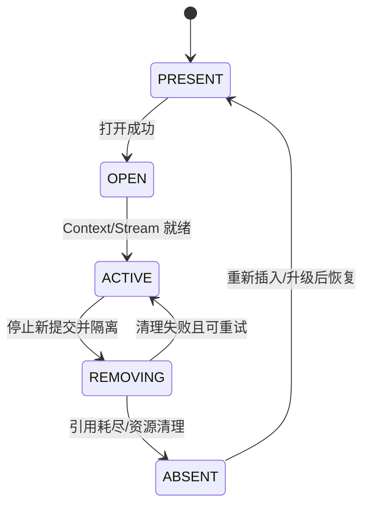

状态机强调移除过程中必须允许“清理失败可重试”；`ABSENT → PRESENT` 的恢复需要重新发现和能力协商。设备被物理移除后内核/固件的资源行为需目标环境验证。

#### 6. 拓展知识

可继续学习 PCIe hotplug、ACPI 事件、设备 drain、graceful shutdown、固件 A/B 升级、设备 reset 语义和 kexec/CRIU 恢复。

#### 7. 常见追问及回答要点

1. **设备拔出时未完成任务怎么处理？**
   - 标为 `UNKNOWN`，保留证据并隔离故障域，不能直接当失败重试。
2. **能不能直接 reset 设备清空状态？**
   - reset 是否安全、是否释放所有 backing 需目标硬件验证，且可能扩大故障域。
3. **在线升级为什么要 drain？**
   - 运行中切换会导致旧版本欠任务处于未知状态；先 drain 再切换可避免状态不一致。

#### 8. 易错点与反例

- 设备拔出后立即判所有任务失败并重试：任务可能已产生副作用。
- 直接 reset 而不隔离：可能影响其他租户和健康设备。
- 假设重新插入后句柄自动有效：需重新发现和能力协商，旧句柄可能已失效。

#### 9. 实践与验证

[待验证] 用模拟设备做热插拔状态机测试：

- 输入：设备状态机、若干引用设备的 Context/Stream/Queue，注入运行中移除和恢复；
- 步骤：移除设备，尝试新提交和销毁对象，再重新插入并恢复调度；
- 预期结果：移除后拒绝新提交，未完成任务进入 `UNKNOWN`，引用耗尽后对象可回收；
- oracle：无悬挂引用、无重复释放，恢复后需重新协商能力；
- 指标：移除检测时间、隔离时间、资源回收率、错误上下文完整率；
- 失败判断：移除后仍允许提交，或引用未耗尽却标记设备可移除，即失败。

真实设备热插拔、固件升级和内核资源回收未执行，标为 `[待验证]`。

#### 10. 评分标准

- 不合格：认为“拔了就重启”，没有状态机。
- 合格：能说出设备状态和基本清理顺序。
- 良好：能结合引用计数、完成三态和故障域处理移除。
- 优秀：能设计热插拔/在线升级状态机、回滚和验证方法，并区分硬件边界。

**证据与来源：** `[已确认]` `cann/01-modules/M04-driver/testing.md:20`、`cann/01-modules/M04-driver/risks-and-debt.md:35`；`[已确认]` `cann/90-cross-module/memory-and-resource-lifecycle.md:49-56`；`[已确认]` `cann/01-modules/M04-driver/README.md:48-50`；状态机扩展为 `[推断]`，硬件行为为 `[待验证]`。

## HRS-I014. 如何定位 Stream/Event 同步陷阱与死锁？

- 难度：中等级
- 知识域：K03 Context/Stream/Event/Queue 生命周期（同步与死锁）
- 考察能力：故障排查、并发推理、状态机推理
- 题型：代码、伪代码或配置分析
- 面试频率：高频
- 前置知识：HRS-I003、HRS-I005、锁与等待图
- 关联题目：前置 `HRS-I005`；后续 `HRS-I015`
- 事实状态：`[已确认]` `[推断]` `[待验证]`

#### 1. 背景知识

Stream 只是提交顺序和依赖的 Runtime 对象，真正设备消费发生在 Driver queue/HDC/esched。[已确认] 来源：[cann/90-cross-module/memory-and-resource-lifecycle.md:91] Event/Callback/Synchronize 是完成边界；Context teardown 失败时会恢复 owner stream 以支持重试。[已确认] 来源：[cann/90-cross-module/memory-and-resource-lifecycle.md:51]

#### 2. 问题分析

把等待关系画成有向图，找出环和缺失的完成边：

1. 等待边：Stream 内任务顺序、跨 Stream 的 Event 依赖、线程与设备的绑定、Host 同步；
2. 常见陷阱：在默认 Stream 上隐式同步、多次等待同一 Event、在回调中再次提交并同步、在持有的锁内做设备同步；
3. 死锁条件：等待图出现环，或某个完成信号永远不会到达（任务从未提交、Event 未记录、callback 丢失）；
4. 定位顺序：参考调试指南“固定版本、记录阶段、找第一个失败边界、沿 ACL→Runtime→HAL→SDK/kernel 反查”；[已确认] 来源：[cann/99-roadmap/debugging-guide.md:14-20]
5. 资源状态：pending task、child handle 和引用计数是否阻止了清理。

#### 3. 具体答案

面试中可以这样回答：

> 我会把 Stream、Event、线程和设备之间的等待关系画成有向图，然后找两类问题：环，以及永远不满足的完成边。Stream 内任务是顺序的，跨 Stream 靠 Event 建立依赖；如果在回调里再次提交并同步等待，或者两个 Stream 互相等对方的 Event，就会成环死锁。
>
> 第二个常见来源是锁与设备同步混用：在持有某个锁时调用设备同步，而完成路径又需要同一把锁，就会阻塞。CANN 的风险登记也把全局锁、缓存与多设备并发的死锁列为高优先级风险。
>
> 定位上我固定版本和阶段，先确认是提交前、Driver 接收、设备执行还是完成通知卡住，再查找缺失的 Event record、未提交的任务或丢失的 callback。清理时我会确认 pending task 和 child handle，因为 Context teardown 失败需要保留可重试状态而不是强拆。
>
> 预防上我会规定等待图无环、锁内不做阻塞同步、每个跨 Stream 依赖都有明确的 Event 记录和等待。

#### 4. 技术洞察

中等级回答要能给出死锁的两个判据：等待图有环，或完成边永久缺失。可以用简化表达：

```text
deadlock  ⇔  cycle(wait_graph) ∨ never_signaled(completion_edge)
```

CANN 确认 teardown 失败会恢复 owner stream 以支持重试，[已确认] 来源：[cann/90-cross-module/memory-and-resource-lifecycle.md:51]，这意味着“清理等待”也可能参与等待图，必须和任务完成边一起分析。Event/Notify 构造成本和跨节点基地址属于 K08 交界，此处只按依赖边处理。[推断]

#### 5. 图文说明

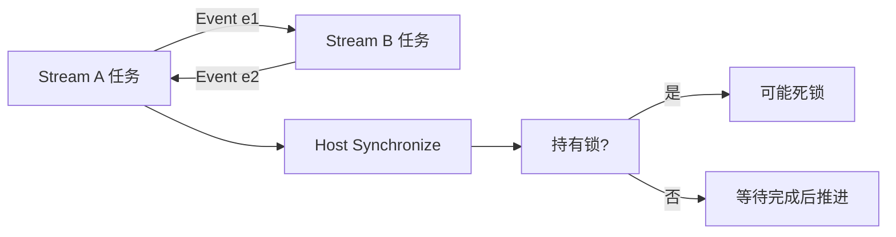

双向 Event 依赖形成环，是典型死锁；`持有锁?` 提示锁内同步的额外风险。图示不表示所有平台都有相同的 Event 语义，callback 丢失和超时行为需目标环境验证。

#### 6. 拓展知识

可继续学习 happens-before、wait-for graph、死锁检测、callback 重入、异步日志与锁顺序、超时后清理、优先级反转和 TSAN。

#### 7. 常见追问及回答要点

1. **两个 Stream 互等 Event 为什么会死锁？**
   - 等待图成环，双方都在等对方先完成，任何一方都无法推进。
2. **回调里能同步等待吗？**
   - 风险很高；回调可能运行在完成路径上，再次同步或提交会阻塞完成，形成环。
3. **死锁和超时如何区分？**
   - 死锁是等待图成环或完成边永不满足；超时只是观察窗口内没有完成证据，需分别定位。

#### 8. 易错点与反例

- 用超时掩盖死锁：只重试不查等待图，问题反复出现。
- 在锁内做设备同步：与完成路径争锁造成阻塞。
- 忘记 Event record：等待一个永远不触发的完成边。

#### 9. 实践与验证

[待验证] 用纯软件等待图模型验证死锁：

- 输入：两个 Stream、两个 Event、一个锁和一个模拟完成信号；构造环、缺失 record、锁内同步三种场景；
- 步骤：运行等待图检测，注入完成信号丢失，再尝试 teardown；
- 预期结果：成环和缺失完成边被识别，teardown 失败保留可重试状态；
- oracle：死锁场景被检测而非无限等待，合法场景无悬挂引用；
- 指标：死锁检测时间、误报率、pending task 数、teardown 重试次数；
- 失败判断：出现无限等待且未被识别，或强拆导致引用不一致，即失败。

真实设备 callback、队列调度和跨进程死锁未执行，标为 `[待验证]`。

#### 10. 评分标准

- 不合格：只建议“加超时重试”。
- 合格：能说出 Stream/Event 依赖和基本同步边界。
- 良好：能画等待图，区分环与缺失完成边，指出锁内同步风险。
- 优秀：能设计等待图检测、teardown 重试和故障注入验证。

**证据与来源：** `[已确认]` `cann/90-cross-module/memory-and-resource-lifecycle.md:51,91`；`[已确认]` `cann/99-roadmap/debugging-guide.md:14-20`、`cann/99-roadmap/risk-register.md:21`；等待图模型为 `[推断]/[建议]`，设备行为为 `[待验证]`。

## HRS-I015. 如何把 SLO、错误预算与告警阈值落到异构资源上？

- 难度：中等级
- 知识域：K10 日志、指标、Tracing、dump、SLO 与诊断证据链（SLO 治理）
- 考察能力：指标设计、边界辨析、取舍分析
- 题型：概念解释与辨析
- 面试频率：中频
- 前置知识：HRS-I010、可靠性指标、故障分类
- 关联题目：前置 `HRS-I010`；后续 `HRS-I001` 复习闭环
- 事实状态：`[已确认]` `[推断]` `[待验证]` `[建议]`

#### 1. 背景知识

CANN 的错误模型按参数、状态、资源、设备/驱动、编译/模型和异步六类区分调用方动作，[已确认] 来源：[cann/00-overview/global-error-model.md:29-37]；不同类别的错误对 SLO 的影响不同。风险登记把版本兼容、异步生命周期、跨层错误映射、ioctl/DMA 校验、并发状态和硬件验证列为最高优先级。[已确认] 来源：[cann/99-roadmap/project-risks.md:17]

#### 2. 问题分析

把 SLO 从“一个总成功率”细化到资源维度：

1. 分层 SLI：请求成功率、P50/P95/P99、队列等待、设备错误率、OOM 率、恢复时间；
2. 错误分类：参数/状态错误通常是调用方问题，不应计入可用性分母，或应单独统计；[推断] 基于错误模型的类别划分
3. 维度：设备、Context、pool、模型/Graph，避免一个全局指标掩盖单设备退化；
4. 错误预算：按错误类别和故障域消耗，异步 `UNKNOWN` 单独计量，不直接算成功或失败；
5. 告警阈值：尾延迟、队列深度、OOM 率、设备错误率设置分级阈值，并绑定诊断证据链（HRS-I010）。

性能指南要求分离编译、加载、首轮、稳态、同步、传输和卸载时间，记录 shape、Stream 数、设备型号和 DFX 开销。[已确认] 来源：[cann/99-roadmap/performance-guide.md:15-17]

#### 3. 具体答案

面试中可以这样回答：

> 我会先把 SLI 分层：成功率、P50/P95/P99、队列等待、设备错误率、OOM 率和恢复时间，并按设备、Context、pool 和模型维度拆分，避免全局平均值掩盖单点退化。
>
> 然后按错误类别记账：参数和状态错误多为调用方问题，应单独统计而不是直接算资源不可用；资源、设备/驱动和异步错误才主要影响稳定性分母；异步 `UNKNOWN` 单独计量，等完成证据后再判定。
>
> 错误预算按类别和故障域消耗，并为尾延迟、队列深度、OOM 率和设备错误率设置分级告警阈值。阈值要和证据链绑定，触发时能直接拿到设备、Context/Stream、阶段和原始错误，而不是只弹一个告警。
>
> 最后我会用分离的时序指标验证：编译、加载、首轮、稳态、同步、传输和卸载分别计量，确保 SLO 变化能定位到具体阶段。

#### 4. 技术洞察

中等级回答要能把错误分类投影到 SLO 记账上：

```text
availability = success / eligible_requests
eligible_requests = total - client_error - unknown_pending
```

`client_error` 和 `unknown_pending` 的处理需要显式约定，否则成功率会被污染。CANN 的错误类别和诊断原则强调保留最底层上下文、不以 `ACL_SUCCESS` 推断完成，[已确认] 来源：[cann/00-overview/global-error-model.md:39-43]，这正好支撑“按类别记账”的做法。风险登记提醒缺少硬件验证会导致错误结论，[已确认] 来源：[cann/99-roadmap/risk-register.md:23]，因此 SLO 阈值应先建立基线再收紧。

#### 5. 图文说明

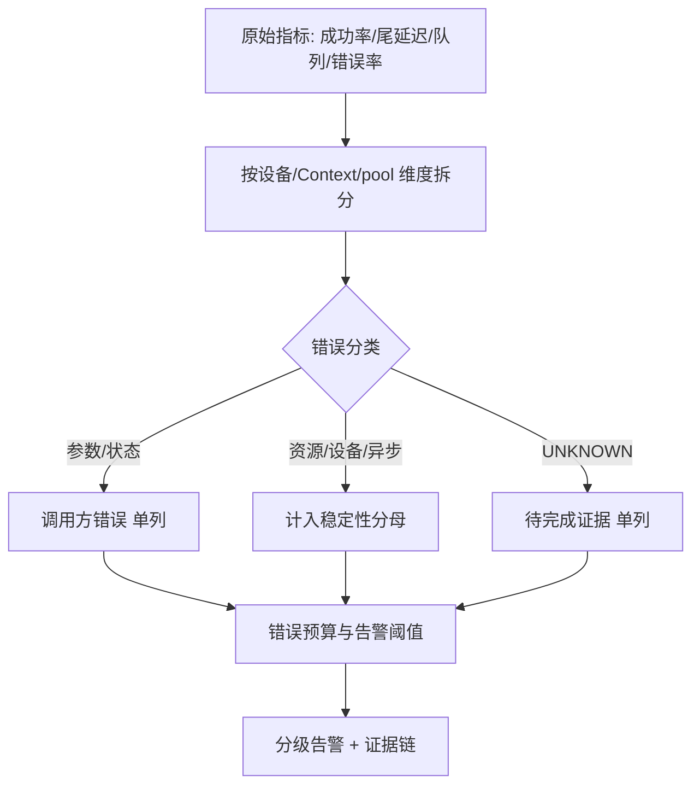

图示把指标、错误分类、错误预算和告警阈值连成一条链；`分级告警` 必须绑定证据链，否则告警无法定位。阈值基线与告警有效性需真实数据验证。

#### 6. 拓展知识

可继续学习 SLI/SLO/SLA、错误预算与 burn rate、多窗口多燃尽率告警、尾延迟 SLO、容量 headroom、降级策略和事故分级。

#### 7. 常见追问及回答要点

1. **为什么不能只看总成功率？**
   - 全局指标会掩盖单设备或单 pool 退化，也无法区分调用方错误和资源故障。
2. **`UNKNOWN` 怎么计入 SLO？**
   - 单独计量，等完成证据后再判定，避免污染成功或失败分母。
3. **阈值该怎么定？**
   - 先建立无硬件/有硬件基线，按错误类别和尾延迟分级设置，再结合 burn rate 动态调整。

#### 8. 易错点与反例

- 把参数错误计入可用性分母：会低估稳定性。
- 用平均值设告警：尾延迟劣化时告警不触发。
- 阈值与证据链脱节：告警响了却无法定位设备和阶段。

#### 9. 实践与验证

[待验证] 建立 SLO 记账与告警演练：

- 输入：合成指标流，含成功率、P99、队列深度、OOM 率、参数错误和 `UNKNOWN`；注入单设备退化和尾延迟上升；
- 步骤：按维度拆分、按类别记账、计算错误预算并触发分级告警；
- 预期结果：单设备退化可被定位，调用方错误不拉低可用性，`UNKNOWN` 不误判；
- oracle：可用性计算符合约定公式，告警与证据链关联；
- 指标：告警准确率、定位时间、错误预算消耗、误报率；
- 失败判断：全局指标掩盖单点退化，或告警无证据链可追溯，即失败。

真实生产流量、硬件基线和多租户 SLO 未采集，标为 `[待验证]`。

#### 10. 评分标准

- 不合格：只用一个成功率，不区分错误类别和维度。
- 合格：能列出 SLI 维度和基本错误分类。
- 良好：能设计按类别/故障域记账的错误预算和分级阈值。
- 优秀：能把证据链、burn rate、尾延迟和降级策略整合成 SLO 治理方案。

**证据与来源：** `[已确认]` `cann/00-overview/global-error-model.md:29-43`；`[已确认]` `cann/99-roadmap/project-risks.md:17`、`cann/99-roadmap/risk-register.md:23`；`[已确认]` `cann/99-roadmap/performance-guide.md:15-17`；记账公式和告警策略为 `[推断]/[建议]`，生产基线为 `[待验证]`。
