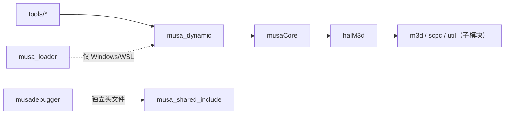
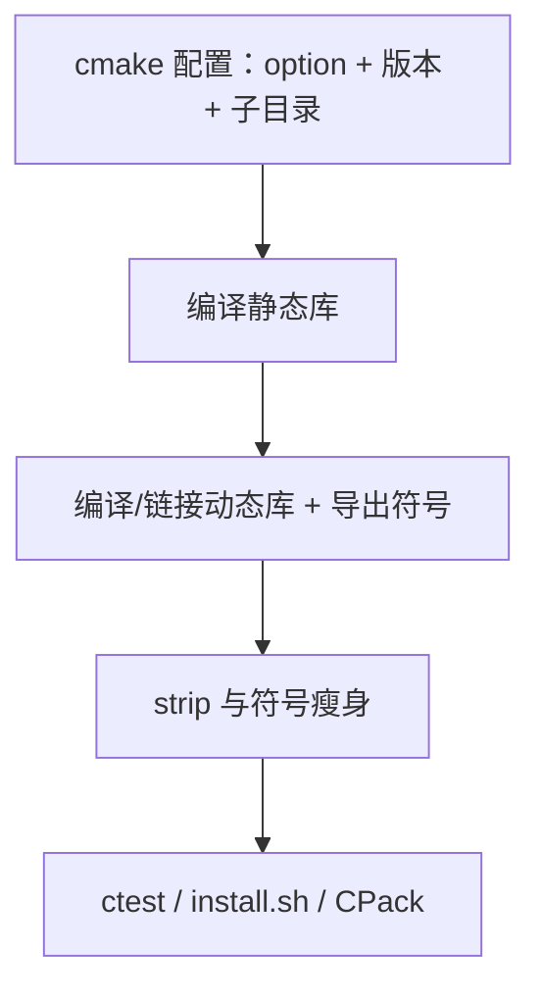
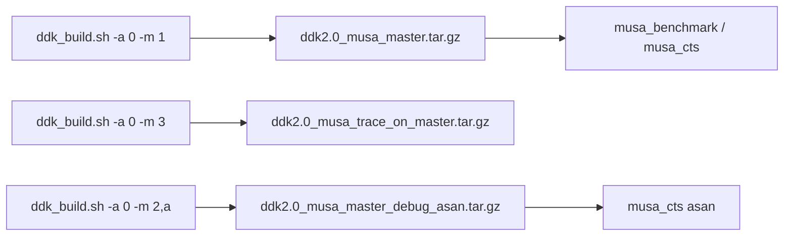
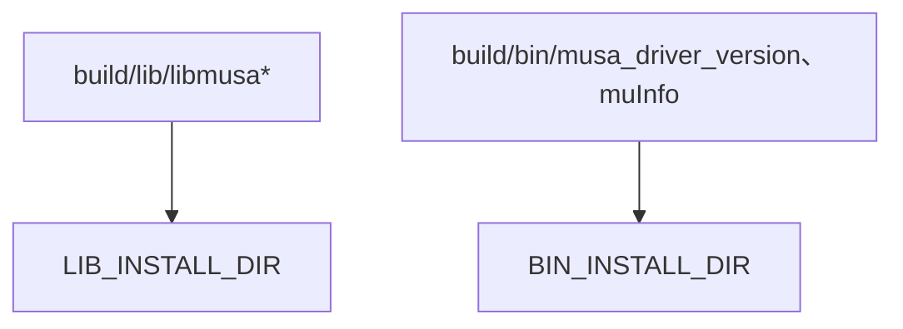
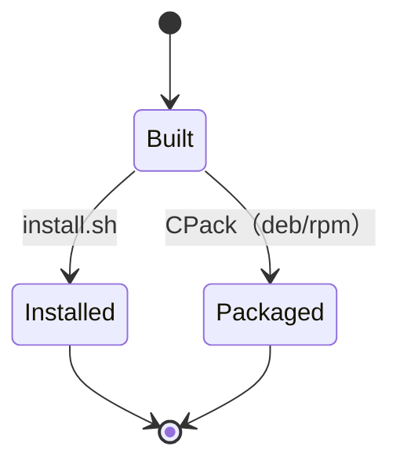

# 构建/发布/安装系统：图示

- 文档目的：build release install：核心关系与流程图示，及节点到源码的映射。
- 适用范围：M01 模块的《构建/发布/安装系统：图示》；源码根 `source/musa`。
- 对应源码版本：5.3.0 develop（本地快照 `source/musa`，无 Git 元数据）
- 证据状态：部分推断（引用较少，证据密度不足）
- 最后更新：2026-10-07
- 前置阅读：[`README.md`](README.md)、[`../module-registry.md`](../module-registry.md)
- 后续阅读：[`design.md`](design.md)、[`risks-and-debt.md`](risks-and-debt.md)

## 分层图

## 目标依赖图

## 构建阶段图

## CI 流水线图（Linux）

## 安装流图

## 生命周期图

## 证据

[src/CMakeLists.txt:7-15] [src/musa/core/CMakeLists.txt:7] [src/driver/CMakeLists.txt:9-11] [.ciConfig.yaml:8-23]

状态名是跨模块抽象，不能替代源码中具体枚举；实际枚举和异常状态请查 `implementation.md`。

## 相关文档

- [`README.md`](README.md)
- [`design.md`](design.md)
- [`call-chains.md`](call-chains.md)
- [`implementation.md`](implementation.md)
- [`risks-and-debt.md`](risks-and-debt.md)

## 源码证据摘要

- `src/CMakeLists.txt`（1 处，例：[src/CMakeLists.txt:7-15]）
- `src/musa/core/CMakeLists.txt`（1 处，例：[src/musa/core/CMakeLists.txt:7]）
- `src/driver/CMakeLists.txt`（1 处，例：[src/driver/CMakeLists.txt:9-11]）

## 未解决问题

1. 本文所有结论均为静态分析，未在授权硬件上执行构建、测试或运行验证。
2. 本文未单列的风险条目见 [`risks-and-debt.md`](risks-and-debt.md)。

## 下一步阅读建议

阅读 [`design.md`](design.md)；阅读 [`risks-and-debt.md`](risks-and-debt.md)。
