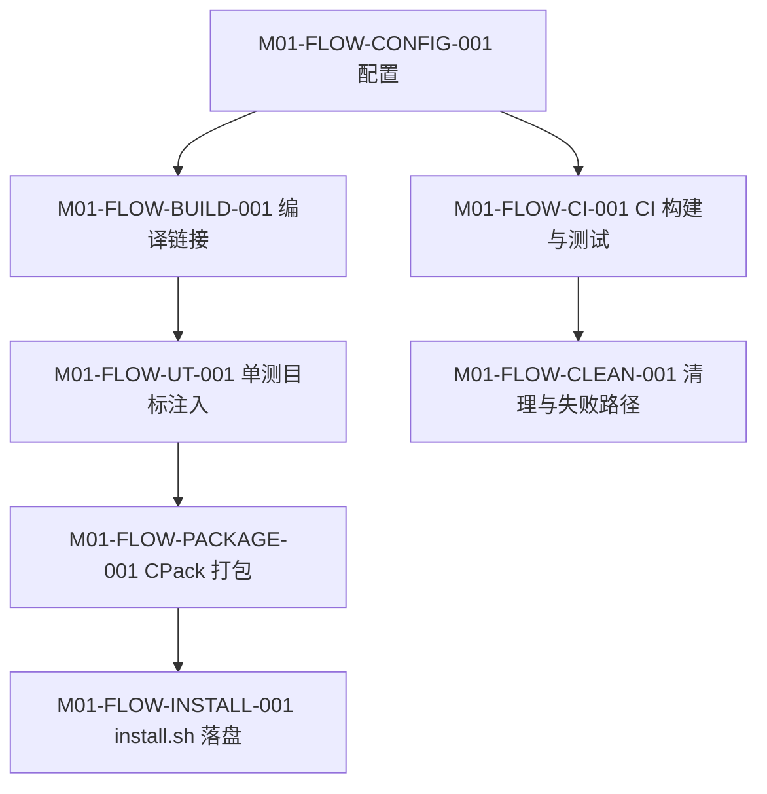

# 构建/发布/安装系统：执行流

- 文档目的：按稳定轨迹 ID 记录 M01 从配置、编译、打包、安装到 CI 与清理的可追踪步骤，每步给出源码符号与行号。
- 适用范围：根 `CMakeLists.txt`、`src/**/CMakeLists.txt`、`cmake/`、`install.sh`、`.ciConfig.yaml`、`.mthreads-ci.yml`、`scripts/`。
- 对应源码版本：`5.3.0 develop`，见 [CMakeLists.txt:33-35]
- 证据状态：静态分析，未验证（本快照未执行任何配置、编译、测试、打包或安装命令）。
- 最后更新：2026-10-07
- 前置阅读：[`README.md`](README.md)、[`source-map.md`](source-map.md)、[`risks-and-debt.md`](risks-and-debt.md)
- 后续阅读：[`design.md`](design.md)、[`risks-and-debt.md`](risks-and-debt.md)

## 主流程

## M01-FLOW-CONFIG-001：cmake 配置

| 步骤 ID | 源码符号与行号 | 调用目的 | 分支条件 | 状态与产物变化 | 输出/错误 | 下一步 |
|---|---|---|---|---|---|---|
| C1 | [CMakeLists.txt:1-4] `cmake_minimum_required` `CMAKE_MODULE_PATH` | 声明最低 CMake 版本，把源码根与 `cmake/` 追加进模块搜索路径 | 无 | `CMAKE_MODULE_PATH` 追加两条路径 | 无 | C2 |
| C2 | [CMakeLists.txt:6-19] `CMAKE_MODULE_PATH` `dev_kit_setup` | WIN32 下补 `external/cmake` 模块路径并调用开发套件初始化 | `WIN32` 为真才进入 | 追加 `wddm_cmake_modules` | `message(FATAL_ERROR ...)` 在 wddm 模块缺失时中止 | C3 |
| C3 | [CMakeLists.txt:21-31] `ENABLE_ASAN_CHECK` `MUSA_BUILD_UT` `MTUB_BUILD` | 声明全部 `option`，默认全部 `OFF` | 无（只注册 cache 变量） | cache 中生成 11 个开关 | 无 | C4 |
| C4 | [CMakeLists.txt:33-35] `version_string` `musa_driver` | 设置版本字符串并 `project(...)` | 无 | `PROJECT_VERSION=5.3.0` | 无 | C5 |
| C5 | [CMakeLists.txt:40-61] `MTUB_BUILD` `CPACK_PROJECT_CONFIG_FILE` `MT_TOOLCHAIN_AVAILABLE` | `MTUB_BUILD` 时找 mt-toolchain、注册 CPack 配置、置工具链可用标志 | `if(MTUB_BUILD)` | `MT_TOOLCHAIN_AVAILABLE=TRUE`，`PACKAGE_NAME=musa-driver` | `find_package(mt-toolchain REQUIRED)` 未安装即中止 | C6 |
| C6 | [CMakeLists.txt:64-69] `MT_TOOLCHAIN_AVAILABLE` `add_version_query` | 工具链不可用时走 legacy 版本查询回退 | `NOT MT_TOOLCHAIN_AVAILABLE` | 载入 `module_version/generate_version_query.cmake` | 无 | C7 |
| C7 | [CMakeLists.txt:110-123] `ENABLE_ASAN_CHECK` `ENABLE_TSAN_CHECK` | 注入 asan/tsan 编译标志，`GCOV_TEST` 环境变量注入覆盖率标志 | 三个条件各自独立 | `CMAKE_CXX_FLAGS` 被改写 | 互斥性由调用方保证，脚本不检查 | C8 |
| C8 | [CMakeLists.txt:125-132] `enable_testing` `MUSA_BUILD_DEBUG` | 打开 CTest 支持并按 debug 开关定 `CMAKE_BUILD_TYPE` | `MUSA_BUILD_DEBUG` | Debug 不做 IPO，Release 开 `CMAKE_INTERPROCEDURAL_OPTIMIZATION` | 无 | C9 |
| C9 | [CMakeLists.txt:134-140] `CSV_UNSPPORTED` `M3D_BUILD_MT_TRACE_CAPTURE` | 条件执行 unsupported 原因统计与 trace 宏定义 | 两个 `if` 独立 | 追加 `add_definitions(-DM3D_BUILD_MT_TRACE_CAPTURE)` | `csv` 分支执行 `code_reason.py`，依赖 `tool/` 目录 | C10 |
| C10 | [CMakeLists.txt:146-154] `MUSA_BUILD_UT` `FetchContent` `googletest` | 单测开启时二次 `enable_testing` 并拉取 googletest 1.17.0 | `MUSA_BUILD_UT` | 生成 `googletest` 目标 | 下载依赖内网 `sh-moss` 地址 | C11 |
| C11 | [CMakeLists.txt:157-163] `CMAKE_INSTALL_PREFIX` `CMAKE_INSTALL_LIBDIR` | 固定安装前缀 `/usr/local/musa/` 与 bin/lib/include 子目录 | 无 | 安装布局常量写入 cache | 无 | C12 |
| C12 | [CMakeLists.txt:165-169] `add_subdirectory` `unittest` | 递归进入 `src`，`MUSA_BUILD_UT` 时再进入 `unittest` | `MUSA_BUILD_UT` | 子项目被配置 | 快照缺 `unittest/` 时此处 FATAL_ERROR | B1 |

## M01-FLOW-BUILD-001：编译与链接

| 步骤 ID | 源码符号与行号 | 调用目的 | 分支条件 | 状态与产物变化 | 输出/错误 | 下一步 |
|---|---|---|---|---|---|---|
| B1 | [src/CMakeLists.txt:1-5] `DRIVER_LIB_NAME` `mtmusa64` | 定义库名并装入 `CMAKE_MODULE_PATH` | 无 | 产物名定为 `mtmusa64` / `musa` | 无 | B2 |
| B2 | [src/CMakeLists.txt:7-15] `add_subdirectory` | 按固定顺序配置 `util`、`hal`、`musa`、`driver`、`loader`、`gdb`、`tools` | 无 | 七个子目录依次生成目标 | 任一子目录缺失即中止 | B3 |
| B3 | [src/util/CMakeLists.txt:1-4] `util` | 生成静态库 `util` | 无 | 产出 `libutil.a` | 无 | B4 |
| B4 | [src/hal/CMakeLists.txt:1-1] `add_subdirectory` | 进入 HAL 实现目录 | 无 | 载入 m3d 实现 | 无 | B5 |
| B5 | [src/hal/m3d/CMakeLists.txt:56-59] `halM3d` `add_library` | 生成 HAL 静态库 `halM3d` | 无 | 产出 `libhalM3d.a` | 无 | B6 |
| B6 | [src/musa/core/CMakeLists.txt:1-11] `musaCore` `target_link_libraries` | 生成核心静态库 `musaCore` 并链接 HAL 与 util | 无 | 产出 `libmusaCore.a` | 无 | B7 |
| B7 | [src/driver/CMakeLists.txt:9-17] `DRIVER_LIB_NAME` `musaCore` | 生成统一驱动动态库 `${DRIVER_LIB_NAME}_dynamic` | 无 | 链接 `musaCore`/`halM3d`/`util` | 无 | B8 |
| B8 | [src/driver/CMakeLists.txt:19-31] `setup_unified_exports` `CMAKE_OBJCOPY` | 生成 `.def`/`.ver` 导出文件并做符号剥离 | `MTUB_BUILD` 相关分支 | 导出表文件写入构建目录 | `generate_export_files` 失败即中止 | B9 |
| B9 | [src/driver/CMakeLists.txt:47-52] `SOVERSION` `DETAIL_VERSION` | 设置动态库 soname 与版本后缀 | `MTUB_BUILD` 分支 | 产出 `libmtmusa64.so.x.y.z` | 无 | B10 |
| B10 | [src/loader/CMakeLists.txt:12-12] `musa_loader` | 声明 loader 目标名 | 无 | 变量 `target=musa_loader` | 无 | B11 |
| B11 | [src/loader/CMakeLists.txt:51-70] `setup_unified_exports` `musa_loader_resolver` | 生成 loader 动态库并链接 resolver | 无 | 产出 `libmusa_loader.so` | 无 | B12 |
| B12 | [src/gdb/CMakeLists.txt:1-8] `musadebugger` | 生成调试器可执行文件 | 无 | 产出 `musadebugger` | 无 | B13 |
| B13 | [src/tools/CMakeLists.txt:12-19] `add_executable` `target_link_libraries` | 生成工具可执行文件 | 无 | 产出到 `CMAKE_RUNTIME_OUTPUT_DIRECTORY` | 无 | D1 |

## M01-FLOW-UT-001：单测目标注入

| 步骤 ID | 源码符号与行号 | 调用目的 | 分支条件 | 状态与产物变化 | 输出/错误 | 下一步 |
|---|---|---|---|---|---|---|
| U1 | [CMakeLists.txt:29-29] `MUSA_BUILD_UT` | 注册单测总开关，缺省 `OFF` | 无 | cache 变量 `MUSA_BUILD_UT=OFF` | 无 | U2 |
| U2 | [CMakeLists.txt:146-154] `FetchContent_MakeAvailable` `googletest` | 拉取并配置 googletest | `MUSA_BUILD_UT` | `gtest`/`gmock` 目标可用 | 内网 URL 不可达即中止 | U3 |
| U3 | [CMakeLists.txt:167-169] `add_subdirectory` `unittest` | 进入单测子目录 | `MUSA_BUILD_UT` | 生成单测可执行与 CTest 用例 | 快照无 `unittest/` 时配置期失败 | D1 |

## M01-FLOW-PACKAGE-001：CPack 打包

| 步骤 ID | 源码符号与行号 | 调用目的 | 分支条件 | 状态与产物变化 | 输出/错误 | 下一步 |
|---|---|---|---|---|---|---|
| P1 | [CMakeLists.txt:47-58] `PACKAGE_NAME` `CPACK_TARGET_ARCHITECTURE` | 设置包名、描述、架构与安装前缀 | `MTUB_BUILD` | CPack 元数据写入 cache | 无 | P2 |
| P2 | [CPackProjectConfig.cmake:3-17] `ACTUAL_INSTALL_LIBDIR` `CPACK_GENERATOR` | 按 `CPACK_TARGET_ARCHITECTURE` 计算 DEB 的 64 位库目录 | `x86_64`/`aarch64`/`i386`/`arm` 分支 | `ACTUAL_INSTALL_LIBDIR` 写成 multiarch 路径 | 未知架构回落 `lib/${ARCH}-linux-gnu` | P3 |
| P3 | [CPackProjectConfig.cmake:18-33] `ACTUAL_INSTALL_LIBDIR` `CPACK_GENERATOR` | RPM 场景把 `ACTUAL_INSTALL_LIBDIR` 改写为 `lib64` 或 `lib` | `CPACK_GENERATOR` 匹配 `RPM` | `ACTUAL_INSTALL_LIBDIR` 被改写 | 其它格式统一给 `lib` | P4 |
| P4 | [src/driver/CMakeLists.txt:54-63] `MTUB_BUILD` `ACTUAL_INSTALL_LIBDIR` | 按真实库目录安装驱动动态库 | `MTUB_BUILD` | 安装规则指向 multiarch/lib64 | 无 | P5 |
| P5 | [.mthreads-ci.yml:48-52] `MTUB_BUILD` `package` | Windows 流水线配置 cmake 后构建 `package` 目标 | `win/build-base` 段 | 生成安装包 | 任一命令非 0 即失败 | P6 |
| P6 | [.mthreads-ci.yml:53-65] `DISTRIBUTION` `COMPONENT` | 用 CPack 按发行版与组件拆包并归档 | `DISTRIBUTION` 取值分支 | `musa-driver*.deb`/`.rpm` 落盘 | 产物缺失则 job 失败 | E1 |

## M01-FLOW-INSTALL-001：install.sh 落盘

| 步骤 ID | 源码符号与行号 | 调用目的 | 分支条件 | 状态与产物变化 | 输出/错误 | 下一步 |
|---|---|---|---|---|---|---|
| E1 | [install.sh:27-30] `LIB_BUILD_DIR` | 校验构建目录 `build/` 存在 | `test -d` 失败 | 脚本退出 | 打印 usage | 终止 |
| E2 | [install.sh:32-49] `getopts` `BIN_INSTALL_DIR` `LIB_INSTALL_DIR` | 解析 `-b/-l/-i/-h` 覆盖安装目录 | 传入对应短选项 | 变量被覆盖 | 非法选项触发 usage | E3 |
| E3 | [install.sh:51-81] `get_architecture` `get_distro` | 探测 CPU 架构与发行版 | `uname`/`ldd` 结果分支 | 决定默认库目录 | 探测失败回退 | E4 |
| E4 | [install.sh:87-99] `mkdir` | 创建 bin/lib/include 目标目录 | 目录已存在则跳过 | 目录被建出 | 权限不足即失败 | E5 |
| E5 | [install.sh:100-105] `BIN_BUILD_DIR` `musa_driver_version` | 拷贝工具与动态库到目标目录并执行版本自检 | 无 | 文件落盘 | `cp` 非 0 即失败 | F1 |

## M01-FLOW-CI-001：CI 构建与测试

| 步骤 ID | 源码符号与行号 | 调用目的 | 分支条件 | 状态与产物变化 | 输出/错误 | 下一步 |
|---|---|---|---|---|---|---|
| F1 | [.ciConfig.yaml:1-7] `include` | 引入公共 CI 片段 | 无 | 配置被展开 | include 失败即整文件无效 | F2 |
| F2 | [.ciConfig.yaml:9-23] `containerImage` `artifacts` | 首个 `build.linux-ddk` 作业定义镜像与产物路径 | 无 | `build/lib/libmusa.so` 归档 | 作业失败即停止后续 | F3 |
| F3 | [.ciConfig.yaml:36-45] `packageName` `submoduleConfig` | 以 `ddk_build.sh` 参数区分 release/trace/asan/vps 变体 | 参数差异 | 产出不同名的 tar.gz | 参数不匹配即构建失败 | F4 |
| F4 | [.ciConfig.yaml:90-97] `clang_tidy` `submoduleConfig` | 静态检查作业调用 `scripts/clang_tidy.py` | 无 | 生成 `report-clang-tidy.txt` | 违规项记入报告 | F5 |
| F5 | [.ciConfig.yaml:99-119] `pkgName` `testMark` | `test.musa_benchmark` 拉取构建产物跑性能用例 | `nodeLabel` 分节点 | 性能数据回填 | 超时 `TIMEOUT:30` 即失败 | F6 |
| F6 | [.ciConfig.yaml:121-145] `testType` `compileArgs` | `test.m3d_musa_cts` 跑 smoke CTS | `testType` 取值分支 | CTS 报告生成 | 用例失败即 job 失败 | F7 |
| F7 | [.ciConfig.yaml:303-322] `packageName` `mcuBranch` | MCU 侧 pytest 作业：装 pytest 后跑 `msight/test_cases/mcu` | 无 | MCU 测试报告 | 用例失败即 job 失败 | F8 |
| F8 | [.mthreads-ci.yml:146-169] `commit_status` `oss_path` | photon 链路按 `commit_status` 等待构建完成并拉取产物 | `interval:600` 轮询 | 依赖包被下载 | 超时 `timeout:14400` 即失败 | F9 |
| F9 | [.mthreads-ci.yml:283-291] `run_tests.py` | 安装运行时环境后执行 photon 样例测试 | 无 | 测试通过/失败 | 用例非 0 即失败 | 终止 |

## M01-FLOW-CLEAN-001：清理与失败路径

| 步骤 ID | 源码符号与行号 | 调用目的 | 分支条件 | 状态与产物变化 | 输出/错误 | 下一步 |
|---|---|---|---|---|---|---|
| X1 | [cmake_mtmusa.py:96-104] `configure_and_build` `shutil.rmtree` | 重新配置前删除既有构建目录再跑 cmake/make | 构建目录存在 | 旧产物被清空 | `rmtree` 权限不足即抛异常 | 终止 |
| X2 | [.mthreads-ci.yml:80-81] `artifacts` | Windows 流水线 `before_script` 清理 artifacts 与 staging | 无 | 旧产物被清空 | 无 | X3 |
| X3 | [scripts/clang_tidy.py:40-44] `BUILD_DIR` `shutil.rmtree` | 重建 `build-clang-tidy` 目录 | 目录存在 | 旧构建被删除 | 无 | X4 |
| X4 | [scripts/clang_tidy.py:64-79] `report_file_path` `os.remove` | 删除旧 clang-tidy 报告再重写 | 报告文件存在 | 报告被清空 | 删除异常被捕获并打印 | X5 |
| X5 | [scripts/clang_tidy.py:81-94] `exclude_dirs` `unittest` | 排除 `module_version`/`unittest`/`build` 等目录 | 无 | 分析范围收窄 | 无 | 终止 |

## 串行与并行

- 本地串行路径：配置 → 编译 → 链接 → 测试/安装，任一步失败即终止；测试开关 `MUSA_BUILD_UT` 会额外拉取 googletest 并进入 `unittest` 子目录。[CMakeLists.txt:125-132] [CMakeLists.txt:146-154] [CMakeLists.txt:167-169]
- CI 并行路径：`.ciConfig.yaml` 的多个构建 job 由 `ddk_build.sh` 参数区分（release / trace / asan / vps），测试 job 通过 `pkgName` 拉取构建产物，photon 链路用 `commit_status` 作门禁等待。[.ciConfig.yaml:8-97] [.ciConfig.yaml:99-240] [.mthreads-ci.yml:146-168]
- 静态检查与构建并行：`clang_tidy` 作业独立于打包作业，失败只体现在报告与 job 状态上。[.ciConfig.yaml:90-97]

## 观测点

- CI 产物：`build/lib/libmusa.so` 与 `libmusadebugger.so`。[.ciConfig.yaml:19-23]
- 打包产物：`build/packages/musa-driver*.deb / .rpm` 上传 sh-repo。[.mthreads-ci.yml:53-65]
- 版本与符号观测：`musa_driver_version` 可执行文件输出版本信息；`.ver`/`.def` 记录导出表。[module_version/generate_version_query.cmake:119-145] [cmake/export_symbols.cmake:64-109]
- 编译期观测：asan/tsan/gcov 三个开关都通过改写 `CMAKE_CXX_FLAGS` 生效，可从 `compile_commands.json` 反查。[CMakeLists.txt:110-123]

## 失败点索引

| 失败点 | 触发条件 | 位置 |
|---|---|---|
| wddm cmake 模块缺失 | `WIN32` 且 `external/cmake` 不存在 | [CMakeLists.txt:6-19] |
| mt-toolchain 未安装 | `MTUB_BUILD=ON` 且 `find_package` 失败 | [CMakeLists.txt:40-61] |
| googletest 下载失败 | `MUSA_BUILD_UT=ON` 且内网 URL 不可达 | [CMakeLists.txt:146-154] |
| `unittest/` 缺失 | `MUSA_BUILD_UT=ON` | [CMakeLists.txt:167-169] |
| `tool/` 缺失 | `CSV_UNSPPORTED` 为真 | [CMakeLists.txt:134-136] |
| 构建目录缺失 | 直接执行 `install.sh` | [install.sh:27-30] |

## 相关文档

- [`README.md`](README.md)
- [`design.md`](design.md)
- [`call-chains.md`](call-chains.md)
- [`implementation.md`](implementation.md)
- [`risks-and-debt.md`](risks-and-debt.md)

## 源码证据摘要

- `src/driver/CMakeLists.txt`（4 处，例：[src/driver/CMakeLists.txt:9-17]）
- `src/CMakeLists.txt`（2 处，例：[src/CMakeLists.txt:1-5]）
- `src/loader/CMakeLists.txt`（2 处，例：[src/loader/CMakeLists.txt:12-12]）

## 未解决问题

1. 本文所有结论均为静态分析，未在授权硬件上执行构建、测试或运行验证。
2. 本文未单列的风险条目见 [`risks-and-debt.md`](risks-and-debt.md)。

## 下一步阅读建议

阅读 [`design.md`](design.md)；阅读 [`risks-and-debt.md`](risks-and-debt.md)。
