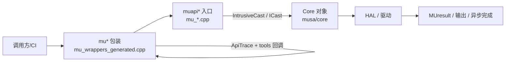
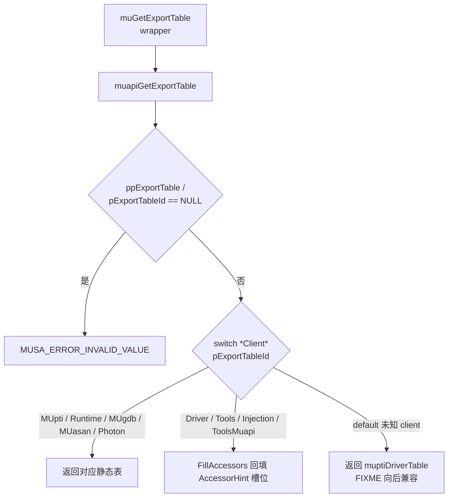

# Driver API 导出层：图示

- 文档目的：driver api：核心关系与流程图示，及节点到源码的映射。
- 适用范围：M02 模块的《Driver API 导出层：图示》；源码根 `source/musa`。
- 对应源码版本：5.3.0 develop（本地快照 `source/musa`，无 Git 元数据）
- 证据状态：已确认（引用与符号已脚本核对；运行期未验证）
- 最后更新：2026-10-07
- 前置阅读：[`README.md`](README.md)、[`../module-registry.md`](../module-registry.md)
- 后续阅读：[`design.md`](design.md)、[`risks-and-debt.md`](risks-and-debt.md)


## 分层图



## 导出表分派图



- `Client` 枚举与 magic number：`MUpti = 0x76543210`。[src/musa_shared_include/export_table.h:1954-1964]
- `FillAccessors`：当 `*pDst == AccessorHint && *pSrc != 0` 时逐个回填。[src/driver/mu_entry.cpp:2146-2156]
- 未知 client 回退 MUPTI 表。[src/driver/mu_entry.cpp:2300-2303]

## Context 生命周期图

```mermaid
stateDiagram-v2
  [*] --> Created: muapiCtxCreate_v2<br/>pDevice->CreateContext
  Created --> Registered: TlsCtxPush +<br/>Platform::LockedAddCtx
  Registered --> Destroying: muapiCtxDestroy_v2
  Destroying --> [*]: LockedRemoveCtx +<br/>DestroyContext
```

实际状态名与枚举请以 Core 源码为准；本图是 Driver 层观察到的登记/销毁顺序。[src/driver/mu_context.cpp:156-182] [src/driver/mu_context.cpp:199-212]

## 相关文档

- [`README.md`](README.md)
- [`design.md`](design.md)
- [`call-chains.md`](call-chains.md)
- [`implementation.md`](implementation.md)
- [`risks-and-debt.md`](risks-and-debt.md)

## 源码证据摘要

- `src/driver/mu_entry.cpp`（2 处，例：[src/driver/mu_entry.cpp:2146-2156]）
- `src/driver/mu_context.cpp`（2 处，例：[src/driver/mu_context.cpp:156-182]）
- `src/musa_shared_include/export_table.h`（1 处，例：[src/musa_shared_include/export_table.h:1954-1964]）

## 未解决问题

1. 本文所有结论均为静态分析，未在授权硬件上执行构建、测试或运行验证。
2. 本文未单列的风险条目见 [`risks-and-debt.md`](risks-and-debt.md)。

## 下一步阅读建议

阅读 [`design.md`](design.md)；阅读 [`risks-and-debt.md`](risks-and-debt.md)。
