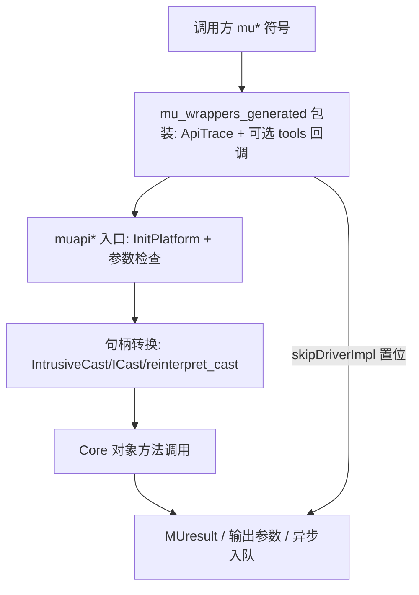

# Driver API 导出层：执行流

- 文档目的：driver api：关键执行轨迹的分步记录与失败点索引。
- 适用范围：M02 模块的《Driver API 导出层：执行流》；源码根 `source/musa`。
- 对应源码版本：5.3.0 develop（本地快照 `source/musa`，无 Git 元数据）
- 证据状态：已确认（引用与符号已脚本核对；运行期未验证）
- 最后更新：2026-10-07
- 前置阅读：[`README.md`](README.md)、[`../module-registry.md`](../module-registry.md)
- 后续阅读：[`design.md`](design.md)、[`risks-and-debt.md`](risks-and-debt.md)


## 主流程



## 同步与异步

同步/异步由两个来源决定，不能仅凭函数名推断：

- 同步语义：同步入口向 `Musa::Context::GeneralMemcpy(TlsCtxTop(), nullptr, copy3D, true)` 传入 `true` 硬同步。[src/driver/mu_memory.cpp:845-855]
- settings 开关：异步入口把 `Musa::Platform::Get().GetSettings().memBlocking`/`launchBlocking` 作为 `blocking` 参数传入 Core。[src/driver/mu_memory.cpp:861-871] [src/driver/mu_module.cpp:262-263] [src/driver/mu_memory.cpp:332-336]

异步路径把工作放入 stream/command（`CmdMemAlloc`/`CmdMemFree`/`GeneralLaunchKernel`），最终状态由 query/synchronize 暴露；Driver 层本身不做轮询。

## 清理流

```text
停止/同步工作 -> 从 tracker/Context 集合移除 -> 释放 Core 对象 -> 返回状态
```

已确认的具体清理点：

- Context 销毁：先 `TlsCtxPop`（若当前线程栈顶就是它），再 `Platform::LockedRemoveCtx`，最后 `GetParentDevice()->DestroyContext`。[src/driver/mu_context.cpp:199-212]
- Module 加载失败：`CreateModule` 成功后 `LoadFatBinary` 失败则 `pContext->DestroyModule(pModule)` 回滚。[src/driver/mu_module.cpp:132-141]
- MemoryPool 创建失败：`Init` 失败直接 `delete pMemoryPool`。[src/driver/mu_mempool.cpp:108-117]
- detached stream：`LockedRemoveDetachedStreamAndCheckLast` 后 `delete detachedStream`，必要时连带删除 parent ctx。[src/driver/mu_stream.cpp:177-194]

## 观测点

- 每个 `mu*` 包装都构造 `ApiTrace trace(status, apiName, cbid, ...)`，析构时把非成功状态写入 TLS 的 last error。[src/driver/internal.h:213-230]
- tools 回调路径：`toolsCallbackEnabled` 命中时构造 `MUtoolsTraceApiMusa`，`toolsIssueCallback` 发 ENTER/EXIT，`pSkipDriverImpl` 可跳过 Driver 实现。[src/driver/mu_wrappers_generated.cpp:3819-3857]
- correlation id：`GeneralIncrCorrelationId` 用 `g_CorrelationId` 原子自增，写入 `Util::ThreadInfo`。[src/driver/mu_entry.cpp:1183-1187]
- 时间戳/ID accessor：`CommandGetQueuedTimestamp`/`CommandGetSubmittedTimestamp`/`CommandGetBeginEndTimestampV2` 供 MUPTI 读取 command 计时；`ContextGetId`/`StreamGetId`/`EventGetId` 暴露对象 ID。[src/driver/mu_entry.cpp:157-173] [src/driver/mu_entry.cpp:1320-1334] [src/driver/mu_entry.cpp:1417-1422]

## 相关文档

- [`README.md`](README.md)
- [`design.md`](design.md)
- [`call-chains.md`](call-chains.md)
- [`implementation.md`](implementation.md)
- [`risks-and-debt.md`](risks-and-debt.md)

## 源码证据摘要

- `src/driver/mu_entry.cpp`（4 处，例：[src/driver/mu_entry.cpp:1183-1187]）
- `src/driver/mu_memory.cpp`（3 处，例：[src/driver/mu_memory.cpp:845-855]）
- `src/driver/mu_module.cpp`（2 处，例：[src/driver/mu_module.cpp:262-263]）

## 未解决问题

1. 本文所有结论均为静态分析，未在授权硬件上执行构建、测试或运行验证。
2. 本文未单列的风险条目见 [`risks-and-debt.md`](risks-and-debt.md)。

## 下一步阅读建议

阅读 [`design.md`](design.md)；阅读 [`risks-and-debt.md`](risks-and-debt.md)。
