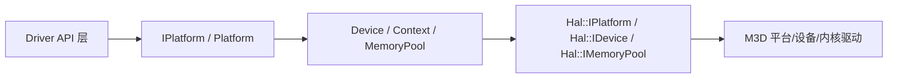
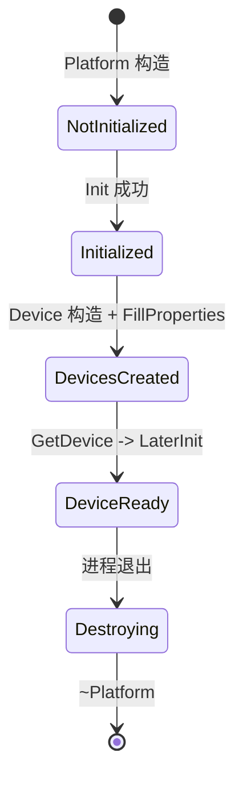

# 平台与设备管理：图示

- 文档目的：platform device：核心关系与流程图示，及节点到源码的映射。
- 适用范围：M03 模块的《平台与设备管理：图示》；源码根 `source/musa`。
- 对应源码版本：5.3.0 develop（本地快照 `source/musa`，无 Git 元数据）
- 证据状态：已确认（引用与符号已脚本核对；运行期未验证）
- 最后更新：2026-10-08
- 前置阅读：[`README.md`](README.md)、[`../module-registry.md`](../module-registry.md)
- 后续阅读：[`design.md`](design.md)、[`risks-and-debt.md`](risks-and-debt.md)


## 分层图



## 初始化生命周期图



## 登记集合示意

```text
Platform::CriticalData (shared_mutex)
  ├─ ctxs()            Context 集合（含 primary ctx）
  ├─ libraries()       Library 集合
  ├─ memoryPools()     MemoryPool 集合
  ├─ detachedStreams() Detached Stream 集合
  └─ capturedStreams() Captured Stream 集合

Device::CriticalData (shared_mutex)
  └─ ctxs()            该设备上的 Context 集合
```

状态名与源码中的集合/枚举对应关系：[src/musa/core/platform.h:63-93] [src/musa/core/device.h:129-148]

具体引擎枚举与异常状态请查 `implementation.md`。

## 图节点到源码的映射

前面三张图的每个状态/节点都能落到一段源码；下表按图的推进顺序登记，仍为静态阅读结果。

| 图中节点 | 源码锚点 | 那一段在做什么 |
|---|---|---|
| `Platform::Get` 单例节点 | [src/musa/core/platform.cpp:14-31] `Platform` | 函数内静态对象，构造函数把 `m_InitStatus` 置为未初始化 |
| `NotInitialized -> Initialized` | [src/musa/core/platform.cpp:85-139] `Init` | `std::call_once` 内完成 HAL 创建、设备枚举排序与 `m_InitStatus` 写入 |
| `GetDevice -> LaterInit` 箭头 | [src/musa/core/platform.cpp:141-150] `LaterInit` | 取设备时才惰性初始化，成功后登记 asan 设备 |
| DevicesCreated（HAL 侧枚举） | [src/hal/m3d/platform.cpp:128-138] `EnumerateDevices` | 先枚举拿 `deviceCount`，枚举不到设备即 `errorNoDevice` |
| DeviceReady（设备就绪） | [src/musa/core/device.cpp:911-1017] `LaterInit` | HAL finalize、queue family 映射、primary context、copy managers |
| `Destroying` 节点 | [src/musa/core/platform.cpp:610-656] `ReleaseUnfreedMemories` | 等待设备、释放未回收内存、删 pool、销毁 HAL 平台 |

## 相关文档

- [`README.md`](README.md)
- [`design.md`](design.md)
- [`call-chains.md`](call-chains.md)
- [`implementation.md`](implementation.md)
- [`risks-and-debt.md`](risks-and-debt.md)

## 源码证据摘要

- `src/musa/core/platform.h`（1 处，例：[src/musa/core/platform.h:63-93] `CriticalBase`）
- `src/musa/core/device.h`（1 处，例：[src/musa/core/device.h:129-148] `CriticalBase`）
- `src/musa/core/platform.cpp`（4 处，例：[src/musa/core/platform.cpp:85-139] `Init`）
- `src/musa/core/device.cpp`（1 处，例：[src/musa/core/device.cpp:911-1017] `LaterInit`）
- `src/hal/m3d/platform.cpp`（1 处，例：[src/hal/m3d/platform.cpp:128-138] `EnumerateDevices`）

## 未解决问题

1. 本文所有结论均为静态分析，未在授权硬件上执行构建、测试或运行验证。
2. 本文未单列的风险条目见 [`risks-and-debt.md`](risks-and-debt.md)。

## 下一步阅读建议

阅读 [`design.md`](design.md)；阅读 [`risks-and-debt.md`](risks-and-debt.md)。
