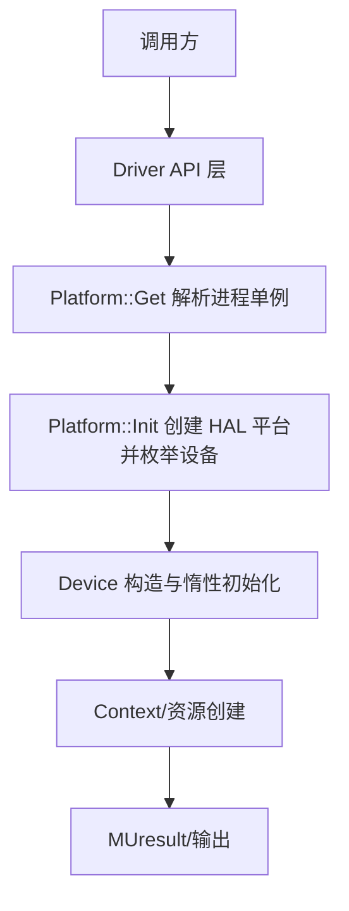

# 平台与设备管理：执行流

- 文档目的：platform device：关键执行轨迹的分步记录与失败点索引。
- 适用范围：M03 模块的《平台与设备管理：执行流》；源码根 `source/musa`。
- 对应源码版本：5.3.0 develop（本地快照 `source/musa`，无 Git 元数据）
- 证据状态：已确认（引用与符号已脚本核对；运行期未验证）
- 最后更新：2026-10-07
- 前置阅读：[`README.md`](README.md)、[`../module-registry.md`](../module-registry.md)
- 后续阅读：[`design.md`](design.md)、[`risks-and-debt.md`](risks-and-debt.md)


## 主流程



## 初始化流

1. `Platform::Get()` 取进程单例。[src/musa/core/platform.cpp:14-17]
2. `Init()` 在 `std::call_once` 内：`SettingsLoader.Init()` → `InitCoreDumpAttribute()` → `Hal::CreatePlatform`。[src/musa/core/platform.cpp:85-98]
3. 读取 HAL 设备数与设备数组，`ReorderHalDevices` 排序，`GetVisibleDeviceIndices` 筛选可见设备；无可见设备时返回 `MUSA_ERROR_NO_DEVICE`。[src/musa/core/platform.cpp:106-118]
4. HAL 设置提交与 `MUgdb::InitDebugger`。[src/musa/core/platform.cpp:122-131]
5. `m_InitStatus` 在末尾写入，返回初始化状态。[src/musa/core/platform.cpp:133-138]

## 设备惰性初始化流

`Platform::GetDevice(ordinal)` 触发 `Device::LaterInit()`：HAL `Finalize` → queue family 映射 → primary context → LLC persisting → copy managers → UniversalManager。[src/musa/core/device.cpp:911-1017]

## 上下文创建流

`Device::CreateContext` 先统计现有 context 数选调度模式，再 `new Context` + `ctx->Init()`，成功后登记进 device 与平台集合并 `Retain`。[src/musa/core/device.cpp:635-675]

## 同步与异步

- 同步：属性查询直接读 HAL 属性缓存，例如 `GetAttribute` 走 `m_pHalDevice->GetProperties()`。[src/musa/core/device.cpp:42-48]
- 异步：`CreateMemory` 只做登记不触发设备工作；真正异步工作由 stream/command 承接（属 M06 范围）。[src/musa/core/platform.cpp:386-403]

## 清理流

```text
Device::LockedWait -> ReleaseUnfreedMemories -> 删除默认 pool -> m_Devices.clear -> ReleaseDevResourceDescs -> Hal::DestroyPlatform
```

`~Platform` 顺序执行上述步骤。[src/musa/core/platform.cpp:610-656]

## 观测点

建议记录 API 序号、对象 ID、device ordinal、queue family、初始化状态与清理顺序；`mu_entry.cpp` 对 profiler/debugger 提供了多类 accessor。[src/driver/mu_entry.cpp:121-198] [src/driver/mu_entry.cpp:1085-1249]

## 相关文档

- [`README.md`](README.md)
- [`design.md`](design.md)
- [`call-chains.md`](call-chains.md)
- [`implementation.md`](implementation.md)
- [`risks-and-debt.md`](risks-and-debt.md)

## 源码证据摘要

- `src/musa/core/platform.cpp`（7 处，例：[src/musa/core/platform.cpp:14-17]）
- `src/musa/core/device.cpp`（3 处，例：[src/musa/core/device.cpp:911-1017]）
- `src/driver/mu_entry.cpp`（2 处，例：[src/driver/mu_entry.cpp:121-198]）

## 未解决问题

1. 本文所有结论均为静态分析，未在授权硬件上执行构建、测试或运行验证。
2. 本文未单列的风险条目见 [`risks-and-debt.md`](risks-and-debt.md)。

## 下一步阅读建议

阅读 [`design.md`](design.md)；阅读 [`risks-and-debt.md`](risks-and-debt.md)。
