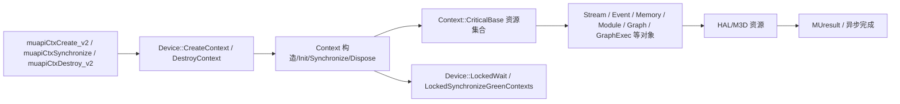
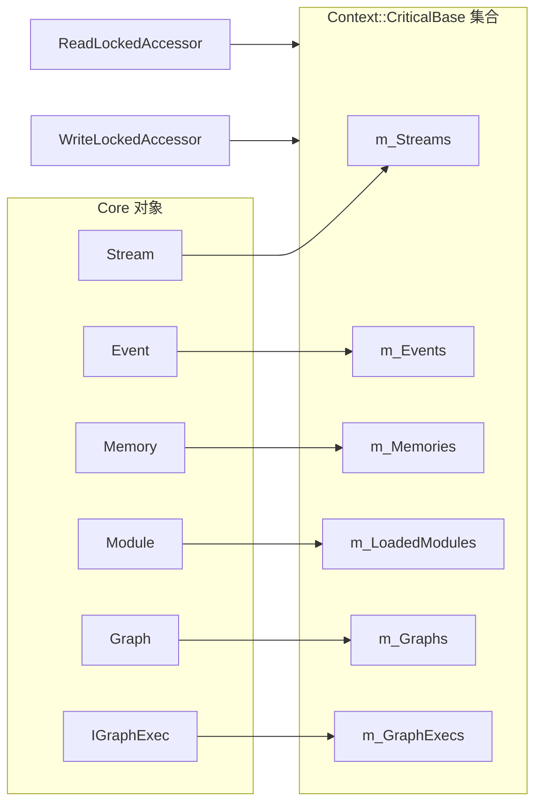

# Context 与资源生命周期：图示

- 文档目的：context lifecycle：核心关系与流程图示，及节点到源码的映射。
- 适用范围：M04 模块的《Context 与资源生命周期：图示》；源码根 `source/musa`。
- 对应源码版本：5.3.0 develop（本地快照 `source/musa`，无 Git 元数据）
- 证据状态：部分推断（引用较少，证据密度不足）
- 最后更新：2026-10-07
- 前置阅读：[`README.md`](README.md)、[`../module-registry.md`](../module-registry.md)
- 后续阅读：[`design.md`](design.md)、[`risks-and-debt.md`](risks-and-debt.md)


## 分层图



## 生命周期图

```mermaid
stateDiagram-v2
 [*] --> Constructed: new Context
 Constructed --> Init: Context::Init（CriticalBase + 默认流 + barrier 流 + 库）
 Init --> Active: 登记成功
 Active --> Sync: Context::Synchronize / LockedWait
 Sync --> Active: 完成
 Active --> Destroying: Dispose / 析构
 Destroying --> SyncWait: 逐流 WaitFinish
 SyncWait --> Release: ReleaseClientResources
 Release --> [*]
 Active --> Reset: LockedReset（primary context 重建）
 Reset --> Init: 重建默认流/barrier 流
```

状态名是阅读模型，不能替代源码中具体字段；实际状态由 `m_IsActivate`、`m_RefCount` 与各资源集合的成员关系表达。[src/musa/core/context.h:346-363]

## 资源登记图



登记/摘除统一走 `WriteLockedAccessor<CriticalBase>`；查找/遍历统一走 `ReadLockedAccessor<CriticalBase>`。[src/musa/core/context.cpp:93-126] [src/musa/core/internal_types.h:213-264]

状态名是跨模块抽象，不能替代源码中具体枚举；实际枚举和异常状态请查 `implementation.md`。

## 相关文档

- [`README.md`](README.md)
- [`design.md`](design.md)
- [`call-chains.md`](call-chains.md)
- [`implementation.md`](implementation.md)
- [`risks-and-debt.md`](risks-and-debt.md)

## 源码证据摘要

- `src/musa/core/context.h`（1 处，例：[src/musa/core/context.h:346-363]）
- `src/musa/core/context.cpp`（1 处，例：[src/musa/core/context.cpp:93-126]）
- `src/musa/core/internal_types.h`（1 处，例：[src/musa/core/internal_types.h:213-264]）

## 未解决问题

1. 本文所有结论均为静态分析，未在授权硬件上执行构建、测试或运行验证。
2. 本文未单列的风险条目见 [`risks-and-debt.md`](risks-and-debt.md)。

## 下一步阅读建议

阅读 [`design.md`](design.md)；阅读 [`risks-and-debt.md`](risks-and-debt.md)。
