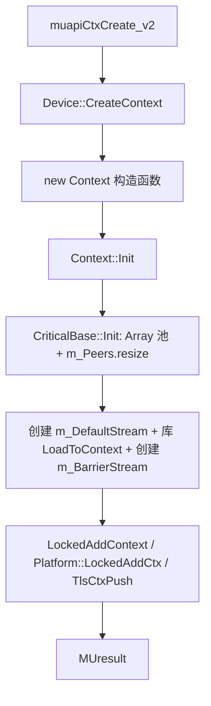
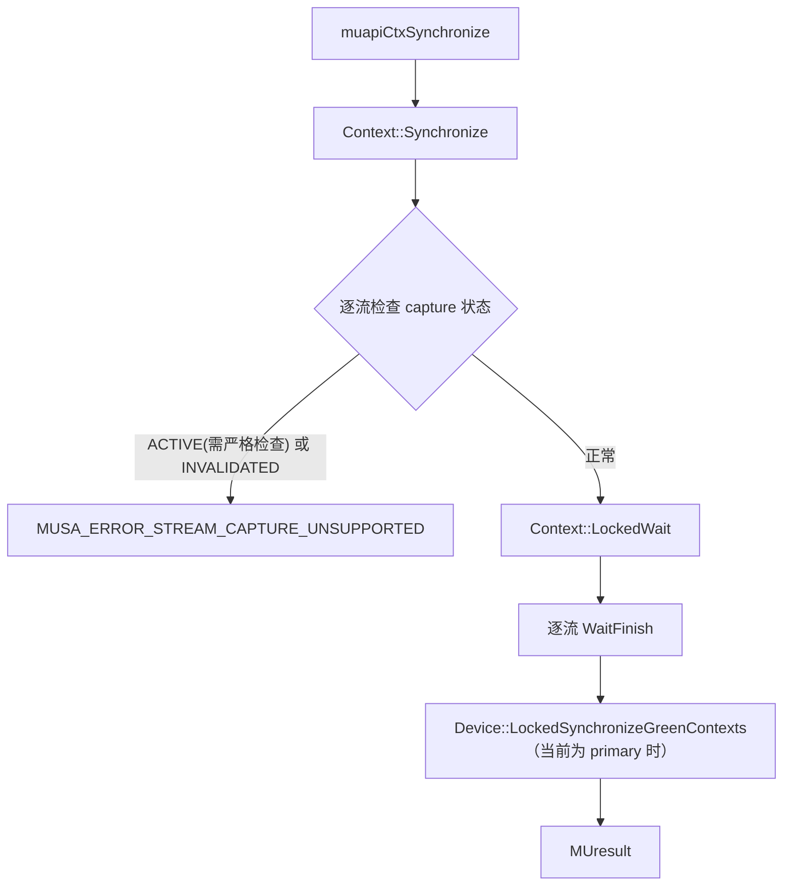
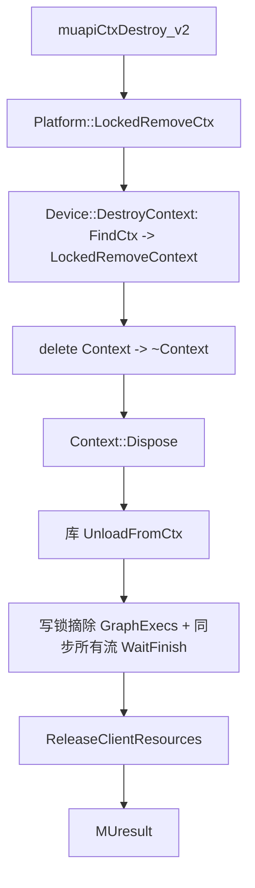

# Context 与资源生命周期：执行流

- 文档目的：context lifecycle：关键执行轨迹的分步记录与失败点索引。
- 适用范围：M04 模块的《Context 与资源生命周期：执行流》；源码根 `source/musa`。
- 对应源码版本：5.3.0 develop（本地快照 `source/musa`，无 Git 元数据）
- 证据状态：已确认（引用与符号已脚本核对；运行期未验证）
- 最后更新：2026-10-07
- 前置阅读：[`README.md`](README.md)、[`../module-registry.md`](../module-registry.md)
- 后续阅读：[`design.md`](design.md)、[`risks-and-debt.md`](risks-and-debt.md)


## 创建流



## 同步流



## 销毁流



## 同步与异步

- `Context::Synchronize` 是同步等待：先读锁遍历流检查 capture 状态，再 `LockedWait` 逐流 `WaitFinish`。[src/musa/core/context.cpp:997-1015]
- 命令提交是异步的：`ResolveDependencyAndQueueCommand` 记录依赖后 `QueueCommand`，仅在 `blocking` 或 pfm 串行模式下才 `commandRef->Wait()`。[src/musa/core/context.cpp:2064-2077]
- 默认流依赖规则：入默认流的命令依赖所有非非阻塞流的 `LastCommand`；入 barrier 流的命令依赖全部；普通 blocking 流依赖默认流。[src/musa/core/context.cpp:2032-2062]

## 清理流

```text
摘除登记（写锁 Remove*）-> 同步（WaitFinish）-> 释放 Core 对象（delete）-> 释放 HAL 对象 -> 返回状态
```

- 单资源销毁：`DestroyStream`/`DestroyEvent`/`DestroyMemory` 等先摘除再删除；`DestroyGraph`/`DestroyGraphExec` 额外先 `LockedWait`。[src/musa/core/context.cpp:1219-1228] [src/musa/core/context.cpp:1618-1659]
- context 级清理：`Dispose` 内 `ReleaseClientResources` 对遗漏资源打 WARNING 并强制删除。[src/musa/core/context.cpp:1967-2005]

## 观测点

建议记录 API 序号、对象 ID、stream、command 类型、queued/submitted/completed 时间戳；`mu_entry.cpp` 对 profiler/debugger 提供了多类 accessor。[src/driver/mu_entry.cpp:121-198] [src/driver/mu_entry.cpp:1085-1249]

## 相关文档

- [`README.md`](README.md)
- [`design.md`](design.md)
- [`call-chains.md`](call-chains.md)
- [`implementation.md`](implementation.md)
- [`risks-and-debt.md`](risks-and-debt.md)

## 源码证据摘要

- `src/musa/core/context.cpp`（6 处，例：[src/musa/core/context.cpp:997-1015]）
- `src/driver/mu_entry.cpp`（2 处，例：[src/driver/mu_entry.cpp:121-198]）

## 未解决问题

1. 本文所有结论均为静态分析，未在授权硬件上执行构建、测试或运行验证。
2. 本文未单列的风险条目见 [`risks-and-debt.md`](risks-and-debt.md)。

## 下一步阅读建议

阅读 [`design.md`](design.md)；阅读 [`risks-and-debt.md`](risks-and-debt.md)。
