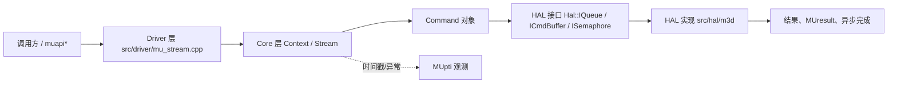
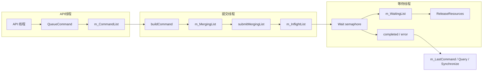
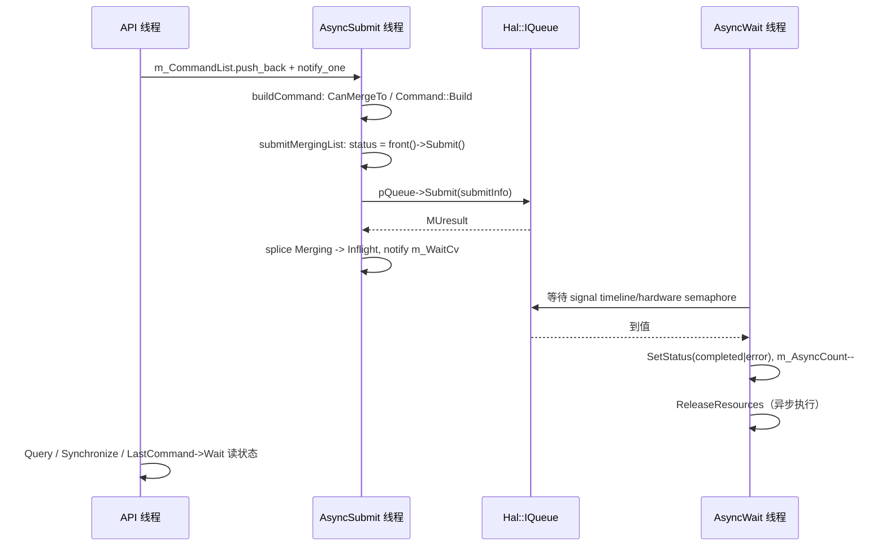
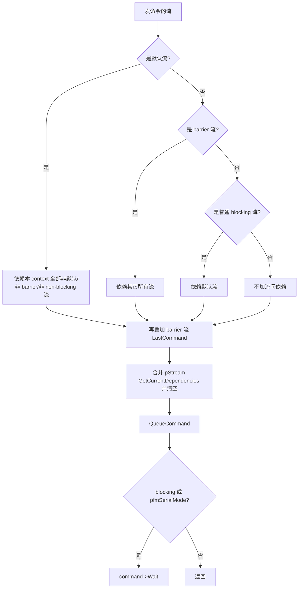
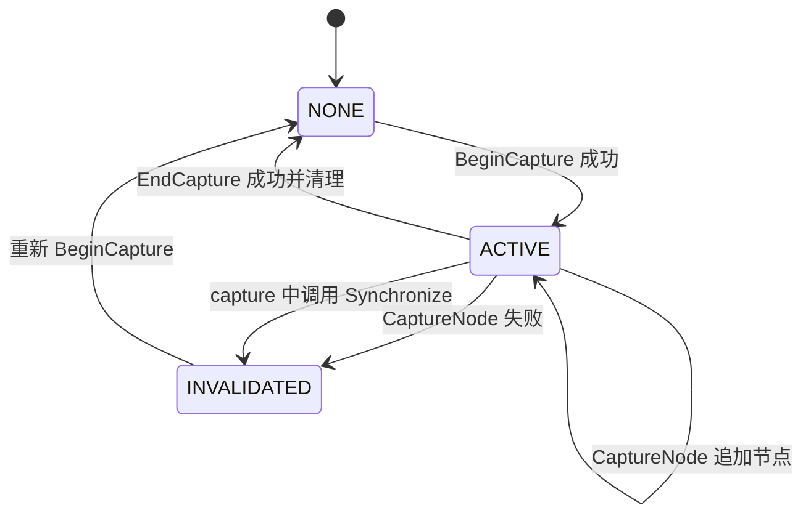
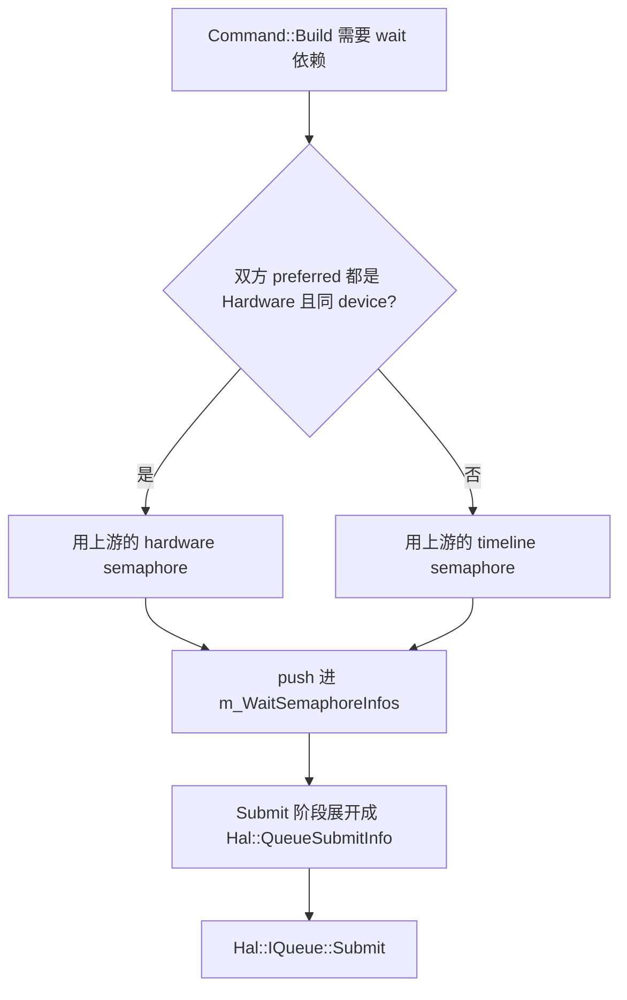

# Stream 与 Command 调度：图示

- 图中节点名来自源码标识符；箭头表示调用或数据流转，不代表已观测到的运行时顺序。
- 文档目的：stream command：核心关系与流程图示，及节点到源码的映射。
- 适用范围：M06 模块的《Stream 与 Command 调度：图示》；源码根 `source/musa`。
- 对应源码版本：5.3.0 develop（本地快照 `source/musa`，无 Git 元数据）
- 证据状态：静态确认；并发时序与硬件提交顺序**未验证**。
- 最后更新：2026-10-07
- 前置阅读：[`README.md`](README.md)、[`../module-registry.md`](../module-registry.md)
- 后续阅读：[`design.md`](design.md)、[`risks-and-debt.md`](risks-and-debt.md)

## 分层图



## Command 生命周期状态图

```mermaid
stateDiagram-v2
 [*] --> created
 created --> queued: QueueCommand
 queued --> built: Command::Build
 built --> submitted: submitMergingList -> Submit
 submitted --> completed: AsyncWait 等到 semaphore
 submitted --> error: Submit 失败 / 引擎错误
 queued --> error: 批次 Submit 失败
 built --> error: 批次 Submit 失败
 completed --> [*]
 error --> [*]
```

状态值与推进规则见 [src/musa/core/command/command.h:35-42]，CAS 实现见 [src/musa/core/command/command.cpp:92-120]。

## Stream 内部队列流转图



四个容器与 `m_LastCommand` 的字段位置见 [src/musa/core/stream.h:195-203]。

## 提交时序图



## 依赖解析决策树



分支代码位于 [src/musa/core/context.cpp:2012-2084]。

## capture 状态图



状态值是 `MUstreamCaptureStatus`，字段为 `m_CaptureStatus`。[src/musa/core/stream.h:249-250]

## semaphore 选择



`GetPreferredSemaphoreType` 由 `Stream::EnableUserQueue(engine)` 决定。[src/musa/core/command/command.cpp:288-291]

## Stream 生命周期图

```mermaid
stateDiagram-v2
 [*] --> Created: Context::CreateStream + Stream::Init
 Created --> Running: 线程启动 / 有命令进出
 Running --> Running: 合批 / 提交 / 完成
 Running --> Draining: 析构置 stop token
 Draining --> [*]: join 两条线程后释放 HalPtr
```

`Init` 在起线程前完成全部 HAL 资源创建。[src/musa/core/stream.cpp:930-1033]

## 状态名说明

图中的 `created`/`queued`/`built`/`submitted`/`completed`/`error` 是 `Musa::Command::Status` 的枚举名；`NONE`/`ACTIVE`/`INVALIDATED` 是 `MUstreamCaptureStatus` 三个取值 `MU_STREAM_CAPTURE_STATUS_NONE`、`MU_STREAM_CAPTURE_STATUS_ACTIVE`、`MU_STREAM_CAPTURE_STATUS_INVALIDATED` 的简写。其它节点名是为可读性起的标签，不能替代源码中的具体符号。

## 相关文档

- [`README.md`](README.md)
- [`design.md`](design.md)
- [`call-chains.md`](call-chains.md)
- [`implementation.md`](implementation.md)
- [`risks-and-debt.md`](risks-and-debt.md)

## 源码证据摘要

- `src/musa/core/command/command.cpp`（2 处，例：[src/musa/core/command/command.cpp:92-120]）
- `src/musa/core/stream.h`（2 处，例：[src/musa/core/stream.h:195-203]）
- `src/musa/core/command/command.h`（1 处，例：[src/musa/core/command/command.h:35-42]）

## 未解决问题

1. 本文所有结论均为静态分析，未在授权硬件上执行构建、测试或运行验证。
2. 本文未单列的风险条目见 [`risks-and-debt.md`](risks-and-debt.md)。

## 下一步阅读建议

阅读 [`design.md`](design.md)；阅读 [`risks-and-debt.md`](risks-and-debt.md)。
