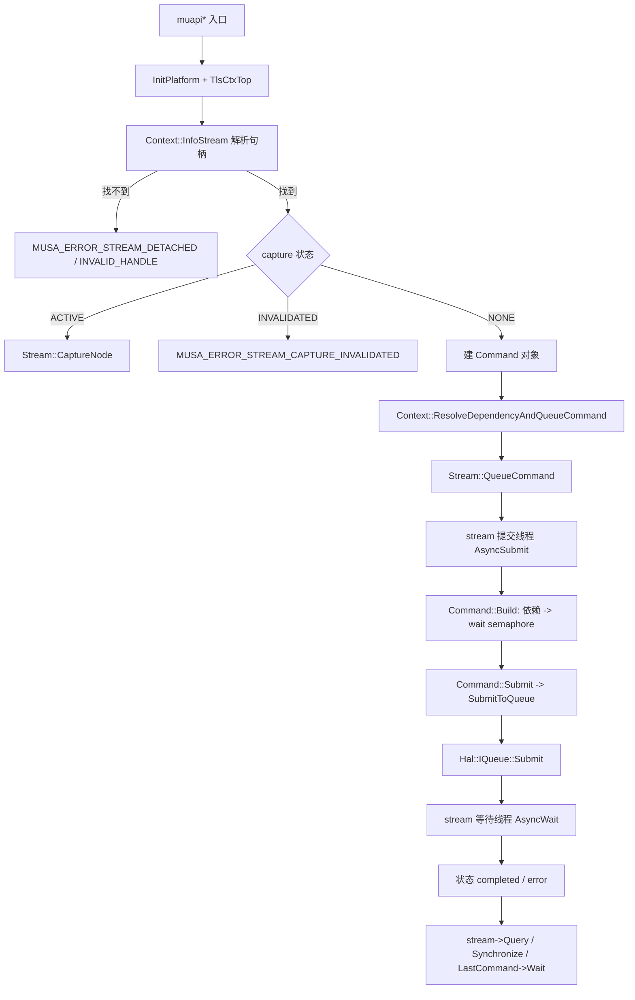
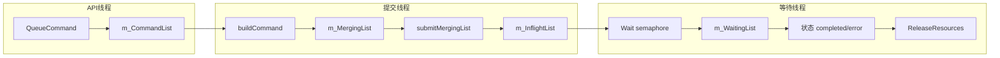
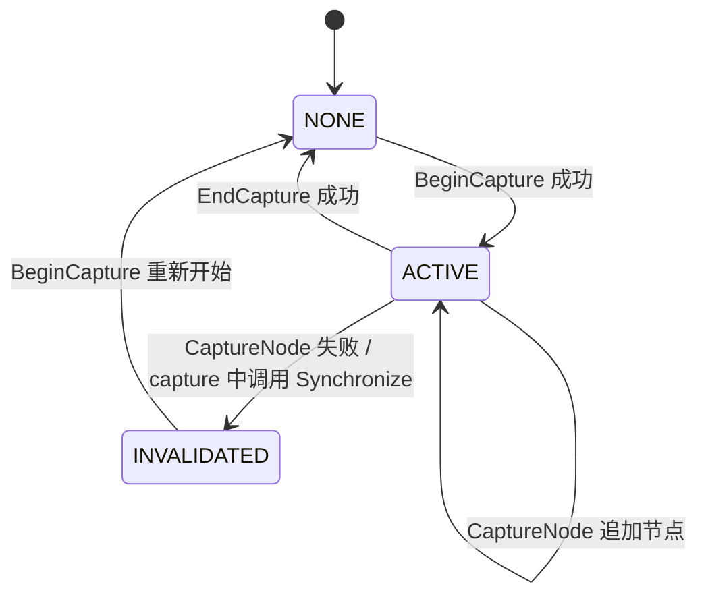

# Stream 与 Command 调度：执行流

- 文档目的：stream command：关键执行轨迹的分步记录与失败点索引。
- 适用范围：M06 模块的《Stream 与 Command 调度：执行流》；源码根 `source/musa`。
- 对应源码版本：5.3.0 develop（本地快照 `source/musa`，无 Git 元数据）
- 证据状态：路径与分支条件已静态确认；线程交错、超时、异常注入行为**未验证**。
- 最后更新：2026-10-07
- 前置阅读：[`README.md`](README.md)、[`../module-registry.md`](../module-registry.md)
- 后续阅读：[`design.md`](design.md)、[`risks-and-debt.md`](risks-and-debt.md)

## 主流程（异步提交）



## 同步与异步

同步路径在 API 或 Core 内阻塞等待；异步路径只把工作推进 `m_CommandList`，由 `Query`/`Synchronize` 暴露最终状态。`blocking` 不来自函数名，而来自：

| 参数 | 来源 | 默认值 |
|---|---|---|
| memcpy 的 `wait` | 同步版硬编码 `true`；异步版取平台设置 `memBlocking` | 0（异步） |
| kernel 的 `wait` | 平台设置 `launchBlocking` | 0（异步） |

默认值证据在 [src/musa/core/platformSettings.cpp:72-73]，同步/异步 memcpy 入口在 [src/driver/mu_memory.cpp:1035-1055]。

## 队列推进流（每条 Stream 内部）



状态推进是单向的：`created -> queued -> built -> submitted -> completed`，任一阶段失败进 `error`，由 `Command::SetStatus` 的 CAS 保证不回退。[src/musa/core/command/command.cpp:92-120]

## 合批流

```text
buildCommand(frontCommand)
  ├─ FilterDependency: 丢掉已 completed 的依赖        [src/musa/core/command/command.cpp:156-166]
  ├─ CanMergeTo(m_MergingList)?
  │   ├─ 否 -> 先 submitMergingList() 清空批次，再开新批次
  │   └─ 是 -> 并入当前批次，继承 primary 的 signal value
  ├─ 分配 signal timeline value
  └─ Command::Build -> 生成 m_WaitSemaphoreInfos
```

触发 `submitMergingList()` 的三个条件是 stopMerging（在途配额不足、批次 >= 32、或命令队列已空）。[src/musa/core/stream.cpp:1287-1306]

## 默认流语义

```text
muapiStreamSynchronize(默认流)
  -> Context::LockedSyncDefaultStream
     遍历本 context 所有流，跳过 non-blocking 流，逐个 WaitFinish

QueueCommand(普通 non-blocking 流)
  -> 不会被默认流/barrier 流当作依赖方     [src/musa/core/context.cpp:2032-2042]
```

三条依赖规则的完整代码在 `Context::ResolveDependencyAndQueueCommand`。[src/musa/core/context.cpp:2012-2084]

## capture 流



状态字段是 `m_CaptureStatus`，同时受 Platform 的 captured set（`capturedStreams`）影响；`Stream::IsCaptureStream` 就是查这个集合。[src/musa/core/stream.h:72-76]

## 清理流

```text
muapiStreamDestroy_v2
  ├─ detached 流: Platform 注册表移除 -> delete detachedStream -> 必要时 delete parentCtx
  └─ 普通流:      Context::LockedWait() -> Context::DestroyStream
                     -> Stream::~Stream:
                          1. 置 m_SubmitStopToken / m_WaitStopToken，notify 两个 cv
                          2. join 提交线程与等待线程
                          3. 清空 m_CommandList / m_MergingList / m_InflightList / m_WaitingList
                          4. 释放 surface 环形容器、spill memory
                          5. HalPtr 释放 queue / cmdPool / cmd buffer / semaphore
```

析构实现位于 [src/musa/core/stream.cpp:850-912]，context 层的先等待后清理位于 [src/musa/core/context.cpp:1984-2010]。

## 错误传播流

```text
HAL 返回错误
  -> Command::Submit 返回非 SUCCESS
  -> submitMergingList 记录到命令的 SetLastError + SetStatus(error)
  -> AsyncWait 用 GetEngineLastError / GetLastError 复核，触发 ErrorHandler
  -> Stream::QueueCommand 在下一次入队时直接返回 sticky error（m_LastError）
  -> driver 入口把 MUresult 原样返回给调用方
```

`Stream::QueueCommand` 的 sticky 检查位于 [src/musa/core/stream.cpp:1056-1116]；sticky 字段 `m_LastError` 定义于 [src/musa/core/stream.h:217-217]。

## 观测点

| 观测点 | 位置 |
|---|---|
| 命令入队/提交/完成时间戳 | `Command::m_QueuedTimestamp`、`m_SubmittedTimestamp`、`m_HostBeginTimestamp`、`m_HostEndTimestamp` |
| submission id | `m_SubId`，memcpy 每次提交前重新分配 |
| API 序号 | `MUpti::RegisterStreamWaitEvent(Util::ThreadInfo::Get().ApiSeqNum(), ...)` |
| 错误快照 | `Stream::m_AbortedCommandSnapshots`，首次出错时对四个队列做快照 |
| 引擎在途计数 | `Stream::m_InflightSubmissionCounts` |

字段定义见 [src/musa/core/command/command.h:247-250]，MUpti 关联调用见 [src/musa/core/context.cpp:2721-2734]。

## 相关文档

- [`README.md`](README.md)
- [`design.md`](design.md)
- [`call-chains.md`](call-chains.md)
- [`implementation.md`](implementation.md)
- [`risks-and-debt.md`](risks-and-debt.md)

## 源码证据摘要

- `src/musa/core/context.cpp`（4 处，例：[src/musa/core/context.cpp:2032-2042]）
- `src/musa/core/stream.cpp`（3 处，例：[src/musa/core/stream.cpp:1287-1306]）
- `src/musa/core/command/command.cpp`（2 处，例：[src/musa/core/command/command.cpp:92-120]）

## 未解决问题

1. 本文所有结论均为静态分析，未在授权硬件上执行构建、测试或运行验证。
2. 本文未单列的风险条目见 [`risks-and-debt.md`](risks-and-debt.md)。

## 下一步阅读建议

阅读 [`design.md`](design.md)；阅读 [`risks-and-debt.md`](risks-and-debt.md)。
