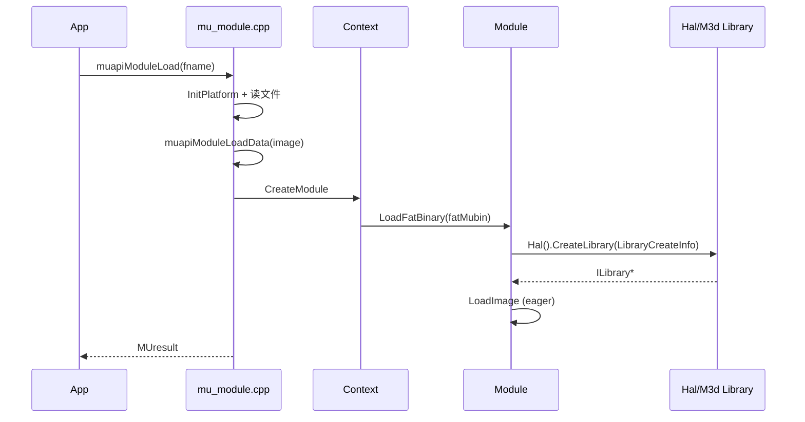
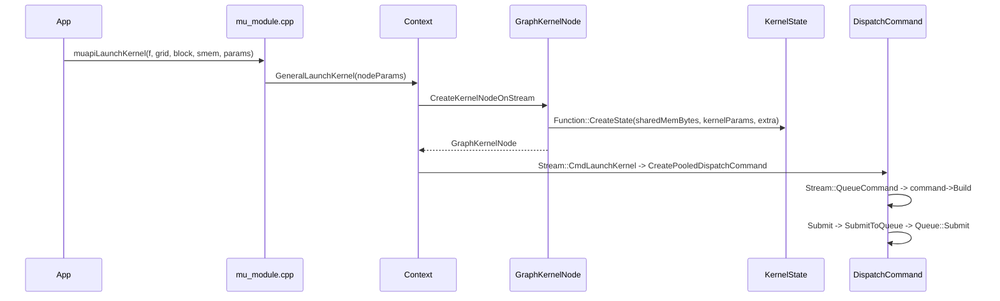

# Module 与 Kernel 执行：图示

- 文档目的：module kernel：核心关系与流程图示，及节点到源码的映射。
- 适用范围：M07 模块的《Module 与 Kernel 执行：图示》；源码根 `source/musa`。
- 对应源码版本：5.3.0 develop（本地快照 `source/musa`，无 Git 元数据）
- 证据状态：已确认（引用与符号已脚本核对；运行期未验证）
- 最后更新：2026-10-07
- 前置阅读：[`README.md`](README.md)、[`../module-registry.md`](../module-registry.md)
- 后续阅读：[`design.md`](design.md)、[`risks-and-debt.md`](risks-and-debt.md)


- 图示内容按源码静态推导，未在本环境编译或运行
- 每张图后附可核对的行级证据；行号来自只读源码快照

## 分层图


- driver 层入口是 `muapiModuleLoad` 与 `muapiModuleLoadData`，二者先 `InitPlatform` 再解析上下文。[src/driver/mu_module.cpp:87-147]
- Core 层的 `Module::LoadFatBinary` 组装 `Hal::LibraryCreateInfo` 并调用 `Hal().CreateLibrary`。[src/musa/core/module.cpp:20-47]
- HAL 层落点是 `CmdBuffer::CmdDispatch`，把 dispatch 参数转成 M3D 命令。[src/hal/m3d/cmdBuffer.cpp:347-380]
- 最终入队点是 `Queue::Submit`。[src/hal/m3d/queue.cpp:182-355]

## 模块加载时序



- `muapiModuleLoad` 读到文件内容后转调 `muapiModuleLoadData`。[src/driver/mu_module.cpp:87-147]
- `Context::CreateModule` 用 `new Module(this)` 创建对象并在写锁下登记。[src/musa/core/context.cpp:1280-1286]
- `Module::LoadFatBinary` 只有在 EAGER 模式下才同步调 `LoadImage`。[src/musa/core/module.cpp:20-47]
- `Module::LoadImage` 用 `std::call_once` 一次性建符号表。[src/musa/core/module.cpp:187-233]

## Launch 时序



- `muapiLaunchKernel` 校验参数后转进 `Context::GeneralLaunchKernel`。[src/driver/mu_module.cpp:231-268]
- `Context::GeneralLaunchKernel` 负责把 launch 参数组装成 kernel 节点参数。[src/musa/core/context.cpp:631-677]
- `Context::CreateKernelNodeOnStream` 是非 capture 路径的建节点入口。[src/musa/core/context.cpp:2240-2267]
- `GraphKernelNode` 在前置校验通过后才走到 `CreateState`，由它产出 `Hal::KernelState`；这一步返回非零就不再继续建资源。[src/musa/core/node/graphKernelNode.cpp:113-120]
- `Stream::CmdLaunchKernel` 只做 `CreatePooledDispatchCommand` 与入队，不录制命令。[src/musa/core/stream.cpp:1568-1582]
- `CreatePooledDispatchCommand` 从对象池借出 `DispatchCommand`。[src/musa/core/command/dispatchCommand.cpp:1347-1360]
- 真正录制发生在 `Stream::QueueCommand` 的 `buildCommand` lambda 内：`Build` 失败会写 `SetLastError`，成功才置为 `built`。[src/musa/core/stream.cpp:1248-1285]
- `DispatchCommand::Build` 内部顺序是 `UpdateImplicitResources` -> `CmdBindKernel` -> `CmdBindKernelState` -> `CmdDispatch`。[src/musa/core/command/dispatchCommand.cpp:147-249]
- `DispatchCommand::Submit` 收尾后用 `SubmitToQueue` 提交到 HAL 队列。[src/musa/core/command/dispatchCommand.cpp:302-347]
- `Queue::Submit` 是 HAL 侧真正的入队点。[src/hal/m3d/queue.cpp:182-355]

## 生命周期图

```mermaid
stateDiagram-v2
 [*] --> Created: CreateModule
 Created --> Loaded: LoadFatBinary+LoadImage 成功
 Loaded --> FunctionInit: GetFunction -> Function::Init
 FunctionInit --> Launched: GeneralLaunchKernel 建 node
 Launched --> Submitted: DispatchCommand::Submit 入队
 Submitted --> [*]: 完成后 ModuleUnload/DestroyModule
 Created --> [*]: LoadFatBinary 失败 DestroyModule
```

状态名是跨模块抽象，不能替代源码中具体枚举；实际枚举和异常状态请查 `implementation.md`。

- `Context::CreateModule` 建模块并登记，`Context::DestroyModule` 负责解注册。[src/musa/core/context.cpp:1280-1300]
- `Function::Init` 用 `std::call_once` 做一次性 `CreateKernel`，成功后置 `m_FuncIsLoaded`。[src/musa/core/symbol.cpp:434-452]
- `muapiModuleUnload` 先 `Synchronize()` 再 `DestroyModule`，句柄为空返回 `MUSA_ERROR_INVALID_HANDLE`。[src/driver/mu_module.cpp:341-361]
- `Module::GetFunction` 解析名字并返回 `IFunction*`，是 `muapiModuleGetFunction` 的核心实现。[src/musa/core/module.cpp:56-73]

## 相关文档

- `call-chains.md`：完整调用链与分支
- `implementation.md`：状态与异常状态

## 源码证据摘要

- `src/driver/mu_module.cpp`（4 处，例：[src/driver/mu_module.cpp:87-147]）
- `src/musa/core/module.cpp`（4 处，例：[src/musa/core/module.cpp:20-47]）
- `src/musa/core/context.cpp`（4 处，例：[src/musa/core/context.cpp:1280-1286]）

## 未解决问题

1. 本文所有结论均为静态分析，未在授权硬件上执行构建、测试或运行验证。
2. 本文未单列的风险条目见 [`risks-and-debt.md`](risks-and-debt.md)。

## 下一步阅读建议

阅读 [`design.md`](design.md)；阅读 [`risks-and-debt.md`](risks-and-debt.md)。
