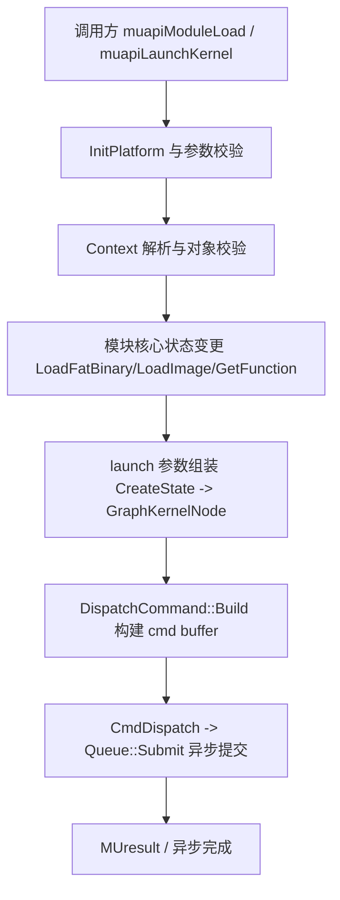

# Module 与 Kernel 执行：执行流

- 文档目的：module kernel：关键执行轨迹的分步记录与失败点索引。
- 适用范围：M07 模块的《Module 与 Kernel 执行：执行流》；源码根 `source/musa`。
- 对应源码版本：5.3.0 develop（本地快照 `source/musa`，无 Git 元数据）
- 证据状态：已确认（引用与符号已脚本核对；运行期未验证）
- 最后更新：2026-10-07
- 前置阅读：[`README.md`](README.md)、[`../module-registry.md`](../module-registry.md)
- 后续阅读：[`design.md`](design.md)、[`risks-and-debt.md`](risks-and-debt.md)


## 主流程



## Module 加载执行流

```text
muapiModuleLoad: InitPlatform -> 打开文件读 image -> muapiModuleLoadData
muapiModuleLoadData: TlsCtxTop -> CreateModule(new Module + RecordModule)
  -> LoadFatBinary(fatMubin)
     -> HAL CreateLibrary(LibraryCreateInfo{sourceType=MusaFatBin, lazyLoad, dump...})
     -> 成功且非 fromInternal: IssueModuleLoadedResourceCallback
     -> eager 模式: LoadImage()
  -> 失败: DestroyModule 回滚
```

## 符号解析与惰性加载

`FindSymbolByName` 在非 eager 模式先触发 `LoadImage`，失败则 `DestroyModule`；查不到返回 `MUSA_ERROR_NOT_FOUND`。[src/musa/core/module.cpp:235-256]

`LoadImage` 通过 HAL `GetSymbols` 拿 `LibrarySymbol[]`：Function 类型建 `Memory(InitPrealloc)+Function`，GlobalVariable 类型建 `Memory+VariableSymbol` 并 `TrackMemory`；两者都 emplace 进 `m_SymbolMap`。[src/musa/core/module.cpp:200-228]

## Kernel launch 执行流

```text
muapiLaunchKernel -> MUSA_KERNEL_NODE_PARAMS 组装（grid/block/sharedMem/params/extra）
  -> GeneralLaunchKernel(ctx, hStream, nodeParams, cluster..., enablePdl, wait)
  -> CreateKernelNodeOnStream -> GraphKernelNode::Create + UpdateParams
     -> grid/block/cluster 校验 -> Function::CreateState(sharedMemBytes, kernelParams, extra, blockSize)
        -> Hal::KernelState::Create + UpdateResourceState（按非 implicit mapping 逐项拷贝）
        -> dynamic shared memory 校验/回填
  -> capture active ? Stream::CaptureNode : Stream::CmdLaunchKernel(pGraphNode, wait)
  -> CreatePooledDispatchCommand -> ResolveDependencyAndQueueCommand -> DispatchCommand::Build
```

## DispatchCommand 构建执行流

```text
Build: InitPfm -> GetHalCmdBuffer(primary/secondary) -> timestamp TopOfPipe
  -> 非 graph: 填 m_pDevice/m_context/m_ForceSingleCore
     -> hasDpCe: SetupGpuCopyJobResources
     -> UpdateImplicitResources（分配 spill/print/cluster/const 等并写 KernelState）
  -> Command::Build 依赖解析 -> CmdBindKernel/CmdBindKernelState
  -> CmdSetLLCPersistcyWindow -> (可选) CmdBindSpillMemoryRange/CmdSetMultiCoreMode
  -> CmdDispatch(dispatch)（workgroupSize=blockDim, workgroupCount=gridDim, blockClusterSize, constBufferGpuVa）
  -> timestamp BottomOfPipe -> MUasan struct param MarkMemoryBegin
```

## 同步与异步

- `muapiLaunchKernel` 传入的 `wait` 来自 `Platform::Get().GetSettings().launchBlocking`（默认 0）。[src/driver/mu_module.cpp:262-263] [src/musa/core/platformSettings.cpp:71-76]
- `DispatchCommand::Submit` 内 `pHalCmdBuffer->End()` 后 `SubmitToQueue` 入队即返回；结果由 stream query/synchronize 暴露。[src/musa/core/command/dispatchCommand.cpp:302-347]
- capture 激活时 kernel 被并入 `CaptureNode`，不进入执行路径。[src/musa/core/context.cpp:666-673]

## 清理流

```text
停止/同步工作 -> 从 tracker/Context 集合移除 -> 释放 Core 对象 -> 释放 HAL 对象 -> 返回状态
Module 析构: 逐符号 UntrackMemory/Variable 引用清理 -> m_pHalLibrary->Destroy
Library::Unload: LockedRemoveLibrary -> UnloadFromAllContexts -> m_KernelMap.clear -> CleanupDeviceCode
DispatchCommand::Postprocess: 观测回写 + sanitizer 释放 + Command::Postprocess
```

## 观测点

`DispatchCommand::Build/Submit/Postprocess/ReleaseResources` 内嵌 MUpti（RegisterKernel/RegisterKernelV2）、MUgdb、MUasan 回调与 timestamp 记录。[src/musa/core/command/dispatchCommand.cpp:27-33] [src/musa/core/command/dispatchCommand.cpp:1259-1292]

建议记录 API 序号、对象 ID、stream、command 类型、queued/submitted/completed 时间戳；`mu_entry.cpp` 对 profiler/debugger 提供了多类 accessor。[src/driver/mu_entry.cpp:121-198] [src/driver/mu_entry.cpp:1085-1249]

## 相关文档

- [`README.md`](README.md)
- [`design.md`](design.md)
- [`call-chains.md`](call-chains.md)
- [`implementation.md`](implementation.md)
- [`risks-and-debt.md`](risks-and-debt.md)

## 源码证据摘要

- `src/musa/core/command/dispatchCommand.cpp`（3 处，例：[src/musa/core/command/dispatchCommand.cpp:302-347]）
- `src/musa/core/module.cpp`（2 处，例：[src/musa/core/module.cpp:235-256]）
- `src/driver/mu_entry.cpp`（2 处，例：[src/driver/mu_entry.cpp:121-198]）

## 未解决问题

1. 本文所有结论均为静态分析，未在授权硬件上执行构建、测试或运行验证。
2. 本文未单列的风险条目见 [`risks-and-debt.md`](risks-and-debt.md)。

## 下一步阅读建议

阅读 [`design.md`](design.md)；阅读 [`risks-and-debt.md`](risks-and-debt.md)。
