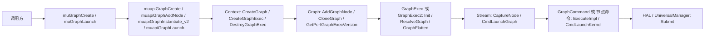
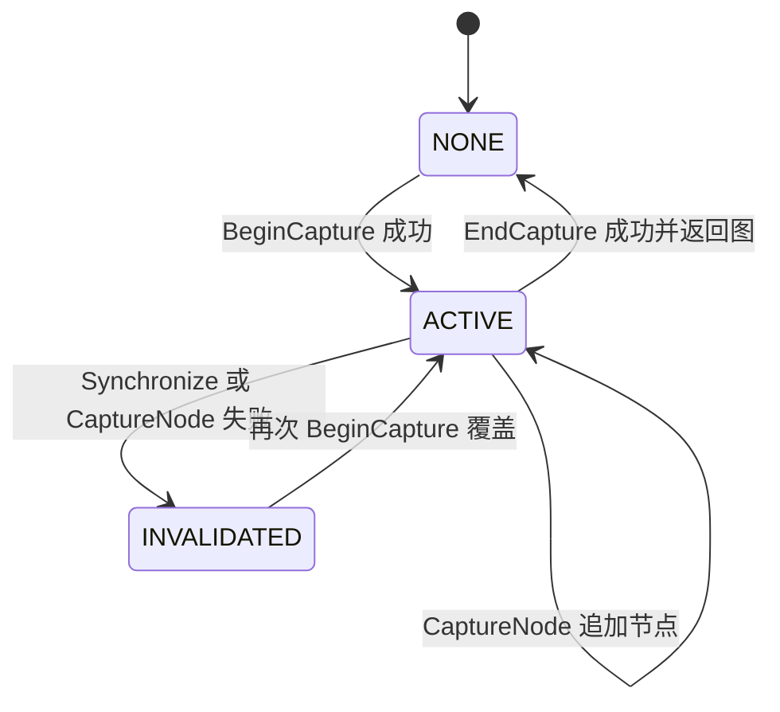
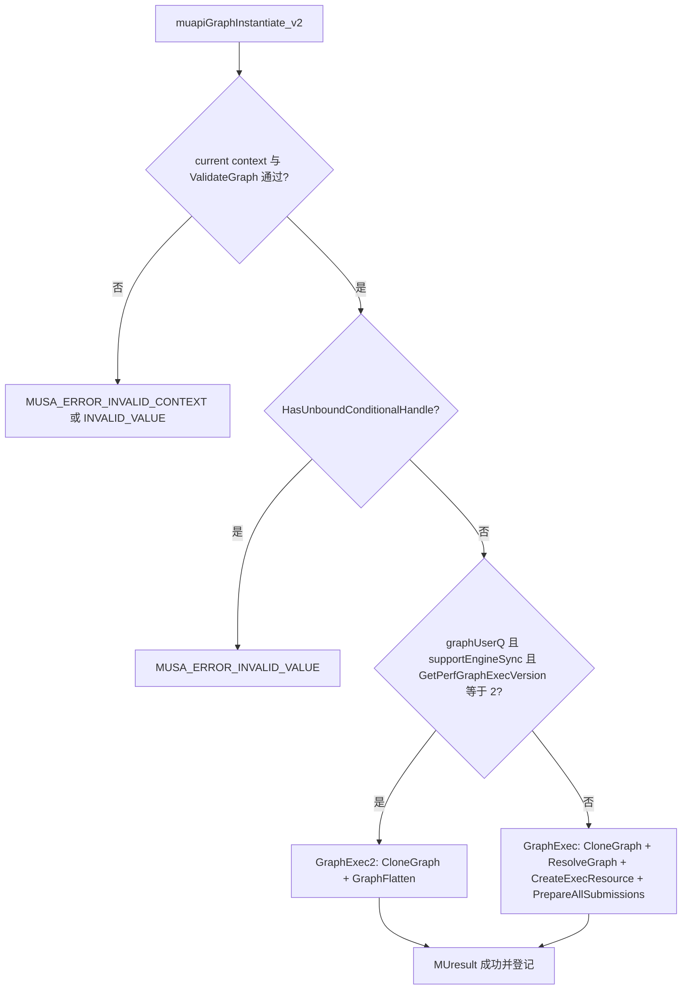
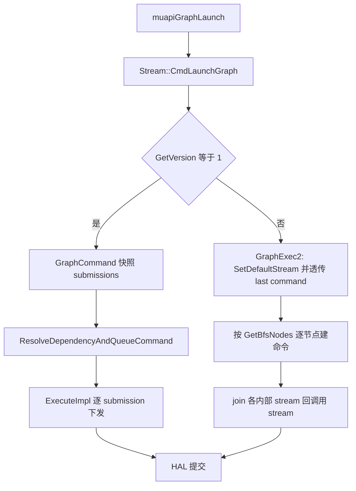
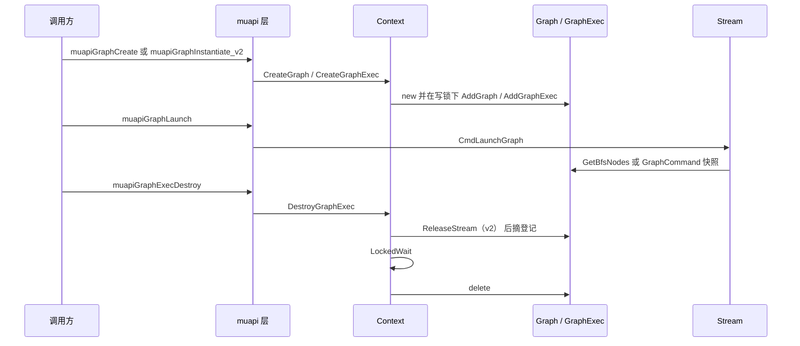
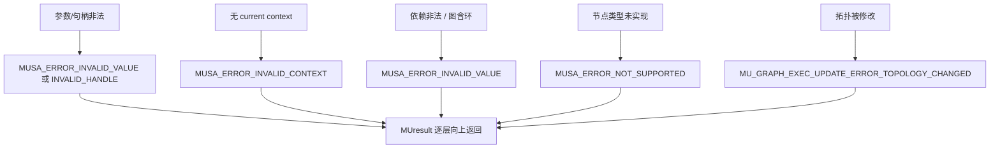

# Graph 执行：图示

- 文档目的：用图表达 M08 的分层、状态机、分叉决策与提交路径，并把每个节点映射到源码
- 适用范围：M08 模块的《Graph 执行：图示》；源码根 `source/musa`。
- 对应源码版本：5.3.0 develop（本地快照 `source/musa`，无 Git 元数据）
- 证据状态：图中节点与箭头均有源码依据；未编译、未在目标机运行
- 最后更新：2026-10-07
- 前置阅读：`README.md`、`design.md`
- 后续阅读：`call-chains.md`、`execution-flows.md`

图中不出现没有源码依据的组件；无法静态确认的箭头在表中标注 `推断`。

## 图 1：分层与调用方向

| 节点 | 含义 | 源码位置 |
|---|---|---|
| `muGraphCreate` | 公共包装：ApiTrace、MUpti 回调、`skipDriverImpl` 后转发 | [src/driver/mu_wrappers_generated.cpp:6034-6073] |
| `muapiGraphCreate` | driver 实现：`InitPlatform` -> 空指针/flags 检查 -> `TlsCtxTop` -> `CreateGraph` | [src/driver/mu_graph.cpp:1188-1208] |
| `Context::CreateGraph` | `new Graph(this)` 并在写锁下登记 | [src/musa/core/context.cpp:1389-1403] |
| `Graph::AddGraphNode` | 建顶点、`SetParentGraph`、逐依赖 `AddEdge` | [src/musa/core/graph.cpp:245-272] |
| `Context::CreateGraphExec` | 拒绝未绑定 conditional handle，按开关选 `GraphExec2`/`GraphExec` 并 `Init` | [src/musa/core/context.cpp:1420-1450] |
| `Stream::CmdLaunchGraph` | `GetVersion()==1` 走 `GraphCommand`，否则走 BFS 逐节点下发 | [src/musa/core/stream.cpp:281-414] |
| `GraphCommand::ExecuteImpl` | v1 的 submission 调度与 conditional 递归 | [src/musa/core/command/graphCommand.cpp:280-431] |

箭头含义：`-->` 是运行时调用（前一层调用后一层），不是包含关系，也不是数据依赖。

## 图 2：capture 状态机

- 枚举真实取值是 `MU_STREAM_CAPTURE_STATUS_NONE`、`MU_STREAM_CAPTURE_STATUS_ACTIVE`、`MU_STREAM_CAPTURE_STATUS_INVALIDATED`，三者定义在同一个 enum 中。[src/musa_shared_include/musa.h:2474-2477]
- `ACTIVE` 的唯一写入点在 `Stream::BeginCapture`；已经是 ACTIVE 时再次进入返回 `MUSA_ERROR_ILLEGAL_STATE`，从 `MU_STREAM_CAPTURE_STATUS_INVALIDATED` 再次进入则被覆盖成 `ACTIVE`。[src/musa/core/stream.cpp:45-73]
- `MU_STREAM_CAPTURE_STATUS_INVALIDATED` 有两个写入点：`Stream::Synchronize` 在状态非 NONE 时写入，`Stream::CaptureNode` 在入图失败时写入；`Stream::Query` 只返回 `MUSA_ERROR_STREAM_CAPTURE_UNSUPPORTED`，不改状态。[src/musa/core/stream.cpp:223-227] [src/musa/core/stream.cpp:690-693]
- 只有成功路径才把状态写回 `NONE` 并返回 `m_CaptureGraph`；状态已是 `MU_STREAM_CAPTURE_STATUS_INVALIDATED` 时 `EndCapture` 直接返回 `MUSA_ERROR_STREAM_CAPTURE_INVALIDATED`，随后清理捕获流注册表。[src/musa/core/stream.cpp:84-85] [src/musa/core/stream.cpp:97-137]

图中 `NONE -> ACTIVE` 的入口实际由 driver 层 `muapiStreamBeginCapture_v2` 先 `CreateGraph` 再调 `BeginCapture`，失败时 driver 侧回滚销毁刚建的图。[src/driver/mu_stream.cpp:391-421]

## 图 3：instantiate 的实现选择

- 判定与创建集中在 `Context::CreateGraphExec` 一个函数内。[src/musa/core/context.cpp:1420-1450]
- v1 的 `Init` 四步在 `GraphExec::Init` 中顺序执行，任何一步失败即返回。[src/musa/core/graph/graph1/graphExec.cpp:709-724]
- v2 的 `Init` 只有两步，`GraphFlatten` 负责 BFS 排序与内部 launch stream 分配。[src/musa/core/graph/graph2/graphExec.cpp:362-371]
- `Init` 失败时 `delete graphExec` 且不登记，因此不会出现半初始化对象进入 tracker。[src/musa/core/context.cpp:1439-1447]

## 图 4：v1 与 v2 提交路径对比

- v1 分支的命令对象是 `GraphCommand`，入队后回填 `SetCommand`。[src/musa/core/stream.cpp:283-292]
- v2 分支先 `SetDefaultStream(this)`，再把调用流未完成的 last command 透传给各内部 launch stream。[src/musa/core/stream.cpp:293-313]
- v2 分支按节点类型 switch；`MU_GRAPH_NODE_TYPE_MEM_ALLOC`、`MU_GRAPH_NODE_TYPE_MEM_FREE`、`MU_GRAPH_NODE_TYPE_CONDITIONAL` 的 body 为空，`MU_GRAPH_NODE_TYPE_EXT_SEMAS_SIGNAL` 与 `MU_GRAPH_NODE_TYPE_BATCH_MEM_OP` 落到 `MUSA_ERROR_NOT_SUPPORTED`。[src/musa/core/stream.cpp:362-393]
- 结束后把各内部 stream 的最后命令作为 join 依赖，用 `SetCurrentDependencies` 挂回调用 stream。[src/musa/core/stream.cpp:396-411]

`GetVersion()` 的返回值来自 `GraphExec`/`GraphExec2` 各自的构造，静态分析未找到运行期切换点（推断）。

## 图 5：对象生命周期与销毁顺序

- 建立顺序：先 `new` 再在 `WriteLockedAccessor` 作用域内登记，返回值最后写输出参数。[src/musa/core/context.cpp:1389-1403]
- 销毁顺序：`ReleaseStream` -> `RemoveGraphExec` -> `LockedWait` -> `delete pGraphExec`，四步都在 `DestroyGraphExec` 内。[src/musa/core/context.cpp:1699-1736]
- `Graph` 的销毁同样先摘登记、`LockedWait`，再 `delete graph`。[src/musa/core/context.cpp:1647-1659]
- `GraphExec` 析构会对仍存活的 `GraphCommand` 执行 `Wait()`，避免命令访问已释放对象。[src/musa/core/graph/graph1/graphExec.cpp:37-46]

## 图 6：错误传播

- 空指针与句柄类错误在 `muapiGraphAddKernelNode_v2` 内立即返回，不进入 Core。[src/driver/mu_graph.cpp:778-799]
- 依赖类错误由 `Graph::ValidateDependencies` 统一给出 `MUSA_ERROR_INVALID_VALUE`。[src/musa/core/graph.cpp:494-511]
- 环检测失败在 `ResolveGraphImpl` 内部清空 `m_Submissions` 后返回。[src/musa/core/graph/graph1/graphExec.cpp:1291-1294]
- update 的拓扑变化通过 `updateResult_out` 返回专用枚举，同时 `status` 为 `MUSA_ERROR_GRAPH_EXEC_UPDATE_FAILURE`。[src/musa/core/graph/graph2/graphExec.cpp:308-360]

## 读图建议

1. 先看图 1 建立「哪一层做哪件事」的框架。
2. 再看图 3 与图 4，理解 v1/v2 为什么分叉、分叉后各自走什么路径。
3. 图 2 与图 5 用于排查状态机与销毁顺序问题。
4. 图 6 用于把错误码反查到具体校验点。

## 相关文档

- `call-chains.md`：文本调用链（与图 1、图 4 对应）
- `execution-flows.md`：流程表（与图 3、图 5 对应）
- `risks-and-debt.md`：图 4 中空分支对应的已知缺口

## 源码证据摘要

- 分层：`mu_wrappers_generated.cpp` -> `mu_graph.cpp` -> `context.cpp` -> `graph.cpp` -> `stream.cpp` -> `graphCommand.cpp`
- 状态机：`MU_STREAM_CAPTURE_STATUS_*` 三态与 `stream.cpp` 的写入点
- 分叉：`Context::CreateGraphExec` 的三条件判定

## 未解决问题

- `GetVersion()` 是否存在运行期变化路径未在源码中找到，标注为 `推断`。
- `UniversalManager::Submit` 之后的 HAL 内部排队不在本模块证据范围内。

## 下一步阅读建议

阅读 [`design.md`](design.md)；阅读 [`risks-and-debt.md`](risks-and-debt.md)。
