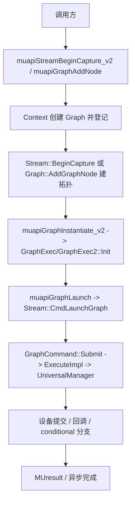

# Graph 执行：执行流

- 文档目的：graph：关键执行轨迹的分步记录与失败点索引。
- 适用范围：M08 模块的《Graph 执行：执行流》；源码根 `source/musa`。
- 对应源码版本：5.3.0 develop（本地快照 `source/musa`，无 Git 元数据）
- 证据状态：已确认（引用与符号已脚本核对；运行期未验证）
- 最后更新：2026-10-07
- 前置阅读：[`README.md`](README.md)、[`../module-registry.md`](../module-registry.md)
- 后续阅读：[`design.md`](design.md)、[`risks-and-debt.md`](risks-and-debt.md)


## 主流程



## capture 流

`muapiStreamBeginCapture_v2` 校验 stream 后创建 Graph，再调用 `Stream::BeginCapture` 把该 stream 置为 `MU_STREAM_CAPTURE_STATUS_ACTIVE` 并记录 `m_CaptureGraph`。[src/driver/mu_stream.cpp:391-421] [src/musa/core/stream.cpp:45-73]

捕获期间 `Stream::EndCapture` 校验：必须是发起 capture 的 stream（`m_IsOriginStream`），非 RELAXED 模式必须同一线程，状态为 ACTIVE 且未被 invalidate；若图有 leaf 节点，leaf 必须都出现在 `m_LastCapturedNodes`，否则返回 `MUSA_ERROR_STREAM_CAPTURE_UNJOINED`。[src/musa/core/stream.cpp:75-139]

capture 开启后，`Query`/`Synchronize` 在该 stream 上返回 `MUSA_ERROR_STREAM_CAPTURE_UNSUPPORTED`，并把状态置为 `MU_STREAM_CAPTURE_STATUS_INVALIDATED`。[src/musa/core/stream.cpp:210-239]

## instantiate 流

`muapiGraphInstantiate_v2` 校验 current context 与 graph 后调用 `Context::CreateGraphExec`。[src/driver/mu_graph.cpp:2304-2324] `CreateGraphExec` 先拒绝含未绑定 conditional handle 的图（`HasUnboundConditionalHandle`），再按开关选择实现：

- `graphUserQ && supportEngineSync && GetPerfGraphExecVersion()==2` 时创建 `GraphExec2`，否则创建 `GraphExec`。[src/musa/core/context.cpp:1420-1450]

`GetPerfGraphExecVersion` 从 2 起算：只要存在 kernel 节点就降为 1；无 kernel 且根节点数 <=1 也降为 1。[src/musa/core/graph.cpp:477-492]

- v1 `GraphExec::Init` = `CloneGraph` + `ResolveGraph` + `CreateExecResource` + `PrepareAllSubmissions`。[src/musa/core/graph/graph1/graphExec.cpp:709-724]
- v2 `GraphExec2::Init` = `CloneGraph` + `GraphFlatten`。[src/musa/core/graph/graph2/graphExec.cpp:362-371]

## launch 流（v1 与 v2 分叉）

- v1：`Stream::CmdLaunchGraph` 创建 `GraphCommand` 并依赖排队；提交走 `GraphCommand::ExecuteImpl`。[src/musa/core/stream.cpp:281-292] [src/musa/core/command/graphCommand.cpp:280-431]
- v2：`Stream::CmdLaunchGraph` 把 `GraphExec2` 的 BFS 节点逐个映射到内部 launch stream 上执行，最后把各 stream 的最后命令 join 回调用 stream。[src/musa/core/stream.cpp:293-414]

`ExecuteImpl` 对每个 submission 设置 wait/signal 模式：图内首个 submission 使用 `WaitBetweenCmd`，末个使用 `SignalBetweenCmd`，其余用 `WaitWithinCmd`/`SignalWithinCmd`。conditional 分支依据 `GetContionalValue` 结果选 IF/WHILE/SWITCH 的 child submission 递归执行。[src/musa/core/command/graphCommand.cpp:288-417]

## 更新流

`GraphExec::Update` 先比较原图与更新图的节点数、逐节点类型和父节点类型，任何不一致返回 `MU_GRAPH_EXEC_UPDATE_ERROR_TOPOLOGY_CHANGED`；一致时清空 submissions 并重新 `Init`。[src/musa/core/graph/graph1/graphExec.cpp:654-707] v2 的 `Update` 同样先做拓扑比较再 `Init`。[src/musa/core/graph/graph2/graphExec.cpp:308-360]

## 清理流

```text
muapiGraphExecDestroy -> ValidateGraphExec -> DestroyGraphExec
  -> (v2) ReleaseStream 同步并销毁内部 stream
  -> LockedWait 等待未完成工作
  -> 移除登记 -> delete GraphExec [src/musa/core/context.cpp:1690-1739]
```

## 同步与异步

- v1 的 `GraphCommand` 是一次性 `Command`，异步完成后由 `Postprocess` 刷新 printf、MUpti 时间戳并释放临时 cmd buffer。[src/musa/core/command/graphCommand.cpp:165-215]
- v2 节点直接在各 stream 上作为普通命令入队，graph 结束通过 join 命令合流。
- 具体 `blocking` 语义来自 API/stream 设置，不能仅凭函数名推断。

## 观测点

建议记录 API 序号、graph ID（`GetCorId`）、stream、节点类型、submission 类型、queued/submitted/completed 时间戳；`GraphCommand` 为每个 kernel/memcpy/memset/atomic/transfer 节点注册 MUpti 上下文。[src/musa/core/command/graphCommand.cpp:80-111] [src/musa/core/command/graphCommand.cpp:123-163]

## 相关文档

- [`README.md`](README.md)
- [`design.md`](design.md)
- [`call-chains.md`](call-chains.md)
- [`implementation.md`](implementation.md)
- [`risks-and-debt.md`](risks-and-debt.md)

## 源码证据摘要

- `src/musa/core/stream.cpp`（5 处，例：[src/musa/core/stream.cpp:45-73]）
- `src/musa/core/command/graphCommand.cpp`（5 处，例：[src/musa/core/command/graphCommand.cpp:280-431]）
- `src/musa/core/context.cpp`（2 处，例：[src/musa/core/context.cpp:1420-1450]）

## 未解决问题

1. 本文所有结论均为静态分析，未在授权硬件上执行构建、测试或运行验证。
2. 本文未单列的风险条目见 [`risks-and-debt.md`](risks-and-debt.md)。

## 下一步阅读建议

阅读 [`design.md`](design.md)；阅读 [`risks-and-debt.md`](risks-and-debt.md)。
