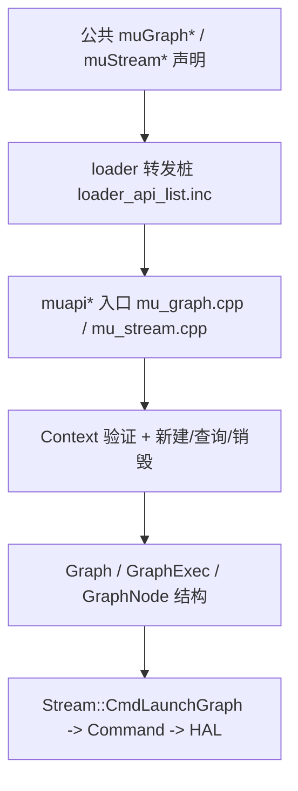

# Graph 执行：接口契约

- 文档目的：列出 graph 子系统的对外入口、分层契约、句柄所有权与错误码约定
- 适用范围：M08 模块的《Graph 执行：接口契约》；源码根 `source/musa`。
- 对应源码版本：5.3.0 develop（本地快照 `source/musa`，无 Git 元数据）
- 证据状态：全部来自只读源码快照的静态阅读，未编译、未运行
- 最后更新：2026-10-07
- 前置阅读：`README.md`、`design.md`
- 后续阅读：`examples.md`、`risks-and-debt.md`

## 1. 公共 ABI 入口

### 1.1 声明位置

| 公共入口 | 输入 | 输出/副作用 | 前置条件 | 典型错误 | 证据 |
|---|---|---|---|---|---|
| `muGraphCreate` | `MUgraph *phGraph`、`unsigned int flags` | 分配空图并出句柄 | `flags` 必须为 0 | `MUSA_ERROR_INVALID_VALUE` | [src/musa_shared_include/musa.h:20624] |
| `muGraphAddKernelNode` | 图、依赖数组、`MUSA_KERNEL_NODE_PARAMS` | 新增 kernel 节点并出节点句柄 | 图处于未实例化状态 | `MUSA_ERROR_INVALID_HANDLE` | [src/musa_shared_include/musa.h:20727] |
| `muGraphInstantiate_v2` | 图、`phErrorNode`、`logBuffer` | 生成执行图并克隆拓扑 | 有 current context 且图无环 | `MUSA_ERROR_INVALID_VALUE` | [src/musa_shared_include/musa.h:29086] |
| `muGraphLaunch` | 执行图、stream | 把执行图提交到 stream | 执行图已校验 | `MUSA_ERROR_INVALID_HANDLE` | [src/musa_shared_include/musa.h:23327] |
| `muGraphGetNodes` | 图、`nodes`、`numNodes` | 返回节点数与句柄数组 | 图句柄有效 | `MUSA_ERROR_INVALID_VALUE` | [src/musa_shared_include/musa.h:22198] |
| `muGraphDebugDotPrint` | 图、路径、flags | 写出 DOT 文本文件 | 路径可写 | `MUSA_ERROR_INVALID_VALUE` | [src/musa_shared_include/musa.h:23547] |
| `muGraphUpload` | 执行图、stream | 无（恒定失败） | — | `MUSA_ERROR_NOT_SUPPORTED` | [src/musa_shared_include/musa.h:23297] |
| `muGraphExecNodeSetParams` | 执行图、节点、新参数 | 就地改执行图节点参数 | 执行图与节点配对 | `MUSA_ERROR_INVALID_VALUE` | [src/musa_shared_include/musa.h:24436] |
| `muStreamBeginCapture_v2` | stream、capture mode | 建空图并把 stream 置为捕获态 | stream 不在捕获中 | `MUSA_ERROR_ILLEGAL_STATE` | [src/musa_shared_include/musa.h:29064] |
| `muStreamEndCapture` | stream、`MUgraph*` | 返回被捕获的图 | 必须在发起捕获的同一线程 | `MUSA_ERROR_STREAM_CAPTURE_INVALIDATED` | [src/musa_shared_include/musa.h:17279] |
| `muDeviceGetGraphMemAttribute` | device、attribute、`value` | 读取 graph 内存池属性 | device 有效 | `MUSA_ERROR_INVALID_VALUE` | [src/musa_shared_include/musa.h:21950] |
| `muDeviceGraphMemTrim` | device | 释放 graph 内存池空闲页 | device 有效 | `MUSA_ERROR_INVALID_VALUE` | [src/musa_shared_include/musa.h:21922] |

### 1.2 版本别名

- `muGraphAddKernelNode` 在头文件里被宏重定向到 `muGraphAddKernelNode_v2`，两者签名使用 `MUSA_KERNEL_NODE_PARAMS`。[src/musa_shared_include/musa.h:109]
- `muStreamBeginCapture` 被重定向到 `muStreamBeginCapture_v2`。[src/musa_shared_include/musa.h:98]
- 公共名 `muGraphInstantiate` 对应的 driver 实现 `muapiGraphInstantiate` 只是丢弃附加参数后转发给 `muapiGraphInstantiate_v2`。[src/driver/mu_graph.cpp:2326-2328]

### 1.3 导出与装载登记

| 环节 | 作用 | 证据 |
|---|---|---|
| `export_table.h` 的 `using ..._fn` | 为每个入口定义函数指针类型，签名即 ABI | [src/musa_shared_include/export_table.h:537] |
| `export_table.h` 的 `ADDMEMBER` | 把指针挂到导出表结构体成员上 | [src/musa_shared_include/export_table.h:1280] |
| `internal.cpp` 的 `addEntryPoints` | 按名字与版本号注册，供 `muGetProcAddress` 查找 | [src/driver/internal.cpp:497] |
| `loader_api_list.inc` | 生成 loader 侧转发桩 | [src/loader/loader_api_list.inc:426] |

新增一个 graph 入口必须同时改这四处，缺一处会出现「符号可解析但调用崩」或「符号查不到」。此为静态推断的耦合关系，未做实验验证。

## 2. 分层契约

- 第一层只做签名稳定；真正的参数校验从 `muapi*` 开始。[src/driver/mu_graph.cpp:1188-1192]
- `muapi*` 一律先 `InitPlatform()`，再取 `TlsCtxTop()`，空 context 直接返回 `MUSA_ERROR_INVALID_CONTEXT`。[src/driver/mu_graph.cpp:791-795]
- Core 层的 `Context` 方法负责句柄合法性与跨对象引用检查，结构层的 `Graph` 只管拓扑。[src/musa/core/context.cpp:1420-1450]
- 提交层契约是 `Stream::CmdLaunchGraph`：v1 走 `GraphCommand`，v2 走逐节点 BFS。[src/musa/core/stream.cpp:281-414]

## 3. 输入与返回值约定

| 约定 | 内容 | 证据 |
|---|---|---|
| 空指针 | `phGraph`、`phGraphNode`、`phGraphExec` 为空一律 `MUSA_ERROR_INVALID_VALUE` | [src/driver/mu_graph.cpp:1188-1193] |
| 无当前上下文 | `TlsCtxTop()` 返回空即 `MUSA_ERROR_INVALID_CONTEXT` | [src/driver/mu_graph.cpp:791-795] |
| 状态非法 | capture 状态不对返回 `MUSA_ERROR_ILLEGAL_STATE` 或 `MUSA_ERROR_STREAM_CAPTURE_UNSUPPORTED` | [src/musa/core/stream.cpp:51-53] |
| 未实现 | 统一入口的 default 分支与恒失败接口返回 `MUSA_ERROR_NOT_SUPPORTED` | [src/driver/mu_graph.cpp:1063-1065] |
| 探测调用 | `nodes == nullptr` 时只回填数量，不写数组 | [src/driver/mu_graph.cpp:1878-1891] |
| 忽略参数 | `_v2` 的 `dependencyData`/`edgeData` 当前被直接忽略 | [src/driver/mu_graph.cpp:296-303] |

所有 `muapi*` 入口返回 `MUresult`，不抛异常；Core 内部失败一律 `break` 出 `do/while(0)` 并原样向上传播。[src/driver/mu_graph.cpp:269-294]

## 4. 句柄与所有权

| 对象 | 创建者 | 持有者 | 销毁者 | 证据 |
|---|---|---|---|---|
| `MUgraph` | `muapiGraphCreate` | 调用方 | `muapiGraphDestroy` -> `Graph::~Graph` | [src/driver/mu_graph.cpp:1210-1232] |
| `MUgraphNode` | `muapiGraphAdd*Node` | 图的 `m_Vertices` 容器 | 随 `Graph::~Graph` 逐个 `delete` | [src/musa/core/graph.cpp:58-63] |
| `MUgraphExec` | `Context::CreateGraphExec` 建 `GraphExec2` 或 `GraphExec` | `AddGraphExec` 登记表 | `muapiGraphExecDestroy` | [src/musa/core/context.cpp:1431-1446] |
| 执行图内部资源 | `GraphExec::CreateExecResource` | 执行图独占 | `GraphExec` 析构 | [src/musa/core/graph/graph1/graphExec.cpp:726-757] |
| capture 产生的图 | `muapiStreamBeginCapture_v2` | 捕获流程，失败时 driver 回滚 | 成功后交给调用方 | [src/driver/mu_stream.cpp:391-421] |

- 实例化会克隆一份图，原图与执行图互相独立，可分别销毁。[src/musa/core/graph.cpp:126-162]
- `Context` 只登记执行图（`GraphExec`），不接管普通图的生命周期。[src/musa/core/context.cpp:1420-1446]

## 5. 跨模块契约

| 对向模块 | 本模块消费 | 本模块提供 | 证据 |
|---|---|---|---|
| M07 module/kernel | `Module::GetFunction` 返回的函数对象（kernel 节点的 `func`） | 执行时机与依赖 | [src/musa/core/module.cpp:56-73] |
| M05 memory | `MUdeviceptr`（memcpy/memset/mem_alloc 参数） | 异步提交顺序 | [src/driver/mu_graph.cpp:345-415] |
| M02 ABI | 导出表与 loader 桩的符号名与顺序 | 新增入口必须四处登记 | [src/musa_shared_include/export_table.h:1280] |
| 观测/调试 | `muapiGraphDebugDotPrint` 产物 | 只读，不改图状态 | [src/driver/mu_graph.cpp:3208-3232] |

## 6. 稳定性约束

- 公共签名是 ABI，改参数顺序或类型会让 `export_table.h` 的 `using muGraphCreate_fn` 与 `loader_api_list.inc` 的 `MUSA_LOADER_API(muGraphCreate, ...)` 同时失配。[src/loader/loader_api_list.inc:426]
- `muapiGraphAddNode` 按 `nodeParams->type` 分支派发，插入新枚举值必须同步补 switch。[src/driver/mu_graph.cpp:1012-1066]
- `Context::CreateGraphExec` 的 v1/v2 选择依赖上下文配置，改动会影响已有执行图的兼容性。[src/musa/core/context.cpp:1420-1433]

## 未解决问题

- `_v2` 版本长期忽略 `dependencyData` 是否会被上游契约收紧，未见迁移说明。
- `muGraphExecNodeSetParams` 不做 `ValidateGraphExec`，其参数校验深度尚无文档约定。

## 源码证据摘要

- ABI 声明：`muGraphCreate`（`musa.h:20624`）、`muGraphInstantiate_v2`（`musa.h:29086`）、`muGraphLaunch`（`musa.h:23327`）
- 四处登记：`export_table.h:537`、`export_table.h:1280`、`internal.cpp:497`、`loader_api_list.inc:426`
- 分层入口：`muapiGraphCreate`（`mu_graph.cpp:1188`）、`Context::CreateGraphExec`（`context.cpp:1420`）、`Stream::CmdLaunchGraph`（`stream.cpp:281`）

## 相关文档

- [`README.md`](README.md)
- [`design.md`](design.md)
- [`call-chains.md`](call-chains.md)
- [`implementation.md`](implementation.md)
- [`risks-and-debt.md`](risks-and-debt.md)

## 下一步阅读建议

阅读 [`design.md`](design.md)；阅读 [`risks-and-debt.md`](risks-and-debt.md)。
