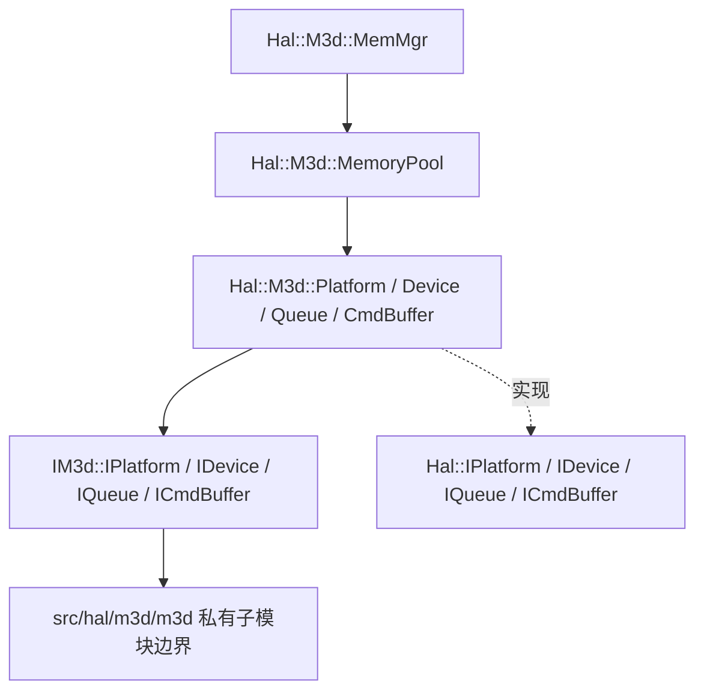
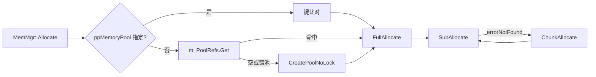
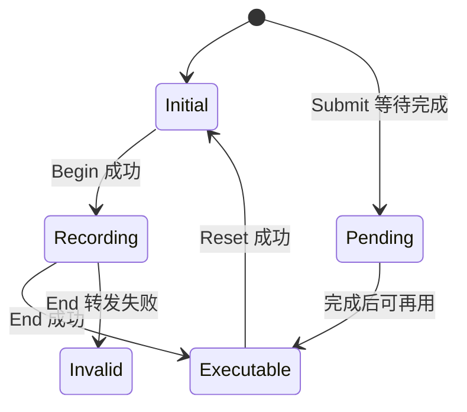
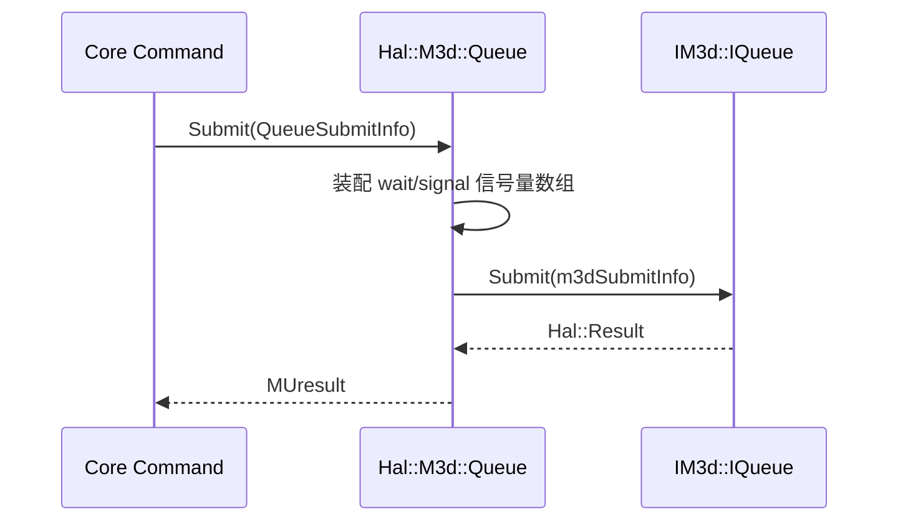

# HAL/M3D 适配：图示

- 文档目的：hal m3d：核心关系与流程图示，及节点到源码的映射。
- 适用范围：M09 模块的《HAL/M3D 适配：图示》；源码根 `source/musa`。
- 对应源码版本：5.3.0 develop（本地快照 `source/musa`，无 Git 元数据）
- 证据状态：已确认（引用与符号已脚本核对；运行期未验证）
- 最后更新：2026-10-07
- 前置阅读：[`README.md`](README.md)、[`../module-registry.md`](../module-registry.md)
- 后续阅读：[`design.md`](design.md)、[`risks-and-debt.md`](risks-and-debt.md)

## 分层图

`Hal::M3d::Platform` 实现 `Hal::IPlatform` 并持有 `IM3d::IPlatform` 的 `OwnPtr` 成员 [src/hal/m3d/platform.h:16-47]；`MemMgr` 与 `MemoryPool` 是 `Device` 内部的另一支，不经过 `IPlatform` 这一层 [src/hal/m3d/device.h:119-121]。

## 内存池关系图

`FullAllocate` 只在 `errorNotFound` 时追加一次 chunk 分配并重试，这是图中 `G -> H -> G` 环的来源 [src/hal/m3d/memoryPool.cpp:85-98]。

## CmdBuffer 状态图

状态名取自 `CmdBufferState` 枚举 [src/hal/halCmdBuffer.h:65-104]；`Begin` 要求 `cmdBufferStateInitial`、`End` 要求 `cmdBufferStateRecording`、`Reset` 拒绝 `cmdBufferStatePending` [src/hal/m3d/cmdBuffer.cpp:145-228]。

图中的 `Pending -> Executable` 迁移是**推断**：本模块只读到状态枚举与 `Reset` 的拒绝分支，提交后由谁把状态改回 `Executable` 未在已读行内出现。

## 提交流程序图

装配到转发的边界在 `Queue::Submit` 的最后一段：`m_M3dQueue->Submit(m3dSubmitInfo)` 返回后直接 `M3dToHalResult` 上抛 [src/hal/m3d/queue.cpp:353-357]。

## 阅读提示

以上状态名与泳道是跨文件抽象，不能替代源码中的具体枚举；逐行证据见 [`line-level-analysis.md`](line-level-analysis.md)。

## 相关文档

- [`README.md`](README.md)
- [`design.md`](design.md)
- [`call-chains.md`](call-chains.md)
- [`implementation.md`](implementation.md)
- [`risks-and-debt.md`](risks-and-debt.md)

## 源码证据摘要

- `src/hal/m3d/platform.h`（1 处，例：[src/hal/m3d/platform.h:16-47]）
- `src/hal/m3d/device.h`（1 处，例：[src/hal/m3d/device.h:119-121]）
- `src/hal/m3d/memoryPool.cpp`（1 处，例：[src/hal/m3d/memoryPool.cpp:85-98]）

## 未解决问题

1. 本文所有结论均为静态分析，未在授权硬件上执行构建、测试或运行验证。
2. 本文未单列的风险条目见 [`risks-and-debt.md`](risks-and-debt.md)。

## 下一步阅读建议

阅读 [`design.md`](design.md)；阅读 [`risks-and-debt.md`](risks-and-debt.md)。
