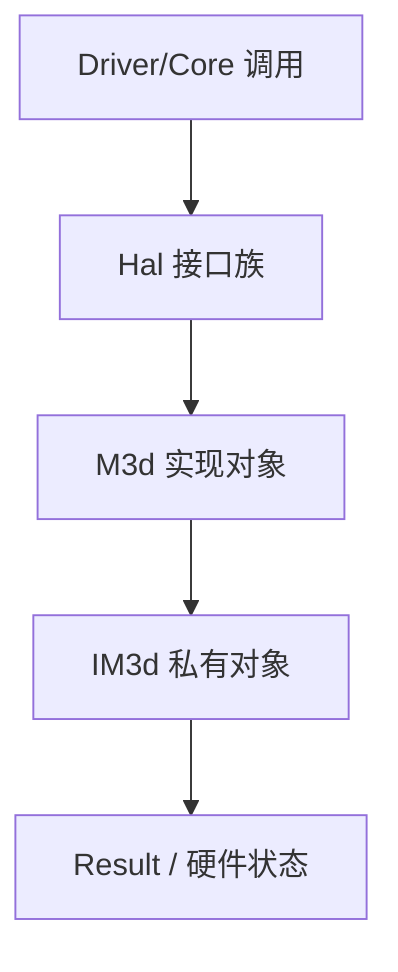

# HAL/M3D 适配：执行流

- 文档目的：hal m3d：关键执行轨迹的分步记录与失败点索引。
- 适用范围：M09 模块的《HAL/M3D 适配：执行流》；源码根 `source/musa`。
- 对应源码版本：5.3.0 develop（本地快照 `source/musa`，无 Git 元数据）
- 证据状态：已确认（引用与符号已脚本核对；运行期未验证）
- 最后更新：2026-10-07
- 前置阅读：[`README.md`](README.md)、[`../module-registry.md`](../module-registry.md)
- 后续阅读：[`design.md`](design.md)、[`risks-and-debt.md`](risks-and-debt.md)


## 主流程



## 分配流：`MemMgr::Allocate`

```text
1. 参数校验
   size==0            -> errorInvalidValue   src/hal/m3d/memMgr.cpp:85-87
   size+align 溢出    -> errorOutOfMemory    src/hal/m3d/memMgr.cpp:88-91
   超 totalGlobalMem  -> errorOutOfMemory    src/hal/m3d/memMgr.cpp:92-95
2. 选池
   ppMemoryPool 已指定 -> MakeKey 比对，不符 errorInvalidValue  src/hal/m3d/memMgr.cpp:99-105
   未指定             -> m_PoolRefs.Get(MakeKey) 命中即用
                        未命中/错池 -> CreatePoolNoLock       src/hal/m3d/memMgr.cpp:107-133
3. 落池
   pPool->FullAllocate(allocInfo, pOffset, ppMemory)   src/hal/m3d/memMgr.cpp:143-145
   MemoryPool::FullAllocate:
     SubAllocate -> errorNotFound -> ChunkAllocate -> SubAllocate   src/hal/m3d/memoryPool.cpp:85-98
     SubAllocate: FindBucket -> ResourceSplit        src/hal/m3d/memoryPool.cpp:100-153
     ChunkAllocate: 平台/设备 CreateMemory -> ResourceAdd   src/hal/m3d/memoryPool.cpp:156-223
```

分配规模校验发生在 `MemMgr::Allocate` [src/hal/m3d/memMgr.cpp:85-96]；指定池的键一致性校验 [src/hal/m3d/memMgr.cpp:103]。池未命中或属性不符时走 `CreatePoolNoLock`，其内部会 `new MemoryPool` 并 `Init`，再按 usage 登记进对应容器 [src/hal/m3d/memMgr.cpp:173-198]。

## 释放流：`MemMgr::Free` → `MemoryPool::Free`

```text
MemMgr::Free                        src/hal/m3d/memMgr.cpp:149
  重建 poolInfo（IsHost/GetHeap/GetProperties/GetViewCapabilities/GetNumaId）  src/hal/m3d/memMgr.cpp:150-155
  m_PoolRefs.Get(MakeKey) -> MUSA_ASSERT 键相等   src/hal/m3d/memMgr.cpp:157-159
  pMemoryPool->Free(pMemory, base, size)           src/hal/m3d/memMgr.cpp:160

MemoryPool::Free                     src/hal/m3d/memoryPool.cpp:225
  1. m_SegmentTracker.find(MemoryRange{base,size})   src/hal/m3d/memoryPool.cpp:230-231
     未找到 -> LOG_WARN 返回                    src/hal/m3d/memoryPool.cpp:265-269
  2. 合并左邻居（isLeftMost==false 且 !busy）    src/hal/m3d/memoryPool.cpp:240-249
  3. 合并右邻居（isRightMost==false 且 !busy）    src/hal/m3d/memoryPool.cpp:251-260
  4. ResourceRemove：整 chunk 空闲且超阈值 -> 销毁 chunk   src/hal/m3d/memoryPool.cpp:340-354
     否则 FreeListInsert 归还空闲表                src/hal/m3d/memoryPool.cpp:262-264
```

释放不一定立即销毁底层显存：空闲段先合并，整个 chunk 空闲后按 `m_ReuseCountLimit/m_ReuseSizeLimit` 决定销毁或保留 [src/hal/m3d/memoryPool.cpp:340-354]。`TrimPool` 则从 free 表迭代释放完整空闲 chunk，直到 `m_TotalSize <= value` [src/hal/m3d/memoryPool.cpp:502-532]。

## 队列提交流：`Queue::Submit`

```text
Queue::Submit                       src/hal/m3d/queue.cpp:182
  1. user queue + fence -> errorInvalidValue      src/hal/m3d/queue.cpp:185-188
  2. wait/signal 信号量数组装配（FW 限 32/8）     src/hal/m3d/queue.cpp:199-225
  3. 超出上限的 wait 单独 WaitQueueSemaphore      src/hal/m3d/queue.cpp:229-237
  4. cmdBuffer 转 IM3d::ICmdBuffer                 src/hal/m3d/queue.cpp:281-286
  5. m_M3dQueue->Submit(m3dSubmitInfo)             src/hal/m3d/queue.cpp:353
  6. 超出上限的 signal 单独 SignalQueueSemaphore   src/hal/m3d/queue.cpp:360-369
```

`Paging` 走 `RemapVirtualMemoryPages` 把虚拟内存段映射到物理内存 [src/hal/m3d/queue.cpp:413-417]；`WaitIdle` 直接转发 [src/hal/m3d/queue.cpp:420-422]。

## 命令录制流：`CmdBuffer`

```text
CreateCmdBuffer -> CmdBuffer::Init                src/hal/m3d/device.cpp:105、src/hal/m3d/cmdBuffer.cpp:75
  family 名 -> engine 类型映射                    src/hal/m3d/cmdBuffer.cpp:84-129
Begin:  Initial -> Recording                      src/hal/m3d/cmdBuffer.cpp:145-197
  m_M3dCmdBuffer->Begin(cmdBufBuildInfo)          src/hal/m3d/cmdBuffer.cpp:185
  compute/universal 额外 CmdBindBorderColorPalette  src/hal/m3d/cmdBuffer.cpp:188-189
录制命令（Cmd* 族）写入 m_M3dCmdBuffer
End:   Recording -> Executable                    src/hal/m3d/cmdBuffer.cpp:199-211
  m_M3dCmdBuffer->End(); RecycleExternalAllocator src/hal/m3d/cmdBuffer.cpp:206-208
Reset: 非 pending 才允许                         src/hal/m3d/cmdBuffer.cpp:213-228
  释放内部内存、清空 SyncTokenMap / struct 参数   src/hal/m3d/cmdBuffer.cpp:221-226
```

状态机违反（如非 Initial 调 Begin）返回 `errorIllegalState` [src/hal/m3d/cmdBuffer.cpp:147-148]、[src/hal/m3d/cmdBuffer.cpp:201-202]。

## 平台初始化流

```text
Platform::Init -> CreatePlatform -> IM3d::CreatePlatform   src/hal/m3d/platform.cpp:102-126
  -> CreateDevices -> EnumerateDevices            src/hal/m3d/platform.cpp:128-131
  -> 每个 device: new Device + Device::Init       src/hal/m3d/platform.cpp:181-184
     Device::Init: CommitSettingsAndInit -> InitProps -> ConstructHeapInfos -> ConstructQueueFamilies  src/hal/m3d/device.cpp:366-388
  -> CreateDevicesP2pTopoMatrix                   src/hal/m3d/platform.cpp:193-194
```

`ConstructHeapInfos` 依据 m3d 属性里的 vaRange 与 pageGranularityMask 计算 `HeapInfo`（vaBase/vaSize/largestPageSize/allocGranularity/supportUVA）[src/hal/m3d/device.cpp:1213-1251]。

## 同步与异步

- 同步：`WaitIdle`/`WaitFences` 阻塞等待队列完成；`Queue::WaitIdle` 直接转发到 `IM3d::IQueue::WaitIdle` [src/hal/m3d/queue.cpp:420-422]。
- 异步：`Submit` 只把 `IM3d::CmdBufInfo` 批量入队即返回，最终完成状态由 fence/信号量暴露 [src/hal/m3d/queue.cpp:244-357]。
- 命令录制阶段不触碰硬件，提交阶段才发生硬件副作用；`src/hal/m3d/m3d` 子模块内的调度与中断处理不在本模块可读范围。

## 相关文档

- [`README.md`](README.md)
- [`design.md`](design.md)
- [`call-chains.md`](call-chains.md)
- [`implementation.md`](implementation.md)
- [`risks-and-debt.md`](risks-and-debt.md)

## 源码证据摘要

- `src/hal/m3d/queue.cpp`（4 处，例：[src/hal/m3d/queue.cpp:413-417]）
- `src/hal/m3d/memMgr.cpp`（3 处，例：[src/hal/m3d/memMgr.cpp:85-96]）
- `src/hal/m3d/memoryPool.cpp`（2 处，例：[src/hal/m3d/memoryPool.cpp:340-354]）

## 未解决问题

1. 本文所有结论均为静态分析，未在授权硬件上执行构建、测试或运行验证。
2. 本文未单列的风险条目见 [`risks-and-debt.md`](risks-and-debt.md)。

## 下一步阅读建议

阅读 [`design.md`](design.md)；阅读 [`risks-and-debt.md`](risks-and-debt.md)。
