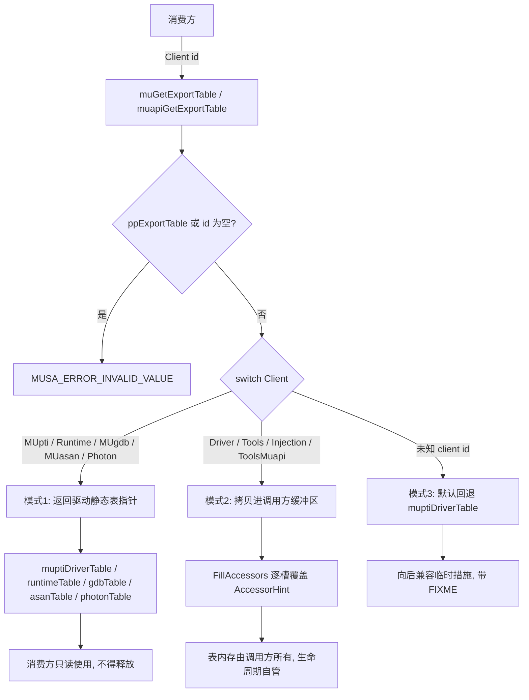
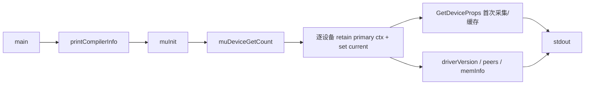
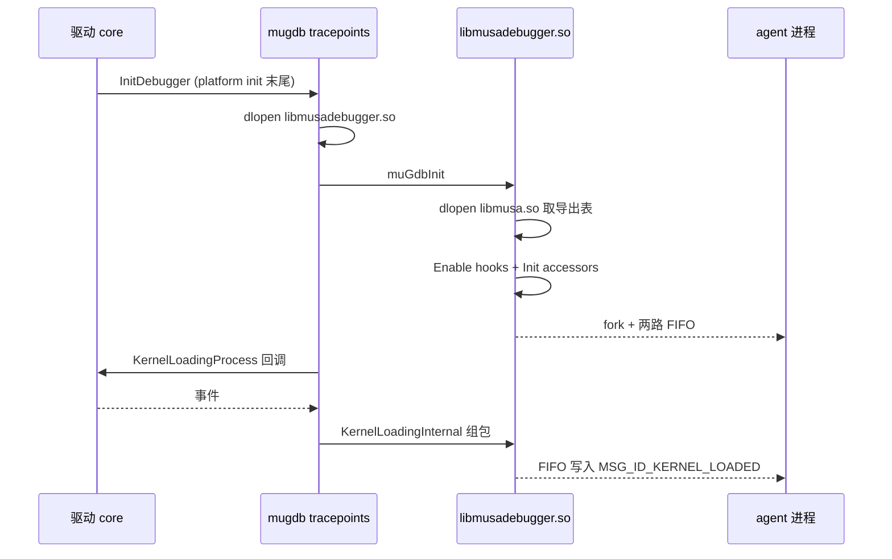
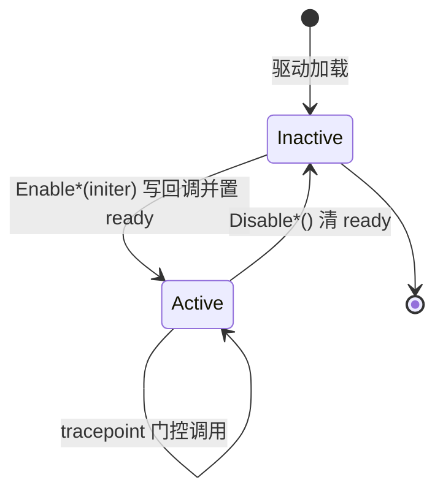

# 工具与调试接口：图示

- 文档目的：tools debug：核心关系与流程图示，及节点到源码的映射。
- 适用范围：M10 模块的《工具与调试接口：图示》；源码根 `source/musa`。
- 对应源码版本：5.3.0 develop（本地快照 `source/musa`，无 Git 元数据）
- 证据状态：已确认（引用与符号已脚本核对；运行期未验证）
- 最后更新：2026-10-07
- 前置阅读：[`README.md`](README.md)、[`../module-registry.md`](../module-registry.md)
- 后续阅读：[`design.md`](design.md)、[`risks-and-debt.md`](risks-and-debt.md)

## ExportTable 分发图（三种模式）

证据：分发 switch [src/driver/mu_entry.cpp:2164-2304]、参数校验 [src/driver/mu_entry.cpp:2160-2161]、`FillAccessors` [src/driver/mu_entry.cpp:2146-2155]、默认回退 [src/driver/mu_entry.cpp:2300-2303]。

## `muInfo` 查询流

证据：`main` [src/tools/muInfo.cpp:372-388]、`GetDeviceProps` 缓存 [src/tools/muInfo.cpp:119-274]。

## GDB 双向接入流

证据：`InitDebugger` [src/driver/mugdb/tracepoints.cpp:53-79]、`MusaGdb::Init` [src/gdb/musaGdb.cpp:80-136]、`KernelLoadingInternal` [src/gdb/interface.cpp:155-258]。

## 生命周期图：hook 存储

状态名是跨模块抽象，不能替代源码中具体枚举；实际 `ready` 原子标志与回调表见 [`data-structures.md`](data-structures.md)。

## 相关文档

- [`README.md`](README.md)
- [`design.md`](design.md)
- [`call-chains.md`](call-chains.md)
- [`implementation.md`](implementation.md)
- [`risks-and-debt.md`](risks-and-debt.md)

## 源码证据摘要

- `src/driver/mu_entry.cpp`（4 处，例：[src/driver/mu_entry.cpp:2164-2304]）
- `src/tools/muInfo.cpp`（2 处，例：[src/tools/muInfo.cpp:372-388]）
- `src/driver/mugdb/tracepoints.cpp`（1 处，例：[src/driver/mugdb/tracepoints.cpp:53-79]）

## 未解决问题

1. 本文所有结论均为静态分析，未在授权硬件上执行构建、测试或运行验证。
2. 本文未单列的风险条目见 [`risks-and-debt.md`](risks-and-debt.md)。

## 下一步阅读建议

阅读 [`design.md`](design.md)；阅读 [`risks-and-debt.md`](risks-and-debt.md)。
