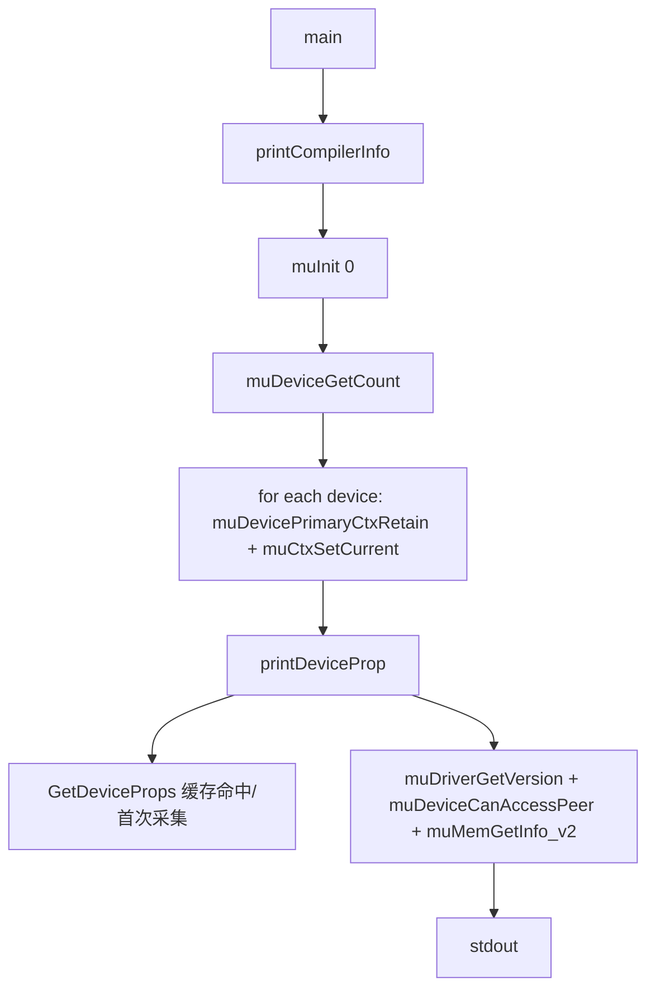
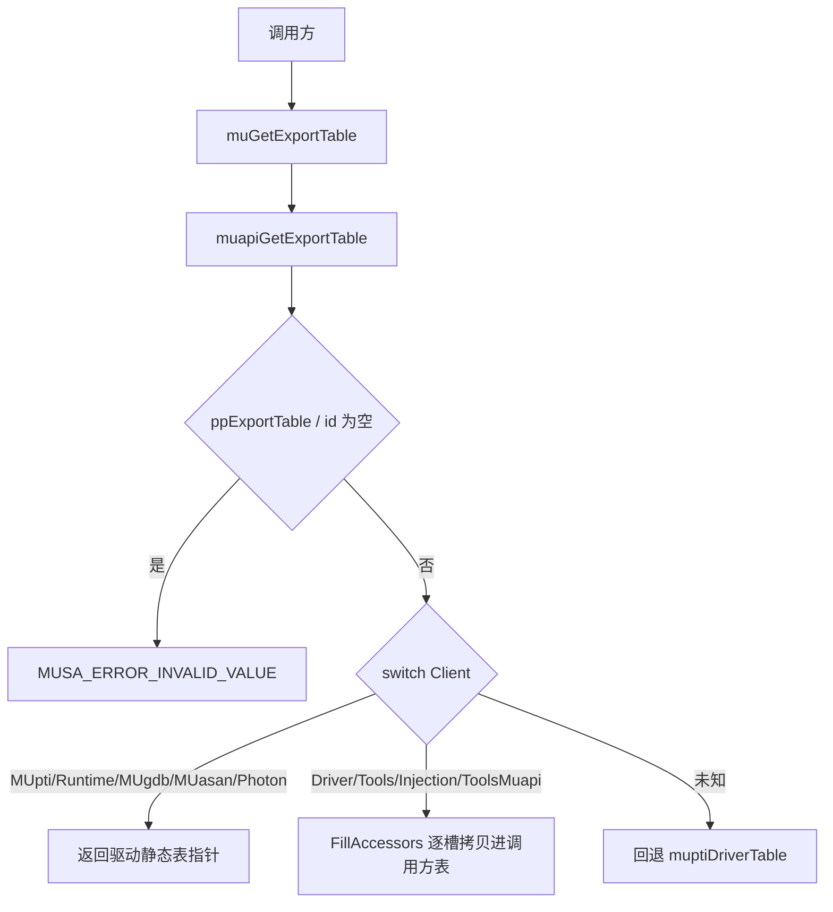

# 工具与调试接口：执行流

- 文档目的：tools debug：关键执行轨迹的分步记录与失败点索引。
- 适用范围：M10 模块的《工具与调试接口：执行流》；源码根 `source/musa`。
- 对应源码版本：5.3.0 develop（本地快照 `source/musa`，无 Git 元数据）
- 证据状态：已确认（引用与符号已脚本核对；运行期未验证）
- 最后更新：2026-10-07
- 前置阅读：[`README.md`](README.md)、[`../module-registry.md`](../module-registry.md)
- 后续阅读：[`design.md`](design.md)、[`risks-and-debt.md`](risks-and-debt.md)

## 主流程：`muInfo` 设备查询

`main` 入口 [src/tools/muInfo.cpp:372-388]，`GetDeviceProps` 局部静态缓存批量采集 [src/tools/muInfo.cpp:119-274]，`printDeviceProp` 输出与 peer/内存查询 [src/tools/muInfo.cpp:283-370]。

## 主流程：导出表分发

分发实现 [src/driver/mu_entry.cpp:2164-2304]，参数校验 [src/driver/mu_entry.cpp:2160-2161]，双路径包装（参数结构体/直调）见 [`call-chains.md`](call-chains.md)。

## 主流程：GDB 调试器接入

1. 驱动初始化末尾调用 `MUgdb::InitDebugger()` [src/musa/core/platform.cpp:130]。
2. `InitDebugger` 在 `muDebugFlag && !ready` 时 `dlopen("libmusadebugger.so")`，取 `muGdbInit` 符号并调用 [src/driver/mugdb/tracepoints.cpp:53-79]。
3. GDB 侧 `muGdbInit` 转发到 `MusaGdb::Init` [src/gdb/interface.cpp:76-78]：`dlopen("libmusa.so")` 取表 → `Enable(InitGdbDriverHooks)` + `InitGdbDriverAccessors` → 创建两路 FIFO → `fork` agent [src/gdb/musaGdb.cpp:80-136]。
4. kernel 生命周期回调：驱动侧 `KernelLoadingProcess` [src/driver/mugdb/tracepoints.cpp:208-239] / `KernelFinishedProcess` [src/driver/mugdb/tracepoints.cpp:241-265] → GDB 侧 `KernelLoadingInternal` 组包、dump code object、写 FIFO [src/gdb/interface.cpp:155-258]。

## 主流程：MUPTI / MUASAN tracepoint

`src/musa/core` 在执行命令时经 `tracepoints.h` 内联函数进入观测点：

- memcpy：`MUpti::EnterMemcpyV2` [src/musa/core/command/memcpyCommand.cpp:58]。
- memset：`MUpti::EnterMemset` [src/musa/core/command/memsetCommand.cpp:22]。
- kernel dispatch：`MUpti::RegisterKernelV2`/`RegisterKernel` [src/musa/core/command/dispatchCommand.cpp:29]、`MUgdb::KernelLoadingProcess` [src/musa/core/command/dispatchCommand.cpp:321]、`MUasan::KernelLoadingProcess` [src/musa/core/command/dispatchCommand.cpp:325]。
- kernel 结束：`MUgdb::KernelFinishedProcess` [src/musa/core/command/dispatchCommand.cpp:1268]、`MUasan::KernelFinishedProcess` [src/musa/core/command/dispatchCommand.cpp:1270]。
- stream 排队：`MUpti::MarkKernelQueued` [src/musa/core/stream.cpp:1093]。

## 同步与异步

`muInfo` 全同步：`muInit` [src/tools/muInfo.cpp:375]、primary ctx retain/set current [src/tools/muInfo.cpp:380-384]、`muDriverGetVersion` [src/tools/muInfo.cpp:297-300] 都在调用线程内返回；无异步等待。GDB trap 场景则是独立 `Monitor` 线程轮询 exchange buffer，等 `BPH_COMM_STATE_TRAP_ENTER` 后 `raise(SIGINT)` 通知 gdb 前端 [src/driver/mugdb/tracepoints.cpp:129-171]。MUPTI/MUASAN 回调同步嵌入命令执行路径。

## 清理流

- GDB：`CloseDebugger` 卸载 `libmusadebugger.so`、join monitor 线程、释放 shader/exchange 内部内存 [src/driver/mugdb/tracepoints.cpp:85-103]；`MusaGdb` 析构发送 `MSG_ID_PROCESS_TERMINATE`、`waitpid`、关闭并删除 FIFO [src/gdb/musaGdb.cpp:30-56]。
- MUPTI/MUASAN：无显式析构路径；`DisableMUptiDriver`/`DisableMUasanDriver` 仅清 `ready` 标志 [src/driver/mupti/hooks.cpp:14-16]、[src/driver/muasan/hooks.cpp:14-16]。

## 观测点

建议记录 API 序号、对象 ID、stream、command 类型、correlationId、queued/submitted/completed 时间戳。GDB 侧已在 `KernelLoadingInternal` 里采集这些字段并经 FIFO 上报 [src/gdb/interface.cpp:155-258]。

## 相关文档

- [`README.md`](README.md)
- [`design.md`](design.md)
- [`call-chains.md`](call-chains.md)
- [`implementation.md`](implementation.md)
- [`risks-and-debt.md`](risks-and-debt.md)

## 源码证据摘要

- `src/tools/muInfo.cpp`（6 处，例：[src/tools/muInfo.cpp:372-388]）
- `src/driver/mugdb/tracepoints.cpp`（5 处，例：[src/driver/mugdb/tracepoints.cpp:53-79]）
- `src/musa/core/command/dispatchCommand.cpp`（5 处，例：[src/musa/core/command/dispatchCommand.cpp:29]）

## 未解决问题

1. 本文所有结论均为静态分析，未在授权硬件上执行构建、测试或运行验证。
2. 本文未单列的风险条目见 [`risks-and-debt.md`](risks-and-debt.md)。

## 下一步阅读建议

阅读 [`design.md`](design.md)；阅读 [`risks-and-debt.md`](risks-and-debt.md)。
