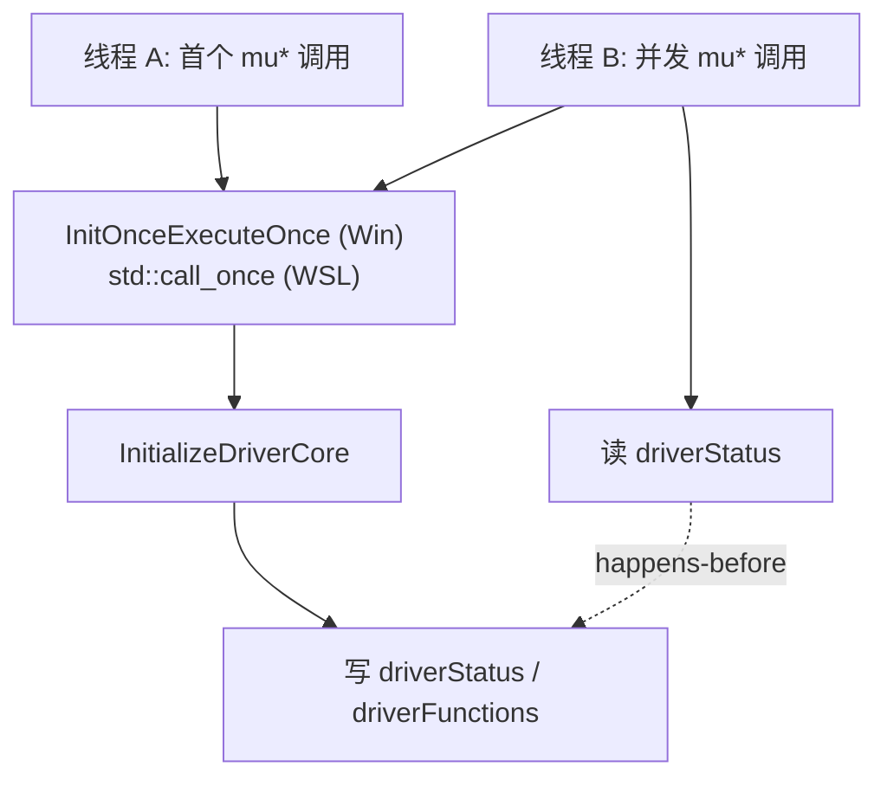

# Loader 薄加载层：数据结构与线程模型

- 文档目的：loader：核心数据结构、字段含义与持有关系。
- 适用范围：M11 模块的《Loader 薄加载层：数据结构与线程模型》；源码根 `source/musa`。
- 对应源码版本：5.3.0 develop（本地快照 `source/musa`，无 Git 元数据）
- 证据状态：已确认（引用与符号已脚本核对；运行期未验证）
- 最后更新：2026-10-07
- 前置阅读：[`README.md`](README.md)、[`../module-registry.md`](../module-registry.md)
- 后续阅读：[`risks-and-debt.md`](risks-and-debt.md)

## `DriverLocation`

| 字段 | 类型 | 含义 | 证据 |
|---|---|---|---|
| `packageId` | `std::string` | 驱动包 ID，用于比对 | [src/loader/driver_resolver.h:11] |
| `driverPath` | `fs::path` | **未解析**路径，实际 `dlopen` 目标 | [src/loader/driver_resolver.h:12] |
| `resolvedDriverPath` | `fs::path` | `fs::canonical` 结果 | [src/loader/driver_resolver.h:13] |

关键语义差异：`driverPath` 在 [src/loader/driver_resolver.cpp:369] 写入并被 loader 加载；`resolvedDriverPath` 在 [src/loader/driver_resolver.cpp:361] 计算，但**只被 `probe.cpp` 使用**（[src/loader/probe.cpp:17]、[src/loader/probe.cpp:33]），loader 主路径完全不读它。

## `PlatformThunks`

| 访问 | 字段 | 证据 |
|---|---|---|
| public | `enumAdapters2` | [src/loader/driver_resolver.cpp:84] |
| public | `queryAdapterInfo` | [src/loader/driver_resolver.cpp:85] |
| public | `closeAdapter` | [src/loader/driver_resolver.cpp:86] |
| private | `module_`（`Util::Library`） | [src/loader/driver_resolver.cpp:93] |

- 栈对象，位于 `ResolveDriverLocation` 作用域 [src/loader/driver_resolver.cpp:301-312]。
- 非拷贝 [src/loader/driver_resolver.cpp:66-67]。
- **函数指针指向 `module_` 内部**，因此 `thunks` 不能比 `module_` 活得久。声明顺序保证了这一点：`thunks` 在函数体开头先声明，`adapters` 在其后声明，故析构时 `adapters` 先于 `thunks` 销毁。

## `AdapterCollection`

| 访问 | 字段 | 证据 |
|---|---|---|
| public | `adapters`（`std::vector<D3DKMT_ADAPTERINFO>`） | [src/loader/driver_resolver.cpp:119] |
| private | `closeAdapter_` | [src/loader/driver_resolver.cpp:122] |

- 栈对象，声明位置在 `thunks` 之后。
- RAII：`~AdapterCollection()` 调 `Reset()` [src/loader/driver_resolver.cpp:104]，`Reset()` 关闭所有非零 `hAdapter` 并清零 [src/loader/driver_resolver.cpp:106-117]。

## `QueryAdapterGfxInfo`

`header`（`MT_QUERYADAPTERINFO_BLOCKHDR`）+ `data`（`MT_QUERYADAPTERINFODATA`）[src/loader/driver_resolver.cpp:38-41]，栈对象并零初始化 [src/loader/driver_resolver.cpp:208]，后端是内核查询缓冲区。

## `DriverFunctions` 与 `DriverDebuggerData`

| 类型 | 位置 | 内容 |
|---|---|---|
| `DriverFunctions` | [src/loader/loader.cpp:118-125] | 567（Windows 570）个函数指针，全部 public，由 [src/loader/loader.cpp:119] 宏展开生成 |
| `DriverDebuggerData` | [src/loader/loader.cpp:127-131] | `bool* debugFlag`、`uint32_t* gdbPid`、`uint32_t* gdbSessionId`，**指向驱动模块内存的裸指针** |
| `driverFunctions` | [src/loader/loader.cpp:135] | 唯一全局实例 |
| `driverDebuggerData` | [src/loader/loader.cpp:136] | 唯一全局实例 |

## 匿名命名空间全局量

| 变量 | 类型 | 证据 |
|---|---|---|
| `driverModule` | `Util::Library::NativeHandle` | [src/loader/loader.cpp:44] |
| `driverStatus` | `MUresult` | [src/loader/loader.cpp:45] |
| `driverInitialization`（Win） | `INIT_ONCE`，`INIT_ONCE_STATIC_INIT` | [src/loader/loader.cpp:84] |
| `driverInitialization`（WSL） | `std::once_flag` | [src/loader/loader.cpp:92] |

## 一次性初始化与 happens-before

- 回调 `InitializeDriver` 恒返回 `TRUE` [src/loader/loader.cpp:89]，失败信息通过 `driverStatus` 传递。
- WSL 分支用 `try/catch` 包裹 `std::call_once` [src/loader/loader.cpp:106-111]，但 `InitializeDriverCore` 声明为 `noexcept` [src/loader/loader.cpp:58]，**该 catch 实际不可达**。
- `driverStatus` 是**非原子**全局 [src/loader/loader.cpp:45]，被每次调用的 `EnsureInitialized` 读取 [src/loader/loader.cpp:104]、[src/loader/loader.cpp:108]。其安全性完全依赖 once-init 提供的 happens-before 边。
- `driverModule` 被写入 [src/loader/loader.cpp:78] 但**全仓库无任何读取点**，作用是让句柄不被释放，注释已说明 [src/loader/loader.cpp:77]。

## 相关文档

- [`README.md`](README.md)
- [`call-chains.md`](call-chains.md)
- [`implementation.md`](implementation.md)
- [`risks-and-debt.md`](risks-and-debt.md)
- [`../module-registry.md`](../module-registry.md)

## 源码证据摘要

- `src/loader/loader.cpp`（17 处，例：[src/loader/loader.cpp:118-125]）
- `src/loader/driver_resolver.cpp`（14 处，例：[src/loader/driver_resolver.cpp:369]）
- `src/loader/driver_resolver.h`（3 处，例：[src/loader/driver_resolver.h:11]）

## 未解决问题

1. 本文所有结论均为静态分析，未在授权硬件上执行构建、测试或运行验证。
2. 本文未单列的风险条目见 [`risks-and-debt.md`](risks-and-debt.md)。

## 下一步阅读建议

阅读 [`risks-and-debt.md`](risks-and-debt.md)。
