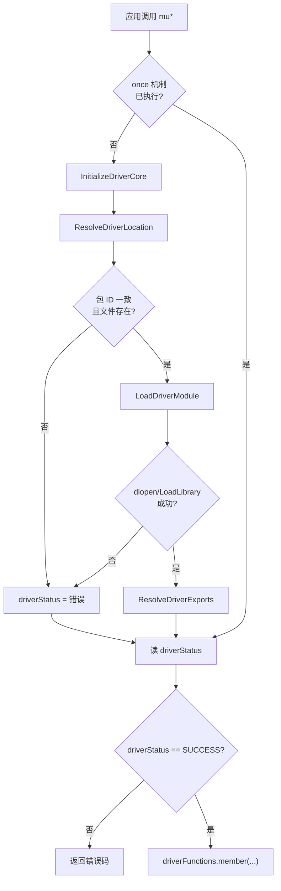
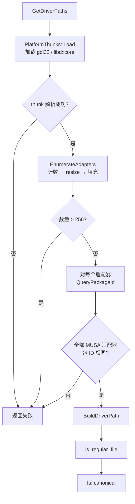

# Loader 薄加载层：执行流程

- 文档目的：loader：关键执行轨迹的分步记录与失败点索引。
- 适用范围：M11 模块的《Loader 薄加载层：执行流程》；源码根 `source/musa`。
- 对应源码版本：5.3.0 develop（本地快照 `source/musa`，无 Git 元数据）
- 证据状态：已确认（引用与符号已脚本核对；运行期未验证）
- 最后更新：2026-10-07
- 前置阅读：[`README.md`](README.md)、[`../module-registry.md`](../module-registry.md)
- 后续阅读：[`risks-and-debt.md`](risks-and-debt.md)

## 正常流程

## 定位子流程

## 失败分支汇总

| 失败点 | 返回码 | 证据 |
|---|---|---|
| thunk 加载或符号解析失败 | 折叠为单个失败原因 | [src/loader/driver_resolver.cpp:78] |
| 适配器数量超限 | `MUSA_ERROR_SYSTEM_DRIVER_MISMATCH` | [src/loader/driver_resolver.cpp:141] |
| 包 ID 不一致 | `MUSA_ERROR_SYSTEM_DRIVER_MISMATCH` | [src/loader/driver_resolver.cpp:342] |
| 驱动文件不存在 | 传播文件系统错误码 | [src/loader/driver_resolver.cpp:356-357] |
| `std::bad_alloc` | `MUSA_ERROR_OUT_OF_MEMORY` | [src/loader/driver_resolver.cpp:374] |
| 其他异常 | `MUSA_ERROR_UNKNOWN` | [src/loader/driver_resolver.cpp:376] |
| `dlopen` 失败 | `MUSA_ERROR_SHARED_OBJECT_INIT_FAILED` | [src/loader/loader.cpp:67-71] |
| 符号未找到（惰性） | `MUSA_ERROR_SHARED_OBJECT_SYMBOL_NOT_FOUND` | [src/loader/loader.cpp:197] |
| 非 MUSA 适配器 | **静默跳过**，`result` 保持 SUCCESS | [src/loader/driver_resolver.cpp:220]、[src/loader/driver_resolver.cpp:247] |

最后一行是行为上最需要注意的一处：真正损坏的 MUSA 适配器与"不是我的硬件"在返回值上不可区分，注释 [src/loader/driver_resolver.cpp:219] 记录了这一设计意图。

## 清理流程

Loader 本身不持有需要清理的资源。`~AdapterCollection` [src/loader/driver_resolver.cpp:104] 通过 `Reset()` 关闭所有非零句柄；`PlatformThunks::module_` 由 `Util::Library` 析构函数 RAII 卸载 [src/util/utilLibrary.h:146]。

`driverModule` 被刻意持有到进程结束 [src/loader/loader.cpp:77-78]，因为所有包装函数和导出表都保存了指向该模块的指针。

## 未验证项

- Windows 与 WSL 两条路径的实际 `DriverStore` 布局和包 ID 一致性。
- `InitOnceExecuteOnce` 回调恒返回 `TRUE` 时失败状态传播的正确性（依赖 `driverStatus`，无实测）。
- 570 个导出符号与 `libmusa.so` 实际导出集合是否严格一致（无符号表 diff）。

## 相关文档

- [`README.md`](README.md)
- [`call-chains.md`](call-chains.md)
- [`implementation.md`](implementation.md)
- [`risks-and-debt.md`](risks-and-debt.md)
- [`../module-registry.md`](../module-registry.md)

## 源码证据摘要

- `src/loader/driver_resolver.cpp`（10 处，例：[src/loader/driver_resolver.cpp:78]）
- `src/loader/loader.cpp`（3 处，例：[src/loader/loader.cpp:67-71]）
- `src/util/utilLibrary.h`（1 处，例：[src/util/utilLibrary.h:146]）

## 未解决问题

1. 本文所有结论均为静态分析，未在授权硬件上执行构建、测试或运行验证。
2. 本文未单列的风险条目见 [`risks-and-debt.md`](risks-and-debt.md)。

## 下一步阅读建议

阅读 [`risks-and-debt.md`](risks-and-debt.md)。
