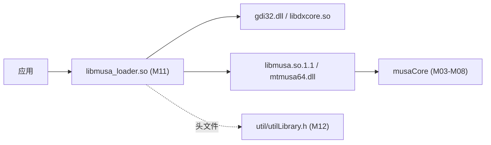

# Loader 薄加载层：源码地图

- 文档目的：loader：源码文件/目录到文档章节的映射。
- 适用范围：M11 模块的《Loader 薄加载层：源码地图》；源码根 `source/musa`。
- 对应源码版本：5.3.0 develop（本地快照 `source/musa`，无 Git 元数据）
- 证据状态：部分推断（引用较少，证据密度不足）
- 最后更新：2026-10-07
- 前置阅读：[`README.md`](README.md)、[`../module-registry.md`](../module-registry.md)
- 后续阅读：[`risks-and-debt.md`](risks-and-debt.md)


| 文件 | 行数 | 关注点 |
|---|---|---|
| `src/loader/CMakeLists.txt` | 93 | 三个目标、门禁条件、导出符号接入、`probe` 目标被注释 |
| `src/loader/loader.cpp` | 220 | 一次性初始化、驱动加载、符号解析、570 个 `extern "C"` 转发 |
| `src/loader/loader.h` | 9 | 仅声明 `Musa::MiniLoader::EnsureInitialized()` |
| `src/loader/driver_resolver.cpp` | 382 | 平台 thunk、适配器枚举、包 ID 查询与比对、路径构造 |
| `src/loader/driver_resolver.h` | 18 | `DriverLocation` 结构与 `ResolveDriverLocation` 声明 |
| `src/loader/loader_api_list.inc` | 568 | 567 条 `MUSA_LOADER_API` 宏，唯一真实导出清单 |
| `src/loader/windows_api_list.inc` | 3 | 3 条 Windows 独有 D3D11 导出 |
| `src/loader/probe.cpp` | 39 | 诊断可执行文件，**当前不参与构建** |
| `src/loader/README.md` | — | 上游说明，含安装步骤与 probe 限制声明 |
| `cmake/export_symbols.cmake` | — | 消费上述两个 `.inc` 生成 `.def` / version script |

## 依赖方向



Loader 通过 `dlopen` 在运行期加载完整驱动，因此**不存在编译期链接依赖**；它对 `util` 的依赖是纯头文件包含。

## 证据锚点

[src/loader/CMakeLists.txt:12] [src/loader/CMakeLists.txt:51-67] [src/loader/loader.cpp:119-123] [src/loader/loader_api_list.inc:566-568]

## 搜索建议

```bash
rg -n "MUSA_LOADER_API" src/loader cmake/export_symbols.cmake
rg -n "getenv|MUSA_" src/loader
```

上述命令是阅读建议，不代表已在本地或远端执行。

## 相关文档

- [`README.md`](README.md)
- [`call-chains.md`](call-chains.md)
- [`implementation.md`](implementation.md)
- [`risks-and-debt.md`](risks-and-debt.md)
- [`../module-registry.md`](../module-registry.md)

## 源码证据摘要

- `src/loader/CMakeLists.txt`（2 处，例：[src/loader/CMakeLists.txt:12]）
- `src/loader/loader.cpp`（1 处，例：[src/loader/loader.cpp:119-123]）
- `src/loader/loader_api_list.inc`（1 处，例：[src/loader/loader_api_list.inc:566-568]）

## 未解决问题

1. 本文所有结论均为静态分析，未在授权硬件上执行构建、测试或运行验证。
2. 本文未单列的风险条目见 [`risks-and-debt.md`](risks-and-debt.md)。

## 下一步阅读建议

阅读 [`risks-and-debt.md`](risks-and-debt.md)。
