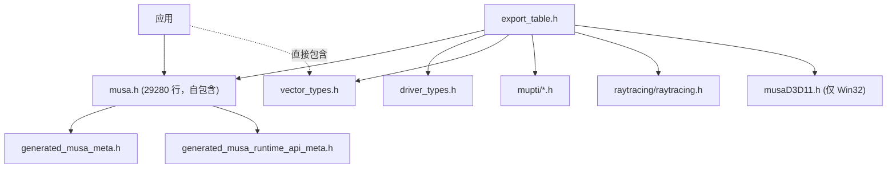

# 公共 API 头文件层：源码地图

- 文档目的：musa shared include：源码文件/目录到文档章节的映射。
- 适用范围：M13 模块的《公共 API 头文件层：源码地图》；源码根 `source/musa`。
- 对应源码版本：5.3.0 develop（本地快照 `source/musa`，无 Git 元数据）
- 证据状态：已确认（引用与符号已脚本核对；运行期未验证）
- 最后更新：2026-10-07
- 前置阅读：[`README.md`](README.md)、[`../module-registry.md`](../module-registry.md)
- 后续阅读：[`risks-and-debt.md`](risks-and-debt.md)


| 文件/目录 | 行数 | 内容 |
|---|---|---|
| `musa.h` | 29280 | **公共 API 单体头**：类型、宏、全部函数原型 |
| `driver_types.h` | 4713 | driver 侧结构体与附加类型 |
| `export_table.h` | 1964 | 11 个命名空间下的 accessor 结构与 8 个 `ExportTable` |
| `vector_types.h` | — | 向量类型（`char1`..`float4` 等），[src/musa_shared_include/vector_types.h:316] 起 |
| `generated_musa_meta.h` | 4038 | 657 个 `*_params_st` 参数结构（driver API） |
| `generated_musa_runtime_api_meta.h` | 2845 | 446 个 `*_params_st` 参数结构（runtime API） |
| `musaD3D11.h` | 308 | Windows D3D11 互操作 |
| `raytracing/raytracing.h` | 220 | 光线追踪 API |
| `vdpau/vdpau.h` | 4987 | VDPAU 视频互操作（本目录最大文件） |
| `mupti/mupti_driver_cbid.h` | 846 | MUPTI driver 回调 ID |
| `mupti/mupti_runtime_cbid.h` | 572 | MUPTI runtime 回调 ID |
| `mugdb/bphandler.h` | 38 | GDB 断点处理器 |
| `mugdb/pack.h` | 11 | GDB 打包辅助 |
| `mugdb/protocol.h` | 106 | GDB 通信协议 |
| `crt/host_defines.h` | 236 | device 端 host 宏 |
| `ogl/GL/gl.h` 等 7 个文件 | — | OpenGL/GLX/WGL/glew 兼容头 |
| `ogl/KHR/khrplatform.h` | — | Khronos 平台类型 |

## 头文件聚合关系



`musa.h` 本身**不包含任何其他头文件**（仅 `<stdlib.h>` [src/musa_shared_include/musa.h:9] 与 `<stdint.h>` [src/musa_shared_include/musa.h:14]），是自包含的单体头。生成文件则 `#include "musa.h"`（[src/musa_shared_include/generated_musa_meta.h:6]）。

## 生成文件标记

[src/musa_shared_include/generated_musa_meta.h:1]：

```
// This file is generated.  Any changes you make will be lost during the next clean build.
```

因此**不应手工编辑**这两个文件。

## 证据锚点

[src/musa_shared_include/generated_musa_meta.h:1-6] [src/musa_shared_include/musa.h:5639-5650] [src/musa_shared_include/export_table.h:1-22]

## 搜索建议

```bash
rg -n "^MUresult MUSAAPI mu" src/musa_shared_include/musa.h
rg -n "__MUSA_DEPRECATED" src/musa_shared_include/musa.h
```

上述命令是阅读建议，不代表已在本地或远端执行。

## 相关文档

- [`README.md`](README.md)
- [`risks-and-debt.md`](risks-and-debt.md)
- [`../module-registry.md`](../module-registry.md)

## 源码证据摘要

- `src/musa_shared_include/musa.h`（3 处，例：[src/musa_shared_include/musa.h:9]）
- `src/musa_shared_include/generated_musa_meta.h`（3 处，例：[src/musa_shared_include/generated_musa_meta.h:6]）
- `src/musa_shared_include/vector_types.h`（1 处，例：[src/musa_shared_include/vector_types.h:316]）

## 未解决问题

1. 本文所有结论均为静态分析，未在授权硬件上执行构建、测试或运行验证。
2. 本文未单列的风险条目见 [`risks-and-debt.md`](risks-and-debt.md)。

## 下一步阅读建议

阅读 [`risks-and-debt.md`](risks-and-debt.md)。
