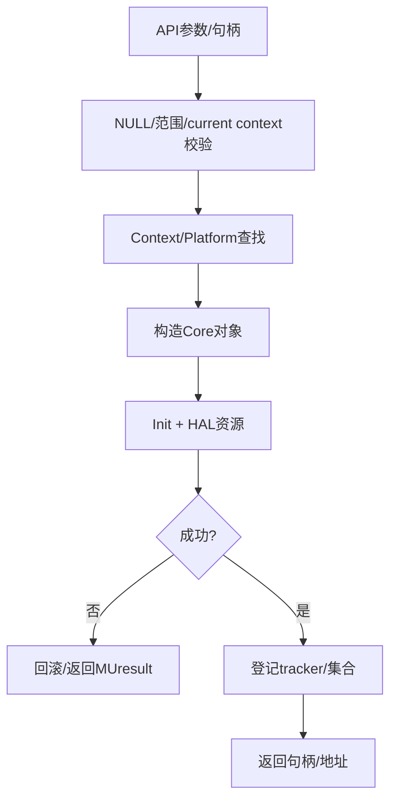

# 端到端流程

- 文档目的：端到端流程：从入口到副作用的完整轨迹。
- 适用范围：90-cross-module《端到端流程》；源码根 `source/musa`。
- 对应源码版本：5.3.0 develop（本地快照 `source/musa`，无 Git 元数据）
- 证据状态：已确认（引用与符号已脚本核对；运行期未验证）
- 最后更新：2026-10-08
- 前置阅读：[`../01-modules/module-registry.md`](../01-modules/module-registry.md)、[`system-wiring.md`](system-wiring.md)
- 后续阅读：[`interface-contracts.md`](interface-contracts.md)、[`../99-roadmap/risk-register.md`](../99-roadmap/risk-register.md)


## 资源创建通用模板



## 异步工作模板

```text
规范化参数 -> 选择 stream -> 创建 Command/GraphNode
 -> 记录依赖 -> QueueCommand -> AsyncSubmit
 -> HAL queue/cmd buffer -> wait/query -> 完成/错误
```

## 释放模板

```text
查找地址/句柄 -> 检查类型和所属 context -> 同步或排队释放
 -> 从 tracker/Context 删除 -> HAL free/destroy
```

内存释放的类型条件和 virtual 特殊路径可见 [src/driver/mu_memory.cpp:716-747]；Stream 的线程停止和资源释放可见 [src/musa/core/stream.cpp:849-908]。

## 已核对的链锚点（抽样）

下面每一格都落到可逐行核对的区间，对应 [`cross-module-call-chains.md`](cross-module-call-chains.md) 中同名链；运行期是否真的走到这些分支仍未验证。

| 链 | 阶段 | 行级锚点 | 该阶段可见的判断 |
|---|---|---|---|
| INIT-001 | API 入口 | [src/driver/mu_context.cpp:121-133] `muapiInit` | flags 非 0 直接置 `MUSA_ERROR_INVALID_VALUE`，否则 `CreatePlatform` |
| INIT-001 | 平台初始化 | [src/musa/core/platform.cpp:84-138] `Platform::Init` | 创建 HAL platform、按可见设备列表生成 `Device` |
| MEM-001 | 分配入口 | [src/driver/mu_memory.cpp:271-304] `muapiMemAlloc_v2` | 校验 `dptr`/`bytesize`/当前 context 后 `CreateMemory` |
| MEM-001 | Core 登记 | [src/musa/core/context.cpp:1037-1086] `Context::CreateMemory` | `ValidateCreateInfo` → `Init` → 写锁内登记（peer 可见时先 `MapToPeers`） |
| MEM-001 | HAL 池分配 | [src/hal/m3d/memMgr.cpp:81-147] `MemMgr::Allocate` | size/alignment/显存上限三类校验后选池或建池 |
| KERNEL-001 | 启动入口 | [src/driver/mu_module.cpp:231-272] `muapiLaunchKernel` | 展开 grid/block/sharedMem 参数后转 `GeneralLaunchKernel` |
| KERNEL-001 | 流命令 | [src/musa/core/stream.cpp:1568-1582] `Stream::CmdLaunchKernel` | 取池化 dispatch command，再 `ResolveDependencyAndQueueCommand` 入队 |
| KERNEL-001 | 队列提交 | [src/hal/m3d/queue.cpp:178-355] `Queue::Submit` | HAL 提交边界；user queue + fence 组合在此判为错误 |
| GRAPH-001 | capture 入口 | [src/driver/mu_stream.cpp:391-421] `muapiStreamBeginCapture_v2` | 建空图并把目标流置为 capture 状态 |

## 模板与锚点的关系

上面三个模板（资源创建、异步工作、释放）描述的是跨模块共用的骨架；表格中的锚点是骨架在 INIT/MEM/KERNEL/GRAPH 四条链上的具体落点。骨架中"回滚/返回 MUresult"一列在 MEM-001 与 KERNEL-001 上分别对应 `Context::CreateMemory` 的 `status != MUSA_SUCCESS` 分支和 `Stream::CmdLaunchKernel` 的 `do/while(0)` 单次失败出口。

## 相关文档

- [`system-wiring.md`](system-wiring.md)
- [`interface-contracts.md`](interface-contracts.md)
- [`cross-module-call-chains.md`](cross-module-call-chains.md)
- [`../01-modules/module-registry.md`](../01-modules/module-registry.md)
- [`../99-roadmap/risk-register.md`](../99-roadmap/risk-register.md)

## 源码证据摘要

- `src/driver/mu_memory.cpp`（2 处，例：[src/driver/mu_memory.cpp:716-747] `muapiMemFree_v2`）
- `src/musa/core/stream.cpp`（2 处，例：[src/musa/core/stream.cpp:849-908] `Stream::~Stream`）
- `src/driver/mu_context.cpp`（1 处，例：[src/driver/mu_context.cpp:121-133] `muapiInit`）
- `src/musa/core/platform.cpp`（1 处，例：[src/musa/core/platform.cpp:84-138] `Platform::Init`）
- `src/musa/core/context.cpp`（1 处，例：[src/musa/core/context.cpp:1037-1086] `Context::CreateMemory`）
- `src/hal/m3d/memMgr.cpp`（1 处，例：[src/hal/m3d/memMgr.cpp:81-147] `MemMgr::Allocate`）
- `src/hal/m3d/queue.cpp`（1 处，例：[src/hal/m3d/queue.cpp:178-355] `Queue::Submit`）
- `src/driver/mu_module.cpp`（1 处，例：[src/driver/mu_module.cpp:231-272] `muapiLaunchKernel`）
- `src/driver/mu_stream.cpp`（1 处，例：[src/driver/mu_stream.cpp:391-421] `muapiStreamBeginCapture_v2`）

## 未解决问题

1. 本文所有结论均为静态分析，未在授权硬件上执行构建、测试或运行验证。
2. 本文未单列的风险条目见 [`../99-roadmap/risk-register.md`](../99-roadmap/risk-register.md)。

## 下一步阅读建议

阅读 [`interface-contracts.md`](interface-contracts.md)；阅读 [`../99-roadmap/risk-register.md`](../99-roadmap/risk-register.md)。
